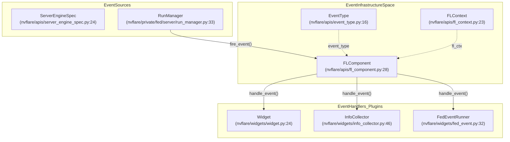
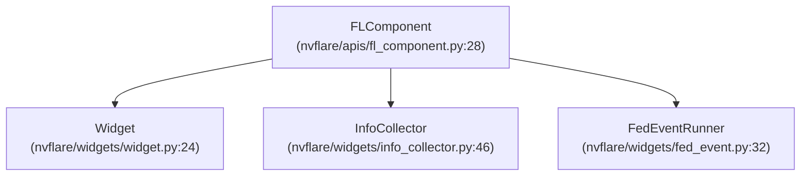
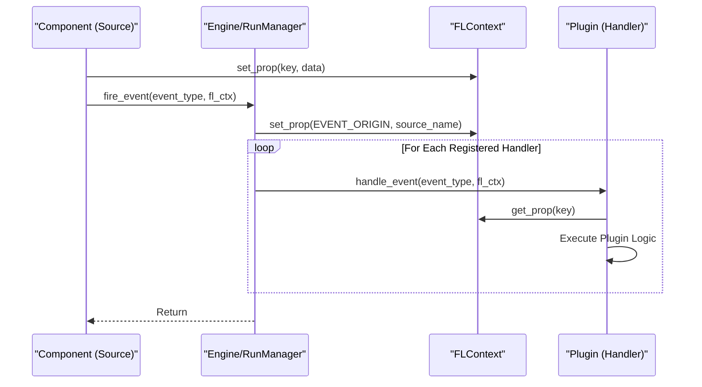

<!-- source: DeepWiki mcp.deepwiki.com · repo NVIDIA/NVFlare · page 3.6 Event System and Plugins · fetched 2026-10-26 -->

# Event System and Plugins

<details>
<summary>Relevant source files</summary>

The following files were used as context for generating this wiki page:

- [nvflare/_version.py](nvflare/_version.py)
- [nvflare/apis/event_type.py](nvflare/apis/event_type.py)
- [nvflare/apis/fl_component.py](nvflare/apis/fl_component.py)
- [nvflare/apis/utils/fl_context_utils.py](nvflare/apis/utils/fl_context_utils.py)
- [nvflare/fuel/f3/cellnet/cell.py](nvflare/fuel/f3/cellnet/cell.py)
- [nvflare/fuel/f3/cellnet/net_manager.py](nvflare/fuel/f3/cellnet/net_manager.py)
- [nvflare/fuel/f3/qat/cell_runner.py](nvflare/fuel/f3/qat/cell_runner.py)
- [nvflare/fuel/f3/qat/stats_viewer.py](nvflare/fuel/f3/qat/stats_viewer.py)
- [nvflare/fuel/f3/qat/time_comm.py](nvflare/fuel/f3/qat/time_comm.py)
- [nvflare/fuel/f3/stats_pool.py](nvflare/fuel/f3/stats_pool.py)
- [nvflare/fuel/hci/reg.py](nvflare/fuel/hci/reg.py)
- [nvflare/fuel/hci/server/builtin.py](nvflare/fuel/hci/server/builtin.py)
- [nvflare/private/defs.py](nvflare/private/defs.py)
- [nvflare/private/event.py](nvflare/private/event.py)
- [nvflare/private/fed/client/client_req_processors.py](nvflare/private/fed/client/client_req_processors.py)
- [nvflare/private/fed/client/sys_cmd.py](nvflare/private/fed/client/sys_cmd.py)
- [nvflare/private/fed/server/cmd_utils.py](nvflare/private/fed/server/cmd_utils.py)
- [nvflare/private/fed/server/info_coll_cmd.py](nvflare/private/fed/server/info_coll_cmd.py)
- [nvflare/private/fed/server/run_manager.py](nvflare/private/fed/server/run_manager.py)
- [nvflare/private/fed/server/server_engine_internal_spec.py](nvflare/private/fed/server/server_engine_internal_spec.py)
- [nvflare/private/fed/server/sys_cmd.py](nvflare/private/fed/server/sys_cmd.py)
- [nvflare/private/fed/server/training_cmds.py](nvflare/private/fed/server/training_cmds.py)
- [nvflare/security/security.py](nvflare/security/security.py)
- [nvflare/utils/process_utils.py](nvflare/utils/process_utils.py)
- [nvflare/widgets/fed_event.py](nvflare/widgets/fed_event.py)
- [nvflare/widgets/info_collector.py](nvflare/widgets/info_collector.py)
- [tests/unit_test/widgets/fed_event_test.py](tests/unit_test/widgets/fed_event_test.py)

</details>


## Purpose and Scope

This document describes NVIDIA FLARE's event-driven plugin architecture, which allows components to hook into workflow execution at specific lifecycle points. The event system enables extensibility without modifying core code, supporting custom logic for monitoring, validation, filtering, and cross-cutting concerns. All major functional blocks in NVFLARE, including executors, controllers, responders, filters, aggregators, and widgets, are built upon the `FLComponent` interface to participate in this event ecosystem.

## Event System Architecture

NVIDIA FLARE uses an event-driven architecture where components register as event handlers and respond to events fired during federated learning execution. This decouples workflow logic from cross-cutting concerns like monitoring, privacy filters, and custom validation.

### Core Components

The following diagram maps the logical event infrastructure to specific code entities within the NVFLARE codebase.

**Event Infrastructure Mapping**



Sources:
[nvflare/apis/fl_component.py:28-40]()
[nvflare/apis/event_type.py:16-100]()
[nvflare/widgets/fed_event.py:32-53]()
[nvflare/widgets/info_collector.py:46-65]()
[nvflare/private/fed/server/run_manager.py:33-43]()

### Event Flow Pattern

Events flow from sources to handlers through a registration and dispatch mechanism:

1.  **Registration Phase**: Components are added to a handlers list during engine initialization. `RunManager` maintains a list of handlers and components that inherit from `FLComponent` [nvflare/private/fed/server/run_manager.py:59-63]().
2.  **Execution Phase**: Event sources call `fire_event(event_type, fl_ctx)` on an `FLComponent` instance [nvflare/apis/fl_component.py:67-84]().
3.  **Dispatch Phase**: The `RunManager` or `ServerEngine` invokes the `fire_event` utility, which iterates through registered handlers and invokes their `handle_event(event_type, fl_ctx)` method [nvflare/private/fed/server/run_manager.py:103-104]().

Sources:
[nvflare/apis/fl_component.py:67-84]()
[nvflare/apis/fl_component.py:131-138]()
[nvflare/private/fed/server/run_manager.py:59-104]()

## Event Types and Categories

NVIDIA FLARE defines built-in system events in `nvflare.apis.event_type.EventType` [nvflare/apis/event_type.py:16]().

### System and Job Lifecycle Events

These events track the global state of the NVFLARE subsystem and specific job execution.

| Event Type | Purpose |
| :--- | :--- |
| `SYSTEM_START` | Fired when the server or client process starts [nvflare/apis/event_type.py:19]() |
| `SYSTEM_END` | Fired when the process is shutting down [nvflare/apis/event_type.py:20]() |
| `START_RUN` | Fired when a specific Job/Run starts execution [nvflare/apis/event_type.py:22]() |
| `END_RUN` | Fired when a specific Job/Run completes [nvflare/apis/event_type.py:24]() |
| `DEPLOY_JOB_TO_SERVER` | Fired before deploying an app to the server [nvflare/apis/event_type.py:71]() |
| `FATAL_SYSTEM_ERROR` | Fired when a `system_panic` is triggered [nvflare/apis/fl_component.py:121-129]() |
| `TASK_RESULT_RECEIVED` | Fired when a task result is received by the engine [nvflare/apis/event_type.py:95]() |
| `TASK_ASSIGNMENT_SENT` | Fired when a task assignment is sent to a client [nvflare/apis/event_type.py:96]() |
| `BEFORE_BUILD_COMPONENT`| Fired before building a component from config [nvflare/apis/event_type.py:91]() |
| `CLIENT_REGISTER_RECEIVED` | Fired when a client registration request is received [nvflare/apis/event_type.py:81]() |
| `CLIENT_DISCONNECTED` | Fired when a client connection is lost [nvflare/apis/event_type.py:37]() |

Sources:
[nvflare/apis/event_type.py:16-100]()
[nvflare/apis/fl_component.py:121-129]()

### Federated Events (Cross-Site)

Federated events allow one site to trigger event handlers on other sites (e.g., Server to Client). This is facilitated by the `fire_fed_event` method.

| Component | Role in Federated Events |
| :--- | :--- |
| `FLComponent.fire_fed_event` | Entry point to fire an event to remote targets [nvflare/apis/fl_component.py:96-119]() |
| `FedEventHeader.TARGETS` | Header used to specify destination sites for the event [nvflare/apis/fl_component.py:116]() |
| `FLContextKey.EVENT_SCOPE` | Key used in `FLContext` to indicate cross-site propagation [nvflare/apis/fl_component.py:118]() |
| `FedEventRunner` | Widget that handles the actual posting and receiving of fed events [nvflare/widgets/fed_event.py:32-53]() |

Sources:
[nvflare/apis/fl_component.py:96-119]()
[nvflare/widgets/fed_event.py:32-53]()

## Plugin Architecture: FLComponent

The `FLComponent` is the foundational base class for functional entities in NVIDIA FLARE [nvflare/apis/fl_component.py:28](). It provides built-in logging, event firing, and event handling capabilities.

### FLComponent Interface

```python
class FLComponent(StatePersistable):
    def fire_event(self, event_type: str, fl_ctx: FLContext):
        # Dispatches a local event via the Engine
        engine = fl_ctx.get_engine()
        if engine:
            engine.fire_event(event_type, fl_ctx)

    def handle_event(self, event_type: str, fl_ctx: FLContext):
        # Method for plugins to implement custom logic
        pass

    def log_info(self, fl_ctx: FLContext, msg: str, fire_event=False):
        # Unified logging that can also fire log-availability events
        ...
```

Sources: [nvflare/apis/fl_component.py:28-140]()

### Hierarchy of Plugins

Specialized components inherit from `FLComponent` to integrate into the runtime.

**Component Inheritance Hierarchy**



Sources:
[nvflare/apis/fl_component.py:28-36]()
[nvflare/widgets/fed_event.py:32]()
[nvflare/widgets/info_collector.py:46]()

## FLContext: The Event Data Carrier

`FLContext` [nvflare/apis/fl_context.py:23]() is the primary vehicle for sharing state between the event source and the handlers.

1.  **Property Injection**: Before firing an event, the source injects data into the `FLContext`. For example, `fire_event_with_data` sets a property and then fires the event [nvflare/apis/fl_component.py:86-94]().
2.  **Event Metadata**: The system sets `FLContextKey.EVENT_ORIGIN` to track which component fired the event [nvflare/apis/fl_component.py:60-61]().
3.  **Stickiness and Visibility**: Properties can be "sticky" (persisting across contexts) or "private" (not serializable for peer transfer) [nvflare/apis/fl_component.py:91-94]().
4.  **Serialization**: When contexts are transferred across sites, `get_serializable_data` filters out non-serializable keys by attempting a `fobs.dumps(v)` check [nvflare/apis/utils/fl_context_utils.py:30-41]().

Sources:
[nvflare/apis/fl_component.py:60-94]()
[nvflare/apis/utils/fl_context_utils.py:30-41]()

## Practical Plugin Examples

### InfoCollector Widget
The `InfoCollector` [nvflare/widgets/info_collector.py:46]() is a built-in `FLComponent` that demonstrates the event system's power for monitoring.
*   **Log Events**: It listens for `CRITICAL_LOG_AVAILABLE`, `ERROR_LOG_AVAILABLE`, `WARNING_LOG_AVAILABLE`, or `EXCEPTION_LOG_AVAILABLE` [nvflare/widgets/info_collector.py:72-77]().
*   **Aggregation**: It aggregates data from various components to provide a unified view of the system status via the `get_run_stats` method [nvflare/widgets/info_collector.py:119-143]().
*   **Admin Commands**: The `InfoCollectorCommandModule` exposes these collected stats to the admin console via commands like `show_stats` and `show_errors` [nvflare/private/fed/server/info_coll_cmd.py:48-62]().

Sources:
[nvflare/widgets/info_collector.py:46-143]()
[nvflare/private/fed/server/info_coll_cmd.py:48-72]()

### FedEventRunner
The `FedEventRunner` [nvflare/widgets/fed_event.py:32]() handles the propagation of events across the network:
*   **Outgoing**: It intercepts events with `EventScope.FEDERATION` and routes them to remote targets [nvflare/widgets/fed_event.py:83-103]().
*   **Incoming**: It registers an auxiliary message handler for `FED_EVENT_TOPIC` to receive events from peers and re-fires them locally [nvflare/widgets/fed_event.py:60-147]().
*   **Deduplication**: It maintains a cache of `received_event_ids` to prevent duplicate processing of retransmitted events [nvflare/widgets/fed_event.py:51-149]().

Sources:
[nvflare/widgets/fed_event.py:32-149]()

## Summary of Event Data Flow



Sources:
[nvflare/apis/fl_component.py:58-66]()
[nvflare/apis/fl_component.py:131-138]()
[nvflare/private/fed/server/run_manager.py:103-104]()

---

