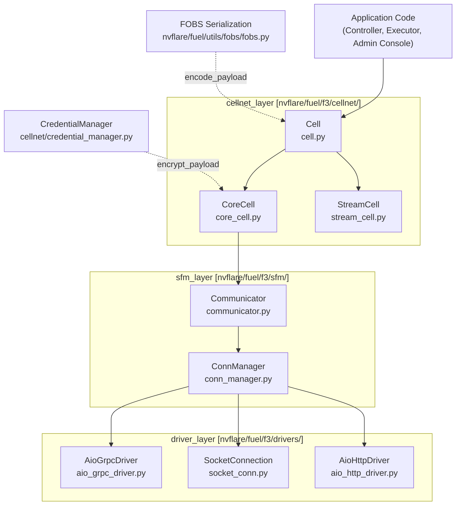
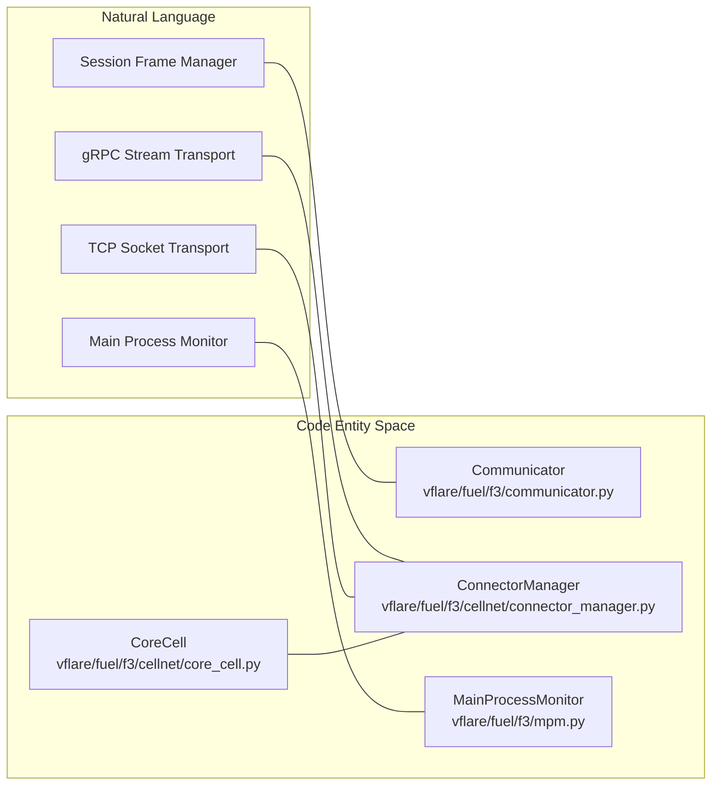
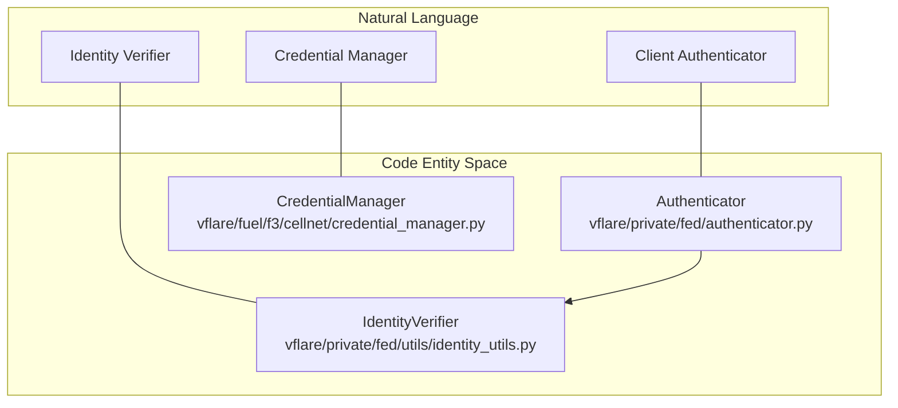

<!-- source: DeepWiki mcp.deepwiki.com · repo NVIDIA/NVFlare · page 4 Communication Framework · fetched 2026-10-26 -->

# Communication Framework

Relevant source files

The following files were used as context for generating this wiki page:

- [docs/release_notes/flare_280.rst](docs/release_notes/flare_280.rst)
- [docs/resources/server_peak_memory_disk_offload.png](docs/resources/server_peak_memory_disk_offload.png)
- [nvflare/apis/event_type.py](nvflare/apis/event_type.py)
- [nvflare/apis/fl_component.py](nvflare/apis/fl_component.py)
- [nvflare/apis/utils/fl_context_utils.py](nvflare/apis/utils/fl_context_utils.py)
- [nvflare/fuel/common/fqn.py](nvflare/fuel/common/fqn.py)
- [nvflare/fuel/f3/cellnet/cell.py](nvflare/fuel/f3/cellnet/cell.py)
- [nvflare/fuel/f3/cellnet/core_cell.py](nvflare/fuel/f3/cellnet/core_cell.py)
- [nvflare/fuel/f3/cellnet/defs.py](nvflare/fuel/f3/cellnet/defs.py)
- [nvflare/fuel/f3/cellnet/fqcn.py](nvflare/fuel/f3/cellnet/fqcn.py)
- [nvflare/fuel/f3/cellnet/identity.py](nvflare/fuel/f3/cellnet/identity.py)
- [nvflare/fuel/f3/cellnet/utils.py](nvflare/fuel/f3/cellnet/utils.py)
- [nvflare/fuel/utils/pipe/cell_pipe.py](nvflare/fuel/utils/pipe/cell_pipe.py)
- [nvflare/private/defs.py](nvflare/private/defs.py)
- [nvflare/private/event.py](nvflare/private/event.py)
- [nvflare/private/fed/authenticator.py](nvflare/private/fed/authenticator.py)
- [nvflare/private/fed/client/client_req_processors.py](nvflare/private/fed/client/client_req_processors.py)
- [nvflare/private/fed/client/sys_cmd.py](nvflare/private/fed/client/sys_cmd.py)
- [nvflare/private/fed/server/cmd_utils.py](nvflare/private/fed/server/cmd_utils.py)
- [nvflare/private/fed/server/info_coll_cmd.py](nvflare/private/fed/server/info_coll_cmd.py)
- [nvflare/private/fed/server/run_manager.py](nvflare/private/fed/server/run_manager.py)
- [nvflare/private/fed/server/server_engine_internal_spec.py](nvflare/private/fed/server/server_engine_internal_spec.py)
- [nvflare/private/fed/server/sys_cmd.py](nvflare/private/fed/server/sys_cmd.py)
- [nvflare/private/fed/server/training_cmds.py](nvflare/private/fed/server/training_cmds.py)
- [nvflare/security/security.py](nvflare/security/security.py)
- [nvflare/widgets/info_collector.py](nvflare/widgets/info_collector.py)
- [tests/integration_test/data/test_configs/standalone_job/ext_process_streaming.yml](tests/integration_test/data/test_configs/standalone_job/ext_process_streaming.yml)
- [tests/unit_test/fuel/f3/cellnet/__init__.py](tests/unit_test/fuel/f3/cellnet/__init__.py)
- [tests/unit_test/fuel/f3/cellnet/core_cell_routing_test.py](tests/unit_test/fuel/f3/cellnet/core_cell_routing_test.py)
- [tests/unit_test/fuel/f3/cellnet/identity_binding_test.py](tests/unit_test/fuel/f3/cellnet/identity_binding_test.py)
- [tests/unit_test/fuel/f3/cellnet/utils_test.py](tests/unit_test/fuel/f3/cellnet/utils_test.py)
- [tests/unit_test/fuel/hci/admin_api_test.py](tests/unit_test/fuel/hci/admin_api_test.py)
- [tests/unit_test/fuel/utils/pipe/cell_pipe_test.py](tests/unit_test/fuel/utils/pipe/cell_pipe_test.py)
- [tests/unit_test/private/fed/authenticator_test.py](tests/unit_test/private/fed/authenticator_test.py)

## Purpose and Scope

This page introduces **CellNet**, the internal message-passing framework (`nvflare/fuel/f3/`) that underpins all NVIDIA FLARE inter-process and inter-node communication. Every interaction between the server orchestrator, client executors, job processes, and admin interfaces passes through CellNet.

This page gives a complete architectural overview. Detailed documentation for each subsystem lives in the child pages:
- Cell architecture and FQCN routing → [Cell Architecture and FQCN Routing](#4.1)
- Messaging patterns and transport driver system → [Communication Patterns](#4.2)
- Serialization → [FOBS Serialization System](#4.3)
- Large payload streaming → [Streaming and Large Object Transfer](#4.4)
- mTLS and end-to-end encryption → [Security and Encryption](#4.5)

For information about how the server and client runtime uses CellNet to send tasks and results, see [Core Runtime Architecture](#3).

---

## Architectural Layers

CellNet is a layered stack. Each layer has well-defined responsibilities and interacts only with the layer directly below it.

**CellNet Layer Stack**

Sources: [nvflare/fuel/f3/cellnet/cell.py:154-165](), [nvflare/fuel/f3/cellnet/core_cell.py:26-27](), [nvflare/fuel/f3/communicator.py:53](), [nvflare/fuel/f3/drivers/driver_params.py:15]()

| Layer | Classes | Responsibility |
|---|---|---|
| **Cell API** | `Cell`, `CoreCell`, `StreamCell` | Named endpoints, FQCN routing, request/reply/broadcast, streaming dispatch. |
| **Session Frame Manager (SFM)** | `Communicator`, `ConnManager` | Connection lifecycle, SFM handshake, heartbeat monitoring, frame dispatch. |
| **Transport Drivers** | `AioGrpcDriver`, `SocketConnection`, `AioHttpDriver` | Byte transport over gRPC, TCP, or HTTP/WebSockets with optional SSL. |
| **Serialization** | FOBS `fobs.py`, `Decomposer` | Python object ↔ `bytes` conversion via msgpack + decomposers. |
| **Security** | `CredentialManager`, `Authenticator` | mTLS, end-to-end payload encryption, and identity verification. |

---

## Key Abstractions

### Cell

`Cell` ([nvflare/fuel/f3/cellnet/cell.py:154-165]()) is the primary user-facing class. It is the named communication endpoint for every process. A `Cell`:

- Wraps a `CoreCell` for low-level routing logic ([nvflare/fuel/f3/cellnet/cell.py:156]()).
- Extends `StreamCell` for blob-level streaming ([nvflare/fuel/f3/cellnet/cell.py:157]()).
- Dispatches method calls to the streaming implementation or `CoreCell` depending on the `channel` ([nvflare/fuel/f3/cellnet/cell.py:37-56]()).

The `Adapter` class ([nvflare/fuel/f3/cellnet/cell.py:82-152]()) bridges the streaming blob callback system to the request/reply pattern by wrapping callbacks and handling `REPLY` message construction ([nvflare/fuel/f3/cellnet/cell.py:138-144]()).

Sources: [nvflare/fuel/f3/cellnet/cell.py:37-56](), [nvflare/fuel/f3/cellnet/cell.py:82-152](), [nvflare/fuel/f3/cellnet/cell.py:138-144](), [nvflare/fuel/f3/cellnet/cell.py:154-165]()

### CoreCell

`CoreCell` owns the routing intelligence and low-level messaging primitives. It manages the `CredentialManager` ([nvflare/fuel/f3/cellnet/core_cell.py:27]()) for per-connection security and handles message firing/requesting logic. It maintains a `ConnectorManager` to handle physical connectivity ([nvflare/fuel/f3/cellnet/core_cell.py:26]()).

Sources: [nvflare/fuel/f3/cellnet/core_cell.py:26-27]()

### FQCN — Fully Qualified Cell Name

Every cell is identified by a dot-separated FQCN that encodes its role, site, and job. The hierarchy allows for complex routing across relays and parent/child processes. Routing logic is centralized in the `FQCN` utility class ([nvflare/fuel/f3/cellnet/fqcn.py:43]()). For example, a server job cell FQCN starts with `server.<job_id>` ([nvflare/fuel/f3/cellnet/cell.py:61-62]()).

Sources: [nvflare/fuel/f3/cellnet/fqcn.py:43](), [nvflare/fuel/f3/cellnet/core_cell.py:43](), [nvflare/fuel/f3/cellnet/cell.py:58-71]()

### Message

A `Message` ([nvflare/fuel/f3/message.py:24]()) consists of `headers` and a `payload`.

| `MessageHeaderKey` constant | Wire key | Purpose |
|---|---|---|
| `MSG_TYPE` | `cn__msg_type` | `REQ`, `REPLY`, or `RETURN` ([nvflare/fuel/f3/cellnet/defs.py:26]()). |
| `REQ_ID` | `cn__req_id` | Request correlation UUID ([nvflare/fuel/f3/cellnet/defs.py:27]()). |
| `ORIGIN` | `cn__origin` | Sender FQCN ([nvflare/fuel/f3/cellnet/defs.py:30]()). |
| `DESTINATION` | `cn__destination` | Target FQCN ([nvflare/fuel/f3/cellnet/defs.py:31]()). |
| `CHANNEL` | `cn__channel` | Logical channel ([nvflare/fuel/f3/cellnet/defs.py:35]()). |

Sources: [nvflare/fuel/f3/cellnet/defs.py:24-49](), [nvflare/fuel/f3/cellnet/utils.py:21]()

---

## Transport Layer

### Transport Drivers

Drivers implement the byte transport over different protocols. 
- **gRPC**: Manages gRPC stream interactions using asynchronous read loops and queues.
- **TCP**: `SocketConnection` provides raw TCP socket handling with frame boundaries.
- **HTTP/WS**: Implements WebSocket-based transport.

**Transport Code Mapping**

Sources: [nvflare/fuel/f3/cellnet/core_cell.py:26](), [nvflare/fuel/f3/cellnet/connector_manager.py:15](), [nvflare/fuel/f3/communicator.py:53](), [nvflare/fuel/f3/mpm.py:59]()

---

## Serialization (FOBS)

Message payloads are serialized using **FOBS (FLARE Object Serialization)**.

- **`encode_payload`**: Handles the logic of converting Python objects into bytes via `fobs.dumps` if they are not already bytes-like ([nvflare/fuel/f3/cellnet/utils.py:133-171]()).
- **`decode_payload`**: Reverses the process, using `fobs.loads` for FOBS-encoded data ([nvflare/fuel/f3/cellnet/utils.py:173-196]()).

The system utilizes `FOBSContextKey` to pass metadata like `PASS_THROUGH` flags during the serialization process ([nvflare/fuel/f3/cellnet/cell.py:110-112]()).

Sources: [nvflare/fuel/f3/cellnet/utils.py:133-171](), [nvflare/fuel/f3/cellnet/utils.py:173-196](), [nvflare/fuel/f3/cellnet/cell.py:110-112]()

---

## Streaming and Large Objects

For large payloads (e.g., model weights), FLARE uses a specialized streaming subsystem to avoid memory exhaustion.

- **`StreamCell`**: Extension of the Cell API for handling large byte streams ([nvflare/fuel/f3/cellnet/cell.py:29]()).
- **Large-model streaming reliability**: Broadcasts are robust when many clients retry after delayed EOF responses ([docs/release_notes/flare_280.rst:55-59]()).
- **Tensor Disk Offload**: For very large models, the system can offload tensors to disk during aggregation to reduce peak memory usage ([docs/release_notes/flare_280.rst:50-54]()).

For details, see [Streaming and Large Object Transfer](#4.4).

Sources: [nvflare/fuel/f3/cellnet/cell.py:29](), [docs/release_notes/flare_280.rst:50-59]()

---

## Security and Encryption

CellNet provides end-to-end security:

1.  **TLS/mTLS**: Secure connection establishment via certificate-based identity.
2.  **Payload Encryption**: The framework supports secure headers and encrypted payloads via `encrypt_payload` in `CoreCell` ([nvflare/fuel/f3/cellnet/core_cell.py:174]()).
3.  **Authentication**: `Authenticator` ([nvflare/private/fed/authenticator.py:69-116]()) is used by clients to register with the server, performing identity challenges and verification using PKI credentials ([nvflare/private/fed/authenticator.py:118-170]()).
4.  **Process Monitoring**: `MainProcessMonitor` (MPM) ensures graceful shutdown and cleanup of communication resources ([nvflare/fuel/f3/mpm.py:59]()).

**Security Entity Mapping**

Sources: [nvflare/fuel/f3/cellnet/core_cell.py:27](), [nvflare/fuel/f3/cellnet/core_cell.py:174](), [nvflare/private/fed/authenticator.py:69-116](), [nvflare/private/fed/authenticator.py:118-170](), [nvflare/fuel/f3/mpm.py:59]()

---

