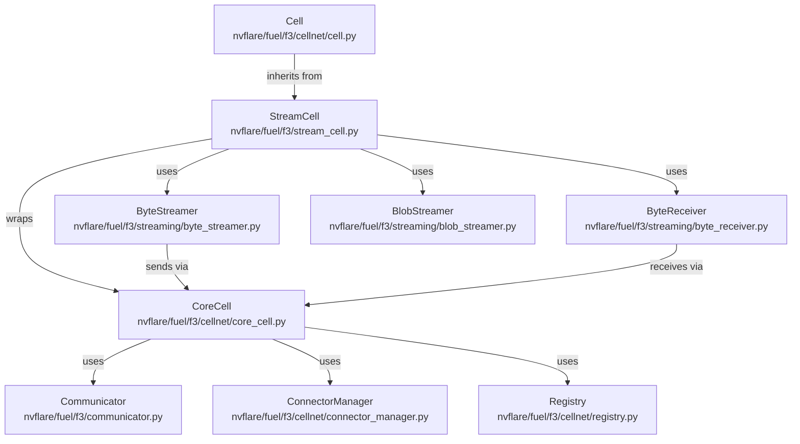
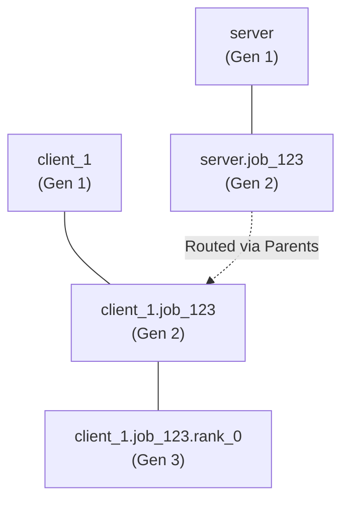
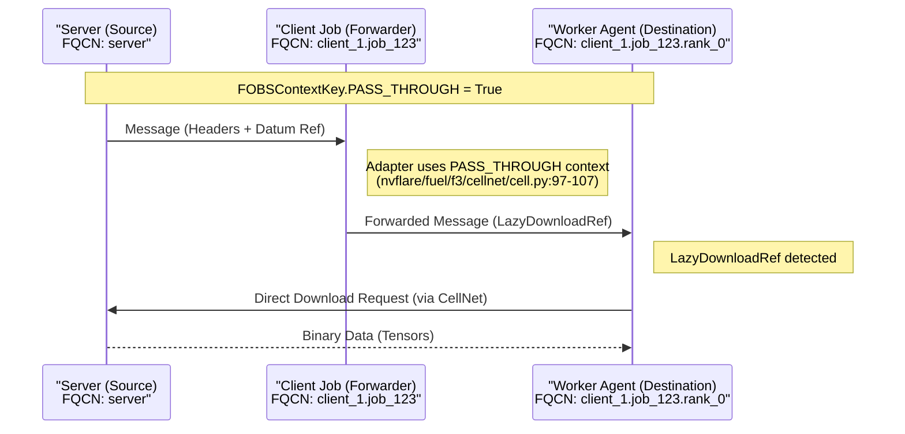
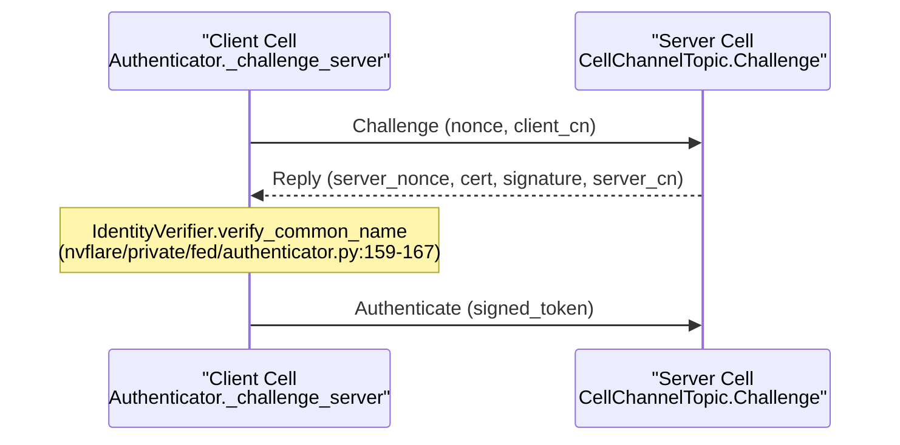

<!-- source: DeepWiki mcp.deepwiki.com · repo NVIDIA/NVFlare · page 4.1 Cell Architecture and FQCN Routing · fetched 2026-10-26 -->

# Cell Architecture and FQCN Routing

Relevant source files

The following files were used as context for generating this wiki page:

- [docs/release_notes/flare_280.rst](docs/release_notes/flare_280.rst)
- [docs/resources/server_peak_memory_disk_offload.png](docs/resources/server_peak_memory_disk_offload.png)
- [nvflare/apis/event_type.py](nvflare/apis/event_type.py)
- [nvflare/apis/fl_component.py](nvflare/apis/fl_component.py)
- [nvflare/apis/utils/fl_context_utils.py](nvflare/apis/utils/fl_context_utils.py)
- [nvflare/fuel/common/fqn.py](nvflare/fuel/common/fqn.py)
- [nvflare/fuel/f3/cellnet/cell.py](nvflare/fuel/f3/cellnet/cell.py)
- [nvflare/fuel/f3/cellnet/core_cell.py](nvflare/fuel/f3/cellnet/core_cell.py)
- [nvflare/fuel/f3/cellnet/defs.py](nvflare/fuel/f3/cellnet/defs.py)
- [nvflare/fuel/f3/cellnet/fqcn.py](nvflare/fuel/f3/cellnet/fqcn.py)
- [nvflare/fuel/f3/cellnet/identity.py](nvflare/fuel/f3/cellnet/identity.py)
- [nvflare/fuel/f3/cellnet/utils.py](nvflare/fuel/f3/cellnet/utils.py)
- [nvflare/fuel/utils/pipe/cell_pipe.py](nvflare/fuel/utils/pipe/cell_pipe.py)
- [nvflare/private/defs.py](nvflare/private/defs.py)
- [nvflare/private/event.py](nvflare/private/event.py)
- [nvflare/private/fed/authenticator.py](nvflare/private/fed/authenticator.py)
- [nvflare/private/fed/client/client_req_processors.py](nvflare/private/fed/client/client_req_processors.py)
- [nvflare/private/fed/client/sys_cmd.py](nvflare/private/fed/client/sys_cmd.py)
- [nvflare/private/fed/server/cmd_utils.py](nvflare/private/fed/server/cmd_utils.py)
- [nvflare/private/fed/server/info_coll_cmd.py](nvflare/private/fed/server/info_coll_cmd.py)
- [nvflare/private/fed/server/run_manager.py](nvflare/private/fed/server/run_manager.py)
- [nvflare/private/fed/server/server_engine_internal_spec.py](nvflare/private/fed/server/server_engine_internal_spec.py)
- [nvflare/private/fed/server/sys_cmd.py](nvflare/private/fed/server/sys_cmd.py)
- [nvflare/private/fed/server/training_cmds.py](nvflare/private/fed/server/training_cmds.py)
- [nvflare/security/security.py](nvflare/security/security.py)
- [nvflare/widgets/info_collector.py](nvflare/widgets/info_collector.py)
- [tests/integration_test/data/test_configs/standalone_job/ext_process_streaming.yml](tests/integration_test/data/test_configs/standalone_job/ext_process_streaming.yml)
- [tests/unit_test/fuel/f3/cellnet/__init__.py](tests/unit_test/fuel/f3/cellnet/__init__.py)
- [tests/unit_test/fuel/f3/cellnet/core_cell_routing_test.py](tests/unit_test/fuel/f3/cellnet/core_cell_routing_test.py)
- [tests/unit_test/fuel/f3/cellnet/identity_binding_test.py](tests/unit_test/fuel/f3/cellnet/identity_binding_test.py)
- [tests/unit_test/fuel/f3/cellnet/utils_test.py](tests/unit_test/fuel/f3/cellnet/utils_test.py)
- [tests/unit_test/fuel/hci/admin_api_test.py](tests/unit_test/fuel/hci/admin_api_test.py)
- [tests/unit_test/fuel/utils/pipe/cell_pipe_test.py](tests/unit_test/fuel/utils/pipe/cell_pipe_test.py)
- [tests/unit_test/private/fed/authenticator_test.py](tests/unit_test/private/fed/authenticator_test.py)

## Purpose and Scope

This document describes the Cell abstraction and FQCN (Fully Qualified Cell Name) routing system that forms the foundation of NVIDIA FLARE's F3 CellNet communication infrastructure. A Cell is the fundamental communication endpoint in NVFlare, representing a server, client, job process, or any other entity that needs to send and receive messages. The FQCN addressing scheme enables hierarchical routing where messages are automatically routed through parent cells to reach their destination.

This page covers:
- The three-layer Cell class hierarchy (`CoreCell` → `StreamCell` → `Cell`) [nvflare/fuel/f3/cellnet/cell.py:154-157]().
- FQCN structure and parsing for hierarchical addressing [nvflare/fuel/f3/cellnet/fqcn.py:43-86]().
- Dynamic routing mechanism based on channel type [nvflare/fuel/f3/cellnet/cell.py:49-55]().
- Cell types, roles, and lifecycle management [nvflare/fuel/f3/cellnet/core_cell.py:600-827]().
- Message abstraction and encoding [nvflare/fuel/f3/cellnet/utils.py:133-172]().
- Integration with the FOBS serialization system and `PASS_THROUGH` optimization [nvflare/fuel/f3/cellnet/cell.py:97-107]().
- Identity verification and secure registration [nvflare/private/fed/authenticator.py:69-170]().

## Cell Class Hierarchy

The Cell architecture consists of three layers, each building upon the previous layer to provide progressively higher-level communication capabilities.

### Architecture Overview

The following diagram illustrates the relationship between the core communication classes and their supporting components.

**Cell Entity Space Mapping**

Sources: [nvflare/fuel/f3/cellnet/cell.py:154-157](), [nvflare/fuel/f3/cellnet/core_cell.py:278-319](), [nvflare/fuel/f3/cellnet/connector_manager.py:34-40](), [nvflare/fuel/f3/communicator.py:53-60]().

### CoreCell: Base Communication Layer

`CoreCell` is the foundational layer providing basic message capabilities. It manages connections, endpoints, and message routing but does not handle streaming. It uses the `SFM` (Simple Fabric Messaging) layer via the `Communicator` to interface with network drivers [nvflare/fuel/f3/cellnet/core_cell.py:278-319]().

**Key Responsibilities:**
- **Message Transport:** Send and receive `Message` objects via `Communicator` [nvflare/fuel/f3/cellnet/core_cell.py:445-455]().
- **Connection Management:** Create and manage connectors and listeners via `ConnectorManager` [nvflare/fuel/f3/cellnet/core_cell.py:280-285]().
- **Callback Registration:** Maintain registries for request callbacks and filters [nvflare/fuel/f3/cellnet/core_cell.py:456-465]().
- **Endpoint Monitoring:** Track connection state and health of peer cells via `EndpointMonitor` [nvflare/fuel/f3/endpoint.py:57-65]().

**Core Methods:**
| Method | Purpose | Returns |
|--------|---------|---------|
| `send_request()` | Send message and wait for reply | `Message` |
| `fire_and_forget()` | Send message without waiting | `Dict[str, str]` |
| `broadcast_request()` | Send to multiple targets | `Dict[str, Message]` |
| `register_request_cb()` | Register callback for topic | `None` |

Sources: [nvflare/fuel/f3/cellnet/core_cell.py:266-509](), [nvflare/fuel/f3/cellnet/connector_manager.py:34-40]().

### StreamCell: Streaming Layer

`StreamCell` wraps a `CoreCell` and adds byte-streaming capabilities for large data transfers. It breaks large messages into chunks and handles flow control and reassembly [nvflare/fuel/f3/cellnet/cell.py:154-157]().

**Key Responsibilities:**
- **Byte Streaming:** Stream data in chunks using `ByteStreamer`.
- **BLOB Transfer:** Send binary large objects that fit in memory via `BlobStreamer`.
- **Flow Control:** Manage window size and acknowledgments to prevent overwhelming receivers.

Sources: [nvflare/fuel/f3/cellnet/cell.py:154-157]().

### Cell: Smart Routing Layer

`Cell` extends `StreamCell` and adds intelligent routing logic. It automatically selects the appropriate transport method (standard vs streaming) based on the channel [nvflare/fuel/f3/cellnet/cell.py:154-157]().

**Channel Classification:**
Channels excluded from streaming (use `CoreCell` directly) include `CLIENT_MAIN`, `SERVER_MAIN`, `SERVER_PARENT_LISTENER`, and `CLIENT_COMMAND` [nvflare/fuel/f3/cellnet/cell.py:37-46](). All other channels support streaming by default [nvflare/fuel/f3/cellnet/cell.py:49-55]().

**Dynamic Method Dispatch:**
The `Cell` class uses dynamic routing logic to determine if a channel is a stream channel. If `_is_stream_channel(channel)` returns true, it utilizes the streaming capabilities of `StreamCell`; otherwise, it falls back to the `CoreCell` implementation [nvflare/fuel/f3/cellnet/cell.py:49-55]().

Sources: [nvflare/fuel/f3/cellnet/cell.py:37-55]().

## FQCN Addressing Scheme

Every cell in NVIDIA FLARE has a unique **Fully Qualified Cell Name (FQCN)** identifying its position in the system hierarchy.

### FQCN Structure and Hierarchy

**FQCN Logical Topology**

Sources: [nvflare/fuel/f3/cellnet/fqcn.py:43-86](), [nvflare/fuel/f3/cellnet/core_cell.py:101-119]().

**Key FQCN Properties:**
- **Generation:** Number of dots + 1 [nvflare/fuel/f3/cellnet/fqcn.py:110-111]().
- **Root:** The first segment of the FQCN [nvflare/fuel/f3/cellnet/fqcn.py:113-114]().
- **Side:** FQCNs starting with `server` are on the server side; others are client-side [nvflare/fuel/f3/cellnet/fqcn.py:116-117]().

**FqcnInfo Structure:**
The `FqcnInfo` class parses these properties during cell initialization [nvflare/fuel/f3/cellnet/fqcn.py:89-117]().

## Cell Types and Roles

### Typical Cell Configurations

| Cell Type | FQCN Example | Role | Connectivity |
|-----------|--------------|------|--------------|
| Server Root | `server` | Hub for all clients | Listens on `root_url` [nvflare/fuel/f3/cellnet/core_cell.py:600-608]() |
| Client Root | `client_1` | Main client process | Connects to `server` [nvflare/fuel/f3/cellnet/core_cell.py:785-811]() |
| Job Cell | `server.job_123` | Job-specific logic | Connects to parent (`server`) [nvflare/fuel/f3/cellnet/core_cell.py:813-827]() |
| Cell Pipe | `site.cellpipe~token~mode` | Inter-process pipe | Unique leaf segment for rendezvous [nvflare/fuel/utils/pipe/cell_pipe.py:51-125]() |

### Cell Initialization
The `CoreCell` constructor initializes the communication stack, including the `ConnectorManager` and `Communicator` [nvflare/fuel/f3/cellnet/core_cell.py:278-319](). It sets up the `fobs_ctx` to include a reference to the cell itself for serialization tasks [nvflare/fuel/f3/cellnet/core_cell.py:324]().

## Cell Lifecycle

### Creation and Start
When `start()` is called, the cell:
1.  Determines its role (root vs child).
2.  Sets up listeners if configured [nvflare/fuel/f3/cellnet/core_cell.py:749-760]().
3.  Establishes backbone connections to parents or the server root [nvflare/fuel/f3/cellnet/core_cell.py:785-827]() via `ConnectorManager`.
4.  Starts the `Communicator`.

### Shutdown
The `stop()` method ensures a graceful exit by:
1.  Notifying peers via a "bye" message [nvflare/fuel/f3/cellnet/core_cell.py:1074-1082]().
2.  Shutting down the `Communicator` and `ConnectorManager`.
3.  Cleaning up the global `ALL_CELLS` registry.
4.  Invoking cleanup callbacks registered with `MainProcessMonitor` (MPM) [nvflare/fuel/f3/mpm.py:59-67]().

Sources: [nvflare/fuel/f3/cellnet/core_cell.py:1013-1093](), [nvflare/fuel/f3/mpm.py:59-67]().

## Message Abstraction

### Message Structure
The `Message` class contains `headers` and a `payload` [nvflare/fuel/f3/message.py:22-26](). Headers are used for routing metadata such as `DESTINATION`, `ORIGIN`, `CHANNEL`, and `TOPIC` [nvflare/fuel/f3/cellnet/defs.py:24-50]().

### Encoding and Serialization
Before transmission, payloads are encoded. If the payload is not bytes, it is serialized using **FOBS** (FLARE Object Serialization) [nvflare/fuel/f3/cellnet/utils.py:145-163](). The `PAYLOAD_ENCODING` header is updated to reflect the serialization type [nvflare/fuel/f3/cellnet/utils.py:165-166](). FOBS serialization is triggered in `encode_payload` [nvflare/fuel/f3/cellnet/utils.py:161]().

Sources: [nvflare/fuel/f3/message.py:22-26](), [nvflare/fuel/f3/cellnet/utils.py:133-172]().

## Cell Properties and Context

### FOBS Context
Cells maintain a `fobs_ctx` used during serialization to provide context-aware decomposition [nvflare/fuel/f3/cellnet/core_cell.py:324](). This context can include `PASS_THROUGH` flags, which allow cells to forward references to large objects (like tensors) without downloading them locally [nvflare/fuel/f3/cellnet/cell.py:107]().

### Adapter and PASS_THROUGH Optimization
The `Adapter` class handles the receiving end of streamed data. It checks for `PASS_THROUGH` per-message or per-channel [nvflare/fuel/f3/cellnet/cell.py:97-106](). If enabled, it sets the `PASS_THROUGH` flag in the FOBS context before decoding the payload [nvflare/fuel/f3/cellnet/cell.py:107-109]().

**Data Flow: Pass-Through Routing**

Sources: [nvflare/fuel/f3/cellnet/cell.py:82-120](), [nvflare/fuel/f3/cellnet/defs.py:50-54]().

### Authenticator and Identity Verification
The `Authenticator` class manages the secure registration of a client cell to the server. It uses a challenge-response mechanism where the client verifies the server's identity using certificates and nonces [nvflare/private/fed/authenticator.py:118-170]().

**Identity Verification Flow**

Sources: [nvflare/private/fed/authenticator.py:118-170](), [nvflare/private/fed/utils/identity_utils.py:155-168]().

### Connector Manager and Backbone Connections
The `ConnectorManager` handles the logic for backbone connections. It uses parameters to decide which generations of cells should connect directly to the server root versus routing through parents. By default, cells connect to the server or parent based on the configured topology [nvflare/fuel/f3/cellnet/core_cell.py:785-827]().

Sources: [nvflare/fuel/f3/cellnet/core_cell.py:324](), [nvflare/fuel/f3/cellnet/connector_manager.py:34-40]().

---

