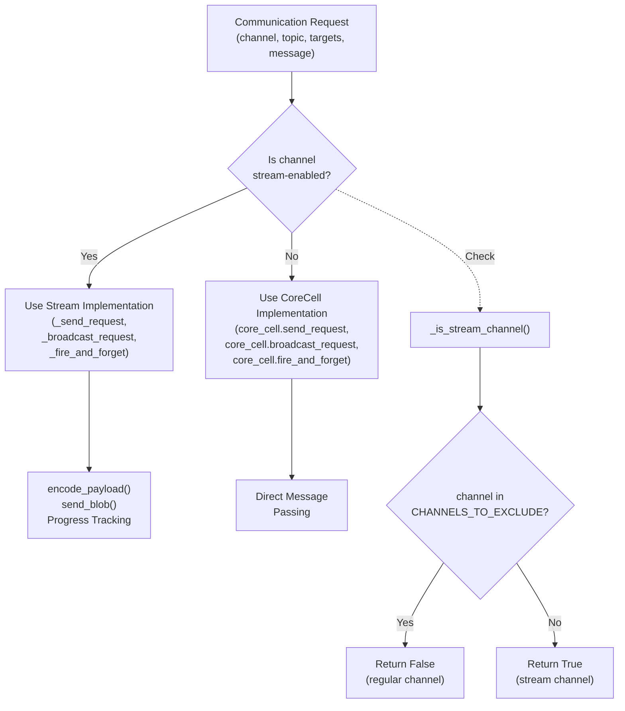

<!-- source: DeepWiki mcp.deepwiki.com · repo NVIDIA/NVFlare · page 4.2 Communication Patterns · fetched 2026-10-26 -->

# Communication Patterns

<details>
<summary>Relevant source files</summary>

The following files were used as context for generating this wiki page:

- [nvflare/apis/event_type.py](nvflare/apis/event_type.py)
- [nvflare/apis/fl_component.py](nvflare/apis/fl_component.py)
- [nvflare/apis/utils/fl_context_utils.py](nvflare/apis/utils/fl_context_utils.py)
- [nvflare/fuel/f3/cellnet/__init__.py](nvflare/fuel/f3/cellnet/__init__.py)
- [nvflare/fuel/f3/cellnet/cbs.py](nvflare/fuel/f3/cellnet/cbs.py)
- [nvflare/fuel/f3/cellnet/cell.py](nvflare/fuel/f3/cellnet/cell.py)
- [nvflare/fuel/f3/cellnet/connector_manager.py](nvflare/fuel/f3/cellnet/connector_manager.py)
- [nvflare/fuel/f3/cellnet/net_agent.py](nvflare/fuel/f3/cellnet/net_agent.py)
- [nvflare/fuel/f3/communicator.py](nvflare/fuel/f3/communicator.py)
- [nvflare/fuel/f3/drivers/aio_conn.py](nvflare/fuel/f3/drivers/aio_conn.py)
- [nvflare/fuel/f3/drivers/aio_context.py](nvflare/fuel/f3/drivers/aio_context.py)
- [nvflare/fuel/f3/drivers/aio_grpc_driver.py](nvflare/fuel/f3/drivers/aio_grpc_driver.py)
- [nvflare/fuel/f3/drivers/aio_http_driver.py](nvflare/fuel/f3/drivers/aio_http_driver.py)
- [nvflare/fuel/f3/drivers/aio_tcp_driver.py](nvflare/fuel/f3/drivers/aio_tcp_driver.py)
- [nvflare/fuel/f3/drivers/grpc/utils.py](nvflare/fuel/f3/drivers/grpc/utils.py)
- [nvflare/fuel/f3/drivers/grpc_driver.py](nvflare/fuel/f3/drivers/grpc_driver.py)
- [nvflare/fuel/f3/drivers/net_utils.py](nvflare/fuel/f3/drivers/net_utils.py)
- [nvflare/fuel/f3/drivers/socket_conn.py](nvflare/fuel/f3/drivers/socket_conn.py)
- [nvflare/fuel/f3/mpm.py](nvflare/fuel/f3/mpm.py)
- [nvflare/fuel/f3/sfm/sfm_endpoint.py](nvflare/fuel/f3/sfm/sfm_endpoint.py)
- [nvflare/private/defs.py](nvflare/private/defs.py)
- [nvflare/private/event.py](nvflare/private/event.py)
- [nvflare/private/fed/client/client_req_processors.py](nvflare/private/fed/client/client_req_processors.py)
- [nvflare/private/fed/client/sys_cmd.py](nvflare/private/fed/client/sys_cmd.py)
- [nvflare/private/fed/server/cmd_utils.py](nvflare/private/fed/server/cmd_utils.py)
- [nvflare/private/fed/server/info_coll_cmd.py](nvflare/private/fed/server/info_coll_cmd.py)
- [nvflare/private/fed/server/run_manager.py](nvflare/private/fed/server/run_manager.py)
- [nvflare/private/fed/server/server_engine_internal_spec.py](nvflare/private/fed/server/server_engine_internal_spec.py)
- [nvflare/private/fed/server/sys_cmd.py](nvflare/private/fed/server/sys_cmd.py)
- [nvflare/private/fed/server/training_cmds.py](nvflare/private/fed/server/training_cmds.py)
- [nvflare/security/security.py](nvflare/security/security.py)
- [nvflare/widgets/info_collector.py](nvflare/widgets/info_collector.py)
- [tests/unit_test/fuel/f3/communicator_test.py](tests/unit_test/fuel/f3/communicator_test.py)
- [tests/unit_test/fuel/f3/drivers/driver_manager_test.py](tests/unit_test/fuel/f3/drivers/driver_manager_test.py)
- [tests/unit_test/fuel/f3/mpm_test.py](tests/unit_test/fuel/f3/mpm_test.py)

</details>


## Purpose and Scope

This page documents the core communication patterns implemented by the `Cell` abstraction in NVIDIA FLARE. It details the multi-channel communication model (MAIN, COMMAND, AUX, PARENT), the internal routing mechanism that selects the appropriate implementation path (Stream vs. Regular), and the specific behaviors of `send_request`, `broadcast_request`, and `fire_and_forget`.

For information about the Cell architecture and FQCN-based routing, see [4.1 Cell Architecture and FQCN Routing](). For details on the FOBS serialization used in message payloads, see [4.3 FOBS Serialization System](). For streaming large objects, see [4.4 Streaming and Large Object Transfer]().

## Communication Channel Model

NVFLARE uses a multi-channel communication model to isolate different types of traffic and ensure that critical control messages are not blocked by large data transfers. These channels are defined in the `CellChannel` class.

| Channel Name | Constant | Purpose |
|--------------|----------|---------|
| **MAIN** | `CellChannel.SERVER_MAIN` / `CLIENT_MAIN` | High-level system orchestration and lifecycle management. |
| **COMMAND** | `CellChannel.SERVER_COMMAND` / `CLIENT_COMMAND` | Task-based communication (GetTask, SubmitUpdate). |
| **AUX** | `CellChannel.AUX_COMMUNICATION` | Side-channel communication for metrics, heartbeats, and logs. |
| **PARENT** | `CellChannel.SERVER_PARENT_LISTENER` | Used in hierarchical topologies for relaying messages. |
| **RETURN** | `CellChannel.RETURN_ONLY` | Dedicated internal channel for stream reply routing. |

Sources: [nvflare/fuel/f3/cellnet/cell.py:37-46](), [nvflare/fuel/f3/cellnet/defs.py:156-172](), [nvflare/private/defs.py:21]()

## Communication Pattern Types

NVIDIA FLARE's Cell communication infrastructure provides three fundamental patterns for message exchange, implemented in the `Cell` class:

| Pattern | Target Count | Waits for Reply | Primary Use Case |
|---------|-------------|-----------------|------------------|
| `send_request` | Single | Yes (synchronous) | Request-response to one specific cell |
| `broadcast_request` | Multiple | Yes (waits for all) | Gather responses from multiple cells |
| `fire_and_forget` | One or more | No (asynchronous) | One-way notifications without response |

All three patterns support both **stream-enabled channels** and **regular channels**, with implementation paths selected based on the channel type.

Sources: [nvflare/fuel/f3/cellnet/cell.py:175-207](), [nvflare/fuel/f3/cellnet/cell.py:208-241](), [nvflare/fuel/f3/cellnet/cell.py:243-286]()

## Channel Type Determination

Before executing any communication request, the `Cell` determines whether the specified channel supports streaming. This determination controls whether it uses the `StreamCell` implementation or `CoreCell` direct message passing.

### Channel Classification Logic



**Excluded Channels (Regular Channels)**

The following channels are excluded from streaming and always use regular message passing via `CoreCell` [nvflare/fuel/f3/cellnet/cell.py:37-46]():

- `CellChannel.CLIENT_MAIN`
- `CellChannel.SERVER_MAIN`
- `CellChannel.SERVER_PARENT_LISTENER`
- `CellChannel.CLIENT_COMMAND`
- `CellChannel.CLIENT_SUB_WORKER_COMMAND`
- `CellChannel.MULTI_PROCESS_EXECUTOR`
- `CellChannel.SIMULATOR_RUNNER`
- `CellChannel.RETURN_ONLY`

All other channels support streaming capabilities by default [nvflare/fuel/f3/cellnet/cell.py:49-55]().

Sources: [nvflare/fuel/f3/cellnet/cell.py:37-55](), [nvflare/fuel/f3/cellnet/cell.py:167-174]()

## Driver-Level Communication

At the lowest level, NVFLARE uses various drivers to handle the physical transport of data. These drivers implement the `Connection` and `BaseDriver` abstractions.

| Driver Class | Protocol | Implementation Detail |
|--------------|----------|-----------------------|
| `SocketConnection` | TCP | Uses standard Python `socket` with `select` [nvflare/fuel/f3/drivers/socket_conn.py:35-141](). |
| `AioStreamSession` | gRPC (Async) | Uses `grpc.aio` for asynchronous streaming frame delivery [nvflare/fuel/f3/drivers/aio_grpc_driver.py:57-127](). |

### Socket Connection Properties

The `SocketConnection` class manages raw TCP sockets. It disables Nagle's algorithm by setting `TCP_NODELAY` to reduce latency for small request/reply frames [nvflare/fuel/f3/drivers/socket_conn.py:47-62](). It also implements a robust `_send_with_timeout` method using `select.select` to prevent blocking the entire process during network congestion [nvflare/fuel/f3/drivers/socket_conn.py:124-141]().

### gRPC Driver Implementation
The `AioStreamSession` handles asynchronous gRPC communication. It uses an `asyncio.Queue` (named `oq`) to buffer outgoing frames [nvflare/fuel/f3/drivers/aio_grpc_driver.py:66-72](). The `read_loop` asynchronously iterates over incoming gRPC messages and calls `process_frame` to pass data up to the SFM layer [nvflare/fuel/f3/drivers/aio_grpc_driver.py:128-152]().

Sources: [nvflare/fuel/f3/drivers/socket_conn.py:35-141](), [nvflare/fuel/f3/drivers/aio_grpc_driver.py:57-180]()

## Pattern 1: send_request

The `send_request` pattern sends a message to a single target cell and waits for a reply. In stream-enabled channels, it is a synchronous, blocking operation that returns the reply message.

### Request-Reply Flow (Stream Channel)

```mermaid
sequenceDiagram
    participant Caller
    participant Cell["Cell<br/>(Sender)"]
    participant Encoder["encode_payload()"]
    participant StreamCell["StreamCell<br/>send_blob()"]
    participant Network
    participant RemoteCell["Remote Cell<br/>(Receiver)"]
    
    Caller->>Cell: send_request(channel, target, topic, request)
    Cell->>Cell: _encode_message(request, abort_signal)
    Cell->>Encoder: encode_payload(request)
    Encoder-->>Cell: Encoded request
    
    Cell->>Cell: _send_one_request()
    Cell->>Cell: Generate req_id (UUID)
    Cell->>Cell: Add STREAM_REQ_ID header
    Cell->>Cell: Create SimpleWaiter(req_id)
    Cell->>Cell: Store in requests_dict[req_id]
    
    Cell->>StreamCell: send_blob(channel, topic, target, request)
    StreamCell->>Network: Stream chunks
    Note over Cell,StreamCell: Stage 1: Sending with progress timeout
    StreamCell-->>Cell: Future (sending complete)
    
    Note over Cell: Stage 2: Wait for receiving first byte
    Cell->>Cell: conditional_wait(waiter.in_receiving)
    
    RemoteCell->>RemoteCell: Process request
    RemoteCell->>Network: Send reply chunks
    
    Note over Cell: Stage 3: Receiving with progress timeout
    Network-->>Cell: Reply chunks arrive
    Cell->>Cell: _process_reply(future)
    Cell->>Cell: waiter.in_receiving.set()
    Cell->>Cell: _future_wait(r_future)
    
    Cell->>Cell: decode_payload(waiter.result)
    Cell-->>Caller: Reply Message
```

### Three-Stage Timeout

The stream `send_request` implementation (in `_send_one_request`) uses a three-stage timeout mechanism with progress tracking [nvflare/fuel/f3/cellnet/cell.py:330-431]():

1. **Sending Stage**: Monitors progress of sending the request via `_future_wait`. If no progress for `timeout` seconds, fails [nvflare/fuel/f3/cellnet/cell.py:406-410]().
2. **Remote Processing Stage**: Waits for the remote cell to start sending the reply (first byte received) using `conditional_wait` on `waiter.in_receiving` [nvflare/fuel/f3/cellnet/cell.py:413-419]().
3. **Receiving Stage**: Monitors progress of receiving the reply via `_future_wait`. If no progress for `timeout` seconds, fails [nvflare/fuel/f3/cellnet/cell.py:421-427]().

Sources: [nvflare/fuel/f3/cellnet/cell.py:330-431](), [nvflare/fuel/f3/cellnet/cell.py:299-324]()

## Pattern 2: broadcast_request

The `broadcast_request` pattern sends a message to multiple target cells and waits for replies from all of them. It executes requests in parallel using a `ThreadPoolExecutor` [nvflare/fuel/f3/cellnet/cell.py:215-220]().

### Optimization: Single Encoding

To optimize memory usage, the `broadcast_request` encodes the message payload **once** using `_encode_message` before spawning threads [nvflare/fuel/f3/cellnet/cell.py:211-213](). Each thread receives a copy of the headers but shares the same encoded payload reference to avoid redundant FOBS serialization [nvflare/fuel/f3/cellnet/cell.py:221-222]().

Sources: [nvflare/fuel/f3/cellnet/cell.py:208-241]()

## Pattern 3: fire_and_forget

The `fire_and_forget` pattern sends a message to one or more targets without waiting for replies. It is asynchronous and returns immediately after initiating the send operation [nvflare/fuel/f3/cellnet/cell.py:243-286]().

### Future Tracking

Although `fire_and_forget` does not wait for replies, it stores `StreamFuture` objects for each target in the message's properties using `MessagePropKey.FUTURES` [nvflare/fuel/f3/cellnet/cell.py:281-283](). This allows callers to check for transmission success if needed.

Sources: [nvflare/fuel/f3/cellnet/cell.py:243-286](), [nvflare/fuel/f3/cellnet/defs.py:63-67]()

## Admin and System Command Patterns

NVFLARE uses specific command modules to handle administrative tasks via the `send_request_to_clients` mechanism.

| Command Module | Purpose | Example Commands |
|----------------|---------|------------------|
| `TrainingCommandModule` | FL lifecycle management | `shutdown`, `restart`, `check_status` [nvflare/private/fed/server/training_cmds.py:52-121]() |
| `SystemCommandModule` | OS/System level monitoring | `sys_info`, `report_resources`, `report_env` [nvflare/private/fed/server/sys_cmd.py:58-108]() |

These modules use the `CommandUtil` class to validate targets and map target names to internal cell tokens [nvflare/private/fed/server/cmd_utils.py:73-168]().

Sources: [nvflare/private/fed/server/training_cmds.py:42-122](), [nvflare/private/fed/server/sys_cmd.py:54-108](), [nvflare/private/fed/server/cmd_utils.py:28-168]()

## Timeout and Abort Handling

Communication patterns support maximum time for a single request-reply cycle and optional cancellation via `Signal`.

### Abort Signals

All patterns accept an optional `abort_signal: Signal` parameter [nvflare/fuel/f3/cellnet/cell.py:338](). When the signal is triggered:

- **In-flight sends**: The `_future_wait` loop checks the signal and stops immediately if triggered [nvflare/fuel/f3/cellnet/cell.py:311-313]().
- **Waiting for reply**: The `conditional_wait` on the `in_receiving` event respects the abort signal, causing the request to fail early [nvflare/fuel/f3/cellnet/cell.py:413-419]().

Sources: [nvflare/fuel/f3/cellnet/cell.py:299-324](), [nvflare/fuel/f3/cellnet/cell.py:330-431](), [nvflare/apis/signal.py:23]()

---

