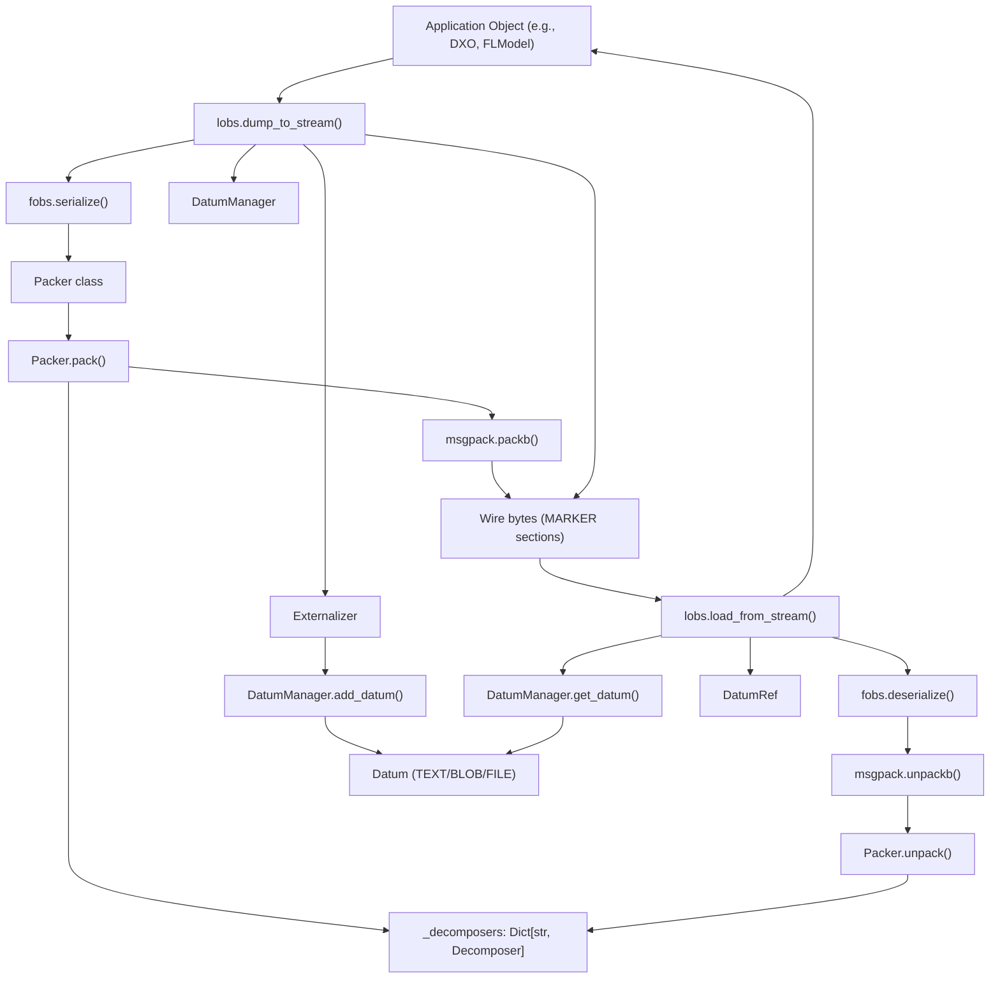
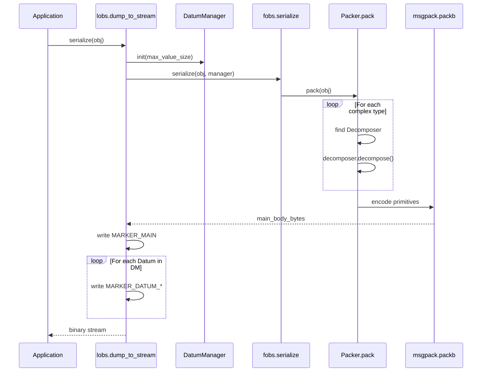
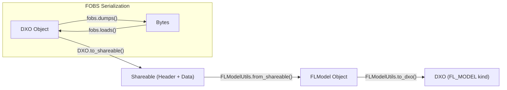

<!-- source: DeepWiki mcp.deepwiki.com · repo NVIDIA/NVFlare · page 4.3 FOBS Serialization System · fetched 2026-10-26 -->

# FOBS Serialization System

Relevant source files

The following files were used as context for generating this wiki page:

- [nvflare/apis/dxo.py](nvflare/apis/dxo.py)
- [nvflare/apis/utils/decomposers/flare_decomposers.py](nvflare/apis/utils/decomposers/flare_decomposers.py)
- [nvflare/app_common/abstract/fl_model.py](nvflare/app_common/abstract/fl_model.py)
- [nvflare/app_common/decomposers/common_decomposers.py](nvflare/app_common/decomposers/common_decomposers.py)
- [nvflare/app_common/decomposers/numpy_decomposers.py](nvflare/app_common/decomposers/numpy_decomposers.py)
- [nvflare/app_common/utils/fl_model_utils.py](nvflare/app_common/utils/fl_model_utils.py)
- [nvflare/app_opt/pt/decomposers.py](nvflare/app_opt/pt/decomposers.py)
- [nvflare/app_opt/pt/tensor_downloader.py](nvflare/app_opt/pt/tensor_downloader.py)
- [nvflare/fuel/utils/buffer_list.py](nvflare/fuel/utils/buffer_list.py)
- [nvflare/fuel/utils/fobs/__init__.py](nvflare/fuel/utils/fobs/__init__.py)
- [nvflare/fuel/utils/fobs/buf_list_stream.py](nvflare/fuel/utils/fobs/buf_list_stream.py)
- [nvflare/fuel/utils/fobs/datum.py](nvflare/fuel/utils/fobs/datum.py)
- [nvflare/fuel/utils/fobs/decomposer.py](nvflare/fuel/utils/fobs/decomposer.py)
- [nvflare/fuel/utils/fobs/decomposers/core_decomposers.py](nvflare/fuel/utils/fobs/decomposers/core_decomposers.py)
- [nvflare/fuel/utils/fobs/decomposers/via_downloader.py](nvflare/fuel/utils/fobs/decomposers/via_downloader.py)
- [nvflare/fuel/utils/fobs/fobs.py](nvflare/fuel/utils/fobs/fobs.py)
- [nvflare/fuel/utils/fobs/lobs.py](nvflare/fuel/utils/fobs/lobs.py)
- [tests/unit_test/apis/utils/decomposers/flare_decomposers_test.py](tests/unit_test/apis/utils/decomposers/flare_decomposers_test.py)
- [tests/unit_test/app_common/abstract/__init__.py](tests/unit_test/app_common/abstract/__init__.py)
- [tests/unit_test/app_common/abstract/fl_model_test.py](tests/unit_test/app_common/abstract/fl_model_test.py)
- [tests/unit_test/app_common/ccwf/test_swarm_forward_memory_path.py](tests/unit_test/app_common/ccwf/test_swarm_forward_memory_path.py)
- [tests/unit_test/app_common/decomposers/common_decomposers_test.py](tests/unit_test/app_common/decomposers/common_decomposers_test.py)
- [tests/unit_test/fuel/utils/fobs/datum_test.py](tests/unit_test/fuel/utils/fobs/datum_test.py)
- [tests/unit_test/fuel/utils/fobs/decomposer_test.py](tests/unit_test/fuel/utils/fobs/decomposer_test.py)
- [tests/unit_test/fuel/utils/fobs/decomposers/via_downloader_test.py](tests/unit_test/fuel/utils/fobs/decomposers/via_downloader_test.py)
- [tests/unit_test/fuel/utils/fobs/fobs_test.py](tests/unit_test/fuel/utils/fobs/fobs_test.py)
- [tests/unit_test/fuel/utils/fobs/test_via_downloader_download_timeout.py](tests/unit_test/fuel/utils/fobs/test_via_downloader_download_timeout.py)

FOBS (FLARE Object Serialization) is NVIDIA FLARE's serialization framework that converts Python objects to bytes for network transfer, persistence, and inter-process communication. It extends `msgpack` with a `Decomposer` registry for custom types and LOBS (Large Object Serialization) for handling large binary payloads efficiently through a multi-section wire format. [nvflare/fuel/utils/fobs/fobs.py:23-25](), [nvflare/fuel/utils/fobs/lobs.py:72-76]()

---

## Architecture Overview

FOBS operates in two primary layers:
1.  **`fobs.py`**: Wraps `msgpack` with a `Decomposer` registry to handle non-primitive Python types (e.g., `Enum`, `dataclass`, `numpy.ndarray`). [nvflare/fuel/utils/fobs/fobs.py:123-156]()
2.  **`lobs.py`**: Extends the core serialization with a multi-section wire format that segregates large binary data into separate "datum" sections to bypass `msgpack` size limits and enable streaming. [nvflare/fuel/utils/fobs/lobs.py:72-137]()

### FOBS Component Architecture

The following diagram maps high-level serialization concepts to the specific classes and functions in the codebase.

Title: FOBS Serialization Entity Mapping

Sources: [nvflare/fuel/utils/fobs/fobs.py:117-156](), [nvflare/fuel/utils/fobs/lobs.py:27-137](), [nvflare/fuel/utils/fobs/datum.py:28-89]()

---

## Public API

The `nvflare.fuel.utils.fobs` package exposes a high-level API compatible with standard Python serialization libraries like `pickle` or `json`. [nvflare/fuel/utils/fobs/fobs.py:36-50]()

| Function | Code Reference | Description |
| :--- | :--- | :--- |
| `fobs.serialize(obj)` | [nvflare/fuel/utils/fobs/fobs.py:314-347]() | Serialize an object to `bytes`. |
| `fobs.deserialize(data)` | [nvflare/fuel/utils/fobs/fobs.py:383-417]() | Deserialize an object from `bytes`. |
| `fobs.serialize_stream(obj, stream)` | [nvflare/fuel/utils/fobs/fobs.py:349-381]() | Serialize an object to a `BinaryIO` stream. |
| `fobs.deserialize_stream(stream)` | [nvflare/fuel/utils/fobs/fobs.py:419-450]() | Deserialize an object from a `BinaryIO` stream. |
| `fobs.register(decomposer)` | [nvflare/fuel/utils/fobs/fobs.py:74-116]() | Register a custom `Decomposer`. |
| `fobs.reset()` | [nvflare/fuel/utils/fobs/fobs.py:246-261]() | Clear registered decomposers and whitelist. |

---

## The Decomposer Interface

Every non-primitive type (not supported natively by `msgpack`) must have a `Decomposer` registered. A `Decomposer` converts a complex object into `msgpack`-compatible primitives (lists, dicts, strings, ints). [nvflare/fuel/utils/fobs/fobs.py:123-144]()

### Core Methods

| Method | Signature | Description |
| :--- | :--- | :--- |
| `supported_type` | `() -> Type` | Returns the Python class this decomposer handles. [nvflare/fuel/utils/fobs/decomposer.py:79-85]() |
| `supported_dots` | `() -> Optional[List[int]]` | Returns Datum Object Types for specialized processing. [nvflare/fuel/utils/fobs/decomposer.py:87-95]() |
| `decompose` | `(target, manager) -> Any` | Converts the object to primitives. [nvflare/fuel/utils/fobs/decomposer.py:110-121]() |
| `recompose` | `(data, manager) -> Any` | Reconstructs the object from decomposed components. [nvflare/fuel/utils/fobs/decomposer.py:123-132]() |

### Built-in Decomposers and Security

FOBS maintains a `_type_name_whitelist` to prevent Remote Code Execution (RCE) during deserialization by gating which classes can be loaded. [nvflare/fuel/utils/fobs/fobs.py:71-71](), [nvflare/fuel/utils/fobs/fobs.py:177-182]()

Built-in support includes:
-   **`DataClassDecomposer`**: Automatically handles classes with a `__dict__` and no-arg constructors (or bypasses `__init__` via `__new__`). [nvflare/fuel/utils/fobs/decomposer.py:66-68](), [nvflare/fuel/utils/fobs/fobs.py:143-144]()
-   **`EnumTypeDecomposer`**: Handles Python `Enum` types. [nvflare/fuel/utils/fobs/fobs.py:135-136]()
-   **`DictDecomposer`**: Rebuilds dictionary subclasses while preserving the specific type. [tests/unit_test/fuel/utils/fobs/decomposer_test.py:79-84]()

Sources: [nvflare/fuel/utils/fobs/fobs.py:168-182](), [nvflare/fuel/utils/fobs/decomposer.py:15-54](), [nvflare/fuel/utils/fobs/builtin_decomposers.py:26-26]()

---

## Serialization Pipeline

When `lobs.dump_to_stream` is called, the system follows a multi-stage process:

1.  **Externalization**: The `Externalizer` walks the object graph. Any `bytes` or `str` larger than a threshold (default 10MB) is moved to a `Datum` and replaced by a `DatumRef`. [nvflare/fuel/utils/fobs/lobs.py:94-96](), [nvflare/fuel/utils/fobs/decomposer.py:147-171]()
2.  **Decomposition**: The `Packer` uses registered `Decomposer` instances to convert objects into a dictionary envelope containing `__fobs_type__`, `__fobs_data__`, and `__fobs_decomposer__`. [nvflare/fuel/utils/fobs/fobs.py:123-156]()
3.  **Msgpack Encoding**: The resulting primitive tree is encoded using `msgpack.packb`. [nvflare/fuel/utils/fobs/fobs.py:314-347]()
4.  **Wire Writing**: The system writes a `MARKER_MAIN` section for the `msgpack` bytes, followed by `MARKER_DATUM_*` sections for each large binary payload. [nvflare/fuel/utils/fobs/lobs.py:97-137]()

### Serialization Sequence

Title: FOBS Serialization Flow

Sources: [nvflare/fuel/utils/fobs/lobs.py:72-137](), [nvflare/fuel/utils/fobs/fobs.py:117-156]()

---

## The Datum System

The `Datum` system is the foundation for memory-efficient transfer of large objects like model weights. [nvflare/fuel/utils/fobs/datum.py:28-45]()

### Datum Types
-   **`DatumType.TEXT`**: UTF-8 encoded strings. [nvflare/fuel/utils/fobs/datum.py:23-23]()
-   **`DatumType.BLOB`**: In-memory raw bytes. [nvflare/fuel/utils/fobs/datum.py:24-24]()
-   **`DatumType.FILE`**: Disk-backed data. [nvflare/fuel/utils/fobs/datum.py:25-25]()

### Datum Object Types (DOT)
DOTs are integer identifiers that allow `Decomposer` instances to perform specialized processing on a `Datum` before reconstruction. This is used by mechanisms to handle on-demand processing or downloading. [nvflare/fuel/utils/fobs/fobs.py:98-114](), [nvflare/fuel/utils/fobs/lobs.py:279-289]()

Sources: [nvflare/fuel/utils/fobs/datum.py:22-26](), [nvflare/fuel/utils/fobs/lobs.py:27-35]()

---

## Complex Object Handling (DXO and FLModel)

FOBS is used extensively to serialize FLARE's core data structures like `DXO` and `FLModel`.

- **DXO Serialization**: The `DXO` class uses FOBS for its `to_bytes` and `to_file` methods. [nvflare/apis/dxo.py:108-127]()
- **FLModel Serialization**: The `FLModelDecomposer` handles the decomposition of `FLModel` attributes (params, metrics, etc.) using an `Externalizer` to ensure large tensors are moved to datums. [nvflare/app_common/decomposers/common_decomposers.py:28-43]()

### Pass-Through Mode and Performance

The `PASS_THROUGH` mechanism (often used in conjunction with `FOBSContextKey`) allows intermediate nodes to forward large objects without fully deserializing the heavy binary payloads. In this mode, `ViaDownloaderDecomposer` creates `LazyDownloadRef` placeholders that preserve the original source FQCN and transaction ID, enabling a subprocess to download directly from the originating server. [nvflare/fuel/utils/fobs/__init__.py:64-64](), [nvflare/fuel/utils/fobs/decomposers/via_downloader.py:117-142]()

Title: DXO to FLModel Conversion Flow

Sources: [nvflare/apis/dxo.py:98-115](), [nvflare/app_common/utils/fl_model_utils.py:46-150](), [nvflare/app_common/utils/fl_model_utils.py:153-161]()

---

## Wire Format (LOBS)

LOBS uses a binary wire format consisting of a header followed by the payload. [nvflare/fuel/utils/fobs/lobs.py:27-28]()

**Header Structure (`_Header` class using `>BBQ`)**: [nvflare/fuel/utils/fobs/lobs.py:44-60]()
-   **marker** (1 byte): 100 (Main), 101 (Text), 102 (Blob), 103 (File). [nvflare/fuel/utils/fobs/lobs.py:30-33]()
-   **dot** (1 byte): Datum Object Type. [nvflare/fuel/utils/fobs/lobs.py:28-28]()
-   **size** (8 bytes): Length of the payload (including Datum ID for datums). [nvflare/fuel/utils/fobs/lobs.py:28-28]()

For `MARKER_DATUM_*` sections, the payload starts with a 16-byte binary UUID (`datum_id`). [nvflare/fuel/utils/fobs/lobs.py:35-35](), [nvflare/fuel/utils/fobs/lobs.py:62-69]()

Sources: [nvflare/fuel/utils/fobs/lobs.py:44-60](), [nvflare/fuel/utils/fobs/lobs.py:27-35]()

---

