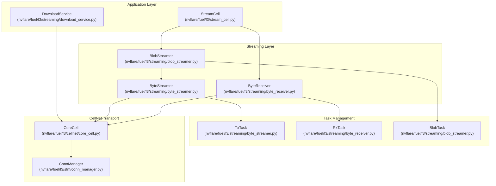

<!-- source: DeepWiki mcp.deepwiki.com · repo NVIDIA/NVFlare · page 4.4 Streaming and Large Object Transfer · fetched 2026-10-26 -->

# Streaming and Large Object Transfer

Relevant source files

The following files were used as context for generating this wiki page:

- [dev_tools/f3/cellnet_bench.py](dev_tools/f3/cellnet_bench.py)
- [docs/design/client_api_execution_modes.md](docs/design/client_api_execution_modes.md)
- [docs/programming_guide/timeouts.rst](docs/programming_guide/timeouts.rst)
- [docs/user_guide/admin_guide/configurations/communication_configuration.rst](docs/user_guide/admin_guide/configurations/communication_configuration.rst)
- [nvflare/apis/streaming.py](nvflare/apis/streaming.py)
- [nvflare/app_common/streamers/file_streamer.py](nvflare/app_common/streamers/file_streamer.py)
- [nvflare/client/cell/__init__.py](nvflare/client/cell/__init__.py)
- [nvflare/client/cell/defs.py](nvflare/client/cell/defs.py)
- [nvflare/fuel/f3/comm_config.py](nvflare/fuel/f3/comm_config.py)
- [nvflare/fuel/f3/sfm/conn_manager.py](nvflare/fuel/f3/sfm/conn_manager.py)
- [nvflare/fuel/f3/stream_cell.py](nvflare/fuel/f3/stream_cell.py)
- [nvflare/fuel/f3/streaming/blob_streamer.py](nvflare/fuel/f3/streaming/blob_streamer.py)
- [nvflare/fuel/f3/streaming/byte_receiver.py](nvflare/fuel/f3/streaming/byte_receiver.py)
- [nvflare/fuel/f3/streaming/byte_streamer.py](nvflare/fuel/f3/streaming/byte_streamer.py)
- [nvflare/fuel/f3/streaming/download_service.py](nvflare/fuel/f3/streaming/download_service.py)
- [nvflare/fuel/f3/streaming/obj_downloader.py](nvflare/fuel/f3/streaming/obj_downloader.py)
- [nvflare/fuel/f3/streaming/stream_const.py](nvflare/fuel/f3/streaming/stream_const.py)
- [nvflare/fuel/f3/streaming/stream_utils.py](nvflare/fuel/f3/streaming/stream_utils.py)
- [nvflare/fuel/f3/streaming/tools/README.md](nvflare/fuel/f3/streaming/tools/README.md)
- [nvflare/fuel/f3/streaming/transfer_outcome.py](nvflare/fuel/f3/streaming/transfer_outcome.py)
- [nvflare/private/stream_runner.py](nvflare/private/stream_runner.py)
- [tests/tools/file_streaming/app/config/config_fed_client.json](tests/tools/file_streaming/app/config/config_fed_client.json)
- [tests/tools/file_streaming/app/custom/controller.py](tests/tools/file_streaming/app/custom/controller.py)
- [tests/tools/file_streaming/app/custom/file_streaming.py](tests/tools/file_streaming/app/custom/file_streaming.py)
- [tests/unit_test/client/cell/__init__.py](tests/unit_test/client/cell/__init__.py)
- [tests/unit_test/client/cell/defs_test.py](tests/unit_test/client/cell/defs_test.py)
- [tests/unit_test/fuel/f3/cellnet_bench_test.py](tests/unit_test/fuel/f3/cellnet_bench_test.py)
- [tests/unit_test/fuel/f3/streaming/blob_streamer_test.py](tests/unit_test/fuel/f3/streaming/blob_streamer_test.py)
- [tests/unit_test/fuel/f3/streaming/byte_receiver_test.py](tests/unit_test/fuel/f3/streaming/byte_receiver_test.py)
- [tests/unit_test/fuel/f3/streaming/byte_streamer_ack_watchdog_test.py](tests/unit_test/fuel/f3/streaming/byte_streamer_ack_watchdog_test.py)
- [tests/unit_test/fuel/f3/streaming/conftest.py](tests/unit_test/fuel/f3/streaming/conftest.py)
- [tests/unit_test/fuel/f3/streaming/download_object_test.py](tests/unit_test/fuel/f3/streaming/download_object_test.py)
- [tests/unit_test/fuel/f3/streaming/download_service_test.py](tests/unit_test/fuel/f3/streaming/download_service_test.py)
- [tests/unit_test/fuel/f3/streaming/download_starvation_test.py](tests/unit_test/fuel/f3/streaming/download_starvation_test.py)
- [tests/unit_test/fuel/f3/streaming/download_test_utils.py](tests/unit_test/fuel/f3/streaming/download_test_utils.py)
- [tests/unit_test/fuel/f3/streaming/transfer_outcome_test.py](tests/unit_test/fuel/f3/streaming/transfer_outcome_test.py)

## Purpose and Scope

This document describes the streaming infrastructure in NVIDIA FLARE for transferring large objects between server and clients. The system provides three complementary mechanisms:

1.  **Byte/BLOB Streaming**: Low-level infrastructure for transferring sequential data or large binary objects that may not fit in memory as a single message. [nvflare/fuel/f3/streaming/byte_streamer.py:53-55](), [nvflare/fuel/f3/streaming/blob_streamer.py:33-61]()
2.  **Download-Based Transfer**: A pull-based framework where recipients download objects in small chunks. This is integrated with FOBS to handle complex objects like tensors and NumPy arrays efficiently. [nvflare/fuel/f3/streaming/download_service.py:100-113](), [nvflare/fuel/f3/streaming/download_service.py:25-44]()
3.  **Memory-Efficient Offload**: Integration for automatically offloading large objects to disk during transfer to reduce peak memory usage, specifically for PyTorch tensors. [nvflare/fuel/f3/streaming/download_service.py:52-60](), [nvflare/fuel/f3/streaming/blob_streamer.py:87-92]()

For information about the underlying F3 Cell Network communication, see **4.1 Cell Architecture and FQCN Routing**. For details on FOBS serialization, see **4.3 FOBS Serialization System**.

---

## Overview

NVIDIA FLARE's communication layer has a configurable maximum message size (typically 1-10 MB). Objects larger than this limit—such as neural network models or large datasets—require special handling. The streaming infrastructure solves this by:

*   **Chunking**: Breaking large objects into manageable chunks. The default chunk size is 1MB. [nvflare/fuel/f3/streaming/byte_streamer.py:30-30](), [nvflare/fuel/f3/comm_config.py:111-112]()
*   **Pull vs. Push**: Providing both push-based (`ByteStreamer`) and pull-based (`DownloadService`) models to optimize for different reliability and memory constraints. [nvflare/fuel/f3/streaming/download_service.py:102-103]()
*   **Flow Control**: Providing a sliding window mechanism to prevent overwhelming receivers. [nvflare/fuel/f3/streaming/byte_streamer.py:33-33](), [nvflare/fuel/f3/streaming/byte_receiver.py:116-117]()
*   **Reliability**: A dedicated retry scheduler for ensuring delivery of chunks in unstable network conditions. [nvflare/fuel/f3/streaming/byte_streamer.py:82-137]()

**Sources:** [nvflare/fuel/f3/streaming/byte_streamer.py:1-55](), [nvflare/fuel/f3/streaming/download_service.py:25-113](), [nvflare/fuel/f3/comm_config.py:111-151](), [nvflare/fuel/f3/streaming/stream_const.py:22-26]()

---

## Architecture Components

### Component Hierarchy

**Sources:** [nvflare/fuel/f3/streaming/byte_streamer.py:199-215](), [nvflare/fuel/f3/streaming/byte_receiver.py:71-124](), [nvflare/fuel/f3/streaming/download_service.py:25-37](), [nvflare/fuel/f3/streaming/blob_streamer.py:71-96](), [nvflare/fuel/f3/sfm/conn_manager.py:64-91]()

---

## Download-Based Transfer Framework

The `DownloadService` provides a pull-based framework where the sender hosts objects and receivers request them. Unlike the `ByteStreamer` which pushes data, this allows receivers to control the pace of the transfer and handles multi-receiver scenarios. [nvflare/fuel/f3/streaming/download_service.py:100-110]()

### Workflow
1.  **Transaction Creation**: The sender creates a transaction via `DownloadService.new_transaction` and adds `Downloadable` objects. [nvflare/fuel/f3/streaming/download_service.py:100-103](), [nvflare/fuel/f3/streaming/download_service.py:116-120]()
2.  **Reference Sharing**: The sender sends `ref_id` strings to recipients via standard messages. [nvflare/fuel/f3/streaming/download_service.py:63-65]()
3.  **Pulling**: Recipients call the download function to pull data. The sender's `Downloadable.produce()` method generates chunks, and the receiver's `Consumer.consume()` processes them. [nvflare/fuel/f3/streaming/download_service.py:135-145](), [nvflare/fuel/f3/streaming/download_service.py:46-51]()

### Lifecycle and Callbacks
The framework supports complex lifecycle management through callbacks:
*   `downloaded_to_one`: Triggered when one receiver finishes. [nvflare/fuel/f3/streaming/download_service.py:147-154]()
*   `downloaded_to_all`: Triggered when all expected receivers finish. [nvflare/fuel/f3/streaming/download_service.py:156-161]()
*   `transaction_done`: Triggered on normal completion or timeout. [nvflare/fuel/f3/streaming/download_service.py:163-172]()

**Sources:** [nvflare/fuel/f3/streaming/download_service.py:25-113](), [nvflare/fuel/f3/streaming/download_service.py:116-172]()

---

## Memory-Efficient Transfer and Disk Offload

For extremely large models, NVIDIA FLARE minimizes memory footprint by utilizing efficient buffering and offloading strategies.

### Fast Buffering
For in-memory transfers, the `FastBuffer` class provides efficient memory management by doubling capacity when the buffer runs out, reducing allocation overhead during chunk accumulation. [nvflare/fuel/f3/streaming/stream_utils.py:75-121]()

### BLOB Pre-allocation
When the size of a binary large object is known in advance, `BlobTask` pre-allocates a `memoryview` over a `bytearray` to avoid multiple re-allocations during the receiving process. [nvflare/fuel/f3/streaming/blob_streamer.py:87-88]()

### Reliable Retry and Resource Management
The system uses specialized thread pools for streaming tasks to prevent blocking main communication threads:
*   `stream_thread_pool`: For general stream processing. [nvflare/fuel/f3/streaming/stream_utils.py:54-54]()
*   `callback_thread_pool`: For executing user-defined callbacks. [nvflare/fuel/f3/streaming/stream_utils.py:55-55]()
*   `download_request_thread_pool`: For handling pull requests. [nvflare/fuel/f3/streaming/stream_utils.py:56-56]()

**Sources:** [nvflare/fuel/f3/streaming/stream_utils.py:75-121](), [nvflare/fuel/f3/streaming/blob_streamer.py:71-96](), [nvflare/fuel/f3/streaming/stream_utils.py:54-57]()

---

## Flow Control and Reliability

### Transmitter Flow Control
The `TxTask` manages a sliding window. It tracks `offset_ack` (acknowledged bytes) and `offset` (sent bytes). If the difference exceeds `window_size`, the sender pauses until an ACK is received. [nvflare/fuel/f3/streaming/byte_streamer.py:33-33](), [nvflare/fuel/f3/streaming/byte_streamer.py:200-215]()

### Receiver ACK Mechanism
The `RxTask` tracks received chunks and reassembles them. When the amount of data received since the last ACK exceeds `ack_interval`, it sends a `STREAM_ACK_TOPIC` message back to the origin. [nvflare/fuel/f3/streaming/byte_receiver.py:47-47](), [nvflare/fuel/f3/streaming/byte_receiver.py:177-178]()

### Reliable Retry Scheduler
The `ReliableRetryScheduler` manages retransmissions for reliable streams. It uses a `CheckedExecutor` named `stm_retry` to handle tasks that have timed out or failed to receive ACKs within the `STREAM_RETRY_TIMEOUT`. [nvflare/fuel/f3/streaming/byte_streamer.py:82-137](), [nvflare/fuel/f3/streaming/byte_streamer.py:89-89]()

**Sources:** [nvflare/fuel/f3/streaming/byte_streamer.py:82-137](), [nvflare/fuel/f3/streaming/byte_receiver.py:177-187](), [nvflare/fuel/f3/comm_config.py:117-126]()

---

## Data Flow: Code to System Mapping

The following diagram maps code entities to the logical data flow of a streaming operation.

```mermaid
graph LR
    subgraph "Sender (Entity: StreamCell)"
        S_Call["send_blob()<br/>(nvflare/fuel/f3/stream_cell.py)"] -- "blob_streamer.send()" --> S_Stream["ByteStreamer.send()<br/>(nvflare/fuel/f3/streaming/byte_streamer.py)"]
        S_Stream -- "TxTask.send_loop()" --> S_Core["CoreCell.send_to_cell()<br/>(nvflare/fuel/f3/cellnet/core_cell.py)"]
    end

    subgraph "Network (Entity: CoreCell)"
        S_Core -- "F3 Message (STREAM_CHANNEL)" --> R_Core["CoreCell.handle_message()<br/>(nvflare/fuel/f3/cellnet/core_cell.py)"]
    end

    subgraph "Receiver (Entity: StreamCell)"
        R_Core -- "ByteReceiver.process_chunk()" --> R_Task["RxTask.process_chunk()<br/>(nvflare/fuel/f3/streaming/byte_receiver.py)"]
        R_Task -- "blob_cb()" --> R_Done["StreamFuture.result()<br/>(nvflare/fuel/f3/streaming/stream_types.py)"]
    end

    style S_Call fill:none
    style R_Done fill:none
```

**Sources:** [nvflare/fuel/f3/streaming/byte_streamer.py:211-214](), [nvflare/fuel/f3/streaming/byte_receiver.py:177-207]()

### System-to-Code Association

| Logical System Operation | Code Entity | File Path |
| :--- | :--- | :--- |
| **Stream Initialization** | `gen_stream_id` | [nvflare/fuel/f3/streaming/stream_utils.py:68-72]() |
| **Reliable Retries** | `ReliableRetryScheduler` | [nvflare/fuel/f3/streaming/byte_streamer.py:82-137]() |
| **Blob Handling** | `BlobHandler` | [nvflare/fuel/f3/streaming/blob_streamer.py:98-104]() |
| **Pull-based Transfer** | `DownloadService` | [nvflare/fuel/f3/streaming/download_service.py:25-37]() |
| **Memory Management** | `FastBuffer` | [nvflare/fuel/f3/streaming/stream_utils.py:75-121]() |
| **Configuration** | `CommConfigurator` | [nvflare/fuel/f3/comm_config.py:56-110]() |
| **Connection Monitoring** | `ConnManager` | [nvflare/fuel/f3/sfm/conn_manager.py:64-91]() |

**Sources:** [nvflare/fuel/f3/streaming/stream_utils.py:68-72](), [nvflare/fuel/f3/streaming/byte_streamer.py:82-137](), [nvflare/fuel/f3/streaming/blob_streamer.py:98-104](), [nvflare/fuel/f3/streaming/download_service.py:25-37](), [nvflare/fuel/f3/streaming/stream_utils.py:75-121](), [nvflare/fuel/f3/comm_config.py:56-110](), [nvflare/fuel/f3/sfm/conn_manager.py:64-91]()

---

