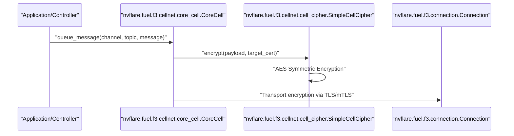

<!-- source: DeepWiki mcp.deepwiki.com · repo NVIDIA/NVFlare · page 4.5 Security and Encryption · fetched 2026-10-26 -->

# Security and Encryption

<details>
<summary>Relevant source files</summary>

The following files were used as context for generating this wiki page:

- [docs/release_notes/flare_280.rst](docs/release_notes/flare_280.rst)
- [docs/resources/server_peak_memory_disk_offload.png](docs/resources/server_peak_memory_disk_offload.png)
- [nvflare/fuel/common/fqn.py](nvflare/fuel/common/fqn.py)
- [nvflare/fuel/f3/cellnet/cell_cipher.py](nvflare/fuel/f3/cellnet/cell_cipher.py)
- [nvflare/fuel/f3/cellnet/core_cell.py](nvflare/fuel/f3/cellnet/core_cell.py)
- [nvflare/fuel/f3/cellnet/credential_manager.py](nvflare/fuel/f3/cellnet/credential_manager.py)
- [nvflare/fuel/f3/cellnet/defs.py](nvflare/fuel/f3/cellnet/defs.py)
- [nvflare/fuel/f3/cellnet/fqcn.py](nvflare/fuel/f3/cellnet/fqcn.py)
- [nvflare/fuel/f3/cellnet/identity.py](nvflare/fuel/f3/cellnet/identity.py)
- [nvflare/fuel/f3/cellnet/utils.py](nvflare/fuel/f3/cellnet/utils.py)
- [nvflare/fuel/sec/admin_cert.py](nvflare/fuel/sec/admin_cert.py)
- [nvflare/fuel/utils/pipe/cell_pipe.py](nvflare/fuel/utils/pipe/cell_pipe.py)
- [nvflare/lighter/impl/he.py](nvflare/lighter/impl/he.py)
- [nvflare/lighter/impl/signature.py](nvflare/lighter/impl/signature.py)
- [nvflare/lighter/impl/workspace.py](nvflare/lighter/impl/workspace.py)
- [nvflare/lighter/spec.py](nvflare/lighter/spec.py)
- [nvflare/lighter/utils.py](nvflare/lighter/utils.py)
- [nvflare/private/fed/authenticator.py](nvflare/private/fed/authenticator.py)
- [nvflare/private/fed/utils/app_authz.py](nvflare/private/fed/utils/app_authz.py)
- [nvflare/private/fed/utils/app_deployer.py](nvflare/private/fed/utils/app_deployer.py)
- [nvflare/tool/verify_startup_kits.py](nvflare/tool/verify_startup_kits.py)
- [tests/integration_test/data/test_configs/standalone_job/ext_process_streaming.yml](tests/integration_test/data/test_configs/standalone_job/ext_process_streaming.yml)
- [tests/unit_test/fuel/f3/cellnet/__init__.py](tests/unit_test/fuel/f3/cellnet/__init__.py)
- [tests/unit_test/fuel/f3/cellnet/core_cell_routing_test.py](tests/unit_test/fuel/f3/cellnet/core_cell_routing_test.py)
- [tests/unit_test/fuel/f3/cellnet/identity_binding_test.py](tests/unit_test/fuel/f3/cellnet/identity_binding_test.py)
- [tests/unit_test/fuel/f3/cellnet/utils_test.py](tests/unit_test/fuel/f3/cellnet/utils_test.py)
- [tests/unit_test/fuel/hci/admin_api_test.py](tests/unit_test/fuel/hci/admin_api_test.py)
- [tests/unit_test/fuel/sec/admin_cert_test.py](tests/unit_test/fuel/sec/admin_cert_test.py)
- [tests/unit_test/fuel/utils/pipe/cell_pipe_test.py](tests/unit_test/fuel/utils/pipe/cell_pipe_test.py)
- [tests/unit_test/lighter/utils_test.py](tests/unit_test/lighter/utils_test.py)
- [tests/unit_test/private/fed/authenticator_test.py](tests/unit_test/private/fed/authenticator_test.py)
- [tests/unit_test/private/fed/utils/app_deployer_test.py](tests/unit_test/private/fed/utils/app_deployer_test.py)

</details>


## Purpose and Scope

This page documents NVIDIA FLARE's security and encryption infrastructure, covering the communication layer's secure channel establishment, TLS/mTLS authentication, message-level security, and administrative session management. It details how the system ensures data confidentiality and participant authenticity during federated learning operations and administrative tasks.

---

## Security Architecture Overview

NVIDIA FLARE implements a multi-layered security architecture integrated directly into the communication framework (CellNet/F3) and the provisioning system. Security starts at the provisioning stage, where certificates are generated, and extends to the runtime where mTLS and message-level encryption are enforced.

Title: Security and Provisioning Architecture
```mermaid
graph TB
    subgraph "Provisioning Time (PKI)"
        [project.yml]
        [CertBuilder]
        [RootCA]
        [SignatureBuilder]
    end
    
    subgraph "Communication Layer (F3)"
        [Driver]
        [Connection]
        [Handshake]
        [SecurityMode]
    end
    
    subgraph "Message Security"
        [Cell]
        [CoreCell]
        [CredentialManager]
        [FOBS]
    end
    
    [project.yml] --> [CertBuilder]
    [CertBuilder] --> [RootCA]
    [RootCA] --> [SignatureBuilder]
    
    [RootCA] -.->|Certs/Keys| [Driver]
    [Driver] --> [SecurityMode]
    [SecurityMode] --> [Connection]
    [Connection] --> [Handshake]
    
    [Handshake] --> [Cell]
    [Cell] --> [CoreCell]
    [CoreCell] --> [CredentialManager]
    [CredentialManager] --> [FOBS]
```

**Sources**: [nvflare/fuel/f3/cellnet/core_cell.py:26-40](), [nvflare/fuel/f3/cellnet/credential_manager.py:1-20](), [nvflare/fuel/f3/connection.py:1-20]()

---

## Connection Security Modes

NVIDIA FLARE supports three primary security modes for communication between cells, determined during the provisioning process [nvflare/apis/fl_constant.py:25-25]().

| Mode | Implementation | Description |
| :--- | :--- | :--- |
| `CLEAR` | Plaintext | No encryption or authentication. Used for POC/Local testing only. |
| `TLS` | One-way TLS | Server authenticates to clients using its certificate. Traffic is encrypted. |
| `MTLS` | Mutual TLS | Both server and client authenticate each other using certificates signed by the project Root CA. |

### Driver-Level Security
The `Driver` implementations utilize utility functions to determine if SSL is required and to load credentials.
- **SSL Requirement**: `is_mtls_config` checks the connection parameters to see if mutual TLS is enabled [nvflare/fuel/f3/cellnet/identity.py:48-49]().
- **Credential Loading**: The `ConnectorManager` handles connector creation and ensures that credentials (CA certs, private keys) are properly enhanced for drivers [nvflare/fuel/f3/cellnet/connector_manager.py:1-20]().
- **Handshake Verification**: During the communication establishment, identities are exchanged and verified via the `CellIdentityResolver` [nvflare/fuel/f3/cellnet/identity.py:44-46]().

### Certificate Management
The provisioning system handles the generation of the PKI infrastructure:
- **Root CA**: The project's root certificate is used as the trust anchor across all sites [nvflare/fuel/f3/drivers/net_utils.py:31-31]().
- **Participant Certs**: Certificates are issued for servers, clients, and relays. In distributed provisioning (v2.8.0), participants keep private keys local while Project Admins approve certificate requests [docs/release_notes/flare_280.rst:21-24]().
- **Key Generation**: RSA keys are generated with a size of 2048 bits by default [nvflare/lighter/utils.py:167-171]().
- **Subject Alternative Names (SAN)**: Certificates are generated with SANs to support multiple hostnames or IP addresses [nvflare/lighter/utils.py:57-71]().

**Sources**: [nvflare/apis/fl_constant.py:25-25](), [nvflare/fuel/f3/cellnet/identity.py:44-49](), [docs/release_notes/flare_280.rst:21-24](), [nvflare/fuel/f3/drivers/net_utils.py:31-31](), [nvflare/lighter/utils.py:57-171]()

---

## Message-Level Security and Authentication

While TLS/mTLS secures the transport "pipe," NVIDIA FLARE provides message-level security via the `Cell` and `CoreCell` abstractions.

### Secure Channel Establishment
The `CoreCell` manages endpoints and handles authentication errors during the handshake phase.
- **Authentication Errors**: If a cell fails authentication, it raises an `AuthenticationError` [nvflare/fuel/f3/cellnet/defs.py:128-129]().
- **Identity Resolution**: `CellIdentityResolver` is used to determine the common name from certificates during identity verification [nvflare/fuel/f3/cellnet/identity.py:44-46]().
- **Client Authentication**: The `Authenticator` class handles the client-side authentication process, including challenging the server (`_challenge_server`) and verifying its identity using PKI credentials [nvflare/private/fed/authenticator.py:118-171]().
- **Server Identity Verification**: The `IdentityVerifier` validates that the server certificate is signed by the root CA and the signature matches the nonce challenge [nvflare/private/fed/authenticator.py:159-167]().

### Encryption and Payload Protection
- **Secure Headers**: The `MessageHeaderKey.SECURE` flag indicates if a message requires end-to-end security [nvflare/fuel/f3/cellnet/defs.py:43-43]().
- **Cell Cipher**: `SimpleCellCipher` provides asymmetric encryption for session keys and symmetric encryption (AES-256) for payloads [nvflare/fuel/f3/cellnet/cell_cipher.py:168-209](). It uses AES in CBC mode with PKCS7 padding [nvflare/fuel/f3/cellnet/cell_cipher.py:100-114]().
- **Bulk Sending**: The `_BulkSender` in `CoreCell` can queue multiple messages and encrypt their payloads before transmission [nvflare/fuel/f3/cellnet/core_cell.py:169-180]().

Title: Secure Message Flow Implementation


**Sources**: [nvflare/fuel/f3/cellnet/core_cell.py:158-180](), [nvflare/fuel/f3/cellnet/defs.py:30-36](), [nvflare/fuel/f3/cellnet/cell_cipher.py:100-209](), [nvflare/private/fed/authenticator.py:118-171]()

---

## Secure Serialization and Data Integrity

### FOBS and Data Integrity
The **FLARE Object Serialization (FOBS)** system handles the conversion of Python objects to binary formats. 
- **Encoding**: Payloads are encoded using `encode_payload` which determines encoding (NONE, BYTES, or FOBS) and sets `MessageHeaderKey.PAYLOAD_LEN` [nvflare/fuel/f3/cellnet/utils.py:133-170]().
- **Decoding**: Upon receipt, messages are decoded via `decode_payload` [nvflare/fuel/f3/cellnet/utils.py:173-196]().

### Workspace and File Integrity
- **Signature Verification**: Startup kits include signed packages to ensure file integrity. The `SignatureBuilder` creates `signature.json` for all files, specifically for Confidential Computing (CC) and Homomorphic Encryption (HE) kits [nvflare/lighter/impl/signature.py:22-62]().
- **App Deployment**: The `AppDeployer` verifies the folder signature of a job app using `verify_folder_signature_and_get_signers` before deployment [nvflare/private/fed/utils/app_deployer.py:74-83]().
- **Stricter Permissions**: v2.8.0 introduced stricter private-key file permissions and safer loading paths to reduce operational risk [docs/release_notes/flare_280.rst:42-45]().

Title: Provisioning Security State Management
```mermaid
graph LR
    subgraph "Workspace State"
        [cert.json]
    end
    
    subgraph "Participant Startup Kit"
        [rootCA.pem]
        [client.crt]
        [client.key]
        [signature.json]
    end
    
    [cert.json] --> [rootCA.pem]
    [cert.json] --> [client.crt]
    [cert.json] --> [client.key]
```

**Sources**: [nvflare/fuel/f3/cellnet/utils.py:133-196](), [docs/release_notes/flare_280.rst:21-45](), [nvflare/lighter/impl/signature.py:22-62](), [nvflare/private/fed/utils/app_deployer.py:74-83]()

---

## Admin Login and Session Security

Administrative access is governed by certificate-based login and session tokens.

- **Cert Login**: The `LoginModule` handles the `cert_login` command, which validates the admin leaf certificate and creates a session.
- **Admin Cert Validation**: `validate_admin_leaf_cert` ensures the certificate has the correct OIDs and usage for admin tasks [nvflare/fuel/sec/admin_cert.py:33-33]().
- **Session Management**: `SessionManager` creates and tracks active sessions, issuing tokens for subsequent command authorization.

**Sources**: [nvflare/fuel/sec/admin_cert.py:33-33](), [nvflare/lighter/utils.py:33-33]()

---

## System Monitoring and Lifecycle Security

NVIDIA FLARE provides utilities to ensure that sensitive information is not leaked through logs and that processes exit cleanly.

- **Secure Logging**: CellNet components use `secure_format_exception` and `secure_format_traceback` to log errors without exposing sensitive data in the stack trace [nvflare/fuel/f3/cellnet/core_cell.py:63-63]().
- **Messaging Error Logs**: `log_messaging_error` ensures messaging failures are logged at the appropriate level, potentially downgrading to DEBUG if the process is stopping to avoid log spam [nvflare/fuel/f3/cellnet/core_cell.py:137-156]().
- **Origin-Bound Auth Tokens**: v2.8.0 introduced origin-bound auth tokens to prevent token theft or reuse by unauthorized cells [docs/release_notes/flare_280.rst:42-45]().
- **CellPipe Isolation**: `CellPipe` uses unique FQCNs based on site name and runtime tokens to ensure that peer-to-peer pipes are isolated and correctly identified during mTLS resolution [nvflare/fuel/utils/pipe/cell_pipe.py:51-125]().

Title: Administrative Security Flow
```mermaid
graph TD
    [AdminClient] -- "cert_login" --> [LoginModule]
    [LoginModule] -- "validate_admin_leaf_cert" --> C{"Valid?"}
    C -- Yes --> [SessionManager.create_session]
    [SessionManager.create_session] --> [Issue Token]
    [Issue Token] --> [AdminAPICommands]
    [AdminAPICommands] -- "validate_auth_headers" --> G{"Authorized?"}
    G -- Yes --> [ExecuteCommand]
```

**Sources**: [nvflare/fuel/f3/cellnet/core_cell.py:63-156](), [docs/release_notes/flare_280.rst:42-45](), [nvflare/fuel/utils/pipe/cell_pipe.py:51-125]()

---

