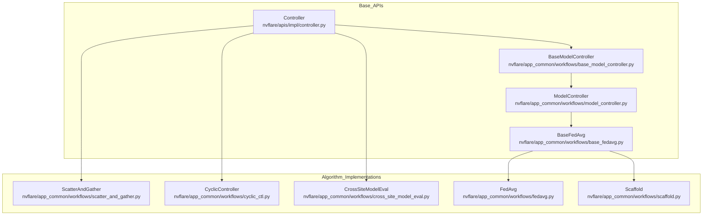
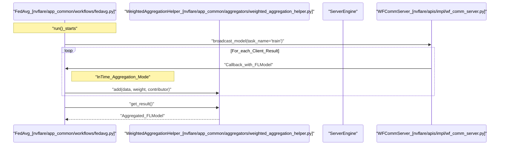

<!-- source: DeepWiki mcp.deepwiki.com · repo NVIDIA/NVFlare · page 5 Workflows and Controllers · fetched 2026-10-26 -->

# Workflows and Controllers

Relevant source files

The following files were used as context for generating this wiki page:

- [docs/programming_guide/memory_management.rst](docs/programming_guide/memory_management.rst)
- [docs/user_guide/agent_skills/index.rst](docs/user_guide/agent_skills/index.rst)
- [nvflare/apis/controller_spec.py](nvflare/apis/controller_spec.py)
- [nvflare/apis/fl_context.py](nvflare/apis/fl_context.py)
- [nvflare/apis/fl_exception.py](nvflare/apis/fl_exception.py)
- [nvflare/apis/impl/controller.py](nvflare/apis/impl/controller.py)
- [nvflare/apis/impl/wf_comm_server.py](nvflare/apis/impl/wf_comm_server.py)
- [nvflare/apis/wf_comm_spec.py](nvflare/apis/wf_comm_spec.py)
- [nvflare/app_common/aggregators/dxo_aggregator.py](nvflare/app_common/aggregators/dxo_aggregator.py)
- [nvflare/app_common/aggregators/intime_accumulate_model_aggregator.py](nvflare/app_common/aggregators/intime_accumulate_model_aggregator.py)
- [nvflare/app_common/aggregators/weighted_aggregation_helper.py](nvflare/app_common/aggregators/weighted_aggregation_helper.py)
- [nvflare/app_common/app_constant.py](nvflare/app_common/app_constant.py)
- [nvflare/app_common/widgets/job_stats_reporter.py](nvflare/app_common/widgets/job_stats_reporter.py)
- [nvflare/app_common/workflows/base_fedavg.py](nvflare/app_common/workflows/base_fedavg.py)
- [nvflare/app_common/workflows/base_model_controller.py](nvflare/app_common/workflows/base_model_controller.py)
- [nvflare/app_common/workflows/broadcast_operator.py](nvflare/app_common/workflows/broadcast_operator.py)
- [nvflare/app_common/workflows/cross_site_eval.py](nvflare/app_common/workflows/cross_site_eval.py)
- [nvflare/app_common/workflows/cross_site_model_eval.py](nvflare/app_common/workflows/cross_site_model_eval.py)
- [nvflare/app_common/workflows/cyclic.py](nvflare/app_common/workflows/cyclic.py)
- [nvflare/app_common/workflows/cyclic_ctl.py](nvflare/app_common/workflows/cyclic_ctl.py)
- [nvflare/app_common/workflows/fedavg.py](nvflare/app_common/workflows/fedavg.py)
- [nvflare/app_common/workflows/global_model_eval.py](nvflare/app_common/workflows/global_model_eval.py)
- [nvflare/app_common/workflows/model_controller.py](nvflare/app_common/workflows/model_controller.py)
- [nvflare/app_common/workflows/scaffold.py](nvflare/app_common/workflows/scaffold.py)
- [nvflare/app_common/workflows/scatter_and_gather.py](nvflare/app_common/workflows/scatter_and_gather.py)
- [nvflare/app_common/workflows/scatter_and_gather_scaffold.py](nvflare/app_common/workflows/scatter_and_gather_scaffold.py)
- [nvflare/app_opt/pt/recipes/scaffold.py](nvflare/app_opt/pt/recipes/scaffold.py)
- [nvflare/app_opt/pt/scaffold.py](nvflare/app_opt/pt/scaffold.py)
- [nvflare/app_opt/statistics/visualization/statistics_visualization.py](nvflare/app_opt/statistics/visualization/statistics_visualization.py)
- [nvflare/app_opt/tf/recipes/scaffold.py](nvflare/app_opt/tf/recipes/scaffold.py)
- [nvflare/fuel/utils/fsm.py](nvflare/fuel/utils/fsm.py)
- [nvflare/fuel/utils/memory_utils.py](nvflare/fuel/utils/memory_utils.py)
- [research/auto-fed-rl/src/autofedrl/autofedrl_scatter_and_gather.py](research/auto-fed-rl/src/autofedrl/autofedrl_scatter_and_gather.py)
- [research/fed-sm/jobs/fedsm_prostate/app/custom/workflows/scatter_and_gather_fedsm.py](research/fed-sm/jobs/fedsm_prostate/app/custom/workflows/scatter_and_gather_fedsm.py)
- [skills/nvflare-autofl/references/job-import-contract.md](skills/nvflare-autofl/references/job-import-contract.md)
- [tests/unit_test/apis/impl/controller_test.py](tests/unit_test/apis/impl/controller_test.py)
- [tests/unit_test/app_common/aggregators/in_time_accumulate_weighted_aggregator_test.py](tests/unit_test/app_common/aggregators/in_time_accumulate_weighted_aggregator_test.py)
- [tests/unit_test/app_common/aggregators/weighted_aggregation_helper_test.py](tests/unit_test/app_common/aggregators/weighted_aggregation_helper_test.py)
- [tests/unit_test/app_common/workflow/cyclic_ctl_test.py](tests/unit_test/app_common/workflow/cyclic_ctl_test.py)
- [tests/unit_test/app_common/workflow/fedavg_test.py](tests/unit_test/app_common/workflow/fedavg_test.py)
- [tests/unit_test/app_opt/pt/scaffold_test.py](tests/unit_test/app_opt/pt/scaffold_test.py)
- [tests/unit_test/fuel/utils/memory_utils_test.py](tests/unit_test/fuel/utils/memory_utils_test.py)
- [tests/unit_test/recipe/scaffold_recipe_test.py](tests/unit_test/recipe/scaffold_recipe_test.py)

## Purpose and Scope

This page documents the workflow and controller architecture in NVFlare, which orchestrates federated learning training rounds on the server side. Controllers define the training logic (when to send tasks, how to aggregate results, when to save models) while workflows implement specific FL algorithms (FedAvg, Cyclic, SCAFFOLD, etc.).

**Related pages:**
- For details on the Controller base class and lifecycle, see [Controller Architecture](#5.1)
- For the standard FedAvg implementation, see [ScatterAndGather and FedAvg](#5.2)
- For specialized algorithms like SCAFFOLD and Cyclic, see [Advanced Workflows](#5.3)
- For state sharing and the context system, see [FLContext and State Management](#5.4)
- For details on aggregation logic, see [Aggregators and Persistors](#5.5)
- For memory optimization strategies, see [Memory Management](#5.6)

---

## Controller Architecture

### Base Class Hierarchy

Controllers in NVFlare follow a multi-level inheritance hierarchy that provides increasing levels of abstraction. The modern stack centers around `FLModel` objects, while legacy workflows use `Shareable` and `DXO`.

**Diagram: Controller Class Hierarchy and Code Entities**

**Sources:** [nvflare/apis/impl/controller.py:25-25]() , [nvflare/app_common/workflows/base_model_controller.py:38-38]() , [nvflare/app_common/workflows/model_controller.py:23-23]() , [nvflare/app_common/workflows/base_fedavg.py:131-131]() , [nvflare/app_common/workflows/scatter_and_gather.py:36-36]() , [nvflare/app_common/workflows/fedavg.py:44-44]() , [nvflare/app_common/workflows/cyclic_ctl.py:43-43]() , [nvflare/app_common/workflows/scaffold.py:54-54]() , [nvflare/app_common/workflows/cross_site_model_eval.py:38-38]()

### Controller Lifecycle

Every controller implements lifecycle methods that are called by the `ServerEngine`. The primary entry point for logic is `control_flow` (legacy) or `run` (modern). The `Controller` class acts as a proxy for communication tasks like `broadcast` and `send` by delegating to a `WFCommSpec` implementation.

| Method | Source | Purpose |
|--------|--------|---------|
| `start_controller()` | [nvflare/app_common/workflows/base_model_controller.py:84-98]() | Initialize components (Engine, Persistor) and wrappers. |
| `control_flow()` | [nvflare/apis/impl/controller.py:169-170]() | Main training loop entry point for `Controller` subclasses. |
| `run()` | [nvflare/app_common/workflows/model_controller.py:38-40]() | Abstract main training routine for modern `ModelController` subclasses. |
| `broadcast_model()` | [nvflare/app_common/workflows/base_model_controller.py:109-136]() | Core method to send `FLModel` tasks to clients. |
| `send_model_and_wait()` | [nvflare/app_common/workflows/model_controller.py:42-72]() | Blocking call to send model and wait for results. |
| `set_communicator()` | [nvflare/apis/impl/controller.py:47-53]() | Links the controller to a `WFCommSpec` for task dispatch. |

**Sources:** [nvflare/apis/impl/controller.py:25-53]() , [nvflare/app_common/workflows/base_model_controller.py:84-136]() , [nvflare/app_common/workflows/model_controller.py:38-72]()

---

## ScatterAndGather and FedAvg

### ScatterAndGather (Legacy)
`ScatterAndGather` (SAG) implements a synchronous Federated Averaging workflow using `Shareable` objects. It waits for a minimum number of client responses (`min_clients`) before proceeding to aggregate results using an `Aggregator` component [nvflare/app_common/workflows/scatter_and_gather.py:36-62]().

**Sources:** [nvflare/app_common/workflows/scatter_and_gather.py:36-62]()

### FedAvg (Modern)
The modern `FedAvg` implementation inherits from `ModelController` and can use **InTime (streaming) aggregation**. Instead of collecting all results in a list, it can aggregate each client's `FLModel` immediately to improve memory efficiency [nvflare/app_common/workflows/fedavg.py:44-54]().

**Diagram: FedAvg Aggregation Flow**

**Sources:** [nvflare/app_common/workflows/fedavg.py:143-184]() , [nvflare/app_common/workflows/base_fedavg.py:107-128]() , [nvflare/apis/impl/wf_comm_server.py:91-107]()

**Key features:**
- **Early Stopping**: Uses `stop_cond` (e.g., "accuracy >= 80") to terminate training via `parse_compare_criteria` [nvflare/app_common/workflows/fedavg.py:123-124]() , [nvflare/app_common/workflows/fedavg.py:134-138]().
- **Tensor Disk Offload**: Can offload tensors to disk during streaming via `enable_tensor_disk_offload` to reduce peak server memory [nvflare/app_common/workflows/fedavg.py:90-93]() , [nvflare/app_common/workflows/fedavg.py:148-152]().

---

## Advanced Workflows

NVFlare supports several complex orchestration patterns:

*   **SCAFFOLD**: Corrects for client drift by maintaining global and local control variates. The modern `Scaffold` controller updates global controls using aggregated client control differences via `scaffold_aggregate_fn` [nvflare/app_common/workflows/scaffold.py:54-79]() , [nvflare/app_common/workflows/scaffold.py:149-164]().
*   **Cyclic**: Implements sequential weight transfer where a model is passed from one client to the next in a "relay" fashion using `RelayOrder` (FIXED, RANDOM, etc.) [nvflare/app_common/workflows/cyclic_ctl.py:34-43]() , [nvflare/app_common/workflows/cyclic_ctl.py:73-82]().
*   **Cross-Site Model Evaluation**: Orchestrates the evaluation of multiple models (e.g., global models vs client models) across participating sites using a `ModelLocator` [nvflare/app_common/workflows/cross_site_model_eval.py:38-72]().

**Sources:** [nvflare/app_common/workflows/scaffold.py:54-164]() , [nvflare/app_common/workflows/cyclic_ctl.py:34-82]() , [nvflare/app_common/workflows/cross_site_model_eval.py:38-72]()

---

## FLContext and State Management

`FLContext` is the primary mechanism for sharing state between components (Controllers, Aggregators, Filters).

*   **Stickiness**: Sticky props become available in all future FL Contexts within the same job lifecycle [nvflare/apis/fl_context.py:73-74]().
*   **Visibility**: Properties can be `private` (visible only to local components) or `public` (visible to remote components) [nvflare/apis/fl_context.py:70-71]().
*   **FLContextManager**: Orchestrates the creation of new contexts and ensures sticky properties are correctly propagated via `check_sticker` and `update_sticker` [nvflare/apis/fl_context.py:122-127]() , [nvflare/apis/fl_context.py:152-164]().

**Sources:** [nvflare/apis/fl_context.py:63-76]() , [nvflare/apis/fl_context.py:122-164]()

---

## Aggregators and Persistors

*   **Aggregators**:
    *   `WeightedAggregationHelper`: Utility used to perform weighted averaging of parameters and metrics [nvflare/app_common/workflows/base_fedavg.py:114-128]().
    *   `ModelAggregator`: Abstract base class for custom aggregators [nvflare/app_common/aggregators/model_aggregator.py:21-21](). `FedAvg` can be configured with a custom `ModelAggregator` [nvflare/app_common/workflows/fedavg.py:120-120]().
*   **Persistors**:
    *   `LearnablePersistor`: Base class for components loading/saving model state [nvflare/app_common/abstract/learnable_persistor.py:23-23]().
    *   `BaseModelController` retrieves the `LearnablePersistor` instance from the engine via `persistor_id` [nvflare/app_common/workflows/base_model_controller.py:90-97]().

**Sources:** [nvflare/app_common/workflows/base_fedavg.py:114-128]() , [nvflare/app_common/workflows/fedavg.py:120-120]() , [nvflare/app_common/workflows/base_model_controller.py:90-97]()

---

## Memory Management

NVFlare implements several strategies to manage server-side memory:

*   **`cleanup_memory`**: Triggers Python GC and `malloc_trim` to return memory to the OS [nvflare/fuel/utils/memory_utils.py:30-31]() (imported in [nvflare/app_common/workflows/scatter_and_gather.py:30-30]()).
*   **`memory_gc_rounds`**: Configuration to trigger cleanup periodically (e.g., every round) [nvflare/app_common/workflows/base_fedavg.py:178-184]() , [nvflare/app_common/workflows/cyclic_ctl.py:128-133]().
*   **Tensor Disk Offload**: `FedAvg` and `Scaffold` can offload tensors to disk during FOBS streaming to reduce memory pressure for large models [nvflare/app_common/workflows/fedavg.py:148-152]() , [nvflare/app_common/workflows/scaffold.py:97-111]().

**Sources:** [nvflare/fuel/utils/memory_utils.py:30-31]() , [nvflare/app_common/workflows/base_fedavg.py:178-184]() , [nvflare/app_common/workflows/fedavg.py:148-152]() , [nvflare/app_common/workflows/scaffold.py:97-111]()

---

