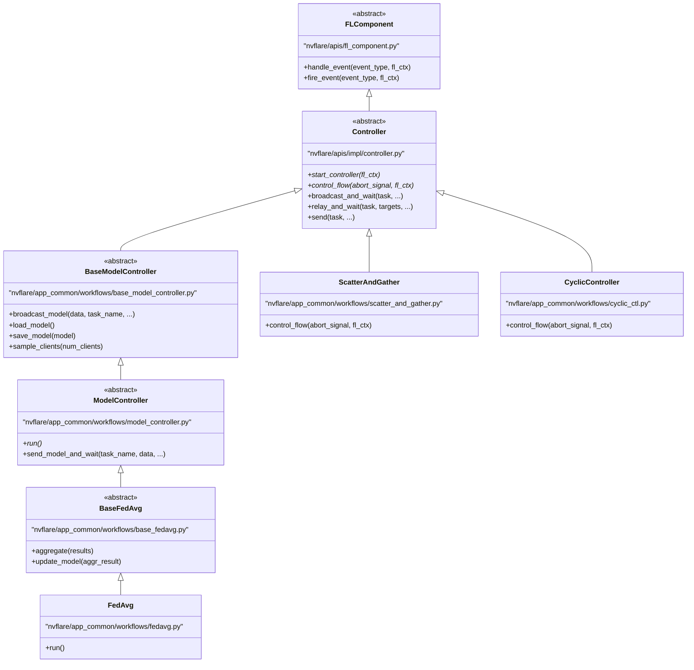
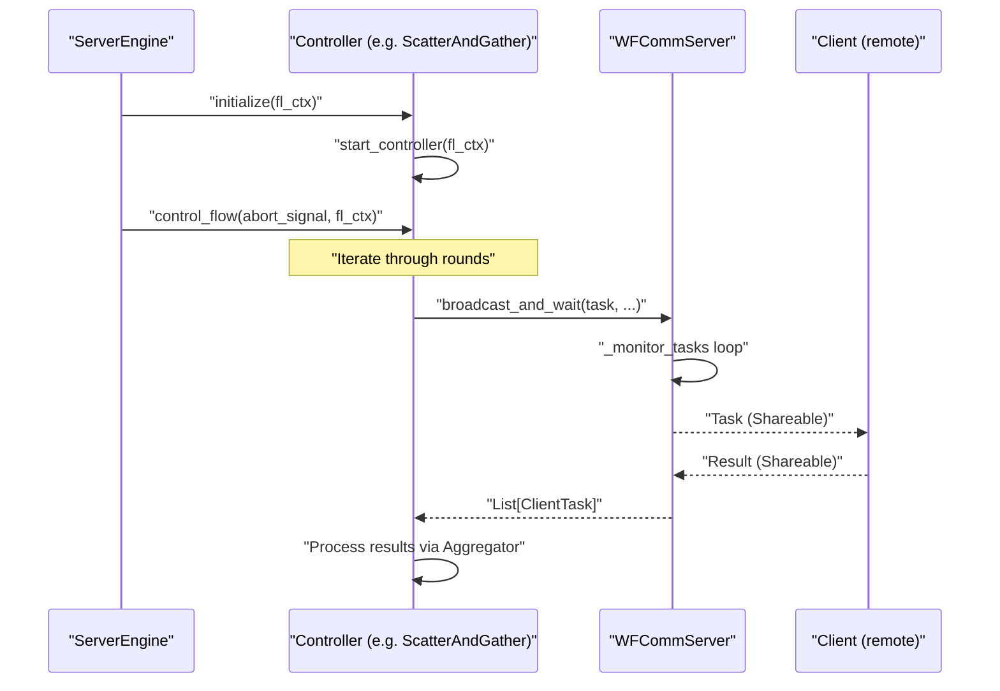

<!-- source: DeepWiki mcp.deepwiki.com · repo NVIDIA/NVFlare · page 5.1 Controller Architecture · fetched 2026-10-26 -->

# Controller Architecture

Relevant source files

The following files were used as context for generating this wiki page:

- [docs/programming_guide/controllers/model_controller.rst](docs/programming_guide/controllers/model_controller.rst)
- [docs/programming_guide/execution_api_type.rst](docs/programming_guide/execution_api_type.rst)
- [docs/programming_guide/execution_api_type/client_api.rst](docs/programming_guide/execution_api_type/client_api.rst)
- [docs/programming_guide/execution_api_type/model_learner.rst](docs/programming_guide/execution_api_type/model_learner.rst)
- [docs/programming_guide/fed_job_api.rst](docs/programming_guide/fed_job_api.rst)
- [docs/user_guide/data_scientist_guide/client_api_usage.rst](docs/user_guide/data_scientist_guide/client_api_usage.rst)
- [examples/hello-world/hello-numpy-cross-val/generate_pretrain_models.py](examples/hello-world/hello-numpy-cross-val/generate_pretrain_models.py)
- [nvflare/apis/controller_spec.py](nvflare/apis/controller_spec.py)
- [nvflare/apis/fl_context.py](nvflare/apis/fl_context.py)
- [nvflare/apis/fl_exception.py](nvflare/apis/fl_exception.py)
- [nvflare/apis/impl/controller.py](nvflare/apis/impl/controller.py)
- [nvflare/apis/impl/wf_comm_server.py](nvflare/apis/impl/wf_comm_server.py)
- [nvflare/apis/wf_comm_spec.py](nvflare/apis/wf_comm_spec.py)
- [nvflare/app_common/abstract/model_learner.py](nvflare/app_common/abstract/model_learner.py)
- [nvflare/app_common/ccwf/comps/np_trainer.py](nvflare/app_common/ccwf/comps/np_trainer.py)
- [nvflare/app_common/ccwf/val_result_manager.py](nvflare/app_common/ccwf/val_result_manager.py)
- [nvflare/app_common/np/np_formatter.py](nvflare/app_common/np/np_formatter.py)
- [nvflare/app_common/np/np_model_locator.py](nvflare/app_common/np/np_model_locator.py)
- [nvflare/app_common/np/np_model_persistor.py](nvflare/app_common/np/np_model_persistor.py)
- [nvflare/app_common/np/np_trainer.py](nvflare/app_common/np/np_trainer.py)
- [nvflare/app_common/np/np_validator.py](nvflare/app_common/np/np_validator.py)
- [nvflare/app_common/np/recipes/__init__.py](nvflare/app_common/np/recipes/__init__.py)
- [nvflare/app_common/np/recipes/lr/__init__.py](nvflare/app_common/np/recipes/lr/__init__.py)
- [nvflare/app_common/np/recipes/lr/fedavg.py](nvflare/app_common/np/recipes/lr/fedavg.py)
- [nvflare/app_common/workflows/broadcast_operator.py](nvflare/app_common/workflows/broadcast_operator.py)
- [nvflare/app_common/workflows/cross_site_model_eval.py](nvflare/app_common/workflows/cross_site_model_eval.py)
- [nvflare/app_common/workflows/cyclic_ctl.py](nvflare/app_common/workflows/cyclic_ctl.py)
- [nvflare/app_common/workflows/global_model_eval.py](nvflare/app_common/workflows/global_model_eval.py)
- [nvflare/app_common/workflows/lr/np_persistor.py](nvflare/app_common/workflows/lr/np_persistor.py)
- [nvflare/app_common/workflows/scatter_and_gather.py](nvflare/app_common/workflows/scatter_and_gather.py)
- [nvflare/app_common/workflows/scatter_and_gather_scaffold.py](nvflare/app_common/workflows/scatter_and_gather_scaffold.py)
- [nvflare/app_opt/he/cross_site_model_eval.py](nvflare/app_opt/he/cross_site_model_eval.py)
- [nvflare/app_opt/statistics/visualization/statistics_visualization.py](nvflare/app_opt/statistics/visualization/statistics_visualization.py)
- [nvflare/fuel/utils/deprecated.py](nvflare/fuel/utils/deprecated.py)
- [nvflare/fuel/utils/fsm.py](nvflare/fuel/utils/fsm.py)
- [nvflare/job_config/api.py](nvflare/job_config/api.py)
- [research/auto-fed-rl/src/autofedrl/autofedrl_scatter_and_gather.py](research/auto-fed-rl/src/autofedrl/autofedrl_scatter_and_gather.py)
- [research/fed-sm/jobs/fedsm_prostate/app/custom/workflows/scatter_and_gather_fedsm.py](research/fed-sm/jobs/fedsm_prostate/app/custom/workflows/scatter_and_gather_fedsm.py)
- [tests/unit_test/apis/impl/controller_test.py](tests/unit_test/apis/impl/controller_test.py)
- [tests/unit_test/apis/impl/wf_comm_server_test.py](tests/unit_test/apis/impl/wf_comm_server_test.py)
- [tests/unit_test/app_common/abstract/model_learner_test.py](tests/unit_test/app_common/abstract/model_learner_test.py)
- [tests/unit_test/app_common/ccwf/ccwf_np_trainer_test.py](tests/unit_test/app_common/ccwf/ccwf_np_trainer_test.py)
- [tests/unit_test/app_common/np/np_trainer_test.py](tests/unit_test/app_common/np/np_trainer_test.py)
- [tests/unit_test/app_common/workflow/cyclic_ctl_test.py](tests/unit_test/app_common/workflow/cyclic_ctl_test.py)
- [tests/unit_test/fuel/utils/deprecated_test.py](tests/unit_test/fuel/utils/deprecated_test.py)
- [tests/unit_test/job_config/fed_job_test.py](tests/unit_test/job_config/fed_job_test.py)

## Purpose and Scope

This page documents the server-side controller architecture in NVIDIA FLARE: the base `Controller` class, the high-level `ModelController` abstraction, and the `control_flow` lifecycle managed by the server engine. Controllers are the primary mechanism by which a federated learning workflow is defined on the server—they orchestrate task creation, distribution to clients, result collection, and training round logic.

For details on specific built-in workflows, see [ScatterAndGather and FedAvg](5.2) and [Advanced Workflows](5.3). For the client-side counterpart that executes tasks, see [Executor Framework](6.1).

---

## Controller Abstractions

NVFLARE provides different levels of controller abstraction to balance flexibility and ease of use. While legacy workflows used the raw `Controller` and `Shareable` objects, modern workflows utilize `FLModel` for a more framework-agnostic data exchange.

| API | Base Class | Data Type | Abstract Method | Location |
|---|---|---|---|---|
| Low-level | `Controller` | `Shareable` | `control_flow()` | [nvflare/apis/impl/controller.py:25-25]() |
| High-level | `BaseModelController` | `FLModel` | N/A | [nvflare/app_common/workflows/base_model_controller.py:38-38]() |
| Workflow-specific | `ModelController` | `FLModel` | `run()` | [nvflare/app_common/workflows/model_controller.py:23-23]() |
| Legacy Workflow | `ScatterAndGather` | `Shareable` | `control_flow()` | [nvflare/app_common/workflows/scatter_and_gather.py:36-36]() |

The low-level `Controller` exposes raw task management primitives. Workflows like `ScatterAndGather` [nvflare/app_common/workflows/scatter_and_gather.py:36-36]() and `CyclicController` [nvflare/app_common/workflows/cyclic_ctl.py:43-43]() inherit directly from this to implement specific orchestration logic via the `control_flow` loop.

Modern workflows such as `FedAvg` [nvflare/app_common/workflows/fedavg.py:43-43]() and `Scaffold` [nvflare/app_common/workflows/scaffold.py:54-54]() inherit from `BaseFedAvg` [nvflare/app_common/workflows/base_fedavg.py:131-131](), which itself is a `ModelController`. These classes use `FLModel` to encapsulate weights, metrics, and metadata.

Sources: [nvflare/apis/impl/controller.py:25-25](), [nvflare/app_common/workflows/scatter_and_gather.py:36-36](), [nvflare/app_common/workflows/cyclic_ctl.py:43-43](), [nvflare/app_common/workflows/model_controller.py:23-23](), [nvflare/app_common/workflows/base_model_controller.py:38-38](), [nvflare/app_common/workflows/base_fedavg.py:131-131]()

---

## Class Hierarchy

The hierarchy bridges the generic component system to specialized federated learning workflows.

**Controller Class Hierarchy**

Sources: [nvflare/apis/impl/controller.py:25-25](), [nvflare/app_common/workflows/scatter_and_gather.py:36-36](), [nvflare/app_common/workflows/model_controller.py:23-23](), [nvflare/app_common/workflows/base_model_controller.py:38-38](), [nvflare/app_common/workflows/base_fedavg.py:131-131](), [nvflare/app_common/workflows/cyclic_ctl.py:43-43]()

---

## Controller Lifecycle

Every `Controller` subclass follows a lifecycle managed by the `ServerEngine`.

| Phase | Method | Purpose |
|---|---|---|
| **Initialization** | `initialize(fl_ctx)` | Sets the engine reference and calls `start_controller`. [nvflare/apis/impl/controller.py:38-45]() |
| **Start-up** | `start_controller(fl_ctx)` | Resolve component references (Persistors, Aggregators) and load initial state. [nvflare/app_common/workflows/scatter_and_gather.py:136-155]() |
| **Execution** | `control_flow(abort_signal, fl_ctx)` | The main loop for low-level controllers. [nvflare/app_common/workflows/scatter_and_gather.py:167-240]() |
| **Execution (Model)** | `run()` | The main routine for `ModelController` workflows. [nvflare/app_common/workflows/model_controller.py:37-40]() |

The `WFCommServer` [nvflare/apis/impl/wf_comm_server.py:91-91]() acts as the communicator, managing the actual task lifecycle and monitoring task status in a dedicated thread `_monitor_tasks` [nvflare/apis/impl/wf_comm_server.py:106-106]().

**Controller Execution Sequence**

Sources: [nvflare/apis/impl/controller.py:38-46](), [nvflare/apis/impl/wf_comm_server.py:91-107](), [nvflare/app_common/workflows/scatter_and_gather.py:167-240](), [nvflare/app_common/workflows/model_controller.py:37-40]()

---

## Task Management Primitives

The `Controller` base class provides several dispatch patterns via its `communicator` (usually `WFCommServer`).

### Dispatch Patterns
- **`broadcast_and_wait`**: Sends a task to clients and blocks until `min_responses` are received or a timeout occurs. [nvflare/apis/impl/controller.py:65-76]()
- **`send_and_wait`**: Sends a task to specific targets in a defined `SendOrder`. [nvflare/apis/impl/controller.py:91-100]()
- **`relay_and_wait`**: A specialized pattern for cyclic workflows where each client receives the result of the previous client. [nvflare/apis/impl/controller.py:117-136]()

### The `Task` and `ClientTask`
- **`Task`**: The high-level definition of work, containing the payload `data` (`Shareable`) and `timeout`. [nvflare/apis/controller_spec.py:68-113]()
- **`ClientTask`**: Records the processing information of a task for a specific client, including send time and results. [nvflare/apis/controller_spec.py:168-185]()

### Job API Integration
Controllers support the `FedJob` API via the `add_to_fed_job` method, allowing them to be added to job configurations Pythonically. [nvflare/apis/impl/controller.py:174-185]()

Sources: [nvflare/apis/impl/controller.py:55-136](), [nvflare/apis/impl/controller.py:174-185](), [nvflare/apis/controller_spec.py:68-185](), [nvflare/job_config/api.py:178-183]()

---

## Workflow Implementation Examples

### ScatterAndGather (Legacy)
The `ScatterAndGather` workflow implements standard Federated Averaging. It uses an `Aggregator`, `Persistor`, and `ShareableGenerator`.
- **Initialization**: Loads the global model via the persistor. [nvflare/app_common/workflows/scatter_and_gather.py:149-152]()
- **Aggregation**: Results are aggregated at the end of each round. [nvflare/app_common/workflows/scatter_and_gather.py:214-220]()

### CyclicController (Legacy)
The `CyclicController` demonstrates the `relay` primitive. It passes the model sequentially through clients in a specific `RelayOrder` (FIXED, RANDOM, or RANDOM_WITHOUT_SAME_IN_A_ROW). [nvflare/app_common/workflows/cyclic_ctl.py:34-40]()

### ScatterAndGatherScaffold
Extends `ScatterAndGather` to implement the SCAFFOLD algorithm by managing global control weights in addition to model weights. [nvflare/app_common/workflows/scatter_and_gather_scaffold.py:31-31]()

Sources: [nvflare/app_common/workflows/scatter_and_gather.py:36-240](), [nvflare/app_common/workflows/cyclic_ctl.py:43-230](), [nvflare/app_common/workflows/scatter_and_gather_scaffold.py:31-143]()

---

## Memory and State Management

### Resource Optimization
- **Memory Cleanup**: Controllers trigger `cleanup_memory()` (performing `gc.collect()` and `malloc_trim`) every N rounds to prevent server-side memory bloat. [nvflare/app_common/workflows/scatter_and_gather.py:236-240](), [nvflare/app_common/workflows/cyclic_ctl.py:128-133]()
- **Tensor Disk Offload**: `ScatterAndGather` supports downloading tensors to disk during FOBS streaming instead of deserializing into memory. [nvflare/app_common/workflows/scatter_and_gather.py:91-93]()
- **In-flight Cleanup**: `WFCommServer` ensures that active disk tensor downloads are cleaned up if a workflow is aborted or finalized. [nvflare/apis/impl/wf_comm_server.py:135-147]()

### State Persistence
- **FLContext**: Manages shared state between components. Properties can be `sticky` (persist across contexts) or `private` (local to the server). [nvflare/apis/fl_context.py:63-76]()
- **Context Properties**: Controllers use properties like `AppConstants.CURRENT_ROUND` and `AppConstants.GLOBAL_MODEL` to share state with other server components. [nvflare/app_common/workflows/scatter_and_gather.py:186-187]()

Sources: [nvflare/app_common/workflows/scatter_and_gather.py:91-240](), [nvflare/app_common/workflows/cyclic_ctl.py:128-133](), [nvflare/apis/impl/wf_comm_server.py:135-147](), [nvflare/apis/fl_context.py:63-76]()

---

