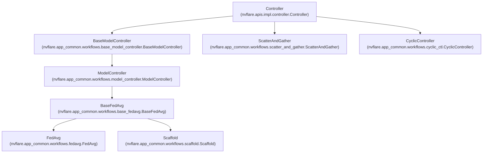
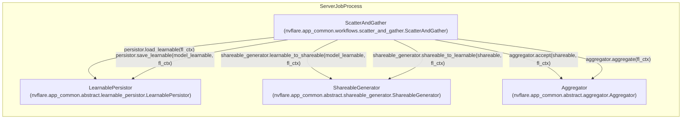
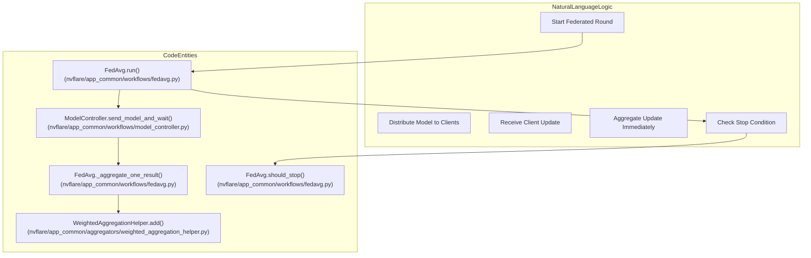
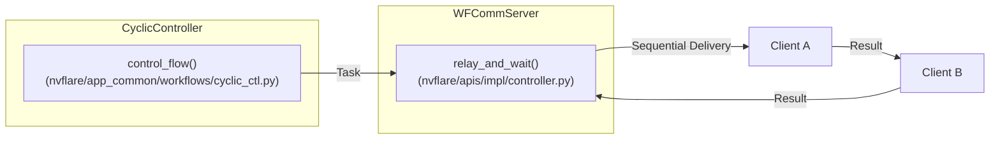

<!-- source: DeepWiki mcp.deepwiki.com · repo NVIDIA/NVFlare · page 5.2 ScatterAndGather and FedAvg · fetched 2026-10-26 -->

# ScatterAndGather and FedAvg

Relevant source files

The following files were used as context for generating this wiki page:

- [docs/programming_guide/memory_management.rst](docs/programming_guide/memory_management.rst)
- [docs/user_guide/agent_skills/index.rst](docs/user_guide/agent_skills/index.rst)
- [nvflare/apis/controller_spec.py](nvflare/apis/controller_spec.py)
- [nvflare/apis/fl_context.py](nvflare/apis/fl_context.py)
- [nvflare/apis/fl_exception.py](nvflare/apis/fl_exception.py)
- [nvflare/apis/impl/controller.py](nvflare/apis/impl/controller.py)
- [nvflare/apis/impl/wf_comm_server.py](nvflare/apis/impl/wf_comm_server.py)
- [nvflare/apis/wf_comm_spec.py](nvflare/apis/wf_comm_spec.py)
- [nvflare/app_common/aggregators/dxo_aggregator.py](nvflare/app_common/aggregators/dxo_aggregator.py)
- [nvflare/app_common/aggregators/intime_accumulate_model_aggregator.py](nvflare/app_common/aggregators/intime_accumulate_model_aggregator.py)
- [nvflare/app_common/aggregators/weighted_aggregation_helper.py](nvflare/app_common/aggregators/weighted_aggregation_helper.py)
- [nvflare/app_common/app_constant.py](nvflare/app_common/app_constant.py)
- [nvflare/app_common/widgets/job_stats_reporter.py](nvflare/app_common/widgets/job_stats_reporter.py)
- [nvflare/app_common/workflows/base_fedavg.py](nvflare/app_common/workflows/base_fedavg.py)
- [nvflare/app_common/workflows/base_model_controller.py](nvflare/app_common/workflows/base_model_controller.py)
- [nvflare/app_common/workflows/broadcast_operator.py](nvflare/app_common/workflows/broadcast_operator.py)
- [nvflare/app_common/workflows/cross_site_eval.py](nvflare/app_common/workflows/cross_site_eval.py)
- [nvflare/app_common/workflows/cross_site_model_eval.py](nvflare/app_common/workflows/cross_site_model_eval.py)
- [nvflare/app_common/workflows/cyclic.py](nvflare/app_common/workflows/cyclic.py)
- [nvflare/app_common/workflows/cyclic_ctl.py](nvflare/app_common/workflows/cyclic_ctl.py)
- [nvflare/app_common/workflows/fedavg.py](nvflare/app_common/workflows/fedavg.py)
- [nvflare/app_common/workflows/global_model_eval.py](nvflare/app_common/workflows/global_model_eval.py)
- [nvflare/app_common/workflows/model_controller.py](nvflare/app_common/workflows/model_controller.py)
- [nvflare/app_common/workflows/scaffold.py](nvflare/app_common/workflows/scaffold.py)
- [nvflare/app_common/workflows/scatter_and_gather.py](nvflare/app_common/workflows/scatter_and_gather.py)
- [nvflare/app_common/workflows/scatter_and_gather_scaffold.py](nvflare/app_common/workflows/scatter_and_gather_scaffold.py)
- [nvflare/app_opt/pt/recipes/scaffold.py](nvflare/app_opt/pt/recipes/scaffold.py)
- [nvflare/app_opt/pt/scaffold.py](nvflare/app_opt/pt/scaffold.py)
- [nvflare/app_opt/statistics/visualization/statistics_visualization.py](nvflare/app_opt/statistics/visualization/statistics_visualization.py)
- [nvflare/app_opt/tf/recipes/scaffold.py](nvflare/app_opt/tf/recipes/scaffold.py)
- [nvflare/fuel/utils/fsm.py](nvflare/fuel/utils/fsm.py)
- [nvflare/fuel/utils/memory_utils.py](nvflare/fuel/utils/memory_utils.py)
- [research/auto-fed-rl/src/autofedrl/autofedrl_scatter_and_gather.py](research/auto-fed-rl/src/autofedrl/autofedrl_scatter_and_gather.py)
- [research/fed-sm/jobs/fedsm_prostate/app/custom/workflows/scatter_and_gather_fedsm.py](research/fed-sm/jobs/fedsm_prostate/app/custom/workflows/scatter_and_gather_fedsm.py)
- [skills/nvflare-autofl/references/job-import-contract.md](skills/nvflare-autofl/references/job-import-contract.md)
- [tests/unit_test/apis/impl/controller_test.py](tests/unit_test/apis/impl/controller_test.py)
- [tests/unit_test/app_common/aggregators/in_time_accumulate_weighted_aggregator_test.py](tests/unit_test/app_common/aggregators/in_time_accumulate_weighted_aggregator_test.py)
- [tests/unit_test/app_common/aggregators/weighted_aggregation_helper_test.py](tests/unit_test/app_common/aggregators/weighted_aggregation_helper_test.py)
- [tests/unit_test/app_common/workflow/cyclic_ctl_test.py](tests/unit_test/app_common/workflow/cyclic_ctl_test.py)
- [tests/unit_test/app_common/workflow/fedavg_test.py](tests/unit_test/app_common/workflow/fedavg_test.py)
- [tests/unit_test/app_opt/pt/scaffold_test.py](tests/unit_test/app_opt/pt/scaffold_test.py)
- [tests/unit_test/fuel/utils/memory_utils_test.py](tests/unit_test/fuel/utils/memory_utils_test.py)
- [tests/unit_test/recipe/scaffold_recipe_test.py](tests/unit_test/recipe/scaffold_recipe_test.py)

## Purpose and Scope

This document describes the primary implementations of Federated Averaging in NVIDIA FLARE: `ScatterAndGather` and `FedAvg`. Both controllers implement the [FederatedAveraging algorithm](https://arxiv.org/abs/1602.05629), but differ in their architecture, API design, and feature sets.

- **ScatterAndGather**: Legacy implementation using the `Controller` base class with `Shareable`-based APIs. [nvflare/app_common/workflows/scatter_and_gather.py:36-55]()
- **FedAvg**: Modern implementation using the `ModelController` abstraction with `FLModel`-based APIs and InTime aggregation. [nvflare/app_common/workflows/fedavg.py:44-96]()

For information about the base controller architecture, see [Controller Architecture](5.1). For details on aggregators and persistors, see [Aggregators and Persistors](5.5).

---

## Architecture Comparison

### Class Hierarchy

The transition from legacy to modern workflows involved moving from generic `Shareable` dictionary-based communication to a typed `FLModel` structure managed by `ModelController`.

**Class Relationship Diagram**

**Sources:** [nvflare/app_common/workflows/base_model_controller.py:38-45](), [nvflare/app_common/workflows/model_controller.py:23-35](), [nvflare/app_common/workflows/base_fedavg.py:131-140](), [nvflare/app_common/workflows/scatter_and_gather.py:36-55](), [nvflare/app_common/workflows/fedavg.py:44-112](), [nvflare/app_common/workflows/scaffold.py:54-80](), [nvflare/app_common/workflows/cyclic_ctl.py:43-57]()

### Key Architectural Differences

| Aspect | ScatterAndGather | FedAvg |
|--------|------------------|--------|
| **Base Class** | `Controller` [nvflare/app_common/workflows/scatter_and_gather.py:36]() | `ModelController` → `BaseFedAvg` [nvflare/app_common/workflows/fedavg.py:44]() |
| **Data Format** | `Shareable` [nvflare/apis/shareable.py:27-28]() | `FLModel` [nvflare/app_common/abstract/fl_model.py:20-28]() |
| **Aggregation** | Component-based (`Aggregator`) [nvflare/app_common/workflows/scatter_and_gather.py:43]() | InTime streaming or `ModelAggregator` [nvflare/app_common/workflows/fedavg.py:50-56]() |
| **API Level** | Low-level (`broadcast_and_wait`) [nvflare/apis/impl/controller.py:65-73]() | High-level (`send_model_and_wait`) [nvflare/app_common/workflows/model_controller.py:42-72]() |
| **Early Stopping** | Not supported | Built-in with `stop_cond` [nvflare/app_common/workflows/fedavg.py:80-82]() |
| **Memory Management** | `memory_gc_rounds` (Manual) [nvflare/app_common/workflows/scatter_and_gather.py:89]() | `memory_gc_rounds` (Inherited) [nvflare/app_common/workflows/base_fedavg.py:164-174]() |

**Sources:** [nvflare/app_common/workflows/scatter_and_gather.py:36-93](), [nvflare/app_common/workflows/fedavg.py:44-112](), [nvflare/app_common/workflows/base_fedavg.py:131-176]()

---

## ScatterAndGather Controller (Legacy)

### Overview
`ScatterAndGather` (SAG) orchestrates training by explicitly managing three primary components: an `Aggregator`, a `LearnablePersistor`, and a `ShareableGenerator`. It operates on the `ModelLearnable` structure, which is converted to a `Shareable` for network transport. [nvflare/app_common/workflows/scatter_and_gather.py:56-62]()

### Component Interaction

**Sources:** [nvflare/app_common/workflows/scatter_and_gather.py:149-165](), [nvflare/app_common/workflows/scatter_and_gather.py:280-310]()

### Execution Flow
1. **Initialization**: Loads the initial global model via the `persistor_id` and converts it using the `shareable_generator_id`. [nvflare/app_common/workflows/scatter_and_gather.py:149-165]()
2. **Control Loop**: For each round, it broadcasts a `train` task to clients using `broadcast_and_wait`. [nvflare/app_common/workflows/scatter_and_gather.py:211-250]()
3. **Result Processing**: As clients return results, the controller passes the `Shareable` to the `Aggregator.accept()` method. [nvflare/app_common/workflows/scatter_and_gather.py:359-392]()
4. **Aggregation**: Once `min_clients` or `wait_time` is reached, it calls `Aggregator.aggregate()` and converts the result back to a `ModelLearnable`. [nvflare/app_common/workflows/scatter_and_gather.py:280-310]()

---

## FedAvg Controller (Modern)

### Overview
`FedAvg` is the recommended implementation for most use cases. It simplifies the workflow by using `FLModel` directly and implementing **InTime Aggregation**. This allows the server to aggregate updates as they arrive, significantly reducing peak memory usage. [nvflare/app_common/workflows/fedavg.py:44-54]()

### InTime Aggregation Logic
Instead of collecting a list of results, `FedAvg` uses a `WeightedAggregationHelper` or a `ModelAggregator` to update the global model state incrementally within the `_aggregate_one_result` callback. [nvflare/app_common/workflows/fedavg.py:213-263]()

**Natural Language to Code Entity Space: FedAvg Workflow**

**Sources:** [nvflare/app_common/workflows/fedavg.py:144-211](), [nvflare/app_common/workflows/fedavg.py:213-263](), [nvflare/app_common/workflows/fedavg.py:285-314](), [nvflare/app_common/workflows/model_controller.py:42-72]()

### Key Features
- **Tensor Disk Offload**: Supports `enable_tensor_disk_offload`, which downloads tensors to disk during FOBS streaming to further reduce memory pressure from ~$N \times$ model size to ~$1 \times$. [nvflare/app_common/workflows/fedavg.py:90-93](), [nvflare/app_common/utils/tensor_disk_offload_context.py:29-31]()
- **Early Stopping**: Uses `stop_cond` (e.g., `"accuracy >= 80"`) and `patience` to terminate training early if metrics meet criteria or stop improving. [nvflare/app_common/workflows/fedavg.py:123-132]()
- **Aggregation Weights**: Allows defining per-client weights via `aggregation_weights`. [nvflare/app_common/workflows/fedavg.py:129]()

### Advanced Configuration

| Parameter | Functionality |
|-----------|---------------|
| `exclude_vars` | Regex pattern to skip certain variables (e.g., batch norm stats) during aggregation. [nvflare/app_common/workflows/fedavg.py:128]() |
| `aggregation_weights` | Dictionary mapping client names to specific weights. [nvflare/app_common/workflows/fedavg.py:129]() |
| `memory_gc_rounds` | Frequency of manual Python garbage collection and `malloc_trim`. [nvflare/app_common/workflows/base_fedavg.py:182-184]() |

---

## Scaffold Implementation

The `Scaffold` controller extends `BaseFedAvg` to implement the SCAFFOLD algorithm, which uses control variates to correct for "client drift" in heterogeneous data settings. [nvflare/app_common/workflows/scaffold.py:54-79]()

### SCAFFOLD Execution Flow
1. **Initialize**: Sets up global control weights `_global_ctrl_weights` as zeros based on the initial model parameters. [nvflare/app_common/workflows/scaffold.py:85-94]()
2. **Broadcasting**: Attaches the global control term to the model metadata using `AlgorithmConstants.SCAFFOLD_CTRL_GLOBAL`. [nvflare/app_common/workflows/scaffold.py:124]()
3. **Aggregation**: Uses `scaffold_aggregate_fn` to aggregate both the model weights and the SCAFFOLD control terms. [nvflare/app_common/workflows/scaffold.py:149-164]()
4. **Update**: Updates the global control weights using the aggregated control differences. [nvflare/app_common/workflows/scaffold.py:133-139]()

**Sources:** [nvflare/app_common/workflows/scaffold.py:85-143](), [nvflare/app_common/workflows/scaffold.py:149-170]()

---

## Cyclic Workflow

The `CyclicController` implements a relay-based workflow where the model is passed sequentially between clients. [nvflare/app_common/workflows/cyclic_ctl.py:58-60]()

### Relay Order Modes
- **FIXED**: Same client order for every round. [nvflare/app_common/workflows/cyclic_ctl.py:35]()
- **RANDOM**: Random order for every round. [nvflare/app_common/workflows/cyclic_ctl.py:36]()
- **RANDOM_WITHOUT_SAME_IN_A_ROW**: Shuffled order ensuring no repetition in consecutive rounds. [nvflare/app_common/workflows/cyclic_ctl.py:37]()

**Code Entity Space: Cyclic Relay**

**Sources:** [nvflare/app_common/workflows/cyclic_ctl.py:151-180](), [nvflare/apis/impl/controller.py:116-136]()

---

## Comparison Summary

| Feature | ScatterAndGather | FedAvg |
| :--- | :--- | :--- |
| **Memory Management** | Collects all `Shareable` objects before aggregation. [nvflare/app_common/workflows/scatter_and_gather.py:280]() | **InTime Aggregation**: Aggregates as results arrive. [nvflare/app_common/workflows/fedavg.py:50]() |
| **Data Abstraction** | `ModelLearnable` / `Shareable` [nvflare/app_common/workflows/scatter_and_gather.py:59-61]() | `FLModel` [nvflare/app_common/abstract/fl_model.py:20-28]() |
| **Model Persistence** | Requires `LearnablePersistor` component. [nvflare/app_common/workflows/scatter_and_gather.py:59]() | Can use simple `model` dict and `save_filename`. [nvflare/app_common/workflows/fedavg.py:63-66]() |
| **Extensibility** | Hard-coded component lifecycle. | Supports custom `ModelAggregator` objects. [nvflare/app_common/workflows/fedavg.py:56]() |

**Sources:** [nvflare/app_common/workflows/scatter_and_gather.py:36-55](), [nvflare/app_common/workflows/fedavg.py:98-132](), [nvflare/app_common/workflows/base_fedavg.py:131-166]()

---

