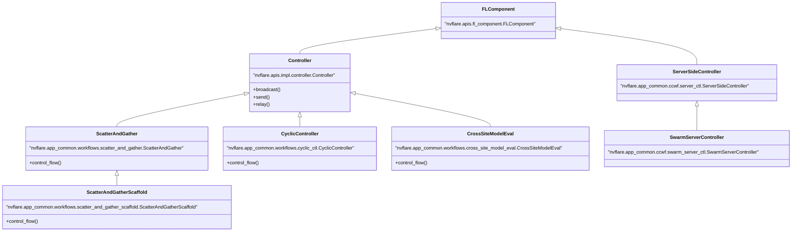
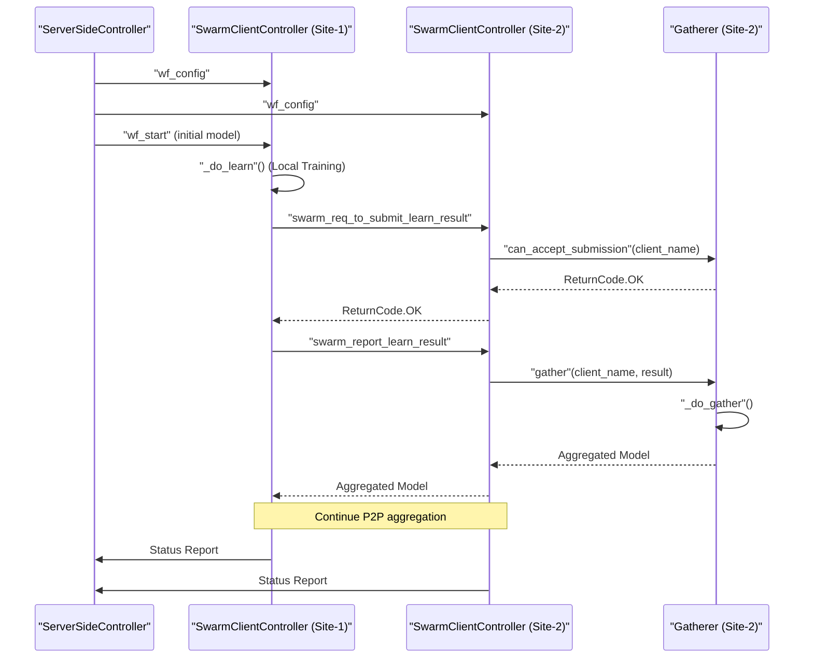

<!-- source: DeepWiki mcp.deepwiki.com · repo NVIDIA/NVFlare · page 5.3 Advanced Workflows · fetched 2026-10-26 -->

# Advanced Workflows

Relevant source files

The following files were used as context for generating this wiki page:

- [docs/programming_guide/controllers/client_controlled_workflows.rst](docs/programming_guide/controllers/client_controlled_workflows.rst)
- [docs/user_guide/data_scientist_guide/available_recipes.rst](docs/user_guide/data_scientist_guide/available_recipes.rst)
- [job_templates/sag_cse_ccwf_pt/config_fed_server.conf](job_templates/sag_cse_ccwf_pt/config_fed_server.conf)
- [job_templates/sag_cse_ccwf_pt/info.conf](job_templates/sag_cse_ccwf_pt/info.conf)
- [job_templates/sag_cse_ccwf_pt/info.md](job_templates/sag_cse_ccwf_pt/info.md)
- [job_templates/sag_cse_ccwf_pt/meta.conf](job_templates/sag_cse_ccwf_pt/meta.conf)
- [nvflare/app_common/ccwf/client_controller_executor.py](nvflare/app_common/ccwf/client_controller_executor.py)
- [nvflare/app_common/ccwf/client_ctl.py](nvflare/app_common/ccwf/client_ctl.py)
- [nvflare/app_common/ccwf/common.py](nvflare/app_common/ccwf/common.py)
- [nvflare/app_common/ccwf/cse_client_ctl.py](nvflare/app_common/ccwf/cse_client_ctl.py)
- [nvflare/app_common/ccwf/cse_server_ctl.py](nvflare/app_common/ccwf/cse_server_ctl.py)
- [nvflare/app_common/ccwf/eval_gen.py](nvflare/app_common/ccwf/eval_gen.py)
- [nvflare/app_common/ccwf/server_ctl.py](nvflare/app_common/ccwf/server_ctl.py)
- [nvflare/app_common/ccwf/swarm_client_ctl.py](nvflare/app_common/ccwf/swarm_client_ctl.py)
- [nvflare/app_common/ccwf/swarm_server_ctl.py](nvflare/app_common/ccwf/swarm_server_ctl.py)
- [nvflare/app_opt/pt/recipes/cyclic.py](nvflare/app_opt/pt/recipes/cyclic.py)
- [nvflare/app_opt/pt/recipes/swarm.py](nvflare/app_opt/pt/recipes/swarm.py)
- [nvflare/app_opt/tf/recipes/cyclic.py](nvflare/app_opt/tf/recipes/cyclic.py)
- [nvflare/fuel/utils/validation_utils.py](nvflare/fuel/utils/validation_utils.py)
- [nvflare/recipe/cyclic.py](nvflare/recipe/cyclic.py)
- [tests/integration_test/data/jobs/swarm_external_process_relay/README.md](tests/integration_test/data/jobs/swarm_external_process_relay/README.md)
- [tests/integration_test/data/jobs/swarm_external_process_relay/app/config/config_fed_client.conf](tests/integration_test/data/jobs/swarm_external_process_relay/app/config/config_fed_client.conf)
- [tests/integration_test/data/jobs/swarm_external_process_relay/app/config/config_fed_server.conf](tests/integration_test/data/jobs/swarm_external_process_relay/app/config/config_fed_server.conf)
- [tests/integration_test/data/jobs/swarm_external_process_relay/app/custom/train.py](tests/integration_test/data/jobs/swarm_external_process_relay/app/custom/train.py)
- [tests/integration_test/data/jobs/swarm_external_process_relay/meta.conf](tests/integration_test/data/jobs/swarm_external_process_relay/meta.conf)
- [tests/integration_test/data/test_configs/standalone_job/client_api_poc.yml](tests/integration_test/data/test_configs/standalone_job/client_api_poc.yml)
- [tests/integration_test/data/test_configs/standalone_job/client_api_prod.yml](tests/integration_test/data/test_configs/standalone_job/client_api_prod.yml)
- [tests/integration_test/data/test_configs/standalone_job/swarm_external_process_relay.yml](tests/integration_test/data/test_configs/standalone_job/swarm_external_process_relay.yml)
- [tests/integration_test/test_configs.yml](tests/integration_test/test_configs.yml)
- [tests/unit_test/app_common/ccwf/test_lazy_ref_local_aggr.py](tests/unit_test/app_common/ccwf/test_lazy_ref_local_aggr.py)
- [tests/unit_test/recipe/cyclic_recipe_test.py](tests/unit_test/recipe/cyclic_recipe_test.py)
- [tests/unit_test/recipe/swarm_recipe_test.py](tests/unit_test/recipe/swarm_recipe_test.py)

Advanced workflows in NVIDIA FLARE extend beyond the canonical ScatterAndGather pattern to enable specialized federated learning scenarios. These include Stochastic Controlled Averaging (SCAFFOLD), cyclic training, cross-site model evaluation, and decentralized Swarm Learning.

For the basic controller architecture and lifecycle, see [Controller Architecture](5.1). For the standard FedAvg implementation, see [ScatterAndGather and FedAvg](5.2). For state management details, see [FLContext and State Management](5.4).

---

## Workflow Orchestration Architecture

The orchestration of advanced workflows relies on the `Controller` base class and its specialized descendants. These components manage the high-level logic of task distribution and result aggregation. In modern NVIDIA FLARE, many of these are also available as high-level "Recipes" which provide declarative APIs for configuration [docs/user_guide/data_scientist_guide/available_recipes.rst:7-8]().

### Controller Hierarchy

**Diagram: Controller Class Hierarchy for Advanced Workflows**

Sources: [nvflare/apis/impl/controller.py:25-25](), [nvflare/app_common/workflows/scatter_and_gather.py:36-36](), [nvflare/app_common/workflows/scatter_and_gather_scaffold.py:31-31](), [nvflare/app_common/workflows/cyclic_ctl.py:43-43](), [nvflare/app_common/workflows/cross_site_model_eval.py:38-38](), [nvflare/app_common/ccwf/swarm_server_ctl.py:30-30]()

---

## SCAFFOLD Workflow

The SCAFFOLD (Stochastic Controlled Averaging) workflow addresses "client drift" in federated learning by using control variates to correct for heterogeneity across local datasets.

### SCAFFOLD Implementation Details
The `ScatterAndGatherScaffold` controller extends the standard `ScatterAndGather` workflow [nvflare/app_common/workflows/scatter_and_gather_scaffold.py:31-31](). It maintains global control weights (`_global_ctrl_weights`) initialized with zeros based on the shape of the global model weights [nvflare/app_common/workflows/scatter_and_gather_scaffold.py:108-111](). 

During the `control_flow`, the server packages both the model weights and the global SCAFFOLD controls into a `DXO` collection [nvflare/app_common/workflows/scatter_and_gather_scaffold.py:139-145](). Clients perform local training and return a `DXO` containing the weight differences and the SCAFFOLD control differences [nvflare/app_common/workflows/scatter_and_gather_scaffold.py:155-165]().

Sources: [nvflare/app_common/workflows/scatter_and_gather_scaffold.py:31-47](), [nvflare/app_common/workflows/scatter_and_gather_scaffold.py:108-111](), [nvflare/app_common/workflows/scatter_and_gather_scaffold.py:139-165]()

---

## Cyclic Learning Workflow

The `CyclicController` implements a relay-based federated learning pattern where the model is passed sequentially from one client to the next [nvflare/app_common/workflows/cyclic_ctl.py:58-60]().

### Relay Orders
The controller supports multiple ordering strategies via the `RelayOrder` class [nvflare/app_common/workflows/cyclic_ctl.py:34-40]():
*   **`FIXED`**: Same order for every round [nvflare/app_common/workflows/cyclic_ctl.py:35-35]().
*   **`RANDOM`**: Random order for every round [nvflare/app_common/workflows/cyclic_ctl.py:36-36]().
*   **`RANDOM_WITHOUT_SAME_IN_A_ROW`**: Shuffled order, no repetition in consecutive rounds [nvflare/app_common/workflows/cyclic_ctl.py:37-37]().

The `CyclicRecipe` provides a high-level API for configuring these sequential jobs, allowing users to specify `task_assignment_timeout` to handle slow or unresponsive clients [nvflare/recipe/cyclic.py:90-91]().

Sources: [nvflare/app_common/workflows/cyclic_ctl.py:34-40](), [nvflare/app_common/workflows/cyclic_ctl.py:125-127](), [nvflare/apis/impl/controller.py:116-136](), [nvflare/recipe/cyclic.py:52-115]()

---

## Cross-Site Model Evaluation

The `CrossSiteModelEval` workflow enables clients to evaluate models trained by other clients or the global model [nvflare/app_common/workflows/cross_site_model_eval.py:53-55]().

### Evaluation Flow
1.  **Model Collection**: The controller can collect models from clients using the `submit_model_task_name` [nvflare/app_common/workflows/cross_site_model_eval.py:47-47]().
2.  **Model Distribution**: Collected models (and the global model) are distributed to other clients for validation using the `validation_task_name` [nvflare/app_common/workflows/cross_site_model_eval.py:48-48]().
3.  **Result Aggregation**: Clients return evaluation metrics, which are stored in the `cross_val_dir` [nvflare/app_common/workflows/cross_site_model_eval.py:42-42]().

In the CCWF framework, `CrossSiteEvalServerController` manages this flow by determining `evaluators` (who evaluates) and `evaluatees` (whose models are evaluated) [nvflare/app_common/ccwf/cse_server_ctl.py:98-102]().

Sources: [nvflare/app_common/workflows/cross_site_model_eval.py:38-52](), [nvflare/app_common/ccwf/cse_server_ctl.py:45-106](), [nvflare/app_common/ccwf/cse_client_ctl.py:31-63]()

---

## Client Controlled Workflows (CCWF) and Swarm Learning

Client Controlled Workflows (CCWF) are designed for decentralized scenarios where training logic and coordination are handled by clients [docs/programming_guide/controllers/client_controlled_workflows.rst:7-10](). This allows for peer-to-peer communication without the server being involved in sensitive data transfer.

### Swarm Learning
In Swarm Learning, clients coordinate aggregation without a central server-side aggregator. 
*   **`Gatherer`**: A component that manages the collection of results from peer "trainers" during a swarm round [nvflare/app_common/ccwf/swarm_client_ctl.py:58-74](). It tracks `trainer_statuses` and handles concurrent submissions [nvflare/app_common/ccwf/swarm_client_ctl.py:82-88]().
*   **Submission Control**: The `can_accept_submission` method regulates peer-to-peer traffic by checking `max_concurrent_submissions` [nvflare/app_common/ccwf/swarm_client_ctl.py:122-155]().
*   **Lazy Reference Resolution**: For efficiency, Swarm learning can use `LazyDownloadRef` placeholders, which are resolved at the aggregation boundary via `_resolve_lazy_refs` using FOBS serialization [tests/unit_test/app_common/ccwf/test_lazy_ref_local_aggr.py:38-45]().

### Swarm Coordination Flow

**Diagram: Swarm Learning Coordination Flow**

Sources: [nvflare/app_common/ccwf/swarm_client_ctl.py:58-74](), [nvflare/app_common/ccwf/swarm_client_ctl.py:122-155](), [nvflare/app_common/ccwf/common.py:20-35](), [docs/programming_guide/controllers/client_controlled_workflows.rst:124-126](), [nvflare/app_common/ccwf/server_ctl.py:58-78]()

---

## Memory Management and State

### Memory Cleanup
Controllers such as `ScatterAndGather` and `CyclicController` support periodic memory cleanup via the `memory_gc_rounds` parameter [nvflare/app_common/workflows/scatter_and_gather.py:53-53](), [nvflare/app_common/workflows/cyclic_ctl.py:56-56](). `SwarmLearningRecipe` also supports `memory_gc_rounds` to trigger `gc.collect()` and `malloc_trim` on both trainer and aggregator roles [nvflare/app_opt/pt/recipes/swarm.py:133-135]().

### FLContext Management
The `FLContext` is the primary vehicle for state sharing. Properties can be marked with masks to control visibility and persistence [nvflare/apis/fl_context.py:27-31]():
*   **`MASK_STICKY`**: Property persists in future contexts [nvflare/apis/fl_context.py:34-35]().
*   **`MASK_PRIVATE`**: Property is only visible to local components [nvflare/apis/fl_context.py:38-39]().

### Communication Management
The `WFCommServer` manages the lifecycle of standing tasks and monitors for "dead" clients using a grace period [nvflare/apis/impl/wf_comm_server.py:101-110](). It uses `_task_monitor` to periodically check task status [nvflare/apis/impl/wf_comm_server.py:133-133]().

Sources: [nvflare/app_common/workflows/scatter_and_gather.py:89-90](), [nvflare/app_common/workflows/cyclic_ctl.py:128-133](), [nvflare/apis/fl_context.py:63-76](), [nvflare/apis/impl/wf_comm_server.py:91-113](), [nvflare/app_opt/pt/recipes/swarm.py:133-136]()

---

