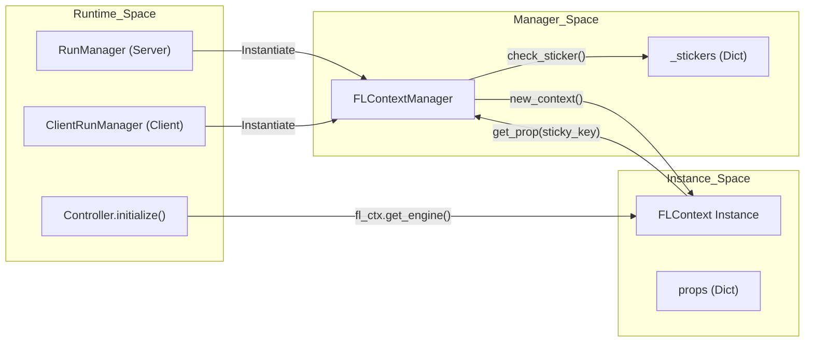
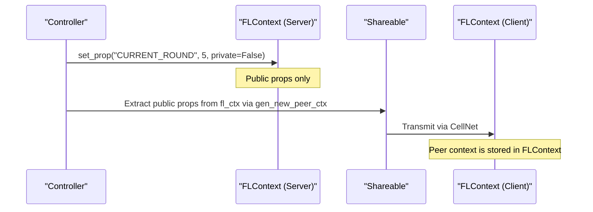

<!-- source: DeepWiki mcp.deepwiki.com · repo NVIDIA/NVFlare · page 5.4 FLContext and State Management · fetched 2026-10-26 -->

# FLContext and State Management

<details>
<summary>Relevant source files</summary>

The following files were used as context for generating this wiki page:

- [docs/design/multistudy_cli.md](docs/design/multistudy_cli.md)
- [docs/user_guide/admin_guide/multi_study_guide.rst](docs/user_guide/admin_guide/multi_study_guide.rst)
- [nvflare/apis/controller_spec.py](nvflare/apis/controller_spec.py)
- [nvflare/apis/fl_context.py](nvflare/apis/fl_context.py)
- [nvflare/apis/fl_exception.py](nvflare/apis/fl_exception.py)
- [nvflare/apis/impl/controller.py](nvflare/apis/impl/controller.py)
- [nvflare/apis/impl/wf_comm_server.py](nvflare/apis/impl/wf_comm_server.py)
- [nvflare/apis/wf_comm_spec.py](nvflare/apis/wf_comm_spec.py)
- [nvflare/apis/workspace.py](nvflare/apis/workspace.py)
- [nvflare/app_common/workflows/broadcast_operator.py](nvflare/app_common/workflows/broadcast_operator.py)
- [nvflare/app_common/workflows/cross_site_model_eval.py](nvflare/app_common/workflows/cross_site_model_eval.py)
- [nvflare/app_common/workflows/cyclic_ctl.py](nvflare/app_common/workflows/cyclic_ctl.py)
- [nvflare/app_common/workflows/global_model_eval.py](nvflare/app_common/workflows/global_model_eval.py)
- [nvflare/app_common/workflows/scatter_and_gather.py](nvflare/app_common/workflows/scatter_and_gather.py)
- [nvflare/app_common/workflows/scatter_and_gather_scaffold.py](nvflare/app_common/workflows/scatter_and_gather_scaffold.py)
- [nvflare/app_opt/statistics/visualization/statistics_visualization.py](nvflare/app_opt/statistics/visualization/statistics_visualization.py)
- [nvflare/fuel/utils/fsm.py](nvflare/fuel/utils/fsm.py)
- [nvflare/private/fed/server/study_cmds.py](nvflare/private/fed/server/study_cmds.py)
- [research/auto-fed-rl/src/autofedrl/autofedrl_scatter_and_gather.py](research/auto-fed-rl/src/autofedrl/autofedrl_scatter_and_gather.py)
- [research/fed-sm/jobs/fedsm_prostate/app/custom/workflows/scatter_and_gather_fedsm.py](research/fed-sm/jobs/fedsm_prostate/app/custom/workflows/scatter_and_gather_fedsm.py)
- [tests/unit_test/apis/impl/controller_test.py](tests/unit_test/apis/impl/controller_test.py)
- [tests/unit_test/apis/workspace_test.py](tests/unit_test/apis/workspace_test.py)
- [tests/unit_test/app_common/workflow/cyclic_ctl_test.py](tests/unit_test/app_common/workflow/cyclic_ctl_test.py)
- [tests/unit_test/private/fed/server/study_cmds_test.py](tests/unit_test/private/fed/server/study_cmds_test.py)
- [tests/unit_test/private/fed/test_fed_utils.py](tests/unit_test/private/fed/test_fed_utils.py)

</details>


## Purpose and Scope

This document explains the **FLContext** system, which is the primary mechanism for state management and data passing in NVIDIA FLARE. `FLContext` provides a structured way to share information between components (controllers, executors, filters, handlers) throughout the federated learning workflow while maintaining proper encapsulation and security boundaries. It serves as the "glue" that allows decoupled components to operate on a shared state.

## FLContext Fundamentals

`FLContext` is a context object that carries state and configuration data throughout the execution of a federated learning job. It acts as a dictionary-like container with additional features for access control, persistence, and synchronization via a central manager. [nvflare/apis/fl_context.py:63-79]()

### Core Concepts

`FLContext` properties are characterized by two orthogonal dimensions: **Visibility** and **Stickiness**.

| Dimension | Options | Description |
|-----------|---------|-------------|
| **Visibility** | Public / Private | Private props are only visible to local components; public props are also visible to remote components. [nvflare/apis/fl_context.py:70-72]() |
| **Stickiness** | Sticky / Non-sticky | Sticky props become available in all future contexts; non-sticky props only exist in the current context. [nvflare/apis/fl_context.py:73-75]() |

These combinations create the following property types:

**Title: FLContext Property Types**
```mermaid
graph TD
    ["FLContext_Property_Types"]
    
    PublicSticky["Public + Sticky<br/>Shared & Persistent<br/>e.g., CURRENT_ROUND"]
    PublicNonSticky["Public + Non-Sticky<br/>Shared & Temporary<br/>e.g., TASK_DATA"]
    PrivateSticky["Private + Sticky<br/>Local & Persistent<br/>e.g., ENGINE"]
    PrivateNonSticky["Private + Non-Sticky<br/>Local & Temporary<br/>e.g., PEER_CONTEXT"]
    
    ["FLContext_Property_Types"] --> PublicSticky
    ["FLContext_Property_Types"] --> PublicNonSticky
    ["FLContext_Property_Types"] --> PrivateSticky
    ["FLContext_Property_Types"] --> PrivateNonSticky
    
    PublicSticky --> PeerContext["Included in get_all_public_props"]
    PublicNonSticky --> PeerContext
    
    PrivateSticky --> LocalOnly["Never Shared with Peers"]
    PrivateNonSticky --> LocalOnly
```
**Sources:** [nvflare/apis/fl_context.py:27-48](), [nvflare/apis/fl_context.py:64-76](), [nvflare/apis/fl_context.py:87-93]()

### FLContext API

The `FLContext` class provides methods to manipulate properties with thread-safe locking using a module-level `_update_lock`. [nvflare/apis/fl_context.py:22-25]()

*   **`set_prop(key, value, private=True, sticky=True)`**: Sets a property. If sticky, it updates the `FLContextManager`. [nvflare/apis/fl_context.py:134-168]()
*   **`get_prop(key, default=None)`**: Retrieves a property. If the property is sticky and not found locally, it checks the `FLContextManager`. [nvflare/apis/fl_context.py:102-132]()
*   **`get_all_public_props()`**: Returns a dictionary of all properties where the mask does not have `MASK_PRIVATE` set. [nvflare/apis/fl_context.py:87-93]()
*   **`set_custom_prop(key, value)`**: A helper to store user-defined properties within a reserved `CUSTOM_PROPS` dictionary. [nvflare/apis/fl_context.py:183-189]()
*   **`get_engine()`**: Retrieves the engine associated with the context (stored as a private sticky property). [nvflare/apis/fl_context.py:95-101]()

**Sources:** [nvflare/apis/fl_context.py:63-210]()

## FLContextManager and Lifecycle

The `FLContextManager` acts as the "source of truth" for sticky properties (stickers). It ensures that when a new `FLContext` is created, it inherits the persistent state of the engine/runner. [nvflare/apis/fl_context.py:220-250]()

**Title: FLContext Lifecycle and Code Entities**

**Sources:** [nvflare/apis/fl_context.py:95-101](), [nvflare/apis/fl_context.py:102-132](), [nvflare/apis/fl_context.py:220-250]()

### Context Interaction in RunManager
The `RunManager` initializes the `FLContextManager` with specific job processing context properties. 

When a component calls `get_prop` for a sticky key, the context transparently fetches it from the manager and caches it locally. [nvflare/apis/fl_context.py:121-132]()

**Sources:** [nvflare/apis/fl_context.py:95-132](), [nvflare/apis/fl_context.py:220-250]()

## State Management in Workflows

Workflows rely heavily on `FLContext` to track training progress and share components.

### Component Access
The context is the primary way to retrieve registered components like aggregators or persistors. For example, `ScatterAndGather` uses the engine from the context to get its components during `initialize` which calls `start_controller`. [nvflare/apis/impl/controller.py:38-45](), [nvflare/app_common/workflows/scatter_and_gather.py:135-150]()

### Round and Phase Management
In workflows like `ScatterAndGather`, the current round is stored as a sticky property to persist across different phases of the control flow. [nvflare/app_common/workflows/scatter_and_gather.py:186-186]()

In `ScatterAndGatherScaffold`, the controller sets the `PHASE`, `NUM_ROUNDS`, and `CURRENT_ROUND` in the context before firing events like `TRAINING_STARTED` and `ROUND_STARTED`. [nvflare/app_common/workflows/scatter_and_gather_scaffold.py:120-132]()

**Sources:** [nvflare/app_common/workflows/scatter_and_gather.py:135-190](), [nvflare/app_common/workflows/scatter_and_gather_scaffold.py:114-133]()

## Peer Context and Communication

State is shared between the Server and Clients using a "Peer Context" mechanism. This allows a site to understand the context in which a task was issued or a result was produced.

**Title: Peer Context Data Flow and Code Entities**

**Sources:** [nvflare/apis/fl_context.py:87-93](), [nvflare/apis/fl_component.py:117-118]()

### Key Logic for Peer Context
1.  **Extraction**: The system extracts public properties from a local `FLContext` to include in messages sent to peers. [nvflare/apis/fl_context.py:87-93]()
2.  **FLComponent Events**: `FLComponent` uses the context to fire events. Built-in events like `TRAINING_STARTED` or `ROUND_STARTED` are used to trigger state transitions across components. [nvflare/app_common/workflows/scatter_and_gather.py:165-176]()
3.  **WFCommServer Task Tracking**: The `WFCommServer` manages task lifecycles using an internal `_task_lock` and monitors tasks in a dedicated thread `_monitor_tasks`. [nvflare/apis/impl/wf_comm_server.py:105-107]()

**Sources:** [nvflare/apis/fl_context.py:87-93](), [nvflare/app_common/workflows/scatter_and_gather.py:165-225](), [nvflare/apis/impl/wf_comm_server.py:91-112]()

## Memory and State Cleanup

Because `FLContext` can hold large objects (like model weights), FLARE provides mechanisms to prevent memory leaks during long-running jobs.

### Memory GC Rounds
Workflows like `ScatterAndGather` and `CyclicController` implement a `memory_gc_rounds` parameter. This triggers a call to `cleanup_memory()` (which performs `gc.collect()` and `malloc_trim`) every $N$ rounds. [nvflare/app_common/workflows/scatter_and_gather.py:53-53](), [nvflare/app_common/workflows/cyclic_ctl.py:128-133]()

### Context Property Removal
Components can explicitly remove properties to free memory:
*   `fl_ctx.remove_prop(key)` [nvflare/apis/fl_context.py:200-210]()

**Sources:** [nvflare/app_common/workflows/scatter_and_gather.py:53-53](), [nvflare/app_common/workflows/cyclic_ctl.py:128-133](), [nvflare/apis/fl_context.py:200-210]()

## Summary of Key Classes

| Class | Role | File |
|-------|------|------|
| `FLContext` | The primary data container passed between FL components. | [nvflare/apis/fl_context.py:63-63]() |
| `FLContextManager` | Manages the lifecycle and synchronization of sticky properties. | [nvflare/apis/fl_context.py:220-220]() |
| `FLComponent` | Base class providing event firing and logging capabilities using `FLContext`. | [nvflare/apis/fl_component.py:28-37]() |
| `Controller` | Uses `FLContext` to orchestrate tasks and manage workflow state. | [nvflare/apis/impl/controller.py:25-25]() |
| `WFCommServer` | Manages standing tasks and client task mappings using `FLContext`. | [nvflare/apis/impl/wf_comm_server.py:91-112]() |
| `Workspace` | Defines the environment structure (startup, site config, run dirs) accessible via context. | [nvflare/apis/workspace.py:22-55]() |

**Sources:** [nvflare/apis/fl_context.py:1-250](), [nvflare/apis/fl_component.py:28-37](), [nvflare/apis/impl/wf_comm_server.py:91-170](), [nvflare/apis/workspace.py:22-180]()

---

