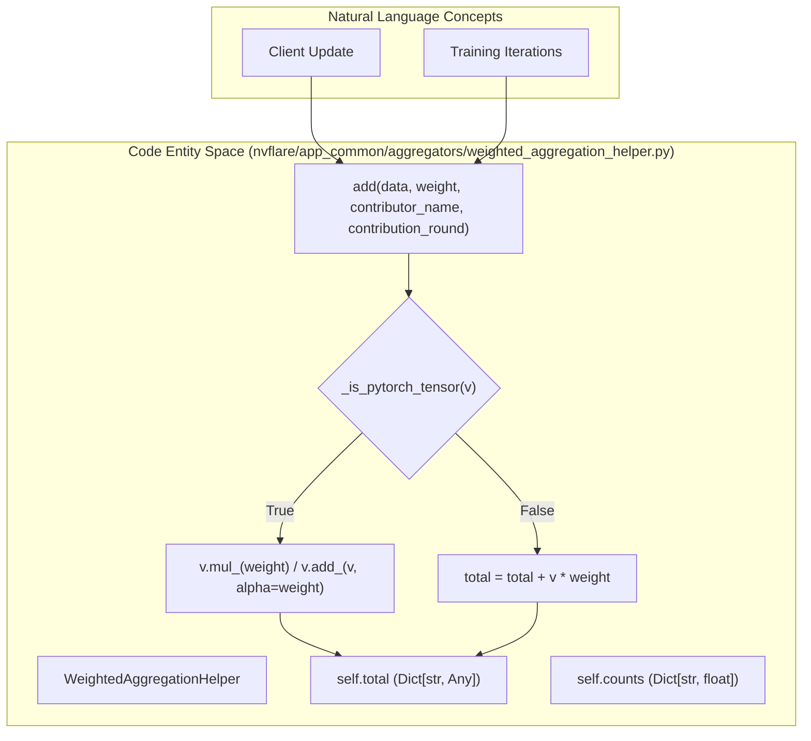
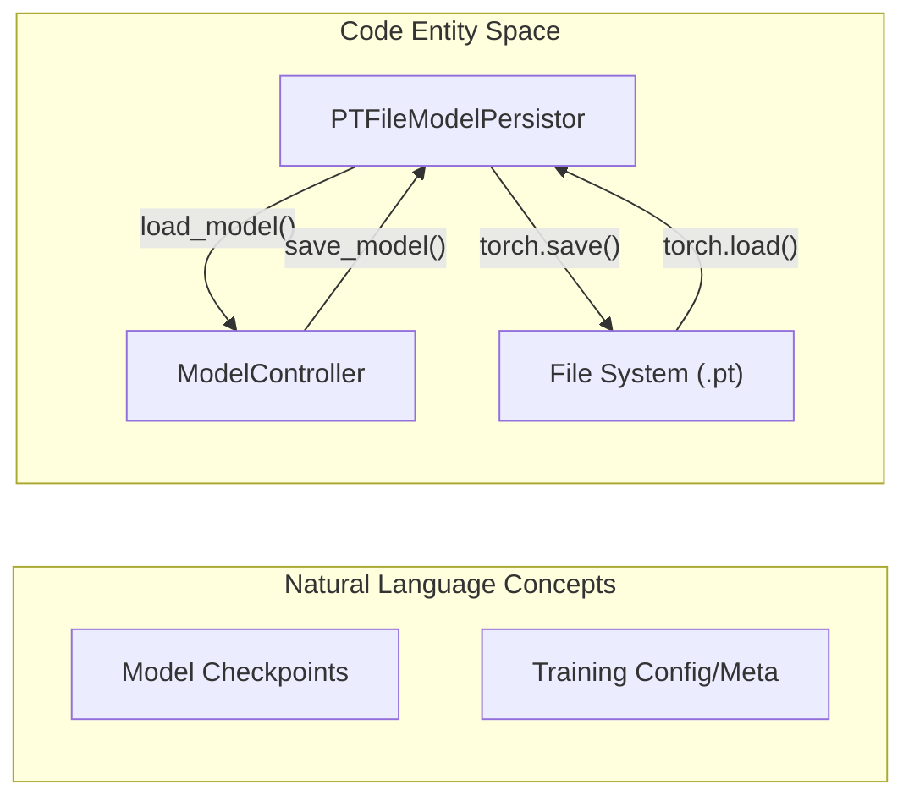
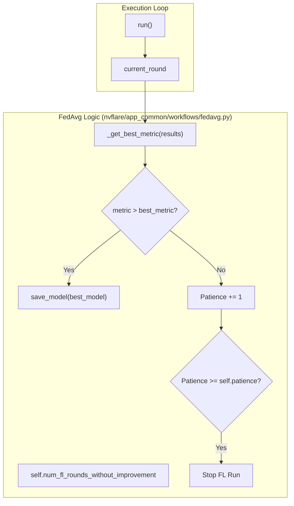

<!-- source: DeepWiki mcp.deepwiki.com · repo NVIDIA/NVFlare · page 5.5 Aggregators and Persistors · fetched 2026-10-26 -->

# Aggregators and Persistors

Relevant source files

The following files were used as context for generating this wiki page:

- [docs/programming_guide/memory_management.rst](docs/programming_guide/memory_management.rst)
- [docs/user_guide/agent_skills/index.rst](docs/user_guide/agent_skills/index.rst)
- [nvflare/app_common/abstract/learner_spec.py](nvflare/app_common/abstract/learner_spec.py)
- [nvflare/app_common/abstract/model_persistor.py](nvflare/app_common/abstract/model_persistor.py)
- [nvflare/app_common/abstract/model_processor.py](nvflare/app_common/abstract/model_processor.py)
- [nvflare/app_common/aggregators/dxo_aggregator.py](nvflare/app_common/aggregators/dxo_aggregator.py)
- [nvflare/app_common/aggregators/intime_accumulate_model_aggregator.py](nvflare/app_common/aggregators/intime_accumulate_model_aggregator.py)
- [nvflare/app_common/aggregators/weighted_aggregation_helper.py](nvflare/app_common/aggregators/weighted_aggregation_helper.py)
- [nvflare/app_common/app_constant.py](nvflare/app_common/app_constant.py)
- [nvflare/app_common/executors/learner_executor.py](nvflare/app_common/executors/learner_executor.py)
- [nvflare/app_common/homomorphic_encryption/he_pt_model_reader_writer.py](nvflare/app_common/homomorphic_encryption/he_pt_model_reader_writer.py)
- [nvflare/app_common/model_desc.py](nvflare/app_common/model_desc.py)
- [nvflare/app_common/pt/pt_fed_utils.py](nvflare/app_common/pt/pt_fed_utils.py)
- [nvflare/app_common/pt/pt_file_model_locator.py](nvflare/app_common/pt/pt_file_model_locator.py)
- [nvflare/app_common/pt/pt_file_model_persistor.py](nvflare/app_common/pt/pt_file_model_persistor.py)
- [nvflare/app_common/pt/pt_model_reader_writer.py](nvflare/app_common/pt/pt_model_reader_writer.py)
- [nvflare/app_common/pt/tb_receiver.py](nvflare/app_common/pt/tb_receiver.py)
- [nvflare/app_common/widgets/job_stats_reporter.py](nvflare/app_common/widgets/job_stats_reporter.py)
- [nvflare/app_common/workflows/base_fedavg.py](nvflare/app_common/workflows/base_fedavg.py)
- [nvflare/app_common/workflows/base_model_controller.py](nvflare/app_common/workflows/base_model_controller.py)
- [nvflare/app_common/workflows/cross_site_eval.py](nvflare/app_common/workflows/cross_site_eval.py)
- [nvflare/app_common/workflows/cyclic.py](nvflare/app_common/workflows/cyclic.py)
- [nvflare/app_common/workflows/fedavg.py](nvflare/app_common/workflows/fedavg.py)
- [nvflare/app_common/workflows/model_controller.py](nvflare/app_common/workflows/model_controller.py)
- [nvflare/app_common/workflows/scaffold.py](nvflare/app_common/workflows/scaffold.py)
- [nvflare/app_opt/pt/file_model_locator.py](nvflare/app_opt/pt/file_model_locator.py)
- [nvflare/app_opt/pt/file_model_persistor.py](nvflare/app_opt/pt/file_model_persistor.py)
- [nvflare/app_opt/pt/recipes/scaffold.py](nvflare/app_opt/pt/recipes/scaffold.py)
- [nvflare/app_opt/pt/scaffold.py](nvflare/app_opt/pt/scaffold.py)
- [nvflare/app_opt/tf/file_model_locator.py](nvflare/app_opt/tf/file_model_locator.py)
- [nvflare/app_opt/tf/recipes/scaffold.py](nvflare/app_opt/tf/recipes/scaffold.py)
- [nvflare/fuel/utils/memory_utils.py](nvflare/fuel/utils/memory_utils.py)
- [skills/nvflare-autofl/references/job-import-contract.md](skills/nvflare-autofl/references/job-import-contract.md)
- [tests/unit_test/app_common/aggregators/in_time_accumulate_weighted_aggregator_test.py](tests/unit_test/app_common/aggregators/in_time_accumulate_weighted_aggregator_test.py)
- [tests/unit_test/app_common/aggregators/weighted_aggregation_helper_test.py](tests/unit_test/app_common/aggregators/weighted_aggregation_helper_test.py)
- [tests/unit_test/app_common/workflow/fedavg_test.py](tests/unit_test/app_common/workflow/fedavg_test.py)
- [tests/unit_test/app_opt/pt/scaffold_test.py](tests/unit_test/app_opt/pt/scaffold_test.py)
- [tests/unit_test/fuel/utils/memory_utils_test.py](tests/unit_test/fuel/utils/memory_utils_test.py)
- [tests/unit_test/recipe/scaffold_recipe_test.py](tests/unit_test/recipe/scaffold_recipe_test.py)

This page describes the **Aggregator** and **Persistor** components used in NVIDIA FLARE workflows to combine client model updates and manage global model persistence. Aggregators implement the core federated learning algorithm logic, while Persistors handle model serialization and deserialization.

---

## Aggregator Overview

Aggregators combine client model updates into a single global model update. The aggregation strategy varies by federated learning algorithm:

- **FedAvg**: Performs weighted averaging of model parameters and metrics based on the number of training steps [nvflare/app_common/workflows/base_fedavg.py:107-129]().
- **SCAFFOLD**: Aggregates both model weights and control variates (difference terms) using a specialized aggregation function `scaffold_aggregate_fn` [nvflare/app_common/workflows/scaffold.py:149-165]().
- **In-Time Aggregation**: To optimize memory, each client result is aggregated immediately upon receipt rather than collecting all results first. This is implemented in the `InTimeAccumulateWeightedAggregator` which handles `Shareable` objects and internal `DXO` structures [nvflare/app_common/aggregators/intime_accumulate_model_aggregator.py:47-79]().

### Aggregator Interface

Standalone aggregators typically implement the `Aggregator` abstract base class [nvflare/app_common/aggregators/intime_accumulate_model_aggregator.py:47-47](). The `InTimeAccumulateWeightedAggregator` implementation uses an internal `_initialize` method triggered by the `START_RUN` event to set up its aggregation weights and filters [nvflare/app_common/aggregators/intime_accumulate_model_aggregator.py:92-97]().

| Method | Purpose | Key Implementation |
|--------|---------|--------------------|
| `accept(shareable, fl_ctx)` | Process a single client contribution from a `Shareable` | [nvflare/app_common/aggregators/intime_accumulate_model_aggregator.py:168-208]() |
| `aggregate(fl_ctx)` | Return the final aggregated result as a `Shareable` | [nvflare/app_common/aggregators/intime_accumulate_model_aggregator.py:210-244]() |
| `handle_event(event_type, fl_ctx)` | Manage lifecycle events like `START_RUN` | [nvflare/app_common/aggregators/intime_accumulate_model_aggregator.py:92-97]() |

**Sources:** [nvflare/app_common/aggregators/intime_accumulate_model_aggregator.py:47-244](), [nvflare/app_common/app_constant.py:118-118]()

---

## Aggregation Strategies

### WeightedAggregationHelper

The `WeightedAggregationHelper` is a thread-safe utility that performs the mathematical operations for aggregation [nvflare/app_common/aggregators/weighted_aggregation_helper.py:116-139](). It supports PyTorch tensors (using in-place `add_` and `mul_` for efficiency) and NumPy arrays [nvflare/app_common/aggregators/weighted_aggregation_helper.py:149-151]().

#### Data Flow and Logic

Title: "WeightedAggregationHelper Operation Logic"

**Sources:** [nvflare/app_common/aggregators/weighted_aggregation_helper.py:116-176](), [nvflare/app_common/aggregators/weighted_aggregation_helper.py:149-151]()

### Memory Efficiency: Tensor Disk Offload

For large models, the aggregator handles lazy references to data to reduce peak server memory. When `enable_tensor_disk_offload` is active, tensors are downloaded to disk during FOBS streaming [nvflare/app_common/workflows/fedavg.py:89-92](). The `WeightedAggregationHelper` checks if a value has a `materialize` method and calls it to load the tensor from disk only during the math operation [nvflare/app_common/aggregators/weighted_aggregation_helper.py:170-173]().

### DXOAggregator

The `DXOAggregator` is a wrapper that uses `WeightedAggregationHelper` to aggregate data contained within a `DXO` (Data Exchange Object) [nvflare/app_common/aggregators/dxo_aggregator.py:25-56](). It validates the `DataKind` (e.g., `WEIGHT_DIFF`, `WEIGHTS`, `METRICS`) and ensures the contribution round matches the current round in the `FLContext` [nvflare/app_common/aggregators/dxo_aggregator.py:86-113]().

### Metric Aggregation and Filtering

Before aggregating metrics, the system filters values to ensure they support weighted arithmetic operations via `filter_aggregatable_metrics` [nvflare/app_common/aggregators/weighted_aggregation_helper.py:41-71](). Boolean values are treated as binary floats (`True=1.0`, `False=0.0`) [nvflare/app_common/aggregators/weighted_aggregation_helper.py:20-38]().

| Value Type | Aggregatable | Logic |
|------------|--------------|-------|
| `int`, `float`, `bool` | Yes | Standard arithmetic or binary conversion [nvflare/app_common/aggregators/weighted_aggregation_helper.py:31-32]() |
| `np.ndarray`, `torch.Tensor` | Yes | Multi-dimensional support [nvflare/app_common/aggregators/weighted_aggregation_helper.py:33-36]() |
| `dict`, `list`, `str` | No | Skipped during aggregation [nvflare/app_common/aggregators/weighted_aggregation_helper.py:28-29]() |

**Sources:** [nvflare/app_common/aggregators/weighted_aggregation_helper.py:41-71](), [nvflare/app_common/aggregators/weighted_aggregation_helper.py:20-39]()

---

## Persistors

Persistors manage the lifecycle of the model on the server side, specifically how it is initialized, loaded from disk at the start of a run, and saved after aggregation.

### PTFileModelPersistor

The system provides framework-specific persistors. `PTFileModelPersistor` handles PyTorch models [nvflare/app_opt/pt/file_model_persistor.py:36-48](). It can load model data in three ways: from a specified source checkpoint file, from the app folder (via `environments.json`), or from a `torch.nn.Module` object [nvflare/app_opt/pt/file_model_persistor.py:51-83]().

### Model Persistence Format Management

The `PTFileModelPersistor` utilizes an internal persistence manager to handle PyTorch checkpoints, including model weights, training configuration, and metadata [nvflare/app_opt/pt/file_model_persistor.py:121-125](). It supports `load_weights_only` to restrict unpickling to tensors and primitive types for security [nvflare/app_opt/pt/file_model_persistor.py:103-105]().

#### Validation and Safety
- **Safe Loading**: Restricts torch unpickler globals when `load_weights_only` is True [nvflare/app_opt/pt/file_model_persistor.py:103-105]().
- **Numpy Conversion**: Supports optional conversion between PyTorch tensors and NumPy arrays during load/save operations if `allow_numpy_conversion` is enabled [nvflare/app_opt/pt/file_model_persistor.py:106-108]().

**Sources:** [nvflare/app_opt/pt/file_model_persistor.py:36-136]()

### Model Persistence Flow

Title: "Model Persistence and Format Management"

**Sources:** [nvflare/app_opt/pt/file_model_persistor.py:36-48](), [nvflare/app_common/workflows/model_controller.py:107-124]()

---

## Early Stopping and Model Selection

The `FedAvg` workflow supports early stopping based on validation metrics [nvflare/app_common/workflows/fedavg.py:118-120](). It parses a `stop_cond` string (e.g., "accuracy >= 80") into a `stop_condition` using `parse_compare_criteria` [nvflare/app_common/workflows/fedavg.py:128-132]().

### Best Model Selection Logic

Title: "FedAvg Best Model Selection Flow"

**Sources:** [nvflare/app_common/workflows/fedavg.py:128-147](), [nvflare/app_common/workflows/fedavg.py:134-136](), [nvflare/app_common/utils/math_utils.py:29-29]()

---

