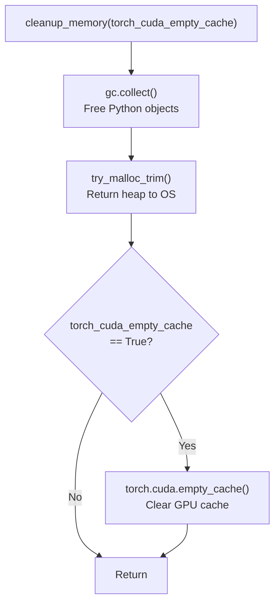
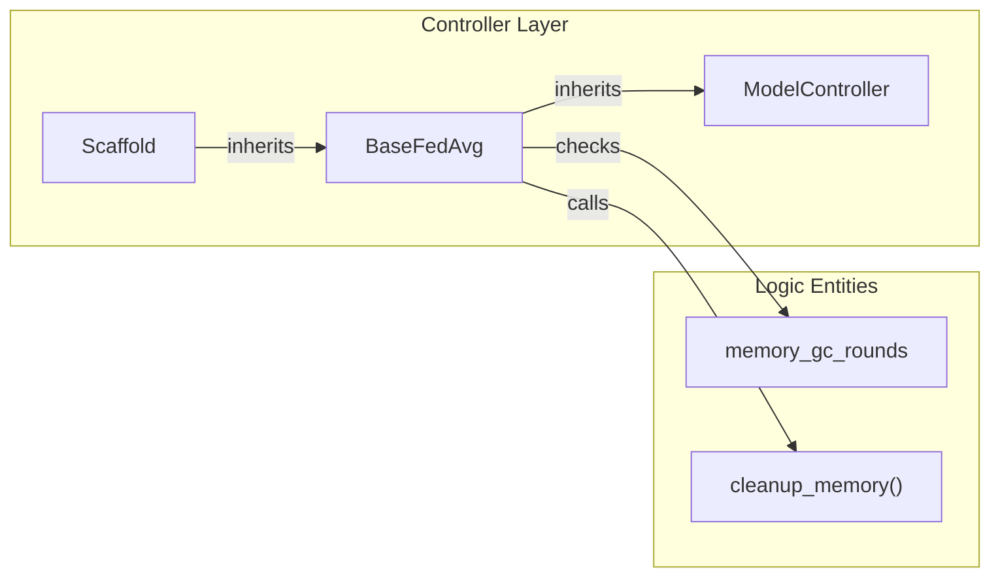
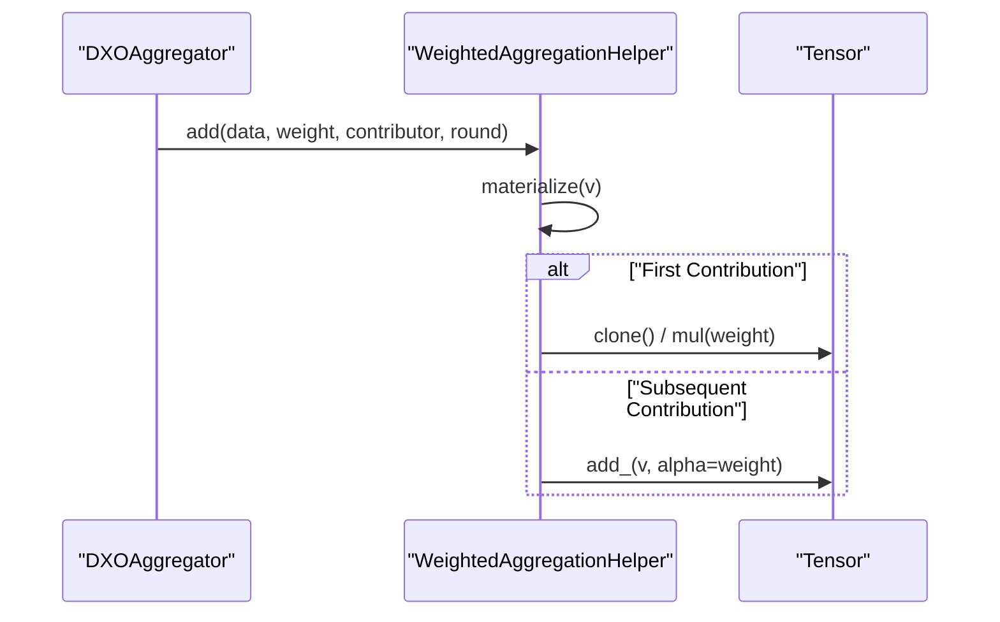
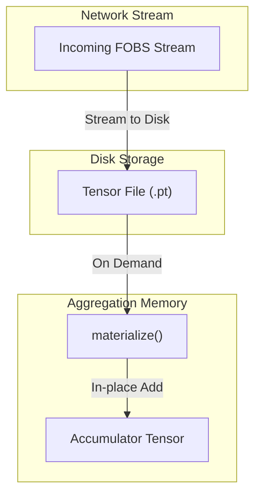

<!-- source: DeepWiki mcp.deepwiki.com · repo NVIDIA/NVFlare · page 5.6 Memory Management · fetched 2026-10-26 -->

# Memory Management

Relevant source files

The following files were used as context for generating this wiki page:

- [docs/programming_guide/component_configuration.rst](docs/programming_guide/component_configuration.rst)
- [docs/programming_guide/memory_management.rst](docs/programming_guide/memory_management.rst)
- [docs/user_guide/agent_skills/index.rst](docs/user_guide/agent_skills/index.rst)
- [examples/advanced/cifar10/pt/cifar10-sim/cifar10_fedopt/README.md](examples/advanced/cifar10/pt/cifar10-sim/cifar10_fedopt/README.md)
- [examples/advanced/cifar10/pt/cifar10-sim/cifar10_fedopt/job.py](examples/advanced/cifar10/pt/cifar10-sim/cifar10_fedopt/job.py)
- [examples/advanced/cifar10/pt/src/data/cifar10_data_utils.py](examples/advanced/cifar10/pt/src/data/cifar10_data_utils.py)
- [examples/advanced/cifar10/tf/cifar10_fedopt/job.py](examples/advanced/cifar10/tf/cifar10_fedopt/job.py)
- [examples/advanced/cifar10/tf/requirements.txt](examples/advanced/cifar10/tf/requirements.txt)
- [nvflare/app_common/aggregators/dxo_aggregator.py](nvflare/app_common/aggregators/dxo_aggregator.py)
- [nvflare/app_common/aggregators/intime_accumulate_model_aggregator.py](nvflare/app_common/aggregators/intime_accumulate_model_aggregator.py)
- [nvflare/app_common/aggregators/weighted_aggregation_helper.py](nvflare/app_common/aggregators/weighted_aggregation_helper.py)
- [nvflare/app_common/app_constant.py](nvflare/app_common/app_constant.py)
- [nvflare/app_common/utils/tensor_disk_offload_context.py](nvflare/app_common/utils/tensor_disk_offload_context.py)
- [nvflare/app_common/widgets/job_stats_reporter.py](nvflare/app_common/widgets/job_stats_reporter.py)
- [nvflare/app_common/workflows/base_fedavg.py](nvflare/app_common/workflows/base_fedavg.py)
- [nvflare/app_common/workflows/base_model_controller.py](nvflare/app_common/workflows/base_model_controller.py)
- [nvflare/app_common/workflows/cross_site_eval.py](nvflare/app_common/workflows/cross_site_eval.py)
- [nvflare/app_common/workflows/cyclic.py](nvflare/app_common/workflows/cyclic.py)
- [nvflare/app_common/workflows/fedavg.py](nvflare/app_common/workflows/fedavg.py)
- [nvflare/app_common/workflows/model_controller.py](nvflare/app_common/workflows/model_controller.py)
- [nvflare/app_common/workflows/scaffold.py](nvflare/app_common/workflows/scaffold.py)
- [nvflare/app_opt/pt/fedopt.py](nvflare/app_opt/pt/fedopt.py)
- [nvflare/app_opt/pt/recipes/fedopt.py](nvflare/app_opt/pt/recipes/fedopt.py)
- [nvflare/app_opt/pt/recipes/scaffold.py](nvflare/app_opt/pt/recipes/scaffold.py)
- [nvflare/app_opt/pt/scaffold.py](nvflare/app_opt/pt/scaffold.py)
- [nvflare/app_opt/tf/recipes/fedopt.py](nvflare/app_opt/tf/recipes/fedopt.py)
- [nvflare/app_opt/tf/recipes/scaffold.py](nvflare/app_opt/tf/recipes/scaffold.py)
- [nvflare/fuel/utils/memory_utils.py](nvflare/fuel/utils/memory_utils.py)
- [skills/nvflare-autofl/references/job-import-contract.md](skills/nvflare-autofl/references/job-import-contract.md)
- [tests/unit_test/app_common/aggregators/in_time_accumulate_weighted_aggregator_test.py](tests/unit_test/app_common/aggregators/in_time_accumulate_weighted_aggregator_test.py)
- [tests/unit_test/app_common/aggregators/weighted_aggregation_helper_test.py](tests/unit_test/app_common/aggregators/weighted_aggregation_helper_test.py)
- [tests/unit_test/app_common/utils/tensor_disk_offload_context_test.py](tests/unit_test/app_common/utils/tensor_disk_offload_context_test.py)
- [tests/unit_test/app_common/workflow/fedavg_test.py](tests/unit_test/app_common/workflow/fedavg_test.py)
- [tests/unit_test/app_opt/pt/fedopt_test.py](tests/unit_test/app_opt/pt/fedopt_test.py)
- [tests/unit_test/app_opt/pt/scaffold_test.py](tests/unit_test/app_opt/pt/scaffold_test.py)
- [tests/unit_test/fuel/utils/memory_utils_test.py](tests/unit_test/fuel/utils/memory_utils_test.py)
- [tests/unit_test/recipe/fedopt_recipe_test.py](tests/unit_test/recipe/fedopt_recipe_test.py)
- [tests/unit_test/recipe/scaffold_recipe_test.py](tests/unit_test/recipe/scaffold_recipe_test.py)

This page describes NVIDIA FLARE's memory management strategies for long-running federated learning jobs. It covers memory cleanup utilities, controller-level periodic cleanup, InTime aggregation for memory-efficient model aggregation, and advanced FOBS-based optimizations like tensor disk offload.

## Overview

Federated learning jobs often run for hours or days across hundreds of rounds. Without proper memory management, server and client processes can experience unbounded RSS (Resident Set Size) growth due to:

-   **Python garbage collection delays**: Objects may not be freed immediately after becoming unreachable.
-   **glibc memory arena fragmentation**: Multi-threaded applications create per-thread arenas that fragment the heap.
-   **Model accumulation**: Controllers may hold references to client results across rounds.
-   **FOBS deserialization overhead**: Streaming large models from clients can cause peak memory spikes.

NVIDIA FLARE provides multiple mechanisms to address these issues:

1.  **Periodic memory cleanup**: `gc.collect()` + `malloc_trim()` every N rounds. [nvflare/app_common/workflows/base_fedavg.py:178-184]()
2.  **InTime aggregation**: Streaming aggregation to avoid holding all client results in memory. [nvflare/app_common/workflows/fedavg.py:50-54]()
3.  **Tensor disk offload**: Download large tensors to disk during FOBS streaming instead of deserializing into RAM. [nvflare/app_common/workflows/fedavg.py:90-93]()

**Sources**: [nvflare/app_common/workflows/base_fedavg.py:178-184](), [nvflare/app_common/workflows/fedavg.py:50-93]()

## Memory Cleanup Mechanisms

### cleanup_memory() Function

The core memory cleanup utility is `cleanup_memory`, which performs three operations:

1.  Runs Python garbage collection (`gc.collect`).
2.  Releases free heap pages to OS (`malloc_trim`, Linux/glibc only).
3.  Optionally clears PyTorch CUDA cache.

**Platform Compatibility**:

| Operation | Linux/glibc | Linux/musl | macOS/Windows |
| :--- | :--- | :--- | :--- |
| `gc.collect()` | ✓ | ✓ | ✓ |
| `malloc_trim()` | ✓ | ✗ | ✗ |
| `torch.cuda.empty_cache()` | ✓ | ✓ | ✓ |

The function safely handles platform differences: `malloc_trim()` is silently skipped on non-glibc systems.

Title: "cleanup_memory() execution flow"

**Sources**: [nvflare/fuel/utils/memory_utils.py:83-117]()

### malloc_trim() on Linux/glibc

The `try_malloc_trim()` function calls glibc's `malloc_trim(0)` to release free heap pages back to the operating system. In multi-threaded Python applications (like FL servers), glibc creates per-thread memory arenas. These arenas can become fragmented, causing RSS to grow even when Python objects are freed. `malloc_trim()` forces glibc to return unused pages to the OS.

**Sources**: [nvflare/fuel/utils/memory_utils.py:40-80]()

## Controller-Level Memory Management

### memory_gc_rounds Parameter

Base classes like `BaseFedAvg` and specialized workflows like `Scaffold` include parameters for periodic memory management.

-   `memory_gc_rounds` (int): Run memory cleanup (`gc.collect` + `malloc_trim`) every N rounds. Set to 0 to disable. [nvflare/app_common/workflows/base_fedavg.py:164-166]()
-   `_maybe_cleanup_memory()`: Internal method that triggers `cleanup_memory()` when the round threshold is reached. [nvflare/app_common/workflows/base_fedavg.py:178-184]()

### Implementation Pattern

Title: "Memory Management in Controller Space"

**Sources**: [nvflare/app_common/workflows/base_fedavg.py:131-184](), [nvflare/app_common/workflows/scaffold.py:54-75]()

## InTime Aggregation and Selection

InTime aggregation refers to processing client contributions as they arrive, rather than waiting for all contributions to be collected before starting aggregation. This significantly reduces peak memory usage on the server.

### InTimeAccumulateWeightedAggregator

The `InTimeAccumulateWeightedAggregator` is the primary component for streaming aggregation. It utilizes `DXOAggregator` and `WeightedAggregationHelper` to process updates incrementally.

1.  **Incremental Processing**: The aggregator accepts `DXO` objects from contributors and updates internal state immediately. [nvflare/app_common/aggregators/dxo_aggregator.py:71-80]()
2.  **Weighted Math**: It uses `WeightedAggregationHelper` to compute weighted sums. If `weigh_by_local_iter` is enabled, it scales updates by the number of local steps. [nvflare/app_common/aggregators/weighted_aggregation_helper.py:117-128]()
3.  **Memory Efficiency**: By using in-place operations (e.g., `add_` for PyTorch tensors), it minimizes the creation of intermediate objects. [nvflare/app_common/aggregators/weighted_aggregation_helper.py:149-152]()

Title: "InTime Aggregation Logic"

**Sources**: [nvflare/app_common/aggregators/dxo_aggregator.py:71-152](), [nvflare/app_common/aggregators/weighted_aggregation_helper.py:116-152]()

## FOBS-Based Memory Optimizations

### Tensor Disk Offload

For large models, the `FedAvg` and `Scaffold` workflows support `enable_tensor_disk_offload`. This feature downloads streamed PyTorch tensors directly to disk on the server during the aggregation phase instead of holding them in RAM.

1.  **Lazy Materialization**: When disk offload is enabled, `WeightedAggregationHelper` receives lazy references. It calls `materialize()` to load the tensor from disk only when performing aggregation math. [nvflare/app_common/aggregators/weighted_aggregation_helper.py:170-174]()
2.  **Context Management**: The lifecycle of the temporary storage is managed via `setup_tensor_disk_offload` and `cleanup_tensor_disk_offload`. [nvflare/app_common/workflows/fedavg.py:149-155]()

Title: "Tensor Disk Offload Data Flow"

**Sources**: [nvflare/app_common/aggregators/weighted_aggregation_helper.py:170-174](), [nvflare/app_common/workflows/fedavg.py:149-155](), [nvflare/app_common/workflows/scaffold.py:97-111]()

## API Reference

### Memory Utilities

| Function | Description | Source |
| :--- | :--- | :--- |
| `cleanup_memory(torch_cuda_empty_cache)` | Runs GC, `malloc_trim`, and optionally clears CUDA cache. | [nvflare/fuel/utils/memory_utils.py:83-117]() |
| `try_malloc_trim()` | Calls glibc `malloc_trim(0)` to release free heap pages. | [nvflare/fuel/utils/memory_utils.py:59-80]() |

### Workflow Configuration

| Parameter | Type | Default | Description |
| :--- | :--- | :--- | :--- |
| `memory_gc_rounds` | `int` | `0` | Frequency of calling `cleanup_memory` in `BaseFedAvg` derived classes. | [nvflare/app_common/workflows/base_fedavg.py:164]() |
| `enable_tensor_disk_offload`| `bool` | `False` | Offload PyTorch tensors to disk during server-side processing in `FedAvg` or `Scaffold`. | [nvflare/app_common/workflows/fedavg.py:109]() |

**Sources**: [nvflare/fuel/utils/memory_utils.py:59-117](), [nvflare/app_common/workflows/base_fedavg.py:164-184](), [nvflare/app_common/workflows/fedavg.py:109]()

---

