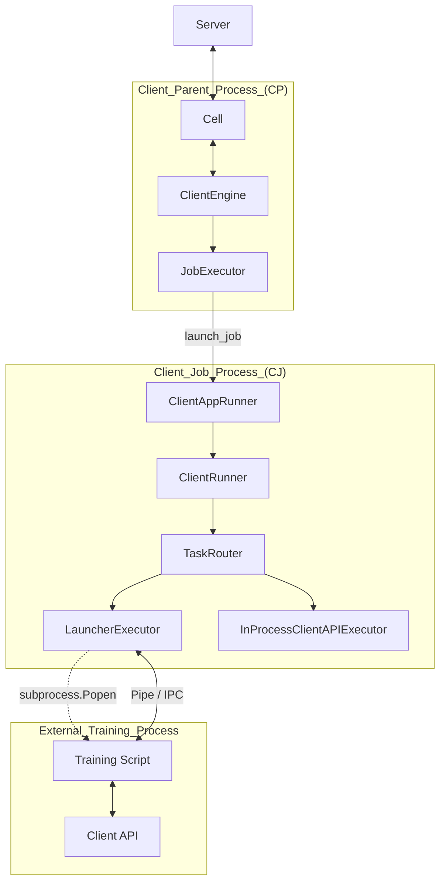
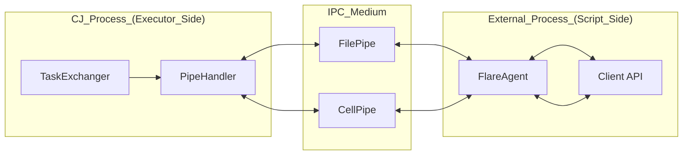

<!-- source: DeepWiki mcp.deepwiki.com · repo NVIDIA/NVFlare · page 6 Client-Side Execution · fetched 2026-10-26 -->

# Client-Side Execution

Relevant source files

The following files were used as context for generating this wiki page:

- [docs/programming_guide/execution_api_type/3rd_party_integration.rst](docs/programming_guide/execution_api_type/3rd_party_integration.rst)
- [docs/programming_guide/fl_model.rst](docs/programming_guide/fl_model.rst)
- [docs/programming_guide/workflows_and_controllers.rst](docs/programming_guide/workflows_and_controllers.rst)
- [nvflare/app_common/abstract/launcher.py](nvflare/app_common/abstract/launcher.py)
- [nvflare/app_common/executors/client_api_launcher_executor.py](nvflare/app_common/executors/client_api_launcher_executor.py)
- [nvflare/app_common/executors/launcher_executor.py](nvflare/app_common/executors/launcher_executor.py)
- [nvflare/app_common/executors/task_exchanger.py](nvflare/app_common/executors/task_exchanger.py)
- [nvflare/app_common/launchers/__init__.py](nvflare/app_common/launchers/__init__.py)
- [nvflare/app_common/launchers/subprocess_launcher.py](nvflare/app_common/launchers/subprocess_launcher.py)
- [nvflare/app_common/widgets/metric_relay.py](nvflare/app_common/widgets/metric_relay.py)
- [nvflare/client/__init__.py](nvflare/client/__init__.py)
- [nvflare/client/api.py](nvflare/client/api.py)
- [nvflare/client/config.py](nvflare/client/config.py)
- [nvflare/client/constants.py](nvflare/client/constants.py)
- [nvflare/client/decorator.py](nvflare/client/decorator.py)
- [nvflare/client/lightning/__init__.py](nvflare/client/lightning/__init__.py)
- [nvflare/client/model_registry.py](nvflare/client/model_registry.py)
- [nvflare/client/task_registry.py](nvflare/client/task_registry.py)
- [nvflare/client/utils.py](nvflare/client/utils.py)
- [nvflare/fuel/utils/constants.py](nvflare/fuel/utils/constants.py)
- [nvflare/fuel/utils/pipe/file_pipe.py](nvflare/fuel/utils/pipe/file_pipe.py)
- [nvflare/fuel/utils/pipe/pipe.py](nvflare/fuel/utils/pipe/pipe.py)
- [nvflare/fuel/utils/pipe/pipe_handler.py](nvflare/fuel/utils/pipe/pipe_handler.py)
- [tests/unit_test/app_common/executors/client_api_launcher_executor_test.py](tests/unit_test/app_common/executors/client_api_launcher_executor_test.py)
- [tests/unit_test/app_common/launchers/__init__.py](tests/unit_test/app_common/launchers/__init__.py)
- [tests/unit_test/app_common/launchers/subprocess_launcher_test.py](tests/unit_test/app_common/launchers/subprocess_launcher_test.py)
- [tests/unit_test/app_common/widgets/metric_relay_test.py](tests/unit_test/app_common/widgets/metric_relay_test.py)
- [tests/unit_test/client/config_test.py](tests/unit_test/client/config_test.py)
- [tests/unit_test/client/package_exports_test.py](tests/unit_test/client/package_exports_test.py)
- [tests/unit_test/fuel/utils/fobs/test_pass_through.py](tests/unit_test/fuel/utils/fobs/test_pass_through.py)

## Purpose and Scope

This page explains how NVIDIA FLARE clients execute federated learning tasks. It covers the client-side runtime architecture, task execution mechanisms, and integration approaches for adapting existing training code to federated learning.

**Topics covered:**
- The two-process client architecture (parent and job processes).
- Task routing and the `Executor` framework.
- External process execution with `LauncherExecutor` and `ClientAPILauncherExecutor`.
- The Client API for minimal code integration.
- Framework integrations (PyTorch Lightning, etc.).
- In-process vs. Ex-process execution modes.

**Related pages:**
- For the base abstraction of task handling, see [Executor Framework](#6.1).
- For details on subprocess isolation, see [LauncherExecutor and External Processes](#6.2).
- For the high-level Client API, see [FLARE Client API](#6.3).
- For framework-specific wrappers, see [Framework Integration](#6.4).
- For data protection, see [Filters and Privacy Protection](#6.5).

---

## Client Process Architecture

### Two-Process Model

NVIDIA FLARE uses a two-process architecture to separate job management from task execution. The **Client Parent Process (CP)** maintains the persistent connection to the server, while the **Client Job Process (CJ)** executes the actual training logic.

**Diagram: Client Execution Hierarchy**

Sources:
- [nvflare/app_common/executors/launcher_executor.py:38-62]()
- [nvflare/app_common/executors/client_api_launcher_executor.py:43-76]()
- [nvflare/app_common/executors/task_exchanger.py:112-127]()

### LauncherExecutor and Subprocess Management

When using the Client API or running external scripts, the `LauncherExecutor` manages the lifecycle of the training subprocess. It handles the transition from the FLARE `Executor` interface to an external process using a `Launcher` component.

**Key Code Entities:**
- `LauncherExecutor`: Manages the exchange of tasks and results with an external process via a `Pipe` [nvflare/app_common/executors/launcher_executor.py:38-62]().
- `ClientAPILauncherExecutor`: A specialized version that configures the environment and writes the `CLIENT_API_CONFIG` file for the `nvflare.client` API [nvflare/app_common/executors/client_api_launcher_executor.py:43-76]().
- `TaskExchanger`: A base class for executors that exchange tasks/results with an external peer over a pipe [nvflare/app_common/executors/task_exchanger.py:112-127]().
- `SubprocessLauncher`: A specific implementation of the `Launcher` interface that uses `subprocess.Popen` to start and manage external training scripts [nvflare/app_common/launchers/subprocess_launcher.py:31-38]().

For details, see [LauncherExecutor and External Processes](#6.2).

Sources:
- [nvflare/app_common/executors/launcher_executor.py:38-140]()
- [nvflare/app_common/executors/client_api_launcher_executor.py:43-121]()
- [nvflare/app_common/executors/task_exchanger.py:112-168]()
- [nvflare/app_common/launchers/subprocess_launcher.py:31-106]()

---

## Communication and Pipes

For communication between the Job Process (CJ) and an external training process, NVFlare uses a **Pipe** abstraction. This allows the system to exchange complex objects (like model weights) across process boundaries using `FOBS` (FLARE Object Serialization).

**Diagram: Pipe Communication Flow**

**Key Components:**
- `Pipe`: Abstract interface for sending/receiving `Message` objects [nvflare/fuel/utils/pipe/pipe.py:114-125]().
- `FilePipe`: Implementation using the file system for IPC, creating `x`, `y`, and `t` (temp) directories for message exchange [nvflare/fuel/utils/pipe/file_pipe.py:29-108]().
- `PipeHandler`: Monitors the pipe, handles heartbeats, and manages message queues via background threads (`reader` and `heartbeat_sender`) [nvflare/fuel/utils/pipe/pipe_handler.py:32-120]().
- `CellPipe`: A high-performance pipe implementation based on FLARE's CellNet [nvflare/fuel/utils/pipe/cell_pipe.py:31-36]().
- `Message`: The unit of communication containing `msg_type` (REQ/REP), `topic`, and `data` [nvflare/fuel/utils/pipe/pipe.py:37-65]().

Sources:
- [nvflare/fuel/utils/pipe/pipe.py:37-65]()
- [nvflare/fuel/utils/pipe/pipe_handler.py:63-120]()
- [nvflare/fuel/utils/pipe/file_pipe.py:29-137]()
- [nvflare/app_common/executors/task_exchanger.py:112-168]()

---

## FLARE Client API

The Client API is designed to federate existing training scripts with minimal changes. It provides a set of high-level functions that hide the complexity of the underlying IPC and task routing.

**Core API Functions:**
- `flare.init()`: Initializes the NVFlare Client API environment and prepares the `APIContext` [nvflare/client/api.py:53-89]().
- `flare.receive()`: Blocks until an `FLModel` is received from the NVFlare side [nvflare/client/api.py:91-98]().
- `flare.send()`: Sends the `FLModel` back to the NVFlare side [nvflare/client/api.py:101-114]().
- `flare.system_info()`: Retrieves job metadata like `job_id` and `site_name` [nvflare/client/api.py:117-131]().
- `flare.log()`: Logs key-value pairs for experiment tracking [nvflare/client/api.py:214-229]().

**API Context Management:**
The API uses an `APIContext` to maintain state. The `init()` function ensures a valid context is available before any other API calls are made [nvflare/client/api.py:32-51]().

For comprehensive details, see [FLARE Client API](#6.3).

Sources:
- [nvflare/client/api.py:32-114]()
- [nvflare/client/api.py:117-131]()
- [nvflare/client/api.py:214-229]()

---

## Framework Integration

NVFlare provides deep integration with popular machine learning frameworks to further simplify the developer experience.

### PyTorch Lightning Integration
The Lightning integration uses a callback mechanism to automatically handle the `receive/send` cycle within the Lightning `Trainer`.

- `flare.patch(trainer)`: Injects the `FLCallback` into the PyTorch Lightning `Trainer` and registers the `TensorDecomposer` [nvflare/client/lightning/__init__.py:34]().
- `FLCallback`: Manages the training loop synchronization, available via `nvflare.app_opt.lightning.FLCallback` [nvflare/client/lightning/__init__.py:33]().

### Subprocess Execution Configuration
The `ClientAPILauncherExecutor` manages several timeouts and configuration keys for external processes, including `submit_result_timeout` and `max_resends` to control how the subprocess handles result transmission [nvflare/app_common/executors/client_api_launcher_executor.py:70-71](). These parameters are written into the `CLIENT_API_CONFIG` file for the script to consume [nvflare/client/config.py:74-75]().

For more details on framework-specific integrations, see [Framework Integration](#6.4).

Sources:
- [nvflare/client/lightning/__init__.py:1-45]()
- [nvflare/app_common/executors/client_api_launcher_executor.py:43-121]()
- [nvflare/client/config.py:56-148]()

---

## Summary of Client-Side Topics

| Topic | Description | Link |
|-------|-------------|------|
| **Executor Framework** | The core abstraction for task handling in NVFlare. | [Executor Framework](#6.1) |
| **Launchers** | How NVFlare manages external subprocesses and scripts via `LauncherExecutor` and `SubprocessLauncher`. | [LauncherExecutor and External Processes](#6.2) |
| **Client API** | The primary interface for data-scientists to federate code using `flare.init`, `send`, and `receive`. | [FLARE Client API](#6.3) |
| **Integrations** | Specialized support for PyTorch, Lightning, and more. | [Framework Integration](#6.4) |
| **Filters** | Privacy and data transformation layers applied at the edge. | [Filters and Privacy Protection](#6.5) |

Sources:
- [nvflare/app_common/executors/launcher_executor.py:38-62]()
- [nvflare/client/api.py:53-114]()
- [nvflare/app_common/executors/client_api_launcher_executor.py:43-76]()
- [nvflare/app_common/launchers/subprocess_launcher.py:31-38]()

---

