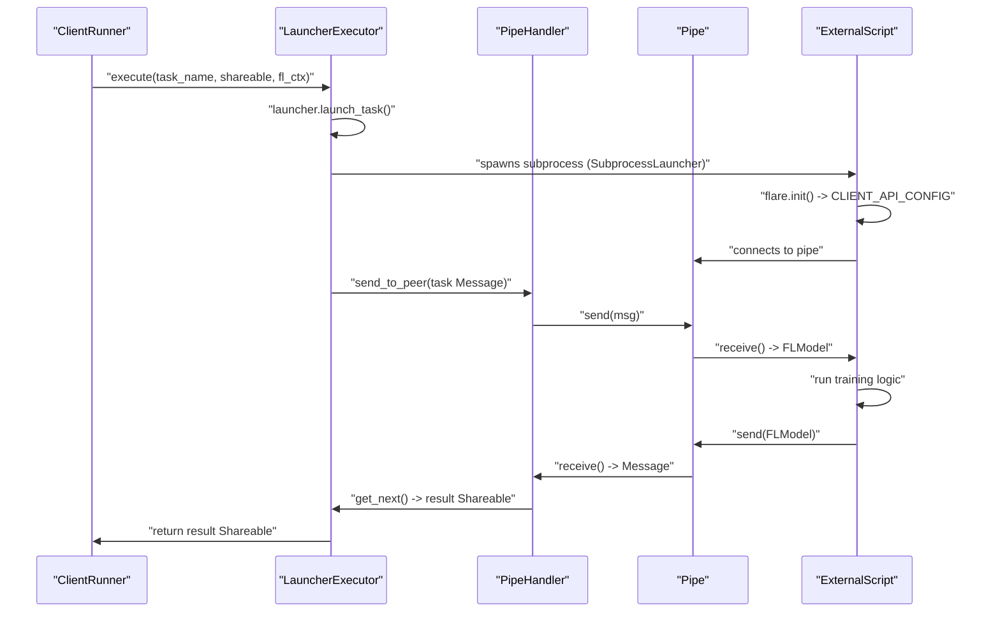

<!-- source: DeepWiki mcp.deepwiki.com · repo NVIDIA/NVFlare · page 6.1 Executor Framework · fetched 2026-10-26 -->

# Executor Framework

<details>
<summary>Relevant source files</summary>

The following files were used as context for generating this wiki page:

- [examples/hello-world/hello-cyclic/job.py](examples/hello-world/hello-cyclic/job.py)
- [examples/hello-world/hello-pt/client.py](examples/hello-world/hello-pt/client.py)
- [examples/hello-world/hello-tf/job.py](examples/hello-world/hello-tf/job.py)
- [nvflare/app_common/abstract/launcher.py](nvflare/app_common/abstract/launcher.py)
- [nvflare/app_common/executors/client_api_launcher_executor.py](nvflare/app_common/executors/client_api_launcher_executor.py)
- [nvflare/app_common/executors/in_process_client_api_executor.py](nvflare/app_common/executors/in_process_client_api_executor.py)
- [nvflare/app_common/executors/launcher_executor.py](nvflare/app_common/executors/launcher_executor.py)
- [nvflare/app_common/executors/task_exchanger.py](nvflare/app_common/executors/task_exchanger.py)
- [nvflare/app_common/executors/task_script_runner.py](nvflare/app_common/executors/task_script_runner.py)
- [nvflare/app_common/launchers/__init__.py](nvflare/app_common/launchers/__init__.py)
- [nvflare/app_common/launchers/subprocess_launcher.py](nvflare/app_common/launchers/subprocess_launcher.py)
- [nvflare/app_common/widgets/metric_relay.py](nvflare/app_common/widgets/metric_relay.py)
- [nvflare/fuel/utils/constants.py](nvflare/fuel/utils/constants.py)
- [nvflare/fuel/utils/pipe/file_pipe.py](nvflare/fuel/utils/pipe/file_pipe.py)
- [nvflare/fuel/utils/pipe/pipe.py](nvflare/fuel/utils/pipe/pipe.py)
- [nvflare/fuel/utils/pipe/pipe_handler.py](nvflare/fuel/utils/pipe/pipe_handler.py)
- [nvflare/tool/job/config/meta.conf](nvflare/tool/job/config/meta.conf)
- [tests/integration_test/data/jobs/hello-pt-cse/app/custom/train.py](tests/integration_test/data/jobs/hello-pt-cse/app/custom/train.py)
- [tests/integration_test/data/jobs/pt_mc_cyclic/app/config/config_fed_client.conf](tests/integration_test/data/jobs/pt_mc_cyclic/app/config/config_fed_client.conf)
- [tests/integration_test/data/jobs/pt_mc_fedavg/app/config/config_fed_client.conf](tests/integration_test/data/jobs/pt_mc_fedavg/app/config/config_fed_client.conf)
- [tests/integration_test/data/test_configs/standalone_job/hello_numpy_recipe_examples.yml](tests/integration_test/data/test_configs/standalone_job/hello_numpy_recipe_examples.yml)
- [tests/integration_test/data/test_configs/standalone_job/pt_job.yml](tests/integration_test/data/test_configs/standalone_job/pt_job.yml)
- [tests/integration_test/data/test_configs/standalone_job/tf_job.yml](tests/integration_test/data/test_configs/standalone_job/tf_job.yml)
- [tests/integration_test/src/validators/__init__.py](tests/integration_test/src/validators/__init__.py)
- [tests/integration_test/src/validators/job_log_result_validator.py](tests/integration_test/src/validators/job_log_result_validator.py)
- [tests/integration_test/src/validators/tf_model_validator.py](tests/integration_test/src/validators/tf_model_validator.py)
- [tests/unit_test/app_common/executors/client_api_launcher_executor_test.py](tests/unit_test/app_common/executors/client_api_launcher_executor_test.py)
- [tests/unit_test/app_common/executors/task_script_runner_test.py](tests/unit_test/app_common/executors/task_script_runner_test.py)
- [tests/unit_test/app_common/launchers/__init__.py](tests/unit_test/app_common/launchers/__init__.py)
- [tests/unit_test/app_common/launchers/subprocess_launcher_test.py](tests/unit_test/app_common/launchers/subprocess_launcher_test.py)
- [tests/unit_test/app_common/widgets/metric_relay_test.py](tests/unit_test/app_common/widgets/metric_relay_test.py)
- [tests/unit_test/fuel/utils/fobs/test_pass_through.py](tests/unit_test/fuel/utils/fobs/test_pass_through.py)

</details>


This page describes the client-side executor framework in NVIDIA FLARE: the `Executor` base class, the `TaskExchanger` intermediate layer, and how these combine with the `Launcher` abstraction to support both in-process and external-process execution models.

For details on how the `ClientRunner` dispatches tasks to executors, see [3.3](). For the FLARE Client API used by external training scripts, see [6.3](). For `LauncherExecutor` and subprocess management specifically, see [6.2]().

---

## Role of Executors

In the FLARE client runtime, the server sends named tasks to each client. The `ClientRunner` receives each task (as a `Shareable` object), looks up the executor registered for that task name via the `TaskRouter`, and calls the executor's `execute()` method. The executor returns a `Shareable` result, which is sent back to the server.

Executors can run logic in one of two modes:

| Mode | Description | When to use |
|---|---|---|
| **In-process** | Executor implements logic directly within the FLARE client process | Simple computations, or when using the `InProcessClientAPIExecutor` for simplified script execution |
| **External-process** | Executor delegates work to a separately launched process via an IPC pipe | Training scripts using PyTorch, TensorFlow, or any framework where you want process isolation |

---

## The `Executor` Base Class

All executors inherit from `Executor` in `nvflare/apis/executor.py`. The key abstract method is:

```python
def execute(self, task_name: str, shareable: Shareable, fl_ctx: FLContext, abort_signal: Signal) -> Shareable:
```

- `task_name` — the name of the task dispatched from the server (e.g., `"train"`, `"validate"`) [nvflare/app_common/executors/launcher_executor.py:54-55]().
- `shareable` — input data from the server, typically containing a model or configuration [nvflare/apis/shareable.py:24-24]().
- `fl_ctx` — the current `FLContext` providing access to engine, workspace, and other components [nvflare/apis/fl_context.py:23-23]().
- `abort_signal` — a `Signal` that the executor must check periodically; if triggered, the executor should stop and return [nvflare/apis/signal.py:25-25]().

`Executor` extends `FLComponent`, so executors can also participate in the event system via `handle_event()`.

**Class hierarchy diagram:**

```mermaid
classDiagram
    class "FLComponent"["FLComponent"] {
        +handle_event(event_type, fl_ctx)
        +log_info(fl_ctx, msg)
    }
    class "Executor"["Executor"] {
        +execute(task_name, shareable, fl_ctx, abort_signal) Shareable
    }
    class "TaskExchanger"["TaskExchanger"] {
        +pipe_id: str
        +pipe: Pipe
        +pipe_handler: PipeHandler
        +execute(task_name, shareable, fl_ctx, abort_signal) Shareable
    }
    class "LauncherExecutor"["LauncherExecutor"] {
        +launcher: Launcher
        +execute(task_name, shareable, fl_ctx, abort_signal) Shareable
        +initialize(fl_ctx)
    }
    class "ClientAPILauncherExecutor"["ClientAPILauncherExecutor"] {
        +params_exchange_format: str
        +params_transfer_type: str
        +initialize(fl_ctx)
    }
    class "InProcessClientAPIExecutor"["InProcessClientAPIExecutor"] {
        +task_script_path: str
        +execute(task_name, shareable, fl_ctx, abort_signal) Shareable
    }

    "FLComponent" <|-- "Executor"
    "Executor" <|-- "TaskExchanger"
    "Executor" <|-- "InProcessClientAPIExecutor"
    "TaskExchanger" <|-- "LauncherExecutor"
    "LauncherExecutor" <|-- "ClientAPILauncherExecutor"
```
Sources: [nvflare/app_common/executors/launcher_executor.py:38-58](), [nvflare/app_common/executors/client_api_launcher_executor.py:43-76](), [nvflare/app_common/executors/task_exchanger.py:112-127](), [nvflare/app_common/executors/in_process_client_api_executor.py:47-66]()

---

## In-Process Execution Model

Execution happens inside the FLARE client process. The `ClientRunner` calls `execute()`, which runs synchronously. NVFlare provides the `InProcessClientAPIExecutor` to bridge standard training scripts into this mode without spawning a separate OS process.

### InProcessClientAPIExecutor
This executor runs the user's script in a background thread within the same process [nvflare/app_common/executors/in_process_client_api_executor.py:124-140](). It utilizes the `InProcessClientAPI` for communication instead of a physical OS-level pipe [nvflare/app_common/executors/in_process_client_api_executor.py:126-132]().

The executor uses a `TaskScriptRunner` to manage the script's lifecycle, including redirecting `print` calls to the FLARE logs and managing `sys.argv` isolation [nvflare/app_common/executors/task_script_runner.py:64-88]().

Sources: [nvflare/app_common/executors/in_process_client_api_executor.py:110-141](), [nvflare/app_common/executors/task_script_runner.py:89-114]()

---

## External-Process Execution Model: Overview

When the training logic must run in a separate process (e.g., a PyTorch training script), the executor delegates work across a **pipe**.

**Key diagram: External-process execution data flow**


Sources: [nvflare/app_common/executors/launcher_executor.py:38-62](), [nvflare/fuel/utils/pipe/pipe_handler.py:32-61](), [nvflare/app_common/executors/task_exchanger.py:112-153](), [nvflare/app_common/launchers/subprocess_launcher.py:31-46]()

---

## TaskExchanger

`TaskExchanger` ([nvflare/app_common/executors/task_exchanger.py]()) is an `Executor` subclass that communicates a task to a remote peer over a `Pipe`. It handles:

- Obtaining the configured `Pipe` component from the engine.
- Creating a `PipeHandler` to manage background reading and heartbeating [nvflare/app_common/executors/task_exchanger.py:113-125]().
- Sending the `Shareable` task to the peer and polling for a `Shareable` reply [nvflare/app_common/executors/task_exchanger.py:113-153]().

### Key constructor parameters

| Parameter | Type | Purpose |
|---|---|---|
| `pipe_id` | `str` | Component ID to look up the `Pipe` [nvflare/app_common/executors/task_exchanger.py:155-155](). |
| `read_interval` | `float` | How often `PipeHandler` reads from the pipe [nvflare/app_common/executors/task_exchanger.py:156-156](). |
| `heartbeat_interval` | `float` | How often a heartbeat is sent to the peer [nvflare/app_common/executors/task_exchanger.py:157-157](). |
| `heartbeat_timeout` | `float` | Timeout for peer heartbeat [nvflare/app_common/executors/task_exchanger.py:158-159](). |
| `max_resends` | `Optional[int]` | Maximum number of retries for pipe sends [nvflare/app_common/executors/task_exchanger.py:161-162](). |
| `peer_read_timeout` | `Optional[float]` | Time to wait for the peer to accept a sent message [nvflare/app_common/executors/task_exchanger.py:163-164](). |
| `streaming_idle_timeout` | `Optional[float]` | When task-send peer-read times out, continue waiting only while progress is made [nvflare/app_common/executors/task_exchanger.py:165-166](). |

Sources: [nvflare/app_common/executors/task_exchanger.py:112-153](), [nvflare/app_common/executors/task_exchanger.py:155-166]()

---

## Pipe Abstraction

The `Pipe` abstract class ([nvflare/fuel/utils/pipe/pipe.py:114-181]()) defines a bidirectional message channel.

| Implementation | File | Transport |
|---|---|---|
| `FilePipe` | [nvflare/fuel/utils/pipe/file_pipe.py]() | Filesystem (shared directory) [nvflare/fuel/utils/pipe/file_pipe.py:29-39](). |
| `CellPipe` | [nvflare/fuel/utils/pipe/cell_pipe.py]() | F3 CellNet (message-based) [nvflare/fuel/utils/pipe/cell_pipe.py:28-28](). |

### `PipeHandler`

`PipeHandler` ([nvflare/fuel/utils/pipe/pipe_handler.py:32-119]()) wraps a `Pipe` with a background **reader thread** and a **heartbeat thread** [nvflare/fuel/utils/pipe/pipe_handler.py:103-119](). It uses a `heartbeat_timeout` to detect if the peer is disconnected ("gone") [nvflare/fuel/utils/pipe/pipe_handler.py:55-59]().

```mermaid
flowchart TD
    "Pipe"["Pipe"]
    "READER"["reader thread (_read)"]
    "HB"["heartbeat_sender thread (_heartbeat)"]
    "QUEUE"["messages deque"]
    "CALLER"["TaskExchanger (execute loop)"]

    "READER" -- "reads from" --> "Pipe"
    "READER" -- "enqueues" --> "QUEUE"
    "HB" -- "sends heartbeat to" --> "Pipe"
    "CALLER" -- "get_next()" --> "QUEUE"
```
Sources: [nvflare/fuel/utils/pipe/pipe_handler.py:103-119](), [nvflare/fuel/utils/pipe/pipe_handler.py:55-59](), [nvflare/fuel/utils/pipe/file_pipe.py:29-39]()

---

## LauncherExecutor

`LauncherExecutor` ([nvflare/app_common/executors/launcher_executor.py:38-140]()) extends `TaskExchanger` with lifecycle management. It uses a `ThreadPoolExecutor` to manage tasks and background operations [nvflare/app_common/executors/launcher_executor.py:114-114]().

### Monitor thread behavior
A monitor thread watches the launcher's run status [nvflare/app_common/executors/launcher_executor.py:129-129](). If the launcher finishes, it ensures the last result is transferred before timing out [nvflare/app_common/executors/launcher_executor.py:107-109](). It also supports deferred task stopping via `_stop_task_wait_timeout` to allow for large-model upload transactions to complete before the subprocess exits [nvflare/app_common/executors/launcher_executor.py:134-139]().

Sources: [nvflare/app_common/executors/launcher_executor.py:107-114](), [nvflare/app_common/executors/launcher_executor.py:129-139]()

---

## ClientAPILauncherExecutor

`ClientAPILauncherExecutor` ([nvflare/app_common/executors/client_api_launcher_executor.py:43-76]()) specializes `LauncherExecutor` for the FLARE Client API. It writes a configuration file (`CLIENT_API_CONFIG`) that the external process reads to initialize its end of the pipe [nvflare/app_common/executors/client_api_launcher_executor.py:66-66]().

It supports specific configuration for result submission timeouts and retries, ensuring that large model transfers (often involving `DownloadService`) are handled robustly [nvflare/app_common/executors/client_api_launcher_executor.py:106-116]().

Sources: [nvflare/app_common/executors/client_api_launcher_executor.py:43-76](), [nvflare/app_common/executors/client_api_launcher_executor.py:106-116]()

---

## Component Wiring Diagram

This diagram shows how the code entities associate across process boundaries.

```mermaid
flowchart TD
    subgraph "FLARE_Client_Process_CJ"["FLARE Client Process (CJ)"]
        "CLE"["ClientAPILauncherExecutor"]
        "LAUNCHER"["SubprocessLauncher"]
        "PIPE"["CellPipe / FilePipe"]
        "PH"["PipeHandler"]
        "CR"["ClientRunner"]

        "CR" -- "dispatches to" --> "CLE"
        "CLE" -- "uses" --> "LAUNCHER"
        "CLE" -- "uses" --> "PH"
        "PH" -- "wraps" --> "PIPE"
    end

    subgraph "External_Training_Process"["External Training Process"]
        "SCRIPT"["Training Script (train.py)"]
        "CAPI"["Client API (flare.init)"]
        "PEER_PIPE"["Peer Pipe"]

        "SCRIPT" -- "calls" --> "CAPI"
        "CAPI" -- "uses" --> "PEER_PIPE"
    end

    "PIPE" <-->|"IPC (File/Cell)"| "PEER_PIPE"
    "LAUNCHER" -- "subprocess.Popen" --> "SCRIPT"
```
Sources: [nvflare/app_common/executors/client_api_launcher_executor.py:43-76](), [nvflare/fuel/utils/pipe/file_pipe.py:79-107](), [nvflare/app_common/executors/task_exchanger.py:112-153](), [nvflare/app_common/launchers/subprocess_launcher.py:98-106]()

---

