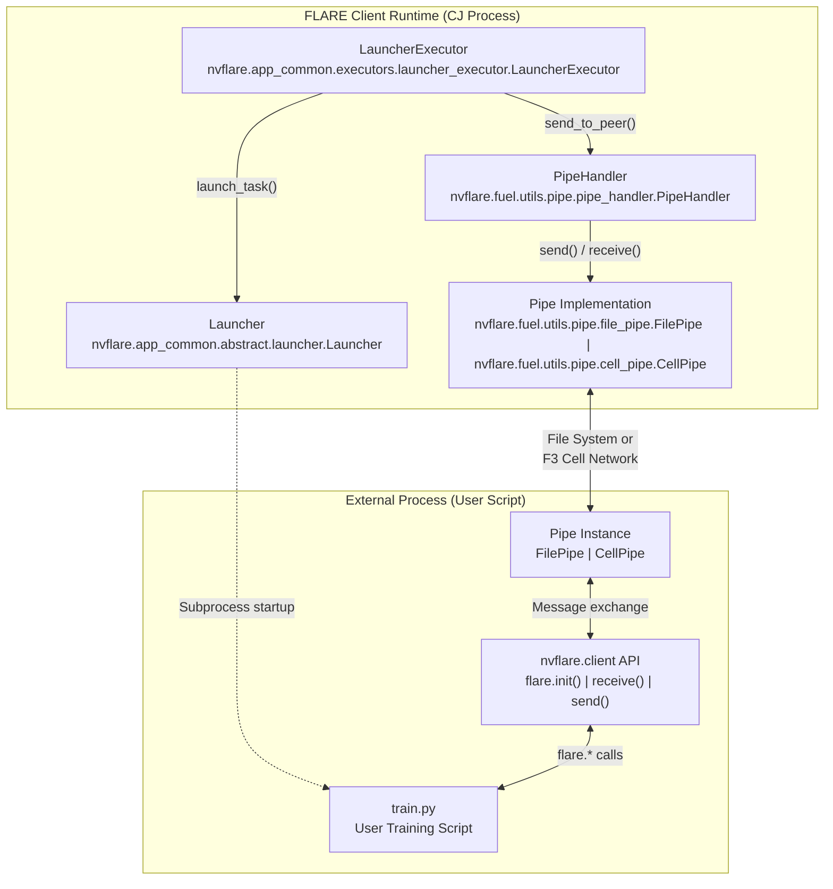
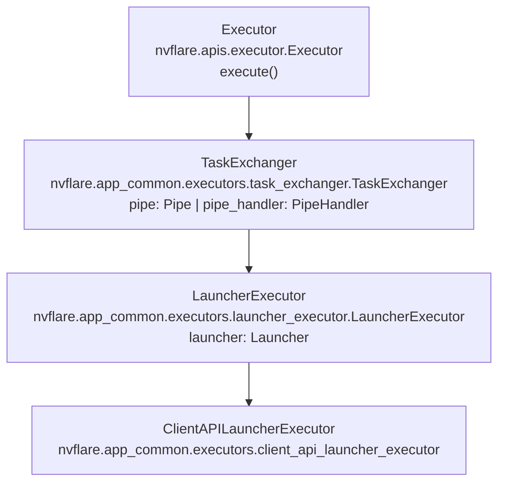
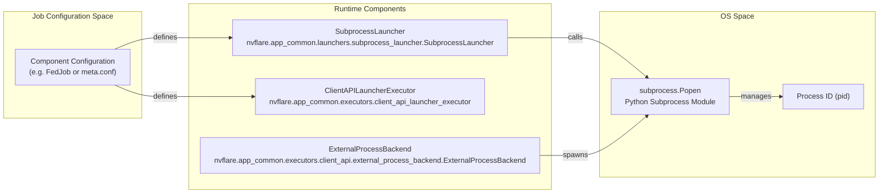
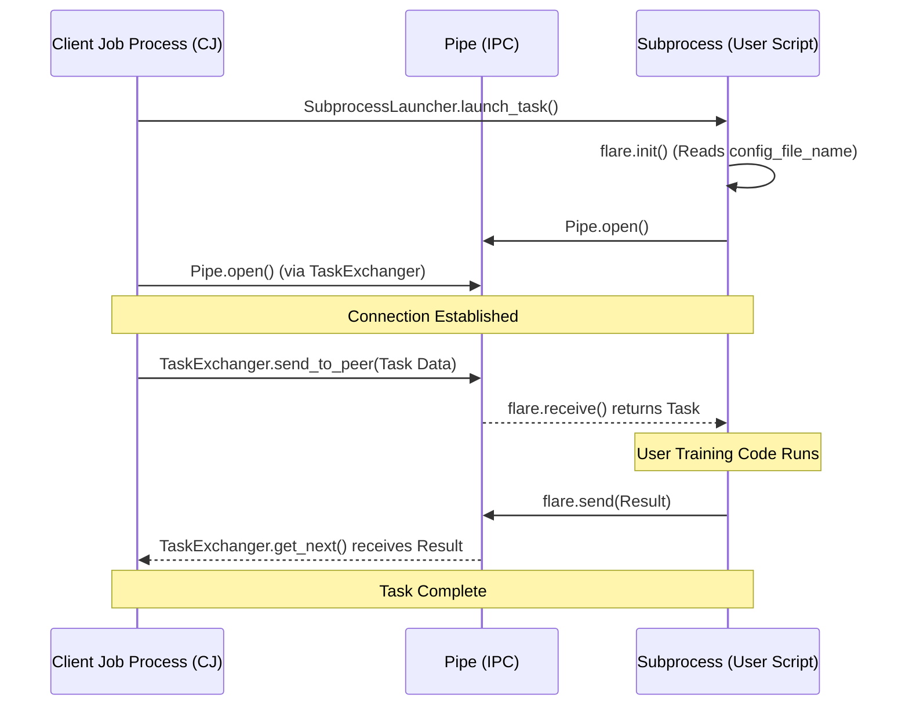

<!-- source: DeepWiki mcp.deepwiki.com · repo NVIDIA/NVFlare · page 6.2 LauncherExecutor and External Processes · fetched 2026-10-26 -->

# LauncherExecutor and External Processes

Relevant source files

The following files were used as context for generating this wiki page:

- [nvflare/app_common/abstract/launcher.py](nvflare/app_common/abstract/launcher.py)
- [nvflare/app_common/executors/client_api/external_process_backend.py](nvflare/app_common/executors/client_api/external_process_backend.py)
- [nvflare/app_common/executors/client_api_launcher_executor.py](nvflare/app_common/executors/client_api_launcher_executor.py)
- [nvflare/app_common/executors/launcher_executor.py](nvflare/app_common/executors/launcher_executor.py)
- [nvflare/app_common/executors/task_exchanger.py](nvflare/app_common/executors/task_exchanger.py)
- [nvflare/app_common/launchers/__init__.py](nvflare/app_common/launchers/__init__.py)
- [nvflare/app_common/launchers/subprocess_launcher.py](nvflare/app_common/launchers/subprocess_launcher.py)
- [nvflare/app_common/widgets/metric_relay.py](nvflare/app_common/widgets/metric_relay.py)
- [nvflare/app_opt/pt/torchrun_node.py](nvflare/app_opt/pt/torchrun_node.py)
- [nvflare/client/cell/bootstrap.py](nvflare/client/cell/bootstrap.py)
- [nvflare/fuel/utils/constants.py](nvflare/fuel/utils/constants.py)
- [nvflare/fuel/utils/pipe/file_pipe.py](nvflare/fuel/utils/pipe/file_pipe.py)
- [nvflare/fuel/utils/pipe/pipe.py](nvflare/fuel/utils/pipe/pipe.py)
- [nvflare/fuel/utils/pipe/pipe_handler.py](nvflare/fuel/utils/pipe/pipe_handler.py)
- [tests/unit_test/app_common/executors/client_api_launcher_executor_test.py](tests/unit_test/app_common/executors/client_api_launcher_executor_test.py)
- [tests/unit_test/app_common/executors/external_process_backend_test.py](tests/unit_test/app_common/executors/external_process_backend_test.py)
- [tests/unit_test/app_common/launchers/__init__.py](tests/unit_test/app_common/launchers/__init__.py)
- [tests/unit_test/app_common/launchers/subprocess_launcher_test.py](tests/unit_test/app_common/launchers/subprocess_launcher_test.py)
- [tests/unit_test/app_common/widgets/metric_relay_test.py](tests/unit_test/app_common/widgets/metric_relay_test.py)
- [tests/unit_test/fuel/utils/fobs/test_pass_through.py](tests/unit_test/fuel/utils/fobs/test_pass_through.py)

## Purpose and Scope

This document explains how NVIDIA FLARE executes federated learning jobs in external processes using the `LauncherExecutor` framework. This architecture enables training scripts written in any language or framework (PyTorch, TensorFlow, Lightning, etc.) to participate in federated learning without being directly embedded in the FLARE runtime process.

The `LauncherExecutor` system provides:
- **Process Isolation**: Jobs run in separate processes via a `Launcher` implementation (like `SubprocessLauncher`), preventing crashes in training code from bringing down the Client Engine [nvflare/app_common/launchers/subprocess_launcher.py:31-56]().
- **Inter-process Communication (IPC)**: Bidirectional data exchange via the `Pipe` abstraction managed by `TaskExchanger` [nvflare/app_common/executors/task_exchanger.py:112-153]().
- **Client API Integration**: Seamless integration for external scripts via the high-level Client API (`flare.init`, `receive`, `send`) supported by `ClientAPILauncherExecutor` [nvflare/app_common/executors/client_api_launcher_executor.py:43-76]().
- **Flexible Lifecycles**: Support for launching a process once per job or once per task depending on the launcher configuration and the `launch_once` property [nvflare/app_common/launchers/subprocess_launcher.py:32-38](), [nvflare/app_common/executors/launcher_executor.py:107-108]().
- **Advanced Execution Modes**: Beyond standard IPC, the `ExternalProcessBackend` enables specialized execution modes where the trainer process group is owned and managed with authenticated sessions over the CJ cell [nvflare/app_common/executors/client_api/external_process_backend.py:17-21]().

## Architecture Overview

The system bridges the "FLARE Runtime Space" (where the `ClientEngine` resides) and the "External Process Space" (where user training code resides) using a pipe-based communication layer.

**Natural Language to Code Entity Space: System Overview**

**Sources:** [nvflare/app_common/executors/launcher_executor.py:38-62](), [nvflare/app_common/executors/task_exchanger.py:112-153](), [nvflare/fuel/utils/pipe/pipe_handler.py:32-120](), [nvflare/app_common/executors/client_api_launcher_executor.py:43-76](), [nvflare/app_common/launchers/subprocess_launcher.py:31-56]()

### Key Components

| Component | Purpose | Location |
|-----------|---------|----------|
| `LauncherExecutor` | Orchestrates external process execution and task exchange | [nvflare/app_common/executors/launcher_executor.py:38-62]() |
| `TaskExchanger` | Base class handling the logic of sending tasks and waiting for results via pipes | [nvflare/app_common/executors/task_exchanger.py:112-153]() |
| `Launcher` | Abstract base class for starting/stopping the external execution environment | [nvflare/app_common/abstract/launcher.py:32-32]() |
| `SubprocessLauncher` | Implementation that uses `subprocess.Popen` to run external scripts | [nvflare/app_common/launchers/subprocess_launcher.py:31-56]() |
| `Pipe` | Abstract communication channel (File-based or Cell-based) | [nvflare/fuel/utils/pipe/pipe.py:114-114]() |
| `PipeHandler` | Monitors a pipe for messages, heartbeats, and status changes | [nvflare/fuel/utils/pipe/pipe_handler.py:32-61]() |
| `ClientAPILauncherExecutor` | Specialized executor that configures the Client API environment for the subprocess | [nvflare/app_common/executors/client_api_launcher_executor.py:43-76]() |
| `ExternalProcessBackend` | Manages authenticated trainer sessions and lazy payload transfers over Cell/F3 | [nvflare/app_common/executors/client_api/external_process_backend.py:173-200]() |

## LauncherExecutor Component

### Class Hierarchy

`LauncherExecutor` inherits from `TaskExchanger`, which provides the core IPC logic. `ClientAPILauncherExecutor` is a specialized version that automatically writes the necessary configuration files (e.g., `client_api.json`) for the subprocess to connect back to the parent.

**Sources:** [nvflare/app_common/executors/launcher_executor.py:38-39](), [nvflare/app_common/executors/task_exchanger.py:112-113](), [nvflare/app_common/executors/client_api_launcher_executor.py:43-44]()

### LauncherExecutor Responsibilities

The `LauncherExecutor` manages the complete lifecycle of external task execution:

1.  **Initialization**: Retrieves the `Launcher` and `Pipe` components from the `FLContext` using configured component IDs [nvflare/app_common/executors/launcher_executor.py:103-105]().
2.  **Process Monitoring**: Monitors if the subprocess crashes or finishes prematurely via a `Launcher` status check and a dedicated monitor thread [nvflare/app_common/executors/launcher_executor.py:116-129]().
3.  **Task Launching**: Triggers the `Launcher.launch_task()` to start or signal the external script [nvflare/app_common/abstract/launcher.py:59-61]().
4.  **Connection Setup**: Waits for the external process before it calls `flare.init()` via `external_pre_init_timeout` [nvflare/app_common/executors/launcher_executor.py:110-110]().
5.  **Result Collection**: Monitors the pipe for results and handles timeouts for transmitting the last result [nvflare/app_common/executors/launcher_executor.py:109-111]().
6.  **Deferred Stopping**: Supports `needs_deferred_stop()` to keep processes alive during large tensor uploads [nvflare/app_common/abstract/launcher.py:46-56](), [nvflare/app_common/executors/launcher_executor.py:134-139]().

### Pipe Communication System

The `Pipe` provides a bidirectional channel. `TaskExchanger` uses a `PipeHandler` to wrap the raw pipe with higher-level logic like heartbeats and message queuing.

#### Pipe Implementations

| Implementation | Mechanism | File Path |
| :--- | :--- | :--- |
| `FilePipe` | Uses file system directories (`x/`, `y/`, `t/`) for message exchange via `FileAccessor`. | [nvflare/fuel/utils/pipe/file_pipe.py:29-59]() |
| `CellPipe` | Uses FLARE's CellNet (F3) for network-based IPC using FQCN routing. | [nvflare/fuel/utils/pipe/cell_pipe.py:28-28]() |

#### PipeHandler and Heartbeats

`PipeHandler` manages the reliability of the pipe connection:
1.  **Reader Thread**: Periodically calls `pipe.receive()` and places messages in a `deque` queue [nvflare/fuel/utils/pipe/pipe_handler.py:102-103]().
2.  **Heartbeat Thread**: Periodically sends `Topic.HEARTBEAT` to the peer to confirm connectivity [nvflare/fuel/utils/pipe/pipe_handler.py:118-119]().

If heartbeats are not received within `heartbeat_timeout`, the peer is marked as `GONE`, and the `status_cb` is triggered to notify the executor [nvflare/fuel/utils/pipe/pipe_handler.py:55-61]().

**Sources:** [nvflare/fuel/utils/pipe/pipe_handler.py:32-120](), [nvflare/fuel/utils/pipe/file_pipe.py:138-163](), [nvflare/fuel/utils/pipe/pipe.py:28-35]()

## Client API Integration

The external process interacts with the `LauncherExecutor` using the `nvflare.client` API. `ClientAPILauncherExecutor` facilitates this by writing the required configuration.

### Configuration Generation

`ClientAPILauncherExecutor` writes a configuration file (default `client_api.json`) that the external script reads during `flare.init()` [nvflare/app_common/executors/client_api_launcher_executor.py:66-66]().

This configuration includes:
- **Pipe Configuration**: The serialized class name and arguments for the `Pipe` implementation [nvflare/app_common/executors/client_api_launcher_executor.py:80-81]().
- **Exchange Formats**: Defines how parameters are exchanged (e.g., `NUMPY` or `PYTORCH`) [nvflare/app_common/executors/client_api_launcher_executor.py:64-67]().
- **Timeouts**: Settings for `peer_read_timeout`, `heartbeat_timeout`, and `submit_result_timeout` [nvflare/app_common/executors/client_api_launcher_executor.py:52-56](), [nvflare/app_common/executors/client_api_launcher_executor.py:70-70]().

**Sources:** [nvflare/app_common/executors/client_api_launcher_executor.py:43-76](), [nvflare/app_common/executors/launcher_executor.py:38-62]()

## Subprocess Management

The `SubprocessLauncher` is the primary implementation for managing external OS processes. It uses the `subprocess` module to spawn and monitor training scripts.

### Process Lifecycle
- **Start**: During `initialize` (if `launch_once=True`) or `launch_task`, it calls `subprocess.Popen` [nvflare/app_common/launchers/subprocess_launcher.py:58-61](), [nvflare/app_common/launchers/subprocess_launcher.py:79-106]().
- **Monitoring**: A background thread logs the subprocess output [nvflare/app_common/launchers/subprocess_launcher.py:107-108](). The `check_run_status` method polls the process exit code [nvflare/app_common/launchers/subprocess_launcher.py:137-147]().
- **Termination**: Uses `SIGTERM` (on POSIX, it kills the process group via `os.killpg`) to gracefully shut down the script [nvflare/app_common/launchers/subprocess_launcher.py:110-119]().

### External Process Backend (Cell-based)
For `ClientAPIExecutor`, the `ExternalProcessBackend` provides a more robust session-based model:
- **Bootstrap Config**: Generates a bootstrap file containing a one-time token and the CJ Cell listener URL [nvflare/app_common/executors/client_api/external_process_backend.py:41-48]().
- **Authenticated Sessions**: The trainer process must perform a `HELLO` handshake with the token to establish a `_TrainerSession` [nvflare/app_common/executors/client_api/external_process_backend.py:123-163]().
- **Result Reaping**: A reaper thread ensures that the trainer process stays alive until the CJ (Client Job) has fully downloaded any lazy result payloads [nvflare/app_common/executors/client_api/external_process_backend.py:143-147]().

**Natural Language to Code Entity Space: Process Management**

**Sources:** [nvflare/app_common/launchers/subprocess_launcher.py:31-56](), [nvflare/app_common/executors/client_api/external_process_backend.py:173-200](), [nvflare/app_common/executors/client_api_launcher_executor.py:43-76]()

## Execution Sequence

**Sources:** [nvflare/app_common/executors/launcher_executor.py:38-140](), [nvflare/app_common/executors/task_exchanger.py:112-153](), [nvflare/fuel/utils/pipe/pipe_handler.py:32-61](), [nvflare/app_common/launchers/subprocess_launcher.py:70-73]()

---

