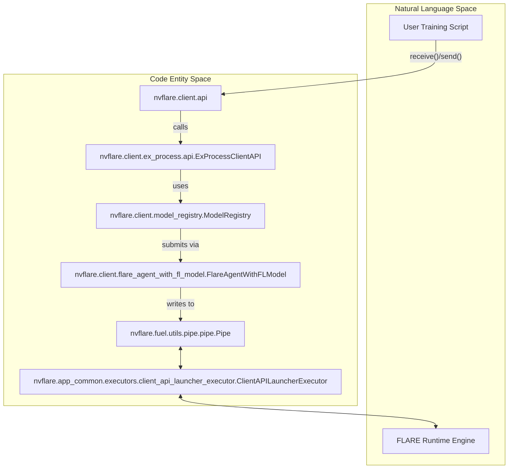
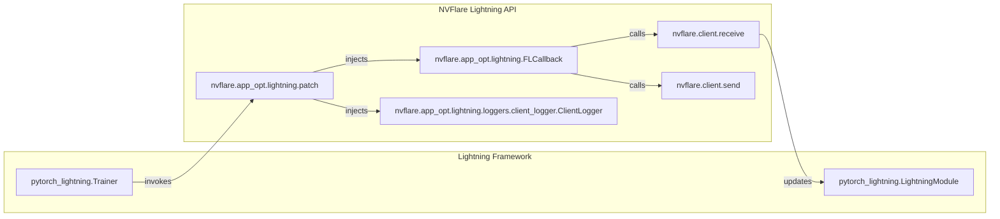

<!-- source: DeepWiki mcp.deepwiki.com · repo NVIDIA/NVFlare · page 6.3 FLARE Client API · fetched 2026-10-26 -->

# FLARE Client API

Relevant source files

The following files were used as context for generating this wiki page:

- [docs/programming_guide/execution_api_type/3rd_party_integration.rst](docs/programming_guide/execution_api_type/3rd_party_integration.rst)
- [docs/programming_guide/fl_model.rst](docs/programming_guide/fl_model.rst)
- [docs/programming_guide/workflows_and_controllers.rst](docs/programming_guide/workflows_and_controllers.rst)
- [examples/advanced/multi-gpu/pt/README.md](examples/advanced/multi-gpu/pt/README.md)
- [examples/advanced/multi-gpu/pt/client.py](examples/advanced/multi-gpu/pt/client.py)
- [examples/docker/jobs/pt-ddp-docker/app_site-1/custom/client.py](examples/docker/jobs/pt-ddp-docker/app_site-1/custom/client.py)
- [examples/docker/jobs/pt-ddp-docker/app_site-2/custom/client.py](examples/docker/jobs/pt-ddp-docker/app_site-2/custom/client.py)
- [nvflare/client/__init__.py](nvflare/client/__init__.py)
- [nvflare/client/api.py](nvflare/client/api.py)
- [nvflare/client/api_spec.py](nvflare/client/api_spec.py)
- [nvflare/client/config.py](nvflare/client/config.py)
- [nvflare/client/constants.py](nvflare/client/constants.py)
- [nvflare/client/decorator.py](nvflare/client/decorator.py)
- [nvflare/client/ex_process/api.py](nvflare/client/ex_process/api.py)
- [nvflare/client/in_process/api.py](nvflare/client/in_process/api.py)
- [nvflare/client/lightning/__init__.py](nvflare/client/lightning/__init__.py)
- [nvflare/client/model_registry.py](nvflare/client/model_registry.py)
- [nvflare/client/task_registry.py](nvflare/client/task_registry.py)
- [nvflare/client/utils.py](nvflare/client/utils.py)
- [tests/integration_test/data/jobs/pt_client_api_torchrun_cpu/app/config/config_fed_client.conf](tests/integration_test/data/jobs/pt_client_api_torchrun_cpu/app/config/config_fed_client.conf)
- [tests/integration_test/data/jobs/pt_client_api_torchrun_cpu/app/config/config_fed_server.conf](tests/integration_test/data/jobs/pt_client_api_torchrun_cpu/app/config/config_fed_server.conf)
- [tests/integration_test/data/jobs/pt_client_api_torchrun_cpu/app/custom/net.py](tests/integration_test/data/jobs/pt_client_api_torchrun_cpu/app/custom/net.py)
- [tests/unit_test/client/config_test.py](tests/unit_test/client/config_test.py)
- [tests/unit_test/client/ex_process/api_test.py](tests/unit_test/client/ex_process/api_test.py)
- [tests/unit_test/client/package_exports_test.py](tests/unit_test/client/package_exports_test.py)

## Purpose and Scope

The FLARE Client API (`nvflare.client`) provides a high-level Python interface for adapting existing centralized training code to federated learning with minimal code changes. This API is the recommended starting point for users who want to convert standalone training scripts into federated learning applications without restructuring their code into classes or implementing complex interfaces [nvflare/client/api.py:22-25]().

**Scope of this document:**
- Core Client API methods (`init`, `receive`, `send`, `system_info`, `tracking`) from `nvflare.client.api` [nvflare/client/api.py:52-235]().
- The `FLModel` data structure used for standardized communication [nvflare/app_common/abstract/fl_model.py:22-101]().
- Communication architecture involving `ExProcessClientAPI`, `InProcessClientAPI`, `ModelRegistry`, and `Pipe` mechanisms [nvflare/client/ex_process/api.py:111-159](), [nvflare/client/in_process/api.py:44-86]().
- Framework-specific integration patterns, specifically for PyTorch Lightning [nvflare/client/lightning/__init__.py:27-45]().

Sources: [nvflare/client/api.py:1-235](), [nvflare/client/ex_process/api.py:1-159](), [nvflare/client/in_process/api.py:1-165](), [nvflare/client/config.py:1-135]()

---

## Core Client API Methods

The Client API is implemented in `nvflare.client.api` and manages an `APIContext` which tracks the state of the communication with the FLARE side [nvflare/client/api.py:24-31](). It supports different execution modes, such as external process (`ExProcessClientAPI`) and in-process (`InProcessClientAPI`) [nvflare/client/ex_process/api.py:111](), [nvflare/client/in_process/api.py:44]().

### Primary Methods

| Method | Purpose | Returns | File Reference |
|--------|---------|---------|----------------|
| `flare.init()` | Initializes the NVFlare Client API environment. Supports `rank` for multi-process (e.g., multi-GPU) training [nvflare/client/api.py:53-88](). | `APIContext` | [nvflare/client/api.py:53]() |
| `flare.receive()` | Receives an `FLModel` from the FLARE side. This call blocks until a model is available or the timeout is reached [nvflare/client/api.py:91-98](). | `Optional[FLModel]` | [nvflare/client/api.py:91]() |
| `flare.send(model)` | Sends the updated `FLModel` back to the FLARE side. Can optionally clear the local cache [nvflare/client/api.py:101-114](). | `None` | [nvflare/client/api.py:101]() |

### Status and Information Methods

| Method | Purpose | Returns | File Reference |
|--------|---------|---------|----------------|
| `flare.is_running()` | Returns whether the NVFlare system is active [nvflare/client/api.py:174-182](). | `bool` | [nvflare/client/api.py:174]() |
| `flare.is_train()` | Checks if the current task is a training task [nvflare/client/api.py:184-192](). | `bool` | [nvflare/client/api.py:184]() |
| `flare.is_evaluate()` | Checks if the current task is an evaluation task [nvflare/client/api.py:194-201](). | `bool` | [nvflare/client/api.py:194]() |
| `flare.is_submit_model()` | Checks if the current task is a submit_model task [nvflare/client/api.py:204-212](). | `bool` | [nvflare/client/api.py:204]() |
| `flare.system_info()` | Retrieves system information including job ID and site name [nvflare/client/api.py:117-132](). | `Dict` | [nvflare/client/api.py:117]() |
| `flare.get_config()` | Retrieves the `ClientConfig` dictionary [nvflare/client/api.py:134-142](). | `Dict` | [nvflare/client/api.py:134]() |
| `flare.get_job_id()` | Retrieves the current job ID [nvflare/client/api.py:144-152](). | `str` | [nvflare/client/api.py:144]() |
| `flare.get_site_name()` | Retrieves the site name of the current client [nvflare/client/api.py:154-162](). | `str` | [nvflare/client/api.py:154]() |
| `flare.get_task_name()` | Retrieves the current task name [nvflare/client/api.py:164-172](). | `str` | [nvflare/client/api.py:164]() |

### Experiment Tracking
The API provides a `log` function for analytics, which uses `AnalyticsDataType` to define the value type [nvflare/client/api.py:214-230](). High-level wrappers in `nvflare/client/tracking.py` are recommended for general usage [nvflare/client/api.py:217]().

Sources: [nvflare/client/api.py:53-235](), [nvflare/client/api_context.py:24-25]()

---

## FLModel Data Structure

The `FLModel` class is the standardized data structure for NVFlare to communicate with external systems [nvflare/app_common/abstract/fl_model.py:22](). It encapsulates parameters, metrics, and metadata required for a federated round.

**Key Attributes:**

| Attribute | Type | Purpose |
|-----------|------|---------|
| `params` | `Any` | Model parameters (e.g., weights). |
| `params_type` | `ParamsType` | Enum indicating if parameters are full weights (`FULL`) or weight differences (`DIFF`) [nvflare/app_common/abstract/fl_model.py:22-101](). |
| `metrics` | `Optional[Dict]` | Evaluation metrics such as loss and scores. |
| `current_round` | `Optional[int]` | The current FL round index. |
| `meta` | `Optional[Dict]` | Metadata dictionary for custom key-value pairs. |

Sources: [nvflare/app_common/abstract/fl_model.py:22-101](), [nvflare/client/config.py:35-41]()

---

## Communication Architecture

The Client API is typically used in a sub-process execution model where the training script is managed by a `LauncherExecutor` or `ClientAPILauncherExecutor`.

### Sub-Process Task Exchange Flow

**Diagram: Communication Flow between User Script and FLARE Executor**

Sources: [nvflare/client/api.py:91-114](), [nvflare/client/ex_process/api.py:111-159](), [nvflare/client/model_registry.py:24-106](), [docs/programming_guide/execution_api_type/3rd_party_integration.rst:156-180]()

### Communication Implementation
1.  **ExProcessClientAPI**: The concrete implementation of the API for external processes. It initializes the `FlareAgentWithFLModel` and `ModelRegistry` based on a configuration file [nvflare/client/ex_process/api.py:111-159]().
2.  **InProcessClientAPI**: Used when training runs in the same process as the FLARE client, utilizing a `DataBus` for communication [nvflare/client/in_process/api.py:44-86]().
3.  **ModelRegistry**: Used internally by the Client API to manage model submission, including calculating parameter differences if `transfer_type` is set to `DIFF` [nvflare/client/model_registry.py:46-64]().
4.  **Pipe and Channel**: The communication bridge. The `ClientConfig` defines `TASK_EXCHANGE` and `METRICS_EXCHANGE` sections, each specifying a `Pipe` class (e.g., `CellPipe`) and a `pipe_channel_name` [nvflare/client/config.py:56-79]().
5.  **Transfer Type**: Supports `FULL` (entire model) or `DIFF` (only weight updates) transfers [nvflare/client/config.py:51-53](). The `ModelRegistry` uses `DIFF_FUNCS` to compute these differences automatically [nvflare/client/model_registry.py:86-105]().

Sources: [nvflare/client/ex_process/api.py:111-159](), [nvflare/client/in_process/api.py:44-102](), [nvflare/client/model_registry.py:24-106](), [nvflare/client/config.py:56-148]()

---

## Framework Integration: PyTorch Lightning

FLARE provides a `patch` mechanism for PyTorch Lightning to automate the integration of `flare.receive()` and `flare.send()` into the training loop [nvflare/client/lightning/__init__.py:34]().

### Patching and Callbacks
The `patch` function (imported from `nvflare.app_opt.lightning`) adds an `FLCallback` and optionally a `RestoreState` callback to the Lightning `Trainer`.

-   **`FLCallback`**: Manages the FL round lifecycle. It handles the mapping between FLARE's `receive`/`send` and Lightning's training/validation hooks [nvflare/client/lightning/__init__.py:33]().
-   **`ClientLogger`**: Provides a framework-native way to log metrics back to FLARE via the Client API [nvflare/client/lightning/__init__.py:35]().

**Diagram: PyTorch Lightning Patching Architecture**

Sources: [nvflare/client/lightning/__init__.py:27-45](), [nvflare/client/api.py:91-114]()

---

## Serialization and Memory Management

Data transmitted between the user script and the FLARE executor is serialized using **FOBS** (FLARE Object Serialization).

1.  **TensorDecomposer**: For PyTorch integration, a `TensorDecomposer` is registered with FOBS to handle efficient transfer of tensors [nvflare/client/ex_process/api.py:103-109]().
2.  **Memory Management**: The `ClientConfig` allows configuring `memory_gc_rounds` and `cuda_empty_cache` to manage resources during long-running jobs [nvflare/client/config.py:72-73](). The `APISpec` base class implements `_maybe_cleanup_memory` which is called after `send()` [nvflare/client/api_spec.py:39-55]().
3.  **Cache Clearing**: `flare.send()` provides a `clear_cache` argument (defaulting to `True`) which triggers `ModelRegistry.release_params()` to nullify large parameter arrays after they are submitted [nvflare/client/api.py:101-114](), [nvflare/client/model_registry.py:66-85]().

Sources: [nvflare/client/api.py:101-114](), [nvflare/client/model_registry.py:66-85](), [nvflare/client/config.py:72-73](), [nvflare/client/ex_process/api.py:103-109](), [nvflare/client/api_spec.py:39-55]()

---

