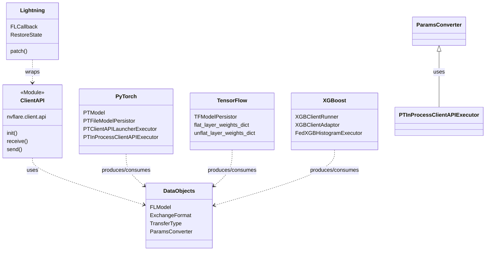

<!-- source: DeepWiki mcp.deepwiki.com · repo NVIDIA/NVFlare · page 6.4 Framework Integration · fetched 2026-10-26 -->

# Framework Integration

<details>
<summary>Relevant source files</summary>

The following files were used as context for generating this wiki page:

- [docs/hello-world/hello-lightning/index.rst](docs/hello-world/hello-lightning/index.rst)
- [docs/release_notes/flare_290.rst](docs/release_notes/flare_290.rst)
- [examples/hello-world/hello-lightning/README.md](examples/hello-world/hello-lightning/README.md)
- [examples/hello-world/hello-lightning/job.py](examples/hello-world/hello-lightning/job.py)
- [examples/hello-world/hello-lightning/requirements.txt](examples/hello-world/hello-lightning/requirements.txt)
- [job_templates/sag_tf/config_fed_client.conf](job_templates/sag_tf/config_fed_client.conf)
- [job_templates/sag_tf/config_fed_server.conf](job_templates/sag_tf/config_fed_server.conf)
- [nvflare/app_common/abstract/params_converter.py](nvflare/app_common/abstract/params_converter.py)
- [nvflare/app_opt/lightning/algorithm.py](nvflare/app_opt/lightning/algorithm.py)
- [nvflare/app_opt/lightning/api.py](nvflare/app_opt/lightning/api.py)
- [nvflare/app_opt/lightning/scaffold.py](nvflare/app_opt/lightning/scaffold.py)
- [nvflare/app_opt/pt/client_api_launcher_executor.py](nvflare/app_opt/pt/client_api_launcher_executor.py)
- [nvflare/app_opt/pt/in_process_client_api_executor.py](nvflare/app_opt/pt/in_process_client_api_executor.py)
- [nvflare/app_opt/pt/job_config/model.py](nvflare/app_opt/pt/job_config/model.py)
- [nvflare/app_opt/pt/numpy_params_converter.py](nvflare/app_opt/pt/numpy_params_converter.py)
- [nvflare/app_opt/tf/client_api_launcher_executor.py](nvflare/app_opt/tf/client_api_launcher_executor.py)
- [nvflare/app_opt/tf/in_process_client_api_executor.py](nvflare/app_opt/tf/in_process_client_api_executor.py)
- [nvflare/app_opt/tf/job_config/model.py](nvflare/app_opt/tf/job_config/model.py)
- [nvflare/app_opt/tf/model_persistor.py](nvflare/app_opt/tf/model_persistor.py)
- [nvflare/app_opt/tf/params_converter.py](nvflare/app_opt/tf/params_converter.py)
- [nvflare/app_opt/tf/utils.py](nvflare/app_opt/tf/utils.py)
- [nvflare/app_opt/xgboost/data_loader.py](nvflare/app_opt/xgboost/data_loader.py)
- [nvflare/app_opt/xgboost/histogram_based/controller.py](nvflare/app_opt/xgboost/histogram_based/controller.py)
- [nvflare/app_opt/xgboost/histogram_based/executor.py](nvflare/app_opt/xgboost/histogram_based/executor.py)
- [nvflare/app_opt/xgboost/histogram_based_v2/adaptors/grpc_client_adaptor.py](nvflare/app_opt/xgboost/histogram_based_v2/adaptors/grpc_client_adaptor.py)
- [nvflare/app_opt/xgboost/histogram_based_v2/adaptors/xgb_adaptor.py](nvflare/app_opt/xgboost/histogram_based_v2/adaptors/xgb_adaptor.py)
- [nvflare/app_opt/xgboost/histogram_based_v2/controller.py](nvflare/app_opt/xgboost/histogram_based_v2/controller.py)
- [nvflare/app_opt/xgboost/histogram_based_v2/defs.py](nvflare/app_opt/xgboost/histogram_based_v2/defs.py)
- [nvflare/app_opt/xgboost/histogram_based_v2/executor.py](nvflare/app_opt/xgboost/histogram_based_v2/executor.py)
- [nvflare/app_opt/xgboost/histogram_based_v2/fed_controller.py](nvflare/app_opt/xgboost/histogram_based_v2/fed_controller.py)
- [nvflare/app_opt/xgboost/histogram_based_v2/fed_executor.py](nvflare/app_opt/xgboost/histogram_based_v2/fed_executor.py)
- [nvflare/app_opt/xgboost/histogram_based_v2/mock/mock_controller.py](nvflare/app_opt/xgboost/histogram_based_v2/mock/mock_controller.py)
- [nvflare/app_opt/xgboost/histogram_based_v2/runners/xgb_client_runner.py](nvflare/app_opt/xgboost/histogram_based_v2/runners/xgb_client_runner.py)
- [nvflare/app_opt/xgboost/histogram_based_v2/sec/client_handler.py](nvflare/app_opt/xgboost/histogram_based_v2/sec/client_handler.py)
- [nvflare/app_opt/xgboost/histogram_based_v2/sec/server_handler.py](nvflare/app_opt/xgboost/histogram_based_v2/sec/server_handler.py)
- [tests/unit_test/app_opt/lightning/api_test.py](tests/unit_test/app_opt/lightning/api_test.py)
- [tests/unit_test/app_opt/pt/pt_model_wrapper_test.py](tests/unit_test/app_opt/pt/pt_model_wrapper_test.py)
- [tests/unit_test/app_opt/xgboost/histrogram_based_v2/adaptors/xgb_adaptor_test.py](tests/unit_test/app_opt/xgboost/histrogram_based_v2/adaptors/xgb_adaptor_test.py)
- [tests/unit_test/recipe/component_config_verification_test.py](tests/unit_test/recipe/component_config_verification_test.py)

</details>


This page describes how NVIDIA FLARE integrates with popular machine learning frameworks including PyTorch, TensorFlow/Keras, PyTorch Lightning, NumPy, and XGBoost. It details the implementation patterns, data flow, and key classes used to bridge these frameworks with the FLARE federated learning infrastructure.

## Overview

NVIDIA FLARE supports multiple ML frameworks through a unified integration pattern that leverages the **Client API**, enabling users to convert centralized training code to federated learning with minimal modifications.

### Integration Architecture

The following diagram illustrates the relationship between user scripts, framework-specific models, and the FLARE execution components.

**Framework Integration Data Flow**
```mermaid
graph TB
    subgraph "User_Training_Script"
        [Script] --> ["client.py<br/>(Training Script)"]
    end
    
    subgraph "Framework_Layer"
        ["torch.nn.Module"]
        ["keras.Model"]
        ["NumPy ndarray"]
        ["pl.Trainer"]
        ["XGBoost Booster"]
    end
    
    subgraph "FLARE_Client_API"
        ["flare.init()"]
        ["flare.receive()"]
        ["flare.send()"]
        ["FLModel<br/>(params, metrics)"]
    end
    
    subgraph "FLARE_Execution_Layer"
        ["InProcessClientAPIExecutor"]
        ["ClientAPILauncherExecutor"]
        ["SubprocessLauncher"]
    end
    
    [Script] --> ["flare.init()"]
    [Script] --> ["flare.receive()"]
    [Script] --> ["flare.send()"]
    
    ["flare.receive()"] --> ["FLModel<br/>(params, metrics)"]
    ["FLModel<br/>(params, metrics)"] --> ["flare.send()"]
    
    ["InProcessClientAPIExecutor"] --> [Script]
    ["ClientAPILauncherExecutor"] --> ["SubprocessLauncher"]
    ["SubprocessLauncher"] --> [Script]
```
Sources: `nvflare/app_opt/pt/client_api_launcher_executor.py:26-56`(), `nvflare/app_opt/pt/in_process_client_api_executor.py:24-43`()

### Common Integration Pattern

All framework integrations follow this pattern:

1.  **Initialization**: Call `flare.init()` [nvflare/client/api.py:53-89]() to set up the Client API environment.
2.  **Model Reception**: Use `flare.receive()` [nvflare/client/api.py:91-98]() to get the global model as `FLModel`.
3.  **Model Loading**: Extract parameters from `FLModel` and load into the framework-specific model.
4.  **Local Training**: Perform standard framework training.
5.  **Model Packaging**: Create `FLModel` [nvflare/app_common/abstract/fl_model.py:22-22]() with updated parameters and optional metrics.
6.  **Model Transmission**: Use `flare.send()` [nvflare/client/api.py:101-114]() to return the updated model to the server.

## PyTorch Integration

PyTorch integration primarily uses the `state_dict` for parameter serialization. FLARE provides specialized classes to handle PyTorch tensors efficiently.

### PyTorch Job Configuration
PyTorch models are managed via `PTModel` [nvflare/app_opt/pt/job_config/model.py:26-35](), which can wrap either an `nn.Module` instance or a dictionary configuration [nvflare/app_opt/pt/job_config/model.py:38-48]().

*   **Persistor**: By default, it creates a `PTFileModelPersistor` [nvflare/app_opt/pt/job_config/model.py:115-131]() which handles saving and loading the model `state_dict`.
*   **Launcher Executor**: The `PTClientAPILauncherExecutor` [nvflare/app_opt/pt/client_api_launcher_executor.py:26-56]() registers the `TensorDecomposer` [nvflare/app_opt/pt/client_api_launcher_executor.py:92]() to handle PyTorch tensor serialization via FOBS.
*   **In-Process Execution**: `PTInProcessClientAPIExecutor` [nvflare/app_opt/pt/in_process_client_api_executor.py:24-43]() handles in-process execution and sets up default parameter converters [nvflare/app_opt/pt/in_process_client_api_executor.py:63-69]().

Sources: `nvflare/app_opt/pt/job_config/model.py:26-150`(), `nvflare/app_opt/pt/client_api_launcher_executor.py:26-94`(), `nvflare/app_opt/pt/in_process_client_api_executor.py:24-75`()

## TensorFlow Integration

TensorFlow integration focuses on `tf.keras.Model` weights and provides persistence mechanisms for Keras models.

### TensorFlow Persistence and Data Flow
The `TFModelPersistor` [nvflare/app_opt/tf/model_persistor.py:28-51]() handles TensorFlow model persistence.
*   **Model Instantiation**: Supports direct `tf.keras.Model` instances or dynamic instantiation from a dict config `{"path": "...", "args": {...}}` [nvflare/app_opt/tf/model_persistor.py:77-86]().
*   **Loading Logic**: It can load from full `.h5`, `.keras`, or `SavedModel` directories [nvflare/app_opt/tf/model_persistor.py:113-132]().
*   **Weight Utilities**: Uses `flat_layer_weights_dict` and `unflat_layer_weights_dict` [nvflare/app_opt/tf/utils.py:25-25]() to manage the transformation of Keras weights for federated exchange.

Sources: `nvflare/app_opt/tf/model_persistor.py:28-151`(), `nvflare/app_opt/tf/utils.py:25-25`()

## PyTorch Lightning Integration

PyTorch Lightning integration leverages the standard `LightningModule` and `LightningDataModule` abstractions [docs/hello-world/hello-lightning/index.rst:72-143]().

*   **Trainer Patching**: The `patch()` function [nvflare/app_opt/lightning/api.py:35-99]() attaches `FLCallback` to the PyTorch Lightning `Trainer`.
*   **Automatic FL Management**: `FLCallback` [nvflare/app_opt/lightning/api.py:119-150]() handles the `receive()` and `send()` calls automatically within the Lightning training loop.
*   **Step Reporting**: Patched Lightning clients report `NUM_STEPS_CURRENT_ROUND` as the actual change in `trainer.global_step` to ensure correct aggregation weighting [docs/release_notes/flare_290.rst:28-35]().
*   **SCAFFOLD/FedProx**: Automatic support for SCAFFOLD and FedProx is provided when the received model contains global controls or coefficients [nvflare/app_opt/lightning/api.py:55-72]().

Sources: `nvflare/app_opt/lightning/api.py:35-151`(), `docs/hello-world/hello-lightning/index.rst:72-161`(), `docs/release_notes/flare_290.rst:28-35`()

## XGBoost Integration

XGBoost integration supports both histogram-based and tree-based collaboration. It uses specialized adaptors and runners to manage the XGBoost training lifecycle.

### XGBoost Architecture
XGBoost integration uses a runner-adaptor pattern to bridge FLARE and XGBoost's internal federated communicator.

*   **Client Runner**: `XGBClientRunner` [nvflare/app_opt/xgboost/histogram_based_v2/runners/xgb_client_runner.py:55-81]() manages the training process, setting up the `dmlc_communicator` environment variables [nvflare/app_opt/xgboost/histogram_based_v2/runners/xgb_client_runner.py:172-177]() and calling `xgb.train()` [nvflare/app_opt/xgboost/histogram_based_v2/runners/xgb_client_runner.py:133-143]().
*   **Adaptors**: `XGBClientAdaptor` [nvflare/app_opt/xgboost/histogram_based_v2/adaptors/xgb_adaptor.py:137-160]() and `XGBServerAdaptor` [nvflare/app_opt/xgboost/histogram_based_v2/adaptors/xgb_adaptor.py:31-44]() define the communication protocol for operations like `all_gather`, `all_reduce`, and `broadcast` [nvflare/app_opt/xgboost/histogram_based_v2/adaptors/xgb_adaptor.py:66-135]().
*   **Executor**: `FedXGBHistogramExecutor` [nvflare/app_opt/xgboost/histogram_based/executor.py:55-90]() handles the `XGB_TRAIN_TASK` [nvflare/app_opt/xgboost/histogram_based/executor.py:32]() and orchestrates local data loading via `XGBDataLoader` [nvflare/app_opt/xgboost/histogram_based/executor.py:126]().

Sources: `nvflare/app_opt/xgboost/histogram_based_v2/runners/xgb_client_runner.py:55-182`(), `nvflare/app_opt/xgboost/histogram_based_v2/adaptors/xgb_adaptor.py:31-205`(), `nvflare/app_opt/xgboost/histogram_based/executor.py:55-166`()

## NumPy Integration

NumPy integration is used for simple algorithms or as a base for custom framework integrations.

### Configuration and Formats
NumPy is the default `server_expected_format` [nvflare/client/config.py:171-173]().
*   **Exchange Format**: The `ExchangeFormat.NUMPY` [nvflare/client/config.py:38-38]() is used to indicate parameters are exchanged as NumPy arrays.
*   **Client Configuration**: The `ClientConfig` [nvflare/client/config.py:81-148]() class manages how tasks and metrics are exchanged, often defaulting to NumPy for cross-framework compatibility.

Sources: `nvflare/client/config.py:35-192`()

## Framework Entity Mapping

The following diagram maps high-level framework concepts to specific code entities in the NVFlare codebase.

**Code Entity Mapping**

Sources: `nvflare/app_opt/pt/job_config/model.py:26`(), `nvflare/app_opt/tf/model_persistor.py:28`(), `nvflare/app_opt/lightning/api.py:35`(), `nvflare/app_opt/xgboost/histogram_based_v2/runners/xgb_client_runner.py:55`(), `nvflare/client/api.py:53`()

## Configuration and Data Flow

Data exchange between FLARE and frameworks relies on the `ExchangeFormat` and `TransferType`.

### Parameter Conversion
The `ParamsConverter` [nvflare/app_common/abstract/params_converter.py:24-28]() provides an abstract base for converting parameters between framework formats and FLARE's internal format.
*   **Process Method**: It extracts data from a `Shareable`, calls the conversion logic, and updates the payload [nvflare/app_common/abstract/params_converter.py:29-34]().
*   **Implementation**: `PTInProcessClientAPIExecutor` uses `create_default_params_converters` [nvflare/app_opt/pt/in_process_client_api_executor.py:63-69]() to handle the transformation between PyTorch and NumPy formats.
*   **FOBS Registration**: Framework-specific decomposers like `TensorDecomposer` [nvflare/app_opt/pt/client_api_launcher_executor.py:92]() are registered with FOBS to ensure efficient serialization across process boundaries.

Sources: `nvflare/app_common/abstract/params_converter.py:24-38`(), `nvflare/app_opt/pt/in_process_client_api_executor.py:63-75`(), `nvflare/app_opt/pt/client_api_launcher_executor.py:88-94`()

---

