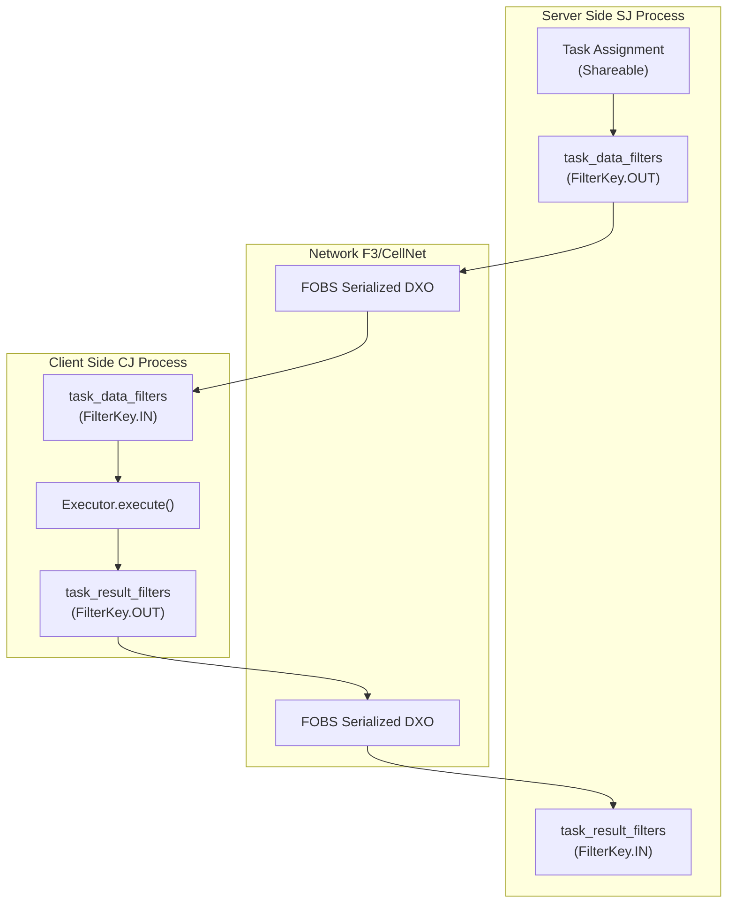
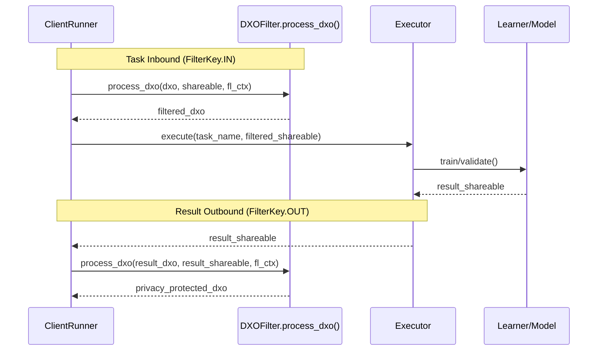

<!-- source: DeepWiki mcp.deepwiki.com · repo NVIDIA/NVFlare · page 6.5 Filters and Privacy Protection · fetched 2026-10-26 -->

# Filters and Privacy Protection

Relevant source files

The following files were used as context for generating this wiki page:

- [nvflare/apis/dxo.py](nvflare/apis/dxo.py)
- [nvflare/apis/impl/any_relay_manager.py](nvflare/apis/impl/any_relay_manager.py)
- [nvflare/apis/impl/seq_relay_manager.py](nvflare/apis/impl/seq_relay_manager.py)
- [nvflare/app_common/abstract/fl_model.py](nvflare/app_common/abstract/fl_model.py)
- [nvflare/app_common/aggregators/accumulate_model_aggregator.py](nvflare/app_common/aggregators/accumulate_model_aggregator.py)
- [nvflare/app_common/decomposers/common_decomposers.py](nvflare/app_common/decomposers/common_decomposers.py)
- [nvflare/app_common/filters/convert_weights.py](nvflare/app_common/filters/convert_weights.py)
- [nvflare/app_common/filters/exclude_vars.py](nvflare/app_common/filters/exclude_vars.py)
- [nvflare/app_common/filters/percentile_privacy.py](nvflare/app_common/filters/percentile_privacy.py)
- [nvflare/app_common/filters/svt_privacy.py](nvflare/app_common/filters/svt_privacy.py)
- [nvflare/app_common/homomorphic_encryption/he_intime_accumulate_model_aggregator.py](nvflare/app_common/homomorphic_encryption/he_intime_accumulate_model_aggregator.py)
- [nvflare/app_common/pt/pt_fedopt.py](nvflare/app_common/pt/pt_fedopt.py)
- [nvflare/app_common/utils/fl_model_utils.py](nvflare/app_common/utils/fl_model_utils.py)
- [nvflare/fuel/sec/audit.py](nvflare/fuel/sec/audit.py)
- [tests/unit_test/app_common/abstract/__init__.py](tests/unit_test/app_common/abstract/__init__.py)
- [tests/unit_test/app_common/abstract/fl_model_test.py](tests/unit_test/app_common/abstract/fl_model_test.py)

## Purpose and Scope

This page describes the filter mechanism in NVIDIA FLARE that provides privacy protection for federated learning tasks. Filters intercept and transform data at task boundaries, enabling privacy-preserving techniques such as differential privacy, model sparsification, and variable exclusion. The system relies on standardized data structures like `DXO` and `FLModel` to ensure compatibility across different machine learning frameworks and external systems.

For information about how executors process tasks, see [Executor Framework](#6.1). For details on the Client API's data handling, see [FLARE Client API](#6.3).

---

## Filter Architecture Overview

NVFLARE implements a bidirectional filter pipeline that processes data flowing between server and clients. Filters operate on task data (incoming) and task results (outgoing) at both server and client boundaries.

### Filter Types and Directions

The following diagram maps the logical flow of data through filter components to the underlying code entities.

**Data Flow and Filter Logic Mapping**

**Sources:** [nvflare/apis/dxo.py:93-107](), [nvflare/app_common/decomposers/common_decomposers.py:28-58]()

### Filter Event Lifecycle

Filters are triggered by specific system events during the task lifecycle. These events allow components to monitor filter activity.

| Event Type | Description |
|------------|-------------|
| `BEFORE_TASK_DATA_FILTER` | Triggered before applying task data filters [nvflare/apis/event_type.py:47]() |
| `AFTER_TASK_DATA_FILTER` | Triggered after applying task data filters [nvflare/apis/event_type.py:48]() |
| `BEFORE_TASK_RESULT_FILTER` | Triggered before applying result filters [nvflare/apis/event_type.py:49]() |
| `AFTER_TASK_RESULT_FILTER` | Triggered after applying result filters [nvflare/apis/event_type.py:50]() |

**Sources:** [nvflare/apis/event_type.py:47-50]()

---

## Data Exchange Structures

Privacy filters primarily operate on standardized containers that wrap model parameters and metadata.

### Data Exchange Object (DXO)
The `DXO` class [nvflare/apis/dxo.py:45-68]() standardizes data passed between communicating parties. It contains a `data_kind` [nvflare/apis/dxo.py:23-33](), the actual `data` (usually a dictionary of tensors), and `meta` properties.

Common `DataKind` values used by filters:
- `WEIGHTS`: Full model weights [nvflare/apis/dxo.py:25]()
- `WEIGHT_DIFF`: Model weight differences (gradients/updates) [nvflare/apis/dxo.py:26]()
- `METRICS`: Evaluation results [nvflare/apis/dxo.py:27]()
- `FL_MODEL`: A complex structure containing multiple model attributes [nvflare/apis/dxo.py:24]()
- `COLLECTION`: A dictionary or list of multiple DXO objects [nvflare/apis/dxo.py:29]()

The `DXO` tracks its processing history via the `FILTER_HISTORY` metadata key [nvflare/apis/dxo.py:140-153]().

### FLModel
`FLModel` [nvflare/app_common/abstract/fl_model.py:42-101]() is a higher-level data structure designed to communicate with external systems. It includes:
- `params`: Model parameters [nvflare/app_common/abstract/fl_model.py:90]()
- `params_type`: Whether parameters are `FULL` or `DIFF` [nvflare/app_common/abstract/fl_model.py:22-25]()
- `metrics`: Evaluation scores [nvflare/app_common/abstract/fl_model.py:92]()
- `meta`: Metadata dictionary [nvflare/app_common/abstract/fl_model.py:101]()

The `FLModelUtils` class provides static methods to convert between `FLModel`, `DXO`, and `Shareable` [nvflare/app_common/utils/fl_model_utils.py:44-161](). For example, `FLModelUtils.to_shareable` converts an `FLModel` into a `Shareable` containing a `DXO` [nvflare/app_common/utils/fl_model_utils.py:46-86]().

**Sources:** [nvflare/apis/dxo.py:23-68](), [nvflare/app_common/abstract/fl_model.py:22-101](), [nvflare/app_common/utils/fl_model_utils.py:44-161]()

---

## Filter Implementation

### DXOFilter Base Class
Most privacy filters inherit from `DXOFilter` [nvflare/apis/dxo_filter.py](), which provides a simplified interface for processing `DXO` objects extracted from a `Shareable`. The `SVTPrivacy` class is a primary example [nvflare/app_common/filters/svt_privacy.py:128]().

### Common Privacy Filters

| Filter Class | Purpose | Key Mechanism |
|--------------|---------|---------------|
| `ExcludeVars` | Security/Privacy | Removes specific variables or layers from the update based on names or regex [nvflare/app_common/filters/exclude_vars.py:24-37](). |
| `PercentilePrivacy` | Sparsification | Only shares updates for parameters where the absolute difference is greater than a specified percentile [nvflare/app_common/filters/percentile_privacy.py:25-46](). |
| `SVTPrivacy` | Differential Privacy | Implements the Sparse Vector Technique (SVT) to provide differential privacy by adding Laplace noise and thresholding updates [nvflare/app_common/filters/svt_privacy.py:128-164](). |
| `ConvertWeights` | Format Conversion | Converts between `WEIGHTS` and `WEIGHT_DIFF` formats using base weights stored in `FLContext` [nvflare/app_common/filters/convert_weights.py:24-46](). |

#### SVT Privacy Logic
The `SVTPrivacy` filter [nvflare/app_common/filters/svt_privacy.py:128-164]() implements a standard differential privacy algorithm. It models one filter invocation as the composition of three pure-DP phases:
1. **Threshold Noise**: Uses budget `epsilon_threshold` to add noise to the threshold `tau` [nvflare/app_common/filters/svt_privacy.py:144-146]().
2. **Query/Selection Noise**: Uses budget `epsilon_query` for selection logic [nvflare/app_common/filters/svt_privacy.py:149-150]().
3. **Release Noise**: Uses budget `epsilon_release` (or derived from `noise_var`) for the final noise injection [nvflare/app_common/filters/svt_privacy.py:152-163]().

The filter maintains a privacy budget across rounds using sequential composition, reporting total epsilon budget via metadata [nvflare/app_common/filters/svt_privacy.py:28-29]().

#### Percentile Privacy Logic
The `PercentilePrivacy` filter [nvflare/app_common/filters/percentile_privacy.py:25]() performs model sparsification:
1. **Cutoff Calculation**: It calculates a cutoff value using `np.percentile` on the absolute values of the weight differences [nvflare/app_common/filters/percentile_privacy.py:75-76]().
2. **Masking**: Any parameter update with an absolute value below the cutoff is set to 0.0 [nvflare/app_common/filters/percentile_privacy.py:88-89]().
3. **Clipping**: Remaining updates are clipped to a specific range defined by `gamma` [nvflare/app_common/filters/percentile_privacy.py:90]().

**Sources:** [nvflare/app_common/filters/svt_privacy.py:128-164](), [nvflare/app_common/filters/percentile_privacy.py:25-95](), [nvflare/app_common/filters/exclude_vars.py:24-111](), [nvflare/app_common/filters/convert_weights.py:24-114]()

---

## Data Flow and Filter Application

### Client-Side Execution Flow
When an `Executor` runs a task, the filter pipeline is applied before and after execution.

**Sources:** [nvflare/app_common/filters/svt_privacy.py:128-164](), [nvflare/app_common/filters/percentile_privacy.py:47-95]()

### Serialization and FOBS
Filters often interact with serialized data. NVFLARE uses **FOBS** (FLARE Object Serialization) to handle complex objects. 

Key FOBS components for filters:
- `FLModelDecomposer`: Ensures `FLModel` objects are decomposed into serializable tuples [nvflare/app_common/decomposers/common_decomposers.py:28-43]() and recomposed accurately [nvflare/app_common/decomposers/common_decomposers.py:45-58]().
- `DictDecomposer`: Used for `Learnable` and `ModelLearnable` structures [nvflare/app_common/decomposers/common_decomposers.py:65-66]().
- `Internalizer` / `Externalizer`: Utility classes used within decomposers to handle data conversion [nvflare/app_common/decomposers/common_decomposers.py:33-48]().

**Sources:** [nvflare/app_common/decomposers/common_decomposers.py:28-67]()

---

## Monitoring and Auditing

The privacy and filter system integrates with NVFLARE's auditing and monitoring tools to ensure transparency in data transformations.

### Audit Logging
The `AuditService` [nvflare/fuel/sec/audit.py:90]() provides a mechanism to log security-sensitive events. The `Auditor` class manages the audit file to log events [nvflare/fuel/sec/audit.py:27-40](). Workflows can use `add_event` [nvflare/fuel/sec/audit.py:41-63]() or `add_job_event` [nvflare/fuel/sec/audit.py:65-82]() to record task-specific actions including `job_id`, `task_name`, and `task_id` in the audit trail.

**Sources:** [nvflare/fuel/sec/audit.py:27-125]()

---

## Summary of Filter Components

| Component | Role | File Reference |
|-----------|------|----------------|
| `DXO` | Standardized data exchange object | [nvflare/apis/dxo.py:45]() |
| `FLModel` | Standard data structure for external systems | [nvflare/app_common/abstract/fl_model.py:42]() |
| `FLModelUtils` | Utilities to convert between Shareable/DXO/FLModel | [nvflare/app_common/utils/fl_model_utils.py:44]() |
| `FLModelDecomposer` | FOBS Decomposer for FLModel | [nvflare/app_common/decomposers/common_decomposers.py:28]() |
| `SVTPrivacy` | Sparse Vector Technique DP filter | [nvflare/app_common/filters/svt_privacy.py:128]() |
| `PercentilePrivacy` | Sparsification filter | [nvflare/app_common/filters/percentile_privacy.py:25]() |
| `ExcludeVars` | Variable/Layer removal filter | [nvflare/app_common/filters/exclude_vars.py:24]() |
| `AuditService` | Logs events for auditing filter/task activity | [nvflare/fuel/sec/audit.py:90]() |

**Sources:** [nvflare/apis/dxo.py:45](), [nvflare/app_common/abstract/fl_model.py:42](), [nvflare/app_common/utils/fl_model_utils.py:44](), [nvflare/app_common/decomposers/common_decomposers.py:28](), [nvflare/app_common/filters/svt_privacy.py:128](), [nvflare/app_common/filters/percentile_privacy.py:25](), [nvflare/app_common/filters/exclude_vars.py:24](), [nvflare/fuel/sec/audit.py:90]()

---

