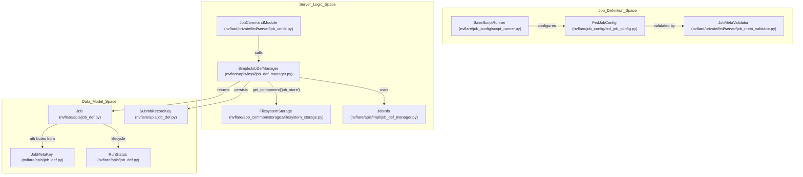
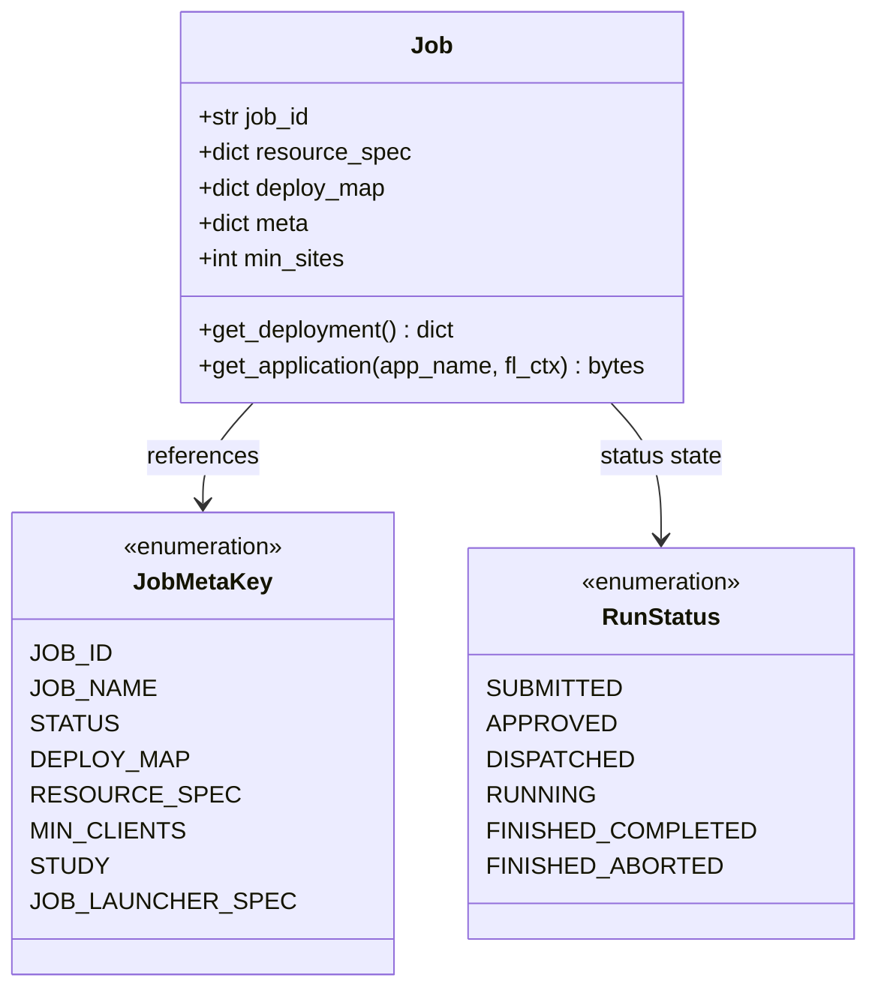
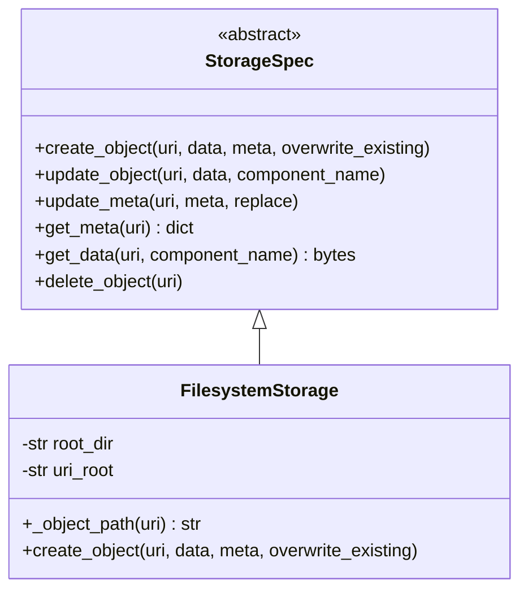
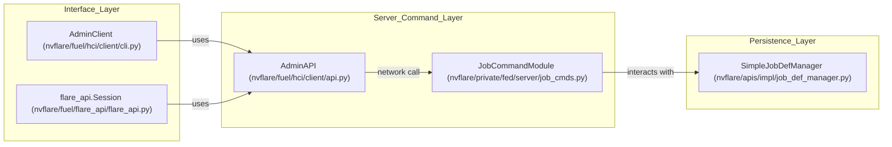

<!-- source: DeepWiki mcp.deepwiki.com · repo NVIDIA/NVFlare · page 7 Job Management System · fetched 2026-10-26 -->

# Job Management System

Relevant source files

The following files were used as context for generating this wiki page:

- [nvflare/apis/fl_snapshot.py](nvflare/apis/fl_snapshot.py)
- [nvflare/apis/impl/job_def_manager.py](nvflare/apis/impl/job_def_manager.py)
- [nvflare/apis/job_def.py](nvflare/apis/job_def.py)
- [nvflare/apis/job_def_manager_spec.py](nvflare/apis/job_def_manager_spec.py)
- [nvflare/apis/state_persistor.py](nvflare/apis/state_persistor.py)
- [nvflare/apis/storage.py](nvflare/apis/storage.py)
- [nvflare/app_common/pt/__init__.py](nvflare/app_common/pt/__init__.py)
- [nvflare/app_common/state_persistors/__init__.py](nvflare/app_common/state_persistors/__init__.py)
- [nvflare/app_common/state_persistors/storage_state_persistor.py](nvflare/app_common/state_persistors/storage_state_persistor.py)
- [nvflare/app_common/storages/filesystem_storage.py](nvflare/app_common/storages/filesystem_storage.py)
- [nvflare/fuel/common/exit_codes.py](nvflare/fuel/common/exit_codes.py)
- [nvflare/fuel/flare_api/api_spec.py](nvflare/fuel/flare_api/api_spec.py)
- [nvflare/fuel/flare_api/flare_api.py](nvflare/fuel/flare_api/flare_api.py)
- [nvflare/fuel/hci/client/api.py](nvflare/fuel/hci/client/api.py)
- [nvflare/fuel/hci/client/api_spec.py](nvflare/fuel/hci/client/api_spec.py)
- [nvflare/fuel/hci/client/cli.py](nvflare/fuel/hci/client/cli.py)
- [nvflare/fuel/hci/client/file_transfer.py](nvflare/fuel/hci/client/file_transfer.py)
- [nvflare/fuel/hci/file_transfer_defs.py](nvflare/fuel/hci/file_transfer_defs.py)
- [nvflare/fuel/hci/proto.py](nvflare/fuel/hci/proto.py)
- [nvflare/fuel/hci/tools/admin.py](nvflare/fuel/hci/tools/admin.py)
- [nvflare/fuel/utils/class_utils.py](nvflare/fuel/utils/class_utils.py)
- [nvflare/fuel/utils/component_classes.json](nvflare/fuel/utils/component_classes.json)
- [nvflare/fuel/utils/components_utils.py](nvflare/fuel/utils/components_utils.py)
- [nvflare/job_config/base_app_config.py](nvflare/job_config/base_app_config.py)
- [nvflare/job_config/fed_app_config.py](nvflare/job_config/fed_app_config.py)
- [nvflare/job_config/fed_job_config.py](nvflare/job_config/fed_job_config.py)
- [nvflare/job_config/file_source.py](nvflare/job_config/file_source.py)
- [nvflare/job_config/script_runner.py](nvflare/job_config/script_runner.py)
- [nvflare/private/fed/server/job_cmds.py](nvflare/private/fed/server/job_cmds.py)
- [tests/unit_test/apis/impl/job_def_manager_test.py](tests/unit_test/apis/impl/job_def_manager_test.py)
- [tests/unit_test/app_common/storages/storage_test.py](tests/unit_test/app_common/storages/storage_test.py)
- [tests/unit_test/data/job_config/sample_code.data](tests/unit_test/data/job_config/sample_code.data)
- [tests/unit_test/fuel/flare_api/session_new_methods_test.py](tests/unit_test/fuel/flare_api/session_new_methods_test.py)
- [tests/unit_test/fuel/utils/class_utils_test.py](tests/unit_test/fuel/utils/class_utils_test.py)
- [tests/unit_test/job_config/base_app_config_test.py](tests/unit_test/job_config/base_app_config_test.py)
- [tests/unit_test/job_config/fed_job_config_test.py](tests/unit_test/job_config/fed_job_config_test.py)
- [tests/unit_test/job_config/script_runner_test.py](tests/unit_test/job_config/script_runner_test.py)
- [tests/unit_test/private/fed/server/job_cmds_test.py](tests/unit_test/private/fed/server/job_cmds_test.py)
- [tests/unit_test/tool/cli_errors_test.py](tests/unit_test/tool/cli_errors_test.py)
- [tests/unit_test/tool/job/job_logs_test.py](tests/unit_test/tool/job/job_logs_test.py)

## Purpose and Scope

The Job Management System provides infrastructure for defining, storing, scheduling, and managing federated learning jobs. A job bundles FL application code and configuration for distributed execution across server and client sites.

The system spans several layers:

- **Job definition:** The `Job` class and `JobMetaKey` enum represent a job in memory [nvflare/apis/job_def.py:48-177](). Jobs can be defined programmatically via the `FedJob` API [nvflare/job_config/fed_job_config.py:43-60]() or by authoring a job folder directly.
- **Job storage:** The `StorageSpec` interface (implemented by `FilesystemStorage`) persists job data, metadata, and workspaces as objects with multiple components [nvflare/apis/storage.py:51-61]().
- **Job management:** `SimpleJobDefManager` implementing `JobDefManagerSpec` provides CRUD operations on stored jobs [nvflare/apis/impl/job_def_manager.py:123-152]().
- **Job CLI tool:** The `nvflare job` command family provides submission, inspection, and lifecycle management for jobs [nvflare/fuel/hci/client/cli.py:50-63]().
- **Admin and API:** The system is accessible via the CLI `nvflare job submit`, the high-level `Session` API [nvflare/fuel/flare_api/flare_api.py:138-194](), or programmatic APIs like `FedJob`.

This page provides an overview of the entire job management system. Detailed coverage is split across subsections:

| Subsection | Page | Coverage |
|------------|------|----------|
| [Job Structure and Metadata](#7.1) | 7.1 | Directory layout, `meta.conf`, `JobMetaKey`, `Job` class |
| [Job Lifecycle and States](#7.2) | 7.2 | `RunStatus` states, transitions, scheduling |
| [Job Storage and Persistence](#7.3) | 7.3 | `FilesystemStorage`, component-based storage model |
| [Job CLI](#7.4) | 7.4 | `nvflare job` commands: `submit`, `wait`, `monitor`, `list`, `abort` |
| [Job Templates and Recipes](#7.5) | 7.5 | Template structure, `FedJob` API, `FedAvgRecipe` |
| [Configuration System and Indexing](#7.6) | 7.6 | `KeyIndex`, HOCON parsing, CLI overrides |

For job scheduling and execution, see [Job Runner and Scheduling](#3.2).

**Sources:** [nvflare/apis/job_def.py:1-215](), [nvflare/apis/impl/job_def_manager.py:123-152](), [nvflare/apis/job_def_manager_spec.py:35-42](), [nvflare/fuel/flare_api/flare_api.py:138-194](), [nvflare/job_config/fed_job_config.py:43-75]()

---

## System Architecture

The diagram below bridges the natural language concepts of job management to specific code entities within the NVFlare repository.

### Job Management Entity Mapping

**Sources:** [nvflare/apis/impl/job_def_manager.py:123-152](), [nvflare/app_common/storages/filesystem_storage.py:130-150](), [nvflare/apis/job_def.py:26-41](), [nvflare/private/fed/server/job_cmds.py:146-160](), [nvflare/job_config/fed_job_config.py:43-75](), [nvflare/job_config/script_runner.py:95-116]()

---

## Job Structure and Core Classes

### Job Class

The `Job` class represents a federated learning job with its configuration and metadata. Each job is uniquely identified by a UUID-based job ID [nvflare/apis/job_def.py:138-158]().

### Core Job Class Relations

**Job Metadata Keys:**

| Key | Description |
|-----|-------------|
| `JOB_ID` | Unique UUID for the job [nvflare/apis/job_def.py:49]() |
| `JOB_NAME` | Human-readable job name [nvflare/apis/job_def.py:50]() |
| `STATUS` | Current `RunStatus` of the job [nvflare/apis/job_def.py:55]() |
| `DEPLOY_MAP` | Dict mapping app names to site names [nvflare/apis/job_def.py:57]() |
| `RESOURCE_SPEC` | Resource requirements per site [nvflare/apis/job_def.py:58]() |
| `MIN_CLIENTS` | Minimum clients required to start [nvflare/apis/job_def.py:62]() |
| `STUDY` | Active study context for the job [nvflare/apis/job_def.py:78]() |
| `JOB_LAUNCHER_SPEC` | Specification for the job launcher (e.g. K8s, subprocess) [nvflare/apis/job_def.py:79]() |

**Sources:** [nvflare/apis/job_def.py:26-180]()

---

## Job Storage Architecture

### StorageSpec Interface

The `StorageSpec` abstract class defines a generic object storage interface where each object consists of data content and metadata [nvflare/apis/storage.py:51-61]().

### Storage Abstraction

### FilesystemStorage Implementation

The `FilesystemStorage` class stores jobs on the local filesystem. Each job object is stored as a directory containing component files like `data` and `meta` [nvflare/app_common/storages/filesystem_storage.py:130-148]().

**Key Implementation Details:**

- **Atomic Writes:** Files are written to temporary names with UUID suffix, then renamed atomically via `os.rename()` [nvflare/app_common/storages/filesystem_storage.py:33-76]().
- **Metadata Encoding:** Metadata is JSON-encoded to UTF-8 bytes [nvflare/app_common/storages/filesystem_storage.py:114-116]().
- **Object Detection:** An object exists if both `data` and `meta` files are present in the URI directory [nvflare/app_common/storages/filesystem_storage.py:107-111]().

**Sources:** [nvflare/app_common/storages/filesystem_storage.py:130-185](), [nvflare/apis/storage.py:18-61]()

---

## Job Definition Manager

### SimpleJobDefManager Implementation

The `SimpleJobDefManager` implements `JobDefManagerSpec` using a `StorageSpec` backend to manage the job store [nvflare/apis/impl/job_def_manager.py:123-152]().

**Key Methods:**

- **Job Creation (`create`):** Sets initial metadata (submit time, status) and persists the content via `store.create_object` [nvflare/apis/impl/job_def_manager.py:274-310]().
- **Job Retrieval (`get_job`):** Reads metadata from storage and reconstructs the `Job` object [nvflare/apis/impl/job_def_manager.py:195-207]().
- **Submit Token Management:** Manages retry-safe job submissions using `SubmitRecordKey` [nvflare/apis/job_def.py:112-131]() and `submit_token` to track submission state and prevent duplicate processing of identical content [nvflare/apis/impl/job_def_manager.py:158-183]().

**Sources:** [nvflare/apis/impl/job_def_manager.py:123-310](), [nvflare/apis/job_def_manager_spec.py:35-42]()

---

## Job Management CLI and API

The job system is exposed through both a CLI and a high-level Python API.

### Job Management Flow

**Common Workflow:**
1. **Submit:** `nvflare job submit -j <job_folder>` or `Session.submit_job()` initiates the job [nvflare/fuel/flare_api/flare_api.py:348-375]().
2. **Monitor:** `nvflare job monitor <job_id>` for interactive progress.
3. **Wait:** `nvflare job wait <job_id>` or `Session.get_job_result()` for automated script completion [nvflare/fuel/flare_api/flare_api.py:463-491]().
4. **Download:** `nvflare job download <job_id>` or `Session.download_job_result()` to retrieve artifacts [nvflare/fuel/flare_api/flare_api.py:493-514]().

**Sources:** [nvflare/fuel/flare_api/flare_api.py:348-514](), [nvflare/private/fed/server/job_cmds.py:178-185](), [nvflare/fuel/hci/client/cli.py:66-85](), [nvflare/fuel/hci/client/api.py:119-140]()

---

