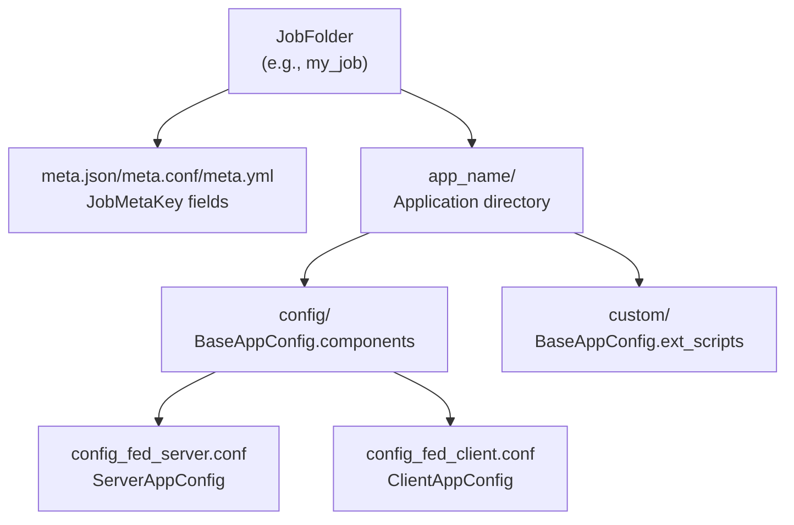
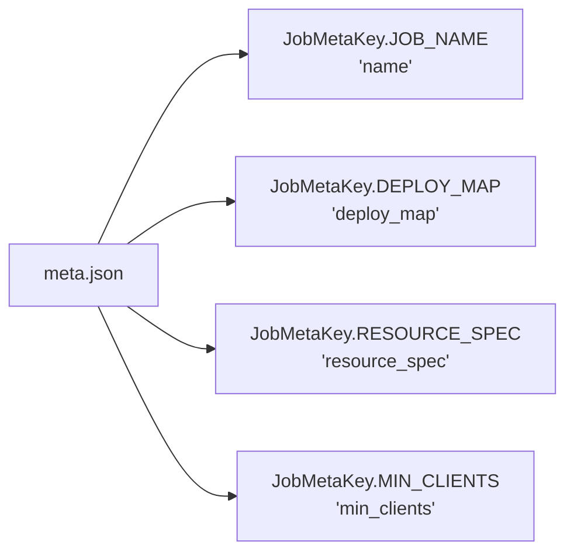
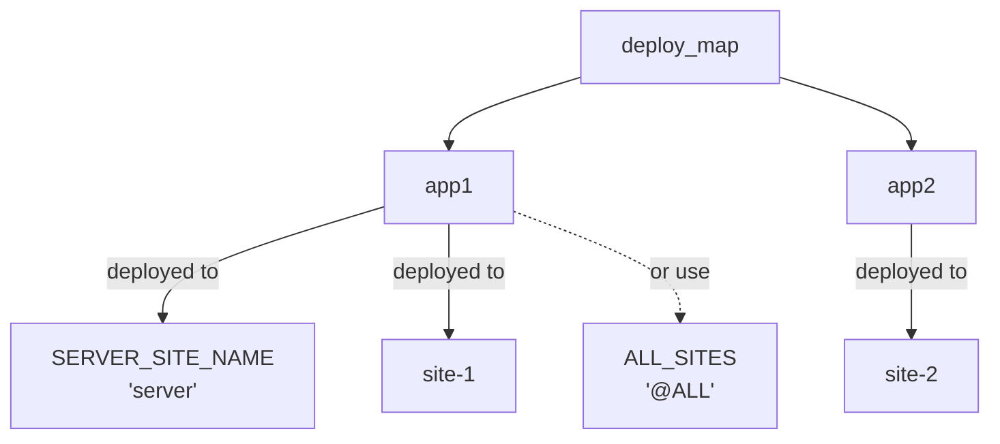
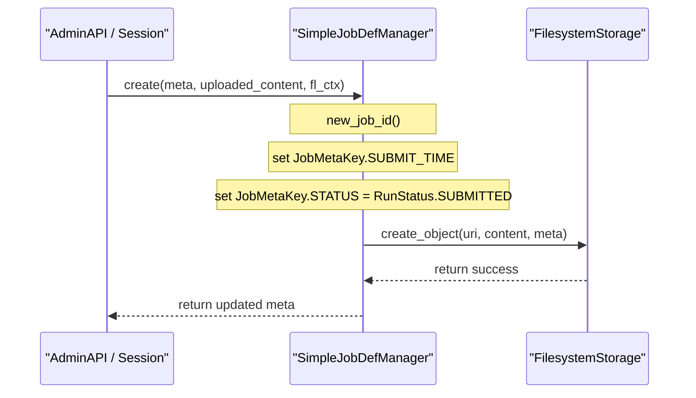
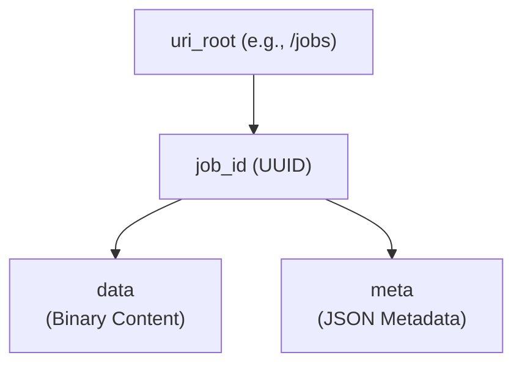
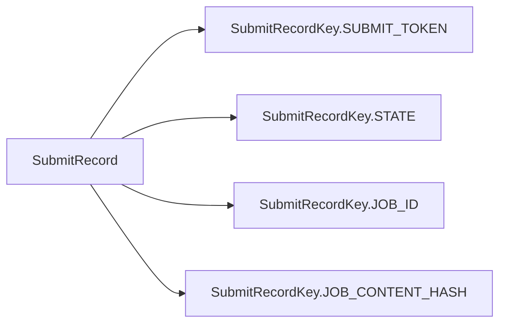

<!-- source: DeepWiki mcp.deepwiki.com · repo NVIDIA/NVFlare · page 7.1 Job Structure and Metadata · fetched 2026-10-26 -->

# Job Structure and Metadata

Relevant source files

The following files were used as context for generating this wiki page:

- [docs/design/multistudy.md](docs/design/multistudy.md)
- [nvflare/apis/fl_snapshot.py](nvflare/apis/fl_snapshot.py)
- [nvflare/apis/impl/job_def_manager.py](nvflare/apis/impl/job_def_manager.py)
- [nvflare/apis/job_def.py](nvflare/apis/job_def.py)
- [nvflare/apis/job_def_manager_spec.py](nvflare/apis/job_def_manager_spec.py)
- [nvflare/apis/state_persistor.py](nvflare/apis/state_persistor.py)
- [nvflare/apis/storage.py](nvflare/apis/storage.py)
- [nvflare/app_common/state_persistors/__init__.py](nvflare/app_common/state_persistors/__init__.py)
- [nvflare/app_common/state_persistors/storage_state_persistor.py](nvflare/app_common/state_persistors/storage_state_persistor.py)
- [nvflare/app_common/storages/filesystem_storage.py](nvflare/app_common/storages/filesystem_storage.py)
- [nvflare/fuel/common/exit_codes.py](nvflare/fuel/common/exit_codes.py)
- [nvflare/fuel/flare_api/api_spec.py](nvflare/fuel/flare_api/api_spec.py)
- [nvflare/fuel/flare_api/flare_api.py](nvflare/fuel/flare_api/flare_api.py)
- [nvflare/fuel/hci/client/api.py](nvflare/fuel/hci/client/api.py)
- [nvflare/fuel/hci/client/api_spec.py](nvflare/fuel/hci/client/api_spec.py)
- [nvflare/fuel/hci/client/cli.py](nvflare/fuel/hci/client/cli.py)
- [nvflare/fuel/hci/client/file_transfer.py](nvflare/fuel/hci/client/file_transfer.py)
- [nvflare/fuel/hci/file_transfer_defs.py](nvflare/fuel/hci/file_transfer_defs.py)
- [nvflare/fuel/hci/proto.py](nvflare/fuel/hci/proto.py)
- [nvflare/fuel/hci/tools/admin.py](nvflare/fuel/hci/tools/admin.py)
- [nvflare/private/fed/server/job_cmds.py](nvflare/private/fed/server/job_cmds.py)
- [nvflare/private/fed/server/job_meta_validator.py](nvflare/private/fed/server/job_meta_validator.py)
- [nvflare/security/logging.py](nvflare/security/logging.py)
- [nvflare/security/study_registry.py](nvflare/security/study_registry.py)
- [tests/integration_test/data/test_configs/authorization/abort_job.yml](tests/integration_test/data/test_configs/authorization/abort_job.yml)
- [tests/integration_test/data/test_configs/authorization/clone_job.yml](tests/integration_test/data/test_configs/authorization/clone_job.yml)
- [tests/integration_test/data/test_configs/authorization/list_job.yml](tests/integration_test/data/test_configs/authorization/list_job.yml)
- [tests/integration_test/data/test_configs/authorization/shell_commands.yml](tests/integration_test/data/test_configs/authorization/shell_commands.yml)
- [tests/integration_test/data/test_configs/authorization/submit_job.yml](tests/integration_test/data/test_configs/authorization/submit_job.yml)
- [tests/integration_test/data/test_configs/authorization/test_diff_job_config.yml](tests/integration_test/data/test_configs/authorization/test_diff_job_config.yml)
- [tests/integration_test/src/nvf_test_driver.py](tests/integration_test/src/nvf_test_driver.py)
- [tests/unit_test/apis/impl/job_def_manager_test.py](tests/unit_test/apis/impl/job_def_manager_test.py)
- [tests/unit_test/apis/job_def_test.py](tests/unit_test/apis/job_def_test.py)
- [tests/unit_test/apis/utils/format_check_test.py](tests/unit_test/apis/utils/format_check_test.py)
- [tests/unit_test/app_common/executors/statistics/mock_df_stats_executor.py](tests/unit_test/app_common/executors/statistics/mock_df_stats_executor.py)
- [tests/unit_test/app_common/storages/storage_test.py](tests/unit_test/app_common/storages/storage_test.py)
- [tests/unit_test/fuel/flare_api/session_new_methods_test.py](tests/unit_test/fuel/flare_api/session_new_methods_test.py)
- [tests/unit_test/fuel/hci/admin_cli_study_test.py](tests/unit_test/fuel/hci/admin_cli_study_test.py)
- [tests/unit_test/lighter/provision_test.py](tests/unit_test/lighter/provision_test.py)
- [tests/unit_test/private/fed/server/job_cmds_test.py](tests/unit_test/private/fed/server/job_cmds_test.py)
- [tests/unit_test/private/fed/server/job_meta_validator_test.py](tests/unit_test/private/fed/server/job_meta_validator_test.py)
- [tests/unit_test/recipe/prod_env_test.py](tests/unit_test/recipe/prod_env_test.py)
- [tests/unit_test/tool/cli_errors_test.py](tests/unit_test/tool/cli_errors_test.py)
- [tests/unit_test/tool/job/job_logs_test.py](tests/unit_test/tool/job/job_logs_test.py)

This page documents the structure of job folders and the metadata system used to describe and manage federated learning jobs in NVIDIA FLARE. Jobs are the primary unit of work submission, containing all configurations, scripts, and metadata needed to execute a federated learning workflow.

For information about creating jobs using the Job CLI, see [Job CLI](). For details about the job lifecycle and execution, see [Job Lifecycle and States](). For job template usage, see [Job Templates and Recipes]().

## Job Folder Structure

A job is organized as a folder hierarchy containing configuration files, custom code, and metadata. The structure supports multi-app deployments where different applications can be deployed to different sites.

Title: Job Folder Organization

### Directory Components

| Component | Purpose | Required |
|-----------|---------|----------|
| `meta.json` | Job metadata including `deploy_map`, resource specs, and job name | Yes |
| `config/` | Configuration files defining server and client components | Yes |
| `custom/` | Custom Python code (trainers, controllers, etc.) | Optional |
| `config_fed_server.json` | Server-side workflow controller, aggregators, persistors | Yes (if server) |
| `config_fed_client.json` | Client-side executors, learners, filters | Yes (if client) |

The `JobMetaValidator` validates the existence of these directories and files within the submitted job ZIP [nvflare/private/fed/server/job_meta_validator.py:55-80](). It specifically checks for `config/` folders for each app defined in the `deploy_map` [nvflare/private/fed/server/job_meta_validator.py:158-163](). Modern configurations often use `.json`, `.conf` (HOCON), or `.yml` format [nvflare/private/fed/server/job_meta_validator.py:88-94]().

**Sources:** [nvflare/private/fed/server/job_meta_validator.py:32-33](), [nvflare/private/fed/server/job_meta_validator.py:155-167](), [nvflare/apis/job_def.py:133-136]()

## Job Metadata (JobMetaKey)

The `meta.json` (or `.conf`/`.yml`) file contains essential job metadata that controls job deployment and execution. The `JobMetaValidator` ensures these fields are present and valid before submission [nvflare/private/fed/server/job_meta_validator.py:44-53]().

Title: Job Metadata Components

### Core Metadata Keys

The `JobMetaKey` enum defines the standard keys used in the metadata file [nvflare/apis/job_def.py:48-81]().

| Key | String Value | Description |
|-----|--------------|-------------|
| `JOB_ID` | `job_id` | Unique UUID for the job |
| `JOB_NAME` | `name` | Human-readable job name |
| `RESOURCE_SPEC` | `resource_spec` | Resource requirements (GPU, memory) per site |
| `DEPLOY_MAP` | `deploy_map` | Maps application directories to site names |
| `MIN_CLIENTS` | `min_clients` | Minimum number of clients required to start |
| `MANDATORY_CLIENTS` | `mandatory_clients` | List of specific clients that must participate |
| `STATUS` | `status` | Current `RunStatus` (SUBMITTED, RUNNING, etc.) |
| `STUDY` | `study` | The study context for the job |
| `JOB_LAUNCHER_SPEC` | `launcher_spec` | Specification for job isolation/execution (e.g., K8s) |

A subset of these keys are considered `USER_SETTABLE_JOB_META_KEYS`, which a recipe author may set via APIs [nvflare/apis/job_def.py:97-104](). When cloning jobs, the server specifically copies keys defined in `CLONED_META_KEYS` [nvflare/private/fed/server/job_cmds.py:89-102]().

**Sources:** [nvflare/apis/job_def.py:48-81](), [nvflare/apis/job_def.py:97-104](), [nvflare/private/fed/server/job_meta_validator.py:94-97](), [nvflare/private/fed/server/job_cmds.py:89-102]()

## Deploy Map

The `deploy_map` within `meta.json` specifies which application directories are deployed to which sites. This enables heterogeneous deployments where different sites run different configurations.

Title: Deployment Mapping Logic

**Deploy Map Patterns:**

| Pattern | Meaning | Example |
|---------|---------|---------|
| `["@ALL"]` | Deploy to all sites including server [nvflare/apis/job_def.py:21]() | `app = ["@ALL"]` |
| `["server"]` | Deploy only to server [nvflare/apis/job_def.py:22]() | `app_server = ["server"]` |
| `["site-1", "site-2"]` | Deploy to specific sites | `app_client = ["site-1", "site-2"]` |

The `JobMetaValidator` enforces that `SERVER_SITE_NAME` is present in the `deploy_map` unless `ALL_SITES` is used [nvflare/private/fed/server/job_meta_validator.py:140-142](). It also validates that no other site is specified if `@ALL` is present [nvflare/private/fed/server/job_meta_validator.py:134-137]().

**Sources:** [nvflare/private/fed/server/job_meta_validator.py:107-112](), [nvflare/private/fed/server/job_meta_validator.py:132-140](), [nvflare/apis/job_def.py:21-23]()

## Job Management and Validation

The `JobDefManagerSpec` defines the interface for managing job definitions, including creation, cloning, and metadata updates [nvflare/apis/job_def_manager_spec.py:23-42](). The `SimpleJobDefManager` implementation uses a `StorageSpec` component (typically `FilesystemStorage`) to persist job data [nvflare/apis/impl/job_def_manager.py:144-152]().

### Validation and Creation Flow
When a job is created, the `SimpleJobDefManager` assigns a unique `job_id` and timestamps. It also supports "submit tokens" for retry-safe submission [nvflare/apis/impl/job_def_manager.py:158-172]().

Title: Job Creation Flow in Code

**Sources:** [nvflare/apis/impl/job_def_manager.py:123-132](), [nvflare/apis/job_def_manager_spec.py:23-42](), [nvflare/apis/impl/job_def_manager.py:144-152]()

## Job Storage and Persistence

Jobs are persisted using the `StorageSpec` abstraction [nvflare/apis/storage.py:47-56](). The default implementation is `FilesystemStorage`, which stores data in a structured directory format on the local filesystem [nvflare/app_common/storages/filesystem_storage.py:130-147]().

| Component | Storage File | Content |
|-----------|--------------|---------|
| `DATA` | `data` | The job payload (Binary/ZIP) [nvflare/apis/storage.py:17-18]() |
| `META` | `meta` | JSON-encoded job metadata [nvflare/apis/storage.py:19-20]() |
| `WORKSPACE` | `workspace` | Persistent workspace data [nvflare/apis/storage.py:21-22]() |

The `SimpleJobDefManager` organizes jobs under a `uri_root` (default "jobs"). Each job gets a unique directory named after its `job_id` [nvflare/apis/impl/job_def_manager.py:154-156]().

Title: Filesystem Storage Layout

**Sources:** [nvflare/apis/storage.py:25-27](), [nvflare/app_common/storages/filesystem_storage.py:107-112](), [nvflare/app_common/storages/filesystem_storage.py:174-180](), [nvflare/apis/impl/job_def_manager.py:154-156]()

## Submit Tokens and Retry Safety

To handle network issues during job submission, NVFLARE uses submit tokens. A submit token allows a client to retry a submission without creating duplicate jobs [nvflare/apis/job_def_manager_spec.py:53-56]().

| Field | Purpose |
|-------|---------|
| `SUBMIT_TOKEN` | Unique token generated by the client [nvflare/apis/job_def.py:116]() |
| `JOB_CONTENT_HASH` | Hash of the job content to ensure consistency [nvflare/apis/job_def.py:124]() |
| `SubmitRecordState` | Tracks token state (`CREATING`, `CREATED`, `JOB_DELETED`) [nvflare/apis/job_def.py:107-111]() |

The `SimpleJobDefManager` maintains a `submit_record_uri_root` and a `job_index` to store these records independently of the job store [nvflare/apis/impl/job_def_manager.py:138-142](). It uses `canonical_job_content_hash` to ensure the content hasn't changed between retries [nvflare/apis/utils/job_submit_token.py:112-120]().

Title: Submit Token State Management

**Sources:** [nvflare/apis/job_def.py:113-130](), [nvflare/apis/impl/job_def_manager.py:138-142](), [nvflare/apis/job_def_manager_spec.py:57-70](), [nvflare/apis/impl/job_def_manager.py:39-44]()

---

