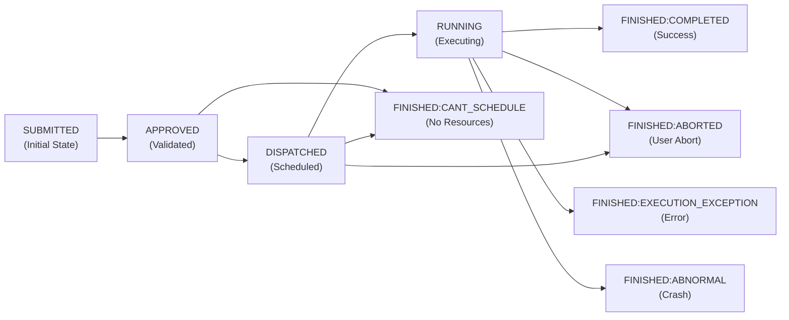
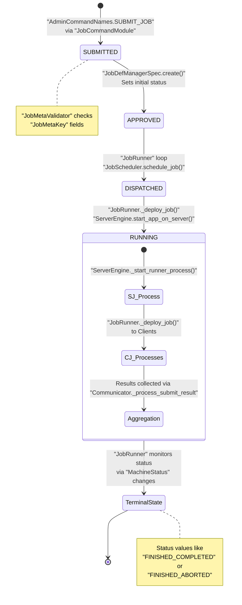
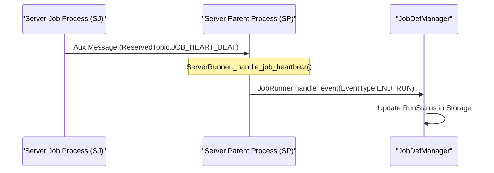

<!-- source: DeepWiki mcp.deepwiki.com · repo NVIDIA/NVFlare · page 7.2 Job Lifecycle and States · fetched 2026-10-26 -->

# Job Lifecycle and States

<details>
<summary>Relevant source files</summary>

The following files were used as context for generating this wiki page:

- [nvflare/apis/client_engine_spec.py](nvflare/apis/client_engine_spec.py)
- [nvflare/apis/fl_constant.py](nvflare/apis/fl_constant.py)
- [nvflare/apis/fl_snapshot.py](nvflare/apis/fl_snapshot.py)
- [nvflare/apis/impl/job_def_manager.py](nvflare/apis/impl/job_def_manager.py)
- [nvflare/apis/job_def.py](nvflare/apis/job_def.py)
- [nvflare/apis/job_def_manager_spec.py](nvflare/apis/job_def_manager_spec.py)
- [nvflare/apis/job_scheduler_spec.py](nvflare/apis/job_scheduler_spec.py)
- [nvflare/apis/server_engine_spec.py](nvflare/apis/server_engine_spec.py)
- [nvflare/apis/state_persistor.py](nvflare/apis/state_persistor.py)
- [nvflare/apis/storage.py](nvflare/apis/storage.py)
- [nvflare/app_common/job_schedulers/job_scheduler.py](nvflare/app_common/job_schedulers/job_scheduler.py)
- [nvflare/app_common/state_persistors/__init__.py](nvflare/app_common/state_persistors/__init__.py)
- [nvflare/app_common/state_persistors/storage_state_persistor.py](nvflare/app_common/state_persistors/storage_state_persistor.py)
- [nvflare/app_common/storages/filesystem_storage.py](nvflare/app_common/storages/filesystem_storage.py)
- [nvflare/fuel/common/exit_codes.py](nvflare/fuel/common/exit_codes.py)
- [nvflare/fuel/flare_api/api_spec.py](nvflare/fuel/flare_api/api_spec.py)
- [nvflare/fuel/flare_api/flare_api.py](nvflare/fuel/flare_api/flare_api.py)
- [nvflare/fuel/hci/client/api.py](nvflare/fuel/hci/client/api.py)
- [nvflare/fuel/hci/client/api_spec.py](nvflare/fuel/hci/client/api_spec.py)
- [nvflare/fuel/hci/client/cli.py](nvflare/fuel/hci/client/cli.py)
- [nvflare/fuel/hci/client/file_transfer.py](nvflare/fuel/hci/client/file_transfer.py)
- [nvflare/fuel/hci/file_transfer_defs.py](nvflare/fuel/hci/file_transfer_defs.py)
- [nvflare/fuel/hci/proto.py](nvflare/fuel/hci/proto.py)
- [nvflare/fuel/hci/tools/admin.py](nvflare/fuel/hci/tools/admin.py)
- [nvflare/private/aux_runner.py](nvflare/private/aux_runner.py)
- [nvflare/private/fed/app/client/client_train.py](nvflare/private/fed/app/client/client_train.py)
- [nvflare/private/fed/app/client/sub_worker_process.py](nvflare/private/fed/app/client/sub_worker_process.py)
- [nvflare/private/fed/app/client/worker_process.py](nvflare/private/fed/app/client/worker_process.py)
- [nvflare/private/fed/app/server/runner_process.py](nvflare/private/fed/app/server/runner_process.py)
- [nvflare/private/fed/app/server/server_train.py](nvflare/private/fed/app/server/server_train.py)
- [nvflare/private/fed/client/client_app_runner.py](nvflare/private/fed/client/client_app_runner.py)
- [nvflare/private/fed/client/client_engine.py](nvflare/private/fed/client/client_engine.py)
- [nvflare/private/fed/client/client_engine_executor_spec.py](nvflare/private/fed/client/client_engine_executor_spec.py)
- [nvflare/private/fed/client/client_engine_internal_spec.py](nvflare/private/fed/client/client_engine_internal_spec.py)
- [nvflare/private/fed/client/client_executor.py](nvflare/private/fed/client/client_executor.py)
- [nvflare/private/fed/client/client_run_manager.py](nvflare/private/fed/client/client_run_manager.py)
- [nvflare/private/fed/client/client_runner.py](nvflare/private/fed/client/client_runner.py)
- [nvflare/private/fed/client/command_agent.py](nvflare/private/fed/client/command_agent.py)
- [nvflare/private/fed/client/communicator.py](nvflare/private/fed/client/communicator.py)
- [nvflare/private/fed/client/fed_client.py](nvflare/private/fed/client/fed_client.py)
- [nvflare/private/fed/client/fed_client_base.py](nvflare/private/fed/client/fed_client_base.py)
- [nvflare/private/fed/server/fed_server.py](nvflare/private/fed/server/fed_server.py)
- [nvflare/private/fed/server/job_cmds.py](nvflare/private/fed/server/job_cmds.py)
- [nvflare/private/fed/server/job_runner.py](nvflare/private/fed/server/job_runner.py)
- [nvflare/private/fed/server/server_command_agent.py](nvflare/private/fed/server/server_command_agent.py)
- [nvflare/private/fed/server/server_commands.py](nvflare/private/fed/server/server_commands.py)
- [nvflare/private/fed/server/server_engine.py](nvflare/private/fed/server/server_engine.py)
- [nvflare/private/fed/server/server_runner.py](nvflare/private/fed/server/server_runner.py)
- [nvflare/private/fed/utils/fed_utils.py](nvflare/private/fed/utils/fed_utils.py)
- [tests/unit_test/apis/impl/job_def_manager_test.py](tests/unit_test/apis/impl/job_def_manager_test.py)
- [tests/unit_test/app_common/job_schedulers/job_scheduler_test.py](tests/unit_test/app_common/job_schedulers/job_scheduler_test.py)
- [tests/unit_test/app_common/storages/storage_test.py](tests/unit_test/app_common/storages/storage_test.py)
- [tests/unit_test/fuel/flare_api/session_new_methods_test.py](tests/unit_test/fuel/flare_api/session_new_methods_test.py)
- [tests/unit_test/private/fed/client/client_executor_test.py](tests/unit_test/private/fed/client/client_executor_test.py)
- [tests/unit_test/private/fed/server/fed_server_test.py](tests/unit_test/private/fed/server/fed_server_test.py)
- [tests/unit_test/private/fed/server/job_cmds_test.py](tests/unit_test/private/fed/server/job_cmds_test.py)
- [tests/unit_test/private/fed/server/job_runner_test.py](tests/unit_test/private/fed/server/job_runner_test.py)
- [tests/unit_test/tool/cli_errors_test.py](tests/unit_test/tool/cli_errors_test.py)
- [tests/unit_test/tool/job/job_logs_test.py](tests/unit_test/tool/job/job_logs_test.py)

</details>


## Purpose and Scope

This document explains the complete lifecycle of a job in NVIDIA FLARE, from submission through completion. It covers all possible job states, state transitions, the mechanisms that drive state changes, and how the system tracks and persists job status information across the Server Parent (SP), Server Job (SJ), and Client Job (CJ) processes.

For information about job structure and metadata, see [7.1 Job Structure and Metadata](). For details on job storage implementations, see [7.3 Job Storage and Persistence](). For administrative commands to manage jobs, see [7.4 Job CLI]().

## Job States Overview

Jobs in NVFLARE progress through a well-defined set of states managed by the `RunStatus` enum. Each state represents a specific phase in the job's execution lifecycle.

### RunStatus Enumeration

The `RunStatus` class defines the possible states for a job during its existence in the system.

Title: Job State Transition Map


**Sources:** [nvflare/apis/job_def.py:41-41](), [nvflare/apis/job_def_manager_spec.py:25-39]()

### State Descriptions

| State | Description | Terminal |
|-------|-------------|----------|
| `SUBMITTED` | Job submitted and stored in `JobDefManager`. | No |
| `APPROVED` | Job validated and approved for scheduling. | No |
| `DISPATCHED` | Job assigned resources and ready to deploy. | No |
| `RUNNING` | Job actively executing on server and clients. | No |
| `FINISHED_COMPLETED` | Job completed successfully. | Yes |
| `FINISHED_ABORTED` | Job aborted by administrator or system. | Yes |
| `FINISHED_EXECUTION_EXCEPTION` | Job failed with an execution exception. | Yes |
| `FINISHED_ABNORMAL` | Job process crashed or terminated abnormally. | Yes |
| `FINISHED_CANT_SCHEDULE` | Job could not be scheduled (e.g., resource constraints). | Yes |
| `FAILED_TO_RUN` | Job failed during the startup/deployment phase. | Yes |
| `ABANDONED` | Job abandoned by the system. | Yes |

**Sources:** [nvflare/apis/job_def_manager_spec.py:25-39]()

## Complete Job Lifecycle

The following diagram bridges natural language concepts to specific code entities and system commands:

Title: Job Lifecycle and Code Entity Space


**Sources:** [nvflare/private/fed/server/server_engine.py:177-191](), [nvflare/private/fed/server/job_runner.py:125-172](), [nvflare/apis/job_def_manager_spec.py:25-39](), [nvflare/private/fed/client/communicator.py:153-172](), [nvflare/private/fed/server/job_cmds.py:146-152]()

## State Transitions in Detail

### SUBMITTED → APPROVED

When a job is submitted, it is processed by the server's job management components.

1. **Validation**: The server ensures the job folder structure and metadata are valid using `JobMetaValidator` [nvflare/private/fed/server/job_meta_validator.py:37-37]().
2. **Creation**: `JobDefManagerSpec` implementations handle the persistence of the job [nvflare/apis/impl/job_def_manager.py:33-40]().
3. **Status Initialization**: The status is initialized to `RunStatus.SUBMITTED` in the metadata [nvflare/apis/job_def_manager_spec.py:27-27]().

**Sources:** [nvflare/apis/job_def_manager_spec.py:27-28](), [nvflare/apis/impl/job_def_manager.py:33-40](), [nvflare/private/fed/server/job_meta_validator.py:37-37]()

### DISPATCHED → RUNNING

The transition to `RUNNING` involves deploying the application to the participating sites.

1. **Deployment**: `JobRunner._deploy_job()` extracts participants and sends `TrainingTopic.DEPLOY` messages [nvflare/private/fed/server/job_runner.py:114-125]().
2. **Server Startup**: `ServerEngine.start_app_on_server()` verifies the app exists and calls `_start_runner_process` [nvflare/private/fed/server/server_engine.py:177-191]().
3. **Client Startup**: Clients receive the deployment message. The `Communicator` on the client side handles task requests via `_process_get_task` [nvflare/private/fed/client/communicator.py:153-172]() and result submissions via `_process_submit_result` [nvflare/private/fed/client/communicator.py:186-200]().
4. **Status Update**: The `MachineStatus` moves from `STARTING` to `STARTED` [nvflare/apis/fl_constant.py:63-65]().

**Sources:** [nvflare/private/fed/server/server_engine.py:177-191](), [nvflare/private/fed/server/job_runner.py:114-172](), [nvflare/private/fed/client/communicator.py:153-200](), [nvflare/apis/fl_constant.py:63-65]()

### RUNNING → Terminal States

The `JobRunner` and `ServerEngine` monitor the job's execution. Transitions to terminal states are driven by the exit of the job processes or explicit abort commands.

1. **Normal Exit**: If the process exits with code 0, the state becomes `RunStatus.FINISHED_COMPLETED` [nvflare/apis/job_def_manager_spec.py:31-31]().
2. **Abort**: Admin commands trigger abort which stops the execution via `ServerRunner.abort()` [nvflare/private/fed/server/server_runner.py:150-153]().
3. **Exceptions**: If a component panics or throws an unhandled exception, `ServerRunner` captures this in `control_flow` and transitions the system status [nvflare/private/fed/server/server_runner.py:150-153]().
4. **API Monitoring**: The `Session.wait_until_complete` method polls the job status until it matches a terminal status [nvflare/fuel/flare_api/flare_api.py:103-104]().

**Sources:** [nvflare/private/fed/server/server_runner.py:150-153](), [nvflare/apis/job_def_manager_spec.py:31-39](), [nvflare/fuel/flare_api/flare_api.py:103-104]()

## Job Process Tracking

### Run Processes Dictionary

The `ServerEngine` maintains internal state to track active job processes in `self.run_processes` [nvflare/private/fed/server/server_engine.py:102-102]().

| Key | Code Symbol | Description |
|-----|-------------|-------------|
| `PROCESS_FINISHED` | `RunProcessKey.PROCESS_FINISHED` | Boolean flag indicating if the process has terminated. |
| `PROCESS_RETURN_CODE` | `RunProcessKey.PROCESS_RETURN_CODE` | The exit code of the job process. |
| `JOB_ID` | `RunProcessKey.JOB_ID` | The unique identifier for the job. |

**Sources:** [nvflare/apis/fl_constant.py:31-33](), [nvflare/private/fed/server/server_engine.py:102-102]()

### Job Status Monitoring

The `ServerEngine` in the parent process (SP) monitors the status of the job process (SJ) and reports it via `get_engine_info` [nvflare/private/fed/server/server_engine.py:140-157]().

Title: Job Status Communication Flow


**Sources:** [nvflare/private/fed/server/server_engine.py:140-157](), [nvflare/private/fed/server/job_runner.py:104-112]()

## Job Completion and Cleanup

### Workspace Persistence

When a job reaches a terminal state, the `JobRunner` triggers workspace saving.

1. **Event Handling**: `EventType.END_RUN` triggers `_save_workspace(fl_ctx)` [nvflare/private/fed/server/job_runner.py:108-109]().
2. **Cleanup**: On system end, `JobRunner.stop()` is called to ensure resources are released [nvflare/private/fed/server/job_runner.py:110-111]().

**Sources:** [nvflare/private/fed/server/job_runner.py:104-112]()

### Abort Handling

The `ServerRunner` defines specific return codes that should trigger a run abort [nvflare/private/fed/server/server_runner.py:82-86]().

```python
# From ServerRunner in nvflare/private/fed/server/server_runner.py
ABORT_RETURN_CODES = [
    ReturnCode.RUN_MISMATCH,
    ReturnCode.TASK_UNKNOWN,
    ReturnCode.UNSAFE_JOB,
]
```

**Sources:** [nvflare/private/fed/server/server_runner.py:82-86]()

## Job State Persistence

Job states are persisted using `JobMetaKey` fields in the job's metadata storage [nvflare/apis/job_def.py:43-77](). NVFLARE uses `StorageSpec` abstractions, such as `FilesystemStorage`, to persist this metadata to disk [nvflare/app_common/storages/filesystem_storage.py:130-147]().

### Meta Data Keys

| Key | Code Symbol | Purpose |
|-----|-------------|---------|
| `status` | `JobMetaKey.STATUS` | Current `RunStatus` of the job. |
| `submit_time` | `JobMetaKey.SUBMIT_TIME` | Timestamp when the job was submitted. |
| `start_time` | `JobMetaKey.START_TIME` | Timestamp when the job moved to `RUNNING`. |
| `job_id` | `JobMetaKey.JOB_ID` | Unique UUID assigned to the job. |

**Sources:** [nvflare/apis/job_def.py:43-67](), [nvflare/app_common/storages/filesystem_storage.py:130-147]()

---

