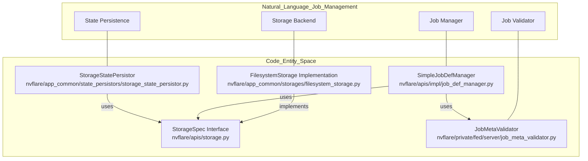
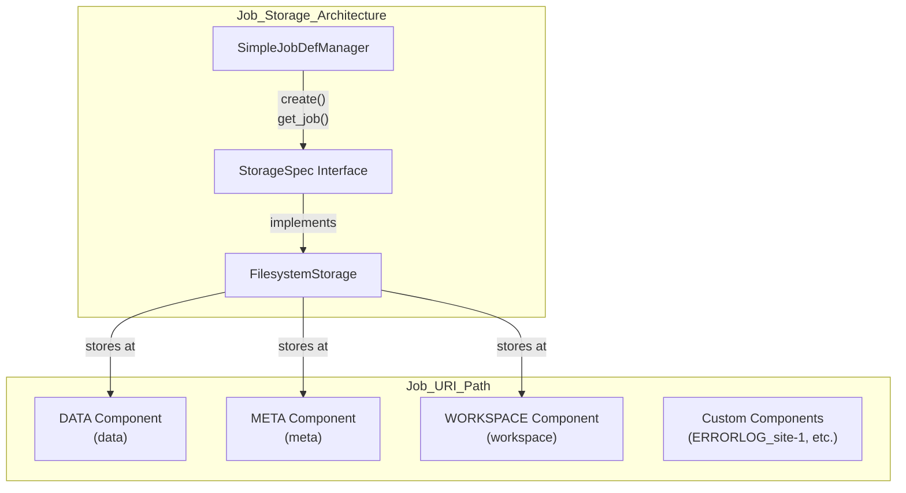
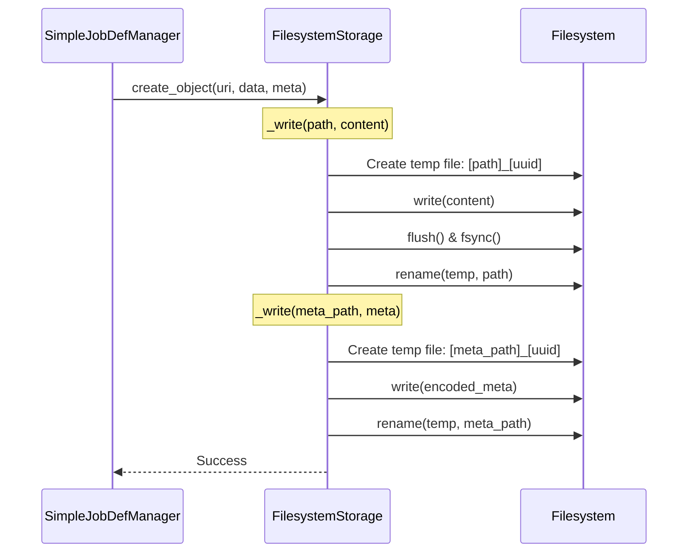

<!-- source: DeepWiki mcp.deepwiki.com · repo NVIDIA/NVFlare · page 7.3 Job Storage and Persistence · fetched 2026-10-26 -->

# Job Storage and Persistence

Relevant source files

The following files were used as context for generating this wiki page:

- [nvflare/apis/fl_snapshot.py](nvflare/apis/fl_snapshot.py)
- [nvflare/apis/impl/job_def_manager.py](nvflare/apis/impl/job_def_manager.py)
- [nvflare/apis/job_def.py](nvflare/apis/job_def.py)
- [nvflare/apis/job_def_manager_spec.py](nvflare/apis/job_def_manager_spec.py)
- [nvflare/apis/state_persistor.py](nvflare/apis/state_persistor.py)
- [nvflare/apis/storage.py](nvflare/apis/storage.py)
- [nvflare/app_common/state_persistors/__init__.py](nvflare/app_common/state_persistors/__init__.py)
- [nvflare/app_common/state_persistors/storage_state_persistor.py](nvflare/app_common/state_persistors/storage_state_persistor.py)
- [nvflare/app_common/storages/filesystem_storage.py](nvflare/app_common/storages/filesystem_storage.py)
- [nvflare/fuel/common/exit_codes.py](nvflare/fuel/common/exit_codes.py)
- [nvflare/fuel/flare_api/api_spec.py](nvflare/fuel/flare_api/api_spec.py)
- [nvflare/fuel/flare_api/flare_api.py](nvflare/fuel/flare_api/flare_api.py)
- [nvflare/fuel/hci/client/api.py](nvflare/fuel/hci/client/api.py)
- [nvflare/fuel/hci/client/api_spec.py](nvflare/fuel/hci/client/api_spec.py)
- [nvflare/fuel/hci/client/cli.py](nvflare/fuel/hci/client/cli.py)
- [nvflare/fuel/hci/client/file_transfer.py](nvflare/fuel/hci/client/file_transfer.py)
- [nvflare/fuel/hci/file_transfer_defs.py](nvflare/fuel/hci/file_transfer_defs.py)
- [nvflare/fuel/hci/proto.py](nvflare/fuel/hci/proto.py)
- [nvflare/fuel/hci/tools/admin.py](nvflare/fuel/hci/tools/admin.py)
- [nvflare/private/fed/server/job_cmds.py](nvflare/private/fed/server/job_cmds.py)
- [tests/unit_test/apis/impl/job_def_manager_test.py](tests/unit_test/apis/impl/job_def_manager_test.py)
- [tests/unit_test/app_common/storages/storage_test.py](tests/unit_test/app_common/storages/storage_test.py)
- [tests/unit_test/fuel/flare_api/session_new_methods_test.py](tests/unit_test/fuel/flare_api/session_new_methods_test.py)
- [tests/unit_test/private/fed/server/job_cmds_test.py](tests/unit_test/private/fed/server/job_cmds_test.py)
- [tests/unit_test/tool/cli_errors_test.py](tests/unit_test/tool/cli_errors_test.py)
- [tests/unit_test/tool/job/job_logs_test.py](tests/unit_test/tool/job/job_logs_test.py)

## Purpose and Scope

This document describes the job storage and persistence infrastructure in NVIDIA FLARE. It covers the `StorageSpec` abstraction layer, job component organization (`DATA`, `META`, `WORKSPACE`), storage backend implementations (`FilesystemStorage`), and how the `JobDefManager` uses storage to persist and retrieve jobs throughout their lifecycle.

For information about job structure and metadata fields, see [7.1 Job Structure and Metadata](). For job lifecycle state transitions, see [7.2 Job Lifecycle and States](). For job submission and download commands, see [7.4 Job CLI]().

**Sources:** [nvflare/apis/storage.py:1-61](), [nvflare/apis/impl/job_def_manager.py:1-35](), [nvflare/app_common/storages/filesystem_storage.py:1-30]()

## Storage Architecture Overview

NVFLARE's job storage system is built on a pluggable architecture that separates the storage abstraction from concrete implementations. This design allows jobs to be stored on local filesystems or custom storage backends (e.g., cloud storage).

### System Entity Mapping
The following diagram bridges the natural language concepts of job management to the specific code entities implementing them.

**Diagram: Job Storage Code Entity Mapping**

**Sources:** [nvflare/apis/impl/job_def_manager.py:123-152](), [nvflare/apis/storage.py:48-61](), [nvflare/app_common/storages/filesystem_storage.py:130-148](), [nvflare/app_common/state_persistors/storage_state_persistor.py:23-33](), [nvflare/private/fed/server/job_meta_validator.py:41-53]()

### Job Object Structure
Jobs are identified by a URI and contain multiple components. In the storage layer, a job is an "object" with a unique URI, and its internal files (like `meta.json` or `job.zip`) are "components".

**Diagram: Job Component Storage Model**

**Sources:** [nvflare/apis/storage.py:18-39](), [nvflare/apis/impl/job_def_manager.py:154-156](), [nvflare/app_common/storages/filesystem_storage.py:149-172]()

## StorageSpec Interface

The `StorageSpec` abstract base class defines the contract for all storage backends. It provides methods for creating, reading, updating, and deleting objects, where each object is identified by a URI and contains data plus metadata.

### Core Operations

| Method | Purpose | Parameters |
|--------|---------|------------|
| `create_object()` | Create a new object with data and metadata | `uri`, `data`, `meta`, `overwrite_existing` |
| `clone_object()` | Create a new object by cloning an existing one | `from_uri`, `to_uri`, `meta`, `overwrite_existing` |
| `update_object()` | Update a specific component of an object | `uri`, `data`, `component_name` |
| `update_meta()` | Update object metadata | `uri`, `meta`, `replace` |
| `get_data()` | Retrieve object data | `uri`, `component_name` |
| `get_meta()` | Retrieve object metadata | `uri` |
| `delete_object()` | Delete an object | `uri` |
| `list_objects()` | List all objects in a path | `path`, `without_tag` |
| `tag_object()` | Tag an object with specified tag and data | `uri`, `tag`, `data` |

**Sources:** [nvflare/apis/storage.py:59-251]()

### Object Components

Standard components are defined as constants and enums:
- `DATA`: Primary job content (usually the uploaded zip) [nvflare/apis/storage.py:17-18]()
- `META`: Job metadata (meta.json) [nvflare/apis/storage.py:19-20]()
- `WORKSPACE`: Execution results and snapshots [nvflare/apis/storage.py:21-22]()
- `DataTypes`: Defines prefixes for dynamic components like `LOG` and `ERRORLOG` [nvflare/apis/storage.py:25-36]()

**Sources:** [nvflare/apis/storage.py:18-39]()

## FilesystemStorage Implementation

`FilesystemStorage` is the default backend that persists objects to the local filesystem.

### Object Creation Flow
The creation process uses atomic write operations with temporary files to ensure consistency. If a write fails, the temporary file is removed to prevent corruption.

**Diagram: Atomic Write Process in FilesystemStorage**

**Sources:** [nvflare/app_common/storages/filesystem_storage.py:33-77](), [nvflare/app_common/storages/filesystem_storage.py:174-210]()

### URI to Path Mapping
`FilesystemStorage` maps logical URIs to physical filesystem paths using `root_dir` (the base storage path) and `uri_root` (the logical prefix). It includes security checks to prevent URI escaping outside the storage root [nvflare/app_common/storages/filesystem_storage.py:149-172]().

### Object Existence Check
An object is considered valid in `FilesystemStorage` if its directory contains both `data` and `meta` files [nvflare/app_common/storages/filesystem_storage.py:107-111]().

## JobDefManager Integration

`SimpleJobDefManager` manages the job lifecycle by coordinating with the storage backend. It implements `JobDefManagerSpec`.

### Job Creation
When a job is submitted via `create()`, the manager:
1. Validates the `job_id` using `check_job_id()` [nvflare/apis/utils/format_check.py:38-40]().
2. Sets `SUBMIT_TIME`, `SUBMIT_TIME_ISO`, and initial `RunStatus.SUBMITTED` [nvflare/apis/job_def.py:26-31]().
3. Calls `store.create_object()` with the job URI derived via `job_uri()` [nvflare/apis/impl/job_def_manager.py:154-156]().

### Job Retrieval
The `get_job()` method retrieves metadata from storage and converts it to a `Job` object using `job_from_meta()` [nvflare/apis/job_def.py:32-34]().

**Sources:** [nvflare/apis/impl/job_def_manager.py:123-152](), [nvflare/apis/job_def.py:138-164](), [nvflare/apis/utils/format_check.py:38-40]()

## Submit Token and Record Persistence

NVFLARE implements retry-safe job submission using "Submit Records". This ensures that if a network failure occurs during submission, a retry with the same token will not create a duplicate job.

- **Storage Location**: Submit records are stored in a sidecar namespace `job_submit_records` alongside the main job store [nvflare/apis/impl/job_def_manager.py:135-141]().
- **Record Lifecycle**:
    1. `new_submit_record()` builds the initial record in `CREATING` state [nvflare/apis/job_def_manager_spec.py:57-67]().
    2. `create_submit_record()` persists it with no-overwrite semantics [nvflare/apis/job_def_manager_spec.py:71-77]().
    3. After the job is successfully stored, the record is updated to `CREATED` state [nvflare/apis/job_def.py:107-109]().
    4. Records can be marked as `JOB_DELETED` via `mark_submit_records_job_deleted()` [nvflare/apis/job_def_manager_spec.py:83-89]().

**Sources:** [nvflare/apis/impl/job_def_manager.py:134-171](), [nvflare/apis/job_def.py:107-130](), [nvflare/apis/job_def_manager_spec.py:53-94]()

## Job Listing and Filtering

NVFLARE uses filters to efficiently query jobs from storage without loading all data into memory.

### Filter Types
- `_StatusFilter`: Filters jobs by their `RunStatus` (e.g., `RUNNING`, `SUBMITTED`) [nvflare/apis/impl/job_def_manager.py:67-79]().
- `_ScheduleJobFilter`: Optimized filter for finding `SUBMITTED` jobs for the scheduler. It uses `tag_object()` to mark jobs as `scheduled` so they are skipped in future calls [nvflare/apis/impl/job_def_manager.py:104-121]().

### Optimization via Tagging
The `FilesystemStorage.list_objects()` method accepts a `without_tag` parameter. If a job directory contains a file matching the tag (e.g., "scheduled"), it is excluded from the list, reducing disk I/O for the scheduler [nvflare/app_common/storages/filesystem_storage.py:259-290]().

**Sources:** [nvflare/apis/impl/job_def_manager.py:61-121](), [nvflare/app_common/storages/filesystem_storage.py:259-290]()

## Component Management

Jobs can store arbitrary data types as components beyond the standard `DATA` and `META`.

### Client-Specific Data
The `set_client_data()` method allows storing data (like error logs or intermediate results) for a specific client. The component name is constructed based on the `data_type` and `client_name` provided [nvflare/apis/job_def_manager_spec.py:177-187]().

### Listing Components
`list_components_of_object()` returns a list of all component names available for a specific job URI by querying the storage backend [nvflare/apis/storage.py:162-175]().

**Sources:** [nvflare/apis/impl/job_def_manager.py:177-187](), [nvflare/apis/storage.py:25-40]()

## State Persistence and Snapshots

The `StorageStatePersistor` provides a mechanism to save and retrieve the state of FL components (snapshots) during job execution.

- **Saving State**: The `save()` method serializes the `RunSnapshot` using `fobs` and stores it at a URI derived from the `job_id`. If a job is completed, the snapshot is deleted [nvflare/app_common/state_persistors/storage_state_persistor.py:35-50]().
- **Retrieving State**: `retrieve()` lists all snapshot objects in the root URI and deserializes them into an `FLSnapshot` container [nvflare/app_common/state_persistors/storage_state_persistor.py:52-63]().
- **Job-Specific Retrieval**: `retrieve_run()` allows fetching the snapshot for a specific `job_id` [nvflare/app_common/state_persistors/storage_state_persistor.py:65-77]().

**Sources:** [nvflare/app_common/state_persistors/storage_state_persistor.py:23-94](), [nvflare/apis/fl_snapshot.py:1-20]()

---

