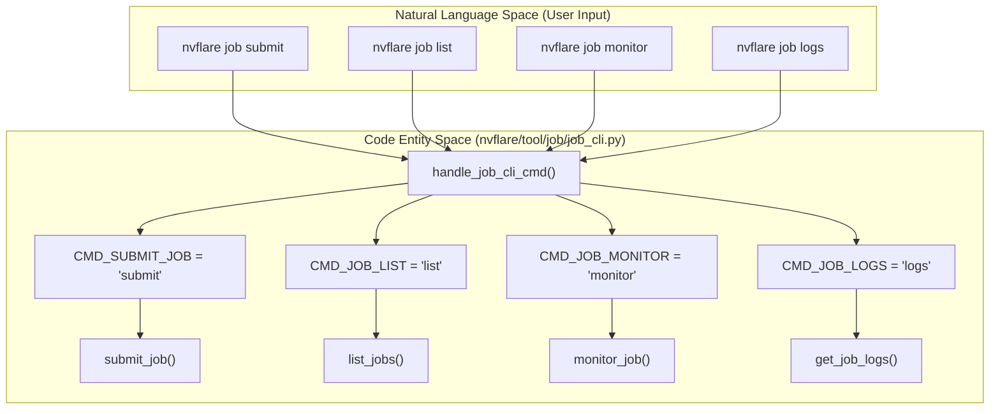
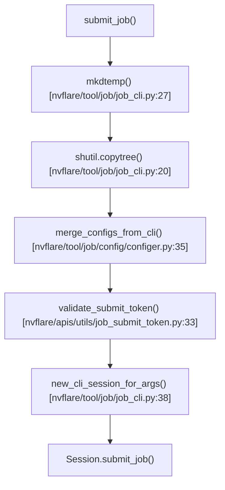

<!-- source: DeepWiki mcp.deepwiki.com · repo NVIDIA/NVFlare · page 7.4 Job CLI · fetched 2026-10-26 -->

# Job CLI

Relevant source files

The following files were used as context for generating this wiki page:

- [docs/design/cli_agent_readiness_backlog.md](docs/design/cli_agent_readiness_backlog.md)
- [docs/design/job_download_artifact_contract_test_plan.md](docs/design/job_download_artifact_contract_test_plan.md)
- [docs/design/nvflare_cli.md](docs/design/nvflare_cli.md)
- [docs/schemas/recipe_catalog.schema.json](docs/schemas/recipe_catalog.schema.json)
- [docs/user_guide/data_scientist_guide/index.rst](docs/user_guide/data_scientist_guide/index.rst)
- [docs/user_guide/nvflare_cli/config_command.rst](docs/user_guide/nvflare_cli/config_command.rst)
- [docs/user_guide/nvflare_cli/dashboard_command.rst](docs/user_guide/nvflare_cli/dashboard_command.rst)
- [docs/user_guide/nvflare_cli/job_cli.rst](docs/user_guide/nvflare_cli/job_cli.rst)
- [docs/user_guide/nvflare_cli/nvflare_cli.rst](docs/user_guide/nvflare_cli/nvflare_cli.rst)
- [docs/user_guide/nvflare_cli/poc_command.rst](docs/user_guide/nvflare_cli/poc_command.rst)
- [docs/user_guide/nvflare_cli/recipe_command.rst](docs/user_guide/nvflare_cli/recipe_command.rst)
- [docs/user_guide/nvflare_cli/study_command.rst](docs/user_guide/nvflare_cli/study_command.rst)
- [docs/user_guide/nvflare_cli/system_command.rst](docs/user_guide/nvflare_cli/system_command.rst)
- [nvflare/cli.py](nvflare/cli.py)
- [nvflare/tool/job/config/config_indexer.py](nvflare/tool/job/config/config_indexer.py)
- [nvflare/tool/job/config/configer.py](nvflare/tool/job/config/configer.py)
- [nvflare/tool/job/job_cli.py](nvflare/tool/job/job_cli.py)
- [nvflare/tool/job/job_client_const.py](nvflare/tool/job/job_client_const.py)
- [nvflare/tool/poc/poc_commands.py](nvflare/tool/poc/poc_commands.py)
- [nvflare/tool/poc/service_constants.py](nvflare/tool/poc/service_constants.py)
- [nvflare/utils/cli_utils.py](nvflare/utils/cli_utils.py)
- [tests/unit_test/data/jobs/launch_everytime/app/config/config_fed_client.conf](tests/unit_test/data/jobs/launch_everytime/app/config/config_fed_client.conf)
- [tests/unit_test/data/jobs/launch_everytime/app/config/config_fed_server.conf](tests/unit_test/data/jobs/launch_everytime/app/config/config_fed_server.conf)
- [tests/unit_test/data/jobs/launch_everytime/meta.conf](tests/unit_test/data/jobs/launch_everytime/meta.conf)
- [tests/unit_test/data/jobs/launch_once/app/config/config_fed_client.conf](tests/unit_test/data/jobs/launch_once/app/config/config_fed_client.conf)
- [tests/unit_test/data/jobs/launch_once/app/config/config_fed_server.conf](tests/unit_test/data/jobs/launch_once/app/config/config_fed_server.conf)
- [tests/unit_test/data/jobs/launch_once/meta.conf](tests/unit_test/data/jobs/launch_once/meta.conf)
- [tests/unit_test/lighter/poc_commands_test.py](tests/unit_test/lighter/poc_commands_test.py)
- [tests/unit_test/tool/job/config/config_indexer_test.py](tests/unit_test/tool/job/config/config_indexer_test.py)
- [tests/unit_test/tool/job/config/configer_test.py](tests/unit_test/tool/job/config/configer_test.py)
- [tests/unit_test/tool/job/job_cli_test.py](tests/unit_test/tool/job/job_cli_test.py)
- [tests/unit_test/tool/job/job_download_test.py](tests/unit_test/tool/job/job_download_test.py)
- [tests/unit_test/tool/poc/poc_force_test.py](tests/unit_test/tool/poc/poc_force_test.py)
- [tests/unit_test/tool/poc/poc_output_test.py](tests/unit_test/tool/poc/poc_output_test.py)

The Job CLI is a technical interface for managing the lifecycle of federated learning jobs within NVIDIA FLARE. It allows developers and researchers to submit, inspect, monitor, and manage jobs non-interactively, making it suitable for CI/CD pipelines, automated scripts, and agentic workflows.

The Job CLI is implemented as a sub-command group under the main `nvflare` entry point [nvflare/cli.py:61-61](). It provides a bridge between the local filesystem (job folders) and the remote FLARE Server via the `AdminAPI` [nvflare/tool/cli_session.py:38-38]().

**Sources:** [nvflare/cli.py:61-61](), [nvflare/tool/job/job_cli.py:8-28](), [docs/user_guide/nvflare_cli/job_cli.rst:7-9]()

## Architecture and Command Dispatch

The Job CLI follows a hierarchical dispatch pattern. The main `nvflare` parser delegates to `def_job_cli_parser` [nvflare/tool/job/job_cli.py:423-423]() to register sub-commands, which are then handled by `handle_job_cli_cmd` [nvflare/tool/job/job_cli.py:415-421]().

### Command Entity Mapping
This diagram maps the CLI surface to the internal handler functions and configuration constants.

Title: Job CLI Command Mapping

**Sources:** [nvflare/tool/job/job_cli.py:83-103](), [nvflare/tool/job/job_cli.py:415-421](), [nvflare/tool/job/job_cli.py:423-423]()

### Command Reference Table

| Command | Implementation Function | Machine Output Support |
| :--- | :--- | :--- |
| `submit` | `submit_job` | JSON [nvflare/tool/job/job_cli.py:104-104]() |
| `list` | `list_jobs` | JSON |
| `monitor` | `monitor_job` | JSONL (Streaming) [nvflare/cli.py:71-73]() |
| `wait` | `wait_job` | JSON (Terminal Envelope) |
| `logs` | `get_job_logs` | Text / JSON |
| `download`| `download_job` | Artifact Manifest [nvflare/tool/job/job_cli.py:133-134]() |
| `list-templates` | `list_templates` | Deprecated [nvflare/tool/job/job_cli.py:83-83]() |

**Sources:** [nvflare/tool/job/job_cli.py:83-103](), [nvflare/cli.py:71-73]()

## Job Submission Workflow

The `submit` command is the primary entry point for job execution. It involves local preparation, configuration merging, and remote transmission.

### Submission Data Flow
Title: Job Submission Data Flow

### Idempotency and Submit Tokens
To support reliable automation, the CLI supports `--submit-token`.
- **Validation**: The token is validated via `validate_submit_token` [nvflare/tool/job/job_cli.py:33-33]().
- **Scope**: The token is scoped to the `study + submitter + token` [nvflare/tool/job/job_cli.py:105-114]().
- **Conflict Handling**: If different content is submitted with the same token, the server returns `SUBMIT_TOKEN_CONFLICT` [docs/user_guide/nvflare_cli/job_cli.rst:152-152]().

**Sources:** [nvflare/tool/job/job_cli.py:76-80](), [nvflare/tool/job/job_cli.py:105-114](), [nvflare/apis/utils/job_submit_token.py:33-33](), [docs/user_guide/nvflare_cli/job_cli.rst:126-152]()

## Configuration Management and Indexing

The Job CLI provides mechanisms to override job configurations at submission time using the `Configer` and `KeyIndex` classes.

### Key Indexing Implementation
The system builds a reverse-order index of configuration files (HOCON, JSON, YAML) to allow path-based updates.

- **`KeyIndex`**: A dataclass storing the `key`, `value`, `parent_key`, and `index` for every element in a config tree [nvflare/tool/job/config/config_indexer.py:27-33]().
- **Path Notation**: Supports array indexing, e.g., `components[1].args.path` via `split_array_key` [nvflare/tool/job/config/configer.py:121-145]().
- **Merging**: `merge_configs_from_cli` coordinates the discovery of all app configurations within a job folder and applies CLI-provided overrides [nvflare/tool/job/config/configer.py:35-44]().

**Sources:** [nvflare/tool/job/config/config_indexer.py:27-33](), [nvflare/tool/job/config/configer.py:35-44](), [nvflare/tool/job/config/configer.py:121-145]()

## Startup Kit Resolution

All server-connected commands rely on `cli_session.py` to establish a secure connection. The CLI automatically discovers credentials using a specific precedence:

1. **Command Arguments**: `--kit-id` or `--startup-kit` [docs/user_guide/nvflare_cli/job_cli.rst:60-65]().
2. **Environment Variables**: `NVFLARE_STARTUP_KIT_DIR` [docs/user_guide/nvflare_cli/job_cli.rst:66-66]().
3. **Local Registry**: The `active` kit defined in `~/.nvflare/config.conf` [nvflare/utils/cli_utils.py:107-111]().

**Sources:** [nvflare/tool/cli_session.py:38-38](), [nvflare/utils/cli_utils.py:107-111](), [docs/user_guide/nvflare_cli/job_cli.rst:60-73]()

## Machine-Readable Output (Agent Readiness)

To support AI agents and automation, the Job CLI implements a structured output contract.

- **JSON Envelope**: Every command supports `--format json`, returning a stable schema including `schema_version`, `status`, and `data` [docs/user_guide/nvflare_cli/job_cli.rst:116-118]().
- **Streaming (JSONL)**: Commands like `monitor` emit newline-delimited JSON objects to `stdout` while sending human-readable logs to `stderr` [nvflare/cli.py:71-73]().
- **Exit Codes**: The CLI provides structured exit codes to the shell for automated branching [nvflare/tool/job/job_cli.py:418-420]().

**Sources:** [nvflare/cli.py:71-73](), [nvflare/tool/job/job_cli.py:418-420](), [docs/user_guide/nvflare_cli/job_cli.rst:116-118]()

---

