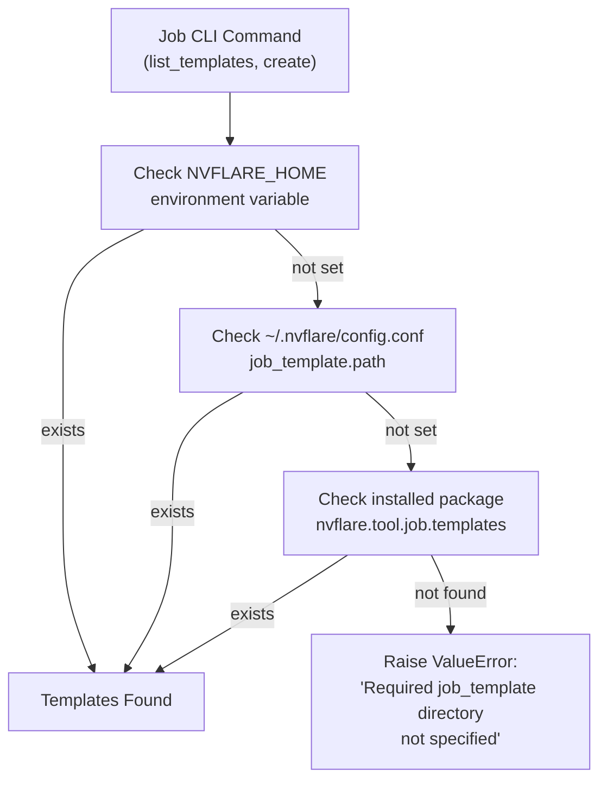
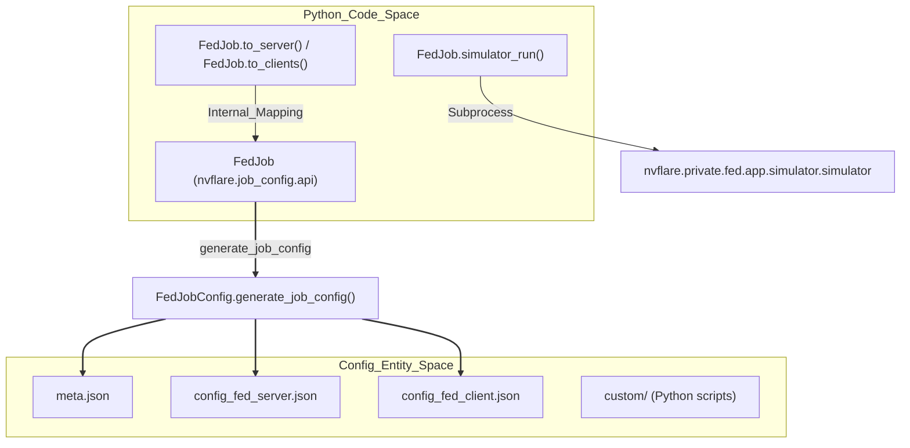
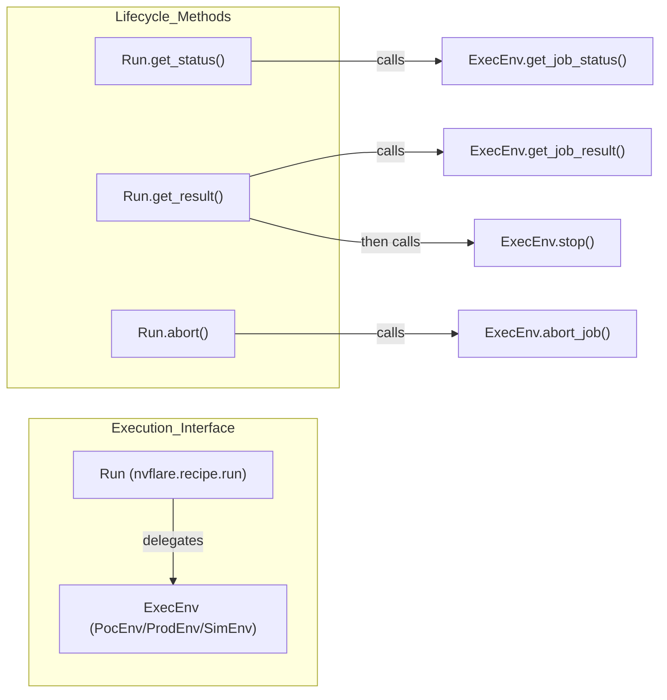

<!-- source: DeepWiki mcp.deepwiki.com · repo NVIDIA/NVFlare · page 7.5 Job Templates and Recipes · fetched 2026-10-26 -->

# Job Templates and Recipes

Relevant source files

The following files were used as context for generating this wiki page:

- [docs/user_guide/data_scientist_guide/job_recipe.rst](docs/user_guide/data_scientist_guide/job_recipe.rst)
- [docs/user_guide/data_scientist_guide/recipe_api.rst](docs/user_guide/data_scientist_guide/recipe_api.rst)
- [examples/hello-world/hello-tf/client.py](examples/hello-world/hello-tf/client.py)
- [examples/hello-world/hello-tf/model.py](examples/hello-world/hello-tf/model.py)
- [job_templates/sag_pt/config_fed_client.conf](job_templates/sag_pt/config_fed_client.conf)
- [job_templates/sag_pt/config_fed_server.conf](job_templates/sag_pt/config_fed_server.conf)
- [job_templates/sag_pt_deploy_map/app_1/config_fed_client.conf](job_templates/sag_pt_deploy_map/app_1/config_fed_client.conf)
- [job_templates/sag_pt_deploy_map/app_2/config_fed_client.conf](job_templates/sag_pt_deploy_map/app_2/config_fed_client.conf)
- [job_templates/sag_pt_deploy_map/app_server/config_fed_server.conf](job_templates/sag_pt_deploy_map/app_server/config_fed_server.conf)
- [job_templates/sag_pt_deploy_map/info.conf](job_templates/sag_pt_deploy_map/info.conf)
- [job_templates/sag_pt_deploy_map/info.md](job_templates/sag_pt_deploy_map/info.md)
- [job_templates/sag_pt_deploy_map/meta.conf](job_templates/sag_pt_deploy_map/meta.conf)
- [nvflare/app_common/np/recipes/fedavg.py](nvflare/app_common/np/recipes/fedavg.py)
- [nvflare/app_common/widgets/intime_model_selector.py](nvflare/app_common/widgets/intime_model_selector.py)
- [nvflare/app_opt/pt/job_config/base_fed_job.py](nvflare/app_opt/pt/job_config/base_fed_job.py)
- [nvflare/app_opt/pt/job_config/fed_avg.py](nvflare/app_opt/pt/job_config/fed_avg.py)
- [nvflare/app_opt/pt/job_config/fed_sag_mlflow.py](nvflare/app_opt/pt/job_config/fed_sag_mlflow.py)
- [nvflare/app_opt/pt/recipes/fedavg.py](nvflare/app_opt/pt/recipes/fedavg.py)
- [nvflare/app_opt/sklearn/recipes/fedavg.py](nvflare/app_opt/sklearn/recipes/fedavg.py)
- [nvflare/app_opt/tf/job_config/base_fed_job.py](nvflare/app_opt/tf/job_config/base_fed_job.py)
- [nvflare/app_opt/tf/job_config/fed_avg.py](nvflare/app_opt/tf/job_config/fed_avg.py)
- [nvflare/app_opt/tf/recipes/fedavg.py](nvflare/app_opt/tf/recipes/fedavg.py)
- [nvflare/job_config/base_fed_job.py](nvflare/job_config/base_fed_job.py)
- [nvflare/recipe/__init__.py](nvflare/recipe/__init__.py)
- [nvflare/recipe/fedavg.py](nvflare/recipe/fedavg.py)
- [nvflare/recipe/poc_env.py](nvflare/recipe/poc_env.py)
- [nvflare/recipe/prod_env.py](nvflare/recipe/prod_env.py)
- [nvflare/recipe/run.py](nvflare/recipe/run.py)
- [nvflare/recipe/sim_env.py](nvflare/recipe/sim_env.py)
- [nvflare/recipe/spec.py](nvflare/recipe/spec.py)
- [nvflare/recipe/utils.py](nvflare/recipe/utils.py)
- [tests/integration_test/slow/recipe_system_test.py](tests/integration_test/slow/recipe_system_test.py)
- [tests/unit_test/app_common/widgets/in_time_model_selector_test.py](tests/unit_test/app_common/widgets/in_time_model_selector_test.py)
- [tests/unit_test/recipe/fedavg_recipe_test.py](tests/unit_test/recipe/fedavg_recipe_test.py)
- [tests/unit_test/recipe/poc_env_test.py](tests/unit_test/recipe/poc_env_test.py)
- [tests/unit_test/recipe/run_test.py](tests/unit_test/recipe/run_test.py)
- [tests/unit_test/recipe/sim_env_test.py](tests/unit_test/recipe/sim_env_test.py)
- [tests/unit_test/recipe/spec_test.py](tests/unit_test/recipe/spec_test.py)
- [tests/unit_test/recipe/utils_test.py](tests/unit_test/recipe/utils_test.py)

## Purpose and Scope

This page documents the job template system and Job Recipe API in NVIDIA FLARE, which provide two complementary approaches for creating federated learning jobs:

- **Job Templates**: Pre-configured job skeletons with customizable variables that serve as starting points for common FL workflows.
- **Job Recipe API**: High-level Python API classes (e.g., `FedAvgRecipe`) and the `FedJob` API that programmatically generate job configurations and manage execution across different environments (Simulator, POC, Production).

For information about the Job CLI commands used to work with templates, see [Job CLI](#7.4). For details on the underlying job configuration structure and metadata, see [Job Structure and Metadata](#7.1).

---

## Job Templates Overview

### What are Job Templates?

Job templates are pre-configured directory structures containing configuration files for common federated learning workflows. Each template typically includes:

- Server configuration (`config_fed_server.conf`)
- Client configuration (`config_fed_client.conf`)
- Job metadata (`meta.conf`)
- Template information (`info.md`)

Templates use **template variables** (placeholders like `{app_script}`, `{min_clients}`) that are substituted during job creation. For example, a `SubprocessLauncher` in a template might use `{app_script}` to define the command line execution.

### Template Discovery Process

The system searches for templates in a prioritized order, checking environment variables, local configuration files, and finally the built-in package directory.

Sources: `[nvflare/job_config/fed_job_config.py:145-168]()`

---

## Job Recipe API

The Job Recipe API provides a high-level Pythonic way to define and execute federated learning jobs. It abstracts the complexity of JSON/HOCON configurations into reusable classes.

### Core Recipe Architecture

The base `Recipe` class `[nvflare/recipe/spec.py:191-203]()` acts as a container for a `FedJob`. Concrete implementations configure this job with specific controllers and executors. It includes utility methods for managing environment-specific configuration such as `add_server_config` and `add_client_config` `[nvflare/recipe/spec.py:204-210]()`.

#### Execution Environments (ExecEnv)

Recipes are executed within an `ExecEnv` `[nvflare/recipe/spec.py:105-141]()`, which defines the deployment target and handles the job lifecycle (deploy, status, abort, result).

| Environment | Class | Description |
| :--- | :--- | :--- |
| **Simulator** | `SimEnv` | Runs locally using the FL Simulator. Validates that all scripts exist locally `[nvflare/recipe/sim_env.py:116-121]()`. |
| **POC** | `PocEnv` | Sets up a multi-process POC deployment locally `[nvflare/recipe/poc_env.py:46-75]()`. |
| **Production** | `ProdEnv` | Submits jobs to a live server using admin startup kits `[nvflare/recipe/prod_env.py:61-84]()`. |

### Unified Recipes and Available Algorithms
NVFlare provides framework-specific unified recipes that automate the configuration of `InTime` aggregation, model persistence, and script runners.

- **PyTorch**: `FedAvgRecipe` in `nvflare.app_opt.pt.recipes.fedavg` `[nvflare/app_opt/pt/recipes/fedavg.py:26-107]()`. It supports `enable_tensor_disk_offload` to reduce server peak memory `[nvflare/app_opt/pt/recipes/fedavg.py:85-85]()` and uses `InTime` aggregation for memory efficiency `[nvflare/app_opt/pt/recipes/fedavg.py:104-106]()`.
- **NumPy**: `NumpyFedAvgRecipe` `[nvflare/app_common/np/recipes/fedavg.py:24-109]()`.
- **TensorFlow**: `FedAvgRecipe` in `nvflare.app_opt.tf.recipes.fedavg` `[nvflare/app_opt/tf/recipes/fedavg.py:25-108]()`.
- **Scikit-learn**: `FedAvgRecipe` in `nvflare.app_opt.sklearn.recipes.fedavg` supports standard FedAvg for custom frameworks like sklearn and XGBoost by setting `framework=FrameworkType.RAW` `[nvflare/recipe/fedavg.py:118-118]()`.

### Registry and Metadata Utilities
The `nvflare.recipe.utils` module maintains registries for experiment tracking (MLflow, TensorBoard, WandB) `[nvflare/recipe/utils.py:31-47]()` and model locators (PyTorch, NumPy, TensorFlow) `[nvflare/recipe/utils.py:49-65]()`. 

Users can set specific job metadata via `set_recipe_meta`, which validates keys against `USER_SETTABLE_JOB_META_KEYS` `[nvflare/recipe/utils.py:172-174]()` and ensures values are JSON-serializable `[nvflare/recipe/utils.py:177-182]()`.

Sources: `[nvflare/recipe/spec.py:105-203]()`, `[nvflare/app_opt/pt/recipes/fedavg.py:26-136]()`, `[nvflare/app_common/np/recipes/fedavg.py:24-133]()`, `[nvflare/recipe/utils.py:31-182]()`

---

## FedJob API

The `FedJob` class `[nvflare/job_config/api.py:184-192]()` is the underlying engine used by recipes to build the job structure programmatically.

### Data Flow: Code to Job Configuration

The following diagram shows how `FedJob` transforms Python objects into the standard NVFlare job directory structure.

Sources: `[nvflare/job_config/api.py:184-210]()`, `[nvflare/job_config/fed_job_config.py:145-173]()`, `[nvflare/job_config/fed_job_config.py:174-193]()`

### Key FedJob Methods

- **Component Placement**: `to(obj, target)` deploys a component (Executor, Controller, Filter) to a specific site or `ALL_SITES` `[nvflare/job_config/api.py:243-265]()`. Shortcut methods `to_server(obj)` `[nvflare/job_config/api.py:311-320]()` and `to_clients(obj)` `[nvflare/job_config/api.py:322-331]()` are provided.
- **Resource Management**: `add_resources(resources)` registers external scripts or directories to be included in the job's `custom` folder `[nvflare/job_config/api.py:141-152]()`.
- **Simulation**: `simulator_run()` generates the job config in a temporary directory and invokes the simulator module `[nvflare/job_config/fed_job_config.py:174-193]()`.
- **Fail Fast Mode**: When `fail_fast=True`, the job configuration injects `dead_client_grace_period: 0` into the server configuration to allow immediate abort on client failure `[nvflare/job_config/api.py:191-192]()`, `[nvflare/job_config/api.py:304-306]()`.

---

## Configuration Assembly

The `FedJobConfig` class `[nvflare/job_config/fed_job_config.py:43-74]()` handles the final assembly of the job directory.

### Job Config Generation
The `generate_job_config` method `[nvflare/job_config/fed_job_config.py:145-173]()` performs the following:
1. Creates the job directory structure under `job_root`.
2. Populates `config/` and `custom/` directories for each app defined in `fed_apps` `[nvflare/job_config/fed_job_config.py:158-163]()`.
3. Generates the `meta.json` file via `_generate_meta`, including `min_clients`, `mandatory_clients`, and the `deploy_map` `[nvflare/job_config/fed_job_config.py:122-144]()`.

### Framework-Specific Models
Framework-specific model wrappers assist the Job API by automatically creating appropriate persistors and locators. For PyTorch, the recipe requires both the `model` (architecture) and `initial_ckpt` (weights) `[docs/user_guide/data_scientist_guide/job_recipe.rst:108-109]()`. For TensorFlow/Keras, `initial_ckpt` alone can work as the format often contains both architecture and weights `[docs/user_guide/data_scientist_guide/job_recipe.rst:113-115]()`.

### Model Serialization and Checkpoints
- **Serialization**: When passing a class instance to a recipe, NVFlare converts the model to a configuration file. For large models (LLMs), users should use the dictionary format `{"class_path": "...", "args": {...}}` to avoid memory overhead during job export `[docs/user_guide/data_scientist_guide/job_recipe.rst:70-77]()`.
- **Checkpoint Paths**: `initial_ckpt` must be an absolute path. It does not need to exist locally during recipe creation but must exist on the **server** at runtime `[docs/user_guide/data_scientist_guide/job_recipe.rst:105-107]()`.

Sources: `[nvflare/job_config/fed_job_config.py:122-173]()`, `[docs/user_guide/data_scientist_guide/job_recipe.rst:70-115]()`

---

## Recipe Execution and Monitoring

The `Run` class `[nvflare/recipe/run.py:22-29]()` represents an active or completed job execution. It provides a thread-safe interface to interact with the execution environment.

### Run Lifecycle and State Management

Key behaviors of the `Run` class:
- **Caching**: After `get_result()` is called, the execution environment is stopped, and the job status and result path are cached within the `Run` object `[nvflare/recipe/run.py:95-119]()`.
- **Cleanup**: `get_result()` accepts a `clean_up` boolean (defaulting to `True`) which determines if the execution environment's temporary workspace is removed `[nvflare/recipe/run.py:84-89]()`.
- **Thread Safety**: State-changing operations are protected by a `threading.Lock` `[nvflare/recipe/run.py:48-51]()`.

Sources: `[nvflare/recipe/run.py:22-135]()`, `[nvflare/recipe/spec.py:105-189]()`

---

## Summary of Recipe API vs. Templates

| Feature | Job Templates | Job Recipe API / FedJob |
| :--- | :--- | :--- |
| **Primary Interface** | CLI (`nvflare job create`) | Python Code |
| **Configuration** | Static HOCON/JSON with variables | Dynamic Python objects |
| **Extensibility** | Limited to template variables | Full programmatic control |
| **Deployment** | Manual submission via CLI | Automated via `ExecEnv.deploy()` |
| **Target Audience** | Users preferring CLI/Config | Developers/Researchers |

Sources: `[nvflare/job_config/api.py:184-192]()`, `[nvflare/recipe/spec.py:191-203]()`

---

