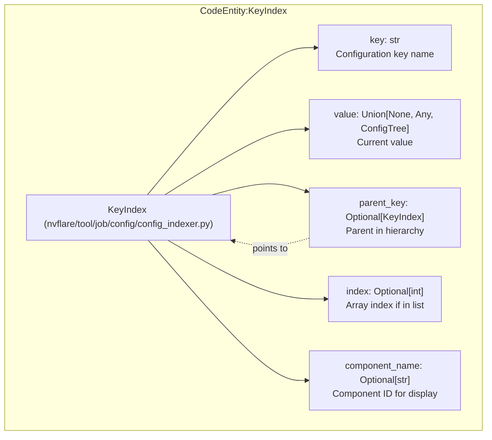
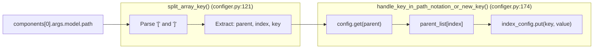

<!-- source: DeepWiki mcp.deepwiki.com · repo NVIDIA/NVFlare · page 7.6 Configuration System and Indexing · fetched 2026-10-26 -->

# Configuration System and Indexing

Relevant source files

The following files were used as context for generating this wiki page:

- [3rdParty/omegaconf.LICENSE.txt](3rdParty/omegaconf.LICENSE.txt)
- [3rdParty/pyhocon_LICENSE.txt](3rdParty/pyhocon_LICENSE.txt)
- [docs/user_guide/admin_guide/configurations/variable_resolution.rst](docs/user_guide/admin_guide/configurations/variable_resolution.rst)
- [nvflare/README.md](nvflare/README.md)
- [nvflare/apis/app_deployer_spec.py](nvflare/apis/app_deployer_spec.py)
- [nvflare/apis/utils/job_utils.py](nvflare/apis/utils/job_utils.py)
- [nvflare/cli.py](nvflare/cli.py)
- [nvflare/fuel/utils/component_builder.py](nvflare/fuel/utils/component_builder.py)
- [nvflare/fuel/utils/config.py](nvflare/fuel/utils/config.py)
- [nvflare/fuel/utils/config_factory.py](nvflare/fuel/utils/config_factory.py)
- [nvflare/fuel/utils/config_service.py](nvflare/fuel/utils/config_service.py)
- [nvflare/fuel/utils/json_config_loader.py](nvflare/fuel/utils/json_config_loader.py)
- [nvflare/fuel/utils/json_scanner.py](nvflare/fuel/utils/json_scanner.py)
- [nvflare/fuel/utils/wfconf.py](nvflare/fuel/utils/wfconf.py)
- [nvflare/fuel_opt/__init__.py](nvflare/fuel_opt/__init__.py)
- [nvflare/fuel_opt/utils/__init__.py](nvflare/fuel_opt/utils/__init__.py)
- [nvflare/fuel_opt/utils/omegaconf_loader.py](nvflare/fuel_opt/utils/omegaconf_loader.py)
- [nvflare/fuel_opt/utils/pyhocon_loader.py](nvflare/fuel_opt/utils/pyhocon_loader.py)
- [nvflare/private/fed/app/fl_conf.py](nvflare/private/fed/app/fl_conf.py)
- [nvflare/private/fed/client/client_json_config.py](nvflare/private/fed/client/client_json_config.py)
- [nvflare/private/fed/server/server_app_runner.py](nvflare/private/fed/server/server_app_runner.py)
- [nvflare/private/fed/server/server_json_config.py](nvflare/private/fed/server/server_json_config.py)
- [nvflare/private/fed/simulator/simulator_app_runner.py](nvflare/private/fed/simulator/simulator_app_runner.py)
- [nvflare/private/fed_json_config.py](nvflare/private/fed_json_config.py)
- [nvflare/private/json_configer.py](nvflare/private/json_configer.py)
- [nvflare/tool/job/config/config_indexer.py](nvflare/tool/job/config/config_indexer.py)
- [nvflare/tool/job/config/configer.py](nvflare/tool/job/config/configer.py)
- [nvflare/tool/job/job_cli.py](nvflare/tool/job/job_cli.py)
- [nvflare/tool/job/job_client_const.py](nvflare/tool/job/job_client_const.py)
- [nvflare/tool/poc/poc_commands.py](nvflare/tool/poc/poc_commands.py)
- [nvflare/tool/poc/service_constants.py](nvflare/tool/poc/service_constants.py)
- [nvflare/utils/cli_utils.py](nvflare/utils/cli_utils.py)
- [tests/unit_test/data/jobs/launch_everytime/app/config/config_fed_client.conf](tests/unit_test/data/jobs/launch_everytime/app/config/config_fed_client.conf)
- [tests/unit_test/data/jobs/launch_everytime/app/config/config_fed_server.conf](tests/unit_test/data/jobs/launch_everytime/app/config/config_fed_server.conf)
- [tests/unit_test/data/jobs/launch_everytime/meta.conf](tests/unit_test/data/jobs/launch_everytime/meta.conf)
- [tests/unit_test/data/jobs/launch_once/app/config/config_fed_client.conf](tests/unit_test/data/jobs/launch_once/app/config/config_fed_client.conf)
- [tests/unit_test/data/jobs/launch_once/app/config/config_fed_server.conf](tests/unit_test/data/jobs/launch_once/app/config/config_fed_server.conf)
- [tests/unit_test/data/jobs/launch_once/meta.conf](tests/unit_test/data/jobs/launch_once/meta.conf)
- [tests/unit_test/fuel/utils/component_builder_test.py](tests/unit_test/fuel/utils/component_builder_test.py)
- [tests/unit_test/fuel/utils/config_format_test.py](tests/unit_test/fuel/utils/config_format_test.py)
- [tests/unit_test/fuel/utils/config_service_test.py](tests/unit_test/fuel/utils/config_service_test.py)
- [tests/unit_test/fuel/utils/json_config_test.py](tests/unit_test/fuel/utils/json_config_test.py)
- [tests/unit_test/fuel/utils/mock_component_builder.py](tests/unit_test/fuel/utils/mock_component_builder.py)
- [tests/unit_test/fuel/utils/pyhocon_config_test.py](tests/unit_test/fuel/utils/pyhocon_config_test.py)
- [tests/unit_test/fuel/utils/wfconf_test.py](tests/unit_test/fuel/utils/wfconf_test.py)
- [tests/unit_test/lighter/poc_commands_test.py](tests/unit_test/lighter/poc_commands_test.py)
- [tests/unit_test/tool/job/config/config_indexer_test.py](tests/unit_test/tool/job/config/config_indexer_test.py)
- [tests/unit_test/tool/job/config/configer_test.py](tests/unit_test/tool/job/config/configer_test.py)
- [tests/unit_test/tool/job/job_cli_test.py](tests/unit_test/tool/job/job_cli_test.py)
- [tests/unit_test/tool/poc/poc_force_test.py](tests/unit_test/tool/poc/poc_force_test.py)
- [tests/unit_test/tool/poc/poc_output_test.py](tests/unit_test/tool/poc/poc_output_test.py)

## Purpose and Scope

This document describes NVIDIA FLARE's configuration system and indexing infrastructure, primarily utilized by the Job CLI and internal component instantiation logic. The system enables template-based job creation with CLI-based configuration overrides, variable discovery, and intelligent configuration merging. It handles multiple configuration formats (JSON, YAML, PYHOCON) and provides a unified interface for manipulating nested configuration structures.

For information about job creation and submission workflows, see [Job CLI (7.4)](). For job structure and metadata, see [Job Structure and Metadata (7.1)]().

## System Overview

The configuration system consists of three main subsystems:

1.  **Configuration Indexing**: Builds reverse indices of configuration keys to track variable locations and enable efficient lookups via `ConfigIndexer` and `KeyIndex` [nvflare/tool/job/config/config_indexer.py:27-68]().
2.  **CLI Configuration Parser**: Parses command-line configuration overrides in the format `-f config_file.conf key=value` via `get_cli_config` [nvflare/tool/job/config/configer.py:277-308]().
3.  **Configuration Merger**: Merges CLI-provided configurations with template configurations while preserving structure and types using `merge_configs` [nvflare/tool/job/config/configer.py:208-261]().

The system is designed to support the Job CLI's template-based workflow where users start with pre-configured job templates and customize them via command-line arguments without manually editing configuration files [nvflare/tool/job/config/configer.py:35-44]().

**Sources**: [nvflare/tool/job/config/configer.py:35-44](), [nvflare/tool/job/config/config_indexer.py:36-68](), [nvflare/tool/job/config/configer.py:277-308]()

## Configuration Indexing System

### KeyIndex Data Structure

The configuration indexing system uses a `KeyIndex` dataclass to represent each configuration key with metadata about its location, value, and relationship to other keys.

Title: "KeyIndex Structure and Relationships"

**KeyIndex Fields**:

| Field | Type | Purpose |
| :--- | :--- | :--- |
| `key` | `str` | The configuration key name (e.g., "num_rounds", "args.model.path") [nvflare/tool/job/config/config_indexer.py:29]() |
| `value` | `Union[None, Any, ConfigTree]` | Current value of the configuration key [nvflare/tool/job/config/config_indexer.py:30]() |
| `parent_key` | `Optional[KeyIndex]` | Reference to parent KeyIndex in hierarchy (for nested configs) [nvflare/tool/job/config/config_indexer.py:31]() |
| `index` | `Optional[int]` | Array index if this key is an element in a list [nvflare/tool/job/config/config_indexer.py:32]() |
| `component_name` | `Optional[str]` | Component identifier for display purposes [nvflare/tool/job/config/config_indexer.py:33]() |

**Sources**: [nvflare/tool/job/config/config_indexer.py:27-34]()

### Reverse-Order Index Building

The system builds reverse-order indices that map configuration key names to their `KeyIndex` objects. This enables efficient variable discovery and value updates.

Title: "Configuration Indexing Flow (Code Entities)"

```mermaid
graph LR
    ConfigFile["config_fed_server.conf"]
    
    subgraph "ParsingLogic"
        PyHOCON["load_pyhocon_conf()<br/>(config_indexer.py:71)"]
        ConfigTree["pyhocon.ConfigTree Object"]
    end
    
    subgraph "IndexConstruction"
        BuildDictIndex["build_dict_reverse_order_index()<br/>(config_indexer.py:163)"]
        BuildListIndex["build_list_reverse_order_index()<br/>(config_indexer.py:89)"]
        AddDefaults["add_default_values()<br/>(config_indexer.py:229)"]
    end
    
    subgraph "IndexOutput"
        KeyIndices["Dict[str, List[KeyIndex]]"]
    end
    
    ConfigFile --> PyHOCON
    PyHOCON --> ConfigTree
    ConfigTree --> BuildDictIndex
    BuildDictIndex --> BuildListIndex
    BuildListIndex --> AddDefaults
    AddDefaults --> KeyIndices
```

The indexing process:

1.  **Load Configuration**: Parse config file using `load_pyhocon_conf` to obtain a `ConfigTree` [nvflare/tool/job/config/config_indexer.py:71-86](). This function utilizes `ConfigFactory.load_config` [nvflare/fuel/utils/config_factory.py:98-125]() and normalizes formats to `pyhocon.ConfigTree` [nvflare/tool/job/config/config_indexer.py:77-80]().
2.  **Recursive Traversal**: Recursively traverse the configuration tree.
    *   `build_dict_reverse_order_index()` handles dictionary-like structures [nvflare/tool/job/config/config_indexer.py:163-201]().
    *   `build_list_reverse_order_index()` handles list structures [nvflare/tool/job/config/config_indexer.py:89-146]().
3.  **Index Creation**: For each configuration key, create a `KeyIndex` with parent references.
4.  **Default Injection**: Add default values from class constructors via `add_default_values()` [nvflare/tool/job/config/config_indexer.py:229-245]().
5.  **Component Naming**: Populate component names for better variable display via `populate_key_component_names()` [nvflare/tool/job/config/config_indexer.py:291-303]().

**Sources**: [nvflare/tool/job/config/config_indexer.py:36-68](), [nvflare/tool/job/config/config_indexer.py:71-86](), [nvflare/tool/job/config/config_indexer.py:89-219](), [nvflare/fuel/utils/config_factory.py:98-125]()

## Configuration File Discovery and Loading

### Multi-App Configuration Discovery

NVFLARE jobs can contain multiple application directories, each with their own configuration files. The system discovers and indexes all configuration files via `build_config_file_indices()` [nvflare/tool/job/config/configer.py:411-453]().

The `build_config_file_indices()` function scans the job folder for `meta.conf` and app-specific configurations (e.g., `config_fed_client.conf`) in `config/` or `custom/` directories, building a comprehensive index of all editable parameters [nvflare/tool/job/config/configer.py:411-453]().

### Configuration Format Support

The system supports multiple configuration formats through the `ConfigFormat` enum and `ConfigFactory` [nvflare/fuel/utils/config_factory.py:25-44]():

| Format | Extensions | Loader Class |
| :--- | :--- | :--- |
| PYHOCON | `.conf` | `PyhoconLoader` [nvflare/fuel/utils/config_factory.py:31-33]() |
| JSON | `.json` | `JsonConfigLoader` [nvflare/fuel/utils/config_factory.py:21]() |
| YAML | `.yml`, `.yaml` | `OmegaConfLoader` [nvflare/fuel/utils/config_factory.py:28-30]() |

The `ConfigFactory.search_config_format` method is used to find the correct format based on file extensions [nvflare/fuel/utils/config_factory.py:46-88]().

**Sources**: [nvflare/fuel/utils/config_factory.py:25-44](), [nvflare/fuel/utils/config_factory.py:46-88](), [nvflare/fuel/utils/config.py:19-24]()

## CLI Configuration Override Mechanism

### CLI Syntax and Parsing

The Job CLI accepts configuration overrides using the `-f` flag, which is handled by `get_cli_config()` [nvflare/tool/job/config/configer.py:277-308]().

**Syntax Rules**:
1.  **File Specification**: `-f <config_file>` followed by space-separated `key=value` pairs [nvflare/tool/job/config/configer.py:317-379]().
2.  **Key Removal**: Append `-` to key or leave value empty to remove: `launch_once-` or `launch_once=` [nvflare/tool/job/config/configer.py:188-196]().

The `get_cli_config()` function processes CLI arguments into a structured dictionary organized by app and configuration file [nvflare/tool/job/config/configer.py:277-308]().

## Configuration Merging Process

The configuration merging process combines CLI overrides with existing template configurations while preserving structure and types.

### Merge Algorithm

The `merge_configs()` function iterates through the overrides and updates the corresponding `KeyIndex` and parent `ConfigTree` [nvflare/tool/job/config/configer.py:208-261]().

1.  **Type Casting**: `_cast_type()` matches the CLI string value to the existing configuration's type (e.g., bool, int) by attempting to parse the value using `ConfigFactory.parse_string` [nvflare/tool/job/config/configer.py:109-118]().
2.  **Key Addition/Removal**: New keys or path notations are handled by `handle_key_in_path_notation_or_new_key()` [nvflare/tool/job/config/configer.py:174-206]().

**Sources**: [nvflare/tool/job/config/configer.py:208-261](), [nvflare/tool/job/config/configer.py:109-118](), [nvflare/tool/job/config/configer.py:174-206]()

## Advanced Configuration Features

### Array Indexing and Path Notation

The system supports advanced key paths for accessing nested structures and arrays using `split_array_key()` [nvflare/tool/job/config/configer.py:121-144]().

**Array Index Syntax**: `parent[index].nested.key`

Title: "Array Path Resolution Logic"

**Sources**: [nvflare/tool/job/config/configer.py:121-144](), [nvflare/tool/job/config/configer.py:174-206]()

### Default Value Injection

The system can automatically inject default values from class constructor signatures into the configuration index via `add_default_values()` [nvflare/tool/job/config/config_indexer.py:229-245](). It uses `inspect.signature()` to extract parameters and their defaults from the actual Python classes referenced in the configuration [nvflare/tool/job/config/config_indexer.py:260-264]().

**Sources**: [nvflare/tool/job/config/config_indexer.py:229-289](), [nvflare/tool/job/config/config_indexer.py:305-313]()

### ConfigService and Section Management

The `ConfigService` provides a global configuration service that manages preloaded configuration info in predefined sections [nvflare/fuel/utils/config_service.py:62-70](). It is initialized by runtime configurators like `FLServerStarterConfiger` and `ServerJsonConfigurator` [nvflare/private/fed/app/fl_conf.py:195-200](), [nvflare/private/fed/server/server_json_config.py:187-192]().

**Initialization Flow**:
1.  Runtime configurator parses JSON/PYHOCON files.
2.  `ConfigService.initialize()` is called with search paths and variable dictionaries [nvflare/fuel/utils/config_service.py:80-131]().
3.  Sections like `APPLICATION_CONF` are added to `ConfigService` [nvflare/private/fed/client/client_json_config.py:188-191]().

**Sources**: [nvflare/fuel/utils/config_service.py:62-131](), [nvflare/private/fed/app/fl_conf.py:195-200](), [nvflare/private/fed/client/client_json_config.py:188-191]()

---

