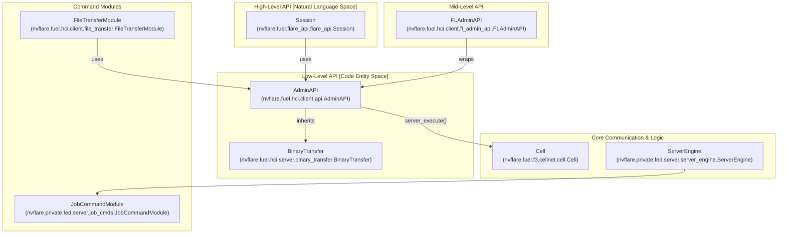
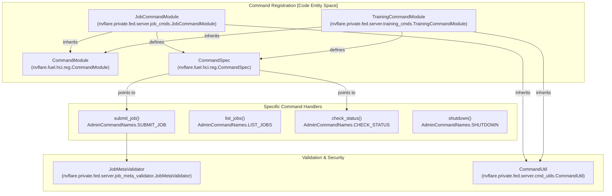

<!-- source: DeepWiki mcp.deepwiki.com · repo NVIDIA/NVFlare · page 8 Admin and Monitoring · fetched 2026-10-26 -->

# Admin and Monitoring

Relevant source files

The following files were used as context for generating this wiki page:

- [nvflare/apis/event_type.py](nvflare/apis/event_type.py)
- [nvflare/apis/fl_component.py](nvflare/apis/fl_component.py)
- [nvflare/apis/fl_snapshot.py](nvflare/apis/fl_snapshot.py)
- [nvflare/apis/impl/job_def_manager.py](nvflare/apis/impl/job_def_manager.py)
- [nvflare/apis/job_def.py](nvflare/apis/job_def.py)
- [nvflare/apis/job_def_manager_spec.py](nvflare/apis/job_def_manager_spec.py)
- [nvflare/apis/state_persistor.py](nvflare/apis/state_persistor.py)
- [nvflare/apis/storage.py](nvflare/apis/storage.py)
- [nvflare/apis/utils/fl_context_utils.py](nvflare/apis/utils/fl_context_utils.py)
- [nvflare/app_common/state_persistors/__init__.py](nvflare/app_common/state_persistors/__init__.py)
- [nvflare/app_common/state_persistors/storage_state_persistor.py](nvflare/app_common/state_persistors/storage_state_persistor.py)
- [nvflare/app_common/storages/filesystem_storage.py](nvflare/app_common/storages/filesystem_storage.py)
- [nvflare/fuel/common/exit_codes.py](nvflare/fuel/common/exit_codes.py)
- [nvflare/fuel/f3/cellnet/cell.py](nvflare/fuel/f3/cellnet/cell.py)
- [nvflare/fuel/flare_api/api_spec.py](nvflare/fuel/flare_api/api_spec.py)
- [nvflare/fuel/flare_api/flare_api.py](nvflare/fuel/flare_api/flare_api.py)
- [nvflare/fuel/hci/client/api.py](nvflare/fuel/hci/client/api.py)
- [nvflare/fuel/hci/client/api_spec.py](nvflare/fuel/hci/client/api_spec.py)
- [nvflare/fuel/hci/client/cli.py](nvflare/fuel/hci/client/cli.py)
- [nvflare/fuel/hci/client/file_transfer.py](nvflare/fuel/hci/client/file_transfer.py)
- [nvflare/fuel/hci/file_transfer_defs.py](nvflare/fuel/hci/file_transfer_defs.py)
- [nvflare/fuel/hci/proto.py](nvflare/fuel/hci/proto.py)
- [nvflare/fuel/hci/tools/admin.py](nvflare/fuel/hci/tools/admin.py)
- [nvflare/private/defs.py](nvflare/private/defs.py)
- [nvflare/private/event.py](nvflare/private/event.py)
- [nvflare/private/fed/client/client_req_processors.py](nvflare/private/fed/client/client_req_processors.py)
- [nvflare/private/fed/client/sys_cmd.py](nvflare/private/fed/client/sys_cmd.py)
- [nvflare/private/fed/server/cmd_utils.py](nvflare/private/fed/server/cmd_utils.py)
- [nvflare/private/fed/server/info_coll_cmd.py](nvflare/private/fed/server/info_coll_cmd.py)
- [nvflare/private/fed/server/job_cmds.py](nvflare/private/fed/server/job_cmds.py)
- [nvflare/private/fed/server/run_manager.py](nvflare/private/fed/server/run_manager.py)
- [nvflare/private/fed/server/server_engine_internal_spec.py](nvflare/private/fed/server/server_engine_internal_spec.py)
- [nvflare/private/fed/server/sys_cmd.py](nvflare/private/fed/server/sys_cmd.py)
- [nvflare/private/fed/server/training_cmds.py](nvflare/private/fed/server/training_cmds.py)
- [nvflare/security/security.py](nvflare/security/security.py)
- [nvflare/widgets/info_collector.py](nvflare/widgets/info_collector.py)
- [tests/unit_test/apis/impl/job_def_manager_test.py](tests/unit_test/apis/impl/job_def_manager_test.py)
- [tests/unit_test/app_common/storages/storage_test.py](tests/unit_test/app_common/storages/storage_test.py)
- [tests/unit_test/fuel/flare_api/session_new_methods_test.py](tests/unit_test/fuel/flare_api/session_new_methods_test.py)
- [tests/unit_test/private/fed/server/job_cmds_test.py](tests/unit_test/private/fed/server/job_cmds_test.py)
- [tests/unit_test/tool/cli_errors_test.py](tests/unit_test/tool/cli_errors_test.py)
- [tests/unit_test/tool/job/job_logs_test.py](tests/unit_test/tool/job/job_logs_test.py)

This page describes the administrative infrastructure of NVIDIA FLARE, covering the multi-tier API architecture, the command execution framework, secure file transfer protocols, and the authorization system used to manage federated learning jobs and system state.

For information about job lifecycle and storage, see [Job Management System](#7). For details on the provisioning system that generates admin startup kits, see [Provisioning System](#10).

## API Layer Hierarchy

NVFLARE provides a three-tier administrative API architecture, ranging from low-level communication primitives to high-level Pythonic abstractions.

### Three-Tier Architecture

Titled: "NVFLARE Admin API Hierarchy"

Sources: [nvflare/fuel/flare_api/flare_api.py:138-186](), [nvflare/fuel/hci/client/api.py:89-138](), [nvflare/private/fed/server/job_cmds.py:144-154](), [nvflare/fuel/hci/client/file_transfer.py:63-83]()

**AdminAPI (Low-Level)**
The `AdminAPI` class in `nvflare.fuel.hci.client.api` provides the foundational interface for raw command execution. It handles:
- **Session Lifecycle**: Manages login results and token persistence via `_LoginReplyProcessor` [nvflare/fuel/hci/client/api.py:186-196]().
- **Command Dispatch**: Routes commands to the remote server using `server_execute` [nvflare/fuel/hci/client/api.py:374-380]().
- **Event Handling**: Fires session events such as `BEFORE_DOWNLOAD_FILE` during transfers [nvflare/fuel/hci/client/file_transfer.py:162-163]().

**Session (High-Level)**
The `Session` class in `flare_api.py` is the primary entry point for developers. It simplifies management by:
- **Automated Setup**: Using `secure_load_admin_config` to parse startup kits and initialize the internal `AdminAPI` [nvflare/fuel/flare_api/flare_api.py:163-186]().
- **Status Mapping**: Translating server-side status values (e.g., `SUBMIT_TOKEN_CONFLICT_STATUS`) into Python exceptions like `SubmitTokenConflict` [nvflare/fuel/flare_api/flare_api.py:21-23](), [nvflare/fuel/flare_api/api_spec.py:68-69]().
- **Study Context**: Supporting the `study` parameter to isolate job visibility and operations [nvflare/fuel/flare_api/flare_api.py:145-160]().

For details, see [API Layer Hierarchy](#8.1).

## Admin Commands and Job Operations

Admin commands are implemented as `CommandModule` objects registered with the server-side engine.

### Command Module Architecture

Titled: "Command Module and Specification Mapping"

Sources: [nvflare/private/fed/server/job_cmds.py:144-185](), [nvflare/private/fed/server/training_cmds.py:42-122](), [nvflare/fuel/hci/reg.py:35-65]()

### JobCommandModule and TrainingCommandModule
Core administrative operations are split into functional modules:
- **JobCommandModule**: Implements core job operations on the server [nvflare/private/fed/server/job_cmds.py:146](). It defines commands for job lifecycle (`SUBMIT_JOB`, `ABORT_JOB`, `DELETE_JOB`) and monitoring (`LIST_JOBS`, `GET_JOB_LOG`) [nvflare/private/fed/server/job_cmds.py:161-216]().
- **TrainingCommandModule**: Handles system-level operations such as `CHECK_STATUS`, `SHUTDOWN`, and `RESTART` for both server and clients [nvflare/private/fed/server/training_cmds.py:53-121]().
- **Authorization**: Each command specifies an `authz_func` (e.g., `authorize_job` or `authorize_server_operation`) to validate user permissions via `CommandUtil` [nvflare/private/fed/server/job_cmds.py:164-180](), [nvflare/private/fed/server/training_cmds.py:57-109]().

For details, see [Admin Commands and Job Operations](#8.2).

## File Transfer Protocol

File transfers between the Admin Client and Server are handled by the `FileTransferModule` [nvflare/fuel/hci/client/file_transfer.py:63]().

- **Binary Transfer**: The `BinaryTransfer` class provides the server-side mechanism for handling raw bytes [nvflare/private/fed/server/job_cmds.py:146]().
- **Push/Pull**: Implemented via `push_folder` and `pull_folder` handlers which manage zipping and unzipping of directory structures [nvflare/fuel/hci/client/file_transfer.py:79-82](), [nvflare/fuel/hci/client/file_transfer.py:182-186]().
- **Client-Side Receivers**: Uses `_FileReceiver` and `_FileSender` to encapsulate the transfer logic during an API request [nvflare/fuel/hci/client/file_transfer.py:35-61]().

For details, see [File Transfer Protocol](#8.3).

## Authorization System

NVFLARE uses a Role-Based Access Control (RBAC) system for administrative commands.

- **Authentication**: Managed via certificates and credentials. The `AdminAPI` handles login and verifies identity via `Authenticator` [nvflare/fuel/hci/client/api.py:65-66]().
- **Command Level Control**: Commands registered in `JobCommandModule` utilize `authz_func` callbacks to check if a user has the necessary permissions for actions like `DELETE_WORKSPACE` [nvflare/private/fed/server/job_cmds.py:162-168]().
- **Study Isolation**: The `study` context ensures that users only see and interact with jobs belonging to their assigned study [nvflare/private/fed/server/job_cmds.py:107-108](). The `CommandUtil` class provides helper methods like `validate_command_targets` to filter clients based on study enrollment [nvflare/private/fed/server/cmd_utils.py:145-168]().

For details, see [Authorization System](#8.4).

## Audit Logging

Every administrative action is recorded to maintain a secure audit trail.
- **Event-Driven**: The system fires events such as `EventType.BEFORE_DOWNLOAD_FILE` and `EventType.AFTER_DOWNLOAD_FILE` to track data movement [nvflare/fuel/hci/client/file_transfer.py:162-172]().
- **Traceability**: Commands like `LIST_JOBS` can filter by user or submission time to provide an overview of activity [nvflare/private/fed/server/job_cmds.py:115-128]().
- **Job Logs**: Users can retrieve server-side logs for specific jobs using `GET_JOB_LOG`, which targets specific sites or the server [nvflare/private/fed/server/job_cmds.py:138-143]().

For details, see [Audit Logging](#8.5).

---
Sources: [nvflare/fuel/flare_api/flare_api.py:138-196](), [nvflare/fuel/hci/client/api.py:118-196](), [nvflare/private/fed/server/job_cmds.py:144-216](), [nvflare/private/fed/server/training_cmds.py:42-122](), [nvflare/fuel/hci/client/file_transfer.py:63-181](), [nvflare/private/fed/server/cmd_utils.py:73-168]()

---

