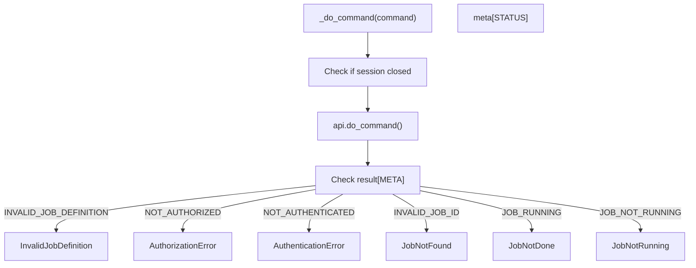
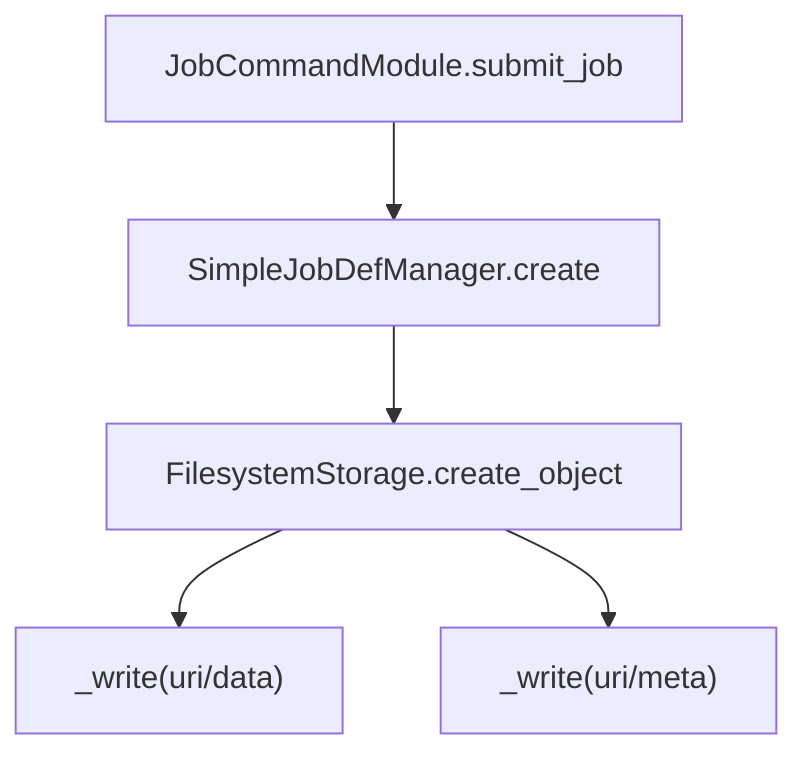
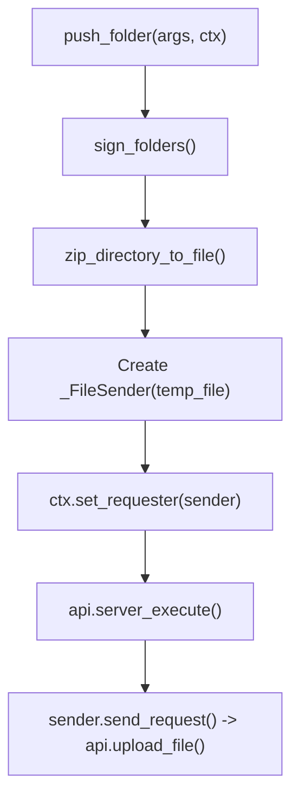

<!-- source: DeepWiki mcp.deepwiki.com · repo NVIDIA/NVFlare · page 8.1 API Layer Hierarchy · fetched 2026-10-26 -->

# API Layer Hierarchy

<details>
<summary>Relevant source files</summary>

The following files were used as context for generating this wiki page:

- [nvflare/apis/fl_snapshot.py](nvflare/apis/fl_snapshot.py)
- [nvflare/apis/impl/job_def_manager.py](nvflare/apis/impl/job_def_manager.py)
- [nvflare/apis/job_def.py](nvflare/apis/job_def.py)
- [nvflare/apis/job_def_manager_spec.py](nvflare/apis/job_def_manager_spec.py)
- [nvflare/apis/state_persistor.py](nvflare/apis/state_persistor.py)
- [nvflare/apis/storage.py](nvflare/apis/storage.py)
- [nvflare/app_common/state_persistors/__init__.py](nvflare/app_common/state_persistors/__init__.py)
- [nvflare/app_common/state_persistors/storage_state_persistor.py](nvflare/app_common/state_persistors/storage_state_persistor.py)
- [nvflare/app_common/storages/filesystem_storage.py](nvflare/app_common/storages/filesystem_storage.py)
- [nvflare/fuel/common/exit_codes.py](nvflare/fuel/common/exit_codes.py)
- [nvflare/fuel/flare_api/api_spec.py](nvflare/fuel/flare_api/api_spec.py)
- [nvflare/fuel/flare_api/flare_api.py](nvflare/fuel/flare_api/flare_api.py)
- [nvflare/fuel/hci/client/api.py](nvflare/fuel/hci/client/api.py)
- [nvflare/fuel/hci/client/api_spec.py](nvflare/fuel/hci/client/api_spec.py)
- [nvflare/fuel/hci/client/cli.py](nvflare/fuel/hci/client/cli.py)
- [nvflare/fuel/hci/client/file_transfer.py](nvflare/fuel/hci/client/file_transfer.py)
- [nvflare/fuel/hci/file_transfer_defs.py](nvflare/fuel/hci/file_transfer_defs.py)
- [nvflare/fuel/hci/proto.py](nvflare/fuel/hci/proto.py)
- [nvflare/fuel/hci/tools/admin.py](nvflare/fuel/hci/tools/admin.py)
- [nvflare/private/fed/server/job_cmds.py](nvflare/private/fed/server/job_cmds.py)
- [tests/unit_test/apis/impl/job_def_manager_test.py](tests/unit_test/apis/impl/job_def_manager_test.py)
- [tests/unit_test/app_common/storages/storage_test.py](tests/unit_test/app_common/storages/storage_test.py)
- [tests/unit_test/fuel/flare_api/session_new_methods_test.py](tests/unit_test/fuel/flare_api/session_new_methods_test.py)
- [tests/unit_test/private/fed/server/job_cmds_test.py](tests/unit_test/private/fed/server/job_cmds_test.py)
- [tests/unit_test/tool/cli_errors_test.py](tests/unit_test/tool/cli_errors_test.py)
- [tests/unit_test/tool/job/job_logs_test.py](tests/unit_test/tool/job/job_logs_test.py)

</details>


This page describes the three-tier API architecture used for administrative communication in NVIDIA FLARE. The layered design provides multiple entry points for different use cases: from low-level direct command execution to high-level Pythonic interfaces with automatic error handling.

For information about the Client API used within federated learning executors, see [Client-Side Execution](6). For details about job management commands and their implementation, see [Job Management System](7) and [Admin Commands and Job Operations](8.2).

## Overview

NVIDIA FLARE implements a three-tier API hierarchy for administrative operations:

1.  **Low-Level**: `AdminAPI` - Direct command execution with raw protocol handling.
2.  **Mid-Level**: `FLAdminAPI` - Wrapped commands with validation and error categorization.
3.  **High-Level**: `Session` (FLARE API) - Pythonic interface with exception-based error handling.

This design enables both programmatic automation (via high-level API) and fine-grained control (via low-level API) depending on user needs.

---

## API Layer Architecture

The following diagram illustrates the relationship between the three layers and the underlying transport.

Title: Three-Tier API Architecture
```mermaid
graph TB
    subgraph "High-Level-Layer"
        ["Session"] -- "nvflare/fuel/flare_api/flare_api.py" --> SessionNode["Session"]
        SessionMethods["submit_job()<br/>list_jobs()<br/>clone_job()<br/>get_system_info()"]
    end
    
    subgraph "Mid-Level-Layer"
        ["FLAdminAPI"] -- "nvflare/fuel/hci/client/fl_admin_api.py" --> FLAdminNode["FLAdminAPI"]
        FLAdminMethods["submit_job()<br/>list_jobs()<br/>abort_job()<br/>check_status()"]
        ErrorWrapper["@wrap_with_return_exception_responses"]
    end
    
    subgraph "Low-Level-Layer"
        ["AdminAPI"] -- "nvflare/fuel/hci/client/api.py" --> AdminNode["AdminAPI"]
        AdminMethods["do_command()<br/>server_execute()<br/>connect()<br/>login()"]
        CmdContext["CommandContext"]
    end
    
    subgraph "Transport-Layer"
        Cell["Cell<br/>(F3/CellNet)"]
        CellChannel["CellChannel.HCI"]
    end
    
    subgraph "Server-Side-Handlers"
        JobCommandModule["JobCommandModule<br/>(job_cmds.py)"]
        LoginModule["LoginModule<br/>(login.py)"]
        FileTransferModule["FileTransferModule<br/>(file_transfer.py)"]
        TrainingCommandModule["TrainingCommandModule<br/>(training_cmds.py)"]
    end
    
    SessionNode --> SessionMethods
    SessionMethods --> FLAdminNode
    
    FLAdminNode --> ErrorWrapper
    ErrorWrapper --> FLAdminMethods
    FLAdminMethods --> AdminNode
    
    AdminNode --> AdminMethods
    AdminMethods --> CmdContext
    CmdContext --> Cell
    
    Cell --> CellChannel
    CellChannel --> JobCommandModule
    CellChannel --> LoginModule
    CellChannel --> FileTransferModule
    CellChannel --> TrainingCommandModule
```

**Sources:** `[nvflare/fuel/flare_api/flare_api.py:138-189]()`, `[nvflare/fuel/hci/client/api.py:231-294]()`, `[nvflare/private/fed/server/job_cmds.py:146-200]()`, `[nvflare/fuel/hci/client/file_transfer.py:63-109]()`

---

## Low-Level: AdminAPI

The `AdminAPI` class provides direct command execution capabilities with minimal abstraction over the underlying communication protocol `[nvflare/fuel/hci/client/api.py:231-294]()`.

### Key Responsibilities

| Responsibility | Implementation |
| :--- | :--- |
| **Connection Management** | Login/logout and connection state via `_LoginReplyProcessor` `[nvflare/fuel/hci/client/api.py:186-195]()` |
| **Command Dispatch** | `do_command()` parses and routes commands `[nvflare/fuel/hci/client/api.py:756-852]()` |
| **Protocol Handling** | Processes raw server responses via `_ServerReplyJsonProcessor` `[nvflare/fuel/hci/client/api.py:118-177]()` |
| **File Transfer** | Binary file upload/download via streaming and `ObjectStreamer` `[nvflare/fuel/hci/client/api.py:537-555]()` |
| **Module Registration** | Loads `CommandModule` implementations into a `CommandRegister` `[nvflare/fuel/hci/client/api.py:231-294]()` |

### Core Methods and Flow

Title: AdminAPI Internal Execution Flow

```mermaid
graph LR
    User["User Code"] --> do_command["do_command(command)"]
    do_command --> check_command["check_command(cmd)"]
    check_command --> server_execute["server_execute(cmd)"]
    
    server_execute --> Cell["Cell.send_request()"]
    Cell --> ServerResponse["Server Response"]
    ServerResponse --> JsonProcessor["_ServerReplyJsonProcessor"]
    JsonProcessor --> CommandContext["CommandContext.set_command_result()"]
```


**Sources:** `[nvflare/fuel/hci/client/api.py:756-852]()`, `[nvflare/fuel/hci/client/api.py:118-177]()`, `[nvflare/fuel/hci/client/api_spec.py:171-210]()`

### Command Context and Protocol

The `CommandContext` object carries state through command execution `[nvflare/fuel/hci/client/api_spec.py:40-118]()`. The `_ServerReplyJsonProcessor` transforms raw JSON responses into structured data `[nvflare/fuel/hci/client/api.py:118-177]()`.

**Response Structure Example (ProtoKey):**
- `ProtoKey.STATUS`: Result status (e.g., SUCCESS, ERROR) `[nvflare/fuel/hci/proto.py:43-43]()`
- `ProtoKey.DATA`: List of data items (strings, tables, dicts) `[nvflare/fuel/hci/proto.py:30-30]()`
- `ProtoKey.META`: Metadata for orchestration `[nvflare/fuel/hci/proto.py:31-31]()`

**Sources:** `[nvflare/fuel/hci/client/api_spec.py:40-118]()`, `[nvflare/fuel/hci/client/api.py:118-177]()`, `[nvflare/fuel/hci/proto.py:27-45]()`

---

## High-Level: Session (FLARE API)

The `Session` class in `nvflare.fuel.flare_api.flare_api` provides the modern Pythonic interface where errors are raised as exceptions `[nvflare/fuel/flare_api/flare_api.py:138-189]()`.

### Initialization and Connection

Initialization sequence `[nvflare/fuel/flare_api/flare_api.py:139-194]`:
1.  Load admin config from startup kit workspace using `secure_load_admin_config` `[nvflare/fuel/flare_api/flare_api.py:165-166]()`.
2.  Initialize `AdminAPI` with config and event handlers `[nvflare/fuel/flare_api/flare_api.py:180-186]()`.
3.  Establish connection via `try_connect(timeout)` which performs login and handles `APIStatus` `[nvflare/fuel/flare_api/flare_api.py:199-221]()`.

### Exception-Based Error Handling

The `_do_command()` method transforms server responses into exceptions `[nvflare/fuel/flare_api/flare_api.py:223-271]`:

Title: FLARE API Exception Mapping


**Sources:** `[nvflare/fuel/flare_api/flare_api.py:223-271]()`

---

## Server-Side Command Handlers

### JobCommandModule
The `JobCommandModule` implements server-side handlers for job-related admin commands `[nvflare/private/fed/server/job_cmds.py:146-200]()`. It interacts with the `JobDefManagerSpec` to persist and retrieve job data `[nvflare/apis/job_def_manager_spec.py:23-42]()`.

| Command | Handler Method | Authorization Function |
| :--- | :--- | :--- |
| `submit_job` | `submit_job()` `[nvflare/private/fed/server/job_cmds.py:187-187]()` | `command_authz_required()` |
| `list_jobs` | `list_jobs()` `[nvflare/private/fed/server/job_cmds.py:182-182]()` | `command_authz_required()` |
| `abort_job` | `abort_job()` `[nvflare/private/fed/server/job_cmds.py:192-192]()` | `authorize_job()` |
| `delete_job` | `delete_job_id()` `[nvflare/private/fed/server/job_cmds.py:163-163]()` | `authorize_job()` |

### Storage Interaction
The server uses `FilesystemStorage` to persist job artifacts. The `create_object` method handles the physical creation of `data` and `meta` files on disk `[nvflare/app_common/storages/filesystem_storage.py:174-206]()`.

Title: Server-Side Job Storage Flow


**Sources:** `[nvflare/private/fed/server/job_cmds.py:157-200]()`, `[nvflare/apis/impl/job_def_manager.py:123-152]()`, `[nvflare/app_common/storages/filesystem_storage.py:130-172]()`

---

## File Transfer Integration

File transfer operations use a specialized binary protocol integrated with the command system via `FileTransferModule` `[nvflare/fuel/hci/client/file_transfer.py:63-109]()`.

### Upload Flow (push_folder)

Title: push_folder Execution Sequence


**Sources:** `[nvflare/fuel/hci/client/file_transfer.py:28-29]()`, `[nvflare/fuel/hci/client/file_transfer.py:35-43]()`, `[nvflare/fuel/hci/client/api.py:537-555]()`

---

## Summary

The three-tier API architecture provides flexibility for different integration levels:

| Layer | Class | Use Case | Error Handling |
| :--- | :--- | :--- | :--- |
| **High** | `Session` | Python scripts, notebooks | Exceptions `[nvflare/fuel/flare_api/flare_api.py:223-271]()` |
| **Mid** | `FLAdminAPI` | Automation with status codes | `FLAdminAPIResponse` |
| **Low** | `AdminAPI` | Custom protocol integrations | Raw status/data `[nvflare/fuel/hci/client/api.py:118-177]()` |

**Sources:** `[nvflare/fuel/flare_api/flare_api.py:138-189]()`, `[nvflare/fuel/hci/client/api.py:231-294]()`

---

