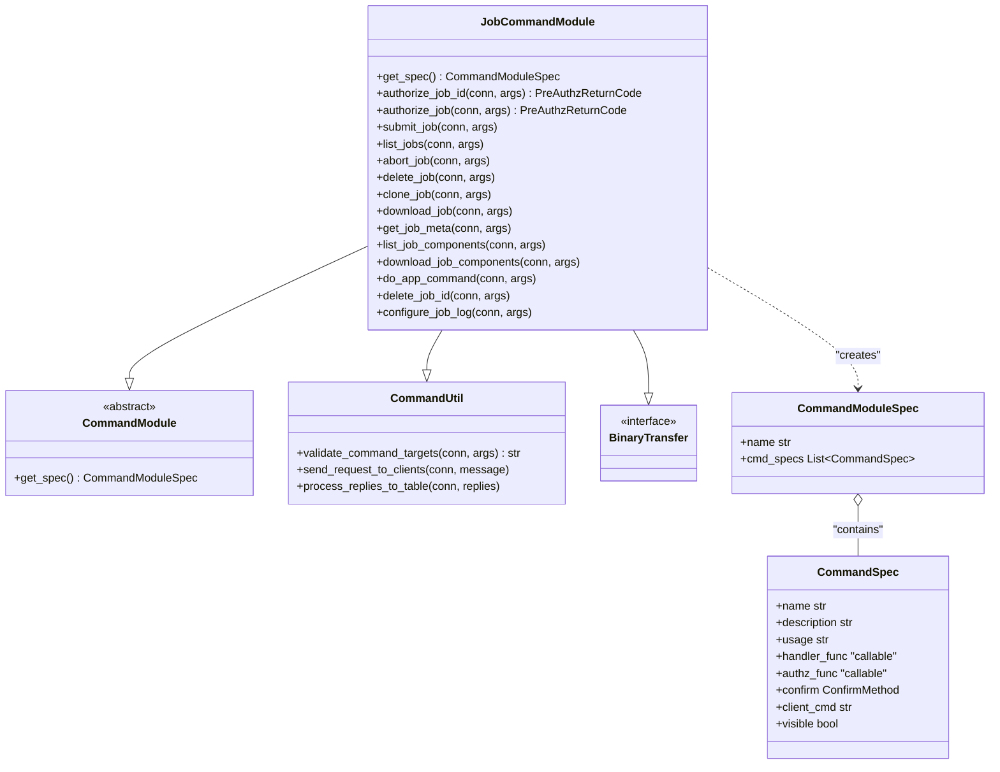
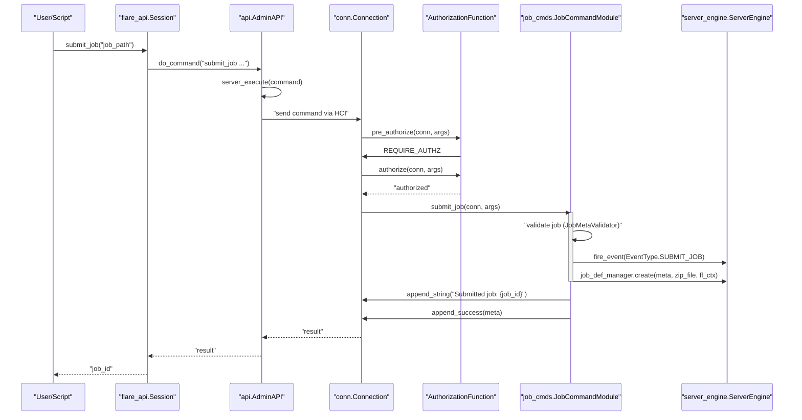
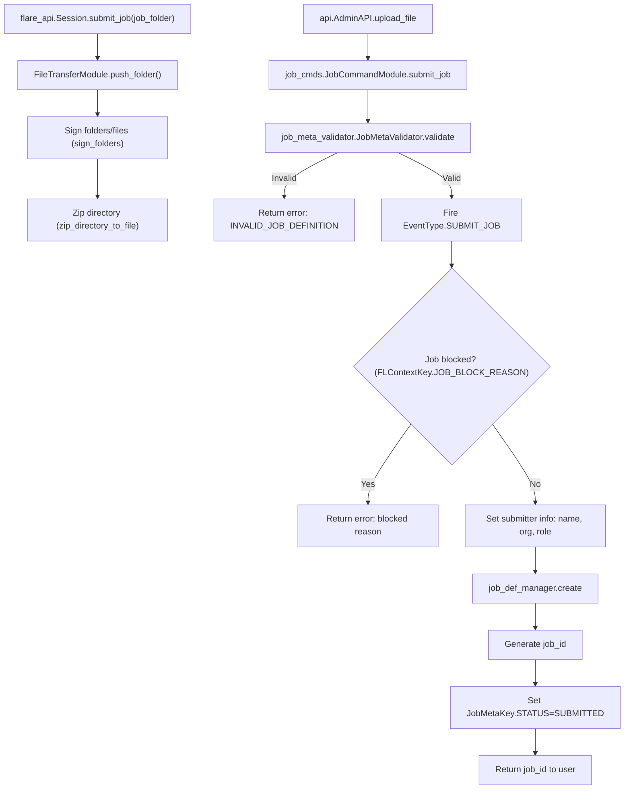
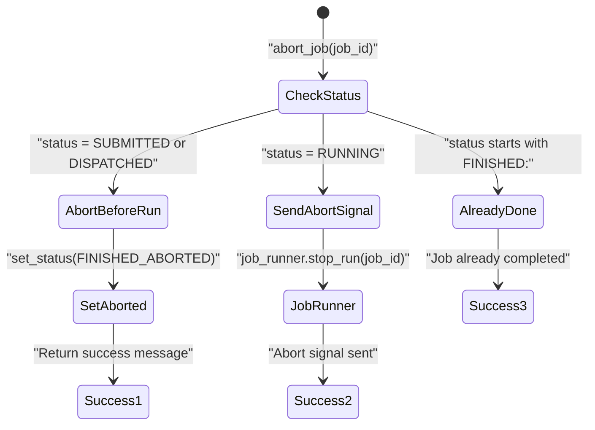
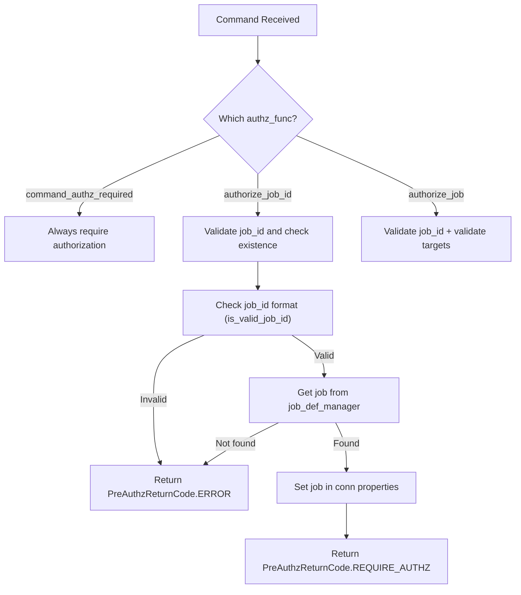

<!-- source: DeepWiki mcp.deepwiki.com · repo NVIDIA/NVFlare · page 8.2 Admin Commands and Job Operations · fetched 2026-10-26 -->

# Admin Commands and Job Operations

<details>
<summary>Relevant source files</summary>

The following files were used as context for generating this wiki page:

- [nvflare/apis/event_type.py](nvflare/apis/event_type.py)
- [nvflare/apis/fl_component.py](nvflare/apis/fl_component.py)
- [nvflare/apis/fl_snapshot.py](nvflare/apis/fl_snapshot.py)
- [nvflare/apis/impl/job_def_manager.py](nvflare/apis/impl/job_def_manager.py)
- [nvflare/apis/job_def.py](nvflare/apis/job_def.py)
- [nvflare/apis/job_def_manager_spec.py](nvflare/apis/job_def_manager_spec.py)
- [nvflare/apis/state_persistor.py](nvflare/apis/state_persistor.py)
- [nvflare/apis/storage.py](nvflare/apis/storage.py)
- [nvflare/apis/utils/fl_context_utils.py](nvflare/apis/utils/fl_context_utils.py)
- [nvflare/app_common/state_persistors/__init__.py](nvflare/app_common/state_persistors/__init__.py)
- [nvflare/app_common/state_persistors/storage_state_persistor.py](nvflare/app_common/state_persistors/storage_state_persistor.py)
- [nvflare/app_common/storages/filesystem_storage.py](nvflare/app_common/storages/filesystem_storage.py)
- [nvflare/fuel/common/exit_codes.py](nvflare/fuel/common/exit_codes.py)
- [nvflare/fuel/f3/cellnet/cell.py](nvflare/fuel/f3/cellnet/cell.py)
- [nvflare/fuel/flare_api/api_spec.py](nvflare/fuel/flare_api/api_spec.py)
- [nvflare/fuel/flare_api/flare_api.py](nvflare/fuel/flare_api/flare_api.py)
- [nvflare/fuel/hci/client/api.py](nvflare/fuel/hci/client/api.py)
- [nvflare/fuel/hci/client/api_spec.py](nvflare/fuel/hci/client/api_spec.py)
- [nvflare/fuel/hci/client/cli.py](nvflare/fuel/hci/client/cli.py)
- [nvflare/fuel/hci/client/file_transfer.py](nvflare/fuel/hci/client/file_transfer.py)
- [nvflare/fuel/hci/file_transfer_defs.py](nvflare/fuel/hci/file_transfer_defs.py)
- [nvflare/fuel/hci/proto.py](nvflare/fuel/hci/proto.py)
- [nvflare/fuel/hci/tools/admin.py](nvflare/fuel/hci/tools/admin.py)
- [nvflare/private/defs.py](nvflare/private/defs.py)
- [nvflare/private/event.py](nvflare/private/event.py)
- [nvflare/private/fed/client/client_req_processors.py](nvflare/private/fed/client/client_req_processors.py)
- [nvflare/private/fed/client/sys_cmd.py](nvflare/private/fed/client/sys_cmd.py)
- [nvflare/private/fed/server/cmd_utils.py](nvflare/private/fed/server/cmd_utils.py)
- [nvflare/private/fed/server/info_coll_cmd.py](nvflare/private/fed/server/info_coll_cmd.py)
- [nvflare/private/fed/server/job_cmds.py](nvflare/private/fed/server/job_cmds.py)
- [nvflare/private/fed/server/run_manager.py](nvflare/private/fed/server/run_manager.py)
- [nvflare/private/fed/server/server_engine_internal_spec.py](nvflare/private/fed/server/server_engine_internal_spec.py)
- [nvflare/private/fed/server/sys_cmd.py](nvflare/private/fed/server/sys_cmd.py)
- [nvflare/private/fed/server/training_cmds.py](nvflare/private/fed/server/training_cmds.py)
- [nvflare/security/security.py](nvflare/security/security.py)
- [nvflare/widgets/info_collector.py](nvflare/widgets/info_collector.py)
- [tests/unit_test/apis/impl/job_def_manager_test.py](tests/unit_test/apis/impl/job_def_manager_test.py)
- [tests/unit_test/app_common/storages/storage_test.py](tests/unit_test/app_common/storages/storage_test.py)
- [tests/unit_test/fuel/flare_api/session_new_methods_test.py](tests/unit_test/fuel/flare_api/session_new_methods_test.py)
- [tests/unit_test/private/fed/server/job_cmds_test.py](tests/unit_test/private/fed/server/job_cmds_test.py)
- [tests/unit_test/tool/cli_errors_test.py](tests/unit_test/tool/cli_errors_test.py)
- [tests/unit_test/tool/job/job_logs_test.py](tests/unit_test/tool/job/job_logs_test.py)

</details>


## Purpose and Scope

This page documents the administrative command system for job management in NVIDIA FLARE, focusing on the server-side command handlers and job operations. It covers how admin commands are defined, executed, and authorized, with particular emphasis on job-related commands like submit, abort, delete, clone, and download.

For information about the three-tier API architecture that provides different abstraction levels for these commands, see [API Layer Hierarchy](#8.1). For details on file transfer protocols used by job submission and download, see [File Transfer Protocol](#8.3). For the authorization and authentication mechanisms, see [Authorization System](#8.4).

---

## Command Module Architecture

Admin commands in NVFLARE are organized into command modules that register and handle specific command types. The `JobCommandModule` is responsible for all job management operations on the server side.

### JobCommandModule Structure

The `JobCommandModule` class implements the command handler for job-related administrative operations. It extends `CommandModule`, `CommandUtil`, and `BinaryTransfer` to provide command registration, utility functions, and binary data handling. [nvflare/private/fed/server/job_cmds.py:146-156]()

Title: "JobCommandModule class structure and relationships"


The module registers the following commands through its `get_spec()` method: [nvflare/private/fed/server/job_cmds.py:157-287]()

| Command Name | Description | Authorization Function | Confirm Method |
|--------------|-------------|----------------------|----------------|
| `delete_workspace` | delete the workspace of a job | `authorize_job` | AUTH |
| `configure_job_log` | configure logging of a running job | `authorize_configure_job_log` | None |
| `list_jobs` | list submitted jobs | `command_authz_required` | None |
| `get_job_log` | get job log text from the server-side log store | `authorize_job_id` | None |
| `get_job_meta` | get metadata of specified job | `authorize_job` | None |
| `list_job` | list additional components of a job | `authorize_job` | None |
| `delete_job` | delete a job and its persisted workspace | `authorize_job` | AUTH |
| `abort_job` | abort a running or dispatched job | `authorize_job` | YESNO |
| `clone_job` | clone a job with a new job_id | `authorize_job` | None |
| `submit_job` | submit a job | `command_authz_required` | None |
| `download_job` | download a specified job | `authorize_job` | None |
| `download_job_components` | download additional job components | `authorize_job` | None |
| `app_command` | execute an app-defined command | `authorize_job_id` | None |

**Sources:** [nvflare/private/fed/server/job_cmds.py:146-287](), [nvflare/fuel/hci/reg.py:65-65]()

---

## Command Execution Flow

Admin commands flow through multiple layers from the client API to the server command handler. The following diagram illustrates this execution path.

Title: "Command execution flow from Session to JobCommandModule"


The execution involves several key steps:

1. **Command Dispatch**: The `AdminAPI.do_command()` method (via ` flare_api.Session.submit_job`) sends the command to the server via `server_execute()`. [nvflare/fuel/hci/client/api.py:638-706](), [nvflare/fuel/flare_api/flare_api.py:307-319]()

2. **Authorization**: The `Connection` object invokes the authorization function specified in the `CommandSpec`. For job commands, this is typically `authorize_job()` or `command_authz_required()`. [nvflare/private/fed/server/job_cmds.py:224-235](), [nvflare/private/fed/server/cmd_utils.py:54-57]()

3. **Handler Execution**: The command handler function (e.g., `submit_job()`) is invoked with the `Connection` and parsed arguments. [nvflare/private/fed/server/job_cmds.py:566-621]()

4. **Job Storage**: The `JobDefManager` (accessible via the engine) persists the job and returns metadata with a generated job ID. [nvflare/private/fed/server/job_cmds.py:608-609]()

5. **Response Building**: The handler appends results to the `Connection`, which are sent back through the API layers to the user.

**Sources:** [nvflare/private/fed/server/job_cmds.py:566-621](), [nvflare/fuel/hci/client/api.py:638-706](), [nvflare/fuel/flare_api/flare_api.py:307-319]()

---

## Job Command Operations

### Submit Job

Job submission is the primary operation for introducing new federated learning jobs into the system. The process involves uploading job content, validation, and storage.

Title: "Job submission workflow"


The `submit_job()` handler performs the following steps:

1. **Upload Reception**: Receives the uploaded zip file location from `ConnProps.FILE_LOCATION` set by the file transfer protocol. [nvflare/private/fed/server/job_cmds.py:568-571]()

2. **Validation**: Uses `JobMetaValidator` to validate the job folder structure and metadata. [nvflare/private/fed/server/job_cmds.py:576-580]()

3. **Event Hook**: Fires `EventType.SUBMIT_JOB` to allow plugins to inspect or block the job. [nvflare/private/fed/server/job_cmds.py:589-597]()

4. **Submitter Tracking**: Records the submitter's name, organization, and role from the connection properties. [nvflare/private/fed/server/job_cmds.py:599-606]()

5. **Persistence**: Calls `job_def_manager.create()` which generates a job ID, sets initial metadata, and stores the job. [nvflare/private/fed/server/job_cmds.py:608-609]()

**Sources:** [nvflare/private/fed/server/job_cmds.py:566-621](), [nvflare/fuel/hci/client/file_transfer.py:96-101](), [nvflare/private/fed/server/job_meta_validator.py:1-50]()

### List Jobs

The `list_jobs()` command retrieves job metadata with flexible filtering and sorting options.

**Command Syntax**:
```
list_jobs [-n name_prefix] [-d] [-u] [-r] [-m num_of_jobs] [--submit-token token] [job_id_prefix]
```

The handler implementation:
1. **Parse Arguments**: Uses `SafeArgumentParser` to parse the command options. [nvflare/private/fed/server/job_cmds.py:320-321]()
2. **Retrieve Jobs**: Gets all jobs from the `job_def_manager`. [nvflare/private/fed/server/job_cmds.py:330-331]()
3. **Filter and Sort**: Applies matching predicates and sorts by submission time. [nvflare/private/fed/server/job_cmds.py:338-347]()
4. **Format Output**: Sends either summary list or detailed list based on `-d` flag. [nvflare/private/fed/server/job_cmds.py:355-358]()

**Sources:** [nvflare/private/fed/server/job_cmds.py:318-369](), [nvflare/private/fed/server/job_cmds.py:115-128]()

### Abort Job

The `abort_job()` command stops a running or dispatched job gracefully.

Title: "Abort job state handling"


The abort handler handles three scenarios:
1. **Pre-Execution Abort**: Directly sets status to `FINISHED_ABORTED` via `job_def_manager`. [nvflare/private/fed/server/job_cmds.py:462-467]()
2. **Active Job Abort**: Calls `JobRunner.stop_run()` to send abort signal to the running server app. [nvflare/private/fed/server/job_cmds.py:473-479]()
3. **Already Finished**: Returns success message indicating job is already complete. [nvflare/private/fed/server/job_cmds.py:468-471]()

**Sources:** [nvflare/private/fed/server/job_cmds.py:452-485]()

### Delete Job

The `delete_job()` command permanently removes a job from the system, including all stored data and workspace.

1. **Retrieve Job**: Gets the job object from connection properties. [nvflare/private/fed/server/job_cmds.py:372-377]()
2. **Status Check**: Ensures job is not currently running. [nvflare/private/fed/server/job_cmds.py:380-385]()
3. **Delete Execution**: Calls `job_def_manager.delete()` which removes the job from storage. [nvflare/private/fed/server/job_cmds.py:392]()

**Sources:** [nvflare/private/fed/server/job_cmds.py:371-400]()

### Clone Job

The `clone_job()` command creates a new job by copying an existing job's content with new metadata.

The cloning process preserves specific metadata fields defined in `CLONED_META_KEYS`. [nvflare/private/fed/server/job_cmds.py:89-102]() The handler implementation filters metadata, sets a new submitter, and calls `job_def_manager.clone()` to copy data. [nvflare/private/fed/server/job_cmds.py:487-517]()

**Sources:** [nvflare/private/fed/server/job_cmds.py:487-517]()

### Download Job

The `download_job()` command retrieves a job's content and workspace. It uses a binary transfer protocol for efficient downloading of `DATA`, `META`, and `WORKSPACE` components. [nvflare/private/fed/server/job_cmds.py:629-679]()

The handler generates a unique transaction ID (`tx_id`), prepares components in a temporary folder, and initiates a transfer using `download_folder()`. [nvflare/private/fed/server/job_cmds.py:649-673]() The client then pulls files via `pull_binary_file()`. [nvflare/fuel/hci/client/file_transfer.py:146-181]()

**Sources:** [nvflare/private/fed/server/job_cmds.py:629-679](), [nvflare/fuel/hci/client/file_transfer.py:146-181]()

### Application Commands

The `do_app_command()` handler allows execution of custom application-defined commands on running jobs. It extracts command data from `ConnProps.CMD_PROPS` and calls `engine.send_app_command()` with the topic and data. [nvflare/private/fed/server/job_cmds.py:711-759]()

**Sources:** [nvflare/private/fed/server/job_cmds.py:711-759]()

---

## Authorization and Validation

Job commands implement a two-phase authorization process: pre-authorization for syntax validation and proper authorization for access control.

### Authorization Functions

Title: "Authorization validation flow"


1. **`authorize_job_id()`**: Validates job ID format using `is_valid_job_id()`, verifies job exists, and stores information in connection properties. [nvflare/private/fed/server/job_cmds.py:193-222]()
2. **`authorize_job()`**: Extends `authorize_job_id()` by also validating command targets (server/client names). [nvflare/private/fed/server/job_cmds.py:224-235](), [nvflare/private/fed/server/cmd_utils.py:73-168]()

**Sources:** [nvflare/private/fed/server/job_cmds.py:193-241](), [nvflare/private/fed/server/cmd_utils.py:73-168]()

---

## API Layer Integration

The job commands can be accessed through multiple API layers:

1. **AdminAPI (Low-Level)**: executes raw command strings via `do_command()`. [nvflare/fuel/hci/client/api.py:638-706]()
2. **AdminClient (CLI)**: provides the interactive command prompt and command dispatch. [nvflare/fuel/hci/client/cli.py:66-126]()

**Sources:** [nvflare/fuel/hci/client/api.py:638-706](), [nvflare/fuel/hci/client/cli.py:66-126]()

---

