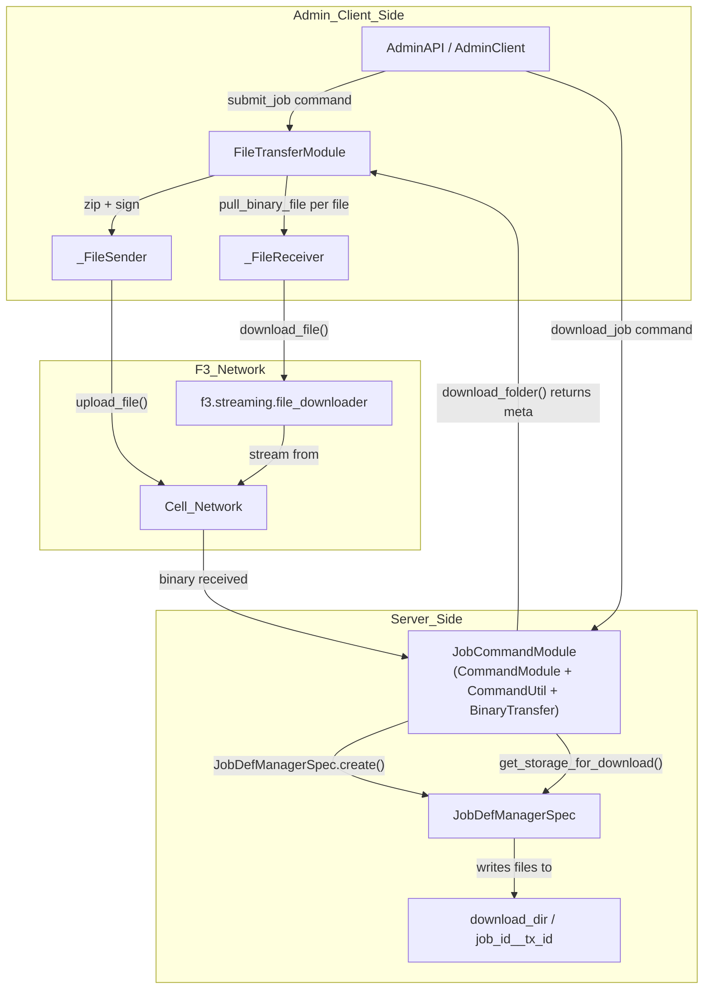
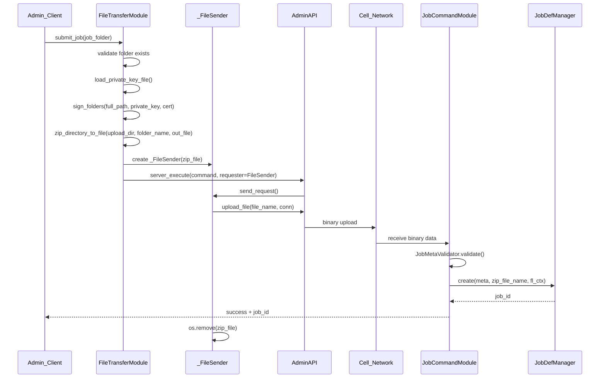
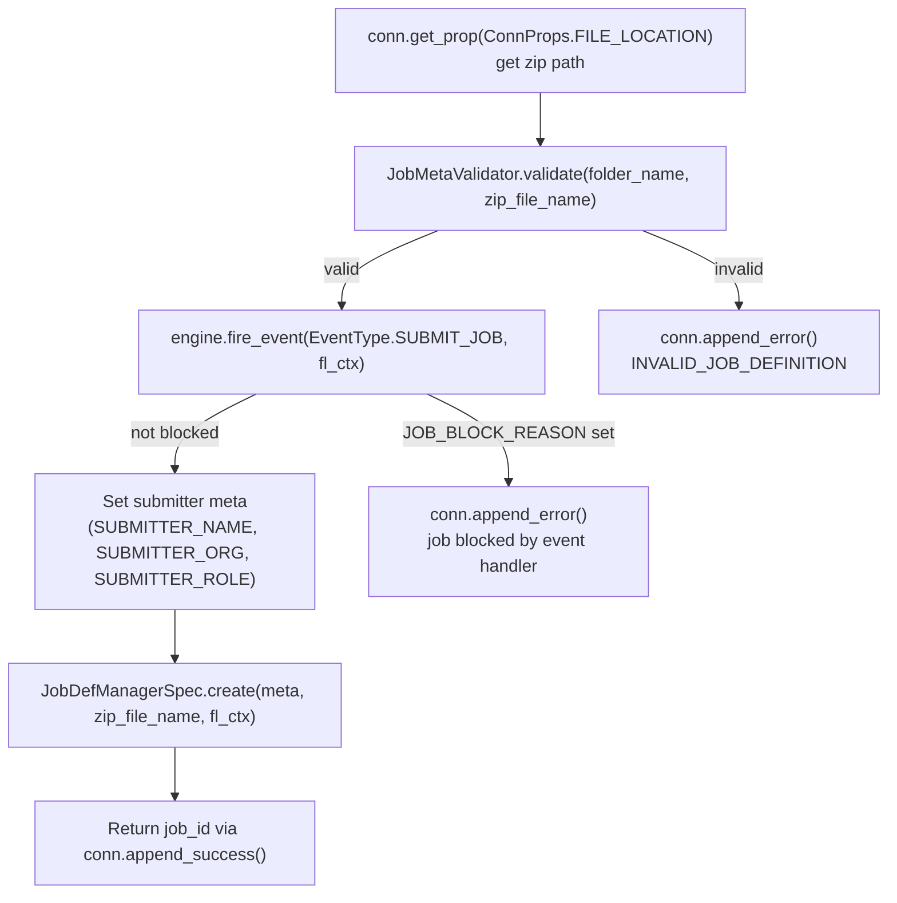
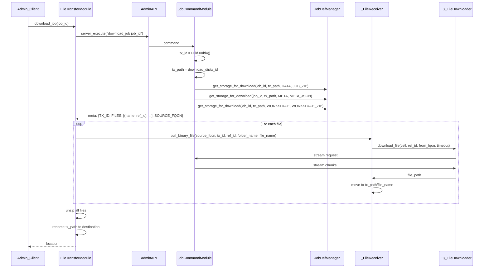
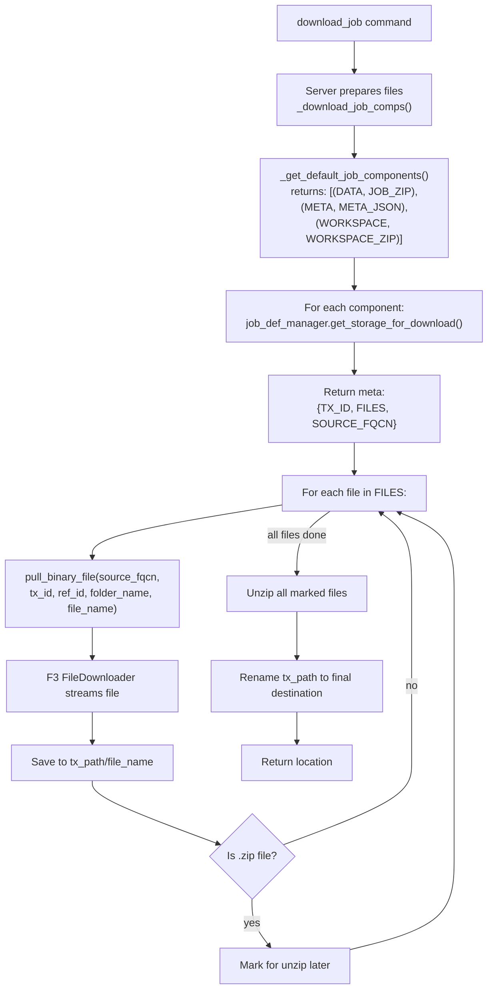
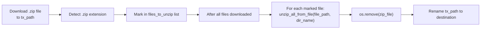
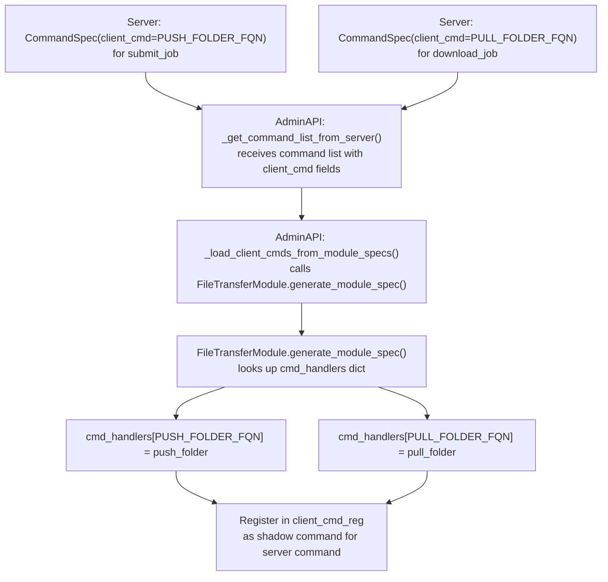

<!-- source: DeepWiki mcp.deepwiki.com · repo NVIDIA/NVFlare · page 8.3 File Transfer Protocol · fetched 2026-10-26 -->

# File Transfer Protocol

<details>
<summary>Relevant source files</summary>

The following files were used as context for generating this wiki page:

- [docs/design/job_process_credential_transport_design.md](docs/design/job_process_credential_transport_design.md)
- [nvflare/apis/fl_snapshot.py](nvflare/apis/fl_snapshot.py)
- [nvflare/apis/impl/job_def_manager.py](nvflare/apis/impl/job_def_manager.py)
- [nvflare/apis/job_def.py](nvflare/apis/job_def.py)
- [nvflare/apis/job_def_manager_spec.py](nvflare/apis/job_def_manager_spec.py)
- [nvflare/apis/job_launcher_spec.py](nvflare/apis/job_launcher_spec.py)
- [nvflare/apis/state_persistor.py](nvflare/apis/state_persistor.py)
- [nvflare/apis/storage.py](nvflare/apis/storage.py)
- [nvflare/app_common/job_launcher/process_launcher.py](nvflare/app_common/job_launcher/process_launcher.py)
- [nvflare/app_common/state_persistors/__init__.py](nvflare/app_common/state_persistors/__init__.py)
- [nvflare/app_common/state_persistors/storage_state_persistor.py](nvflare/app_common/state_persistors/storage_state_persistor.py)
- [nvflare/app_common/storages/filesystem_storage.py](nvflare/app_common/storages/filesystem_storage.py)
- [nvflare/fuel/common/exit_codes.py](nvflare/fuel/common/exit_codes.py)
- [nvflare/fuel/flare_api/api_spec.py](nvflare/fuel/flare_api/api_spec.py)
- [nvflare/fuel/flare_api/flare_api.py](nvflare/fuel/flare_api/flare_api.py)
- [nvflare/fuel/hci/client/api.py](nvflare/fuel/hci/client/api.py)
- [nvflare/fuel/hci/client/api_spec.py](nvflare/fuel/hci/client/api_spec.py)
- [nvflare/fuel/hci/client/cli.py](nvflare/fuel/hci/client/cli.py)
- [nvflare/fuel/hci/client/file_transfer.py](nvflare/fuel/hci/client/file_transfer.py)
- [nvflare/fuel/hci/conn.py](nvflare/fuel/hci/conn.py)
- [nvflare/fuel/hci/file_transfer_defs.py](nvflare/fuel/hci/file_transfer_defs.py)
- [nvflare/fuel/hci/proto.py](nvflare/fuel/hci/proto.py)
- [nvflare/fuel/hci/server/binary_transfer.py](nvflare/fuel/hci/server/binary_transfer.py)
- [nvflare/fuel/hci/server/hci.py](nvflare/fuel/hci/server/hci.py)
- [nvflare/fuel/hci/server/login.py](nvflare/fuel/hci/server/login.py)
- [nvflare/fuel/hci/server/sess.py](nvflare/fuel/hci/server/sess.py)
- [nvflare/fuel/hci/tools/admin.py](nvflare/fuel/hci/tools/admin.py)
- [nvflare/private/fed/app/relay/relay.py](nvflare/private/fed/app/relay/relay.py)
- [nvflare/private/fed/server/client_manager.py](nvflare/private/fed/server/client_manager.py)
- [nvflare/private/fed/server/job_cmds.py](nvflare/private/fed/server/job_cmds.py)
- [nvflare/private/fed/utils/identity_utils.py](nvflare/private/fed/utils/identity_utils.py)
- [tests/unit_test/apis/impl/job_def_manager_test.py](tests/unit_test/apis/impl/job_def_manager_test.py)
- [tests/unit_test/app_common/storages/storage_test.py](tests/unit_test/app_common/storages/storage_test.py)
- [tests/unit_test/fuel/flare_api/session_new_methods_test.py](tests/unit_test/fuel/flare_api/session_new_methods_test.py)
- [tests/unit_test/fuel/hci/phase2_login_study_test.py](tests/unit_test/fuel/hci/phase2_login_study_test.py)
- [tests/unit_test/fuel/hci/session_study_test.py](tests/unit_test/fuel/hci/session_study_test.py)
- [tests/unit_test/private/fed/server/client_manager_test.py](tests/unit_test/private/fed/server/client_manager_test.py)
- [tests/unit_test/private/fed/server/job_cmds_test.py](tests/unit_test/private/fed/server/job_cmds_test.py)
- [tests/unit_test/private/fed/utils/identity_utils_test.py](tests/unit_test/private/fed/utils/identity_utils_test.py)
- [tests/unit_test/tool/cli_errors_test.py](tests/unit_test/tool/cli_errors_test.py)
- [tests/unit_test/tool/job/job_logs_test.py](tests/unit_test/tool/job/job_logs_test.py)

</details>


## Purpose and Scope

This document describes the file transfer protocol used in NVFlare for uploading and downloading jobs and job results between admin clients and the FL server. The protocol handles job submission (push), job result retrieval (pull), and the underlying binary streaming mechanism that enables efficient transfer of large files.

For information about job management and lifecycle, see [Job Lifecycle and States](). For information about the Admin API and command execution, see [API Layer Hierarchy]().

## Overview

The file transfer protocol provides a bidirectional mechanism for exchanging job data between admin clients and the FL server. It operates over the Cell/F3 network layer and employs a transaction-based approach with binary streaming for efficient data transfer.

**Key Characteristics:**
- **Transaction-based**: Downloads use unique transaction IDs (`tx_id`) to manage multi-file transfers [nvflare/private/fed/server/job_cmds.py:647-648]().
- **Binary streaming**: Large files are transferred in chunks with flow control and progress tracking [nvflare/fuel/hci/client/api.py:474-489]().
- **Compression**: Job folders are automatically zipped before transfer [nvflare/fuel/hci/client/file_transfer.py:313-314]().
- **Security**: Uploaded jobs are cryptographically signed before transmission [nvflare/fuel/hci/client/file_transfer.py:308-310]().
- **Asynchronous**: File transfers can happen independently of command execution via the `HCIRequester` pattern [nvflare/fuel/hci/client/file_transfer.py:33-58]().

**Sources:** [nvflare/private/fed/server/job_cmds.py:146-177](), [nvflare/fuel/hci/client/file_transfer.py:63-109](), [nvflare/fuel/hci/client/api.py:474-489]()

## Protocol Architecture

The two sides of the protocol are:

| Side | Key Class | Module |
|------|-----------|--------|
| Client | `FileTransferModule` | `nvflare/fuel/hci/client/file_transfer.py` [nvflare/fuel/hci/client/file_transfer.py:63]() |
| Server | `JobCommandModule` (inherits `BinaryTransfer`) | `nvflare/private/fed/server/job_cmds.py` [nvflare/private/fed/server/job_cmds.py:146]() |

The push/pull command names are defined as constants in `nvflare/fuel/hci/file_transfer_defs.py`:
- `PUSH_FOLDER_FQN` — client-side command for upload (mapped to `push_folder` handler) [nvflare/fuel/hci/file_transfer_defs.py:22]()
- `PULL_FOLDER_FQN` — client-side command for download (mapped to `pull_folder` handler) [nvflare/fuel/hci/file_transfer_defs.py:23]()

### High-Level Flow

**File Transfer Protocol — High-Level Component Interactions**



**Sources:** [nvflare/fuel/hci/client/file_transfer.py:63-109](), [nvflare/private/fed/server/job_cmds.py:146-177](), [nvflare/fuel/hci/file_transfer_defs.py:21-25]()

## Upload Protocol (Push Folder)

### Command Flow

The upload protocol is triggered when an admin client submits a job using the `submit_job` command. The flow involves preparing the job folder, signing it, zipping it, and uploading the binary data to the server.



**Sources:** [nvflare/fuel/hci/client/file_transfer.py:291-321](), [nvflare/private/fed/server/job_cmds.py:564-618]()

### File Preparation

Before upload, the job folder undergoes several preparation steps:

1. **Signature Generation**: The job folder is signed using the admin client's private key [nvflare/fuel/hci/client/file_transfer.py:308-310]().
   - Uses `load_private_key_file()` and `sign_folders()` [nvflare/fuel/hci/client/file_transfer.py:28-29]().
   - Signature files are created in the folder structure.

2. **Compression**: The entire job folder is zipped into a temporary file [nvflare/fuel/hci/client/file_transfer.py:313-314]().
   - Uses `zip_directory_to_file()` from `nvflare.fuel.utils.zip_utils` [nvflare/fuel/hci/client/file_transfer.py:27]().
   - Temporary file created with UUID name in system temp directory [nvflare/fuel/hci/client/file_transfer.py:312]().

3. **Binary Upload**: The zip file is uploaded using the `_FileSender` class [nvflare/fuel/hci/client/file_transfer.py:35-42]().
   - Calls `api.upload_file()` which handles the binary streaming [nvflare/fuel/hci/client/file_transfer.py:40]().
   - Temporary file is deleted after successful upload [nvflare/fuel/hci/client/file_transfer.py:41]().

**Sources:** [nvflare/fuel/hci/client/file_transfer.py:291-321]()

### Server-Side Reception

On the server side, job submission is handled by `JobCommandModule.submit_job()`.

**`submit_job()` — Server-Side Upload Steps**



Key steps:
1. **File Location**: Retrieved from `conn.get_prop(ConnProps.FILE_LOCATION)` [nvflare/private/fed/server/job_cmds.py:566]().
2. **Validation**: `JobMetaValidator.validate()` checks job structure and metadata [nvflare/private/fed/server/job_cmds.py:575]().
3. **Event Firing**: `EventType.SUBMIT_JOB` event allows handlers to block submission via `FLContextKey.JOB_BLOCK_REASON` [nvflare/private/fed/server/job_cmds.py:587-595]().
4. **Metadata**: Submitter info (`SUBMITTER_NAME`, `SUBMITTER_ORG`, `SUBMITTER_ROLE`) is added [nvflare/private/fed/server/job_cmds.py:598-601]().
5. **Storage**: `JobDefManagerSpec.create()` stores the job and extracts the zip [nvflare/private/fed/server/job_cmds.py:606]().

**Sources:** [nvflare/private/fed/server/job_cmds.py:564-618]()

## Download Protocol (Pull Folder)

### Transaction-Based Download

The download protocol uses a transaction-based approach to handle multi-file downloads efficiently. Each download operation is assigned a unique transaction ID (`tx_id`) to isolate concurrent downloads and track progress.



**Sources:** [nvflare/private/fed/server/job_cmds.py:627-677](), [nvflare/fuel/hci/client/file_transfer.py:196-266]()

### Transaction ID Management

Transaction IDs provide isolation and concurrent download support:

**Purpose:**
- **Isolation**: Multiple simultaneous downloads of the same job do not conflict.
- **Cleanup**: Failed downloads can be cleaned up by removing the transaction folder [nvflare/private/fed/server/job_cmds.py:620-625]().
- **Progress Tracking**: Each transaction has its own folder structure.

**Implementation:**

| Component | Code Entity | Location | Description |
|-----------|-------------|----------|-------------|
| TX ID Generation | `uuid.uuid4()` | [nvflare/private/fed/server/job_cmds.py:647]() | New UUID per download |
| TX Path (server) | `BinaryTransfer.tx_path()` | [nvflare/private/fed/server/job_cmds.py:648]() | Returns path under server download dir |
| TX Path (client) | `FileTransferModule._tx_path()` | [nvflare/fuel/hci/client/file_transfer.py:143-144]() | `download_dir/{folder_name}__{tx_id}` |
| Folder Metadata | `download_folder()` in `BinaryTransfer` | [nvflare/private/fed/server/job_cmds.py:667-671]() | Sends `{TX_ID, FILES, SOURCE_FQCN}` to client |
| Cleanup | `_clean_up_download()` | [nvflare/private/fed/server/job_cmds.py:620-625]() | `shutil.rmtree(tx_path)` on error |

The server's `BinaryTransfer.download_folder()` call is what returns the metadata dict containing the `TX_ID`, list of `FILES` (name + ref_id pairs), and `SOURCE_FQCN` to the client, which then initiates individual `pull_binary_file` calls [nvflare/private/fed/server/job_cmds.py:667-671]().

**Sources:** [nvflare/private/fed/server/job_cmds.py:620-677](), [nvflare/fuel/hci/client/file_transfer.py:143-144]()

### Multi-File Download Sequence

Job downloads typically involve three files:
1. **JOB_ZIP**: The job configuration and application data [nvflare/apis/storage.py:53]().
2. **META_JSON**: Job metadata [nvflare/apis/storage.py:55]().
3. **WORKSPACE_ZIP**: Job execution workspace (results, logs, etc.) [nvflare/apis/storage.py:57]().

The download process for each file:



**Sources:** [nvflare/fuel/hci/client/file_transfer.py:196-266](), [nvflare/private/fed/server/job_cmds.py:627-677](), [nvflare/private/fed/server/job_cmds.py:678-679]()

### Download Job Components

In addition to the standard job download, NVFlare supports downloading additional job components (e.g., error logs from specific sites):

**Key Differences from Standard Download:**

| Aspect | Standard Download | Component Download |
|--------|-------------------|-------------------|
| Method | `download_job()` [nvflare/private/fed/server/job_cmds.py:681]() | `download_job_components()` [nvflare/private/fed/server/job_cmds.py:690]() |
| Components | Fixed: DATA, META, WORKSPACE [nvflare/apis/storage.py:51-58]() | Dynamic: filtered from `list_components()` [nvflare/private/fed/server/job_cmds.py:698]() |
| Filter | N/A | Excludes system components: workspace, meta, scheduled, data [nvflare/private/fed/server/job_cmds.py:702]() |
| Use Case | Full job retrieval | Debugging, error logs |

**Component Filtering Logic:**
```python
all_components = job_def_manager.list_components(jid=job_id, fl_ctx=fl_ctx)
filtered = [item for item in all_components 
            if item not in {WORKSPACE, META, "scheduled", DATA} 
            and StorageSpec.is_valid_component(item)]
```

**Sources:** [nvflare/private/fed/server/job_cmds.py:690-708](), [nvflare/private/fed/server/job_cmds.py:417-448]()

## Binary Transfer Mechanism

### F3 File Streaming

The actual file transfer is handled by the F3 (Fast Federated Framework) streaming protocol, which provides efficient binary data transfer over the Cell network.

**AdminAPI Integration:**

The `AdminAPI` class provides the `download_file()` method that interfaces with F3:

```python
def download_file(self, source_fqcn: str, ref_id: str, file_name: str):
    err, file_path = downloader.download_file(
        cell=self.cell,
        ref_id=ref_id,
        from_fqcn=source_fqcn,
        per_request_timeout=self.file_download_progress_timeout,
    )
```

**Key Parameters:**

| Parameter | Type | Description |
|-----------|------|-------------|
| `source_fqcn` | str | Fully Qualified Cell Name of the source (server) |
| `ref_id` | str | Reference ID for the file (unique identifier) |
| `file_name` | str | Destination file path on the client |
| `per_request_timeout` | float | Timeout for each chunk request (progress timeout) |

**Sources:** [nvflare/fuel/hci/client/api.py:474-489]()

### Progress Tracking and Timeouts

The file transfer mechanism includes progress tracking to detect stalled transfers:

**Timeout Configuration:**

| Timeout Type | Config Key | Default | Purpose |
|--------------|-----------|---------|---------|
| File Download Progress | `FILE_DOWNLOAD_PROGRESS_TIMEOUT` | 5.0 seconds | Maximum time between receiving chunks [nvflare/fuel/hci/client/api_spec.py:234]() |
| Login Timeout | `LOGIN_TIMEOUT` | 10.0 seconds | Initial connection timeout [nvflare/fuel/hci/client/cli.py:95]() |
| Authenticate Message | `AUTHENTICATE_MSG_TIMEOUT` | 5.0 seconds | Cell authentication timeout [nvflare/fuel/hci/client/api_spec.py:235]() |

**Progress Timeout Behavior:**
- If no data is received within `per_request_timeout`, the download is considered stalled [nvflare/fuel/hci/client/api.py:474-489]().
- The `FileWaiter` tracks the last progress time [nvflare/fuel/hci/client/api.py:95]().
- Timeout causes the transfer to abort and return an error.

**Sources:** [nvflare/fuel/hci/client/api_spec.py:234](), [nvflare/fuel/hci/client/api.py:474-489]()

### Unzip and File Handling

After downloading zip files, they are unzipped to their final locations:



**Unzip Implementation Details:**
- Unzipping is deferred until after all files are downloaded [nvflare/fuel/hci/client/file_transfer.py:177]().
- This prevents blocking the download of other files during extraction [nvflare/fuel/hci/client/file_transfer.py:177-178]().
- Large files can take significant time to unzip.
- On failure, the entire transaction folder is cleaned up [nvflare/fuel/hci/client/file_transfer.py:251]().

**Sources:** [nvflare/fuel/hci/client/file_transfer.py:171-255]()

## Key Components and Classes

### FileTransferModule

The `FileTransferModule` is a `CommandModule` that provides file transfer commands to the admin client.

**Class Definition:** [nvflare/fuel/hci/client/file_transfer.py:63-322]()

**Key Methods:**

| Method | Purpose | Location |
|--------|---------|----------|
| `push_folder()` | Upload a job folder to the server | [nvflare/fuel/hci/client/file_transfer.py:291-321]() |
| `pull_folder()` | Download a job folder from the server | [nvflare/fuel/hci/client/file_transfer.py:196-266]() |
| `pull_binary_file()` | Download a single binary file | [nvflare/fuel/hci/client/file_transfer.py:146-181]() |
| `info()` | Display upload/download directory configuration | [nvflare/fuel/hci/client/file_transfer.py:286-289]() |
| `generate_module_spec()` | Map server commands to client handlers | [nvflare/fuel/hci/client/file_transfer.py:111-141]() |

**Command Registration:**
```python
cmd_specs=[
    CommandSpec(
        name=self.PULL_BINARY_FILE_CMD,
        description="download one binary files in the download_dir",
        usage="pull_binary source_fqcn tx_id ref_id folder_name file_name",
        handler_func=self.pull_binary_file,
        visible=False,
    ),
    # ... other commands
]
```

**Sources:** [nvflare/fuel/hci/client/file_transfer.py:63-322]()

### JobCommandModule

`JobCommandModule` handles job-related commands on the server side, including file transfers.

**Class signature:** `class JobCommandModule(CommandModule, CommandUtil, BinaryTransfer):` [nvflare/private/fed/server/job_cmds.py:146]()

The `BinaryTransfer` mixin (from `nvflare/fuel/hci/server/binary_transfer`) provides:
- `download_folder()` — sends the file list metadata back to the client [nvflare/private/fed/server/job_cmds.py:667]().
- `tx_path()` — computes the server-side transaction folder path [nvflare/private/fed/server/job_cmds.py:648]().
- `upload_file()` — handles incoming binary upload streams.

**Class Definition:** [nvflare/private/fed/server/job_cmds.py:146-177]()

**File Transfer Methods:**

| Method | Purpose | Location |
|--------|---------|----------|
| `submit_job()` | Receive and store uploaded job | [nvflare/private/fed/server/job_cmds.py:564-618]() |
| `download_job()` | Prepare standard job files for download | [nvflare/private/fed/server/job_cmds.py:681-688]() |
| `download_job_components()` | Prepare additional job components | [nvflare/private/fed/server/job_cmds.py:690-696]() |
| `_download_job_comps()` | Shared download preparation logic | [nvflare/private/fed/server/job_cmds.py:627-677]() |
| `_clean_up_download()` | Remove transaction folder on error | [nvflare/private/fed/server/job_cmds.py:620-625]() |
| `_get_default_job_components()` | Returns standard file component list | [nvflare/private/fed/server/job_cmds.py:678-679]() |
| `_get_extra_job_components()` | Returns non-standard components | [nvflare/private/fed/server/job_cmds.py:698-707]() |

**Authorization:** Both upload and download operations require authorization via `authz_func`. The `client_cmd` field on each `CommandSpec` tells the admin client which `FileTransferModule` handler to invoke:

| Command | `authz_func` | `client_cmd` |
|---------|-------------|--------------|
| `submit_job` | `command_authz_required` | `ftd.PUSH_FOLDER_FQN` [nvflare/private/fed/server/job_cmds.py:161]() |
| `download_job` | `authorize_job` | `ftd.PULL_FOLDER_FQN` [nvflare/private/fed/server/job_cmds.py:169]() |
| `download_job_components` | `authorize_job` | `ftd.PULL_FOLDER_FQN` [nvflare/private/fed/server/job_cmds.py:177]() |

**Sources:** [nvflare/private/fed/server/job_cmds.py:146-177](), [nvflare/private/fed/server/job_cmds.py:564-708]()

### BinaryTransfer

`BinaryTransfer` is a server-side mixin class inherited by `JobCommandModule` [nvflare/private/fed/server/job_cmds.py:146](). It provides the low-level server mechanics for initiating file downloads:

- `download_folder(conn, tx_id, folder_name)` — looks up the files staged in the transaction directory and encodes their names and reference IDs into the response metadata (`MetaKey.FILES`, `MetaKey.TX_ID`, `MetaKey.SOURCE_FQCN`) [nvflare/private/fed/server/job_cmds.py:667-671]().
- `tx_path(conn, tx_id)` — computes the absolute server-side path for the transaction folder [nvflare/private/fed/server/job_cmds.py:648]().
- `upload_file(file_name, conn)` — receives binary file content from the admin client over the Cell network.

The client reads the `FILES` + `TX_ID` + `SOURCE_FQCN` from the response metadata and issues one `pull_binary_file` command per file [nvflare/fuel/hci/client/file_transfer.py:146-181]().

**Sources:** [nvflare/private/fed/server/job_cmds.py:146](), [nvflare/private/fed/server/job_cmds.py:627-677]()

### Helper Classes

**`_FileSender`** [nvflare/fuel/hci/client/file_transfer.py:35-42]()
- Implements `HCIRequester` [nvflare/fuel/hci/client/api_spec.py:244]().
- Called by `push_folder()` to upload the zip file [nvflare/fuel/hci/client/file_transfer.py:316]().
- Calls `api.upload_file(file_name, conn)` then `os.remove()` on the temp file [nvflare/fuel/hci/client/file_transfer.py:40-41]().

**`_FileReceiver`** [nvflare/fuel/hci/client/file_transfer.py:45-60]()
- Implements `HCIRequester` [nvflare/fuel/hci/client/api_spec.py:244]().
- Called by `pull_binary_file()` to download one file per transaction [nvflare/fuel/hci/client/file_transfer.py:161]().
- Calls `api.download_file(source_fqcn, ref_id, file_name)` [nvflare/fuel/hci/client/file_transfer.py:53]().
- Stores `num_bytes_received` for progress reporting [nvflare/fuel/hci/client/file_transfer.py:53]().

**`HCIRequester` Pattern:**

```
CommandContext.set_requester(sender_or_receiver)
AdminAPI.server_execute(command, cmd_ctx=ctx)
  → requester.send_request(api, conn, cmd_ctx)
```

This pattern allows file transfer objects to inject custom binary I/O into the normal command execution flow without changing the command dispatch path [nvflare/fuel/hci/client/api_spec.py:244-248]().

**Sources:** [nvflare/fuel/hci/client/file_transfer.py:35-60](), [nvflare/fuel/hci/client/api_spec.py:244-248]()

## Command Integration

### Command Registration Flow

File transfer commands are integrated into the admin command system through a dynamic registration process. When the admin client fetches the server command list, it maps each server command's `client_cmd` field to a local `FileTransferModule` handler.

**`CommandSpec` client_cmd → FileTransferModule handler mapping**



**Handler Mapping in `FileTransferModule.__init__()`:**

```python
self.cmd_handlers = {
    ftd.PUSH_FOLDER_FQN: self.push_folder,
    ftd.PULL_FOLDER_FQN: self.pull_folder,
}
```

When a user runs `submit_job`, the admin client's command dispatcher routes it to `push_folder` [nvflare/fuel/hci/client/file_transfer.py:79-80](). When the user runs `download_job`, it routes to `pull_folder` [nvflare/fuel/hci/client/file_transfer.py:81](), which then orchestrates the per-file `pull_binary_file` sub-commands.

**Sources:** [nvflare/fuel/hci/client/file_transfer.py:79-141](), [nvflare/private/fed/server/job_cmds.py:161-177](), [nvflare/fuel/hci/file_transfer_defs.py:21-25]()

### Command Execution Context

File transfer commands use the `CommandContext` to pass information between layers:

**Key Context Properties:**

| Property | Key | Usage |
|----------|-----|-------|
| Command | `CommandCtxKey.CMD` | The full command string [nvflare/fuel/hci/client/api_spec.py:60]() |
| API | `CommandCtxKey.API` | Reference to AdminAPI instance [nvflare/fuel/hci/client/api_spec.py:57]() |
| Entry | `CommandCtxKey.CMD_ENTRY` | CommandEntry with usage info [nvflare/fuel/hci/client/api_spec.py:81]() |
| Requester | `CommandCtxKey.REQUESTER` | _FileSender or _FileReceiver [nvflare/fuel/hci/client/api_spec.py:45]() |
| Result | `CommandCtxKey.RESULT` | Command execution result [nvflare/fuel/hci/client/api_spec.py:51]() |
| Meta | `CommandCtxKey.META` | Metadata (tx_id, files, etc.) [nvflare/fuel/hci/client/api_spec.py:99]() |

**Requester Pattern:**
The `HCIRequester` interface allows file transfer objects to inject custom behavior into command execution:

```python
ctx.set_requester(sender)
return api.server_execute(command, cmd_ctx=ctx)

# In AdminAPI:
requester = ctx.get_requester()
if requester:
    result = requester.send_request(api, conn, cmd_ctx)
```

**Sources:** [nvflare/fuel/hci/client/api_spec.py:24-118](), [nvflare/fuel/hci/client/file_transfer.py:319-321]()

---

