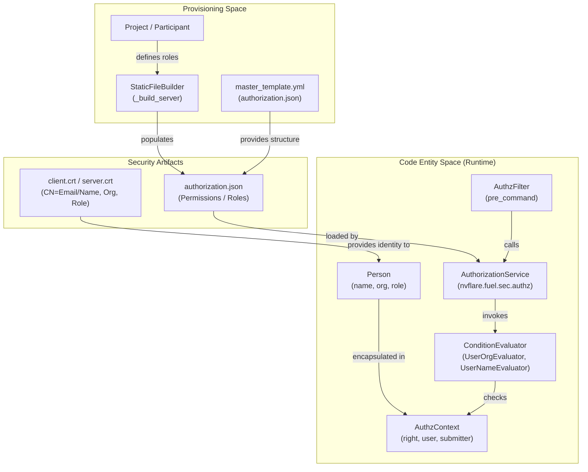
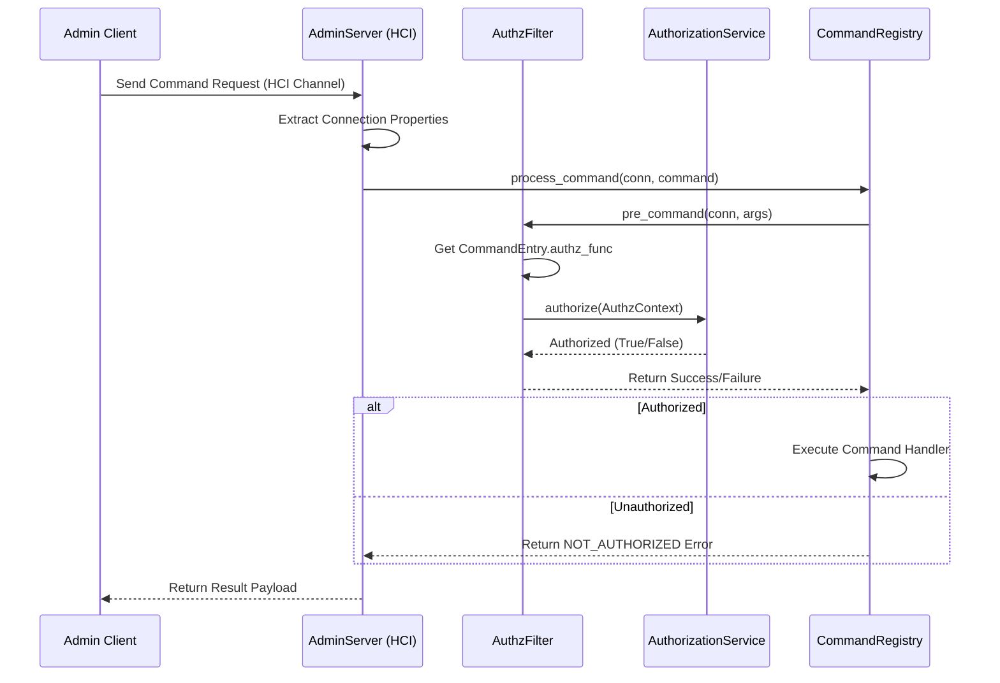

<!-- source: DeepWiki mcp.deepwiki.com · repo NVIDIA/NVFlare · page 8.4 Authorization System · fetched 2026-10-26 -->

# Authorization System

Relevant source files

The following files were used as context for generating this wiki page:

- [docs/user_guide/admin_guide/security/unsafe_component_detection.rst](docs/user_guide/admin_guide/security/unsafe_component_detection.rst)
- [docs/user_guide/nvflare_cli/provision_command.rst](docs/user_guide/nvflare_cli/provision_command.rst)
- [nvflare/apis/event_type.py](nvflare/apis/event_type.py)
- [nvflare/apis/fl_component.py](nvflare/apis/fl_component.py)
- [nvflare/apis/utils/fl_context_utils.py](nvflare/apis/utils/fl_context_utils.py)
- [nvflare/apis/utils/format_check.py](nvflare/apis/utils/format_check.py)
- [nvflare/app_common/default_component_policy.py](nvflare/app_common/default_component_policy.py)
- [nvflare/app_common/widgets/component_path_authorizer.py](nvflare/app_common/widgets/component_path_authorizer.py)
- [nvflare/edge/simulation/README.md](nvflare/edge/simulation/README.md)
- [nvflare/fuel/f3/cellnet/cell.py](nvflare/fuel/f3/cellnet/cell.py)
- [nvflare/fuel/hci/server/authz.py](nvflare/fuel/hci/server/authz.py)
- [nvflare/fuel/sec/authz.py](nvflare/fuel/sec/authz.py)
- [nvflare/lighter/constants.py](nvflare/lighter/constants.py)
- [nvflare/lighter/ctx.py](nvflare/lighter/ctx.py)
- [nvflare/lighter/dummy_project.yml](nvflare/lighter/dummy_project.yml)
- [nvflare/lighter/edge_project.yml](nvflare/lighter/edge_project.yml)
- [nvflare/lighter/entity.py](nvflare/lighter/entity.py)
- [nvflare/lighter/impl/cert.py](nvflare/lighter/impl/cert.py)
- [nvflare/lighter/impl/docker.py](nvflare/lighter/impl/docker.py)
- [nvflare/lighter/impl/static_file.py](nvflare/lighter/impl/static_file.py)
- [nvflare/lighter/provision.py](nvflare/lighter/provision.py)
- [nvflare/lighter/provisioner.py](nvflare/lighter/provisioner.py)
- [nvflare/lighter/templates/master_template.yml](nvflare/lighter/templates/master_template.yml)
- [nvflare/lighter/tree_prov.py](nvflare/lighter/tree_prov.py)
- [nvflare/private/defs.py](nvflare/private/defs.py)
- [nvflare/private/event.py](nvflare/private/event.py)
- [nvflare/private/fed/client/client_req_processors.py](nvflare/private/fed/client/client_req_processors.py)
- [nvflare/private/fed/client/sys_cmd.py](nvflare/private/fed/client/sys_cmd.py)
- [nvflare/private/fed/server/cmd_utils.py](nvflare/private/fed/server/cmd_utils.py)
- [nvflare/private/fed/server/info_coll_cmd.py](nvflare/private/fed/server/info_coll_cmd.py)
- [nvflare/private/fed/server/run_manager.py](nvflare/private/fed/server/run_manager.py)
- [nvflare/private/fed/server/server_engine_internal_spec.py](nvflare/private/fed/server/server_engine_internal_spec.py)
- [nvflare/private/fed/server/sys_cmd.py](nvflare/private/fed/server/sys_cmd.py)
- [nvflare/private/fed/server/training_cmds.py](nvflare/private/fed/server/training_cmds.py)
- [nvflare/private/fed/utils/site_config.py](nvflare/private/fed/utils/site_config.py)
- [nvflare/security/security.py](nvflare/security/security.py)
- [nvflare/widgets/info_collector.py](nvflare/widgets/info_collector.py)
- [tests/unit_test/app_common/widgets/component_path_authorizer_test.py](tests/unit_test/app_common/widgets/component_path_authorizer_test.py)
- [tests/unit_test/fuel/flare_api_test.py](tests/unit_test/fuel/flare_api_test.py)
- [tests/unit_test/fuel/hci/server/authz_filter_test.py](tests/unit_test/fuel/hci/server/authz_filter_test.py)
- [tests/unit_test/lighter/__init__.py](tests/unit_test/lighter/__init__.py)
- [tests/unit_test/lighter/cert_builder_test.py](tests/unit_test/lighter/cert_builder_test.py)
- [tests/unit_test/lighter/participant_test.py](tests/unit_test/lighter/participant_test.py)
- [tests/unit_test/lighter/project_test.py](tests/unit_test/lighter/project_test.py)
- [tests/unit_test/lighter/static_file_builder_test.py](tests/unit_test/lighter/static_file_builder_test.py)
- [tests/unit_test/private/fed/utils/site_config_test.py](tests/unit_test/private/fed/utils/site_config_test.py)

## Purpose and Scope

The Authorization System in NVIDIA FLARE controls access to administrative commands, job operations, and system resources. This document covers authentication via certificates, authorization functions, Role-Based Access Control (RBAC), and the implementation of command-level access control within the server infrastructure.

The system is designed to handle both interactive CLI usage via the admin console and programmatic access via the Session API. It ensures that only authenticated and authorized participants (Servers, Clients, and Admins) can interact with the federated network by leveraging identities embedded in certificates [nvflare/lighter/templates/master_template.yml:18-20]().

---

## Authorization Architecture Overview

The authorization system is built upon a foundation of mutual TLS (mTLS) for authentication and a structured policy engine for authorization. Authorization decisions are based on the identity and role embedded in the participant's certificate [nvflare/lighter/templates/master_template.yml:18-20]().

**Authorization Architecture Components**

**Sources:** [nvflare/fuel/sec/authz.py:40-75](), [nvflare/fuel/hci/server/authz.py:44-60](), [nvflare/lighter/impl/static_file.py:122-124](), [nvflare/lighter/templates/master_template.yml:52-53]()

---

## Authentication and Identity

NVIDIA FLARE uses X.509 certificates to establish identity. During provisioning, the system generates a certificate chain for every participant [nvflare/lighter/templates/master_template.yml:7-9]().

### Identity and Certificates
*   **Admin Client**: Identities are embedded in the CN field of the client certificate, which uniquely identifies the participant [nvflare/lighter/templates/master_template.yml:18-19]().
*   **Federated Client**: The client name is embedded in the CN field [nvflare/lighter/templates/master_template.yml:40-41]().
*   **Server**: The server identity is configured in the `fed_client.json` of connecting clients [nvflare/lighter/templates/master_template.yml:116-116]().

### Connection Properties
Identity information is carried through the system using `ConnProps` and `RequestHeader` fields:
*   `USER_NAME`, `USER_ORG`, `USER_ROLE` [nvflare/private/defs.py:87-89]().
*   `SUBMITTER_NAME`, `SUBMITTER_ORG`, `SUBMITTER_ROLE` [nvflare/private/defs.py:90-92]().

**Sources:** [nvflare/lighter/templates/master_template.yml:1-42](), [nvflare/private/defs.py:87-92](), [nvflare/lighter/impl/cert.py:100-117]()

---

## Policy Evaluation Engine

The core of the authorization system is the `AuthorizationService` and its evaluation logic. It uses a "Rights" based system where roles are mapped to specific permissions (rights).

**Key Evaluation Classes**

*   **`Person`**: Represents the identity of the user, including their name, organization, and assigned role [nvflare/fuel/sec/authz.py:41-45]().
*   **`AuthzContext`**: Contains the "Right" being requested and the `Person` (user) requesting it. It may also include a "Submitter" `Person` for job-ownership checks [nvflare/fuel/sec/authz.py:56-68]().
*   **`ConditionEvaluator`**: An abstract base class for logic that determines if a condition is met [nvflare/fuel/sec/authz.py:77-80]().
    *   **`UserOrgEvaluator`**: Checks if the user's organization matches a target (e.g., the site's org or the submitter's org) [nvflare/fuel/sec/authz.py:83-94]().
    *   **`UserNameEvaluator`**: Checks if the user's name matches a specific identity [nvflare/fuel/sec/authz.py:96-104]().

**Sources:** [nvflare/fuel/sec/authz.py:41-104]()

---

## Component Path Authorization

To prevent the execution of malicious code, NVIDIA FLARE implements a built-in path authorizer for non-BYOC (Bring Your Own Code) jobs.

**Implementation Details**
1.  **`class_allow_list`**: A list of allowed component path prefixes (e.g., `nvflare.app_common.`) [nvflare/lighter/templates/master_template.yml:70-70]().
2.  **Enforcement**: The `class_list_enforcement_mode` can be set to `enforce` or `warn` [nvflare/lighter/templates/master_template.yml:69-69]().
3.  **Default Policy**: A curated list of safe components is provided in `DEFAULT_CLASS_ALLOW_LIST` [nvflare/app_common/default_component_policy.py:20-20]().
4.  **Static Validation**: The `StaticFileBuilder` renders these policies into `resources.json.default` for both servers and clients [nvflare/lighter/impl/static_file.py:688-692]().

**Sources:** [nvflare/app_common/default_component_policy.py:20-20](), [nvflare/lighter/templates/master_template.yml:66-104](), [nvflare/lighter/impl/static_file.py:688-700]()

---

## Command-Level Access Control

Administrative commands are secured by verifying the requester's identity against the server's authorization policy. Commands define their required authorization via `authz_func` in their `CommandSpec` [nvflare/private/fed/server/training_cmds.py:57-57]().

**Runtime Authorization Flow**

### Authorization Functions
Commands use specific utility functions to determine access:
*   **`authorize_server_operation`**: Used for commands like `check_status` or `shutdown` [nvflare/private/fed/server/training_cmds.py:57-57]().
*   **`authorize_client_operation`**: Validates targets and checks if the site is enrolled in the active study [nvflare/private/fed/server/cmd_utils.py:59-71]().
*   **`must_be_project_admin`**: Restricts sensitive commands (e.g., `admin_check_status`) to users with the `project_admin` role [nvflare/private/fed/server/cmd_utils.py:170-176]().

**Sources:** [nvflare/fuel/hci/server/authz.py:44-95](), [nvflare/private/fed/server/training_cmds.py:48-121](), [nvflare/private/fed/server/cmd_utils.py:54-176]()

---

## Study-Based Access Control

In advanced deployments, access can be restricted by "Studies." A `StudyRegistry` defines which organizations and admin users are allowed to interact with specific clients within a study scope [nvflare/lighter/provision.py:73-135]().

**Study Validation Flow**
1.  **Registry Loading**: The server loads a `study_registry.json` if studies are defined in the project configuration [nvflare/lighter/impl/static_file.py:124-129]().
2.  **Target Filtering**: When a command targets specific clients, the `validate_command_targets` function checks if those clients are enrolled in the user's active study [nvflare/private/fed/server/cmd_utils.py:145-168]().
3.  **Enforcement**: If a user attempts to target a site not enrolled in their study, the command is rejected with an error message [nvflare/private/fed/server/cmd_utils.py:160-163]().

**Sources:** [nvflare/lighter/provision.py:73-135](), [nvflare/private/fed/server/cmd_utils.py:145-168](), [nvflare/lighter/impl/static_file.py:124-129]()

---

## Secure Communication Settings

The authorization system is underpinned by connection security settings defined during provisioning.

| Security Level | Description | Code Constant |
| :--- | :--- | :--- |
| **CLEAR** | No encryption or authentication | `ConnSecurity.CLEAR` [nvflare/lighter/constants.py:107]() |
| **TLS** | Encrypted communication, server authentication | `ConnSecurity.TLS` [nvflare/lighter/constants.py:108]() |
| **MTLS** | Encrypted, mutual authentication (Server & Client) | `ConnSecurity.MTLS` [nvflare/lighter/constants.py:109]() |

The `StaticFileBuilder` determines the scheme (e.g., `grpc`, `tcp`, `http`) and security level for each participant based on the `project.yml` [nvflare/lighter/impl/static_file.py:113-128]().

**Sources:** [nvflare/lighter/constants.py:106-110](), [nvflare/lighter/impl/static_file.py:113-128](), [nvflare/lighter/impl/cert.py:1-29]()

---

