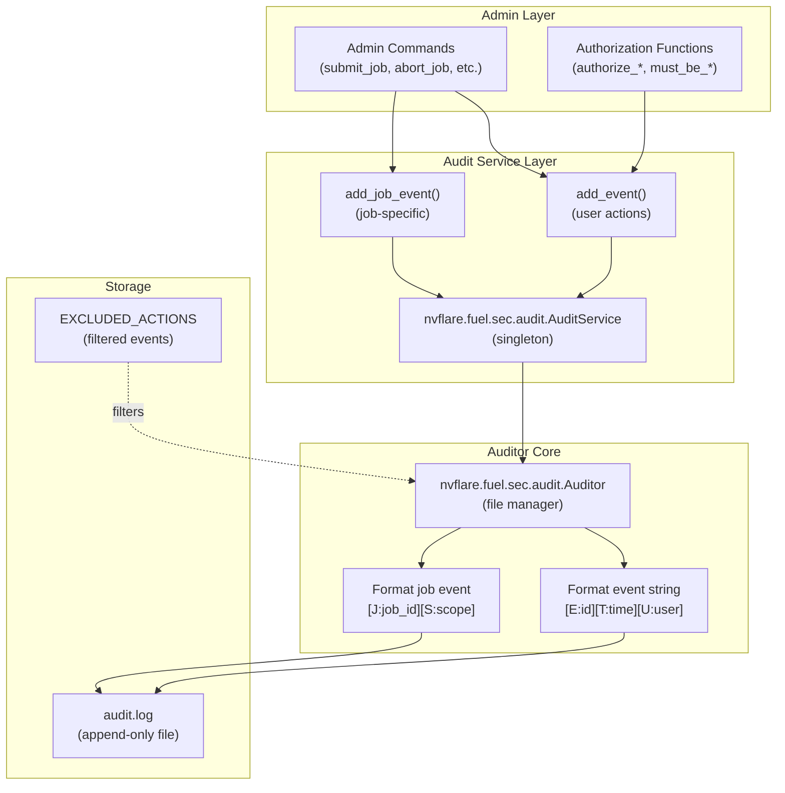
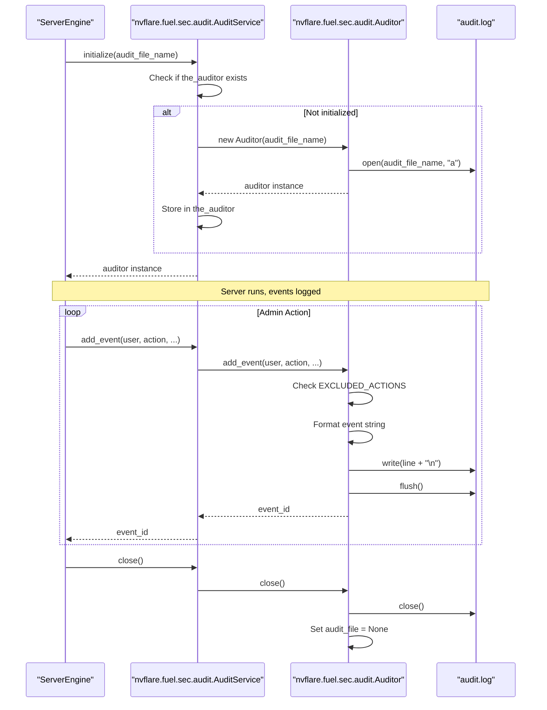

<!-- source: DeepWiki mcp.deepwiki.com · repo NVIDIA/NVFlare · page 8.5 Audit Logging · fetched 2026-10-26 -->

# Audit Logging

Relevant source files

The following files were used as context for generating this wiki page:

- [docs/programming_guide/live_log_streaming.rst](docs/programming_guide/live_log_streaming.rst)
- [docs/user_guide/admin_guide/configurations/site_config.rst](docs/user_guide/admin_guide/configurations/site_config.rst)
- [examples/tutorials/self-paced-training/part-3_security_and_privacy/chapter-6_Security_in_federated_compute_system/06.3_customized_site_security/custom_client_side_job_level_authorization/security/site-1/resources.json](examples/tutorials/self-paced-training/part-3_security_and_privacy/chapter-6_Security_in_federated_compute_system/06.3_customized_site_security/custom_client_side_job_level_authorization/security/site-1/resources.json)
- [nvflare/apis/impl/any_relay_manager.py](nvflare/apis/impl/any_relay_manager.py)
- [nvflare/apis/impl/seq_relay_manager.py](nvflare/apis/impl/seq_relay_manager.py)
- [nvflare/app_common/aggregators/accumulate_model_aggregator.py](nvflare/app_common/aggregators/accumulate_model_aggregator.py)
- [nvflare/app_common/filters/convert_weights.py](nvflare/app_common/filters/convert_weights.py)
- [nvflare/app_common/filters/exclude_vars.py](nvflare/app_common/filters/exclude_vars.py)
- [nvflare/app_common/filters/percentile_privacy.py](nvflare/app_common/filters/percentile_privacy.py)
- [nvflare/app_common/filters/svt_privacy.py](nvflare/app_common/filters/svt_privacy.py)
- [nvflare/app_common/homomorphic_encryption/he_intime_accumulate_model_aggregator.py](nvflare/app_common/homomorphic_encryption/he_intime_accumulate_model_aggregator.py)
- [nvflare/app_common/logging/README.md](nvflare/app_common/logging/README.md)
- [nvflare/app_common/logging/constants.py](nvflare/app_common/logging/constants.py)
- [nvflare/app_common/logging/job_log_receiver.py](nvflare/app_common/logging/job_log_receiver.py)
- [nvflare/app_common/logging/job_log_streamer.py](nvflare/app_common/logging/job_log_streamer.py)
- [nvflare/app_common/pt/pt_fedopt.py](nvflare/app_common/pt/pt_fedopt.py)
- [nvflare/app_common/streamers/log_streamer.py](nvflare/app_common/streamers/log_streamer.py)
- [nvflare/fuel/sec/audit.py](nvflare/fuel/sec/audit.py)
- [tests/unit_test/app_common/logging/job_log_receiver_test.py](tests/unit_test/app_common/logging/job_log_receiver_test.py)
- [tests/unit_test/app_common/logging/job_log_streamer_test.py](tests/unit_test/app_common/logging/job_log_streamer_test.py)
- [tests/unit_test/app_common/streamers/log_streamer_test.py](tests/unit_test/app_common/streamers/log_streamer_test.py)

This page documents the audit logging system in NVIDIA FLARE, which provides a comprehensive event trail for security, compliance, and troubleshooting purposes. The audit system records user actions, job events, and system operations to an append-only log file.

For information about authorization and access control that precedes audit logging, see [Authorization System](#8.4). For information about admin commands that generate audit events, see [Admin Commands and Job Operations](#8.2).

## Overview

The audit logging system consists of two primary components that work together to capture events throughout the FLARE runtime:

1.  **`Auditor`**: Low-level class that manages the physical audit log file and event formatting [nvflare/fuel/sec/audit.py:27-88]().
2.  **`AuditService`**: Singleton service providing a global interface for adding audit events [nvflare/fuel/sec/audit.py:90-125]().

The system is initialized once during server startup and maintains an append-only log file throughout the server lifecycle. All administrative actions, job operations, and significant system events are automatically recorded with timestamps, user identities, and contextual information.

**Sources:** [nvflare/fuel/sec/audit.py:1-125]()

## System Architecture

The following diagram illustrates the flow from administrative actions to the physical log file, highlighting the key code entities involved.

### Audit Data Flow

**Sources:** [nvflare/fuel/sec/audit.py:27-125]()

## Core Components

### Auditor Class

The `Auditor` class manages the physical audit log file and handles event serialization. It is initialized with a file path and maintains an open file handle for efficient append operations [nvflare/fuel/sec/audit.py:27-39]().

| Method | Parameters | Purpose |
| :--- | :--- | :--- |
| `__init__` | `audit_file_name: str` | Opens or creates the audit log file in append mode [nvflare/fuel/sec/audit.py:28-39]() |
| `add_event` | `user, action, ref, msg` | Records a user action event [nvflare/fuel/sec/audit.py:41-63]() |
| `add_job_event` | `job_id, scope_name, task_name, task_id, ref, msg` | Records a job-specific event [nvflare/fuel/sec/audit.py:65-82]() |
| `close` | None | Flushes and closes the audit file [nvflare/fuel/sec/audit.py:84-88]() |

The class opens the audit file in append mode (`"a"`) to ensure events are never lost even if the process restarts [nvflare/fuel/sec/audit.py:39](). Each event is immediately flushed to disk for durability [nvflare/fuel/sec/audit.py:61-62]().

**Sources:** [nvflare/fuel/sec/audit.py:27-88]()

### AuditService Singleton

The `AuditService` class provides a global singleton interface for audit logging throughout the FLARE codebase. It maintains a single `Auditor` instance in the class variable `the_auditor` [nvflare/fuel/sec/audit.py:90-93]().

| Static Method | Purpose |
| :--- | :--- |
| `initialize` | Creates the singleton `Auditor` instance [nvflare/fuel/sec/audit.py:96-99]() |
| `get_auditor` | Returns the current `Auditor` instance [nvflare/fuel/sec/audit.py:101-103]() |
| `add_event` | Forwards to `Auditor.add_event` [nvflare/fuel/sec/audit.py:105-110]() |
| `add_job_event` | Forwards to `Auditor.add_job_event` [nvflare/fuel/sec/audit.py:112-119]() |
| `close` | Closes the `Auditor` instance [nvflare/fuel/sec/audit.py:121-125]() |

The singleton pattern ensures all components write to the same audit file without requiring dependency injection of the auditor instance.

**Sources:** [nvflare/fuel/sec/audit.py:90-125]()

## Event Types and Formats

### User Action Events

User action events record administrative operations performed by authenticated users. The format is:

`[E:event_id][R:ref][T:timestamp][U:user][A:action] message` [nvflare/fuel/sec/audit.py:51-60]()

**Field Descriptions:**

| Field | Format | Description |
| :--- | :--- | :--- |
| `E` | UUID v4 | Unique event identifier [nvflare/fuel/sec/audit.py:50]() |
| `R` | String | Reference ID linking related events (optional) [nvflare/fuel/sec/audit.py:52-53]() |
| `T` | ISO timestamp | Event occurrence time [nvflare/fuel/sec/audit.py:54]() |
| `U` | String | Username or identity [nvflare/fuel/sec/audit.py:55]() |
| `A` | String | Action identifier [nvflare/fuel/sec/audit.py:56]() |
| Message | Free text | Additional context (optional) [nvflare/fuel/sec/audit.py:57-58]() |

**Sources:** [nvflare/fuel/sec/audit.py:41-63]()

### Job Execution Events

Job events track the lifecycle and operations of federated learning jobs:

`[E:event_id][R:ref][T:timestamp][S:scope_name][J:job_id][A:task_name#task_id] message` [nvflare/fuel/sec/audit.py:69-79]()

**Field Descriptions:**

| Field | Format | Description |
| :--- | :--- | :--- |
| `E` | UUID v4 | Unique event identifier [nvflare/fuel/sec/audit.py:68]() |
| `R` | String | Reference ID (optional) [nvflare/fuel/sec/audit.py:70-71]() |
| `T` | ISO timestamp | Event occurrence time [nvflare/fuel/sec/audit.py:72]() |
| `S` | String | FL scope name (optional) [nvflare/fuel/sec/audit.py:73-74]() |
| `J` | String | Job identifier [nvflare/fuel/sec/audit.py:75]() |
| `A` | String | Task name and task ID in format `task#id` [nvflare/fuel/sec/audit.py:76]() |
| Message | Free text | Additional context (optional) [nvflare/fuel/sec/audit.py:77-78]() |

**Sources:** [nvflare/fuel/sec/audit.py:65-82]()

## Event Filtering

Certain high-frequency or low-value actions are excluded from audit logging to reduce log volume. The exclusion list is defined in `EXCLUDED_ACTIONS` [nvflare/fuel/sec/audit.py:19-24]():

| Excluded Action | Reason |
| :--- | :--- |
| `scheduler.check_resource` | High-frequency health check |
| `_check_session` | Internal session validation |
| `_commands` | Internal command listing |
| `__aux_command__` | Internal auxiliary messaging |

The filtering occurs in the `add_event` method before any file I/O [nvflare/fuel/sec/audit.py:43-44]().

**Sources:** [nvflare/fuel/sec/audit.py:19-24](), [nvflare/fuel/sec/audit.py:43-44]()

## Real-Time Job Log Streaming

Beyond static audit trails, NVIDIA FLARE supports real-time log streaming from clients to the server for live monitoring. This allows administrators to `tail -f` client logs from the server-side workspace [docs/programming_guide/live_log_streaming.rst:7-10]().

### Log Streaming Architecture

The following diagram maps the high-level streaming concepts to the internal code entities and data flow.

```mermaid
graph LR
    subgraph "Client Side (Site)"
        JLS["nvflare.app_common.logging.job_log_streamer.JobLogStreamer"]
        LTP["nvflare.app_common.streamers.log_streamer._LogTailProducer"]
    end

    subgraph "Network (CellNet/F3)"
        LS_CH["Channels.LOG_STREAMING_CHANNEL"]
        LL_TOP["LIVE_LOG_TOPIC"]
    end

    subgraph "Server Side (Parent/Job Process)"
        JLR["nvflare.app_common.logging.job_log_receiver.JobLogReceiver"]
        LCC["nvflare.app_common.streamers.log_streamer._LogChunkConsumer"]
        JobMgr["JobManager.set_client_data()"]
    end

    JLS --> LTP
    LTP -- "Heartbeats & Data" --> LS_CH
    LS_CH --> LL_TOP
    LL_TOP --> LCC
    LCC --> JLR
    JLR -- "Persist via" --> JobMgr
```

### Key Streaming Classes
*   **`JobLogStreamer`**: A widget running in the job subprocess that tails local logs and initiates streaming [nvflare/app_common/logging/job_log_streamer.py:36-60](). It triggers on `START_RUN` to begin tailing and `END_RUN` to join the thread [nvflare/app_common/logging/README.md:111-118]().
*   **`LogStreamer`**: Provides the core `stream_log` logic, handling dead-sender detection via liveness heartbeats [nvflare/app_common/streamers/log_streamer.py:15-56](). It ensures that `liveness_interval < idle_timeout` to prevent spurious disconnections [nvflare/app_common/streamers/log_streamer.py:53-56]().
*   **`JobLogReceiver`**: Server-side widget that receives chunks and writes them to `{dest_dir}/{job_id}/{client_name}/{log_file_name}` [nvflare/app_common/logging/job_log_receiver.py:41-79](). It registers for events like `SYSTEM_START` and `START_RUN` to ensure it is ready for incoming streams [nvflare/app_common/logging/job_log_receiver.py:102-105]().

### Security and Constraints
*   **Site Control**: Streaming is gated by the `allow_log_streaming` variable in the site configuration. The `JobLogReceiver` checks this setting via `_is_site_allowed_to_stream` to prevent unauthorized data egress [nvflare/app_common/logging/job_log_receiver.py:132-149]().
*   **Idle Timeout**: The `_LogChunkConsumer` uses a `_watchdog` thread to close streams if no data or heartbeat is received within `idle_timeout` [nvflare/app_common/streamers/log_streamer.py:121-138]().
*   **Identity Verification**: The receiver uses `fl_ctx.get_peer_context()` to verify the identity of the client sending the log chunks, preventing spoofing [nvflare/app_common/logging/job_log_receiver.py:123-131]().

**Sources:** [nvflare/app_common/logging/job_log_streamer.py:36-86](), [nvflare/app_common/logging/job_log_receiver.py:41-105](), [nvflare/app_common/streamers/log_streamer.py:15-138](), [nvflare/app_common/logging/README.md:1-170](), [tests/unit_test/app_common/logging/job_log_receiver_test.py:43-81]()

## Privacy and Protection Filters

Audit trails and model updates are protected by privacy filters. These filters can be combined for defense-in-depth.

### SVTPrivacy Filter
Implements the standard Sparse Vector Technique (SVT) for differential privacy [nvflare/app_common/filters/svt_privacy.py:128-142](). It splits the privacy budget (`epsilon`) into `epsilon_threshold`, `epsilon_query`, and `epsilon_release` [nvflare/app_common/filters/svt_privacy.py:70-105](). 

### PercentilePrivacy Filter
Implements the "largest percentile to share" privacy preserving policy [nvflare/app_common/filters/percentile_privacy.py:25-36](). It calculates a `cutoff` based on the configured `percentile` and zeroes out weight differences with absolute values below that cutoff [nvflare/app_common/filters/percentile_privacy.py:76-91]().

### ExcludeVars Filter
Allows excluding specific variables or layers from model updates using a list of names or regular expressions [nvflare/app_common/filters/exclude_vars.py:24-42](). It uses `re.compile` for pattern matching if a string is provided [nvflare/app_common/filters/exclude_vars.py:66]().

**Sources:** [nvflare/app_common/filters/svt_privacy.py:128-172](), [nvflare/app_common/filters/percentile_privacy.py:25-95](), [nvflare/app_common/filters/exclude_vars.py:24-111]()

## Initialization and Lifecycle

The following sequence diagram shows the lifecycle of the `AuditService` and how it interacts with the `Auditor` and the filesystem.

### Lifecycle Sequence

**Sources:** [nvflare/fuel/sec/audit.py:96-99](), [nvflare/fuel/sec/audit.py:39](), [nvflare/fuel/sec/audit.py:61-62](), [nvflare/fuel/sec/audit.py:84-87]()

## Thread Safety and Concurrency

The `Auditor` class relies on file system guarantees for consistency:
1.  The `AuditService` singleton is initialized once during server startup [nvflare/fuel/sec/audit.py:96-99]().
2.  The `audit_file` is opened in append mode (`"a"`), which provides atomic write guarantees on most POSIX-compliant file systems [nvflare/fuel/sec/audit.py:39]().
3.  The `flush()` call after each write ensures events are persisted immediately to disk [nvflare/fuel/sec/audit.py:62]().

**Sources:** [nvflare/fuel/sec/audit.py:39](), [nvflare/fuel/sec/audit.py:61-62]()

## Error Handling

The audit system implements defensive error handling to prevent audit failures from disrupting system operation:
1.  **Null Check**: Methods check if `audit_file` is `None` before writing, preventing errors if the auditor was closed [nvflare/fuel/sec/audit.py:47-48]().
2.  **Silent Failure**: If the auditor is not initialized, audit calls return an empty string rather than raising exceptions [nvflare/fuel/sec/audit.py:107-109]().
3.  **Graceful Shutdown**: The `close` method sets `audit_file = None` to prevent use-after-close errors [nvflare/fuel/sec/audit.py:84-88]().

**Sources:** [nvflare/fuel/sec/audit.py:47-48](), [nvflare/fuel/sec/audit.py:107-109](), [nvflare/fuel/sec/audit.py:84-88]()

## Implementation Details

### UUID Generation
The system uses Python's `uuid.uuid4()` for event ID generation, providing globally unique identifiers for correlation [nvflare/fuel/sec/audit.py:16](), [nvflare/fuel/sec/audit.py:50](), [nvflare/fuel/sec/audit.py:68]().

### Timestamp Format
Timestamps use `datetime.now()` providing microsecond precision [nvflare/fuel/sec/audit.py:17](), [nvflare/fuel/sec/audit.py:54](), [nvflare/fuel/sec/audit.py:72]().

**Sources:** [nvflare/fuel/sec/audit.py:16-17](), [nvflare/fuel/sec/audit.py:50-54](), [nvflare/fuel/sec/audit.py:68-72]()

---

