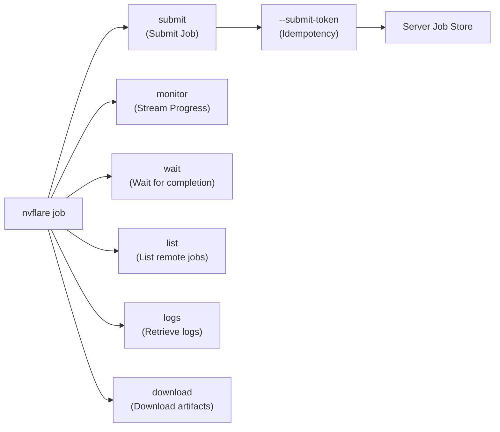
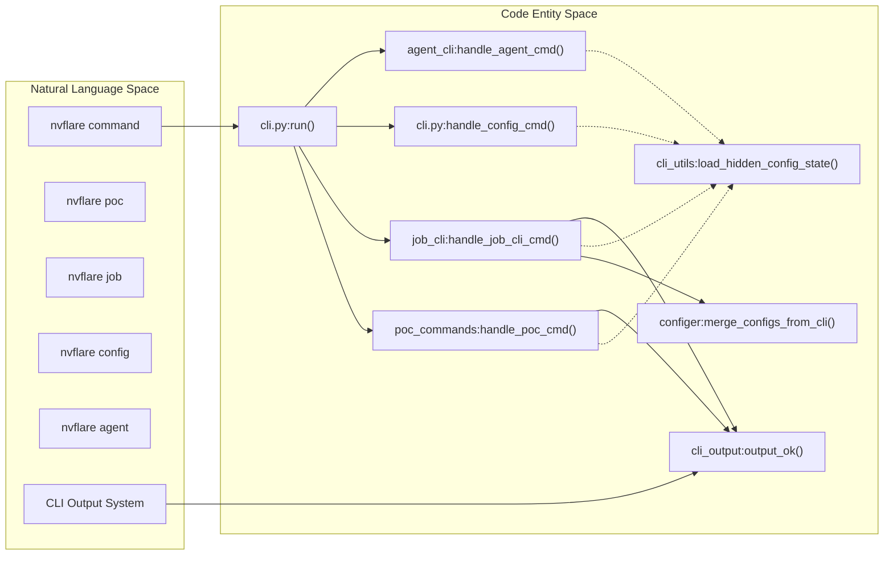

<!-- source: DeepWiki mcp.deepwiki.com · repo NVIDIA/NVFlare · page 9 Command-Line Interface · fetched 2026-10-26 -->

# Command-Line Interface

Relevant source files

The following files were used as context for generating this wiki page:

- [docs/design/cli_agent_readiness_backlog.md](docs/design/cli_agent_readiness_backlog.md)
- [docs/design/job_download_artifact_contract_test_plan.md](docs/design/job_download_artifact_contract_test_plan.md)
- [docs/design/nvflare_cli.md](docs/design/nvflare_cli.md)
- [docs/schemas/recipe_catalog.schema.json](docs/schemas/recipe_catalog.schema.json)
- [docs/user_guide/data_scientist_guide/index.rst](docs/user_guide/data_scientist_guide/index.rst)
- [docs/user_guide/nvflare_cli/config_command.rst](docs/user_guide/nvflare_cli/config_command.rst)
- [docs/user_guide/nvflare_cli/dashboard_command.rst](docs/user_guide/nvflare_cli/dashboard_command.rst)
- [docs/user_guide/nvflare_cli/job_cli.rst](docs/user_guide/nvflare_cli/job_cli.rst)
- [docs/user_guide/nvflare_cli/nvflare_cli.rst](docs/user_guide/nvflare_cli/nvflare_cli.rst)
- [docs/user_guide/nvflare_cli/poc_command.rst](docs/user_guide/nvflare_cli/poc_command.rst)
- [docs/user_guide/nvflare_cli/recipe_command.rst](docs/user_guide/nvflare_cli/recipe_command.rst)
- [docs/user_guide/nvflare_cli/study_command.rst](docs/user_guide/nvflare_cli/study_command.rst)
- [docs/user_guide/nvflare_cli/system_command.rst](docs/user_guide/nvflare_cli/system_command.rst)
- [nvflare/cli.py](nvflare/cli.py)
- [nvflare/tool/job/config/config_indexer.py](nvflare/tool/job/config/config_indexer.py)
- [nvflare/tool/job/config/configer.py](nvflare/tool/job/config/configer.py)
- [nvflare/tool/job/job_cli.py](nvflare/tool/job/job_cli.py)
- [nvflare/tool/job/job_client_const.py](nvflare/tool/job/job_client_const.py)
- [nvflare/tool/poc/poc_commands.py](nvflare/tool/poc/poc_commands.py)
- [nvflare/tool/poc/service_constants.py](nvflare/tool/poc/service_constants.py)
- [nvflare/utils/cli_utils.py](nvflare/utils/cli_utils.py)
- [tests/unit_test/data/jobs/launch_everytime/app/config/config_fed_client.conf](tests/unit_test/data/jobs/launch_everytime/app/config/config_fed_client.conf)
- [tests/unit_test/data/jobs/launch_everytime/app/config/config_fed_server.conf](tests/unit_test/data/jobs/launch_everytime/app/config/config_fed_server.conf)
- [tests/unit_test/data/jobs/launch_everytime/meta.conf](tests/unit_test/data/jobs/launch_everytime/meta.conf)
- [tests/unit_test/data/jobs/launch_once/app/config/config_fed_client.conf](tests/unit_test/data/jobs/launch_once/app/config/config_fed_client.conf)
- [tests/unit_test/data/jobs/launch_once/app/config/config_fed_server.conf](tests/unit_test/data/jobs/launch_once/app/config/config_fed_server.conf)
- [tests/unit_test/data/jobs/launch_once/meta.conf](tests/unit_test/data/jobs/launch_once/meta.conf)
- [tests/unit_test/lighter/poc_commands_test.py](tests/unit_test/lighter/poc_commands_test.py)
- [tests/unit_test/tool/job/config/config_indexer_test.py](tests/unit_test/tool/job/config/config_indexer_test.py)
- [tests/unit_test/tool/job/config/configer_test.py](tests/unit_test/tool/job/config/configer_test.py)
- [tests/unit_test/tool/job/job_cli_test.py](tests/unit_test/tool/job/job_cli_test.py)
- [tests/unit_test/tool/job/job_download_test.py](tests/unit_test/tool/job/job_download_test.py)
- [tests/unit_test/tool/poc/poc_force_test.py](tests/unit_test/tool/poc/poc_force_test.py)
- [tests/unit_test/tool/poc/poc_output_test.py](tests/unit_test/tool/poc/poc_output_test.py)

This page documents the `nvflare` CLI entry point: its structure, the full set of top-level subcommands, and the implementation logic for dispatching and handling user requests. It serves as the primary interface for operators, data scientists, and developers interacting with NVIDIA FLARE.

For architecture details on how the CLI modules are wired together internally, see [CLI Architecture](#9.1). For POC lifecycle operations, see [POC Commands](#9.2). For configuration management via `nvflare config`, see [Configuration Management](#9.3). For service startup and GPU allocation details, see [Service Control and GPU Assignment](#9.4).

---

## Entry Point

The `nvflare` command is registered as a console script entry point. The `run()` function in [nvflare/cli.py:257-293]() serves as the primary execution wrapper.

The execution flow involves:
1. Appending the current working directory to `sys.path` to allow loading local custom code [nvflare/cli.py:259]().
2. Initializing the `argparse` tree via `def_parser()` [nvflare/cli.py:260]().
3. Ensuring the hidden configuration file (usually `~/.nvflare/config.conf`) is migrated to the current version (v2) [nvflare/cli.py:263](), [nvflare/utils/cli_utils.py:28]().
4. Checking for the `--version` flag [nvflare/cli.py:267]().
5. Dispatching the command to the registered handler in the `handlers` dictionary [nvflare/cli.py:274]().
6. Handling specialized exceptions like `AuthenticationError`, `AuthorizationError`, or `NoConnection` for remote operations [nvflare/cli.py:280-285]().

Sources: [nvflare/cli.py:257-293](), [nvflare/utils/cli_utils.py:27-28](), [nvflare/utils/cli_utils.py:107-111]()

---

## Top-Level Command Map

The CLI is designed to support both human-readable output and machine-readable JSON envelopes via the `--format json` flag [nvflare/cli.py:291]().

**Command Dispatch Overview**

```mermaid
flowchart TD
    nvflare["nvflare (cli.py:run)"] --> poc["poc (poc_commands.py)"]
    nvflare --> provision["provision (provision.py)"]
    nvflare --> preflight_check["preflight_check (preflight_check.py)"]
    nvflare --> simulator["simulator (simulator.py)"]
    nvflare --> dashboard["dashboard (cli.py)"]
    nvflare --> job["job (job_cli.py)"]
    nvflare --> recipe["recipe (recipe_cli.py)"]
    nvflare --> config["config (cli.py)"]
    nvflare --> system["system (system_cli.py)"]
    nvflare --> cert["cert (cert_cli.py)"]
    nvflare --> package["package (package_cli.py)"]
    nvflare --> agent["agent (agent_cli.py)"]
    nvflare --> study["study (study_cli.py)"]
    nvflare --> deploy["deploy (deploy_cli.py)"]

    poc --> prepare["prepare"]
    poc --> start["start"]
    poc --> stop["stop"]
    poc --> clean["clean"]
    poc --> add-user["add-user"]
    poc --> add-site["add-site"]

    job --> submit["submit"]
    job --> monitor["monitor"]
    job --> list["list"]
    job --> logs["logs"]
    job --> stats["stats"]
    job --> wait["wait"]
    job --> download["download"]
    
    agent --> info["info"]
    agent --> inspect["inspect"]
    agent --> doctor["doctor"]
    agent --> skills["skills"]
```

Sources: [nvflare/cli.py:55-69](), [nvflare/tool/poc/poc_commands.py:74-80](), [nvflare/tool/job/job_cli.py:83-102](), [nvflare/tool/agent/agent_cli.py:31](), [nvflare/cli.py:33]()

---

The handler registry in [nvflare/cli.py:244-255]() maps each subcommand string to its implementation:

| Subcommand | Handler Function | Implementation Module |
|---|---|---|
| `poc` | `handle_poc_cmd` | [nvflare/tool/poc/poc_commands.py:1212]() |
| `provision` | `handle_provision` | [nvflare/lighter/provision.py:28]() |
| `preflight-check` | `check_packages` | [nvflare/tool/preflight_check.py:38]() |
| `simulator` | `handle_simulator_cmd` | [nvflare/cli.py:109]() |
| `dashboard` | `handle_dashboard` | [nvflare/dashboard/cli.py:25]() |
| `job` | `handle_job_cli_cmd` | [nvflare/tool/job/job_cli.py:465]() |
| `recipe` | `handle_recipe_cmd` | [nvflare/tool/recipe/recipe_cli.py:36]() |
| `config` | `handle_config_cmd` | [nvflare/cli.py:233]() |
| `system` | `handle_system_cmd` | [nvflare/tool/system/system_cli.py:38]() |
| `cert` | `handle_cert_cmd` | [nvflare/tool/cert/cert_cli.py:31]() |
| `package` | `handle_package_cmd` | [nvflare/tool/package/package_cli.py:32]() |
| `agent` | `handle_agent_cmd` | [nvflare/tool/agent/agent_cli.py:31]() |
| `study` | `handle_study_cmd` | [nvflare/tool/study/study_cli.py:31]() |
| `deploy` | `handle_deploy_cmd` | [nvflare/tool/deploy/deploy_cli.py:33]() |

Sources: [nvflare/cli.py:244-255](), [nvflare/cli.py:109](), [nvflare/cli.py:33]()

---

## Global Flags and Output Handling

The CLI implements a structured output contract to support automation via `nvflare/tool/cli_output.py`. It supports `txt` (human-readable), `json` (single envelope), and `jsonl` (newline-delimited events) [nvflare/tool/cli_output.py:23-31]().

### Output Modes
* **txt (human)**: Default mode. stdout contains tables and summaries; stderr contains diagnostics [nvflare/tool/cli_output.py:19-21]().
* **json**: stdout contains exactly one JSON envelope [nvflare/tool/cli_output.py:23-25]().
* **jsonl**: stdout contains newline-delimited JSON events for streaming. This is used for commands like `nvflare job monitor` [nvflare/cli.py:71-73](), [nvflare/tool/cli_output.py:28-30]().

Sources: [nvflare/tool/cli_output.py:19-31](), [nvflare/tool/cli_output.py:104-117]()

---

## `nvflare poc` — Proof-of-Concept Management

The `poc` command manages a local single-machine federated learning environment. It uses a default workspace at `/tmp/nvflare/poc` [nvflare/tool/poc/poc_commands.py:71]().

| Subcommand | Purpose |
|---|---|
| `prepare` | Initializes a POC workspace and provisions local kits [nvflare/tool/poc/poc_commands.py:74]() |
| `start` | Orchestrates service startup with optional GPU assignment [nvflare/tool/poc/poc_commands.py:75]() |
| `stop` | Shuts down services gracefully via `shutdown.fl` [nvflare/tool/poc/poc_commands.py:181-182]() |
| `clean` | Deletes the POC workspace directory [nvflare/tool/poc/poc_commands.py:77]() |
| `add-user` | Adds a secondary user to an existing POC workspace [nvflare/tool/poc/poc_commands.py:79]() |
| `add-site` | Adds a client participant to the POC project [nvflare/tool/poc/poc_commands.py:80]() |

### GPU Assignment Logic
When starting POC clients, NVFLARE can automatically assign GPUs using `client_gpu_assignments()` [nvflare/tool/poc/poc_commands.py:116-139](). It maps available host GPU IDs (detected via `get_host_gpu_ids` [nvflare/tool/poc/poc_commands.py:35]()) to client names using a round-robin strategy.

Sources: [nvflare/tool/poc/poc_commands.py:116-139](), [nvflare/tool/poc/poc_commands.py:74-80]()

---

## `nvflare job` — Job Lifecycle Management

The `job` command family is used to submit, inspect, monitor, and manage federated learning jobs from an admin startup kit.

**Subcommand dispatch in `job_cli.py`:**

Sources: [nvflare/tool/job/job_cli.py:83-102]()

### Idempotent Submission
The Job CLI supports retry-safe submission using `--submit-token` [nvflare/tool/job/job_cli.py:105-114](). This token deduplicates retries for identical submitted job content in the same study by the same submitter [nvflare/tool/job/job_cli.py:109-112](). Validation of this token is handled by `validate_submit_token` [nvflare/tool/job/job_submit_token.py:33]().

### Configuration Merging
The `nvflare job` CLI allows overriding job configuration via command-line arguments. This logic is handled in `nvflare/tool/job/config/configer.py`, which builds indices of configuration files [nvflare/tool/job/config/configer.py:36]() and merges them with CLI-provided values [nvflare/tool/job/config/configer.py:208](). The `KeyIndex` class tracks the location of specific keys within the HOCON/JSON structure [nvflare/tool/job/config/config_indexer.py:28]().

Sources: [nvflare/tool/job/job_cli.py:105-114](), [nvflare/apis/utils/job_submit_token.py:33](), [nvflare/tool/job/config/configer.py:35-44](), [nvflare/tool/job/config/config_indexer.py:27-34]()

---

## `nvflare config` — Persistent Settings

This command manages the hidden configuration file located at `~/.nvflare/config.conf` [nvflare/utils/cli_utils.py:51]().

| Argument | Purpose |
|---|---|
| `--startup_kit_dir` | Sets the startup kit location (deprecated) [nvflare/cli.py:166-171]() |
| `--poc_workspace_dir` | Sets the default POC workspace directory [nvflare/cli.py:173-180]() |
| `use` | Sets the active startup kit for subsequent commands [nvflare/cli.py:210]() |
| `add` | Registers a new startup kit path [nvflare/cli.py:209]() |

The `handle_config_cmd` [nvflare/cli.py:233-241]() allows other CLI commands to discover workspace and active identities without requiring explicit flags on every invocation.

Sources: [nvflare/cli.py:157-241](), [nvflare/utils/cli_utils.py:51-76]()

---

## Code Entity Map

The diagram below maps CLI surface names to the implementing code entities and utilities:

Sources: [nvflare/cli.py:244-255](), [nvflare/utils/cli_utils.py:107-111](), [nvflare/tool/poc/poc_commands.py:1212](), [nvflare/tool/job/job_cli.py:465](), [nvflare/tool/cli_output.py:205](), [nvflare/tool/agent/agent_cli.py:31](), [nvflare/tool/job/config/configer.py:35]()

---

