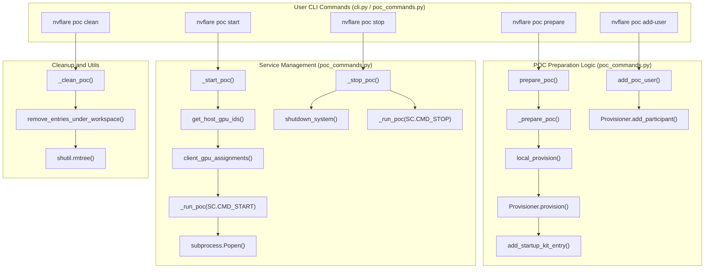
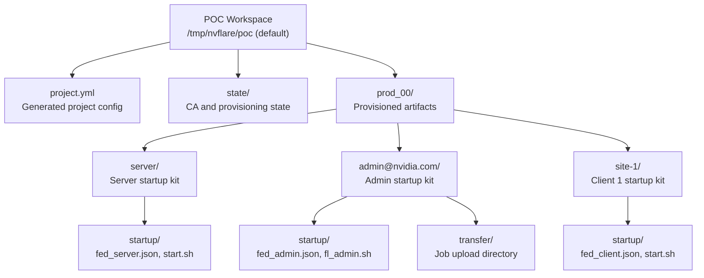
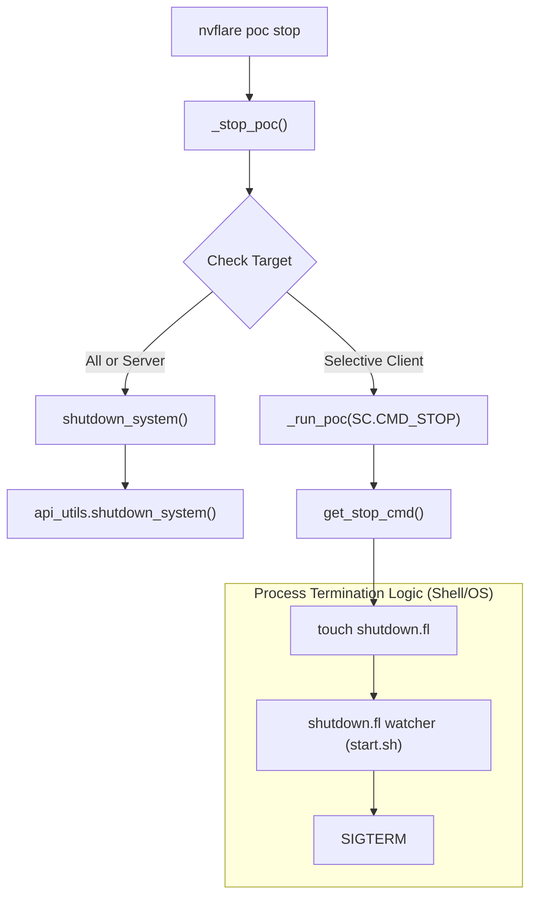

<!-- source: DeepWiki mcp.deepwiki.com · repo NVIDIA/NVFlare · page 9.2 POC Commands · fetched 2026-10-26 -->

# POC Commands

Relevant source files

The following files were used as context for generating this wiki page:

- [docs/design/cli_agent_readiness_backlog.md](docs/design/cli_agent_readiness_backlog.md)
- [docs/design/job_download_artifact_contract_test_plan.md](docs/design/job_download_artifact_contract_test_plan.md)
- [docs/design/nvflare_cli.md](docs/design/nvflare_cli.md)
- [docs/schemas/recipe_catalog.schema.json](docs/schemas/recipe_catalog.schema.json)
- [docs/user_guide/data_scientist_guide/index.rst](docs/user_guide/data_scientist_guide/index.rst)
- [docs/user_guide/nvflare_cli/config_command.rst](docs/user_guide/nvflare_cli/config_command.rst)
- [docs/user_guide/nvflare_cli/dashboard_command.rst](docs/user_guide/nvflare_cli/dashboard_command.rst)
- [docs/user_guide/nvflare_cli/job_cli.rst](docs/user_guide/nvflare_cli/job_cli.rst)
- [docs/user_guide/nvflare_cli/nvflare_cli.rst](docs/user_guide/nvflare_cli/nvflare_cli.rst)
- [docs/user_guide/nvflare_cli/poc_command.rst](docs/user_guide/nvflare_cli/poc_command.rst)
- [docs/user_guide/nvflare_cli/recipe_command.rst](docs/user_guide/nvflare_cli/recipe_command.rst)
- [docs/user_guide/nvflare_cli/study_command.rst](docs/user_guide/nvflare_cli/study_command.rst)
- [docs/user_guide/nvflare_cli/system_command.rst](docs/user_guide/nvflare_cli/system_command.rst)
- [nvflare/cli.py](nvflare/cli.py)
- [nvflare/tool/job/config/config_indexer.py](nvflare/tool/job/config/config_indexer.py)
- [nvflare/tool/job/config/configer.py](nvflare/tool/job/config/configer.py)
- [nvflare/tool/job/job_cli.py](nvflare/tool/job/job_cli.py)
- [nvflare/tool/job/job_client_const.py](nvflare/tool/job/job_client_const.py)
- [nvflare/tool/poc/poc_commands.py](nvflare/tool/poc/poc_commands.py)
- [nvflare/tool/poc/service_constants.py](nvflare/tool/poc/service_constants.py)
- [nvflare/utils/cli_utils.py](nvflare/utils/cli_utils.py)
- [tests/unit_test/data/jobs/launch_everytime/app/config/config_fed_client.conf](tests/unit_test/data/jobs/launch_everytime/app/config/config_fed_client.conf)
- [tests/unit_test/data/jobs/launch_everytime/app/config/config_fed_server.conf](tests/unit_test/data/jobs/launch_everytime/app/config/config_fed_server.conf)
- [tests/unit_test/data/jobs/launch_everytime/meta.conf](tests/unit_test/data/jobs/launch_everytime/meta.conf)
- [tests/unit_test/data/jobs/launch_once/app/config/config_fed_client.conf](tests/unit_test/data/jobs/launch_once/app/config/config_fed_client.conf)
- [tests/unit_test/data/jobs/launch_once/app/config/config_fed_server.conf](tests/unit_test/data/jobs/launch_once/app/config/config_fed_server.conf)
- [tests/unit_test/data/jobs/launch_once/meta.conf](tests/unit_test/data/jobs/launch_once/meta.conf)
- [tests/unit_test/lighter/poc_commands_test.py](tests/unit_test/lighter/poc_commands_test.py)
- [tests/unit_test/tool/job/config/config_indexer_test.py](tests/unit_test/tool/job/config/config_indexer_test.py)
- [tests/unit_test/tool/job/config/configer_test.py](tests/unit_test/tool/job/config/configer_test.py)
- [tests/unit_test/tool/job/job_cli_test.py](tests/unit_test/tool/job/job_cli_test.py)
- [tests/unit_test/tool/job/job_download_test.py](tests/unit_test/tool/job/job_download_test.py)
- [tests/unit_test/tool/poc/poc_force_test.py](tests/unit_test/tool/poc/poc_force_test.py)
- [tests/unit_test/tool/poc/poc_output_test.py](tests/unit_test/tool/poc/poc_output_test.py)

## Purpose and Scope

This document covers the **POC (Proof of Concept) mode commands** in NVIDIA FLARE's CLI, which provide a local multi-process testing environment for federated learning. POC mode allows users to establish and connect distinct server and client "systems" on a single machine, orchestrated via the FLARE Console or API, without the overhead of a true distributed deployment [nvflare/tool/poc/poc_commands.py:1-45]().

For information about the overall CLI architecture, see [CLI Architecture](#9.1). For job submission and management, see [Job CLI](#7.4). For production provisioning, see [Provisioning System](#10).

**Sources:** [nvflare/tool/poc/poc_commands.py:1-45]()

---

## POC Command Overview

The POC commands are accessible via `nvflare poc <subcommand>`. These commands manage the lifecycle of a local federated learning environment by wrapping the provisioning system and process management utilities.

| Command | Handler Function | Purpose |
|---------|-----------------|---------|
| `config` | `handle_poc_cmd` | Set or show the local POC workspace path [nvflare/tool/poc/poc_commands.py:882](), [nvflare/tool/poc/poc_commands.py:1003]() |
| `prepare` | `handle_poc_cmd` | Provision a local POC workspace with server, clients, and admin kits [nvflare/tool/poc/poc_commands.py:302](), [nvflare/tool/poc/poc_commands.py:982]() |
| `add-user` | `handle_poc_cmd` | Dynamically add a secondary user (lead/member/org_admin) to an existing POC workspace [nvflare/tool/poc/poc_commands.py:535](), [nvflare/tool/poc/poc_commands.py:985]() |
| `add-site` | `handle_poc_cmd` | Dynamically add a client site to an existing POC workspace [nvflare/tool/poc/poc_commands.py:548](), [nvflare/tool/poc/poc_commands.py:988]() |
| `start` | `handle_poc_cmd` | Start all or selected services (server, clients, admin) [nvflare/tool/poc/poc_commands.py:734](), [nvflare/tool/poc/poc_commands.py:991]() |
| `stop` | `handle_poc_cmd` | Stop all or selected services [nvflare/tool/poc/poc_commands.py:761](), [nvflare/tool/poc/poc_commands.py:994]() |
| `clean` | `handle_poc_cmd` | Remove the entire POC workspace and associated registry entries [nvflare/tool/poc/poc_commands.py:781](), [nvflare/tool/poc/poc_commands.py:997]() |

**Sources:** [nvflare/tool/poc/poc_commands.py:73-80](), [nvflare/tool/poc/poc_commands.py:970-1007](), [nvflare/tool/poc/poc_commands.py:882-924]()

---

## POC Command Workflow

The POC workflow transitions from workspace preparation to service orchestration.

### Natural Language to Code Entity Mapping: POC Lifecycle

**Sources:** [nvflare/tool/poc/poc_commands.py:302-376](), [nvflare/tool/poc/poc_commands.py:734-759](), [nvflare/tool/poc/poc_commands.py:761-779](), [nvflare/tool/poc/poc_commands.py:116-139](), [nvflare/tool/poc/poc_commands.py:781-806]()

---

## POC Workspace Structure

After running `nvflare poc prepare`, the workspace structure is generated based on the `Provisioner` logic [nvflare/lighter/provisioner.py:38]() and configured builders.

**Sources:** [nvflare/tool/poc/poc_commands.py:70-71](), [nvflare/tool/poc/poc_commands.py:195-205]()

---

## nvflare poc prepare

The `prepare` command provisions a local POC environment. It generates a default project configuration and modifies it for local execution.

### Command Options

| Option | Short | Type | Default | Description |
|--------|-------|------|---------|-------------|
| `--number_of_clients` | `-n` | int | 2 | Number of client sites to create [nvflare/tool/poc/poc_commands.py:931]() |
| `--clients` | `-c` | list[str] | [] | Specific client names (overrides `-n`) [nvflare/tool/poc/poc_commands.py:935]() |
| `--he` | `-he` | flag | False | Enable homomorphic encryption [nvflare/tool/poc/poc_commands.py:941]() |
| `--project_input` | `-i` | str | "" | Path to custom project.yaml file [nvflare/tool/poc/poc_commands.py:947]() |
| `--docker_image` | `-d` | str | None | Docker image for generating `start_docker.sh` [nvflare/tool/poc/poc_commands.py:954]() |
| `--force` | `--force` | flag | False | Overwrite existing workspace without prompt [nvflare/tool/poc/poc_commands.py:959]() |

### Implementation Details
1. **Localhost Binding**: Forces the server host to `localhost` via `update_server_default_host` [nvflare/tool/poc/poc_commands.py:339-340]().
2. **Participant Modification**: Updates the participant list in the project dictionary based on `-n` or `-c` flags [nvflare/tool/poc/poc_commands.py:314-317]().
3. **Provisioner Call**: Executes `Provisioner.provision()` with `ProvisionMode.POC` [nvflare/tool/poc/poc_commands.py:292-293]().
4. **Registry Update**: Registers the generated admin startup kit in `~/.nvflare/config.conf` using `add_startup_kit_entry` [nvflare/tool/poc/poc_commands.py:372-376]().
5. **Safety Checks**: If the workspace exists, `_prepare_poc` checks if the system is running via `is_poc_running()` before attempting deletion [nvflare/tool/poc/poc_commands.py:435-442]().

**Sources:** [nvflare/tool/poc/poc_commands.py:292-376](), [nvflare/tool/poc/poc_commands.py:926-967](), [tests/unit_test/lighter/poc_commands_test.py:31-34]()

---

## nvflare poc start

The `start` command launches the provisioned services.

### Service Start Logic
Services are identified by scanning the workspace's production directory (e.g., `prod_00`) [nvflare/tool/poc/poc_commands.py:575-585]():
- **Server**: Started first. The command waits for the admin port to become available before starting clients [nvflare/tool/poc/poc_commands.py:734-759]().
- **Clients**: Started after the server is ready. If GPU IDs are provided, they are assigned to clients [nvflare/tool/poc/poc_commands.py:116-139]().
- **Admin**: Admin consoles are started with the `fl_admin.sh` script [nvflare/tool/poc/poc_commands.py:153-154]().

### GPU Assignment Algorithm
If GPUs are available (detected via `get_host_gpu_ids`), `client_gpu_assignments()` distributes them [nvflare/tool/poc/poc_commands.py:116-139]():
- If `n_gpus <= n_clients`: Each client gets one GPU in round-robin fashion [nvflare/tool/poc/poc_commands.py:124-127]().
- If `n_gpus > n_clients`: GPUs are distributed across clients such that some clients receive multiple GPUs [nvflare/tool/poc/poc_commands.py:128-138]().

**Sources:** [nvflare/tool/poc/poc_commands.py:116-139](), [nvflare/tool/poc/poc_commands.py:734-759](), [nvflare/tool/poc/poc_commands.py:575-585]()

---

## nvflare poc stop

The `stop` command terminates the POC environment.

### Natural Language to Code Entity Mapping: Shutdown Mechanisms

**Sources:** [nvflare/tool/poc/poc_commands.py:761-779](), [nvflare/tool/poc/poc_commands.py:179-183](), [nvflare/tool/api_utils.py:46]()

---

## Configuration and Persistence

### Hidden Configuration (`~/.nvflare/config.conf`)
The POC system persists its state in a hidden configuration file managed by `cli_utils.py` [nvflare/utils/cli_utils.py:65-66]().
- `poc.workspace`: Stores the absolute path to the current POC workspace [nvflare/tool/poc/poc_commands.py:84]().
- `startup_kits`: A registry of discovered admin startup kits, including those from POC [nvflare/tool/kit/kit_config.py:51]().

### Workspace Resolution Order
1. CLI argument `--poc_workspace_dir` (or `-pw`) [nvflare/tool/poc/poc_commands.py:882]().
2. Environment variable `NVFLARE_POC_WORKSPACE` [nvflare/tool/poc/poc_commands.py:401-403]().
3. Hidden config `poc.workspace` [nvflare/tool/poc/poc_commands.py:396]().
4. Default: `/tmp/nvflare/poc` [nvflare/tool/poc/poc_commands.py:71]().

**Sources:** [nvflare/tool/poc/poc_commands.py:388-414](), [nvflare/utils/cli_utils.py:61-69](), [nvflare/tool/poc/poc_commands.py:882-924]()

---

