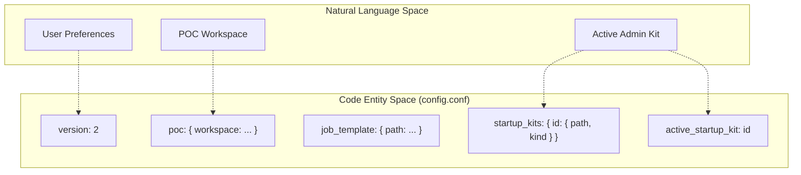
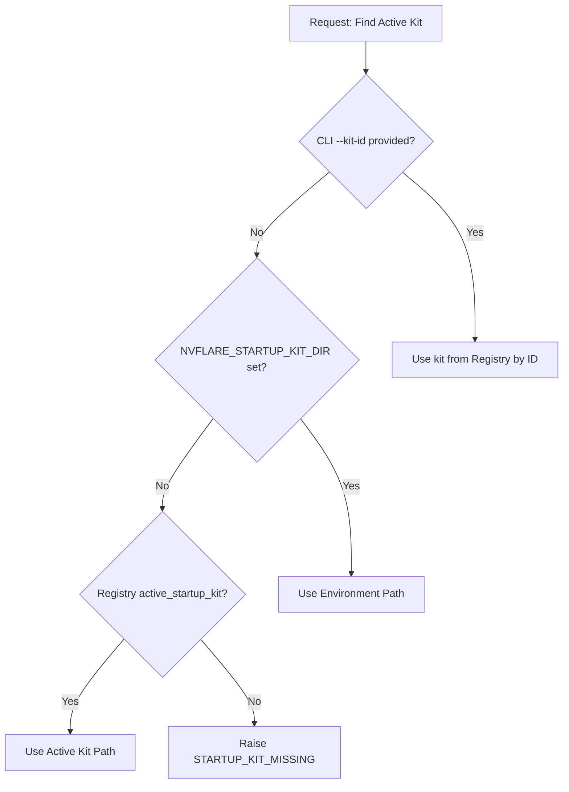
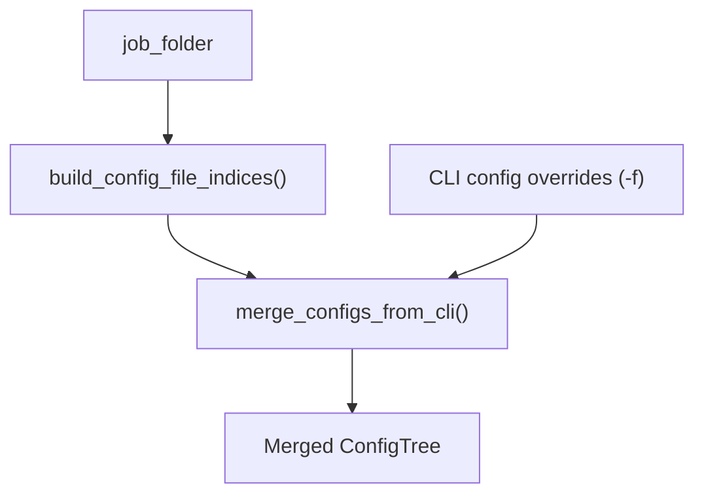

<!-- source: DeepWiki mcp.deepwiki.com · repo NVIDIA/NVFlare · page 9.3 Configuration Management · fetched 2026-10-26 -->

# Configuration Management

<details>
<summary>Relevant source files</summary>

The following files were used as context for generating this wiki page:

- [nvflare/cli.py](nvflare/cli.py)
- [nvflare/tool/job/config/config_indexer.py](nvflare/tool/job/config/config_indexer.py)
- [nvflare/tool/job/config/configer.py](nvflare/tool/job/config/configer.py)
- [nvflare/tool/job/job_cli.py](nvflare/tool/job/job_cli.py)
- [nvflare/tool/job/job_client_const.py](nvflare/tool/job/job_client_const.py)
- [nvflare/tool/package_checker/__init__.py](nvflare/tool/package_checker/__init__.py)
- [nvflare/tool/package_checker/check_rule.py](nvflare/tool/package_checker/check_rule.py)
- [nvflare/tool/package_checker/client_package_checker.py](nvflare/tool/package_checker/client_package_checker.py)
- [nvflare/tool/package_checker/package_checker.py](nvflare/tool/package_checker/package_checker.py)
- [nvflare/tool/package_checker/server_package_checker.py](nvflare/tool/package_checker/server_package_checker.py)
- [nvflare/tool/package_checker/utils.py](nvflare/tool/package_checker/utils.py)
- [nvflare/tool/poc/poc_commands.py](nvflare/tool/poc/poc_commands.py)
- [nvflare/tool/poc/service_constants.py](nvflare/tool/poc/service_constants.py)
- [nvflare/tool/preflight_check.py](nvflare/tool/preflight_check.py)
- [nvflare/utils/cli_utils.py](nvflare/utils/cli_utils.py)
- [tests/integration_test/data/projects/authz.yml](tests/integration_test/data/projects/authz.yml)
- [tests/integration_test/data/projects/dummy.yml](tests/integration_test/data/projects/dummy.yml)
- [tests/unit_test/data/jobs/launch_everytime/app/config/config_fed_client.conf](tests/unit_test/data/jobs/launch_everytime/app/config/config_fed_client.conf)
- [tests/unit_test/data/jobs/launch_everytime/app/config/config_fed_server.conf](tests/unit_test/data/jobs/launch_everytime/app/config/config_fed_server.conf)
- [tests/unit_test/data/jobs/launch_everytime/meta.conf](tests/unit_test/data/jobs/launch_everytime/meta.conf)
- [tests/unit_test/data/jobs/launch_once/app/config/config_fed_client.conf](tests/unit_test/data/jobs/launch_once/app/config/config_fed_client.conf)
- [tests/unit_test/data/jobs/launch_once/app/config/config_fed_server.conf](tests/unit_test/data/jobs/launch_once/app/config/config_fed_server.conf)
- [tests/unit_test/data/jobs/launch_once/meta.conf](tests/unit_test/data/jobs/launch_once/meta.conf)
- [tests/unit_test/lighter/poc_commands_test.py](tests/unit_test/lighter/poc_commands_test.py)
- [tests/unit_test/tool/job/config/config_indexer_test.py](tests/unit_test/tool/job/config/config_indexer_test.py)
- [tests/unit_test/tool/job/config/configer_test.py](tests/unit_test/tool/job/config/configer_test.py)
- [tests/unit_test/tool/job/job_cli_test.py](tests/unit_test/tool/job/job_cli_test.py)
- [tests/unit_test/tool/package_checker/utils_test.py](tests/unit_test/tool/package_checker/utils_test.py)
- [tests/unit_test/tool/poc/poc_force_test.py](tests/unit_test/tool/poc/poc_force_test.py)
- [tests/unit_test/tool/poc/poc_output_test.py](tests/unit_test/tool/poc/poc_output_test.py)

</details>


## Purpose and Scope

This document describes NVFLARE's CLI configuration management system, which stores persistent user preferences and environment settings for command-line tools. The configuration system manages directory paths and identities for:

- **Startup Kits**: Admin and participant credentials for POC and Production modes, managed via a registry of active kits [nvflare/tool/kit/kit_config.py:35-35]().
- **POC Workspaces**: Local directories for proof-of-concept deployments [nvflare/utils/cli_utils.py:134-156]().
- **Job Templates**: Pre-configured job structures for rapid job creation [nvflare/utils/cli_utils.py:159-180]().
- **User Settings**: Debug flags and local preferences [nvflare/cli.py:187-187]().

This configuration is primarily stored in `~/.nvflare/config.conf` and is managed by the `nvflare config` command.

**Related Documentation:**
- For job-specific configuration (`meta.conf`, `config_fed_server.conf`), see **7.6 Configuration System and Indexing**.
- For provisioning configuration (`project.yml`), see **10.1 Provisioning Overview and Workflow**.
- For runtime configuration files (`fed_server.json`, `fed_client.json`), see **10.4 Configuration File Generation**.

## Configuration File Location and Registry

NVFLARE CLI tools store user configuration in a hidden directory at the user's home directory:

```
~/.nvflare/config.conf
```

### Hidden Directory Management
The directory `~/.nvflare/` is automatically created by `get_or_create_hidden_nvflare_dir()` [nvflare/utils/cli_utils.py:55-63](). The full path to the configuration file is resolved by `get_hidden_nvflare_config_path()` [nvflare/utils/cli_utils.py:43-52]().

### Startup Kit Registry
Modern NVFLARE configuration uses a registry-based approach for startup kits. Instead of a single path, the system maintains a list of known startup kits in the `startup_kits` section of the config [nvflare/tool/kit/kit_config.py:100-115](). Kits are classified as either `admin` or `site` (server/client) [nvflare/tool/kit/kit_config.py:48-49]().

**Key Functions:**
- `add_startup_kit_entry`: Adds a new kit to the local registry [nvflare/tool/kit/kit_config.py:100-115]().
- `set_active_startup_kit`: Designates a specific kit as the "active" one for CLI commands [nvflare/tool/kit/kit_config.py:145-160]().
- `get_active_startup_kit_id`: Retrieves the ID of the currently active kit [nvflare/tool/kit/kit_config.py:163-174]().

**Sources:** [nvflare/utils/cli_utils.py:31-71](), [nvflare/tool/kit/kit_config.py:47-174]()

## Configuration Structure

The configuration uses HOCON format (Human-Optimized Config Object Notation), supporting nested objects and fallback logic.

### Settings Sections
Settings are organized by functional area and target environment [nvflare/utils/cli_utils.py:148-156]().

- **poc.workspace**: Path to the POC workspace root [nvflare/utils/cli_utils.py:151-151]().
- **job_template.path**: Global path for job templates [nvflare/utils/cli_utils.py:175-175]().
- **startup_kits**: A dictionary mapping kit IDs to their file paths and metadata [nvflare/tool/kit/kit_config.py:100-115]().

**Diagram: Configuration Entity Mapping**


**Sources:** [nvflare/utils/cli_utils.py:27-28](), [nvflare/utils/cli_utils.py:148-180](), [nvflare/tool/kit/kit_config.py:100-115]()

## Configuration Commands

### The `nvflare config` Command
The `nvflare config` command is the primary interface for managing local settings [nvflare/cli.py:157-194]().

**Sub-commands:**
- `nvflare config list`: Lists all registered startup kits and their status [nvflare/cli.py:202-202]().
- `nvflare config use`: Sets the active startup kit by ID [nvflare/cli.py:204-204]().
- `nvflare config add`: Adds a new startup kit to the registry [nvflare/cli.py:203-203]().
- `nvflare config remove`: Removes a kit from the registry [nvflare/cli.py:205-205]().

**Implementation Flow:**
The `handle_config_cmd()` function [nvflare/cli.py:214-256]() manages the update lifecycle:
1. Loads the current state via `load_hidden_config_state()` [nvflare/cli.py:239-239]().
2. Processes directory updates for POC workspaces and job templates [nvflare/cli.py:242-252]().
3. Persists the changes using `save_config()` [nvflare/cli.py:253-253]().

**Sources:** [nvflare/cli.py:157-256](), [nvflare/tool/kit/kit_config.py:35-160]()

## Path Resolution and Discovery

### Resolution Priority
When a command requires a resource, it follows a specific search order.

**Startup Kit Discovery:**
1. Explicit CLI argument (`--startup-kit` or `--kit-id`) [nvflare/tool/cli_session.py:38-38]().
2. Environment variable `NVFLARE_STARTUP_KIT_DIR` [nvflare/tool/poc/poc_commands.py:187-188]().
3. The active kit identified in `~/.nvflare/config.conf` [nvflare/tool/kit/kit_config.py:163-174]().

**Job Template Discovery:**
1. Explicit CLI argument (`-jt`).
2. Environment variable `NVFLARE_HOME/job_templates` [nvflare/utils/cli_utils.py:195-197]().
3. Hidden config `job_template.path` [nvflare/utils/cli_utils.py:200-201]().
4. Package default: `nvflare/tool/job/templates` [nvflare/utils/cli_utils.py:207-213]().

**Diagram: Discovery Logic Flow**


**Sources:** [nvflare/utils/cli_utils.py:188-218](), [nvflare/tool/kit/kit_config.py:163-174](), [nvflare/tool/cli_session.py:38-38](), [nvflare/tool/poc/poc_commands.py:185-193]()

## Machine-Readable Output and Agent Readiness

To support automation and AI agents, the NVFLARE CLI provides stable machine-readable output modes.

### Output Modes
- **JSON Mode**: Enabled via `set_output_format("json")`. Commands emit exactly one JSON envelope to `stdout`.
- **JSONL Mode**: Enabled via `set_output_format("jsonl")`. Streaming commands emit newline-delimited JSON objects.

### Command Contract Discovery
Agents use the `--schema` flag to discover command arguments and behavioral metadata [nvflare/cli.py:190-190]().
- `output_modes`: Supported formats (e.g., `["json"]`) [nvflare/tool/job/job_cli.py:104-104]().

**Sources:** [nvflare/cli.py:159-191](), [nvflare/tool/job/job_cli.py:104-115]()

## Internal Configuration Utilities

### ConfigFactory and Formats
The `ConfigFactory` provides a unified interface for loading different configuration formats including `JSON`, `PYHOCON`, and `OMEGACONF` [nvflare/fuel/utils/config_factory.py:23-23]().

### Configuration Indexing and CLI Merging
The `Configer` utility allows users to override job configurations directly from the CLI [nvflare/tool/job/config/configer.py:35-44]().

1. **Indexing**: `build_config_file_indices()` scans configuration files to create a searchable index of keys [nvflare/tool/job/config/configer.py:36-36]().
2. **Merging**: `merge_configs_from_cli()` takes CLI arguments and applies them to the indexed configuration tree [nvflare/tool/job/config/configer.py:35-44]().
3. **Key Indexing**: The `KeyIndex` class tracks keys, values, and their parent relationships within the HOCON tree [nvflare/tool/job/config/config_indexer.py:28-33]().

**Diagram: Configuration Merging Logic**


**Sources:** [nvflare/tool/job/config/configer.py:35-44](), [nvflare/tool/job/config/config_indexer.py:27-68](), [nvflare/utils/cli_utils.py:21-25]()

---

