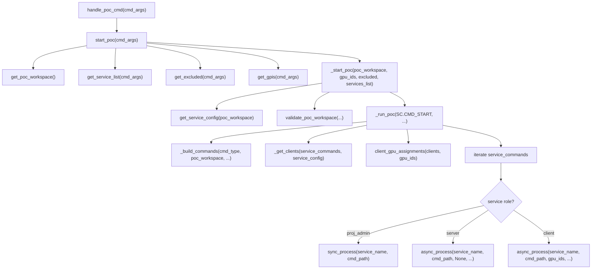
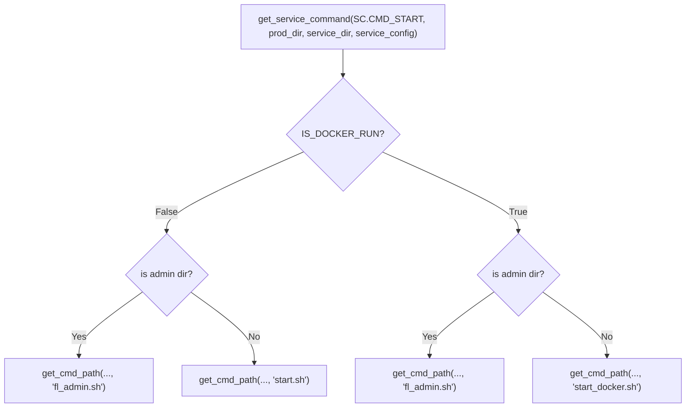
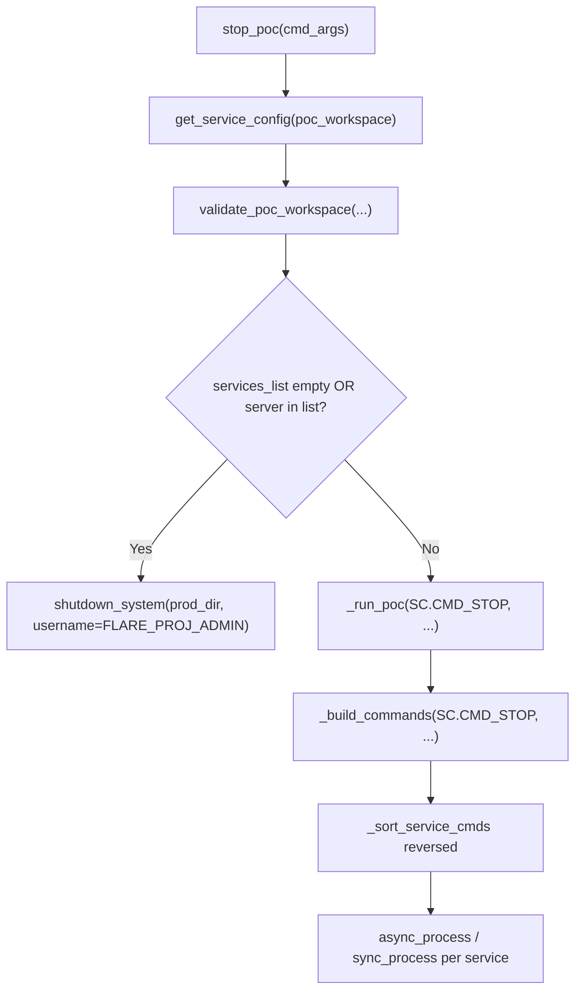
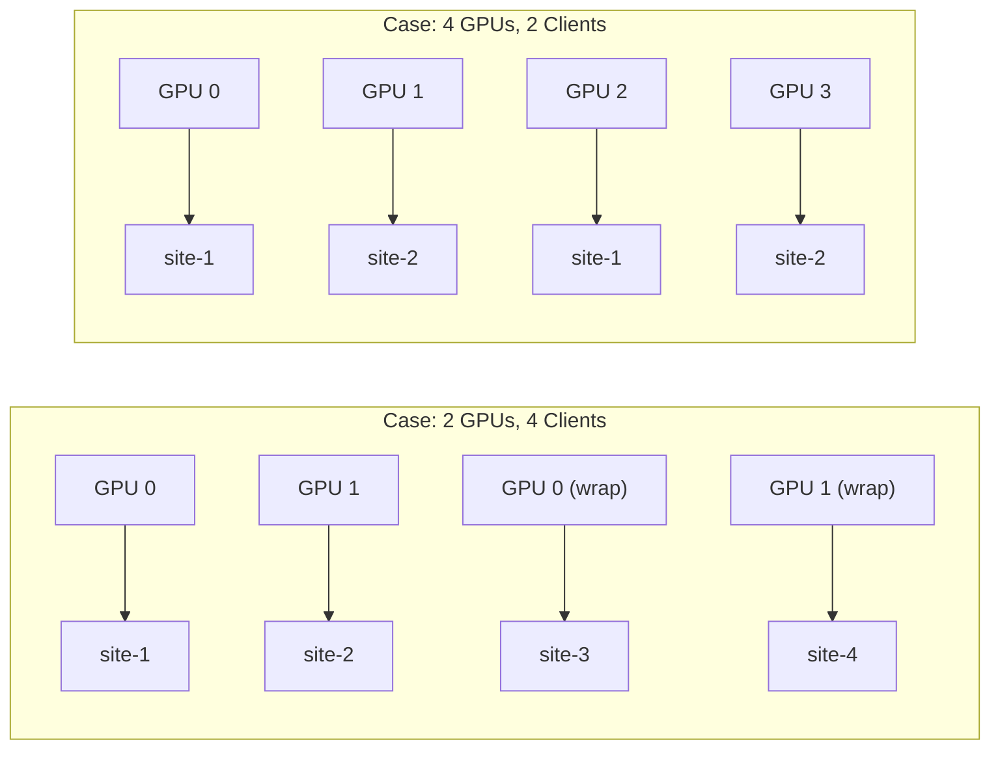
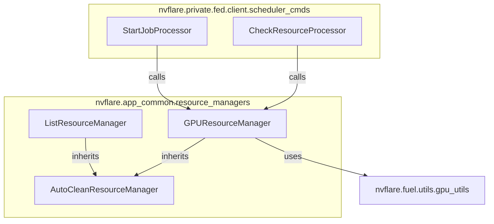
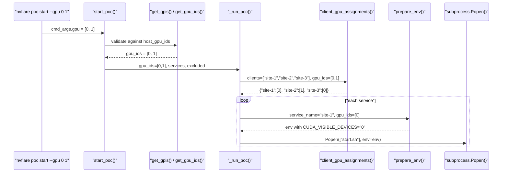

<!-- source: DeepWiki mcp.deepwiki.com · repo NVIDIA/NVFlare · page 9.4 Service Control and GPU Assignment · fetched 2026-10-26 -->

# Service Control and GPU Assignment

<details>
<summary>Relevant source files</summary>

The following files were used as context for generating this wiki page:

- [nvflare/apis/resource_manager_spec.py](nvflare/apis/resource_manager_spec.py)
- [nvflare/app_common/resource_consumers/gpu_resource_consumer.py](nvflare/app_common/resource_consumers/gpu_resource_consumer.py)
- [nvflare/app_common/resource_managers/auto_clean_resource_manager.py](nvflare/app_common/resource_managers/auto_clean_resource_manager.py)
- [nvflare/app_common/resource_managers/gpu_resource_manager.py](nvflare/app_common/resource_managers/gpu_resource_manager.py)
- [nvflare/app_common/resource_managers/list_resource_manager.py](nvflare/app_common/resource_managers/list_resource_manager.py)
- [nvflare/cli.py](nvflare/cli.py)
- [nvflare/fuel/utils/gpu_utils.py](nvflare/fuel/utils/gpu_utils.py)
- [nvflare/private/fed/client/scheduler_cmds.py](nvflare/private/fed/client/scheduler_cmds.py)
- [nvflare/private/scheduler_constants.py](nvflare/private/scheduler_constants.py)
- [nvflare/tool/job/config/config_indexer.py](nvflare/tool/job/config/config_indexer.py)
- [nvflare/tool/job/config/configer.py](nvflare/tool/job/config/configer.py)
- [nvflare/tool/job/job_cli.py](nvflare/tool/job/job_cli.py)
- [nvflare/tool/job/job_client_const.py](nvflare/tool/job/job_client_const.py)
- [nvflare/tool/poc/poc_commands.py](nvflare/tool/poc/poc_commands.py)
- [nvflare/tool/poc/service_constants.py](nvflare/tool/poc/service_constants.py)
- [nvflare/utils/cli_utils.py](nvflare/utils/cli_utils.py)
- [tests/unit_test/app_common/resource_managers/gpu_resource_manager_test.py](tests/unit_test/app_common/resource_managers/gpu_resource_manager_test.py)
- [tests/unit_test/app_common/resource_managers/list_resource_manager_test.py](tests/unit_test/app_common/resource_managers/list_resource_manager_test.py)
- [tests/unit_test/data/jobs/launch_everytime/app/config/config_fed_client.conf](tests/unit_test/data/jobs/launch_everytime/app/config/config_fed_client.conf)
- [tests/unit_test/data/jobs/launch_everytime/app/config/config_fed_server.conf](tests/unit_test/data/jobs/launch_everytime/app/config/config_fed_server.conf)
- [tests/unit_test/data/jobs/launch_everytime/meta.conf](tests/unit_test/data/jobs/launch_everytime/meta.conf)
- [tests/unit_test/data/jobs/launch_once/app/config/config_fed_client.conf](tests/unit_test/data/jobs/launch_once/app/config/config_fed_client.conf)
- [tests/unit_test/data/jobs/launch_once/app/config/config_fed_server.conf](tests/unit_test/data/jobs/launch_once/app/config/config_fed_server.conf)
- [tests/unit_test/data/jobs/launch_once/meta.conf](tests/unit_test/data/jobs/launch_once/meta.conf)
- [tests/unit_test/lighter/poc_commands_test.py](tests/unit_test/lighter/poc_commands_test.py)
- [tests/unit_test/tool/job/config/config_indexer_test.py](tests/unit_test/tool/job/config/config_indexer_test.py)
- [tests/unit_test/tool/job/config/configer_test.py](tests/unit_test/tool/job/config/configer_test.py)
- [tests/unit_test/tool/job/job_cli_test.py](tests/unit_test/tool/job/job_cli_test.py)
- [tests/unit_test/tool/poc/poc_force_test.py](tests/unit_test/tool/poc/poc_force_test.py)
- [tests/unit_test/tool/poc/poc_output_test.py](tests/unit_test/tool/poc/poc_output_test.py)

</details>


This page documents how NVFLARE's POC mode starts and stops individual services as subprocesses, and how GPU device IDs are distributed across client sites. It covers the implementation found in `nvflare/tool/poc/poc_commands.py` and the constants in the associated `service_constants.py`.

For an overview of the complete `nvflare poc` command lifecycle (prepare, clean, workspace layout), see [POC Commands](#9.2). For configuration file setup and the `~/.nvflare/config.conf` file, see [Configuration Management](#9.3).

---

## Service Roles and Configuration

Before starting or stopping services, the system builds a **service config** dictionary from the provisioned `project.yml`. This dictionary maps logical role names to the actual participant names in the project.

The `get_service_config()` function [nvflare/tool/poc/poc_commands.py:326-353]() populates the following keys, whose string constants are defined in `FlareServiceConstants` (`SC`) [nvflare/tool/poc/service_constants.py:16-29]():

| Constant | Key | Example Value |
|---|---|---|
| `SC.FLARE_SERVER` | `"server"` | `"server"` |
| `SC.FLARE_PROJ_ADMIN` | `"admin@nvidia.com"` | `"admin@nvidia.com"` |
| `SC.FLARE_OTHER_ADMINS` | `"other_admins"` | `["lead@nvidia.com"]` |
| `SC.FLARE_CLIENTS` | `"clients"` | `["site-1", "site-2"]` |
| `SC.IS_DOCKER_RUN` | `"is_docker_run"` | `True` / `False` |

`IS_DOCKER_RUN` is determined by inspecting the `builders` in the project configuration; if a `StaticFileBuilder` is present with a `docker_image` argument, it is set to `True` [nvflare/tool/poc/poc_commands.py:330-340](). This causes different startup scripts to be selected [nvflare/tool/poc/poc_commands.py:141-160]().

**Sources:** [nvflare/tool/poc/poc_commands.py:326-353](), [nvflare/tool/poc/service_constants.py:16-29]()

---

## Start Flow

The following diagram shows the call chain when `nvflare poc start` is invoked via the main CLI entry point.

**`nvflare poc start` call chain**



**Sources:** [nvflare/tool/poc/poc_commands.py:981-1051](), [nvflare/tool/poc/poc_commands.py:1193-1224]()

---

## Service Start Order

`_sort_service_cmds()` [nvflare/tool/poc/poc_commands.py:921-940]() assigns an integer ordering key to each service before sorting:

| Service | Order key | Rationale |
|---|---|---|
| Server (`SC.FLARE_SERVER`) | `0` | Must be ready before clients connect |
| Clients | `random(2, N)` | Order is non-deterministic |
| Project admin | `sys.maxsize` | Started last, after all others are up |

On **stop**, the list is reversed — the admin console terminates first, then clients, then the server [nvflare/tool/poc/poc_commands.py:1200]().

Additionally, before launching the admin console, `_run_poc()` inserts a 2-second `time.sleep` if there are other services in the command list [nvflare/tool/poc/poc_commands.py:1209-1213](). Clients also receive a 1-second delay between launches [nvflare/tool/poc/poc_commands.py:1218]().

**Sources:** [nvflare/tool/poc/poc_commands.py:921-940](), [nvflare/tool/poc/poc_commands.py:1200-1224]()

---

## Process Launch Mechanics

Two functions handle process execution within the POC environment:

### `async_process()`
[nvflare/tool/poc/poc_commands.py:1179-1184]()

Used for server and client participants. Calls `subprocess.Popen()` — fire-and-forget. The parent process does not wait for it.

```python
# nvflare/tool/poc/poc_commands.py:1179-1184
def async_process(service_name, cmd_path, gpu_ids, service_config):
    my_env = prepare_env(service_name, gpu_ids, service_config)
    subprocess.Popen(cmd_path.split(" "), env=my_env)
```

### `sync_process()`
[nvflare/tool/poc/poc_commands.py:1187-1189]()

Used for the admin console only. Calls `subprocess.run()` — blocks until the admin console exits. This means the `nvflare poc start` command stays attached to the admin console when it is not excluded.

**Sources:** [nvflare/tool/poc/poc_commands.py:1179-1189]()

---

## Startup Script Selection

`get_service_command()` [nvflare/tool/poc/poc_commands.py:142-176]() selects the correct shell script path based on deployment mode and participant role:

**Start command selection (`SC.CMD_START`)**



**Stop command selection (`SC.CMD_STOP`)**

| Mode | Participant | Command |
|---|---|---|
| Non-Docker | Any | `touch <service_dir>/shutdown.fl` |
| Docker | Admin | `touch <service_dir>/shutdown.fl` |
| Docker | Server/Client | `docker stop <service_dir>` |

The `touch shutdown.fl` mechanism [nvflare/tool/poc/poc_commands.py:179-182]() signals a running NVFLARE service to shut itself down gracefully. Docker-mode non-admin services are stopped via Docker's own stop command instead [nvflare/tool/poc/poc_commands.py:169]().

**Sources:** [nvflare/tool/poc/poc_commands.py:142-182]()

---

## Stop Flow

For a full system stop (or when the server is included in the stop target), `_stop_poc()` delegates to `shutdown_system()` [nvflare/tool/poc/poc_commands.py:1094]() which uses the admin API to send a graceful shutdown. For stopping individual client services only, `_run_poc(SC.CMD_STOP, ...)` is called directly [nvflare/tool/poc/poc_commands.py:1106]().

**`nvflare poc stop` flow**



**Sources:** [nvflare/tool/poc/poc_commands.py:1067-1106](), [nvflare/tool/api_utils.py:46-46]()

---

## GPU Assignment

### CLI Input

The `--gpu` flag on `nvflare poc start` accepts a list of integer GPU IDs. `get_gpis()` [nvflare/tool/poc/poc_commands.py:991-996]() processes this into a list of validated integer IDs.

`get_gpu_ids()` [nvflare/tool/poc/poc_commands.py:972-978]() resolves the special value `-1` (meaning "use all host GPUs"):

```python
# nvflare/tool/poc/poc_commands.py:972-978
def get_gpu_ids(gpu_ids, host_gpu_ids):
    if gpu_ids == [-1]:
        return host_gpu_ids
    # ... validation logic ...
    return gpu_ids
```

`validate_gpu_ids()` [nvflare/tool/poc/poc_commands.py:964-969]() raises a `CLIException` if any requested GPU ID is not present in the host's GPU list, obtained via `get_host_gpu_ids()` [nvflare/fuel/utils/gpu_utils.py:60-71]().

**Sources:** [nvflare/tool/poc/poc_commands.py:964-996](), [nvflare/fuel/utils/gpu_utils.py:60-71]()

---

### Distribution Algorithm

`client_gpu_assignments()` [nvflare/tool/poc/poc_commands.py:116-139]() distributes the GPU ID list across the client list and returns a `Dict[str, List[int]]`.

Three cases are handled:

| Condition | Behavior |
|---|---|
| `n_gpus == 0` | Every client gets an empty list (CPU mode) [nvflare/tool/poc/poc_commands.py:120-122]() |
| `0 < n_gpus <= n_clients` | Round-robin: each client gets exactly **one** GPU ID (`gpu_ids[client_id % n_gpus]`) [nvflare/tool/poc/poc_commands.py:124-127]() |
| `n_gpus > n_clients` | Round-robin: each GPU is assigned to one client; clients can accumulate **multiple** GPU IDs [nvflare/tool/poc/poc_commands.py:128-138]() |

**GPU distribution examples**



**Sources:** [nvflare/tool/poc/poc_commands.py:116-139]()

---

### Environment Variable Injection

`prepare_env()` [nvflare/tool/poc/poc_commands.py:1159-1176]() creates a modified copy of the current environment before passing it to `subprocess.Popen`.

| Variable | Set When | Value |
|---|---|---|
| `CUDA_VISIBLE_DEVICES` | `gpu_ids` is non-empty | Comma-joined GPU IDs e.g. `"0,2"` [nvflare/tool/poc/poc_commands.py:1165-1166]() |
| `GPU2USE` | Docker mode + non-empty GPU IDs | `"--gpus=\"device=0,2\""` [nvflare/tool/poc/poc_commands.py:1168-1169]() |
| `MY_DATA_DIR` | Docker mode | `/data/default/poc` [nvflare/tool/poc/poc_commands.py:1171-1172]() |
| `SVR_NAME` | Docker mode | Service directory name [nvflare/tool/poc/poc_commands.py:1174]() |

If no GPU IDs are assigned to a service, `prepare_env()` still returns the environment dict but without `CUDA_VISIBLE_DEVICES` or `GPU2USE` [nvflare/tool/poc/poc_commands.py:1179-1184]().

**Sources:** [nvflare/tool/poc/poc_commands.py:1159-1184]()

---

## Runtime GPU Resource Management

While `nvflare poc` handles initial GPU assignment to the parent process, NVFLARE also provides a runtime `GPUResourceManager` [nvflare/app_common/resource_managers/gpu_resource_manager.py:73]() to manage GPU resources across multiple jobs running on a single client.

### Resource Manager Flow

When a job is submitted, the `CheckResourceProcessor` [nvflare/private/fed/client/scheduler_cmds.py:54]() on the client calls the resource manager to verify availability. If resources are sufficient, the `StartJobProcessor` [nvflare/private/fed/client/scheduler_cmds.py:92]() allocates them before starting the application.

**Code Entity Relationship: Resource Management**



The `GPUResourceManager` respects the `CUDA_VISIBLE_DEVICES` environment variable set during startup [nvflare/app_common/resource_managers/gpu_resource_manager.py:30-53](). It only manages the subset of GPUs visible to the process.

**Sources:** [nvflare/app_common/resource_managers/gpu_resource_manager.py:73-146](), [nvflare/private/fed/client/scheduler_cmds.py:54-133]()

---

## Full Data Flow: Start with GPU Assignment

**Complete data flow from CLI args to subprocess environment**



**Sources:** [nvflare/tool/poc/poc_commands.py:1193-1224](), [nvflare/tool/poc/poc_commands.py:1159-1184]()

---

## Summary Reference

| Function / Class | File | Purpose |
|---|---|---|
| `start_poc()` | [nvflare/tool/poc/poc_commands.py:981-1011]() | CLI entry for `nvflare poc start` |
| `_start_poc()` | [nvflare/tool/poc/poc_commands.py:1014-1040]() | Validates workspace, invokes `_run_poc` |
| `_run_poc()` | [nvflare/tool/poc/poc_commands.py:1193-1224]() | Core loop: builds, orders, and launches service commands |
| `_sort_service_cmds()` | [nvflare/tool/poc/poc_commands.py:921-940]() | Orders services (server first, admin last) |
| `get_service_command()` | [nvflare/tool/poc/poc_commands.py:142-176]() | Selects correct shell script path per role and mode |
| `async_process()` | [nvflare/tool/poc/poc_commands.py:1179-1184]() | Non-blocking subprocess launch |
| `client_gpu_assignments()` | [nvflare/tool/poc/poc_commands.py:116-139]() | Distributes GPU IDs across client names |
| `GPUResourceManager` | [nvflare/app_common/resource_managers/gpu_resource_manager.py:73]() | Runtime manager for GPU allocation to jobs |
| `get_host_gpu_ids()` | [nvflare/fuel/utils/gpu_utils.py:60-71]() | Queries system for available GPU indices via `nvidia-smi` |

**Sources:** [nvflare/tool/poc/poc_commands.py:1-1224](), [nvflare/fuel/utils/gpu_utils.py:1-71](), [nvflare/app_common/resource_managers/gpu_resource_manager.py:73-146]()

---

