# Page: Overview

# Overview

<details>
<summary>Relevant source files</summary>

The following files were used as context for generating this wiki page:

- [.dockerignore](.dockerignore)
- [.github/workflows/premerge.yml](.github/workflows/premerge.yml)
- [README.md](README.md)
- [codecov.yml](codecov.yml)
- [docs/examples/hello_cross_val.rst](docs/examples/hello_cross_val.rst)
- [docs/examples/hello_numpy.rst](docs/examples/hello_numpy.rst)
- [docs/faq.rst](docs/faq.rst)
- [docs/flare_overview.rst](docs/flare_overview.rst)
- [docs/index.rst](docs/index.rst)
- [docs/installation.rst](docs/installation.rst)
- [docs/programming_guide/filters.rst](docs/programming_guide/filters.rst)
- [docs/programming_guide/provisioning_system.rst](docs/programming_guide/provisioning_system.rst)
- [docs/programming_guide/system_architecture.rst](docs/programming_guide/system_architecture.rst)
- [docs/quickstart.rst](docs/quickstart.rst)
- [docs/resources/nvidia_eye.wwPt122j.png](docs/resources/nvidia_eye.wwPt122j.png)
- [examples/advanced/psi/README.md](examples/advanced/psi/README.md)
- [examples/advanced/psi/psi.jpg](examples/advanced/psi/psi.jpg)
- [nvflare/__init__.py](nvflare/__init__.py)
- [nvflare/apis/client_engine_spec.py](nvflare/apis/client_engine_spec.py)
- [nvflare/apis/fl_constant.py](nvflare/apis/fl_constant.py)
- [nvflare/apis/job_scheduler_spec.py](nvflare/apis/job_scheduler_spec.py)
- [nvflare/apis/server_engine_spec.py](nvflare/apis/server_engine_spec.py)
- [nvflare/app_common/job_schedulers/job_scheduler.py](nvflare/app_common/job_schedulers/job_scheduler.py)
- [nvflare/fuel/hci/chunk.py](nvflare/fuel/hci/chunk.py)
- [nvflare/lighter/poc.py](nvflare/lighter/poc.py)
- [nvflare/private/aux_runner.py](nvflare/private/aux_runner.py)
- [nvflare/private/fed/app/client/client_train.py](nvflare/private/fed/app/client/client_train.py)
- [nvflare/private/fed/app/client/sub_worker_process.py](nvflare/private/fed/app/client/sub_worker_process.py)
- [nvflare/private/fed/app/client/worker_process.py](nvflare/private/fed/app/client/worker_process.py)
- [nvflare/private/fed/app/server/runner_process.py](nvflare/private/fed/app/server/runner_process.py)
- [nvflare/private/fed/app/server/server_train.py](nvflare/private/fed/app/server/server_train.py)
- [nvflare/private/fed/app/utils.py](nvflare/private/fed/app/utils.py)
- [nvflare/private/fed/client/client_app_runner.py](nvflare/private/fed/client/client_app_runner.py)
- [nvflare/private/fed/client/client_engine.py](nvflare/private/fed/client/client_engine.py)
- [nvflare/private/fed/client/client_engine_executor_spec.py](nvflare/private/fed/client/client_engine_executor_spec.py)
- [nvflare/private/fed/client/client_engine_internal_spec.py](nvflare/private/fed/client/client_engine_internal_spec.py)
- [nvflare/private/fed/client/client_executor.py](nvflare/private/fed/client/client_executor.py)
- [nvflare/private/fed/client/client_run_manager.py](nvflare/private/fed/client/client_run_manager.py)
- [nvflare/private/fed/client/client_runner.py](nvflare/private/fed/client/client_runner.py)
- [nvflare/private/fed/client/command_agent.py](nvflare/private/fed/client/command_agent.py)
- [nvflare/private/fed/client/communicator.py](nvflare/private/fed/client/communicator.py)
- [nvflare/private/fed/client/fed_client.py](nvflare/private/fed/client/fed_client.py)
- [nvflare/private/fed/client/fed_client_base.py](nvflare/private/fed/client/fed_client_base.py)
- [nvflare/private/fed/server/fed_server.py](nvflare/private/fed/server/fed_server.py)
- [nvflare/private/fed/server/job_runner.py](nvflare/private/fed/server/job_runner.py)
- [nvflare/private/fed/server/server_command_agent.py](nvflare/private/fed/server/server_command_agent.py)
- [nvflare/private/fed/server/server_commands.py](nvflare/private/fed/server/server_commands.py)
- [nvflare/private/fed/server/server_engine.py](nvflare/private/fed/server/server_engine.py)
- [nvflare/private/fed/server/server_runner.py](nvflare/private/fed/server/server_runner.py)
- [nvflare/private/fed/utils/fed_utils.py](nvflare/private/fed/utils/fed_utils.py)
- [pyproject.toml](pyproject.toml)
- [runtest.sh](runtest.sh)
- [setup.cfg](setup.cfg)
- [setup.py](setup.py)
- [tests/unit_test/app_common/job_schedulers/job_scheduler_test.py](tests/unit_test/app_common/job_schedulers/job_scheduler_test.py)
- [tests/unit_test/app_common/utils/__init__.py](tests/unit_test/app_common/utils/__init__.py)
- [tests/unit_test/app_common/utils/fl_model_utils_test.py](tests/unit_test/app_common/utils/fl_model_utils_test.py)
- [tests/unit_test/fuel/f3/streaming/stream_types_test.py](tests/unit_test/fuel/f3/streaming/stream_types_test.py)
- [tests/unit_test/private/fed/client/client_executor_test.py](tests/unit_test/private/fed/client/client_executor_test.py)
- [tests/unit_test/private/fed/server/fed_server_test.py](tests/unit_test/private/fed/server/fed_server_test.py)
- [tests/unit_test/private/fed/server/job_runner_test.py](tests/unit_test/private/fed/server/job_runner_test.py)

</details>


## Purpose and Scope

This document provides a high-level architectural overview of **NVIDIA FLARE** (**NV**IDIA **F**ederated **L**earning **A**pplication **R**untime **E**nvironment), an open-source, domain-agnostic Python SDK [setup.cfg:3](). It enables researchers and data scientists to adapt existing machine learning workflows—including PyTorch, TensorFlow, XGBoost, and scikit-learn—to a federated paradigm with minimal code changes [README.md:16-18]().

NVIDIA FLARE is designed to support the entire federated learning lifecycle, from local simulation to large-scale production deployment [README.md:32-36](). It facilitates both institutional cross-silo and edge/mobile cross-device scenarios.

For specific topics:
- **System Architecture**: Detailed breakdown of server/client components and communication. See [System Architecture](#1.1).
- **Installation and Setup**: Guide for installing the `nvflare` package and environment setup. See [Installation and Setup](#1.2).
- **Deployment Modes**: Explanation of Simulator, POC, and Production modes. See [Deployment Modes](#1.3).

**Sources**: [README.md:1-74](), [setup.cfg:1-38](), [nvflare/private/fed/server/server_engine.py:89-128]()

## System Architecture

NVIDIA FLARE follows a layered architecture designed to transition workloads seamlessly between different environments [README.md:21-22]().

### High-Level Component Organization

The following diagram maps high-level system capabilities to their primary code entities.

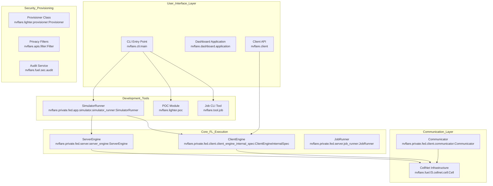

The architecture is organized into functional layers:
1.  **User Interface Layer**: Entry points including the `nvflare` CLI [setup.cfg:154](), a web-based Dashboard for project management [setup.py:87](), and the high-level Client API for minimal code changes [README.md:33]().
2.  **Development Tools**: Tools for different development stages, including the `Simulator` for single-system testing and POC mode for local multi-process simulation [README.md:34]().
3.  **Core FL Execution**: The runtime orchestration engines (`ServerEngine` [nvflare/private/fed/server/server_engine.py:89](), `ClientEngine`) and the `JobRunner` [nvflare/private/fed/server/job_runner.py:94]() that manages the lifecycle of federated jobs.
4.  **Communication Layer**: The F3 (Fast, Flexible, Federated) infrastructure providing `Cell` networking [nvflare/private/fed/server/fed_server.py:188]() and `Communicator` abstractions [nvflare/private/fed/client/communicator.py:52]().
5.  **Security & Privacy**: Services including the `Provisioner` for PKI-based setup, privacy filters for data protection [nvflare/private/fed/client/communicator.py:57](), and auditing services for compliance [nvflare/private/fed/utils/fed_utils.py:39]().

**Sources**: [README.md:32-38](), [setup.cfg:152-154](), [nvflare/private/fed/server/server_engine.py:89-128](), [nvflare/private/fed/server/fed_server.py:188-200](), [nvflare/private/fed/client/communicator.py:52-95]()

## Core Components and Process Model

NVIDIA FLARE uses a multi-process architecture to ensure isolation between infrastructure management (Parent processes) and federated learning workload execution (Job processes).

### Process Architecture and Key Classes

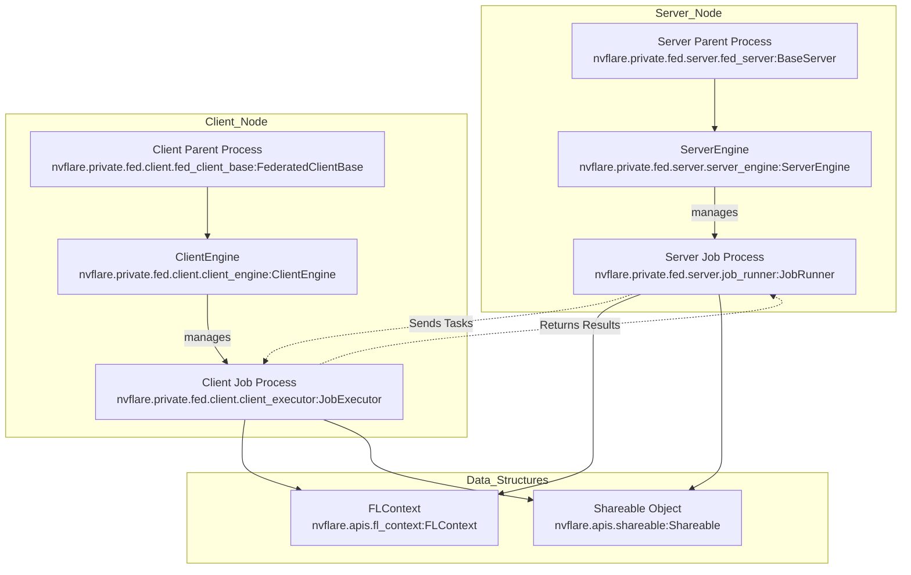

### Key Process Roles

| Process Type | Role | Key Components |
| :--- | :--- | :--- |
| **Server Parent (SP)** | Orchestrates the system and manages client registrations. | `BaseServer` [nvflare/private/fed/server/fed_server.py:85](), `ServerEngine` [nvflare/private/fed/server/server_engine.py:89]() |
| **Server Job (SJ)** | Executes server-side logic for a specific job (e.g., aggregation). | `JobRunner` [nvflare/private/fed/server/job_runner.py:94]() |
| **Client Parent (CP)** | Manages site-level operations and launches job workers. | `FederatedClientBase` [nvflare/private/fed/client/fed_client_base.py:39](), `Communicator` [nvflare/private/fed/client/communicator.py:52]() |
| **Client Job (CJ)** | Executes client-side training or validation logic for a job. | `JobExecutor` [nvflare/private/fed/client/client_executor.py:171]() |

This isolation ensures that a failure in a training script (CJ) does not crash the site's main connection to the federated network (CP). Data is exchanged using the `Shareable` object [nvflare/apis/fl_constant.py:100]() and managed via `FLContext` [nvflare/apis/fl_constant.py:123]().

**Sources**: [nvflare/private/fed/server/fed_server.py:85-115](), [nvflare/private/fed/server/server_engine.py:89-128](), [nvflare/private/fed/server/job_runner.py:94-123](), [nvflare/private/fed/client/fed_client_base.py:39-58](), [nvflare/private/fed/client/client_executor.py:171-212]()

## Deployment Modes

FLARE supports three modes for different stages of the workflow [README.md:32-37]().

| Mode | Use Case | Communication | Deployment |
| :--- | :--- | :--- | :--- |
| **Simulator** | Rapid prototyping and algorithm development. | Local threads/processes. | Single machine [README.md:34](). |
| **POC** | Testing multi-process deployment and networking. | Local TCP/Processes. | Single machine; simulated multi-site [nvflare/lighter/poc.py:1](). |
| **Production** | Real-world distributed deployment. | Distributed; TLS/mTLS. | Multi-node; requires PKI provisioning [nvflare/private/fed/utils/fed_utils.py:73](). |

-   **Simulator**: Runs jobs locally for fast testing.
-   **POC Mode**: Simulates deployment on one host with separate processes for clients and server.
-   **Production**: Uses the provisioning system to generate "startup kits" containing certificates and configurations [nvflare/private/fed/utils/fed_utils.py:143-165]().

**Sources**: [README.md:32-37](), [nvflare/private/fed/utils/fed_utils.py:73-140](), [nvflare/private/fed/utils/fed_utils.py:143-165]()

## Key Features and Capabilities

NVIDIA FLARE is a general-purpose framework for collaborative computing, supporting various workflows beyond simple model aggregation.

### Federated Workflows
-   **Federated Training**: Support for `FedAvg`, `FedProx`, `FedOpt`, `SCAFFOLD`, and more [README.md:27]().
-   **Federated Analytics**: Compute statistics across distributed data [README.md:29]().
-   **Federated Evaluation**: Evaluate global models or perform cross-site validation [README.md:28]().

### Advanced Capabilities
-   **Client API**: Transition from local ML to FL with minimal changes [README.md:33]().
-   **Privacy & Security**: Built-in differential privacy, homomorphic encryption, and Private Set Intersection (PSI) [README.md:30]().
-   **Resiliency**: Built-in support for system resiliency and fault tolerance [README.md:39]().
-   **Authorization**: Security enforcement through federated authorization and privacy policy [README.md:38]().

**Sources**: [README.md:23-41](), [nvflare/apis/fl_constant.py:26-54](), [nvflare/private/fed/utils/fed_utils.py:47-50]()

---

# Page: System Architecture

# System Architecture

<details>
<summary>Relevant source files</summary>

The following files were used as context for generating this wiki page:

- [README.md](README.md)
- [docs/examples/hello_cross_val.rst](docs/examples/hello_cross_val.rst)
- [docs/examples/hello_numpy.rst](docs/examples/hello_numpy.rst)
- [docs/faq.rst](docs/faq.rst)
- [docs/flare_overview.rst](docs/flare_overview.rst)
- [docs/index.rst](docs/index.rst)
- [docs/installation.rst](docs/installation.rst)
- [docs/programming_guide/filters.rst](docs/programming_guide/filters.rst)
- [docs/programming_guide/provisioning_system.rst](docs/programming_guide/provisioning_system.rst)
- [docs/programming_guide/system_architecture.rst](docs/programming_guide/system_architecture.rst)
- [docs/quickstart.rst](docs/quickstart.rst)
- [docs/resources/nvidia_eye.wwPt122j.png](docs/resources/nvidia_eye.wwPt122j.png)
- [examples/advanced/psi/README.md](examples/advanced/psi/README.md)
- [examples/advanced/psi/psi.jpg](examples/advanced/psi/psi.jpg)
- [nvflare/apis/client_engine_spec.py](nvflare/apis/client_engine_spec.py)
- [nvflare/apis/event_type.py](nvflare/apis/event_type.py)
- [nvflare/apis/fl_component.py](nvflare/apis/fl_component.py)
- [nvflare/apis/fl_constant.py](nvflare/apis/fl_constant.py)
- [nvflare/apis/job_scheduler_spec.py](nvflare/apis/job_scheduler_spec.py)
- [nvflare/apis/server_engine_spec.py](nvflare/apis/server_engine_spec.py)
- [nvflare/apis/utils/fl_context_utils.py](nvflare/apis/utils/fl_context_utils.py)
- [nvflare/app_common/job_schedulers/job_scheduler.py](nvflare/app_common/job_schedulers/job_scheduler.py)
- [nvflare/fuel/f3/cellnet/cell.py](nvflare/fuel/f3/cellnet/cell.py)
- [nvflare/private/aux_runner.py](nvflare/private/aux_runner.py)
- [nvflare/private/defs.py](nvflare/private/defs.py)
- [nvflare/private/event.py](nvflare/private/event.py)
- [nvflare/private/fed/app/client/client_train.py](nvflare/private/fed/app/client/client_train.py)
- [nvflare/private/fed/app/client/sub_worker_process.py](nvflare/private/fed/app/client/sub_worker_process.py)
- [nvflare/private/fed/app/client/worker_process.py](nvflare/private/fed/app/client/worker_process.py)
- [nvflare/private/fed/app/server/runner_process.py](nvflare/private/fed/app/server/runner_process.py)
- [nvflare/private/fed/app/server/server_train.py](nvflare/private/fed/app/server/server_train.py)
- [nvflare/private/fed/client/client_app_runner.py](nvflare/private/fed/client/client_app_runner.py)
- [nvflare/private/fed/client/client_engine.py](nvflare/private/fed/client/client_engine.py)
- [nvflare/private/fed/client/client_engine_executor_spec.py](nvflare/private/fed/client/client_engine_executor_spec.py)
- [nvflare/private/fed/client/client_engine_internal_spec.py](nvflare/private/fed/client/client_engine_internal_spec.py)
- [nvflare/private/fed/client/client_executor.py](nvflare/private/fed/client/client_executor.py)
- [nvflare/private/fed/client/client_req_processors.py](nvflare/private/fed/client/client_req_processors.py)
- [nvflare/private/fed/client/client_run_manager.py](nvflare/private/fed/client/client_run_manager.py)
- [nvflare/private/fed/client/client_runner.py](nvflare/private/fed/client/client_runner.py)
- [nvflare/private/fed/client/command_agent.py](nvflare/private/fed/client/command_agent.py)
- [nvflare/private/fed/client/communicator.py](nvflare/private/fed/client/communicator.py)
- [nvflare/private/fed/client/fed_client.py](nvflare/private/fed/client/fed_client.py)
- [nvflare/private/fed/client/fed_client_base.py](nvflare/private/fed/client/fed_client_base.py)
- [nvflare/private/fed/client/sys_cmd.py](nvflare/private/fed/client/sys_cmd.py)
- [nvflare/private/fed/server/cmd_utils.py](nvflare/private/fed/server/cmd_utils.py)
- [nvflare/private/fed/server/fed_server.py](nvflare/private/fed/server/fed_server.py)
- [nvflare/private/fed/server/info_coll_cmd.py](nvflare/private/fed/server/info_coll_cmd.py)
- [nvflare/private/fed/server/job_runner.py](nvflare/private/fed/server/job_runner.py)
- [nvflare/private/fed/server/run_manager.py](nvflare/private/fed/server/run_manager.py)
- [nvflare/private/fed/server/server_command_agent.py](nvflare/private/fed/server/server_command_agent.py)
- [nvflare/private/fed/server/server_commands.py](nvflare/private/fed/server/server_commands.py)
- [nvflare/private/fed/server/server_engine.py](nvflare/private/fed/server/server_engine.py)
- [nvflare/private/fed/server/server_engine_internal_spec.py](nvflare/private/fed/server/server_engine_internal_spec.py)
- [nvflare/private/fed/server/server_runner.py](nvflare/private/fed/server/server_runner.py)
- [nvflare/private/fed/server/sys_cmd.py](nvflare/private/fed/server/sys_cmd.py)
- [nvflare/private/fed/server/training_cmds.py](nvflare/private/fed/server/training_cmds.py)
- [nvflare/private/fed/utils/fed_utils.py](nvflare/private/fed/utils/fed_utils.py)
- [nvflare/security/security.py](nvflare/security/security.py)
- [nvflare/widgets/info_collector.py](nvflare/widgets/info_collector.py)
- [tests/unit_test/app_common/job_schedulers/job_scheduler_test.py](tests/unit_test/app_common/job_schedulers/job_scheduler_test.py)
- [tests/unit_test/private/fed/client/client_executor_test.py](tests/unit_test/private/fed/client/client_executor_test.py)
- [tests/unit_test/private/fed/server/fed_server_test.py](tests/unit_test/private/fed/server/fed_server_test.py)
- [tests/unit_test/private/fed/server/job_runner_test.py](tests/unit_test/private/fed/server/job_runner_test.py)

</details>


## Purpose and Scope

This document describes the overall system architecture of NVIDIA FLARE (NVIDIA Federated Learning Application Runtime Environment), including the server/client component structure, process model, communication infrastructure, and deployment models. It provides a technical overview of how the major subsystems interact to enable federated learning workloads.

For detailed information about specific subsystems:
- For core runtime execution details, see **Core Runtime Architecture** (Section 3).
- For communication protocols and networking, see **Communication Framework** (Section 4).
- For workflow orchestration, see **Workflows and Controllers** (Section 5).
- For client-side execution, see **Client-Side Execution** (Section 6).
- For deployment and provisioning, see **Deployment Modes** (Section 1.3) and **Provisioning System** (Section 10).

## High-Level Architecture

NVIDIA FLARE follows a **client-server architecture** where a central server coordinates federated learning jobs across multiple distributed clients. The system is designed with a componentized, event-driven architecture that separates concerns into distinct layers.

### System Overview

NVIDIA FLARE's architecture is built around the `ServerEngine` [nvflare/private/fed/server/server_engine.py:89-90]() and `ClientEngine` [nvflare/private/fed/client/client_engine.py:58-61]() which manage the state and orchestration of federated jobs.

**Title: NVIDIA FLARE High-Level Component Mapping**
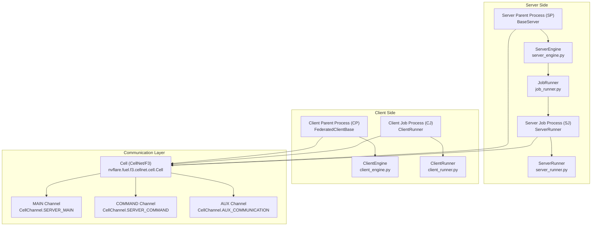
Sources: [nvflare/private/fed/server/server_engine.py:89-126](), [nvflare/private/fed/server/fed_server.py:85-112](), [nvflare/private/fed/client/fed_client_base.py:45-58](), [nvflare/private/fed/client/client_engine.py:58-75](), [nvflare/private/defs.py:59-67]()

### Core Architecture Principles

1. **Process Isolation**: Jobs run in separate processes (SJ/CJ) isolated from parent processes (SP/CP) for fault tolerance and resource management [nvflare/apis/fl_constant.py:118-119]().
2. **Event-Driven**: Components communicate through a comprehensive event system defined in `EventType` [nvflare/apis/event_type.py:19-20]().
3. **Pluggable Components**: Controllers, Executors, Filters, and other components follow well-defined interfaces like `FLComponent` [nvflare/apis/fl_component.py:20-21]().
4. **Multi-Channel Communication**: Dedicated channels for different message types ensure reliable delivery [nvflare/private/defs.py:59-67]().
5. **Stateful Orchestration**: `ServerEngine` [nvflare/private/fed/server/server_engine.py:89-100]() and `ClientRunner` [nvflare/private/fed/client/client_runner.py:125-165]() maintain system state and coordinate all operations.

Sources: [nvflare/apis/fl_constant.py:118-119](), [nvflare/private/fed/server/server_engine.py:89-126](), [nvflare/private/fed/client/client_runner.py:125-165](), [nvflare/apis/fl_component.py:20-21]()

## Process Model and Job Isolation

NVIDIA FLARE uses a **multi-process architecture** with strict separation between parent processes and job processes. This design provides job isolation and the ability to run multiple jobs concurrently.

### Process Types and Roles

The system distinguishes between long-running "Parent" processes and transient "Job" processes.

**Title: Process Interaction and Module Mapping**
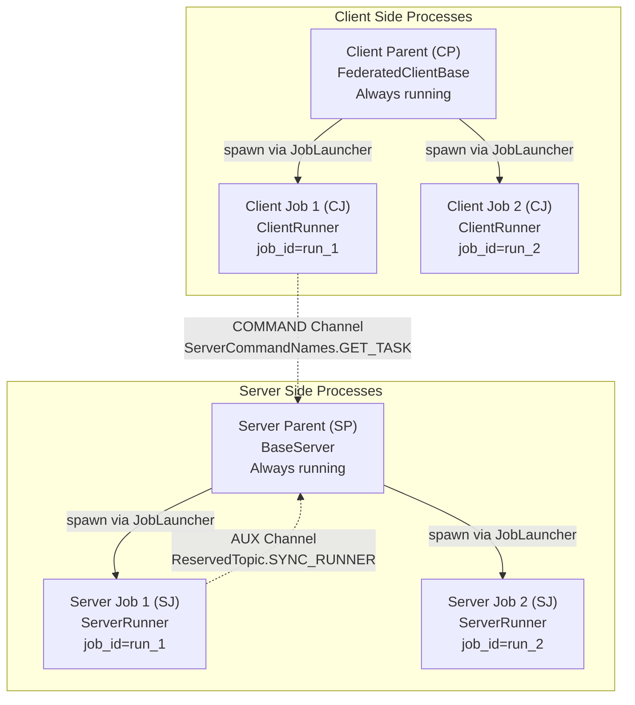
Sources: [nvflare/private/fed/server/server_engine.py:191-210](), [nvflare/private/fed/server/server_runner.py:112-121](), [nvflare/private/fed/client/client_runner.py:125-165](), [nvflare/private/fed/client/communicator.py:133-144]()

### Process Lifecycle

| Process Type | Module | Lifecycle | Responsibilities |
|-------------|---------|-----------|-----------------|
| **SP (Server Parent)** | `nvflare.private.fed.server.fed_server` | Continuous | Client registration, Job scheduling via `JobRunner`, Admin command handling [nvflare/private/fed/server/fed_server.py:85-152](). |
| **SJ (Server Job)** | `nvflare.private.fed.server.server_runner` | Per-job | Running `ServerRunner` and workflows, executing `Controller.control_flow()` [nvflare/private/fed/server/server_runner.py:127-149](). |
| **CP (Client Parent)** | `nvflare.private.fed.client.fed_client_base` | Continuous | Registration, authentication, Spawning CJ processes [nvflare/private/fed/client/fed_client_base.py:45-112](). |
| **CJ (Client Job)** | `nvflare.private.fed.client.client_runner` | Per-job | Running `ClientRunner`, executing `Executor.execute()`, task fetch and result submission [nvflare/private/fed/client/client_runner.py:125-165](). |

Sources: [nvflare/private/fed/server/server_engine.py:191-295](), [nvflare/private/fed/server/fed_server.py:85-152](), [nvflare/private/fed/client/fed_client_base.py:45-112](), [nvflare/private/fed/client/client_runner.py:125-165]()

## Server-Side Architecture

### ServerEngine: The Orchestration Hub

`ServerEngine` [nvflare/private/fed/server/server_engine.py:89-90]() is the central orchestration component on the server side. It maintains system state and coordinates all major operations.

**Key Responsibilities**:
- **Job Process Management**: Tracks running jobs in `run_processes` dict [nvflare/private/fed/server/server_engine.py:102]().
- **Client Management**: Interfaces with `ClientManager` [nvflare/private/fed/server/server_engine.py:107]().
- **Job Lifecycle**: Coordinates with `JobRunner` [nvflare/private/fed/server/job_runner.py:94-95]() to deploy and start jobs [nvflare/private/fed/server/server_engine.py:125]().
- **Communication**: Owns the server `Cell` [nvflare/private/fed/server/server_engine.py:106]().
- **Admin Command Processing**: Handles various admin commands via `ServerCommands` [nvflare/private/fed/server/server_engine.py:84]().

Sources: [nvflare/private/fed/server/server_engine.py:89-157](), [nvflare/private/fed/server/job_runner.py:94-120]()

### JobRunner: Job Lifecycle Management

`JobRunner` [nvflare/private/fed/server/job_runner.py:94-95]() manages the complete lifecycle of federated learning jobs from submission through completion.

**Job Lifecycle Stages**:
1. **Deployment** (`_deploy_job`): Deploy app to server and clients [nvflare/private/fed/server/job_runner.py:125-160]().
2. **Start**: Launch server SJ and client CJs [nvflare/private/fed/server/job_runner.py:180-200]().
3. **Monitoring**: Track job status via `RunStatus` [nvflare/private/fed/server/job_runner.py:35]().
4. **Job Heartbeat**: Processes client job heartbeats via `_handle_job_heartbeat` [nvflare/private/fed/server/server_runner.py:117]().

Sources: [nvflare/private/fed/server/job_runner.py:94-200](), [nvflare/private/fed/server/server_runner.py:117]()

## Client-Side Architecture

### FederatedClientBase: Connection and Management

`FederatedClientBase` [nvflare/private/fed/client/fed_client_base.py:39-40]() runs in the CP process and manages the connection to the server. It handles authentication and the primary server endpoint (SP).

**Key Responsibilities**:
- **Authentication**: Manages `token`, `token_signature`, and `ssid` issued by the server [nvflare/private/fed/client/fed_client_base.py:75-77]().
- **Communicator**: Initializes the `Communicator` [nvflare/private/fed/client/communicator.py:52-63]() for message exchange [nvflare/private/fed/client/fed_client_base.py:87-96]().
- **Cell Management**: Creates and updates the client `Cell` based on server location [nvflare/private/fed/client/fed_client_base.py:141-192]().

Sources: [nvflare/private/fed/client/fed_client_base.py:45-112](), [nvflare/private/fed/client/communicator.py:52-110]()

### ClientRunner: Task Execution

`ClientRunner` [nvflare/private/fed/client/client_runner.py:125-126]() runs in the CJ subprocess and executes individual tasks. It uses a `TaskRouter` [nvflare/private/fed/client/client_runner.py:49-50]() to dispatch tasks to the appropriate `Executor` [nvflare/apis/executor.py:20]().

**Task Execution Flow**:
1. **Fetch Task**: `ClientRunner` pulls tasks via the `Communicator` which registers callbacks for `ServerCommandNames.GET_TASK` [nvflare/private/fed/client/communicator.py:133-137]().
2. **Route**: `TaskRouter.route()` finds the assigned `Executor` for the `task_name` [nvflare/private/fed/client/client_runner.py:67-76]().
3. **Execute**: The `Executor.execute()` method is triggered by task assignment events [nvflare/private/fed/client/client_runner.py:166-175]().
4. **Submit**: Results are returned to the server via `Communicator` using `ServerCommandNames.SUBMIT_UPDATE` [nvflare/private/fed/client/communicator.py:139-144]().

Sources: [nvflare/private/fed/client/client_runner.py:125-300](), [nvflare/private/fed/client/communicator.py:133-144]()

## Communication Infrastructure

NVIDIA FLARE uses a multi-layered communication framework built on **CellNet** (also called **F3** - FLARE Federated Framework).

### Cell Architecture and Addressing

A **Cell** [nvflare/fuel/f3/cellnet/cell.py:72]() is the fundamental communication primitive. Each process is identified by a **Fully Qualified Cell Name (FQCN)** [nvflare/fuel/f3/cellnet/fqcn.py:31]().

- **Server Root**: `FQCN.ROOT_SERVER` [nvflare/private/fed/server/fed_server.py:185]().
- **Client FQCN**: Determined based on connection topology and relay presence [nvflare/private/fed/client/fed_client_base.py:161-182]().

Sources: [nvflare/fuel/f3/cellnet/fqcn.py:31](), [nvflare/private/fed/server/fed_server.py:185-193](), [nvflare/private/fed/client/fed_client_base.py:161-182](), [nvflare/fuel/f3/cellnet/cell.py:72-144]()

### Communication Channels

CellNet uses dedicated channels for different message types [nvflare/private/defs.py:59-67]():

| Channel | Purpose | Direction |
|---------|---------|-----------|
| `CellChannel.SERVER_MAIN` | Registration and heartbeats | Client → Server |
| `CellChannel.SERVER_COMMAND` | Task fetch (`GET_TASK`) and result submission (`SUBMIT_UPDATE`) | Bidirectional |
| `CellChannel.AUX_COMMUNICATION` | Auxiliary/Custom messages (e.g., `SYNC_RUNNER`, `JOB_HEART_BEAT`) | Bidirectional |

Sources: [nvflare/private/defs.py:59-67](), [nvflare/private/fed/client/communicator.py:133-144](), [nvflare/private/fed/server/server_runner.py:112-121](), [nvflare/fuel/f3/cellnet/cell.py:37-46]()

## Deployment Models

NVIDIA FLARE supports three primary deployment modes:

- **Simulator Mode**: Runs jobs on a single system for fast testing and algorithm development. Mimics distributed execution using threads or IPC [nvflare/apis/fl_constant.py:108]().
- **POC Mode**: Simulates deployment on one host with separate processes for clients and server using `localhost` networking [nvflare/apis/fl_constant.py:153]().
- **Production Mode**: Distributed deployment using startup kits generated by the provisioning system, utilizing full TLS/mTLS security [nvflare/private/fed/server/fed_server.py:153-167]().

### Cloud and Orchestrated Deployment
NVIDIA FLARE supports advanced deployment scenarios:
- **Containerized**: Supports running in Docker with isolated job processes using the `JobLauncher` abstraction [nvflare/apis/fl_constant.py:118-119]().
- **Kubernetes**: Supports running in Kubernetes with specialized launchers for scaling across clusters.
- **Cloud**: Built-in support for AWS, GCP, and Azure deployment via infrastructure scripts.

Sources: [nvflare/private/fed/server/fed_server.py:148-193](), [nvflare/apis/fl_constant.py:108-153](), [nvflare/private/fed/server/server_engine.py:184-190]()

---

# Page: Installation and Setup

# Installation and Setup

<details>
<summary>Relevant source files</summary>

The following files were used as context for generating this wiki page:

- [.dockerignore](.dockerignore)
- [.github/workflows/premerge.yml](.github/workflows/premerge.yml)
- [CODEOWNERS](CODEOWNERS)
- [CODE_OF_CONDUCT.md](CODE_OF_CONDUCT.md)
- [CONTRIBUTING.md](CONTRIBUTING.md)
- [codecov.yml](codecov.yml)
- [docs/contributing.rst](docs/contributing.rst)
- [nvflare/__init__.py](nvflare/__init__.py)
- [nvflare/fuel/hci/chunk.py](nvflare/fuel/hci/chunk.py)
- [nvflare/lighter/poc.py](nvflare/lighter/poc.py)
- [nvflare/private/fed/app/utils.py](nvflare/private/fed/app/utils.py)
- [pyproject.toml](pyproject.toml)
- [runtest.sh](runtest.sh)
- [setup.cfg](setup.cfg)
- [setup.py](setup.py)
- [tests/unit_test/app_common/utils/__init__.py](tests/unit_test/app_common/utils/__init__.py)
- [tests/unit_test/app_common/utils/fl_model_utils_test.py](tests/unit_test/app_common/utils/fl_model_utils_test.py)
- [tests/unit_test/fuel/f3/streaming/stream_types_test.py](tests/unit_test/fuel/f3/streaming/stream_types_test.py)

</details>


## Purpose and Scope

This document guides technical users through the installation of NVIDIA FLARE (NVFLARE), the configuration of Python virtual environments, and the management of optional dependencies. It details the package structure defined in the build system and provides a technical overview of how the library is distributed and verified.

For information on running FLARE after installation, see [Deployment Modes](1.3). For production deployment and provisioning, see [Provisioning System](10).

---

## Prerequisites

NVIDIA FLARE requires the following system environment:

| Requirement | Specification |
|------------|---------------|
| **Python** | 3.10 through 3.14 (tested) [setup.cfg:10-14](), [nvflare/private/fed/app/utils.py:30-31]() |
| **Package Manager** | `pip` [setup.cfg:21-22](), [runtest.sh:54]() or `uv` [runtest.sh:45-51]() |
| **Version Control** | Git (required for source installation and versioning) [setup.cfg:189-191]() |
| **Operating System** | POSIX Linux (Primary support) [setup.cfg:16](). macOS supported with limitations on specific extras [setup.cfg:75-80]() |

**Important Version Compatibility Note:** The system performs a strict version check at startup in `version_check()` to ensure the Python environment is within the supported range of 3.10 to 3.14 [nvflare/private/fed/app/utils.py:96-109](). The package version is managed via `versioneer` to ensure consistency across distributed components [setup.py:25-35]().

Sources: [setup.cfg:10-21](), [setup.py:25-35](), [nvflare/private/fed/app/utils.py:30-42](), [nvflare/private/fed/app/utils.py:96-109]()

---

## Installation Methods

### Installation Flow

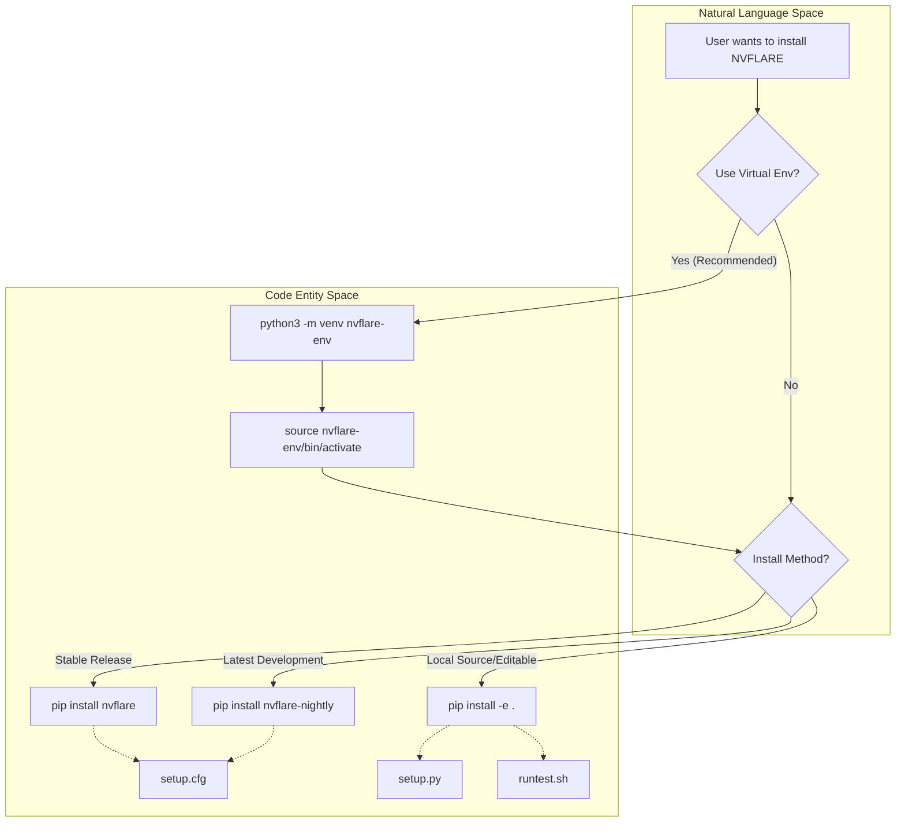

Sources: [setup.py:53-57](), [setup.cfg:153-154](), [runtest.sh:29-58]()

---

## Virtual Environment Setup

Isolating NVFLARE dependencies is critical for avoiding conflicts with framework-specific requirements (e.g., conflicting PyTorch or TensorFlow versions).

**1. Create virtual environment:**
```bash
python3 -m venv nvflare-env
```
This creates a directory containing a copy of the Python interpreter and standard library.

**2. Activate the environment:**
```bash
source nvflare-env/bin/activate
```
Activation ensures that subsequent `pip` or `uv` commands target the isolated environment [runtest.sh:48-51]().

**3. Update package management tools:**
```bash
(nvflare-env) $ python3 -m pip install -U pip setuptools
```
Updating `pip` and `setuptools` ensures compatibility with modern wheel distributions and the `setup.cfg` metadata format.

Sources: [setup.cfg:19-22](), [runtest.sh:45-55]()

---

## Installing NVIDIA FLARE

### Package Structure and Distribution

The build process in `setup.py` dynamically assembles the package by collecting core code, dashboard assets, and job templates.

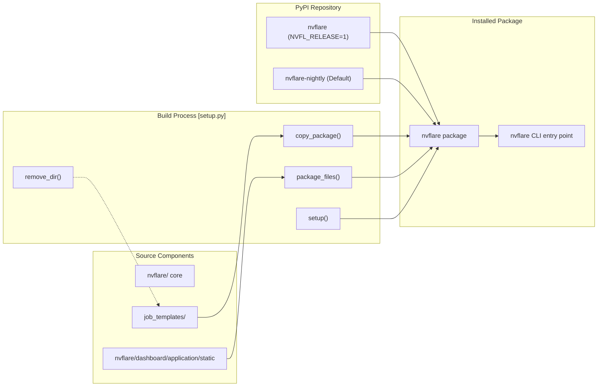

Sources: [setup.py:53-57](), [setup.py:87-91](), [setup.cfg:153-154](), [setup.py:117]()

### Method 1: PyPI Installation

Install the stable release:
```bash
pip install nvflare
```
The package name `nvflare` is used when the environment variable `NVFL_RELEASE` is set to `"1"` [setup.py:53-55](). Otherwise, the build defaults to `nvflare-nightly` [setup.py:57]().

### Method 2: Source Installation (Development)

For contributors or users needing the latest unreleased changes:
```bash
git clone https://github.com/NVIDIA/NVFlare.git
cd NVFlare
pip install -e .
```
The `setup.py` script uses `versioneer` to determine the version string from the git state [setup.py:35-51](). If no git information is available, it defaults to a `.dev` version based on the current date [setup.py:41-49](). Developers can also use `runtest.sh` to install dependencies with appropriate extras for their platform (e.g., `dev`, `dev_mac`, or `dev_cpu`) [runtest.sh:29-39]().

Sources: [setup.py:35-57](), [runtest.sh:29-58]()

---

## Dependency Management

### Core Dependencies

These packages are mandatory and defined in `install_requires` [setup.cfg:21-38]():

| Dependency | Purpose |
|-----------|---------|
| `cryptography` | Secure communication and PKI [setup.cfg:22]() |
| `grpcio` | High-performance RPC transport [setup.cfg:26]() |
| `numpy` | Tensor and data manipulation [setup.cfg:28]() |
| `protobuf` | Structured data serialization [setup.cfg:29]() |
| `msgpack` | Efficient binary serialization [setup.cfg:33]() |
| `Flask` & `SQLAlchemy` | Dashboard backend and persistence [setup.cfg:23-25]() |
| `pydantic` | Configuration validation [setup.cfg:37]() |
| `safetensors` | Secure tensor serialization [setup.cfg:38]() |
| `psutil` | Process monitoring and lifecycle management [setup.cfg:30](), [nvflare/private/fed/app/utils.py:20]() |

### Optional Feature Groups (Extras)

NVFLARE uses `options.extras_require` to manage framework-specific dependencies [setup.cfg:40-150]().

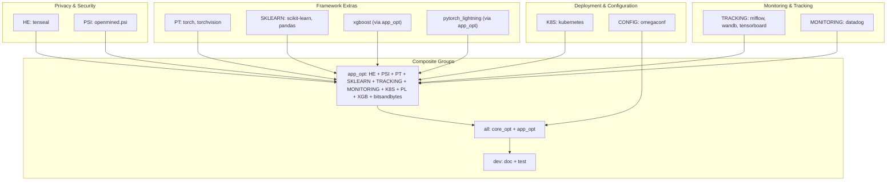

Sources: [setup.cfg:40-90](), [setup.cfg:119-121]()

### Platform and Version Limitations

- **macOS Compatibility:** The `HE` and `PSI` extras are excluded from the `app_opt_mac` group because `tenseal` and `openmined.psi` often lack compatible wheels for macOS [setup.cfg:75-80](), [setup.cfg:93-95]().
- **Python 3.14 Support:** `tenseal` (required for `HE`) is currently unavailable for Python 3.14 [setup.cfg:42-44](). Similarly, `openmined.psi` is restricted to versions below 3.14 [setup.cfg:45-46]().
- **CI/CD Validation:** The `premerge.yml` workflow verifies these dependencies across multiple Python versions (3.10-3.14) and operating systems (Ubuntu 22.04/24.04) [.github/workflows/premerge.yml:49-50]().

Sources: [setup.cfg:42-46](), [setup.cfg:75-80](), [.github/workflows/premerge.yml:42-67]()

---

## Package Verification

### CLI Entry Point

Installation registers the `nvflare` command-line interface via `console_scripts`. This is mapped to the `main` function in `nvflare.cli` [setup.cfg:153-154]().

```bash
nvflare --version
```

### Versioning Mechanism

The version is managed via `versioneer` [setup.py:25-35](). At runtime, the version is accessible via the `__version__` attribute in the root package [nvflare/__init__.py:17]().

### Internal Data Assets

The installation includes critical non-code assets required for runtime operation:
- **Job Templates:** Copied from `job_templates/` into `nvflare/tool/job/templates/` during build [setup.py:88-90]().
- **Dashboard Static Files:** Located in `nvflare/dashboard/application/static/` [setup.py:87]() via `extra_files` [setup.py:110]().
- **POC Data:** A `poc.zip` file is included in the package data for local simulation [setup.py:109]().
- **Entry Points:** The `nvflare` command is the primary interface for `poc`, `job`, and `provision` operations [setup.cfg:154]().

Sources: [setup.py:87-115](), [setup.cfg:153-154](), [nvflare/__init__.py:17]()

---

# Page: Deployment Modes

# Deployment Modes

<details>
<summary>Relevant source files</summary>

The following files were used as context for generating this wiki page:

- [README.md](README.md)
- [docs/examples/hello_cross_val.rst](docs/examples/hello_cross_val.rst)
- [docs/examples/hello_numpy.rst](docs/examples/hello_numpy.rst)
- [docs/faq.rst](docs/faq.rst)
- [docs/flare_overview.rst](docs/flare_overview.rst)
- [docs/index.rst](docs/index.rst)
- [docs/installation.rst](docs/installation.rst)
- [docs/programming_guide/filters.rst](docs/programming_guide/filters.rst)
- [docs/programming_guide/provisioning_system.rst](docs/programming_guide/provisioning_system.rst)
- [docs/programming_guide/system_architecture.rst](docs/programming_guide/system_architecture.rst)
- [docs/quickstart.rst](docs/quickstart.rst)
- [docs/resources/nvidia_eye.wwPt122j.png](docs/resources/nvidia_eye.wwPt122j.png)
- [examples/advanced/psi/README.md](examples/advanced/psi/README.md)
- [examples/advanced/psi/psi.jpg](examples/advanced/psi/psi.jpg)
- [nvflare/cli.py](nvflare/cli.py)
- [nvflare/collab/runtime/controller.py](nvflare/collab/runtime/controller.py)
- [nvflare/fuel/common/multi_process_executor_constants.py](nvflare/fuel/common/multi_process_executor_constants.py)
- [nvflare/fuel/f3/connection.py](nvflare/fuel/f3/connection.py)
- [nvflare/private/fed/app/deployer/base_client_deployer.py](nvflare/private/fed/app/deployer/base_client_deployer.py)
- [nvflare/private/fed/app/deployer/server_deployer.py](nvflare/private/fed/app/deployer/server_deployer.py)
- [nvflare/private/fed/app/deployer/simulator_deployer.py](nvflare/private/fed/app/deployer/simulator_deployer.py)
- [nvflare/private/fed/app/simulator/simulator.py](nvflare/private/fed/app/simulator/simulator.py)
- [nvflare/private/fed/app/simulator/simulator_runner.py](nvflare/private/fed/app/simulator/simulator_runner.py)
- [nvflare/private/fed/app/simulator/simulator_worker.py](nvflare/private/fed/app/simulator/simulator_worker.py)
- [nvflare/private/fed/client/admin.py](nvflare/private/fed/client/admin.py)
- [nvflare/private/fed/server/admin.py](nvflare/private/fed/server/admin.py)
- [nvflare/private/fed/simulator/simulator_client_engine.py](nvflare/private/fed/simulator/simulator_client_engine.py)
- [nvflare/private/fed/simulator/simulator_server.py](nvflare/private/fed/simulator/simulator_server.py)
- [nvflare/tool/job/config/config_indexer.py](nvflare/tool/job/config/config_indexer.py)
- [nvflare/tool/job/config/configer.py](nvflare/tool/job/config/configer.py)
- [nvflare/tool/job/job_cli.py](nvflare/tool/job/job_cli.py)
- [nvflare/tool/job/job_client_const.py](nvflare/tool/job/job_client_const.py)
- [nvflare/tool/poc/poc_commands.py](nvflare/tool/poc/poc_commands.py)
- [nvflare/tool/poc/service_constants.py](nvflare/tool/poc/service_constants.py)
- [nvflare/utils/cli_utils.py](nvflare/utils/cli_utils.py)
- [tests/unit_test/collab/runtime/controller_test.py](tests/unit_test/collab/runtime/controller_test.py)
- [tests/unit_test/data/jobs/launch_everytime/app/config/config_fed_client.conf](tests/unit_test/data/jobs/launch_everytime/app/config/config_fed_client.conf)
- [tests/unit_test/data/jobs/launch_everytime/app/config/config_fed_server.conf](tests/unit_test/data/jobs/launch_everytime/app/config/config_fed_server.conf)
- [tests/unit_test/data/jobs/launch_everytime/meta.conf](tests/unit_test/data/jobs/launch_everytime/meta.conf)
- [tests/unit_test/data/jobs/launch_once/app/config/config_fed_client.conf](tests/unit_test/data/jobs/launch_once/app/config/config_fed_client.conf)
- [tests/unit_test/data/jobs/launch_once/app/config/config_fed_server.conf](tests/unit_test/data/jobs/launch_once/app/config/config_fed_server.conf)
- [tests/unit_test/data/jobs/launch_once/meta.conf](tests/unit_test/data/jobs/launch_once/meta.conf)
- [tests/unit_test/fuel/f3/streaming/streaming_test.py](tests/unit_test/fuel/f3/streaming/streaming_test.py)
- [tests/unit_test/lighter/poc_commands_test.py](tests/unit_test/lighter/poc_commands_test.py)
- [tests/unit_test/private/fed/app/deployer/simulator_deployer_test.py](tests/unit_test/private/fed/app/deployer/simulator_deployer_test.py)
- [tests/unit_test/private/fed/app/simulator/simulator_runner_test.py](tests/unit_test/private/fed/app/simulator/simulator_runner_test.py)
- [tests/unit_test/private/fed/server/server_engine_test.py](tests/unit_test/private/fed/server/server_engine_test.py)
- [tests/unit_test/tool/job/config/config_indexer_test.py](tests/unit_test/tool/job/config/config_indexer_test.py)
- [tests/unit_test/tool/job/config/configer_test.py](tests/unit_test/tool/job/config/configer_test.py)
- [tests/unit_test/tool/job/job_cli_test.py](tests/unit_test/tool/job/job_cli_test.py)
- [tests/unit_test/tool/poc/poc_force_test.py](tests/unit_test/tool/poc/poc_force_test.py)
- [tests/unit_test/tool/poc/poc_output_test.py](tests/unit_test/tool/poc/poc_output_test.py)

</details>


## Purpose and Scope

This document explains the three primary deployment modes in NVIDIA FLARE: **Simulator**, **POC**, and **Production**. These modes provide a progression path from rapid algorithm prototyping to secure, distributed federated learning across multiple organizations. Each mode utilizes different process architectures, communication mechanisms, and security configurations to balance development speed with operational realism. [nvflare/private/fed/app/simulator/simulator_runner.py:84-107]()

---

## Overview

NVIDIA FLARE supports three deployment modes to facilitate different stages of the Federated Learning (FL) workflow:

| Mode | Purpose | Process Model | Communication | Security | Typical Use |
|------|---------|---------------|---------------|----------|-------------|
| **Simulator** | Rapid prototyping | Single system, multi-process | In-memory / IPC | Optional | Algorithm development, fast debugging |
| **POC** | Local validation | Multi-process (Server + Clients) on one host | Local network (localhost) | Optional | Workflow testing, integration validation |
| **Production** | Distributed FL | Multi-process across machines | Network (TLS/mTLS) | Required | Real-world multi-party collaboration |

The recommended workflow is to start with the **Simulator** for development, then validate with **POC** mode on a single host before moving to a full **Production** distributed deployment. [docs/quickstart.rst:16-22]()

**Sources:** [nvflare/private/fed/app/simulator/simulator_runner.py:84-107](), [docs/quickstart.rst:16-22](), [README.md:32-39]()

---

## Simulator Mode

### Architecture

Simulator mode runs the entire federated learning system (Server and multiple Clients) within a single system. It mimics a distributed environment by using `SimulatorRunner` to orchestrate the lifecycle of a job locally. [nvflare/private/fed/app/simulator/simulator_runner.py:84-110]()

Title: Simulator Process Architecture
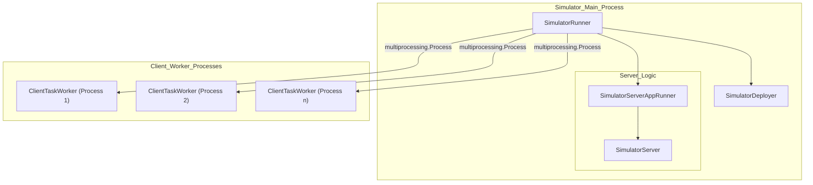

**Diagram: Simulator Process Architecture** associating `SimulatorRunner` [nvflare/private/fed/app/simulator/simulator_runner.py:84](), `SimulatorServer` [nvflare/private/fed/simulator/simulator_server.py:96](), and `ClientTaskWorker` [nvflare/private/fed/app/simulator/simulator_worker.py:48]().

**Sources:** [nvflare/private/fed/app/simulator/simulator_runner.py:26](), [nvflare/private/fed/app/simulator/simulator_worker.py:48-56](), [nvflare/private/fed/simulator/simulator_server.py:96-121]()

### Implementation Details
The `SimulatorRunner` initializes a `SimulatorDeployer` to set up a temporary workspace. [nvflare/private/fed/app/simulator/simulator_runner.py:113](). It uses `multiprocessing.Process` to spawn `ClientTaskWorker` instances, which execute client tasks in isolation. [nvflare/private/fed/app/simulator/simulator_runner.py:26](). Each `ClientTaskWorker` creates a `SimulatorClientAppRunner` to manage the local execution of the `ClientApp`. [nvflare/private/fed/app/simulator/simulator_worker.py:68-72]()

The `SimulatorRunner` manages a pool of `ClientTaskWorker` processes. When a task needs to be executed on a client, the `SimulatorRunner` sends the task to the appropriate `ClientTaskWorker` via an inter-process communication (IPC) channel using `multiprocessing.connection.Client`. [nvflare/private/fed/app/simulator/simulator_runner.py:27](). The `ClientTaskWorker` then executes the task using its `SimulatorClientAppRunner` and returns the result. This setup allows for concurrent execution of client tasks, mimicking a distributed environment. [nvflare/private/fed/app/simulator/simulator_runner.py:25-27](), [nvflare/private/fed/app/simulator/simulator_worker.py:157-158]()

**Sources:** [nvflare/private/fed/app/simulator/simulator_runner.py:84-121](), [nvflare/private/fed/app/simulator/simulator_runner.py:26](), [nvflare/private/fed/app/simulator/simulator_worker.py:68-72](), [nvflare/private/fed/app/simulator/simulator_worker.py:157-158]()

---

## POC Mode

### Architecture

POC (Proof of Concept) mode simulates a distributed deployment on a single host by running the server and clients as separate processes. This mode validates the multi-process communication and lifecycle management of the system using generated startup kits. [docs/quickstart.rst:19-19]()

Title: POC Multi-Process Architecture
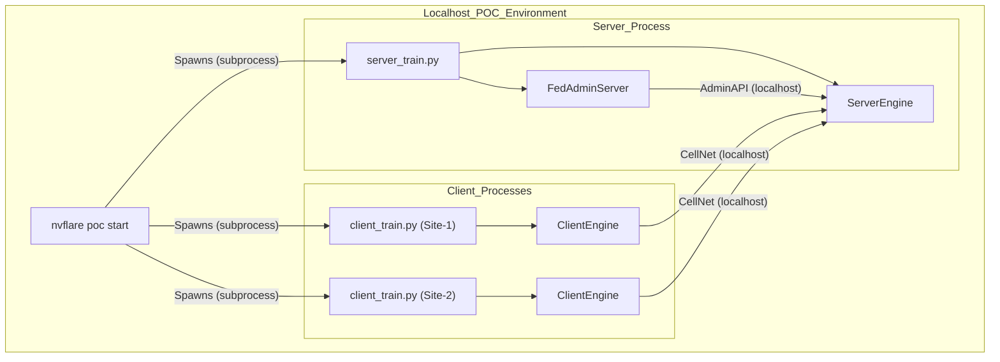

**Diagram: POC Multi-Process Architecture** using `FedAdminServer` [nvflare/private/fed/server/admin.py:145]() and `ServerEngine` [nvflare/private/fed/simulator/simulator_server.py:31]().

**Sources:** [nvflare/tool/poc/poc_commands.py:142-176](), [nvflare/private/fed/server/admin.py:145-165](), [nvflare/private/fed/simulator/simulator_server.py:31-40](), [docs/quickstart.rst:19-19]()

### POC Management

The POC environment is managed via the `nvflare poc` CLI command group. It generates a local workspace where each participant (server and clients) has its own sub-folder and configuration files. [nvflare/tool/poc/poc_commands.py:74-80]()

The `nvflare poc prepare` command provisions the necessary startup kits and configurations for the server and clients within a designated POC workspace (default: `/tmp/nvflare/poc`). [nvflare/tool/poc/poc_commands.py:71-74](). The server and client processes communicate over localhost using CellNet. [nvflare/private/fed/app/deployer/simulator_deployer.py:88-103]()

| Component | Function | Implementation |
|---------|----------|----------------|
| **Server** | Aggregates and orchestrates. | `SimulatorServer` [nvflare/private/fed/simulator/simulator_server.py:96]() |
| **Client** | Executes training/inference. | `ClientEngine` [nvflare/private/fed/app/simulator/simulator_worker.py:50]() |
| **Admin** | Command and control. | `FedAdminServer` [nvflare/private/fed/server/admin.py:145]() |

**Sources:** [nvflare/tool/poc/poc_commands.py:71-94](), [nvflare/private/fed/simulator/simulator_server.py:96-121](), [nvflare/private/fed/server/admin.py:145-165](), [nvflare/private/fed/app/simulator/simulator_worker.py:50-55]()

---

## Production Mode

### Architecture

Production mode is a distributed deployment where participants (Server, Clients, Admins) run on different physical or virtual machines. It requires a **Provisioning** step to generate secure startup kits containing certificates and configurations. [docs/programming_guide/provisioning_system.rst:6-16]()

Title: Production Distributed Deployment
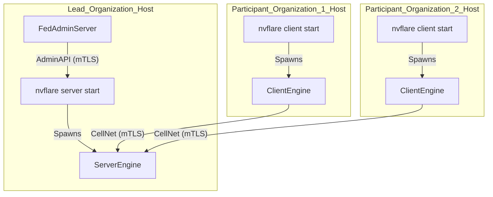

**Diagram: Production Distributed Deployment** associating `FedAdminServer` [nvflare/private/fed/server/admin.py:145]() with `ServerEngine` [nvflare/private/fed/simulator/simulator_server.py:31]() and `ClientEngine` [nvflare/private/fed/app/simulator/simulator_worker.py:50]().

**Sources:** [nvflare/private/fed/server/admin.py:145-165](), [nvflare/private/fed/app/simulator/simulator_worker.py:48-55](), [docs/programming_guide/provisioning_system.rst:6-16]()

### Provisioning and Security

In production, the system relies on signed packages and mutual TLS (mTLS). [docs/programming_guide/provisioning_system.rst:9-11]()
- **Provisioning**: The `Provisioner` class handles the lifecycle of generating startup kits by orchestrating various `Builder` modules. [docs/programming_guide/provisioning_system.rst:65-75]()
- **mTLS Enforcement**: Communication channels use shared TLS certificates generated during provisioning to establish secure identities between participants. [docs/programming_guide/provisioning_system.rst:9-11]()
- **Participant Types**: The system recognizes `server`, `client`, and `admin` as primary participant types. [docs/programming_guide/provisioning_system.rst:121-126]()
- **Workspace Structure**: Provisioning creates a structured workspace (e.g., `prod_01`) containing `startup` folders with certificates and configuration files for each site. [docs/programming_guide/provisioning_system.rst:12-16]()

**Sources:** [docs/programming_guide/provisioning_system.rst:9-75](), [docs/programming_guide/provisioning_system.rst:121-126]()

---

## Mode Comparison and Transition

### Feature Matrix

| Feature | Simulator | POC | Production |
|---------|-----------|-----|------------|
| **Entry Point** | `SimulatorRunner` [nvflare/private/fed/app/simulator/simulator_runner.py:84]() | `nvflare poc` [nvflare/tool/poc/poc_commands.py:74]() | `Provisioner` [docs/programming_guide/provisioning_system.rst:65]() |
| **Networking** | Internal IPC [nvflare/private/fed/app/simulator/simulator_runner.py:27]() | Localhost TCP [nvflare/tool/poc/poc_commands.py:90]() | Networked mTLS [docs/programming_guide/provisioning_system.rst:9]() |
| **Process Isolation** | `multiprocessing.Process` [nvflare/private/fed/app/simulator/simulator_runner.py:26]() | OS Processes (Subprocess) | Distributed OS Processes |
| **Security** | Optional | Optional | Required (mTLS/Certs) [docs/programming_guide/provisioning_system.rst:9]() |
| **Workspace** | `simulator_workspace` [nvflare/private/fed/app/simulator/simulator_runner.py:125]() | `/tmp/nvflare/poc` [nvflare/tool/poc/poc_commands.py:71]() | Provisioned Workspace [docs/programming_guide/provisioning_system.rst:15-16]() |

**Sources:** [nvflare/private/fed/app/simulator/simulator_runner.py:26-125](), [nvflare/tool/poc/poc_commands.py:71-90](), [docs/programming_guide/provisioning_system.rst:9-65](), [docs/quickstart.rst:18-20]()

### Transition Workflow

1. **Develop**: Use the **Simulator** for rapid iteration on a single machine without complex setup. This allows for quick algorithm development and debugging. [docs/quickstart.rst:22-22]()
2. **Validate**: Transition to **POC mode** to test multi-process behavior and separation of site-specific configurations on one host. [docs/quickstart.rst:22-22]()
3. **Deploy**: Use the **Provisioning System** to generate startup kits for a distributed **Production** environment across different organizations. [docs/quickstart.rst:22-22]()

**Sources:** [docs/quickstart.rst:16-22](), [docs/programming_guide/provisioning_system.rst:6-16]()

---

# Page: Getting Started

# Getting Started

<details>
<summary>Relevant source files</summary>

The following files were used as context for generating this wiki page:

- [docs/example_applications_algorithms.rst](docs/example_applications_algorithms.rst)
- [docs/examples/federated_statistics_overview.rst](docs/examples/federated_statistics_overview.rst)
- [docs/examples/fl_algorithms.rst](docs/examples/fl_algorithms.rst)
- [docs/examples/hello_world_examples.rst](docs/examples/hello_world_examples.rst)
- [docs/examples/medical_image_analysis.rst](docs/examples/medical_image_analysis.rst)
- [docs/examples/tutorial_notebooks.rst](docs/examples/tutorial_notebooks.rst)
- [docs/programming_guide/controllers/cross_site_model_evaluation.rst](docs/programming_guide/controllers/cross_site_model_evaluation.rst)
- [docs/programming_guide/controllers/cyclic_workflow.rst](docs/programming_guide/controllers/cyclic_workflow.rst)
- [docs/programming_guide/controllers/scatter_and_gather_workflow.rst](docs/programming_guide/controllers/scatter_and_gather_workflow.rst)
- [docs/release_notes/flare_220.rst](docs/release_notes/flare_220.rst)
- [docs/release_notes/flare_240.rst](docs/release_notes/flare_240.rst)
- [docs/release_notes/flare_250.rst](docs/release_notes/flare_250.rst)
- [docs/whats_new.rst](docs/whats_new.rst)
- [examples/README.md](examples/README.md)
- [examples/advanced/README.md](examples/advanced/README.md)
- [examples/advanced/finance/README.md](examples/advanced/finance/README.md)
- [examples/advanced/job_api/tf/README.md](examples/advanced/job_api/tf/README.md)
- [examples/advanced/job_api/tf/run_jobs.sh](examples/advanced/job_api/tf/run_jobs.sh)
- [examples/advanced/monitoring/README.md](examples/advanced/monitoring/README.md)
- [examples/advanced/monitoring/jobs/README.md](examples/advanced/monitoring/jobs/README.md)
- [examples/advanced/sklearn-kmeans/sklearn_kmeans_iris.ipynb](examples/advanced/sklearn-kmeans/sklearn_kmeans_iris.ipynb)
- [examples/advanced/sklearn-linear/sklearn_linear_higgs.ipynb](examples/advanced/sklearn-linear/sklearn_linear_higgs.ipynb)
- [examples/advanced/sklearn-svm/sklearn_svm_cancer.ipynb](examples/advanced/sklearn-svm/sklearn_svm_cancer.ipynb)
- [examples/hello-world/README.md](examples/hello-world/README.md)
- [examples/hello-world/hello-lightning/hello_lightning.ipynb](examples/hello-world/hello-lightning/hello_lightning.ipynb)
- [examples/hello-world/hello-pt/requirements.txt](examples/hello-world/hello-pt/requirements.txt)
- [examples/hello-world/hello_world.ipynb](examples/hello-world/hello_world.ipynb)
- [examples/hello-world/hw_pre_start.sh](examples/hello-world/hw_pre_start.sh)
- [examples/tutorials/README.md](examples/tutorials/README.md)
- [examples/tutorials/flare_api.ipynb](examples/tutorials/flare_api.ipynb)
- [examples/tutorials/flare_simulator.ipynb](examples/tutorials/flare_simulator.ipynb)
- [examples/tutorials/setup_poc.ipynb](examples/tutorials/setup_poc.ipynb)

</details>


## Purpose and Scope

This page provides practical quick-start guides for new users to begin using NVIDIA FLARE (NVFLARE). It covers the primary entry points for running federated learning jobs: the **FL Simulator** for local testing, **POC mode** for multi-process simulation, the **Job CLI** for job management, and the **Client API** for federating existing training code. NVIDIA FLARE is a domain-agnostic, open-source Python SDK designed to adapt existing ML/DL workflows to a federated paradigm [examples/README.md:3-9]().

For comprehensive system architecture and deployment details, see [Overview](#1). For production deployment with provisioning and startup kits, see [Provisioning System](#10).

**Sources:** [examples/README.md:1-18](), [docs/example_applications_algorithms.rst:1-8]()

---

## Three Deployment Modes

NVIDIA FLARE supports three modes corresponding to different stages of your workflow [examples/tutorials/setup_poc.ipynb:10-14]():

| Mode | Purpose | Process Model | Use Case |
|------|---------|---------------|----------|
| **Simulator** | Algorithm development & debugging | Single system, simulates multiple clients | Rapid prototyping without complex networking [examples/tutorials/flare_simulator.ipynb:8-11]() |
| **POC** | Local validation | Multi-process (separate server & clients) | Validate deployment on one host before production [examples/tutorials/setup_poc.ipynb:12-14]() |
| **Production** | Real deployment | Distributed across sites | Live FL system with provisioned startup kits [docs/example_applications_algorithms.rst:38-40]() |

### Deployment Evolution
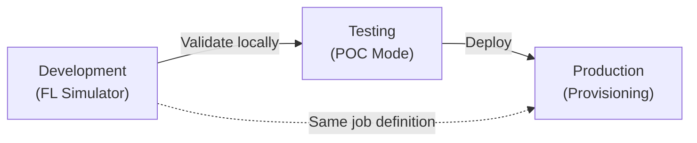

**Workflow:** Start with the **Simulator** for fast iteration [examples/tutorials/flare_simulator.ipynb:10-11](). Move to **POC mode** (`nvflare poc`) to test multi-process behavior and established distinct server and client "systems" [examples/tutorials/setup_poc.ipynb:12-14](). Deploy to **Production** using provisioned startup kits generated via the `Provisioner` [docs/release_notes/flare_250.rst:107-113]().

**Sources:** [examples/tutorials/setup_poc.ipynb:10-14](), [examples/tutorials/flare_simulator.ipynb:8-11](), [docs/release_notes/flare_250.rst:107-113]()

---

## Converting ML Code to Federated Learning

Converting existing training code typically involves using the **Client API** (`nvflare.client`). This transition requires minimal code changes to adapt ML/DL workflows to a federated paradigm [docs/release_notes/flare_240.rst:10-15]().

### The Job Recipe API
The modern way to define federated jobs is through **Job Recipes**, which encapsulate the workflow (e.g., `FedAvgRecipe`) and training script in a high-level Python API [examples/hello-world/hello_world.ipynb:28-32](). Recipes expose key arguments like `min_clients`, `num_rounds`, and `train_script` [examples/hello-world/hello_world.ipynb:54-60]().

```python
from nvflare.app_opt.pt.recipes.fedavg import FedAvgRecipe # [examples/hello-world/hello_world.ipynb:51]()
from nvflare.recipe import SimEnv # [examples/hello-world/hello_world.ipynb:52]()

recipe = FedAvgRecipe(
    name="hello-pt",
    min_clients=2,
    num_rounds=2,
    model=SimpleNetwork(), # [examples/hello-world/hello_world.ipynb:58]()
    train_script="client.py", # [examples/hello-world/hello_world.ipynb:59]()
)

env = SimEnv(num_clients=2) # [examples/hello-world/hello_world.ipynb:62]()
run = recipe.execute(env) # [examples/hello-world/hello_world.ipynb:63]()
```

### Client-Side Logic
The training script uses the Client API to interact with the FLARE runtime [docs/release_notes/flare_240.rst:21-24]().

```python
import nvflare.client as flare # [docs/release_notes/flare_240.rst:21]()

flare.init() # Initialize runtime [docs/release_notes/flare_240.rst:24]()

while flare.is_running(): # [docs/release_notes/flare_240.rst:27]()
    input_model = flare.receive() # Receive global model [docs/release_notes/flare_240.rst:30]()
    # ... training ...
    flare.send(output_model) # Send updated model back [docs/release_notes/flare_240.rst:46]()
```

**Sources:** [examples/hello-world/hello_world.ipynb:28-70](), [docs/release_notes/flare_240.rst:8-48]()

---

## Quick Start Path 1: FL Simulator

The **FL Simulator** runs a local simulation of an NVFLARE deployment. It is useful for local development and batch jobs that should start, run, and exit without provisioned daemons [examples/tutorials/flare_simulator.ipynb:8-10](). For details, see [Simulator Usage](#2.3).

### Simulator Architecture
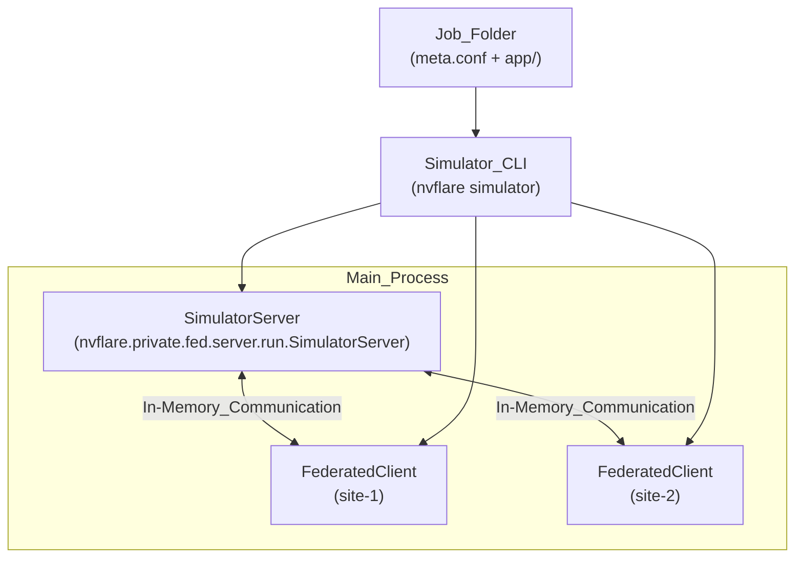

**Usage:**
The simulator can be invoked via the CLI to run a specific job folder [examples/tutorials/flare_simulator.ipynb:23](). For Recipe API based jobs, you can run the script directly as it uses `SimEnv` internally [examples/tutorials/flare_simulator.ipynb:65-67]().

**Sources:** [examples/tutorials/flare_simulator.ipynb:8-23, 65-67](), [docs/example_applications_algorithms.rst:38-39]()

---

## Quick Start Path 2: POC Mode

**POC (Proof of Concept) mode** establishes distinct server and client "systems" on a single machine using separate processes, allowing users to experiment with multi-process separation and administrative tools [examples/tutorials/setup_poc.ipynb:12-14](). For details, see [POC Mode Quick Start](#2.2).

### POC Process Structure
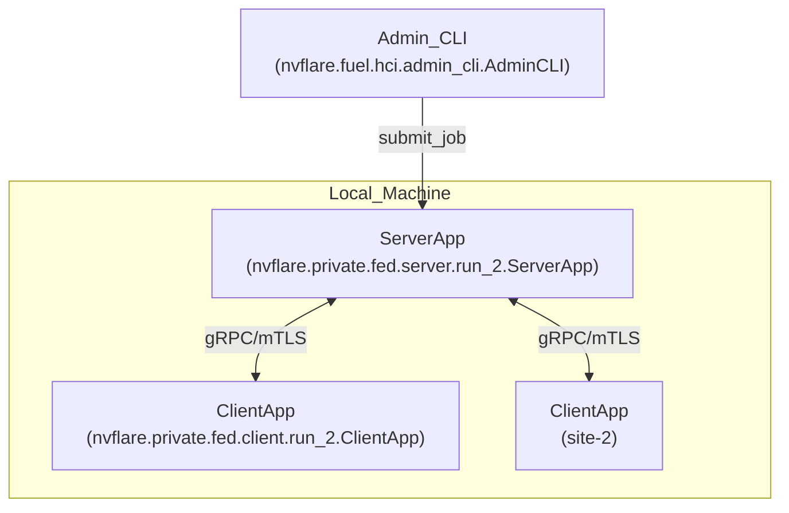

**Setup Commands:**
```bash
# Configure the POC workspace location
nvflare config -pw /tmp/nvflare/poc

# Prepare workspace and start system
nvflare poc prepare -n 2
nvflare poc start
```
Configuration is managed via the `nvflare poc` command group which handles local setup and service control [examples/tutorials/setup_poc.ipynb:17, 152-156]().

**Sources:** [examples/tutorials/setup_poc.ipynb:12-101, 152-169](), [docs/example_applications_algorithms.rst:40-41]()

---

## Quick Start Path 3: Job CLI / FLARE API

The **Job CLI** and **FLARE API** provide high-level interfaces for creating, customizing, and submitting federated learning jobs. For details, see [Job CLI Quick Start](#2.4) and [Client API Quick Start](#2.5).

### Job Lifecycle via API
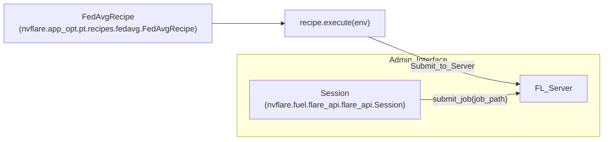

**Common Components:**
- `FedAvgRecipe`: Simplifies job creation by defining the workflow programmatically [examples/hello-world/hello_world.ipynb:50-60]().
- `nvflare job`: CLI command group to create, list, and submit jobs [docs/release_notes/flare_240.rst:64]().
- `flare_api`: Provides a Pythonic way to interact with the FL Server [examples/tutorials/flare_api.ipynb:42-44]().

**Sources:** [docs/release_notes/flare_240.rst:58-68](), [examples/hello-world/hello_world.ipynb:46-66](), [examples/tutorials/flare_api.ipynb:42-66]()

---

## Hello World Examples

NVFLARE includes several "Hello World" examples to demonstrate core functionality across different frameworks [examples/README.md:75-78](). These examples demonstrate how to use NVIDIA FLARE's high-level **Job Recipe** and **Collab** APIs [examples/hello-world/README.md:1-4](). For details, see [Hello World Examples](#2.1).

| Example | Framework | Summary |
|---------|-----------|---------|
| **Hello PyTorch** | PyTorch | Federated averaging with PyTorch models and CIFAR-10 [examples/hello-world/README.md:102-103](). |
| **Hello NumPy** | NumPy | Basic FedAvg demonstration with a NumPy trainer [examples/README.md:79](). |
| **Hello TensorFlow**| TensorFlow| Federated averaging using TensorFlow models [examples/hello-world/README.md:149-150](). |
| **Hello JAX** | JAX/Flax | MNIST classification using JAX and Flax [examples/hello-world/README.md:164-165](). |
| **Hello Lightning** | PyTorch Lightning | Streamlined training using the Lightning integration [examples/hello-world/README.md:117-118](). |
| **Hello Flower** | Flower | Running Flower apps in FLARE infrastructure [examples/hello-world/README.md:230-231](). |
| **Hello Cyclic** | PyTorch | Cyclic weight transfer workflow [examples/README.md:82](). |
| **Hello Tabular Stats** | Pandas | Federated statistics computation [examples/hello-world/hello_world.ipynb:83](). |

**Sources:** [examples/README.md:75-85](), [examples/hello-world/README.md:1-243](), [examples/hello-world/hello_world.ipynb:10-85]()

---

## Next Steps
- For details on basic examples, see [Hello World Examples](#2.1).
- To test multi-process execution locally, see [POC Mode Quick Start](#2.2).
- To iterate quickly on algorithms, see [Simulator Usage](#2.3).
- To learn how to build jobs from templates, see [Job CLI Quick Start](#2.4).
- To federate your own code, see [Client API Quick Start](#2.5).

**Sources:** [examples/hello-world/hello_world.ipynb:70-76](), [examples/README.md:14-17]()

---

# Page: Hello World Examples

# Hello World Examples

<details>
<summary>Relevant source files</summary>

The following files were used as context for generating this wiki page:

- [docs/example_applications_algorithms.rst](docs/example_applications_algorithms.rst)
- [docs/examples/federated_statistics_overview.rst](docs/examples/federated_statistics_overview.rst)
- [docs/examples/fl_algorithms.rst](docs/examples/fl_algorithms.rst)
- [docs/examples/hello_pt_job_api.rst](docs/examples/hello_pt_job_api.rst)
- [docs/examples/hello_tf_job_api.rst](docs/examples/hello_tf_job_api.rst)
- [docs/examples/hello_world_examples.rst](docs/examples/hello_world_examples.rst)
- [docs/examples/medical_image_analysis.rst](docs/examples/medical_image_analysis.rst)
- [docs/examples/tutorial_notebooks.rst](docs/examples/tutorial_notebooks.rst)
- [docs/hello-world/hello-cyclic/index.rst](docs/hello-world/hello-cyclic/index.rst)
- [docs/hello-world/hello-lr/index.rst](docs/hello-world/hello-lr/index.rst)
- [docs/hello-world/hello-pt/index.rst](docs/hello-world/hello-pt/index.rst)
- [docs/hello-world/hello-tabular-stats/index.rst](docs/hello-world/hello-tabular-stats/index.rst)
- [docs/hello-world/hello-tf/index.rst](docs/hello-world/hello-tf/index.rst)
- [docs/hello-world/hello-xgboost/index.rst](docs/hello-world/hello-xgboost/index.rst)
- [docs/programming_guide/controllers/cross_site_model_evaluation.rst](docs/programming_guide/controllers/cross_site_model_evaluation.rst)
- [docs/programming_guide/controllers/cyclic_workflow.rst](docs/programming_guide/controllers/cyclic_workflow.rst)
- [docs/programming_guide/controllers/scatter_and_gather_workflow.rst](docs/programming_guide/controllers/scatter_and_gather_workflow.rst)
- [docs/release_notes/flare_220.rst](docs/release_notes/flare_220.rst)
- [docs/release_notes/flare_240.rst](docs/release_notes/flare_240.rst)
- [docs/release_notes/flare_250.rst](docs/release_notes/flare_250.rst)
- [docs/whats_new.rst](docs/whats_new.rst)
- [examples/README.md](examples/README.md)
- [examples/advanced/README.md](examples/advanced/README.md)
- [examples/advanced/finance/README.md](examples/advanced/finance/README.md)
- [examples/advanced/job_api/tf/README.md](examples/advanced/job_api/tf/README.md)
- [examples/advanced/job_api/tf/run_jobs.sh](examples/advanced/job_api/tf/run_jobs.sh)
- [examples/advanced/monitoring/README.md](examples/advanced/monitoring/README.md)
- [examples/advanced/monitoring/jobs/README.md](examples/advanced/monitoring/jobs/README.md)
- [examples/hello-world/README.md](examples/hello-world/README.md)
- [examples/hello-world/hello-cyclic/README.md](examples/hello-world/hello-cyclic/README.md)
- [examples/hello-world/hello-numpy-cross-val/README.md](examples/hello-world/hello-numpy-cross-val/README.md)
- [examples/hello-world/hello-numpy-cross-val/client.py](examples/hello-world/hello-numpy-cross-val/client.py)
- [examples/hello-world/hello-numpy-cross-val/job.py](examples/hello-world/hello-numpy-cross-val/job.py)
- [examples/hello-world/hello-numpy/client.py](examples/hello-world/hello-numpy/client.py)
- [examples/hello-world/hello-pt/README.md](examples/hello-world/hello-pt/README.md)
- [examples/hello-world/hello-pt/hello-pt.ipynb](examples/hello-world/hello-pt/hello-pt.ipynb)
- [examples/hello-world/hello-pt/job.py](examples/hello-world/hello-pt/job.py)
- [examples/hello-world/hello-tabular-stats/df_stats.ipynb](examples/hello-world/hello-tabular-stats/df_stats.ipynb)
- [examples/hello-world/hello-tf/README.md](examples/hello-world/hello-tf/README.md)
- [examples/tutorials/README.md](examples/tutorials/README.md)
- [nvflare/app_common/np/recipes/cross_site_eval.py](nvflare/app_common/np/recipes/cross_site_eval.py)
- [tests/unit_test/recipe/hello_numpy_cross_val_client_test.py](tests/unit_test/recipe/hello_numpy_cross_val_client_test.py)

</details>


## Purpose and Scope

The Hello World Examples demonstrate the core workflows of NVIDIA FLARE through simple, self-contained applications that can be run immediately after installation. Each example showcases how to convert centralized training code into federated learning with minimal modifications, typically requiring only 5 lines of code changes using the **Client API** [examples/hello-world/hello-pt/README.md:87-94]().

These examples utilize **Job Recipes**, a high-level API introduced to provide a pythonic user experience for defining FL jobs without manually editing configuration files [docs/release_notes/flare_250.rst:34-38](). A Job Recipe encapsulates the entire FL workflow, including server-side logic and client execution, making federated learning as easy as running a standard Python script [examples/hello-world/hello-pt/README.md:129-131]().

## Available Hello World Examples

The primary hello-world examples demonstrate various frameworks and algorithms:

| Example | Framework | Algorithm | Primary Concepts | Location |
|---------|-----------|-----------|-----------------|----------|
| Hello PyTorch | PyTorch | FedAvg | Client API, `FedAvgRecipe`, CIFAR-10 | [examples/hello-world/hello-pt/]() |
| Hello TensorFlow | TensorFlow/Keras | FedAvg | Keras integration, MNIST, Memory Flags | [examples/hello-world/hello-tf/]() |
| Hello JAX | JAX/Flax | FedAvg | MNIST, Parameter Tree flattening | [examples/hello-world/hello-jax/]() |
| Hello Cyclic | TensorFlow/PT | Cyclic Weight Transfer | Sequential fine-tuning, `CyclicRecipe` | [examples/hello-world/hello-cyclic/]() |
| Hello Tabular Stats | Pandas | Statistics | Count, Mean, Stddev, Histograms | [examples/hello-world/hello-tabular-stats/]() |
| Hello HuggingFace | HuggingFace | FedAvg | Qwen SFT/PEFT, `nvflare.client.hf` | [examples/hello-world/hello-huggingface/]() |
| Hello Flower | Flower | Flower App | SuperLink/SuperNode on FLARE | [examples/hello-world/hello-flower/]() |
| Hello NumPy Collab | NumPy | Custom | Collab API, `@collab.publish` | [examples/hello-world/hello-collab/]() |

Sources: [examples/README.md:75-85](), [docs/example_applications_algorithms.rst:22-32](), [examples/hello-world/README.md:100-226](), [docs/release_notes/flare_250.rst:43-51]()

## Common Example Structure

All hello-world examples follow a consistent file organization pattern:

### Example Architecture Diagram
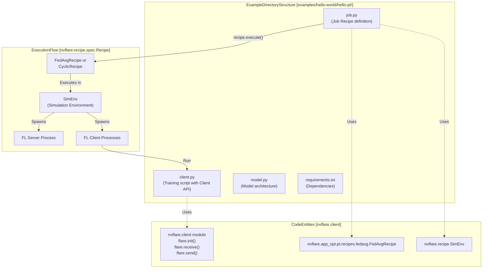
Sources: [examples/hello-world/hello-pt/README.md:28-35](), [examples/hello-world/hello-tf/README.md:46-53](), [examples/hello-world/hello-pt/README.md:88-108](), [examples/hello-world/hello-pt/README.md:129-144]()

### File Responsibilities

*   **`client.py`**: The training script. It contains the local training logic adapted for FL using `flare.receive()` to get the global model and `flare.send()` to return updates [examples/hello-world/hello-pt/README.md:82-84]().
*   **`model.py`**: Defines the model architecture (e.g., a `SimpleNetwork` extending `nn.Module` in PyTorch or `Net` extending `models.Sequential` in TensorFlow) [examples/hello-world/hello-pt/README.md:51-54](), [examples/hello-world/hello-tf/README.md:61-72]().
*   **`job.py`**: The entry point that defines the FL job using a `Recipe`. It specifies parameters like `num_rounds`, `min_clients`, and the `train_script` to run [examples/hello-world/hello-pt/README.md:129-144]().

Sources: [examples/hello-world/hello-pt/README.md:28-35](), [examples/hello-world/hello-tf/README.md:46-53](), [examples/hello-world/hello-pt/README.md:82-84](), [examples/hello-world/hello-pt/README.md:51-54](), [examples/hello-world/hello-tf/README.md:61-72](), [examples/hello-world/hello-pt/README.md:129-144]()

## Core FLARE Components for Hello World

### Client API Module (`nvflare.client`)

The Client API provides three essential methods to convert centralized code to federated learning [examples/hello-world/hello-pt/README.md:93-97]():

1.  **`flare.init()`**: Initializes the NVFlare Client API environment [examples/hello-world/hello-pt/README.md:105]().
2.  **`flare.receive()`**: Receives the global model (as an `FLModel` object) from the server [examples/hello-world/hello-pt/README.md:106]().
3.  **`flare.send()`**: Sends the locally trained model back to the server [examples/hello-world/hello-pt/README.md:113]().

### Client Data Flow
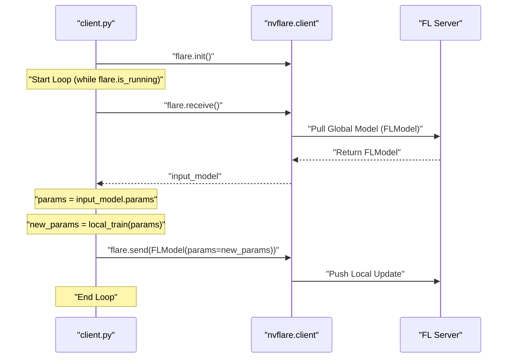
Sources: [examples/hello-world/hello-pt/README.md:93-114](), [docs/release_notes/flare_240.rst:18-47]()

### Job Recipe API

Job Recipes simplify job definition by providing pre-configured workflows like `FedAvgRecipe` or `CyclicRecipe` [examples/hello-world/hello-pt/README.md:118]().

```python
from nvflare.app_opt.pt.recipes.fedavg import FedAvgRecipe
from nvflare.recipe import SimEnv

recipe = FedAvgRecipe(
    name="hello-pt",
    min_clients=2,
    num_rounds=3,
    model=SimpleNetwork(),
    train_script="client.py",
    train_args="--batch_size 32",
)

env = SimEnv(num_clients=2)
recipe.execute(env=env)
```
Sources: [examples/hello-world/hello-pt/README.md:132-144](), [examples/hello-world/README.md:57-69]()

## Framework-Specific Examples

### Hello PyTorch
This example trains a CIFAR-10 classifier using PyTorch [examples/hello-world/hello-pt/README.md:2-3](). The `SimpleNetwork` is defined as a standard `nn.Module` [examples/hello-world/hello-pt/README.md:51-54](). It demonstrates the use of `FedAvgRecipe` to coordinate multiple clients [examples/hello-world/hello-pt/README.md:132-141]().

Sources: [examples/hello-world/hello-pt/README.md:2-3](), [examples/hello-world/hello-pt/README.md:51-54](), [examples/hello-world/hello-pt/README.md:132-141]()

### Hello TensorFlow
Uses the MNIST dataset and a Keras `Sequential` model [examples/hello-world/hello-tf/README.md:55-72](). It highlights framework-specific memory management for GPUs using `TF_FORCE_GPU_ALLOW_GROWTH` to prevent TensorFlow from allocating all GPU memory at startup [examples/hello-world/hello-tf/README.md:143-149]().

Sources: [examples/hello-world/hello-tf/README.md:55-72](), [examples/hello-world/hello-tf/README.md:143-149]()

### Hello HuggingFace
Demonstrates federated Qwen SFT/PEFT using the HuggingFace `Trainer` or TRL `SFTTrainer` [examples/hello-world/README.md:181-182](). It uses a specialized `nvflare.client.hf` module to patch the HuggingFace trainer with minimal code changes [examples/hello-world/README.md:185]().

Sources: [examples/hello-world/README.md:181-195](), [docs/example_applications_algorithms.rst:32]()

### Hello Cyclic (CWT)
Unlike FedAvg which aggregates models in parallel, **Cyclic Weight Transfer** passes model weights sequentially from one site to the next for repeated fine-tuning [examples/hello-world/hello-cyclic/README.md:1-4](). It uses the `CyclicRecipe` [examples/hello-world/hello-cyclic/README.md:108-112]().

Sources: [examples/hello-world/hello-cyclic/README.md:1-4](), [examples/hello-world/hello-cyclic/README.md:108-112]()

### Hello Tabular Statistics
Demonstrates generating federated statistics (Count, Mean, Stddev, Histograms) for data represented as Pandas DataFrames [docs/examples/federated_statistics_overview.rst:39-43](). It utilizes a `Local statistics generator` on the client side [docs/examples/federated_statistics_overview.rst:58]().

Sources: [docs/examples/federated_statistics_overview.rst:39-60](), [examples/hello-world/hello-tabular-stats/df_stats.ipynb:10-12]()

### Hello Flower
Allows Flower applications to run on NVFlare infrastructure [docs/release_notes/flare_250.rst:43-45](). It uses `FlowerApplet` and `FlowerController` to wrap Flower's `ServerApp` and `ClientApp` without requiring modifications to the original Flower code [docs/release_notes/flare_250.rst:46-49]().

Sources: [docs/release_notes/flare_250.rst:43-51](), [examples/hello-world/README.md:230-236]()

## Model Input Options

Recipes support flexible model initialization [examples/hello-world/hello-pt/README.md:146-147]():

1.  **Class Instance**: `model=SimpleNetwork()` - Convenient and Pythonic [examples/hello-world/hello-pt/README.md:150]().
2.  **Dict Config**: `model={"class_path": "model.SimpleNetwork", "args": {}}` - Better for large models to avoid unnecessary instantiation overhead [examples/hello-world/hello-pt/README.md:151]().
3.  **Pre-trained Checkpoint**: Use `initial_ckpt` to specify an absolute path to weights on the server to resume training [examples/hello-world/hello-pt/README.md:157-162]().

For **TensorFlow**, Keras `.h5` or `SavedModel` formats contain both architecture and weights, allowing `initial_ckpt` to be used without a `model` parameter [examples/hello-world/hello-cyclic/README.md:139-140]().

Sources: [examples/hello-world/hello-pt/README.md:146-147](), [examples/hello-world/hello-pt/README.md:150](), [examples/hello-world/hello-pt/README.md:151](), [examples/hello-world/hello-pt/README.md:157-162](), [examples/hello-world/hello-cyclic/README.md:139-140]()

## Running Examples

### Basic Execution Flow
1. Clone the repository and navigate to the example directory [examples/hello-world/hello-pt/README.md:17-26]().
2. Install dependencies: `pip install -r requirements.txt` [examples/hello-world/hello-pt/README.md:11-15]().
3. Run the job script: `python job.py` [examples/hello-world/hello-pt/README.md:175]().

Sources: [examples/hello-world/hello-pt/README.md:17-26](), [examples/hello-world/hello-pt/README.md:11-15](), [examples/hello-world/hello-pt/README.md:175]()

### Execution Environments
NVFlare provides different environments to run the same recipe:
*   **SimEnv**: Uses the FL Simulator for local testing. It can specify `num_clients` and `num_threads` [examples/hello-world/hello-pt/README.md:142]().
*   **PocEnv**: Runs in POC mode, mimicking a distributed environment locally [examples/tutorials/setup_poc.ipynb:40]().

Sources: [examples/hello-world/hello-pt/README.md:142](), [docs/example_applications_algorithms.rst:40]()

### Accessing Results and Logs
Results and logs are stored in the workspace directory:
*   PyTorch: `/tmp/nvflare/simulation/hello-pt/` [examples/hello-world/hello-pt/README.md:184]().
*   Cyclic: `/tmp/nvflare/simulation/cyclic` [examples/hello-world/hello-cyclic/README.md:156]().
*   TensorFlow: `/tmp/nvflare/jobs/workdir` [examples/hello-world/hello-tf/README.md:140]().

Sources: [examples/hello-world/hello-pt/README.md:184](), [examples/hello-world/hello-cyclic/README.md:156](), [examples/hello-world/hello-tf/README.md:140]()

### Experiment Tracking
Many examples support experiment tracking (TensorBoard, MLflow, W&B). This functionality dynamically adds tracking receivers to the server and/or clients to stream metrics [examples/hello-world/hello-tf/README.md:98]().

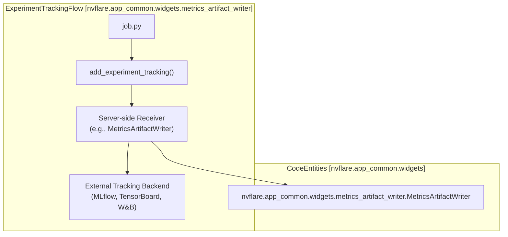
Sources: [examples/hello-world/hello-tf/README.md:98](), [examples/hello-world/README.md:108](), [examples/hello-world/README.md:236]()

---

# Page: POC Mode Quick Start

# POC Mode Quick Start

<details>
<summary>Relevant source files</summary>

The following files were used as context for generating this wiki page:

- [examples/advanced/sklearn-kmeans/sklearn_kmeans_iris.ipynb](examples/advanced/sklearn-kmeans/sklearn_kmeans_iris.ipynb)
- [examples/advanced/sklearn-linear/sklearn_linear_higgs.ipynb](examples/advanced/sklearn-linear/sklearn_linear_higgs.ipynb)
- [examples/advanced/sklearn-svm/sklearn_svm_cancer.ipynb](examples/advanced/sklearn-svm/sklearn_svm_cancer.ipynb)
- [examples/hello-world/hello-lightning/hello_lightning.ipynb](examples/hello-world/hello-lightning/hello_lightning.ipynb)
- [examples/hello-world/hello-pt/requirements.txt](examples/hello-world/hello-pt/requirements.txt)
- [examples/hello-world/hello_world.ipynb](examples/hello-world/hello_world.ipynb)
- [examples/hello-world/hw_pre_start.sh](examples/hello-world/hw_pre_start.sh)
- [examples/tutorials/flare_api.ipynb](examples/tutorials/flare_api.ipynb)
- [examples/tutorials/flare_simulator.ipynb](examples/tutorials/flare_simulator.ipynb)
- [examples/tutorials/setup_poc.ipynb](examples/tutorials/setup_poc.ipynb)
- [nvflare/cli.py](nvflare/cli.py)
- [nvflare/tool/job/config/config_indexer.py](nvflare/tool/job/config/config_indexer.py)
- [nvflare/tool/job/config/configer.py](nvflare/tool/job/config/configer.py)
- [nvflare/tool/job/job_cli.py](nvflare/tool/job/job_cli.py)
- [nvflare/tool/job/job_client_const.py](nvflare/tool/job/job_client_const.py)
- [nvflare/tool/poc/poc_commands.py](nvflare/tool/poc/poc_commands.py)
- [nvflare/tool/poc/service_constants.py](nvflare/tool/poc/service_constants.py)
- [nvflare/utils/cli_utils.py](nvflare/utils/cli_utils.py)
- [tests/unit_test/data/jobs/launch_everytime/app/config/config_fed_client.conf](tests/unit_test/data/jobs/launch_everytime/app/config/config_fed_client.conf)
- [tests/unit_test/data/jobs/launch_everytime/app/config/config_fed_server.conf](tests/unit_test/data/jobs/launch_everytime/app/config/config_fed_server.conf)
- [tests/unit_test/data/jobs/launch_everytime/meta.conf](tests/unit_test/data/jobs/launch_everytime/meta.conf)
- [tests/unit_test/data/jobs/launch_once/app/config/config_fed_client.conf](tests/unit_test/data/jobs/launch_once/app/config/config_fed_client.conf)
- [tests/unit_test/data/jobs/launch_once/app/config/config_fed_server.conf](tests/unit_test/data/jobs/launch_once/app/config/config_fed_server.conf)
- [tests/unit_test/data/jobs/launch_once/meta.conf](tests/unit_test/data/jobs/launch_once/meta.conf)
- [tests/unit_test/lighter/poc_commands_test.py](tests/unit_test/lighter/poc_commands_test.py)
- [tests/unit_test/tool/job/config/config_indexer_test.py](tests/unit_test/tool/job/config/config_indexer_test.py)
- [tests/unit_test/tool/job/config/configer_test.py](tests/unit_test/tool/job/config/configer_test.py)
- [tests/unit_test/tool/job/job_cli_test.py](tests/unit_test/tool/job/job_cli_test.py)
- [tests/unit_test/tool/poc/poc_force_test.py](tests/unit_test/tool/poc/poc_force_test.py)
- [tests/unit_test/tool/poc/poc_output_test.py](tests/unit_test/tool/poc/poc_output_test.py)

</details>


## Purpose and Scope

POC (Proof of Concept) mode is a local multi-process testing environment for NVIDIA FLARE that allows you to run a complete federated learning system on a single machine. It provides a realistic testing environment with separate processes for the server, clients, and admin console, bridging the gap between the FL Simulator (single-process testing) and production deployment [examples/tutorials/setup_poc.ipynb:10-15]().

**When to use POC mode:**
- Testing federated learning workflows with realistic process separation [examples/tutorials/setup_poc.ipynb:12-13]().
- Validating job configurations and `project.yml` before production deployment [examples/tutorials/setup_poc.ipynb:13-14]().
- Debugging multi-client scenarios and GPU resource allocation on a local machine [nvflare/tool/poc/poc_commands.py:116-139]().
- Learning NVIDIA FLARE system behavior and administrative commands in a safe environment [examples/tutorials/setup_poc.ipynb:10-15]().

Sources: [nvflare/tool/poc/poc_commands.py:116-139](), [examples/tutorials/setup_poc.ipynb:10-15]()

---

## POC Mode in the Development Pipeline

POC mode sits between the Simulator and Production deployment, providing an intermediate testing environment. While the FL Simulator runs in a single process (often via `SimEnv`), POC mode establishes distinct server and client "systems" orchestrated via the FLARE Console [examples/tutorials/setup_poc.ipynb:12-13]().

Title: Development Lifecycle
```mermaid
graph LR
    ["Development<br/>Write Code"] -- "flare.init()" --> ["Simulator<br/>SimEnv<br/>Fast Iteration"]
    ["Simulator<br/>SimEnv<br/>Fast Iteration"] -- "PocEnv" --> ["POC Mode<br/>Multi Process<br/>Realistic Testing"]
    ["POC Mode<br/>Multi Process<br/>Realistic Testing"] -- "ProdEnv" --> ["Production<br/>Distributed<br/>Real Deployment"]
    
    ["Simulator<br/>SimEnv<br/>Fast Iteration"] -.fallback.-> ["Development<br/>Write Code"]
    ["POC Mode<br/>Multi Process<br/>Realistic Testing"] -.fallback.-> ["Development<br/>Write Code"]
```

**Development progression:**
1. **Development**: Write and adapt training code using Client API or Job Recipes [examples/hello-world/hello_world.ipynb:48-64]().
2. **Simulator**: Fast iteration with `nvflare simulator` or running `job.py` with `SimEnv` [examples/hello-world/hello_world.ipynb:62-63]().
3. **POC Mode**: Multi-process testing with `nvflare poc` commands or `PocEnv` in Job Recipes [examples/advanced/sklearn-linear/sklearn_linear_higgs.ipynb:91-93]().
4. **Production**: Distributed deployment with provisioned startup kits using `Provisioner` [nvflare/tool/poc/poc_commands.py:39]().

Sources: [nvflare/tool/poc/poc_commands.py:39](), [examples/hello-world/hello_world.ipynb:48-64](), [examples/advanced/sklearn-linear/sklearn_linear_higgs.ipynb:91-93](), [examples/tutorials/setup_poc.ipynb:12-13]()

---

## POC Architecture Overview

POC mode uses local provisioning to create startup kits for all participants, then orchestrates their execution on localhost.

Title: POC Mode Implementation Flow
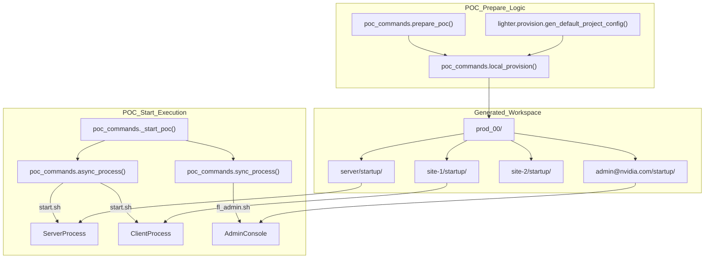

**Key functions:**
- `prepare_poc()` [nvflare/tool/poc/poc_commands.py:535-594]() - Orchestrates POC preparation by defining the project structure and calling the provisioner.
- `local_provision()` [nvflare/tool/poc/poc_commands.py:316-361]() - Creates local startup kits using `Provisioner` with a specific POC configuration [nvflare/tool/poc/poc_commands.py:359]().
- `_start_poc()` [nvflare/tool/poc/poc_commands.py:764-793]() - Manages the service startup sequence for all participants.
- `async_process()` [nvflare/tool/poc/poc_commands.py:961-967]() - Launches server/client processes as background tasks.
- `sync_process()` [nvflare/tool/poc/poc_commands.py:969-972]() - Launches the admin console in the foreground (blocking).

Sources: [nvflare/tool/poc/poc_commands.py:316-361](), [nvflare/tool/poc/poc_commands.py:535-594](), [nvflare/tool/poc/poc_commands.py:764-793](), [nvflare/tool/poc/poc_commands.py:961-972]()

---

## Command Reference

### nvflare poc prepare

Provisions a local POC environment by generating startup kits for server, clients, and admin.

**Syntax:**
```bash
nvflare poc prepare [options]
```

**Options:**

| Option | Description | Default |
|--------|-------------|---------|
| `-n`, `--number_of_clients` | Number of client sites | 2 [nvflare/tool/poc/poc_commands.py:461]() |
| `-c`, `--clients` | Space-separated client names (overrides `-n`) | - |
| `-i`, `--project_input` | Path to custom project.yml | Auto-generated |
| `-he`, `--he` | Enable homomorphic encryption | False |
| `-d`, `--docker_image` | Docker image name for containerized deployment | None |

**Behavioral Logic:**
1. **Workspace Setup**: Creates the workspace directory, defaulting to `/tmp/nvflare/poc` if not configured [nvflare/tool/poc/poc_commands.py:71]().
2. **Provisioning**: Runs the `Provisioner` with `ProvisionMode.POC` to generate certificates and configurations [nvflare/tool/poc/poc_commands.py:359]().
3. **Workspace Structure**: Generates a `prod_00/` directory containing individual startup kits for each participant. For example, `prod_00/server`, `prod_00/site-1`, `prod_00/admin@nvidia.com` [examples/tutorials/setup_poc.ipynb:226]().
4. **Configuration Update**: Automatically updates the hidden `~/.nvflare/config.conf` with the new POC workspace path and registers the admin identity [nvflare/tool/poc/poc_commands.py:55-59]().

Sources: [nvflare/tool/poc/poc_commands.py:55-59](), [nvflare/tool/poc/poc_commands.py:71](), [nvflare/tool/poc/poc_commands.py:359](), [nvflare/tool/poc/poc_commands.py:461](), [examples/tutorials/setup_poc.ipynb:226]()

---

### nvflare poc start

Starts the POC environment by launching server, client, and optionally admin processes.

**Syntax:**
```bash
nvflare poc start [options]
```

**Startup Sequence:**
1. **Server**: The server process is launched first via `async_process` [nvflare/tool/poc/poc_commands.py:996-997]().
2. **Clients**: Client processes follow, with a 1-second delay between each to prevent resource contention [nvflare/tool/poc/poc_commands.py:999-1001]().
3. **Admin**: The admin console is only started if explicitly requested via the `-p` service flag [nvflare/tool/poc/poc_commands.py:991-995]().

**GPU assignment logic:**
The `client_gpu_assignments()` function [nvflare/tool/poc/poc_commands.py:116-139]() manages hardware allocation:
- **No GPUs**: All clients are assigned an empty list, defaulting to CPU execution [nvflare/tool/poc/poc_commands.py:120-123]().
- **Limited GPUs**: If there are fewer GPUs than clients, assignment uses a round-robin modulo approach [nvflare/tool/poc/poc_commands.py:124-127]().
- **Abundant GPUs**: If GPUs outnumber clients, clients are assigned multiple specific GPU IDs [nvflare/tool/poc/poc_commands.py:128-139]().

Sources: [nvflare/tool/poc/poc_commands.py:116-139](), [nvflare/tool/poc/poc_commands.py:991-1001]()

---

### nvflare poc stop

Stops running POC services using either graceful shutdown or direct process termination.

**Syntax:**
```bash
nvflare poc stop [options]
```

**Shutdown mechanisms:**
1. **Graceful System Shutdown**: Uses the `shutdown_system()` API to send stop commands to all connected participants [nvflare/tool/poc/poc_commands.py:851](), [nvflare/tool/api_utils.py:46]().
2. **File-Based Stop**: For non-Docker services, it creates a `shutdown.fl` file in the service directory, which the running process monitors to trigger exit [nvflare/tool/poc/poc_commands.py:179-182]().
3. **Docker Termination**: For containerized services, it executes `docker stop` on the relevant container names [nvflare/tool/poc/poc_commands.py:169]().

Sources: [nvflare/tool/poc/poc_commands.py:169-182](), [nvflare/tool/poc/poc_commands.py:851](), [nvflare/tool/api_utils.py:46]()

---

### nvflare poc clean

Removes the POC workspace directory after verifying the system is stopped.

**Safety checks:**
1. **Workspace Presence**: Verifies the workspace exists before attempting deletion [nvflare/tool/poc/poc_commands.py:1033]().
2. **Runtime Check**: Checks for the existence of `pid.fl` files to ensure no processes are currently running in the workspace [nvflare/tool/poc/poc_commands.py:1010-1015]().

Sources: [nvflare/tool/poc/poc_commands.py:1010-1015](), [nvflare/tool/poc/poc_commands.py:1033]()

---

## Workspace Configuration

### Hidden Configuration File

POC commands interact with `~/.nvflare/config.conf` to persist workspace settings. This is managed via `save_config` and `load_hidden_config_state` [nvflare/utils/cli_utils.py:107-111]().

Title: Config Precedence
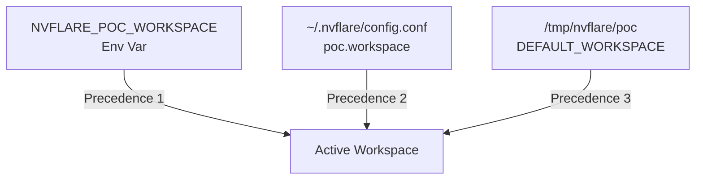

Sources: [nvflare/tool/poc/poc_commands.py:71](), [nvflare/utils/cli_utils.py:107-111](), [examples/tutorials/setup_poc.ipynb:133-146]()

---

## Integration with Flare API

POC mode is fully compatible with the high-level `flare_api` for automated job management.

Title: Job Submission via Flare API
```mermaid
sequenceDiagram
    participant User
    participant Session as "nvflare.fuel.flare_api.flare_api.Session"
    participant POC as "POC Workspace"
    participant Server as "ServerEngine"
    
    User->>POC: nvflare poc prepare
    User->>Session: new_secure_session(startup_kit_location)
    User->>Session: submit_job(job_folder)
    Session->>Server: Admin Command Dispatch
```

**Job Submission Example:**
Jobs are submitted to a running POC environment by initiating a `new_secure_session()` using the admin startup kit generated in the POC workspace [examples/tutorials/flare_api.ipynb:60-65](). The `Session` object then provides methods like `submit_job()` and `monitor_job()` [examples/tutorials/flare_api.ipynb:148-165]().

Sources: [examples/tutorials/flare_api.ipynb:60-65](), [examples/tutorials/flare_api.ipynb:148-165]()

---

## Advanced Configuration

### Docker-Based POC Mode
By providing a `-d` flag during `prepare`, NVFLARE configures the POC environment to run server and client parent processes within Docker containers [nvflare/tool/poc/poc_commands.py:423-428](). This changes the startup script generation to use `start_docker.sh` [nvflare/tool/poc/poc_commands.py:160]().

### Homomorphic Encryption
The `-he` flag instructs the provisioner to include the `HEBuilder` in the builder list, enabling homomorphic encryption for the local deployment [nvflare/tool/poc/poc_commands.py:443-451]().

Sources: [nvflare/tool/poc/poc_commands.py:160](), [nvflare/tool/poc/poc_commands.py:423-451]()

---

## CLI Command Dispatch

The `nvflare` CLI uses a centralized dispatch mechanism in `nvflare/cli.py` to route subcommands to their respective handlers.

**Handler Registration**:
The `poc` command sub-parsers and their corresponding functions are defined in `nvflare/tool/poc/poc_commands.py` [nvflare/tool/poc/poc_commands.py:1038-1044]():
- `CMD_PREPARE_POC` -> `prepare_poc`
- `CMD_START_POC` -> `start_poc`
- `CMD_STOP_POC` -> `stop_poc`
- `CMD_CLEAN_POC` -> `clean_poc`
- `CMD_CONFIG_POC` -> `config_poc`

Sources: [nvflare/tool/poc/poc_commands.py:1038-1044]()

---

# Page: Simulator Usage

# Simulator Usage

<details>
<summary>Relevant source files</summary>

The following files were used as context for generating this wiki page:

- [examples/advanced/sklearn-kmeans/sklearn_kmeans_iris.ipynb](examples/advanced/sklearn-kmeans/sklearn_kmeans_iris.ipynb)
- [examples/advanced/sklearn-linear/sklearn_linear_higgs.ipynb](examples/advanced/sklearn-linear/sklearn_linear_higgs.ipynb)
- [examples/advanced/sklearn-svm/sklearn_svm_cancer.ipynb](examples/advanced/sklearn-svm/sklearn_svm_cancer.ipynb)
- [examples/hello-world/hello-lightning/hello_lightning.ipynb](examples/hello-world/hello-lightning/hello_lightning.ipynb)
- [examples/hello-world/hello-pt/requirements.txt](examples/hello-world/hello-pt/requirements.txt)
- [examples/hello-world/hello_world.ipynb](examples/hello-world/hello_world.ipynb)
- [examples/hello-world/hw_pre_start.sh](examples/hello-world/hw_pre_start.sh)
- [examples/tutorials/flare_api.ipynb](examples/tutorials/flare_api.ipynb)
- [examples/tutorials/flare_simulator.ipynb](examples/tutorials/flare_simulator.ipynb)
- [examples/tutorials/setup_poc.ipynb](examples/tutorials/setup_poc.ipynb)
- [nvflare/collab/runtime/controller.py](nvflare/collab/runtime/controller.py)
- [nvflare/fuel/common/multi_process_executor_constants.py](nvflare/fuel/common/multi_process_executor_constants.py)
- [nvflare/fuel/f3/connection.py](nvflare/fuel/f3/connection.py)
- [nvflare/private/fed/app/deployer/base_client_deployer.py](nvflare/private/fed/app/deployer/base_client_deployer.py)
- [nvflare/private/fed/app/deployer/server_deployer.py](nvflare/private/fed/app/deployer/server_deployer.py)
- [nvflare/private/fed/app/deployer/simulator_deployer.py](nvflare/private/fed/app/deployer/simulator_deployer.py)
- [nvflare/private/fed/app/simulator/simulator.py](nvflare/private/fed/app/simulator/simulator.py)
- [nvflare/private/fed/app/simulator/simulator_runner.py](nvflare/private/fed/app/simulator/simulator_runner.py)
- [nvflare/private/fed/app/simulator/simulator_worker.py](nvflare/private/fed/app/simulator/simulator_worker.py)
- [nvflare/private/fed/client/admin.py](nvflare/private/fed/client/admin.py)
- [nvflare/private/fed/server/admin.py](nvflare/private/fed/server/admin.py)
- [nvflare/private/fed/simulator/simulator_client_engine.py](nvflare/private/fed/simulator/simulator_client_engine.py)
- [nvflare/private/fed/simulator/simulator_server.py](nvflare/private/fed/simulator/simulator_server.py)
- [tests/unit_test/collab/runtime/controller_test.py](tests/unit_test/collab/runtime/controller_test.py)
- [tests/unit_test/fuel/f3/streaming/streaming_test.py](tests/unit_test/fuel/f3/streaming/streaming_test.py)
- [tests/unit_test/private/fed/app/deployer/simulator_deployer_test.py](tests/unit_test/private/fed/app/deployer/simulator_deployer_test.py)
- [tests/unit_test/private/fed/app/simulator/simulator_runner_test.py](tests/unit_test/private/fed/app/simulator/simulator_runner_test.py)
- [tests/unit_test/private/fed/server/server_engine_test.py](tests/unit_test/private/fed/server/server_engine_test.py)

</details>


The FL Simulator is a local development and testing tool that enables rapid prototyping of federated learning applications without deploying a distributed system. It allows developers to run an entire federated learning job on a single machine while maintaining process isolation for clients.

For information about POC mode (local multi-process deployment), see [2.2. POC Mode Quick Start](). For production deployment, see [1.3. Deployment Modes]().

---

## Overview and Purpose

The FL Simulator executes federated learning jobs by simulating multiple clients and a server within a single host environment. It provides a fast iteration cycle by eliminating the need for network configuration, certificate management, or manual service orchestration.

**Key Characteristics:**
- **Concurrency Management**: Clients are managed via a `ThreadPoolExecutor` within the `SimulatorRunner` [nvflare/private/fed/app/simulator/simulator_runner.py:25-25](), [nvflare/private/fed/app/simulator/simulator_runner.py:91-94]().
- **Process Isolation**: Individual client tasks are executed in separate subprocesses using `SimulatorClientRunner` which invokes `simulator_worker.py` [nvflare/private/fed/app/simulator/simulator_runner.py:716-720]().
- **Simulated Communication**: Mimics distributed CellNet architecture using local `Cell` objects and in-memory communication patterns [nvflare/private/fed/app/simulator/simulator_runner.py:314-320]().
- **Automated Deployment**: The `SimulatorDeployer` handles the creation of the workspace and application deployment logic [nvflare/private/fed/app/simulator/simulator_runner.py:113-113]().
- **Resource Management**: Supports distributing clients across multiple GPUs by partitioning host GPU IDs [nvflare/private/fed/app/simulator/simulator_worker.py:261-264]().

**Sources:** [nvflare/private/fed/app/simulator/simulator_runner.py:84-113](), [nvflare/private/fed/app/simulator/simulator_worker.py:49-128]()

---

## Architecture Overview

The Simulator architecture maps production components to local equivalents to ensure that the same code (Executors, Controllers) can run unchanged in simulation or production.

**Natural Language to Code Entity Space**

```mermaid
graph TD
    subgraph "Distributed Production Entities"
        ProdServer["ServerEngine<br/>(nvflare.private.fed.server.server_engine.ServerEngine)"]
        ProdClient["ClientEngine<br/>(nvflare.private.fed.client.client_engine.ClientEngine)"]
        ProdCell["CellNet<br/>(nvflare.fuel.f3.cellnet.cell.Cell)"]
        ProdServer -- "RPC/CellNet" --> ProdCell
        ProdClient -- "RPC/CellNet" --> ProdCell
    end
    
    subgraph "Simulator Entities"
        SimRunner["SimulatorRunner<br/>(nvflare.private.fed.app.simulator.simulator_runner.SimulatorRunner)"]
        SimServerAppRunner["SimulatorServerAppRunner<br/>(nvflare.private.fed.simulator.simulator_app_runner.SimulatorServerAppRunner)"]
        SimWorker["ClientTaskWorker<br/>(nvflare.private.fed.app.simulator.simulator_worker.ClientTaskWorker)"]
        SimCell["In-Memory Cell<br/>(nvflare.fuel.f3.cellnet.cell.Cell)"]
        
        SimRunner -- "orchestrates" --> SimServerAppRunner
        SimRunner -- "dispatches to" --> SimWorker
        SimServerAppRunner -- "registers" --> SimCell
        SimWorker -- "registers" --> SimCell
    end
    
    ProdServer -.->|"simulated by"| SimServerAppRunner
    ProdClient -.->|"simulated by"| SimWorker
    ProdCell -.->|"simulated by"| SimCell
```

**Component Mapping:**

| Production Component | Simulator Equivalent | Implementation |
|---------------------|---------------------|----------------|
| `ServerEngine` | `SimulatorServerEngine` | The `SimulatorServer` uses `SimulatorServerEngine` [nvflare/private/fed/simulator/simulator_server.py:31-31]() which extends `ServerEngine` to handle simulator-specific communication and persistence. |
| `ClientEngine` | `ClientEngine` | The `ClientTaskWorker` creates a standard `ClientEngine` [nvflare/private/fed/app/simulator/simulator_worker.py:50-55]() to run the client application. |
| `CellNet` | Local `Cell` | Uses `Cell` with local listeners and no encryption [nvflare/private/fed/app/simulator/simulator_worker.py:27-27](). |
| `JobRunner` | `SimulatorRunner` | Handles the overall lifecycle of the simulation job [nvflare/private/fed/app/simulator/simulator_runner.py:84-84]().

**Sources:** [nvflare/private/fed/app/simulator/simulator_runner.py:84-113](), [nvflare/private/fed/app/simulator/simulator_worker.py:49-128](), [nvflare/private/fed/simulator/simulator_server.py:31-31]()

---

## Execution Model

The Simulator uses a hybrid model where the Server runs in a thread and Clients run in isolated processes.

**Component Interaction Flow**

```mermaid
sequenceDiagram
    participant SR as "SimulatorRunner"
    participant SSAR as "SimulatorServerAppRunner"
    participant SCR as "SimulatorClientRunner"
    participant CTW as "ClientTaskWorker (Process)"
    
    SR->>SR: setup()
    SR->>SSAR: start_server_app()
    activate SSAR
    SR->>SCR: client_run()
    activate SCR
    
    loop Task Dispatching
        SCR->>CTW: Popen(simulator_worker.py)
        activate CTW
        CTW->>CTW: create_client_engine()
        CTW->>CTW: do_one_task()
        CTW-->>SCR: return task result
        deactivate CTW
    end
    
    SSAR->>SSAR: Server engine completion
    deactivate SSAR
    SCR->>SCR: All clients finished
    deactivate SCR
```

**Process Model Details:**
- **Isolation**: Each client task is isolated in a subprocess launched via `subprocess.Popen` [nvflare/private/fed/app/simulator/simulator_runner.py:716-720]().
- **Worker Initialization**: The `simulator_worker.py` script initializes FOBS, security content, and the `ClientEngine` [nvflare/private/fed/app/simulator/simulator_worker.py:34-41]().
- **Communication**: The worker communicates status back to the parent runner using a `multiprocessing.connection.Listener` [nvflare/private/fed/app/simulator/simulator_worker.py:20-20]().

**Sources:** [nvflare/private/fed/app/simulator/simulator_runner.py:476-538](), [nvflare/private/fed/app/simulator/simulator_worker.py:49-138]()

---

## GPU Support

The Simulator can automatically manage GPU allocation to ensure client processes do not conflict.

- **Discovery**: `SimulatorRunner` identifies host GPUs via `get_host_gpu_ids()` [nvflare/private/fed/app/simulator/simulator_runner.py:56-56]().
- **Splitting**: Available GPUs are split among the number of clients using `split_gpus()` [nvflare/private/fed/app/simulator/simulator_runner.py:240-276]().
- **Assignment**: When spawning a `ClientTaskWorker`, the assigned GPU IDs are passed via environment variables to the subprocess [nvflare/private/fed/app/simulator/simulator_worker.py:261-264]().

**Sources:** [nvflare/private/fed/app/simulator/simulator_runner.py:56-56](), [nvflare/private/fed/app/simulator/simulator_runner.py:240-276](), [nvflare/private/fed/app/simulator/simulator_worker.py:261-264]()

---

## Implementation Details

### SimulatorRunner Class
The central controller [nvflare/private/fed/app/simulator/simulator_runner.py:83-84]() responsible for:
- `setup()`: Preparing the workspace, deployer, and client configurations [nvflare/private/fed/app/simulator/simulator_runner.py:162-238]().
- `run()`: Starting the simulation engine [nvflare/private/fed/app/simulator/simulator_runner.py:597-626]().
- `split_clients()`: Dividing the list of clients into chunks based on available threads/GPUs [nvflare/private/fed/app/simulator/simulator_runner.py:365-376]().

**Sources:** [nvflare/private/fed/app/simulator/simulator_runner.py:83-626](), [nvflare/private/fed/app/simulator/simulator_worker.py:49-128]()

### ClientTaskWorker Class
The worker logic [nvflare/private/fed/app/simulator/simulator_worker.py:48-49]() responsible for:
- `create_client_runner()`: Initializing the `SimulatorClientAppRunner` and `ClientRunner` for the specific client [nvflare/private/fed/app/simulator/simulator_worker.py:57-78]().
- `do_one_task()`: Executing a single task (like training) by calling `client_runner.fetch_and_run_one_task()` [nvflare/private/fed/app/simulator/simulator_worker.py:100-101]().

**Sources:** [nvflare/private/fed/app/simulator/simulator_runner.py:84-626](), [nvflare/private/fed/app/simulator/simulator_worker.py:48-128]()

---

## Workspace Structure

The simulator generates a temporary or persistent workspace mirroring a production layout.

| Directory | Purpose |
|-----------|---------|
| `server/` | Server application and logs. |
| `site-n/` | Individual client application directories (site-1, site-2, etc.). |
| `local/` | Local configuration and resource files. |
| `pool_stats/` | Communication metrics and `simulator_cell_stats.json` [nvflare/private/fed/app/simulator/simulator_runner.py:80-81]().

**Sources:** [nvflare/private/fed/app/simulator/simulator_runner.py:314-343](), [nvflare/private/fed/app/simulator/simulator_runner.py:80-81]()

---

## Simplified Usage via Job Recipes

In NVFLARE 2.7+, the **Job Recipe** API simplifies simulator usage. Instead of using the `nvflare simulator` CLI, users can define a `SimEnv` directly in Python.

```python
from nvflare.recipe import SimEnv
from nvflare.app_opt.pt.recipes.fedavg import FedAvgRecipe

recipe = FedAvgRecipe(
    name="hello-pt",
    num_rounds=2,
    model=SimpleNetwork(),
    train_script="client.py",
)

env = SimEnv(num_clients=2)
run = recipe.execute(env)
```

This internally triggers the `SimulatorRunner` logic, saving results to `/tmp/nvflare/simulation/[job-name]/` [examples/hello-world/hello_world.ipynb:44-44]().

**Sources:** [examples/hello-world/hello_world.ipynb:26-64](), [examples/tutorials/flare_simulator.ipynb:41-46]()

---

# Page: Job CLI Quick Start

# Job CLI Quick Start

<details>
<summary>Relevant source files</summary>

The following files were used as context for generating this wiki page:

- [docs/design/cli_agent_readiness_backlog.md](docs/design/cli_agent_readiness_backlog.md)
- [docs/design/job_download_artifact_contract_test_plan.md](docs/design/job_download_artifact_contract_test_plan.md)
- [docs/design/nvflare_cli.md](docs/design/nvflare_cli.md)
- [docs/schemas/recipe_catalog.schema.json](docs/schemas/recipe_catalog.schema.json)
- [docs/user_guide/data_scientist_guide/index.rst](docs/user_guide/data_scientist_guide/index.rst)
- [docs/user_guide/nvflare_cli/config_command.rst](docs/user_guide/nvflare_cli/config_command.rst)
- [docs/user_guide/nvflare_cli/dashboard_command.rst](docs/user_guide/nvflare_cli/dashboard_command.rst)
- [docs/user_guide/nvflare_cli/job_cli.rst](docs/user_guide/nvflare_cli/job_cli.rst)
- [docs/user_guide/nvflare_cli/nvflare_cli.rst](docs/user_guide/nvflare_cli/nvflare_cli.rst)
- [docs/user_guide/nvflare_cli/poc_command.rst](docs/user_guide/nvflare_cli/poc_command.rst)
- [docs/user_guide/nvflare_cli/recipe_command.rst](docs/user_guide/nvflare_cli/recipe_command.rst)
- [docs/user_guide/nvflare_cli/study_command.rst](docs/user_guide/nvflare_cli/study_command.rst)
- [docs/user_guide/nvflare_cli/system_command.rst](docs/user_guide/nvflare_cli/system_command.rst)
- [nvflare/cli.py](nvflare/cli.py)
- [nvflare/tool/job/config/config_indexer.py](nvflare/tool/job/config/config_indexer.py)
- [nvflare/tool/job/config/configer.py](nvflare/tool/job/config/configer.py)
- [nvflare/tool/job/job_cli.py](nvflare/tool/job/job_cli.py)
- [nvflare/tool/job/job_client_const.py](nvflare/tool/job/job_client_const.py)
- [nvflare/tool/poc/poc_commands.py](nvflare/tool/poc/poc_commands.py)
- [nvflare/tool/poc/service_constants.py](nvflare/tool/poc/service_constants.py)
- [nvflare/utils/cli_utils.py](nvflare/utils/cli_utils.py)
- [tests/unit_test/data/jobs/launch_everytime/app/config/config_fed_client.conf](tests/unit_test/data/jobs/launch_everytime/app/config/config_fed_client.conf)
- [tests/unit_test/data/jobs/launch_everytime/app/config/config_fed_server.conf](tests/unit_test/data/jobs/launch_everytime/app/config/config_fed_server.conf)
- [tests/unit_test/data/jobs/launch_everytime/meta.conf](tests/unit_test/data/jobs/launch_everytime/meta.conf)
- [tests/unit_test/data/jobs/launch_once/app/config/config_fed_client.conf](tests/unit_test/data/jobs/launch_once/app/config/config_fed_client.conf)
- [tests/unit_test/data/jobs/launch_once/app/config/config_fed_server.conf](tests/unit_test/data/jobs/launch_once/app/config/config_fed_server.conf)
- [tests/unit_test/data/jobs/launch_once/meta.conf](tests/unit_test/data/jobs/launch_once/meta.conf)
- [tests/unit_test/lighter/poc_commands_test.py](tests/unit_test/lighter/poc_commands_test.py)
- [tests/unit_test/tool/job/config/config_indexer_test.py](tests/unit_test/tool/job/config/config_indexer_test.py)
- [tests/unit_test/tool/job/config/configer_test.py](tests/unit_test/tool/job/config/configer_test.py)
- [tests/unit_test/tool/job/job_cli_test.py](tests/unit_test/tool/job/job_cli_test.py)
- [tests/unit_test/tool/job/job_download_test.py](tests/unit_test/tool/job/job_download_test.py)
- [tests/unit_test/tool/poc/poc_force_test.py](tests/unit_test/tool/poc/poc_force_test.py)
- [tests/unit_test/tool/poc/poc_output_test.py](tests/unit_test/tool/poc/poc_output_test.py)

</details>


## Purpose and Scope

This page introduces the **Job CLI** (`nvflare job`), a technical command-line interface for creating, customizing, and submitting NVIDIA FLARE jobs. The Job CLI acts as the primary administrative gateway to the federated learning system, allowing users to manage the full job lifecycle from submission through monitoring to result retrieval.

**Related pages:**
- For running jobs in Simulator mode, see [Simulator Usage](2.3)
- For setting up POC mode environments, see [POC Mode Quick Start](2.2)
- For detailed job management and lifecycle, see [Job CLI](7.4)

---

## Overview

The Job CLI provides a suite of subcommands defined in `nvflare/tool/job/job_cli.py` [nvflare/tool/job/job_cli.py:83-102](). It is designed for both human interaction and machine-driven automation (CI/CD, agents), supporting structured JSON output and retry-safe submission tokens [docs/design/nvflare_cli.md:37-50]().

### Job CLI Command Map

| Command | Purpose | Implementation Constant |
|---------|---------|------------------------|
| `submit` | Submit a pre-built job folder to the server | `CMD_SUBMIT_JOB` [nvflare/tool/job/job_cli.py:86]() |
| `wait` | Block until job completion and return final result | `CMD_JOB_WAIT` [nvflare/tool/job/job_cli.py:100]() |
| `monitor` | Wait for a job and stream progress to stderr | `CMD_JOB_MONITOR` [nvflare/tool/job/job_cli.py:99]() |
| `list` | List jobs currently on the server | `CMD_JOB_LIST` [nvflare/tool/job/job_cli.py:87]() |
| `abort` | Terminate a running job | `CMD_JOB_ABORT` [nvflare/tool/job/job_cli.py:89]() |
| `meta` | Retrieve job execution metadata | `CMD_JOB_META` [nvflare/tool/job/job_cli.py:88]() |
| `logs` | Get job logs from the server-side log store | `CMD_JOB_LOGS` [nvflare/tool/job/job_cli.py:96]() |
| `stats` | Show running job statistics | `CMD_JOB_STATS` [nvflare/tool/job/job_cli.py:95]() |
| `download` | Download job result | `CMD_JOB_DOWNLOAD` [nvflare/tool/job/job_cli.py:91]() |
| `clone` | Clone an existing job | `CMD_JOB_CLONE` [nvflare/tool/job/job_cli.py:90]() |
| `delete` | Remove job artifacts from the server | `CMD_JOB_DELETE` [nvflare/tool/job/job_cli.py:92]() |

### Job Management Data Flow

The diagram below illustrates how the CLI interacts with the backend system to manage jobs, associating CLI components with code entities.

```mermaid
graph TD
    subgraph "LocalEnvironment"
        User["User/Script"] -- "nvflare job submit -j <job_folder>" --> JobCLI["nvflare.tool.job.job_cli.py"]
        JobFolder["Job Folder<br/>(meta.conf + apps)"] --> JobCLI
        JobCLI -- "Establishes Session" --> Session["nvflare.tool.cli_session.new_cli_session_for_args"]
    end

    subgraph "FLAREServer"
        Session -- "Admin API Calls" --> AdminAPI["nvflare.fuel.hci.client.api.AdminAPI"]
        AdminAPI -- "Sends Commands" --> Connection["nvflare.fuel.hci.conn.Connection"]
        Connection -- "Dispatches to" --> JobCmdMod["nvflare.private.fed.server.job_cmds.JobCommandModule"]
    end

    JobCLI -- "Applies Overrides" --> Configer["nvflare.tool.job.config.configer.merge_configs_from_cli"]
    Configer -- "Modified Job Config" --> JobCLI
```
**Title: Job Submission and Management Flow**

The CLI uses `new_cli_session_for_args` [nvflare/tool/cli_session.py:38]() to establish a secure connection to the server. The `handle_job_cli_cmd` function [nvflare/tool/job/job_cli.py:1186]() routes subcommands to their respective handlers.

**Sources:** [nvflare/tool/job/job_cli.py:83-102](), [nvflare/tool/job/job_cli.py:1186](), [nvflare/cli.py:34-41](), [nvflare/tool/cli_session.py:38](), [docs/design/nvflare_cli.md:21-28]()

---

## Job Templates and Recipes

Job templates provide a structured way to define federated learning workflows. While `nvflare job create` is deprecated in favor of the **FedJob API** and **Recipe API** [nvflare/tool/job/job_cli.py:212-214](), the template system remains a core part of the codebase for defining baseline configurations.

### Template Discovery
The system searches for templates in a specific order [nvflare/utils/cli_utils.py:188-214]():
1. `NVFLARE_HOME` environment variable [nvflare/utils/cli_utils.py:195-197]().
2. The hidden configuration file `~/.nvflare/config.conf` under the key `job_template.path` [nvflare/utils/cli_utils.py:200-201]().
3. The internal package directory `nvflare/tool/job/templates` [nvflare/utils/cli_utils.py:208-212]().

### Listing Templates
The command `nvflare job list-templates` (aliased to `nvflare recipe list`) uses `build_job_template_indices` [nvflare/tool/job/job_cli.py:155]() to parse `info.conf` files within template directories.

| Field | Code Key | Description |
|-------|----------|-------------|
| Description | `JOB_INFO_DESC` | Human-readable purpose [nvflare/tool/job/job_client_const.py:57]() |
| Controller | `JOB_INFO_CONTROLLER_TYPE` | Type of FL controller used [nvflare/tool/job/job_client_const.py:55]() |
| API Type | `JOB_INFO_EXECUTION_API_TYPE` | e.g., "Client API" or "Executor" [nvflare/tool/job/job_client_const.py:59]() |

**Sources:** [nvflare/tool/job/job_cli.py:155-173](), [nvflare/utils/cli_utils.py:188-214](), [nvflare/tool/job/job_client_const.py:54-62]()

---

## Configuration Customization

### The Configer and Indexing System
The Job CLI uses `merge_configs_from_cli` [nvflare/tool/job/config/configer.py:35-44]() to allow command-line overrides of job parameters.

```mermaid
graph TD
    subgraph "nvflare.tool.job.config.config_indexer"
        BuildIndex["build_reverse_order_index()"] -- "Parses HOCON" --> ConfigTree["pyhocon.ConfigTree"]
        ConfigTree -- "Creates Mappings" --> KeyIndex["KeyIndex (key, value, parent_key)"]
    end

    subgraph "nvflare.tool.job.config.configer"
        CLIArgs["CLI -f arguments"] -- "Passed to" --> MergeConfigs["merge_configs_from_cli()"]
        MergeConfigs -- "Uses" --> KeyIndex
        MergeConfigs -- "Modifies" --> FinalConfigTree["Modified pyhocon.ConfigTree"]
    end
```
**Title: CLI Configuration Override System**

### Advanced Override Syntax
The CLI supports path notation for modifying nested components:
- **Nested Access:** `executors[0].executor.args.lr=0.01` is handled by `split_array_key` [nvflare/tool/job/config/configer.py:121-144]().
- **Deletion:** Appending a minus sign (e.g., `key-`) triggers removal via `config.pop(key)` [nvflare/tool/job/config/configer.py:189-196]().
- **Type Conversion:** The `convert_to_number` function [nvflare/tool/job/config/configer.py:147]() automatically casts string inputs to appropriate numeric types.

**Sources:** [nvflare/tool/job/config/configer.py:35-45](), [nvflare/tool/job/config/configer.py:121-160](), [nvflare/tool/job/config/config_indexer.py:36-68]()

---

## Submitting Jobs

### Submission Workflow
When `nvflare job submit` is called, the CLI performs the following:
1. **Startup Kit Selection:** Resolves the admin identity using `new_cli_session_for_args` [nvflare/tool/cli_session.py:38]().
2. **Job Validation:** Ensures the job folder contains required metadata like `meta.conf` [nvflare/tool/job/job_client_const.py:63]().
3. **Transmission:** Uses the `AdminAPI` to send the `submit_job` command to the server.

### Idempotency with Submit Tokens
To handle network retries safely, the CLI supports `--submit-token` [docs/user_guide/nvflare_cli/job_cli.rst:126-128]().
- **Validation:** Tokens are validated using `validate_submit_token` [nvflare/apis/utils/job_submit_token.py:33]() via the CLI arg parser [nvflare/tool/job/job_cli.py:76-80]().
- **Mechanism:** The server uses this token to deduplicate requests. If a job with the same token and content was already accepted, the server returns the existing `job_id` [nvflare/tool/job/job_cli.py:105-114]().

**Sources:** [nvflare/tool/job/job_cli.py:76-80](), [nvflare/tool/job/job_cli.py:105-114](), [nvflare/tool/job/job_client_const.py:63](), [nvflare/tool/cli_session.py:38](), [docs/user_guide/nvflare_cli/job_cli.rst:126-177]()

---

## POC Mode Integration

The Job CLI is often used in conjunction with POC mode for rapid prototyping [docs/user_guide/nvflare_cli/poc_command.rst:7-10]().

### Local Deployment Lifecycle
1. **Prepare:** `nvflare poc prepare` generates the workspace [nvflare/tool/poc/poc_commands.py:74](). This involves calling `Provisioner` builders [nvflare/tool/poc/poc_commands.py:37-39]().
2. **Start:** `nvflare poc start` launches the server and client processes [nvflare/tool/poc/poc_commands.py:75](). This command uses `get_service_command` [nvflare/tool/poc/poc_commands.py:142-176]() to determine the correct script (e.g., `start.sh` or `fl_admin.sh`).
3. **Stop:** `nvflare poc stop` signals termination by creating a `shutdown.fl` file [nvflare/tool/poc/poc_commands.py:179-182]().

### GPU Assignment in POC
In POC mode, host GPUs are distributed across clients via `client_gpu_assignments` [nvflare/tool/poc/poc_commands.py:116-139]().

```mermaid
graph TD
    subgraph "POCCommandExecution"
        PrepareCmd["nvflare poc prepare"] -- "Generates Workspace" --> Provisioner["nvflare.lighter.provisioner.Provisioner"]
        StartCmd["nvflare poc start"] -- "Invokes" --> GetServiceCmd["nvflare.tool.poc.poc_commands.get_service_command()"]
        GetServiceCmd -- "Determines Startup Script" --> StartScript["start.sh / fl_admin.sh"]
        StartCmd -- "Detects GPUs" --> GetHostGPUs["nvflare.fuel.utils.gpu_utils.get_host_gpu_ids()"]
        GetHostGPUs -- "Available GPUs" --> AssignGPUs["nvflare.tool.poc.poc_commands.client_gpu_assignments()"]
        AssignGPUs -- "Per-Client GPU IDs" --> EnvSetup["CUDA_VISIBLE_DEVICES Environment Variable"]
    end
```
**Title: POC Mode Resource Allocation**

**Sources:** [nvflare/tool/poc/poc_commands.py:74-76](), [nvflare/tool/poc/poc_commands.py:142-176](), [nvflare/tool/poc/poc_commands.py:179-182](), [nvflare/tool/poc/poc_commands.py:116-139](), [docs/user_guide/nvflare_cli/poc_command.rst:162-184]()

---

## Configuration Management

The CLI maintains state and user preferences in a hidden directory [nvflare/utils/cli_utils.py:55-63]().

### Workspace and Kit Registry
- **Location:** `~/.nvflare/` [nvflare/utils/cli_utils.py:66-69]().
- **Config File:** `config.conf` [nvflare/utils/cli_utils.py:51-52]().
- **Active Kit:** Managed via `set_active_startup_kit` [nvflare/tool/kit/kit_config.py:36]() and retrieved via `get_active_startup_kit_id` [nvflare/tool/kit/kit_config.py:53]().

### Configuration Utilities
The `cli_utils.py` file provides helper functions like `load_hidden_config_state` [nvflare/utils/cli_utils.py:107-111]() and `create_poc_workspace_config` [nvflare/utils/cli_utils.py:134-156]() to manage these persistent settings.

**Sources:** [nvflare/utils/cli_utils.py:51-70](), [nvflare/utils/cli_utils.py:107-111](), [nvflare/utils/cli_utils.py:134-157](), [nvflare/tool/kit/kit_config.py:36-53](), [docs/design/nvflare_cli.md:27-28]()

---

# Page: Client API Quick Start

# Client API Quick Start

<details>
<summary>Relevant source files</summary>

The following files were used as context for generating this wiki page:

- [docs/programming_guide/controllers/model_controller.rst](docs/programming_guide/controllers/model_controller.rst)
- [docs/programming_guide/execution_api_type.rst](docs/programming_guide/execution_api_type.rst)
- [docs/programming_guide/execution_api_type/3rd_party_integration.rst](docs/programming_guide/execution_api_type/3rd_party_integration.rst)
- [docs/programming_guide/execution_api_type/client_api.rst](docs/programming_guide/execution_api_type/client_api.rst)
- [docs/programming_guide/execution_api_type/model_learner.rst](docs/programming_guide/execution_api_type/model_learner.rst)
- [docs/programming_guide/fed_job_api.rst](docs/programming_guide/fed_job_api.rst)
- [docs/programming_guide/fl_model.rst](docs/programming_guide/fl_model.rst)
- [docs/programming_guide/workflows_and_controllers.rst](docs/programming_guide/workflows_and_controllers.rst)
- [docs/user_guide/data_scientist_guide/client_api_usage.rst](docs/user_guide/data_scientist_guide/client_api_usage.rst)
- [examples/hello-world/hello-numpy-cross-val/generate_pretrain_models.py](examples/hello-world/hello-numpy-cross-val/generate_pretrain_models.py)
- [nvflare/app_common/abstract/model_learner.py](nvflare/app_common/abstract/model_learner.py)
- [nvflare/app_common/ccwf/comps/np_trainer.py](nvflare/app_common/ccwf/comps/np_trainer.py)
- [nvflare/app_common/ccwf/val_result_manager.py](nvflare/app_common/ccwf/val_result_manager.py)
- [nvflare/app_common/np/np_formatter.py](nvflare/app_common/np/np_formatter.py)
- [nvflare/app_common/np/np_model_locator.py](nvflare/app_common/np/np_model_locator.py)
- [nvflare/app_common/np/np_model_persistor.py](nvflare/app_common/np/np_model_persistor.py)
- [nvflare/app_common/np/np_trainer.py](nvflare/app_common/np/np_trainer.py)
- [nvflare/app_common/np/np_validator.py](nvflare/app_common/np/np_validator.py)
- [nvflare/app_common/np/recipes/__init__.py](nvflare/app_common/np/recipes/__init__.py)
- [nvflare/app_common/np/recipes/lr/__init__.py](nvflare/app_common/np/recipes/lr/__init__.py)
- [nvflare/app_common/np/recipes/lr/fedavg.py](nvflare/app_common/np/recipes/lr/fedavg.py)
- [nvflare/app_common/workflows/lr/np_persistor.py](nvflare/app_common/workflows/lr/np_persistor.py)
- [nvflare/app_opt/he/cross_site_model_eval.py](nvflare/app_opt/he/cross_site_model_eval.py)
- [nvflare/client/__init__.py](nvflare/client/__init__.py)
- [nvflare/client/api.py](nvflare/client/api.py)
- [nvflare/client/config.py](nvflare/client/config.py)
- [nvflare/client/constants.py](nvflare/client/constants.py)
- [nvflare/client/decorator.py](nvflare/client/decorator.py)
- [nvflare/client/lightning/__init__.py](nvflare/client/lightning/__init__.py)
- [nvflare/client/model_registry.py](nvflare/client/model_registry.py)
- [nvflare/client/task_registry.py](nvflare/client/task_registry.py)
- [nvflare/client/utils.py](nvflare/client/utils.py)
- [nvflare/fuel/utils/deprecated.py](nvflare/fuel/utils/deprecated.py)
- [nvflare/job_config/api.py](nvflare/job_config/api.py)
- [tests/unit_test/apis/impl/wf_comm_server_test.py](tests/unit_test/apis/impl/wf_comm_server_test.py)
- [tests/unit_test/app_common/abstract/model_learner_test.py](tests/unit_test/app_common/abstract/model_learner_test.py)
- [tests/unit_test/app_common/ccwf/ccwf_np_trainer_test.py](tests/unit_test/app_common/ccwf/ccwf_np_trainer_test.py)
- [tests/unit_test/app_common/np/np_trainer_test.py](tests/unit_test/app_common/np/np_trainer_test.py)
- [tests/unit_test/client/config_test.py](tests/unit_test/client/config_test.py)
- [tests/unit_test/client/package_exports_test.py](tests/unit_test/client/package_exports_test.py)
- [tests/unit_test/fuel/utils/deprecated_test.py](tests/unit_test/fuel/utils/deprecated_test.py)
- [tests/unit_test/job_config/fed_job_test.py](tests/unit_test/job_config/fed_job_test.py)

</details>


This page provides a practical guide to converting centralized training code to federated learning using the NVIDIA FLARE Client API. You will learn how to federate existing ML code with minimal changes and execute your first federated learning job.

**Scope:** This quick start focuses on hands-on usage with working examples. For comprehensive technical documentation including API reference, communication patterns, and advanced features, see the [FLARE Client API](6.3) page.

**Prerequisites:** NVIDIA FLARE installed (`pip install nvflare`). Basic Python and ML framework knowledge (PyTorch, TensorFlow, etc.).

## Why Use the Client API?

The Client API enables federated learning with minimal code changes to existing training scripts:

- **Minimal lines of code** to federate centralized training [docs/programming_guide/execution_api_type/client_api.rst:13-20]().
- **No class restructuring** - works with your existing code structure by using `flare.init()`, `flare.receive()`, and `flare.send()` [nvflare/client/api.py:53-114]().
- **Framework agnostic** - supports PyTorch, PyTorch Lightning, TensorFlow, NumPy, and HuggingFace [docs/programming_guide/execution_api_type/client_api.rst:18-19]().
- **Standardized Data Exchange** - uses the `FLModel` data structure to standardize model parameters and metrics across frameworks [nvflare/client/api.py:18-21](), [nvflare/client/api.py:111-112]().
- **Experiment Tracking** - provides streaming metrics like TensorBoard logs to the server via the tracking API [nvflare/client/api.py:214-229]().

Sources: [nvflare/client/api.py:18-114](), [docs/programming_guide/execution_api_type/client_api.rst:13-20](), [nvflare/client/api.py:214-229]()

## The 3-Line Conversion Pattern

Converting centralized training to federated learning follows this pattern:

| Step | Action | Code Entity |
| :--- | :--- | :--- |
| **1** | Initialize FLARE | `flare.init()` [nvflare/client/api.py:53-89]() |
| **2** | Receive Global Model | `flare.receive()` [nvflare/client/api.py:91-98]() |
| **3** | Send Local Update | `flare.send(FLModel(...))` [nvflare/client/api.py:101-114]()

Title: "Client API Conversion Workflow"
```mermaid
graph LR
    subgraph "Centralized_Training"
        Centralized_Code_Entity["Centralized Code"] -- "Logic" --> A["Load data<br/>Initialize model<br/>Train loop<br/>Save model"]
    end
    
    subgraph "Federated_Training"
        B["flare.init()"]
        C["input_model = flare.receive()"]
        D["Load data<br/>Load params from input_model<br/>Train loop<br/>Package params"]
        E["output_model = flare.FLModel(params)"]
        F["flare.send(output_model)"]
        
        B --> C
        C --> D
        D --> E
        E --> F
    end
```

Sources: [nvflare/client/api.py:53-114](), [docs/programming_guide/execution_api_type/client_api.rst:57-71]()

## Complete Working Example

This example demonstrates federated PyTorch training using the Client API.

### Step 1: Training Script with Client API

**File: client.py**

```python
import nvflare.client as flare
import torch

def main():
    # 1. Initialize FLARE Client API
    flare.init()
    
    # Setup model and data
    model = Net()
    
    # Federated Learning Loop
    while flare.is_running():
        # 2. Receive global model from server
        input_model = flare.receive()
        
        # Load received parameters
        model.load_state_dict(input_model.params)
        
        # Standard training logic
        # ... train(model) ...
        
        # 3. Package and send updated model back
        output_model = flare.FLModel(
            params=model.state_dict(),
            metrics={"accuracy": 0.9}
        )
        flare.send(output_model)

if __name__ == "__main__":
    main()
```

**Key points:**
- `flare.init()` initializes the `APIContext` which manages the communication state [nvflare/client/api.py:75-89]().
- `flare.is_running()` checks if the FL system is still active and the job has not been aborted or completed [nvflare/client/api.py:174-181]().
- `flare.receive()` retrieves an `FLModel` containing global weights sent by the server [nvflare/client/api.py:91-98]().
- `flare.send()` returns local updates to the server for aggregation [nvflare/client/api.py:101-114]().

Sources: [nvflare/client/api.py:53-181](), [docs/programming_guide/execution_api_type/client_api.rst:113-180]()

## Client API Core Functions

The Client API provides essential functions for FL communication defined in `nvflare/client/api.py`:

| Function | Purpose | Returns |
| :--- | :--- | :--- |
| `flare.init()` | Initialize FL environment | `APIContext` [nvflare/client/api.py:53-89]() |
| `flare.is_running()` | Check if FL job is active | `bool` [nvflare/client/api.py:174-181]() |
| `flare.receive()` | Receive model from server | `FLModel` [nvflare/client/api.py:91-98]() |
| `flare.send(model)` | Send model to server | `None` [nvflare/client/api.py:101-114]() |
| `flare.system_info()` | Get job ID and site name | `Dict` [nvflare/client/api.py:117-131]() |
| `flare.get_job_id()` | Get the current job ID | `str` [nvflare/client/api.py:144-152]() |
| `flare.get_site_name()` | Get the current client's site name | `str` [nvflare/client/api.py:154-162]() |
| `flare.get_task_name()` | Get the name of the current task | `str` [nvflare/client/api.py:164-172]() |
| `flare.is_train()` | Check if current task is training | `bool` [nvflare/client/api.py:184-192]() |
| `flare.is_evaluate()` | Check if current task is evaluation | `bool` [nvflare/client/api.py:194-202]() |
| `flare.is_submit_model()` | Check if current task is model submission | `bool` [nvflare/client/api.py:204-212]() |
| `flare.log(key, value, data_type)` | Log analytics data | `bool` [nvflare/client/api.py:214-229]() |

### The FLModel Object

The `FLModel` object is the standard data structure for NVFlare to communicate model data [nvflare/client/api.py:21](). It encapsulates model parameters, metadata, and metrics.

```python
# Receiving model
input_model = flare.receive()
params = input_model.params          # Model parameters (e.g., weights)

# Sending model
output_model = flare.FLModel(
    params=model.state_dict(),       # Required: model parameters
    metrics={"accuracy": 0.95}       # Optional: evaluation metrics
)
flare.send(output_model)
```

Sources: [nvflare/client/api.py:91-114](), [nvflare/client/__init__.py:19-20]()

## Code-to-System Mapping

This diagram maps code entities to their roles in the FL execution system.

Title: "Client API Runtime Entity Mapping"
```mermaid
graph TD
    subgraph "Execution_Process"
        Script["client.py"] -- "Calls" --> API["nvflare.client.api"]
        API -- "Uses" --> APIContext["nvflare.client.api_context.APIContext"]
        APIContext -- "Creates" --> Spec["nvflare.client.api_spec.APISpec"]
    end
    
    subgraph "Implementation_Variants"
        Spec -- "In-Process" --> InProc["InProcessClientAPI"]
        Spec -- "Ex-Process" --> ExProc["ExProcessClientAPI"]
    end

    subgraph "Communication_Layer"
        ExProc -- "Uses" --> Agent["FlareAgentWithFLModel"]
        Agent -- "Communicates via" --> Pipe["nvflare.fuel.utils.pipe.pipe.Pipe"]
    end
```

Sources: [nvflare/client/api.py:75-89](), [nvflare/client/api_context.py:24-25](), [nvflare/client/ipc/ipc_agent.py:38]()

## Data Flow Sequence

When a training script uses the Client API, it interacts with the system via the `APIContext` which manages the task state through the underlying `ModelRegistry`.

Title: "Client API Data Flow Sequence"
```mermaid
sequenceDiagram
    participant Script as "Training Script (client.py)"
    participant API as "Client API (flare.send)"
    participant Reg as "ModelRegistry"
    participant Agent as "FlareAgentWithFLModel"
    
    Script->>API: send(FLModel, clear_cache=True)
    API->>Reg: submit_model(FLModel)
    alt TransferType is DIFF
        Reg->>Reg: _prepare_param_diff(FLModel)
    end
    Reg->>Agent: submit_task(FLModel)
    API->>Reg: release_params(FLModel)
    Note over Reg: Nulls model.params if clear_cache
```

Sources: [nvflare/client/api.py:101-114](), [nvflare/client/model_registry.py:46-64](), [nvflare/client/model_registry.py:86-105](), [nvflare/client/config.py:174-175]()

## Framework Integration Examples

### PyTorch Lightning Integration

NVFlare provides a `patch` function for PyTorch Lightning `Trainer` to automate the FL loop by injecting an `FLCallback` [nvflare/client/lightning/__init__.py:33-34]().

```python
import pytorch_lightning as pl
import nvflare.client.lightning as flare_lightning

trainer = pl.Trainer(max_epochs=1)
# Automatically handles flare.init, receive, and send via FLCallback
flare_lightning.patch(trainer)

trainer.fit(model, train_loader)
```

Sources: [nvflare/client/lightning/__init__.py:33-45]()

### Task-Specific Logic

You can differentiate between training and evaluation tasks using built-in flags provided by the API [nvflare/client/api.py:184-212]().

```python
while flare.is_running():
    input_model = flare.receive()
    
    if flare.is_train():
        # Training task logic
        print(f"Received training task: {flare.get_task_name()}")
    elif flare.is_evaluate():
        # Validation task logic
        print(f"Received evaluation task: {flare.get_task_name()}")
    elif flare.is_submit_model():
        # Final model submission logic
        print(f"Received submit_model task: {flare.get_task_name()}")
        
    flare.send(output_model)
```

Sources: [nvflare/client/api.py:184-212]()

## Job Configuration with FedJob

Once the training script is federated, use the `FedJob` API to define the server-side workflow and assign the script to clients [nvflare/job_config/api.py:184-192]().

```python
from nvflare.job_config.api import FedJob
from nvflare.job_config.script_runner import ScriptRunner
from nvflare.app_common.workflows.fedavg import FedAvg

job = FedJob(name="my_job")

# Server-side workflow
job.to_server(FedAvg(num_clients=2, num_rounds=5))

# Client-side execution of our federated script
job.to_clients(ScriptRunner(script="client.py"))

job.export_job("/tmp/jobs")
```

Sources: [nvflare/job_config/api.py:184-212](), [docs/programming_guide/fed_job_api.rst:79-102]()

## Advanced Communication Features

### Differential Parameter Exchange
The Client API supports sending only the difference between the local model and the received global model to reduce bandwidth usage. This is controlled by the `transfer_type` configuration [nvflare/client/config.py:51-54](), [nvflare/client/config.py:174-175](). The `ModelRegistry` calculates this difference via `_prepare_param_diff` [nvflare/client/model_registry.py:86-105]().

Sources: [nvflare/client/config.py:51-54](), [nvflare/client/config.py:174-175](), [nvflare/client/model_registry.py:86-105]()

### Memory Management
The `send()` function includes a `clear_cache` parameter (defaulting to `True`). When enabled, the `ModelRegistry.release_params` method is called to nullify large parameter arrays after serialization is complete, freeing memory [nvflare/client/api.py:101-114](), [nvflare/client/model_registry.py:66-85]().

Sources: [nvflare/client/api.py:101-114](), [nvflare/client/model_registry.py:66-85]()

## Troubleshooting

**Common Issues:**

1.  **`APIContext is None`**: Ensure `flare.init()` is called before `receive()` or `send()`. This initializes the global context required for API operations [nvflare/client/api.py:32-50]().
2.  **`model needs to be an instance of FLModel`**: The `send()` function strictly requires the `FLModel` wrapper to ensure metadata and parameters are correctly handled [nvflare/client/api.py:111-112]().
3.  **Multi-GPU/Process Initialization**: When using multiple worker processes (e.g., PyTorch DDP), pass the `rank` to `flare.init(rank=...)` to ensure the correct context is established for each process [nvflare/client/api.py:53-73]().

Sources: [nvflare/client/api.py:32-114]()

---

# Page: Core Runtime Architecture

# Core Runtime Architecture

<details>
<summary>Relevant source files</summary>

The following files were used as context for generating this wiki page:

- [docs/user_guide/admin_guide/configurations/variable_resolution.rst](docs/user_guide/admin_guide/configurations/variable_resolution.rst)
- [nvflare/apis/client_engine_spec.py](nvflare/apis/client_engine_spec.py)
- [nvflare/apis/fl_constant.py](nvflare/apis/fl_constant.py)
- [nvflare/apis/job_scheduler_spec.py](nvflare/apis/job_scheduler_spec.py)
- [nvflare/apis/server_engine_spec.py](nvflare/apis/server_engine_spec.py)
- [nvflare/app_common/job_schedulers/job_scheduler.py](nvflare/app_common/job_schedulers/job_scheduler.py)
- [nvflare/fuel/utils/component_builder.py](nvflare/fuel/utils/component_builder.py)
- [nvflare/fuel/utils/config_service.py](nvflare/fuel/utils/config_service.py)
- [nvflare/fuel/utils/wfconf.py](nvflare/fuel/utils/wfconf.py)
- [nvflare/private/aux_runner.py](nvflare/private/aux_runner.py)
- [nvflare/private/fed/app/client/client_train.py](nvflare/private/fed/app/client/client_train.py)
- [nvflare/private/fed/app/client/sub_worker_process.py](nvflare/private/fed/app/client/sub_worker_process.py)
- [nvflare/private/fed/app/client/worker_process.py](nvflare/private/fed/app/client/worker_process.py)
- [nvflare/private/fed/app/fl_conf.py](nvflare/private/fed/app/fl_conf.py)
- [nvflare/private/fed/app/server/runner_process.py](nvflare/private/fed/app/server/runner_process.py)
- [nvflare/private/fed/app/server/server_train.py](nvflare/private/fed/app/server/server_train.py)
- [nvflare/private/fed/client/client_app_runner.py](nvflare/private/fed/client/client_app_runner.py)
- [nvflare/private/fed/client/client_engine.py](nvflare/private/fed/client/client_engine.py)
- [nvflare/private/fed/client/client_engine_executor_spec.py](nvflare/private/fed/client/client_engine_executor_spec.py)
- [nvflare/private/fed/client/client_engine_internal_spec.py](nvflare/private/fed/client/client_engine_internal_spec.py)
- [nvflare/private/fed/client/client_executor.py](nvflare/private/fed/client/client_executor.py)
- [nvflare/private/fed/client/client_json_config.py](nvflare/private/fed/client/client_json_config.py)
- [nvflare/private/fed/client/client_run_manager.py](nvflare/private/fed/client/client_run_manager.py)
- [nvflare/private/fed/client/client_runner.py](nvflare/private/fed/client/client_runner.py)
- [nvflare/private/fed/client/command_agent.py](nvflare/private/fed/client/command_agent.py)
- [nvflare/private/fed/client/communicator.py](nvflare/private/fed/client/communicator.py)
- [nvflare/private/fed/client/fed_client.py](nvflare/private/fed/client/fed_client.py)
- [nvflare/private/fed/client/fed_client_base.py](nvflare/private/fed/client/fed_client_base.py)
- [nvflare/private/fed/server/fed_server.py](nvflare/private/fed/server/fed_server.py)
- [nvflare/private/fed/server/job_runner.py](nvflare/private/fed/server/job_runner.py)
- [nvflare/private/fed/server/server_app_runner.py](nvflare/private/fed/server/server_app_runner.py)
- [nvflare/private/fed/server/server_command_agent.py](nvflare/private/fed/server/server_command_agent.py)
- [nvflare/private/fed/server/server_commands.py](nvflare/private/fed/server/server_commands.py)
- [nvflare/private/fed/server/server_engine.py](nvflare/private/fed/server/server_engine.py)
- [nvflare/private/fed/server/server_json_config.py](nvflare/private/fed/server/server_json_config.py)
- [nvflare/private/fed/server/server_runner.py](nvflare/private/fed/server/server_runner.py)
- [nvflare/private/fed/simulator/simulator_app_runner.py](nvflare/private/fed/simulator/simulator_app_runner.py)
- [nvflare/private/fed/utils/fed_utils.py](nvflare/private/fed/utils/fed_utils.py)
- [nvflare/private/fed_json_config.py](nvflare/private/fed_json_config.py)
- [nvflare/private/json_configer.py](nvflare/private/json_configer.py)
- [tests/unit_test/app_common/job_schedulers/job_scheduler_test.py](tests/unit_test/app_common/job_schedulers/job_scheduler_test.py)
- [tests/unit_test/fuel/utils/component_builder_test.py](tests/unit_test/fuel/utils/component_builder_test.py)
- [tests/unit_test/fuel/utils/config_service_test.py](tests/unit_test/fuel/utils/config_service_test.py)
- [tests/unit_test/fuel/utils/mock_component_builder.py](tests/unit_test/fuel/utils/mock_component_builder.py)
- [tests/unit_test/fuel/utils/wfconf_test.py](tests/unit_test/fuel/utils/wfconf_test.py)
- [tests/unit_test/private/fed/client/client_executor_test.py](tests/unit_test/private/fed/client/client_executor_test.py)
- [tests/unit_test/private/fed/server/fed_server_test.py](tests/unit_test/private/fed/server/fed_server_test.py)
- [tests/unit_test/private/fed/server/job_runner_test.py](tests/unit_test/private/fed/server/job_runner_test.py)

</details>


## Purpose and Scope

This page documents the core runtime systems that execute federated learning jobs in NVIDIA FLARE. It covers the process architecture, runtime engines, and how server and client components coordinate during job execution. This is an architectural overview focusing on the key runtime components and their interactions.

For details on specific components:
- Server orchestration and job management: see [ServerEngine and Orchestration](#3.1)
- Job runner and scheduling: see [Job Runner and Scheduling](#3.2)
- Client-side execution details: see [ClientEngine Architecture](#3.3)
- Process isolation mechanisms: see [Process Model and Job Isolation](#3.4)
- Single-process testing mode: see [Simulator Architecture](#3.5)
- Event system and plugin architecture: see [Event System and Plugins](#3.6)

For information about workflows and controllers that implement FL algorithms, see [Workflows and Controllers](#5). For communication infrastructure, see [Communication Framework](#4).

## Overview

NVFlare's runtime architecture is designed around a **parent-job process model** that provides isolation, resilience, and support for concurrent job execution. The system has distinct runtime components for server-side orchestration and client-side execution, communicating through the Cell/F3 network layer.

### Key Design Principles

| Principle | Implementation |
|---|---|
| **Process Isolation** | Each job runs in a separate child process (SJ/CJ) while parent processes (SP/CP) manage lifecycle [nvflare/apis/fl_constant.py:118-119]() |
| **Fault Tolerance** | Parent processes monitor and track job processes in `run_processes`; jobs can fail without affecting the parent [nvflare/private/fed/server/server_engine.py:102-103]() |
| **Concurrent Execution** | Multiple jobs can run simultaneously, tracked by `job_id` in the engine's process map [nvflare/private/fed/server/server_engine.py:147-156]() |
| **Clean Separation** | Parent processes (SP/CP) handle management/communication; job processes (SJ/CJ) execute specific workflows/tasks [nvflare/apis/fl_constant.py:118-119]() |
| **Unified Communication** | All processes communicate through Cell/F3 network using FQCN addressing [nvflare/fuel/f3/cellnet/fqcn.py:51-52]()

## Runtime Process Architecture

The following diagram maps the Natural Language concepts of "Parent" and "Job" processes to their specific code entities and entry points.

**Process Types, Classes, and Entry Points**

```mermaid
graph TB
    subgraph "SP: server_train.py [ProcessType.SERVER_PARENT]"
        SP_BaseServer["BaseServer (fed_server.py)"]
        SP_ServerEngine["ServerEngine (server_engine.py)"]
        SP_BaseServer -->|"_create_server_engine()"| SP_ServerEngine
    end

    subgraph "SJ: runner_process.py [ProcessType.SERVER_JOB]"
        SJ_ServerAppRunner["ServerAppRunner (runner_process.py)"]
        SJ_ServerRunner["ServerRunner (server_runner.py)"]
        SJ_ServerEngine["ServerEngine (server_engine.py)"]
        SJ_ServerAppRunner --> SJ_ServerEngine
        SJ_ServerAppRunner --> SJ_ServerRunner
    end

    subgraph "CP: client_train.py [ProcessType.CLIENT_PARENT]"
        CP_FederatedClientBase["FederatedClientBase (fed_client_base.py)"]
        CP_ClientEngine["ClientEngine (client_engine.py)"]
        CP_FederatedClientBase --> CP_ClientEngine
    end

    subgraph "CJ: worker_process.py [ProcessType.CLIENT_JOB]"
        CJ_ClientAppRunner["ClientAppRunner (worker_process.py)"]
        CJ_ClientRunner["ClientRunner (client_runner.py)"]
        CJ_ClientEngine["ClientEngine (client_engine.py)"]
        CJ_ClientAppRunner --> CJ_ClientEngine
        CJ_ClientAppRunner --> CJ_ClientRunner
    end

    SP_ServerEngine -->|"JobLauncherSpec.launch_job()"| SJ_ServerAppRunner
    CP_ClientEngine -->|"JobExecutor.start_app()"| CJ_ClientAppRunner

    SP_ServerEngine <-.->|"Cell: SERVER_COMMAND"| SJ_ServerRunner
    SJ_ServerRunner <-.->|"Cell: SERVER_COMMAND"| CJ_ClientRunner
```

Sources: [nvflare/private/fed/server/server_engine.py:89-106](), [nvflare/private/fed/server/fed_server.py:85-111](), [nvflare/private/fed/client/fed_client_base.py:45-99](), [nvflare/apis/fl_constant.py:118-119](), [nvflare/private/fed/client/client_runner.py:126-162](), [nvflare/private/fed/client/client_executor.py:189-211]()

## Server-Side Runtime Components

### ServerEngine

`ServerEngine` is the core orchestrator running in the Server Parent (SP) process. It manages the entire lifecycle of jobs on the server side. For details, see [ServerEngine and Orchestration](#3.1).

```mermaid
graph TD
    SE["ServerEngine (server_engine.py)"]
    
    subgraph "Core Responsibilities"
        TR["run_processes (Job Tracking)"]
        CM["client_manager (Client Registry)"]
        JR["job_runner (Scheduling/Deployment)"]
        CN["cell (CellNet integration)"]
    end
    
    subgraph "Key Runtime Methods"
        SA["start_app_on_server()"]
        GEI["get_engine_info()"]
        VT["validate_targets()"]
    end
    
    SE --> TR
    SE --> CM
    SE --> JR
    SE --> CN
    SE --> SA
    SE --> GEI
    SE --> VT
```

**ServerEngine State and Key Attributes**

Key data structures in `ServerEngine` ([nvflare/private/fed/server/server_engine.py:89-128]()):

| Field | Type | Purpose |
|---|---|---|
| `run_processes` | `Dict` | Tracking running jobs indexed by `job_id` [nvflare/private/fed/server/server_engine.py:102]() |
| `client_manager` | `ClientManager` | Registry and management of connected `Client` objects [nvflare/private/fed/server/server_engine.py:107]() |
| `job_runner` | `JobRunner` | High-level component for job deployment and scheduling [nvflare/private/fed/server/server_engine.py:125]() |
| `cell` | `Cell` | The CellNet communication node for the process [nvflare/private/fed/server/server_engine.py:106]() |
| `executor` | `ThreadPoolExecutor` | Thread pool for concurrent internal operations [nvflare/private/fed/server/server_engine.py:119]() |

Each entry in `run_processes[job_id]` tracks the process handle and metadata for active jobs ([nvflare/private/fed/server/server_engine.py:142-157]()).

Sources: [nvflare/private/fed/server/server_engine.py:89-128](), [nvflare/apis/fl_constant.py:69-121](), [nvflare/private/fed/server/job_runner.py:94-102]()

### FederatedServer

`BaseServer` is the abstract server object that manages server state, client connections, and admin operations. It initializes the `ClientManager` to track participant status ([nvflare/private/fed/server/fed_server.py:103-105]()). It establishes the `Cell` for the root server ([nvflare/private/fed/server/fed_server.py:183-192]()).

Sources: [nvflare/private/fed/server/fed_server.py:85-119](), [nvflare/private/fed/server/fed_server.py:148-192]()

## Client-Side Runtime Components

### ClientEngine

`ClientEngine` runs in the client parent process (CP) and manages job execution on the client side via the `JobExecutor` ([nvflare/private/fed/client/client_engine.py:58-75]()). It tracks running child processes in `run_processes` within the executor ([nvflare/private/fed/client/client_executor.py:182]()). It initializes the `FLContextManager` with stickers identifying the site as `ProcessType.CLIENT_PARENT` ([nvflare/private/fed/client/client_engine.py:85-101]()). For details, see [ClientEngine Architecture](#3.3).

Sources: [nvflare/private/fed/client/client_engine.py:58-111](), [nvflare/private/fed/client/client_executor.py:170-184](), [nvflare/private/fed/client/client_executor.py:189-211]()

### FederatedClient

`FederatedClientBase` is the main client object that handles client-side initialization, registration, and communication via the `Communicator` ([nvflare/private/fed/client/fed_client_base.py:87-96]()). It maintains the `ClientStatus` lifecycle and establishes connectivity to the server via `_create_cell` ([nvflare/private/fed/client/fed_client_base.py:141-153]()).

Sources: [nvflare/private/fed/client/fed_client_base.py:45-112](), [nvflare/private/fed/client/communicator.py:52-104]()

## Job Execution Workflow

The following diagram shows how a job flows through the runtime system from submission to completion. For details on job lifecycle and scheduling, see [Job Runner and Scheduling](#3.2).

```mermaid
sequenceDiagram
    participant SP as "ServerEngine (SP)"
    participant SJ as "ServerRunner (SJ)"
    participant CP as "JobExecutor (CP)"  
    participant CJ as "ClientRunner (CJ)"
    
    SP->>SP: "start_app_on_server(job)"
    Note over SP: "spawn SJ via JobLauncherSpec"
    
    SJ->>SP: "Cell: GET_CLIENTS"
    SP->>SJ: "return clients dict"
    
    SP->>CP: "start_job (via Admin/Cell)"
    CP->>CP: "JobExecutor.start_app(job_id)"
    Note over CP: "spawn CJ via JobLauncherSpec"
    
    loop "Task Execution"
        CJ->>SJ: "Cell: GET_TASK (via Communicator)"
        SJ->>CJ: "return Shareable (Task)"
        CJ->>CJ: "ClientRunner.fetch_and_run_one_task()"
        CJ->>SJ: "Cell: SUBMIT_UPDATE (results)"
    end
    
    SJ->>SP: "Cell: UPDATE_RUN_STATUS (Finished)"
```

Sources: [nvflare/private/fed/server/server_engine.py:177-191](), [nvflare/private/fed/server/job_runner.py:125-174](), [nvflare/private/fed/client/client_executor.py:189-211](), [nvflare/private/fed/client/client_runner.py:126-165]()

## Parent-Job Communication Patterns

Communication between parent and job processes uses specific `CellChannel` constants and topic names. For more information on the process model and isolation, see [Process Model and Job Isolation](#3.4).

**Inter-Process Message Routing via CellChannel and Topic Constants**

| Source Class | Target | Method | `CellChannel` | Topic |
|---|---|---|---|---|
| `ServerEngine` (SP) | SJ | `_start_runner_process` | `SERVER_COMMAND` | Deployment commands [nvflare/private/fed/server/server_engine.py:191-200]() |
| `Communicator` (CJ) | SJ | `_process_get_task` | `SERVER_COMMAND` | `GET_TASK` [nvflare/private/fed/client/communicator.py:133-137]() |
| `Communicator` (CJ) | SJ | `_process_submit_result` | `SERVER_COMMAND` | `SUBMIT_UPDATE` [nvflare/private/fed/client/communicator.py:140-144]() |
| `ClientEngine` (CP) | SJ/SP | `_handle_aux_message` | `AUX_COMMUNICATION` | Generic topic handling [nvflare/private/fed/client/client_engine.py:141-147]() |

Sources: [nvflare/private/fed/server/server_engine.py:177-210](), [nvflare/private/fed/client/communicator.py:133-144](), [nvflare/private/fed/client/client_engine.py:134-158]()

## Simulator Architecture

The Simulator provides a lightweight runtime that mimics the distributed architecture using local processes or threads. It uses `SimulatorRunner` to deploy and manage both the server and multiple clients within a single environment. For a detailed explanation, see [Simulator Architecture](#3.5).

- **Process Isolation**: The simulator can use `multiprocessing.Process` to run clients in isolation.
- **Task Distribution**: `ClientTaskWorker` manages the execution of tasks for simulated clients, handling the swap-in/swap-out of client contexts.

Sources: [nvflare/private/fed/utils/fed_utils.py:52]()

## Event System and Plugins

NVFlare uses an event-driven architecture where components can react to system lifecycle changes. For a comprehensive guide, see [Event System and Plugins](#3.6).

- **FLComponent**: The base class for all components that can handle events ([nvflare/apis/fl_component.py:23-27]()).
- **Event Dispatching**: Engines use `fire_event()` to notify components of events like `SYSTEM_START`, `SWAP_IN`, or `JOB_COMPLETED` ([nvflare/private/fed/server/server_engine.py:456-457]()), ([nvflare/private/fed/client/client_engine.py:112-113]()).

Sources: [nvflare/apis/fl_component.py:1-30](), [nvflare/private/fed/server/server_engine.py:456-457](), [nvflare/private/fed/client/client_engine.py:112-113]()

---

# Page: ServerEngine and Orchestration

# ServerEngine and Orchestration

<details>
<summary>Relevant source files</summary>

The following files were used as context for generating this wiki page:

- [nvflare/apis/client_engine_spec.py](nvflare/apis/client_engine_spec.py)
- [nvflare/apis/event_type.py](nvflare/apis/event_type.py)
- [nvflare/apis/fl_component.py](nvflare/apis/fl_component.py)
- [nvflare/apis/fl_constant.py](nvflare/apis/fl_constant.py)
- [nvflare/apis/job_scheduler_spec.py](nvflare/apis/job_scheduler_spec.py)
- [nvflare/apis/server_engine_spec.py](nvflare/apis/server_engine_spec.py)
- [nvflare/apis/utils/fl_context_utils.py](nvflare/apis/utils/fl_context_utils.py)
- [nvflare/app_common/job_schedulers/job_scheduler.py](nvflare/app_common/job_schedulers/job_scheduler.py)
- [nvflare/fuel/f3/cellnet/cell.py](nvflare/fuel/f3/cellnet/cell.py)
- [nvflare/private/aux_runner.py](nvflare/private/aux_runner.py)
- [nvflare/private/defs.py](nvflare/private/defs.py)
- [nvflare/private/event.py](nvflare/private/event.py)
- [nvflare/private/fed/app/client/client_train.py](nvflare/private/fed/app/client/client_train.py)
- [nvflare/private/fed/app/client/sub_worker_process.py](nvflare/private/fed/app/client/sub_worker_process.py)
- [nvflare/private/fed/app/client/worker_process.py](nvflare/private/fed/app/client/worker_process.py)
- [nvflare/private/fed/app/server/runner_process.py](nvflare/private/fed/app/server/runner_process.py)
- [nvflare/private/fed/app/server/server_train.py](nvflare/private/fed/app/server/server_train.py)
- [nvflare/private/fed/client/client_app_runner.py](nvflare/private/fed/client/client_app_runner.py)
- [nvflare/private/fed/client/client_engine.py](nvflare/private/fed/client/client_engine.py)
- [nvflare/private/fed/client/client_engine_executor_spec.py](nvflare/private/fed/client/client_engine_executor_spec.py)
- [nvflare/private/fed/client/client_engine_internal_spec.py](nvflare/private/fed/client/client_engine_internal_spec.py)
- [nvflare/private/fed/client/client_executor.py](nvflare/private/fed/client/client_executor.py)
- [nvflare/private/fed/client/client_req_processors.py](nvflare/private/fed/client/client_req_processors.py)
- [nvflare/private/fed/client/client_run_manager.py](nvflare/private/fed/client/client_run_manager.py)
- [nvflare/private/fed/client/client_runner.py](nvflare/private/fed/client/client_runner.py)
- [nvflare/private/fed/client/command_agent.py](nvflare/private/fed/client/command_agent.py)
- [nvflare/private/fed/client/communicator.py](nvflare/private/fed/client/communicator.py)
- [nvflare/private/fed/client/fed_client.py](nvflare/private/fed/client/fed_client.py)
- [nvflare/private/fed/client/fed_client_base.py](nvflare/private/fed/client/fed_client_base.py)
- [nvflare/private/fed/client/sys_cmd.py](nvflare/private/fed/client/sys_cmd.py)
- [nvflare/private/fed/server/cmd_utils.py](nvflare/private/fed/server/cmd_utils.py)
- [nvflare/private/fed/server/fed_server.py](nvflare/private/fed/server/fed_server.py)
- [nvflare/private/fed/server/info_coll_cmd.py](nvflare/private/fed/server/info_coll_cmd.py)
- [nvflare/private/fed/server/job_runner.py](nvflare/private/fed/server/job_runner.py)
- [nvflare/private/fed/server/run_manager.py](nvflare/private/fed/server/run_manager.py)
- [nvflare/private/fed/server/server_command_agent.py](nvflare/private/fed/server/server_command_agent.py)
- [nvflare/private/fed/server/server_commands.py](nvflare/private/fed/server/server_commands.py)
- [nvflare/private/fed/server/server_engine.py](nvflare/private/fed/server/server_engine.py)
- [nvflare/private/fed/server/server_engine_internal_spec.py](nvflare/private/fed/server/server_engine_internal_spec.py)
- [nvflare/private/fed/server/server_runner.py](nvflare/private/fed/server/server_runner.py)
- [nvflare/private/fed/server/sys_cmd.py](nvflare/private/fed/server/sys_cmd.py)
- [nvflare/private/fed/server/training_cmds.py](nvflare/private/fed/server/training_cmds.py)
- [nvflare/private/fed/utils/fed_utils.py](nvflare/private/fed/utils/fed_utils.py)
- [nvflare/security/security.py](nvflare/security/security.py)
- [nvflare/widgets/info_collector.py](nvflare/widgets/info_collector.py)
- [tests/unit_test/app_common/job_schedulers/job_scheduler_test.py](tests/unit_test/app_common/job_schedulers/job_scheduler_test.py)
- [tests/unit_test/private/fed/client/client_executor_test.py](tests/unit_test/private/fed/client/client_executor_test.py)
- [tests/unit_test/private/fed/server/fed_server_test.py](tests/unit_test/private/fed/server/fed_server_test.py)
- [tests/unit_test/private/fed/server/job_runner_test.py](tests/unit_test/private/fed/server/job_runner_test.py)

</details>


## Purpose and Scope

This page documents the `ServerEngine` class, its role in the NVIDIA FLARE server runtime, how it manages running jobs, dispatches commands, coordinates client interactions, and ties together the federated learning execution lifecycle on the server side.

This page focuses on the server parent process (SP) orchestration layer. For job scheduling policies and the `JobRunner` scheduling loop, see [3.2](). For the client-side equivalent (`ClientEngine`), see [3.3](). For the subprocess isolation model, see [3.4](). For CellNet communication internals, see [4]().

---

## Class Hierarchy and Interface Contract

`ServerEngine` is the central coordination object on the server. It implements several internal and external interfaces to manage job lifecycles and communication.

| Interface | Defined In | Purpose |
|---|---|---|
| `ServerEngineInternalSpec` | [nvflare/private/fed/server/server_engine_internal_spec.py:85-85]() | Internal server-side operations (job launching, client management, command dispatch) |
| `StreamableEngine` | [nvflare/private/fed/server/server_engine.py:89-89]() | Object streaming registration and dispatch |
| `ServerEngineSpec` | [nvflare/apis/server_engine_spec.py:23-23]() | Public interface visible to workflows and controllers |

**Component relationship diagram:**

```mermaid
classDiagram
    class "ServerEngineSpec" {
        <<interface>>
        +get_clients()
        +send_aux_request()
        +register_aux_message_handler()
        +new_context()
        +fire_event()
    }
    class "ServerEngineInternalSpec" {
        <<interface>>
        +start_app_on_server()
        +abort_app_on_server()
        +send_command_to_child_runner_process()
        +persist_components()
        +restore_components()
    }
    class "StreamableEngine" {
        <<interface>>
        +stream_objects()
        +register_stream_processing()
    }
    class "ServerEngine" {
        +server: BaseServer
        +run_processes: dict
        +exception_run_processes: dict
        +client_manager: ClientManager
        +run_manager: RunManager
        +job_runner: JobRunner
        +cell: Cell
        +executor: ThreadPoolExecutor
        +lock: Lock
    }
    class "BaseServer" {
        +client_manager: ClientManager
        +cell: Cell
        +status: ServerStatus
    }
    "ServerEngineSpec" <|-- "ServerEngine"
    "ServerEngineInternalSpec" <|-- "ServerEngine"
    "StreamableEngine" <|-- "ServerEngine"
    "BaseServer" *-- "ServerEngine"
```
Sources: [nvflare/private/fed/server/server_engine.py:89-128](), [nvflare/private/fed/server/fed_server.py:85-121](), [nvflare/private/fed/server/server_engine_internal_spec.py:85-85]()

---

## Initialization

`ServerEngine` is instantiated inside the server deployment process. It requires a `ClientManager` to track connected sites and a `snapshot_persistor` for state management and snapshots.

`ServerEngine.__init__` [nvflare/private/fed/server/server_engine.py:90-129]() establishes:

| Attribute | Type | Purpose |
|---|---|---|
| `self.server` | `BaseServer` | Back-reference to the server object [nvflare/private/fed/server/server_engine.py:100-100]() |
| `self.run_processes` | `dict` | Active job processes, keyed by `job_id` [nvflare/private/fed/server/server_engine.py:102-102]() |
| `self.exception_run_processes` | `dict` | Processes that exited with errors [nvflare/private/fed/server/server_engine.py:103-103]() |
| `self.client_manager` | `ClientManager` | Registry of connected clients [nvflare/private/fed/server/server_engine.py:107-107]() |
| `self.executor` | `ThreadPoolExecutor` | Pool for worker threads [nvflare/private/fed/server/server_engine.py:119-119]() |
| `self.widgets` | `dict` | System widgets, initially `InfoCollector` [nvflare/private/fed/server/server_engine.py:109-112]() |

Core initialization involves setting up the `RunManager` and `JobRunner` to bridge the gap between job definition and execution.

Sources: [nvflare/private/fed/server/server_engine.py:90-129]()

---

## Job Process Management

### The `run_processes` Dictionary

Each active job is tracked in `self.run_processes` using keys defined in `RunProcessKey` [nvflare/apis/fl_constant.py:33-33]().

```python
# Internal structure of a run process entry
run_processes[job_id] = {
    RunProcessKey.JOB_HANDLE: launcher_handle,
    RunProcessKey.JOB_ID: job_id,
    RunProcessKey.PARTICIPANTS: {token: Client, ...},
    RunProcessKey.PROCESS_FINISHED: False,
    RunProcessKey.PROCESS_EXE_ERROR: False
}
```
Sources: [nvflare/private/fed/server/server_engine.py:102-102](), [nvflare/apis/fl_constant.py:33-33]()

### Job Launch Sequence

When a job is scheduled, `ServerEngine.start_app_on_server()` [nvflare/private/fed/server/server_engine.py:177-191]() initiates the runner process.

**Job launch sequence:**

```mermaid
sequenceDiagram
    participant "JobRunner" as [JobRunner]
    participant "ServerEngine(SP)" as [ServerEngine]
    participant "JobLauncherSpec" as [JobLauncherSpec]
    participant "runner_process(SJ)" as [runner_process.py]
    participant "BaseServer" as [BaseServer]

    "JobRunner"->>"ServerEngine": "start_app_on_server(fl_ctx, job, job_clients)"
    "ServerEngine"->>"ServerEngine": "_start_runner_process(job, job_clients, snapshot, fl_ctx)"
    "ServerEngine"->>"ServerEngine": "Prepare JobProcessArgs (EXE_MODULE, JOB_ID, PARENT_URL)"
    "ServerEngine"->>"JobLauncherSpec": "launch_job(job_meta, fl_ctx)"
    "JobLauncherSpec"-->>"ServerEngine": "job_handle"
    "ServerEngine"->>"ServerEngine": "run_processes[job_id] = {JOB_HANDLE, PARTICIPANTS}"
    "ServerEngine"->>"ServerEngine": "Thread: wait_for_complete(job_id, job_handle)"
    "runner_process(SJ)"-->>"BaseServer": "Cell: GET_CLIENTS (SERVER_PARENT_LISTENER)"
    "BaseServer"-->>"runner_process(SJ)": "Valid client list"
    "runner_process(SJ)"-->>"BaseServer": "Cell: UPDATE_RUN_STATUS"
    "ServerEngine"->>"ServerEngine": "Move to exception_run_processes if exit_code != 0"
```
Sources: [nvflare/private/fed/server/server_engine.py:177-198](), [nvflare/private/fed/server/job_runner.py:125-141]()

### Process Completion Monitoring

`wait_for_complete()` [nvflare/private/fed/server/server_engine.py:200-224]() runs in a background thread for each job. It waits for the launcher handle to signal process termination and then checks if the job reported a successful finish via the `UPDATE_RUN_STATUS` message. If the process exits with a non-zero code, it is moved to `exception_run_processes` [nvflare/private/fed/server/server_engine.py:218-219]().

Sources: [nvflare/private/fed/server/server_engine.py:200-224]()

---

## SP ↔ SJ Communication

The Server Parent (SP) and Server Job (SJ) processes communicate over CellNet using hierarchical FQCNs. The SJ cell is typically a child of the SP cell.

| Channel | Direction | Purpose |
|---|---|---|
| `CellChannel.SERVER_COMMAND` | SP → SJ | Admin/Monitoring (abort, show_stats, get_errors) [nvflare/private/defs.py:61-61]() |
| `CellChannel.SERVER_PARENT_LISTENER` | SJ → SP | Client list requests, run status updates [nvflare/private/fed/server/fed_server.py:463-463]() |

### SP → SJ: `send_command_to_child_runner_process()`

[nvflare/private/fed/server/server_engine.py:788-817]()

This method routes commands to the SJ cell (FQCN: `ROOT_SERVER/job_id`). It supports both synchronous requests and asynchronous messages if `timeout <= 0` [nvflare/private/fed/server/server_engine.py:811-811]().

### SJ → SP: `_listen_command()`

In the `BaseServer` implementation [nvflare/private/fed/server/fed_server.py:463-498](), the server listens for requests from SJ processes via the `SERVER_PARENT_LISTENER` channel:
- `GET_CLIENTS`: SJ asks for the list of authorized clients for its job [nvflare/private/fed/server/fed_server.py:465-465]().
- `UPDATE_RUN_STATUS`: SJ reports it has finished or encountered a fatal error [nvflare/private/fed/server/fed_server.py:488-488]().

**SP ↔ SJ Code Entity Mapping:**

```mermaid
flowchart LR
    subgraph "SP_Process"
        SE_SP["ServerEngine_(SP)"]
        FS["BaseServer_/_FederatedServer"]
        CELL_SP["Cell_(ROOT_SERVER)"]
    end
    subgraph "SJ_Process"
        SE_SJ["ServerEngine_(SJ)"]
        SCA["ServerCommandAgent"]
        CELL_SJ["Cell_(ROOT_SERVER/job_id)"]
    end

    SE_SP -->|"send_command_to_child_runner_process()"| CELL_SP
    CELL_SP -->|"CellChannel.SERVER_COMMAND"| CELL_SJ
    CELL_SJ --> SCA
    SCA -->|"execute_command(command_name)"| SE_SJ

    SE_SJ -->|"sync_clients_from_main_process()"| CELL_SJ
    CELL_SJ -->|"CellChannel.SERVER_PARENT_LISTENER_/_GET_CLIENTS"| CELL_SP
    CELL_SP --> FS
    FS -->|"_listen_command()"| SE_SP
```
Sources: [nvflare/private/fed/server/server_engine.py:788-817](), [nvflare/private/fed/server/fed_server.py:463-498](), [nvflare/private/fed/server/server_command_agent.py:40-44](), [nvflare/private/fed/server/server_command_agent.py:52-54]()

---

## Client Management

`ServerEngine` manages site connectivity through the `ClientManager`.

| Method | Description |
|---|---|
| `get_clients()` | Returns all registered clients as a list [nvflare/private/fed/server/server_engine.py:171-172]() |
| `validate_targets()` | Validates a list of client names and returns `(List[Client], List[invalid_names])` [nvflare/private/fed/server/server_engine.py:174-175]() |
| `get_client_from_name()` | Retrieves a `Client` object by site name [nvflare/private/fed/server/server_engine.py:297-298]() |
| `get_client_name_from_token()` | Resolves a client token to its site name [nvflare/private/fed/server/server_engine.py:303-304]() |

Sources: [nvflare/private/fed/server/server_engine.py:171-175](), [nvflare/private/fed/server/server_engine.py:297-304]()

---

## Aux Message Routing

The Aux communication system allows workflows to send arbitrary messages to clients or the server itself.

- **`send_aux_request()`** [nvflare/private/fed/server/server_engine.py:567-580](): Sends a request to specific targets (clients or "server").
- **`multicast_aux_requests()`** [nvflare/private/fed/server/server_engine.py:582-612](): Sends different payloads to multiple clients simultaneously.
- **`register_aux_message_handler()`** [nvflare/private/fed/server/server_engine.py:564-565](): Registers a listener for a specific topic on the server.

The `ServerEngine` delegates these calls to the `RunManager`'s `AuxRunner` [nvflare/private/fed/server/server_engine.py:568-568]().

Sources: [nvflare/private/fed/server/server_engine.py:564-612]()

---

## Snapshot and HA Support

`ServerEngine` handles the persistence of the FL environment state to support recovery and High Availability.

- **`persist_components()`** [nvflare/private/fed/server/server_engine.py:819-866](): Collects the state of all `FLComponent` objects in the `RunManager`, serializes `FLContext` properties, and zips the run directory into a `RunSnapshot` [nvflare/private/fed/server/server_engine.py:863-863]().
- **`restore_components()`** [nvflare/private/fed/server/server_engine.py:868-873](): Reconstitutes component states and context properties from a provided snapshot.

Sources: [nvflare/private/fed/server/server_engine.py:819-873](), [nvflare/apis/fl_snapshot.py:41-41]()

---

# Page: Job Runner and Scheduling

# Job Runner and Scheduling

<details>
<summary>Relevant source files</summary>

The following files were used as context for generating this wiki page:

- [nvflare/apis/client_engine_spec.py](nvflare/apis/client_engine_spec.py)
- [nvflare/apis/fl_constant.py](nvflare/apis/fl_constant.py)
- [nvflare/apis/job_scheduler_spec.py](nvflare/apis/job_scheduler_spec.py)
- [nvflare/apis/resource_manager_spec.py](nvflare/apis/resource_manager_spec.py)
- [nvflare/apis/server_engine_spec.py](nvflare/apis/server_engine_spec.py)
- [nvflare/app_common/job_schedulers/job_scheduler.py](nvflare/app_common/job_schedulers/job_scheduler.py)
- [nvflare/app_common/resource_consumers/gpu_resource_consumer.py](nvflare/app_common/resource_consumers/gpu_resource_consumer.py)
- [nvflare/app_common/resource_managers/auto_clean_resource_manager.py](nvflare/app_common/resource_managers/auto_clean_resource_manager.py)
- [nvflare/app_common/resource_managers/gpu_resource_manager.py](nvflare/app_common/resource_managers/gpu_resource_manager.py)
- [nvflare/app_common/resource_managers/list_resource_manager.py](nvflare/app_common/resource_managers/list_resource_manager.py)
- [nvflare/fuel/utils/gpu_utils.py](nvflare/fuel/utils/gpu_utils.py)
- [nvflare/private/aux_runner.py](nvflare/private/aux_runner.py)
- [nvflare/private/fed/app/client/client_train.py](nvflare/private/fed/app/client/client_train.py)
- [nvflare/private/fed/app/client/sub_worker_process.py](nvflare/private/fed/app/client/sub_worker_process.py)
- [nvflare/private/fed/app/client/worker_process.py](nvflare/private/fed/app/client/worker_process.py)
- [nvflare/private/fed/app/server/runner_process.py](nvflare/private/fed/app/server/runner_process.py)
- [nvflare/private/fed/app/server/server_train.py](nvflare/private/fed/app/server/server_train.py)
- [nvflare/private/fed/client/client_app_runner.py](nvflare/private/fed/client/client_app_runner.py)
- [nvflare/private/fed/client/client_engine.py](nvflare/private/fed/client/client_engine.py)
- [nvflare/private/fed/client/client_engine_executor_spec.py](nvflare/private/fed/client/client_engine_executor_spec.py)
- [nvflare/private/fed/client/client_engine_internal_spec.py](nvflare/private/fed/client/client_engine_internal_spec.py)
- [nvflare/private/fed/client/client_executor.py](nvflare/private/fed/client/client_executor.py)
- [nvflare/private/fed/client/client_run_manager.py](nvflare/private/fed/client/client_run_manager.py)
- [nvflare/private/fed/client/client_runner.py](nvflare/private/fed/client/client_runner.py)
- [nvflare/private/fed/client/command_agent.py](nvflare/private/fed/client/command_agent.py)
- [nvflare/private/fed/client/communicator.py](nvflare/private/fed/client/communicator.py)
- [nvflare/private/fed/client/fed_client.py](nvflare/private/fed/client/fed_client.py)
- [nvflare/private/fed/client/fed_client_base.py](nvflare/private/fed/client/fed_client_base.py)
- [nvflare/private/fed/client/scheduler_cmds.py](nvflare/private/fed/client/scheduler_cmds.py)
- [nvflare/private/fed/server/fed_server.py](nvflare/private/fed/server/fed_server.py)
- [nvflare/private/fed/server/job_runner.py](nvflare/private/fed/server/job_runner.py)
- [nvflare/private/fed/server/server_command_agent.py](nvflare/private/fed/server/server_command_agent.py)
- [nvflare/private/fed/server/server_commands.py](nvflare/private/fed/server/server_commands.py)
- [nvflare/private/fed/server/server_engine.py](nvflare/private/fed/server/server_engine.py)
- [nvflare/private/fed/server/server_runner.py](nvflare/private/fed/server/server_runner.py)
- [nvflare/private/fed/utils/fed_utils.py](nvflare/private/fed/utils/fed_utils.py)
- [nvflare/private/scheduler_constants.py](nvflare/private/scheduler_constants.py)
- [tests/unit_test/app_common/job_schedulers/job_scheduler_test.py](tests/unit_test/app_common/job_schedulers/job_scheduler_test.py)
- [tests/unit_test/app_common/resource_managers/gpu_resource_manager_test.py](tests/unit_test/app_common/resource_managers/gpu_resource_manager_test.py)
- [tests/unit_test/app_common/resource_managers/list_resource_manager_test.py](tests/unit_test/app_common/resource_managers/list_resource_manager_test.py)
- [tests/unit_test/private/fed/client/client_executor_test.py](tests/unit_test/private/fed/client/client_executor_test.py)
- [tests/unit_test/private/fed/server/fed_server_test.py](tests/unit_test/private/fed/server/fed_server_test.py)
- [tests/unit_test/private/fed/server/job_runner_test.py](tests/unit_test/private/fed/server/job_runner_test.py)

</details>


## Purpose and Scope

This page documents the Job Runner and Scheduling subsystem in NVIDIA FLARE's server-side runtime. The `JobRunner` class [nvflare/private/fed/server/job_runner.py:94-102]() orchestrates the complete job lifecycle: deployment, process spawning, monitoring, and cleanup. The `JobSchedulerSpec` interface [nvflare/apis/job_scheduler_spec.py:42-71]() determines which jobs can execute based on client resource availability and job requirements.

**Scope:**
- Job lifecycle orchestration by `JobRunner`.
- Resource-based scheduling via `JobSchedulerSpec`.
- Job deployment to server and clients.
- Process spawning and monitoring via `ServerEngine`.
- Job abortion and workspace persistence.

Sources: [nvflare/private/fed/server/job_runner.py:94-102](), [nvflare/apis/job_scheduler_spec.py:42-71]()

## Overview

The Job Runner and Scheduling system consists of:

- **JobRunner** [nvflare/private/fed/server/job_runner.py:94](): `FLComponent` that manages job lifecycle orchestration.
- **JobScheduler** [nvflare/apis/job_scheduler_spec.py:42](): Interface for resource-based job selection.
- **JobDefManagerSpec** [nvflare/apis/impl/job_def_manager.py:42](): Interface for job metadata and storage management.

The `JobRunner` runs a continuous loop that queries `JobDefManager.get_jobs_to_schedule()` for approved jobs, invokes `JobScheduler.schedule_job()` to select executable jobs, then coordinates deployment and execution. Jobs are deployed to participating clients via admin commands, spawned as isolated server processes via `JobLauncherSpec`, monitored for completion, and persisted to storage upon finish.

Sources: [nvflare/private/fed/server/job_runner.py:94-102](), [nvflare/private/fed/server/job_runner.py:410-460]()

## Component Architecture

**Component Relationships Diagram**

```mermaid
graph TB
    subgraph "Server_Parent_Process_SP"
        SE["ServerEngine<br/>nvflare/private/fed/server/server_engine.py"]
        JR["JobRunner<br/>nvflare/private/fed/server/job_runner.py"]
        JS["JobSchedulerSpec<br/>nvflare/apis/job_scheduler_spec.py"]
        JDM["JobDefManagerSpec<br/>nvflare/apis/impl/job_def_manager.py"]
        AS["BaseServer/AdminServer<br/>nvflare/private/fed/server/fed_server.py"]
    end
    
    subgraph "Server_Job_Process_SJ"
        SR["ServerRunner<br/>nvflare/private/fed/server/server_runner.py"]
        CTRL["Controller<br/>(FedAvg/ScatterAndGather)"]
    end
    
    subgraph "Storage_Layer"
        STOR["StorageSpec<br/>nvflare/apis/storage.py"]
        WS["Workspace<br/>nvflare/apis/workspace.py"]
    end
    
    subgraph "Client_Job_Processes_CJ"
        CR1["ClientRunner<br/>nvflare/private/fed/client/client_runner.py"]
        CR2["ClientRunner<br/>nvflare/private/fed/client/client_runner.py"]
    end
    
    SE -->|"set_job_runner(jr, jdm)<br/>[nvflare/private/fed/server/server_engine.py:495]"| JR
    SE -->|"start_app_on_server(job)<br/>[nvflare/private/fed/server/server_engine.py:177]"| SJ
    
    JR -->|"run() loop [nvflare/private/fed/server/job_runner.py:410]<br/>calls schedule_job()"| JS
    JR -->|"get_jobs_to_schedule()<br/>[nvflare/private/fed/server/job_runner.py:424]"| JDM
    JS -->|"schedule_job(candidates)<br/>returns (Job, Dict[str, DispatchInfo])"| JR
    
    JR -->|"_deploy_job(job, sites)<br/>[nvflare/private/fed/server/job_runner.py:125]"| AS
    AS -->|"send deploy messages"| CR1
    AS -->|"send deploy messages"| CR2
    JR -->|"_start_run(job_id, job, sites)<br/>[nvflare/private/fed/server/job_runner.py:245]"| SE
    JR -->|"_save_workspace(job_id)<br/>[nvflare/private/fed/server/job_runner.py:381]"| JDM
    
    JDM -->|"save_workspace(job_id, dirs)"| STOR
    JR -->|"workspace.get_run_dir(job_id)"| WS
    
    SR -->|"instantiates Controller"| CTRL
```

**Component Responsibilities:**

| Component | Class/Interface | Primary Responsibilities | Key Methods |
|-----------|-----------------|-------------------------|-------------|
| `JobRunner` | `FLComponent` | Job lifecycle orchestration, deployment coordination, completion monitoring | `run()`, `_deploy_job()`, `_start_run()`, `abort_job()` |
| `JobScheduler` | `JobSchedulerSpec` | Resource-based job selection, client availability checking | `schedule_job()` |
| `ServerEngine` | `ServerEngineInternalSpec` | Process spawning, inter-process communication, engine coordination | `start_app_on_server()`, `abort_app_on_server()`, `set_job_runner()` |
| `JobDefManager` | `JobDefManagerSpec` | Job metadata management, status tracking, storage interface | `get_jobs_to_schedule()`, `set_status()`, `save_workspace()` |
| `ServerRunner` | `TBI` | In-process job execution, controller instantiation, task coordination | `_execute_run()`, workflow execution |

Sources: [nvflare/private/fed/server/job_runner.py:94-102](), [nvflare/private/fed/server/server_engine.py:89-126](), [nvflare/apis/job_scheduler_spec.py:42-71](), [nvflare/private/fed/server/server_runner.py:80-109]()

## JobRunner Architecture

### Initialization and Configuration

The `JobRunner` class [nvflare/private/fed/server/job_runner.py:94]() is initialized with a workspace root and registered as a component in the server's engine.

**JobRunner Class Structure**

| Attribute | Type | Purpose |
|-----------|------|---------|
| `workspace_root` | `str` | Root directory for job workspaces |
| `ask_to_stop` | `bool` | Signals the runner to terminate |
| `scheduler` | `JobSchedulerSpec` | Job scheduler instance (set during `SYSTEM_START`) |
| `running_jobs` | `Dict[str, Job]` | Maps job_id to Job object for active jobs |
| `_finished_job_states` | `Dict[str, _FinishedJobState]` | Stores final status and workspace save state for finished jobs |
| `lock` | `threading.Lock()` | Protects concurrent access to `running_jobs` |

**Initialization Code** [nvflare/private/fed/server/job_runner.py:95-102]():
```python
class JobRunner(FLComponent):
    def __init__(self, workspace_root: str) -> None:
        super().__init__()
        self.workspace_root = workspace_root
        self.ask_to_stop = False
        self.scheduler = None
        self.running_jobs = {}
        self._finished_job_states = {}
        self.lock = threading.Lock()
```

The runner obtains a reference to the `JobScheduler` during the `SYSTEM_START` event [nvflare/private/fed/server/job_runner.py:104-107]():
```python
def handle_event(self, event_type: str, fl_ctx: FLContext):
    if event_type == EventType.SYSTEM_START:
        engine = fl_ctx.get_engine()
        self.scheduler = engine.get_component(SystemComponents.JOB_SCHEDULER)
```

Sources: [nvflare/private/fed/server/job_runner.py:94-107]()

### Main Execution Loop

The `JobRunner.run()` method [nvflare/private/fed/server/job_runner.py:410]() implements the primary job management loop.

**JobRunner.run() State Machine**

```mermaid
stateDiagram-v2
    [*] --> WaitLoop: "run() starts"
    
    WaitLoop --> CheckState: "sleep(1.0)"
    CheckState --> CheckClients: "server_state is HotState?"
    CheckClients --> WaitLoop: "not HotState"
    CheckClients --> GetJobs: "engine.get_clients() exists"
    
    GetJobs --> ScheduleJob: "job_manager.get_jobs_to_schedule()"
    GetJobs --> WaitLoop: "no approved jobs"
    
    ScheduleJob --> ValidateStatus: "scheduler.schedule_job(candidates)"
    ScheduleJob --> WaitLoop: "returns (None, None)"
    
    ValidateStatus --> TryRun: "_check_job_status(SUBMITTED)"
    ValidateStatus --> WaitLoop: "status changed"
    
    TryRun --> SetDispatched: "_try_run(job, sites)"
    SetDispatched --> Deploy: "set_status(DISPATCHED)"
    Deploy --> Start: "_deploy_job(job, sites)"
    Start --> SetRunning: "_start_run(job, sites)"
    SetRunning --> AddTracking: "set_status(RUNNING)"
    AddTracking --> WaitLoop: "running_jobs[job_id] = job"
    
    TryRun --> HandleError: "exception raised"
    HandleError --> SetError: "set error status"
    SetError --> WaitLoop
    
    WaitLoop --> [*]: "ask_to_stop == True"
```

Key loop operations [nvflare/private/fed/server/job_runner.py:410-460]():

1.  **State Check**: Verify `engine.server.server_state` is `HotState` instance [nvflare/private/fed/server/job_runner.py:419]().
2.  **Client Check**: Verify `engine.get_clients()` returns non-empty list [nvflare/private/fed/server/job_runner.py:420]().
3.  **Query Approved Jobs**: Call `job_manager.get_jobs_to_schedule(fl_ctx)` for candidates [nvflare/private/fed/server/job_runner.py:424]().
4.  **Schedule**: Invoke `scheduler.schedule_job(job_manager, job_candidates, fl_ctx)` returning `(job, sites)` [nvflare/apis/job_scheduler_spec.py:56-71]().
5.  **Validate Status**: Check `_check_job_status(job_manager, job.job_id, RunStatus.SUBMITTED)` before proceeding [nvflare/private/fed/server/job_runner.py:438]().
6.  **Execute**: Call `_try_run(job_manager, job, sites, fl_ctx)` which manages deployment and execution [nvflare/private/fed/server/job_runner.py:442]().
7.  **Sleep**: `time.sleep(1.0)` between iterations [nvflare/private/fed/server/job_runner.py:460]().

Sources: [nvflare/private/fed/server/job_runner.py:410-460](), [nvflare/apis/job_scheduler_spec.py:56-71]()

### Job Completion Monitoring

A separate thread runs `_job_complete_process()` [nvflare/private/fed/server/job_runner.py:331]() to detect job completion.

**Completion Monitoring Logic** [nvflare/private/fed/server/job_runner.py:334-347]():
- Iterates over `list(self.running_jobs.keys())` to detect completed jobs.
- Checks if `job_id not in engine.run_processes.keys()` to detect termination.
- Calls `_update_job_status(engine, job, job_manager, fl_ctx)` to determine final status [nvflare/private/fed/server/job_runner.py:349-379]().
- Removes job from `self.running_jobs` under lock.
- Sets `FLContextKey.CURRENT_JOB_ID` and fires `EventType.JOB_COMPLETED`.
- Calls `engine.remove_exception_process(job_id)` for cleanup [nvflare/private/fed/server/job_runner.py:347]().

Sources: [nvflare/private/fed/server/job_runner.py:331-379]()

## Job Lifecycle States and Transitions

Jobs progress through well-defined states managed by `JobDefManager`:

**State Descriptions:**

| State | Description | Set By |
|-------|-------------|--------|
| `SUBMITTED` | Job uploaded and validated | Job submission handler |
| `APPROVED` | Job approved for execution | Job approval handler |
| `DISPATCHED` | Scheduler selected job, deployment starting | `JobRunner._try_run()` [nvflare/private/fed/server/job_runner.py:445]() |
| `RUNNING` | Job executing on server and clients | `JobRunner._try_run()` [nvflare/private/fed/server/job_runner.py:458]() |
| `FINISHED_COMPLETED` | Job completed successfully | `JobRunner._update_job_status()` [nvflare/private/fed/server/job_runner.py:378]() |
| `FINISHED_ABORTED` | Job aborted by admin command | `JobRunner.abort_job()` [nvflare/private/fed/server/job_runner.py:503]() |
| `FINISHED_EXECUTION_EXCEPTION` | Job failed with execution error | `JobRunner._update_job_status()` [nvflare/private/fed/server/job_runner.py:365]() |
| `FINISHED_ABNORMAL` | Job process crashed unexpectedly | `JobRunner._update_job_status()` [nvflare/private/fed/server/job_runner.py:363]() |

Sources: [nvflare/apis/job_def.py:27-40](), [nvflare/private/fed/server/job_runner.py:438-460](), [nvflare/private/fed/server/job_runner.py:349-379]()

## JobScheduler and Resource-Based Scheduling

The `JobSchedulerSpec` interface [nvflare/apis/job_scheduler_spec.py:42]() determines which approved jobs can execute based on client resource availability.

### Scheduling Interface

The `JobSchedulerSpec.schedule_job()` method signature [nvflare/apis/job_scheduler_spec.py:56-71]():

```python
def schedule_job(
    self, 
    job_manager: JobDefManagerSpec, 
    job_candidates: List[Job], 
    fl_ctx: FLContext
) -> Tuple[Optional[Job], Optional[Dict[str, DispatchInfo]]]
```

**Scheduling Process**:
1.  **Iterate Candidates**: Loop through `job_candidates` in priority order [nvflare/private/fed/server/job_runner.py:432]().
2.  **Extract Requirements**: Check `job.meta` for `MIN_CLIENTS`, `MANDATORY_CLIENTS`, and `RESOURCE_SPEC` [nvflare/apis/job_def.py:59-64]().
3.  **Check Client Availability**: Verify clients are connected via `ClientManager.get_clients()` [nvflare/private/fed/server/server_engine.py:171]().
4.  **Build Dispatch Info**: Generate `Dict[str, DispatchInfo]` containing target app names and resource requirements [nvflare/apis/job_scheduler_spec.py:32-40]().
5.  **Return Decision**: Return the selected `Job` and site mapping, or `(None, None)` if no job can be scheduled.

Sources: [nvflare/apis/job_scheduler_spec.py:15-71](), [nvflare/private/fed/server/job_runner.py:432-435](), [nvflare/apis/job_def.py:49-81]()

## Job Deployment Process

Job deployment involves distributing application code to all participants via `_deploy_job()` [nvflare/private/fed/server/job_runner.py:125]().

### Deployment Steps

**Server Deployment** [nvflare/private/fed/server/job_runner.py:149-182]():
1.  Identify `SiteType.SERVER` in deployment map.
2.  Fire `DEPLOY_JOB_TO_SERVER` event.
3.  Use `AppDeployer` to extract app to `workspace/job_id/app_server` [nvflare/private/fed/server/job_runner.py:161-169]().
4.  Verify folder signature in secure mode [nvflare/private/fed/server/job_runner.py:174-180]().

**Client Deployment** [nvflare/private/fed/server/job_runner.py:184-205]():
1.  Create `TrainingTopic.DEPLOY` message with app data [nvflare/private/fed/server/job_runner.py:114]().
2.  Send to participating clients via `_send_to_clients()` [nvflare/private/fed/server/job_runner.py:58]().
3.  Collect replies and track `failed_clients` [nvflare/private/fed/server/job_runner.py:214-225]().

**Failure Handling** [nvflare/private/fed/server/job_runner.py:228-240]():
- Abort if `num_ok_sites < job.min_sites`.
- Abort if any `job.required_sites` failed to deploy.

Sources: [nvflare/private/fed/server/job_runner.py:114-240]()

## Job Starting and Process Spawning

### Server Process Spawning

The `ServerEngine.start_app_on_server()` method [nvflare/private/fed/server/server_engine.py:177]() coordinates process creation.

**Launch Sequence** [nvflare/private/fed/server/server_engine.py:226-295]():
1.  **Prepare Arguments**: Build `job_args` using `JobProcessArgs` [nvflare/private/fed/server/server_engine.py:201-224]().
2.  **Identify Launcher**: Call `get_job_launcher(job.meta, fl_ctx)` [nvflare/private/fed/server/server_engine.py:226]().
3.  **Launch**: Call `job_launcher.launch_job(job.meta, fl_ctx)` [nvflare/private/fed/server/server_engine.py:281]().
4.  **Track**: Store process handle in `self.run_processes[job.job_id]` [nvflare/private/fed/server/server_engine.py:287]().
5.  **Monitor**: Start `wait_for_complete()` thread to wait on process exit [nvflare/private/fed/server/server_engine.py:294]().

Sources: [nvflare/private/fed/server/server_engine.py:177-295](), [nvflare/apis/job_launcher_spec.py:44-52]()

### Monitoring and Status Tracking

**Completion Detection Logic** [nvflare/private/fed/server/server_engine.py:200-224]():
1.  **Wait**: Call `process.wait()` to block until exit [nvflare/private/fed/server/server_engine.py:201]().
2.  **Check Finish Flag**: Poll for `RunProcessKey.PROCESS_FINISHED` reported by the job process [nvflare/private/fed/server/server_engine.py:204-214]().
3.  **Read Return Code**: Use `get_return_code()` to read exit status [nvflare/private/fed/server/server_engine.py:215]().
4.  **Update Tracking**: If non-zero exit, add to `self.exception_run_processes` [nvflare/private/fed/server/server_engine.py:218-222]().

Sources: [nvflare/private/fed/server/job_runner.py:349-379](), [nvflare/private/fed/server/server_engine.py:200-224]()

## Job Abortion and Cleanup

### Aborting Running Jobs

The `JobRunner.abort_job()` method [nvflare/private/fed/server/job_runner.py:465]() handles termination.

**Abortion Steps**:
1.  **Abort Clients**: Call `_abort_client_run()` sending `TrainingTopic.ABORT` to all participants [nvflare/private/fed/server/job_runner.py:489]().
2.  **Abort Server**: Call `engine.abort_app_on_server(job_id)` [nvflare/private/fed/server/job_runner.py:494]().
3.  **Force Kill**: If server job process doesn't exit, `ServerEngine` calls `child_process.terminate()` [nvflare/private/fed/server/server_engine.py:336-339]().
4.  **Clean Up**: Remove from `run_processes` and set final status to `FINISHED_ABORTED` [nvflare/private/fed/server/job_runner.py:346-357]().

Sources: [nvflare/private/fed/server/job_runner.py:465-507](), [nvflare/private/fed/server/server_engine.py:320-357]()

### Workspace Saving and Persistence

After completion, `_save_workspace()` [nvflare/private/fed/server/job_runner.py:381]() persists results.

**Workspace Saving Process** [nvflare/private/fed/server/job_runner.py:381-406]():
1.  **Collect Dirs**: Identify `run_dir`, `result_root`, `log_root`, and `audit_root` [nvflare/private/fed/server/job_runner.py:384-399]().
2.  **Persist**: Call `job_manager.save_workspace(job_id, ws_dirs, fl_ctx)` [nvflare/private/fed/server/job_runner.py:401]().
3.  **Clean Up**: Delete local directories using `shutil.rmtree()` [nvflare/private/fed/server/job_runner.py:405-406]().

Sources: [nvflare/private/fed/server/job_runner.py:381-406]()

## Integration with ServerEngine

The `JobRunner` and `ServerEngine` collaborate through defined interfaces.

**Integration Mapping:**

| JobRunner Method | ServerEngine Method | Purpose |
|------------------|---------------------|---------|
| `_deploy_job()` | `validate_targets()` | Validate client names [nvflare/private/fed/server/server_engine.py:174]() |
| `_start_run()` | `start_app_on_server()` | Spawn server job process [nvflare/private/fed/server/server_engine.py:177]() |
| `_start_run()` | `get_clients()` | Get client objects for job [nvflare/private/fed/server/server_engine.py:171]() |
| `abort_job()` | `abort_app_on_server()` | Terminate server process [nvflare/private/fed/server/server_engine.py:320]() |
| `_job_complete_process()` | `run_processes` (attr) | Monitor process status [nvflare/private/fed/server/server_engine.py:102]() |

Sources: [nvflare/private/fed/server/job_runner.py:125-507](), [nvflare/private/fed/server/server_engine.py:495-497]()

---

# Page: ClientEngine Architecture

# ClientEngine Architecture

<details>
<summary>Relevant source files</summary>

The following files were used as context for generating this wiki page:

- [docs/design/distributed_provisioning.md](docs/design/distributed_provisioning.md)
- [nvflare/apis/client_engine_spec.py](nvflare/apis/client_engine_spec.py)
- [nvflare/apis/fl_constant.py](nvflare/apis/fl_constant.py)
- [nvflare/apis/job_scheduler_spec.py](nvflare/apis/job_scheduler_spec.py)
- [nvflare/apis/server_engine_spec.py](nvflare/apis/server_engine_spec.py)
- [nvflare/app_common/job_schedulers/job_scheduler.py](nvflare/app_common/job_schedulers/job_scheduler.py)
- [nvflare/private/aux_runner.py](nvflare/private/aux_runner.py)
- [nvflare/private/fed/app/client/client_train.py](nvflare/private/fed/app/client/client_train.py)
- [nvflare/private/fed/app/client/sub_worker_process.py](nvflare/private/fed/app/client/sub_worker_process.py)
- [nvflare/private/fed/app/client/worker_process.py](nvflare/private/fed/app/client/worker_process.py)
- [nvflare/private/fed/app/server/runner_process.py](nvflare/private/fed/app/server/runner_process.py)
- [nvflare/private/fed/app/server/server_train.py](nvflare/private/fed/app/server/server_train.py)
- [nvflare/private/fed/client/client_app_runner.py](nvflare/private/fed/client/client_app_runner.py)
- [nvflare/private/fed/client/client_engine.py](nvflare/private/fed/client/client_engine.py)
- [nvflare/private/fed/client/client_engine_executor_spec.py](nvflare/private/fed/client/client_engine_executor_spec.py)
- [nvflare/private/fed/client/client_engine_internal_spec.py](nvflare/private/fed/client/client_engine_internal_spec.py)
- [nvflare/private/fed/client/client_executor.py](nvflare/private/fed/client/client_executor.py)
- [nvflare/private/fed/client/client_run_manager.py](nvflare/private/fed/client/client_run_manager.py)
- [nvflare/private/fed/client/client_runner.py](nvflare/private/fed/client/client_runner.py)
- [nvflare/private/fed/client/command_agent.py](nvflare/private/fed/client/command_agent.py)
- [nvflare/private/fed/client/communicator.py](nvflare/private/fed/client/communicator.py)
- [nvflare/private/fed/client/fed_client.py](nvflare/private/fed/client/fed_client.py)
- [nvflare/private/fed/client/fed_client_base.py](nvflare/private/fed/client/fed_client_base.py)
- [nvflare/private/fed/client/training_cmds.py](nvflare/private/fed/client/training_cmds.py)
- [nvflare/private/fed/server/fed_server.py](nvflare/private/fed/server/fed_server.py)
- [nvflare/private/fed/server/job_runner.py](nvflare/private/fed/server/job_runner.py)
- [nvflare/private/fed/server/server_command_agent.py](nvflare/private/fed/server/server_command_agent.py)
- [nvflare/private/fed/server/server_commands.py](nvflare/private/fed/server/server_commands.py)
- [nvflare/private/fed/server/server_engine.py](nvflare/private/fed/server/server_engine.py)
- [nvflare/private/fed/server/server_runner.py](nvflare/private/fed/server/server_runner.py)
- [nvflare/private/fed/utils/fed_utils.py](nvflare/private/fed/utils/fed_utils.py)
- [nvflare/tool/cli_errors.py](nvflare/tool/cli_errors.py)
- [tests/unit_test/app_common/job_schedulers/job_scheduler_test.py](tests/unit_test/app_common/job_schedulers/job_scheduler_test.py)
- [tests/unit_test/private/fed/client/client_executor_test.py](tests/unit_test/private/fed/client/client_executor_test.py)
- [tests/unit_test/private/fed/client/test_training_cmds_sig_verify.py](tests/unit_test/private/fed/client/test_training_cmds_sig_verify.py)
- [tests/unit_test/private/fed/server/fed_server_test.py](tests/unit_test/private/fed/server/fed_server_test.py)
- [tests/unit_test/private/fed/server/job_runner_test.py](tests/unit_test/private/fed/server/job_runner_test.py)
- [tests/unit_test/private/fed/server/test_job_runner_sig_verify.py](tests/unit_test/private/fed/server/test_job_runner_sig_verify.py)
- [tests/unit_test/private/fed/server/test_require_signed_jobs_config.py](tests/unit_test/private/fed/server/test_require_signed_jobs_config.py)
- [tests/unit_test/tool/package/package_commands_test.py](tests/unit_test/tool/package/package_commands_test.py)

</details>


## Purpose and Scope

This document describes the **ClientEngine** architecture, which is the core client-side orchestration component in NVIDIA FLARE. The ClientEngine runs in the **Client Parent process (CP)** and is responsible for managing job lifecycles, handling communication with the server, processing admin commands, and coordinating between the parent process and client job processes.

For information about server-side orchestration, see [ServerEngine and Orchestration](3.1). For details on how tasks are executed within client job processes, see [Process Model and Job Isolation](3.4).

---

## ClientEngine Role and Responsibilities

The `ClientEngine` is the top-level client-side engine that runs continuously in the Client Parent process. It is distinct from components that run within individual job processes (CJ).

### Key Responsibilities

| Responsibility | Description |
|---------------|-------------|
| **Job Process Management** | Creates and monitors client job processes (CJ) through `JobExecutor` [nvflare/private/fed/client/client_executor.py:171-188]() |
| **Communication** | Manages the Cell network connection and message routing [nvflare/private/fed/client/communicator.py:127-144]() |
| **Auxiliary Messages** | Handles auxiliary messages through `AuxRunner` [nvflare/private/aux_runner.py:34-45]() |
| **Context Management** | Fires and handles FL events across components via `FLContext` [nvflare/private/fed/client/client_engine.py:85-101]() |
| **Task Forwarding** | Forwards task requests from child job processes to the server [nvflare/private/fed/client/communicator.py:153-172]() |

Sources: [nvflare/private/fed/client/client_engine.py:58-123](), [nvflare/private/fed/client/client_executor.py:171-188](), [nvflare/private/fed/client/communicator.py:52-144]()

---

## Process Architecture: CP vs CJ

The client architecture uses a **multi-process model** with two process types defined in `ReservedKey.PROCESS_TYPE` [nvflare/apis/fl_constant.py:118-118]():

### Bridge between Natural Language and Code Space: Process Model

Title: "Client Process Hierarchy and Code Entities"
```mermaid
graph TB
    subgraph "ClientParentProcess (CP)"
        [CE] --> ["ClientEngine (nvflare/private/fed/client/client_engine.py)"]
        [FC] --> ["FederatedClient (nvflare/private/fed/client/fed_client.py)"]
        [Cell_CP] --> ["Cell (nvflare/fuel/f3/cellnet/cell.py)"]
        [JobExec] --> ["JobExecutor (nvflare/private/fed/client/client_executor.py)"]
        [AuxRun] --> ["AuxRunner (nvflare/private/aux_runner.py)"]
        [Comm] --> ["Communicator (nvflare/private/fed/client/communicator.py)"]
        
        [CE] -->|manages| [JobExec]
        [CE] -->|uses| [Cell_CP]
        [CE] -->|has| [AuxRun]
        [FC] -->|owns| [CE]
        [FC] -->|has| [Comm]
    end
    
    subgraph "ClientJobProcess (CJ)"
        [CR] --> ["ClientRunner (nvflare/private/fed/client/client_runner.py)"]
        [Cell_CJ] --> ["Cell (nvflare/fuel/f3/cellnet/cell.py)"]
        [Executors] --> ["Executor (nvflare/apis/executor.py)"]
        [Filters] --> ["Filter (nvflare/apis/filter.py)"]
        [CRM] --> ["ClientRunManager (nvflare/private/fed/client/client_run_manager.py)"]
        
        [CR] -->|uses| [CRM]
        [CRM] -->|manages| [Cell_CJ]
        [CR] -->|routes to| [Executors]
        [CR] -->|applies| [Filters]
    end
    
    [JobExec] -->|launches via JobLauncher| [CR]
    [Cell_CP] -.->|parent_url| [Cell_CJ]
    [JobExec] -->|monitors| [CR]
```
Sources: [nvflare/private/fed/client/client_engine.py:58-60](), [nvflare/apis/fl_constant.py:118-118](), [nvflare/private/fed/client/client_executor.py:171-188](), [nvflare/private/fed/client/fed_client_base.py:39-112](), [nvflare/private/fed/client/client_run_manager.py:55-124]()

### Client Parent (CP)
- **Process Type:** `CP` (Client Parent) [nvflare/apis/fl_constant.py:118-118]()
- **Main Class:** `ClientEngine` [nvflare/private/fed/client/client_engine.py:58-58]()
- **Lifespan:** Runs continuously, persists across jobs.
- **Responsibilities:** Job management, communication infrastructure, and security token handling.

### Client Job (CJ)
- **Process Type:** `CJ` (Client Job) [nvflare/apis/fl_constant.py:118-118]()
- **Main Class:** `ClientRunner` [nvflare/private/fed/client/client_runner.py:126-126]()
- **Runtime Engine:** `ClientRunManager` [nvflare/private/fed/client/client_run_manager.py:55-55]()
- **Lifespan:** Created per job, terminates when job completes.
- **Responsibilities:** Task execution, local training logic, and application-level filters.

---

## ClientEngine Component Architecture

### Core Components and Data Flow

Title: "ClientEngine Internal Architecture"
```mermaid
graph LR
    subgraph "ClientEngine (CP)"
        [CE] --> ["ClientEngine (nvflare/private/fed/client/client_engine.py)"]
        
        subgraph "JobLifecycle"
            [JE] --> ["JobExecutor (nvflare/private/fed/client/client_executor.py)"]
            [RP] --> ["run_processes (dict)"]
        end
        
        subgraph "NetworkStack"
            [Cell] --> ["Cell (nvflare/fuel/f3/cellnet/cell.py)"]
            [Comm] --> ["Communicator (nvflare/private/fed/client/communicator.py)"]
        end
        
        subgraph "AdminAndAux"
            [AuxR] --> ["AuxRunner (nvflare/private/aux_runner.py)"]
            [Streamer] --> ["ObjectStreamer (nvflare/private/stream_runner.py)"]
        end
        
        [CE] -->|start_app| [JE]
        [JE] -->|tracks| [RP]
        [CE] -->|uses| [Comm]
        [Comm] -->|wraps| [Cell]
        [CE] -->|manages| [AuxR]
        [AuxR] -->|uses| [Streamer]
    end
```
Sources: [nvflare/private/fed/client/client_engine.py:58-110](), [nvflare/private/fed/client/communicator.py:52-105](), [nvflare/private/fed/client/client_executor.py:171-188]()

### Component Details

#### 1. JobExecutor
The `JobExecutor` manages the lifecycle of client job processes. It uses a `JobLauncher` to spawn the worker process [nvflare/private/fed/client/client_executor.py:246-246]().
- **start_app:** Prepares `JobProcessArgs` (including authentication tokens and parent URL) and launches the process [nvflare/private/fed/client/client_executor.py:190-281]().
- **check_status:** Queries the status of the running client job [nvflare/private/fed/client/client_executor.py:113-122]().
- **abort_app:** Terminates the running application process [nvflare/private/fed/client/client_executor.py:125-131]().

#### 2. Communicator
The `Communicator` handles low-level registration and heartbeat logic with the server [nvflare/private/fed/client/communicator.py:52-63](). 
- It manages the authentication tokens (`token`, `token_signature`) issued by the server [nvflare/private/fed/client/communicator.py:113-118]().
- It provides callback registration for `CellChannel.SERVER_COMMAND` to handle `GET_TASK` and `SUBMIT_UPDATE` from child processes [nvflare/private/fed/client/communicator.py:133-144]().

#### 3. AuxRunner
Manages auxiliary communication for non-task messages, such as metrics, system info, or sync requests [nvflare/private/aux_runner.py:25-45](). It allows components to register handlers for specific topics and dispatches incoming messages [nvflare/private/fed/client/client_engine.py:159-175]().

---

## Job Lifecycle Management

### Job Startup Flow

Title: "Job Launch Sequence (CP to CJ)"
```mermaid
sequenceDiagram
    participant S as "Server"
    participant CP as "ClientEngine (CP)"
    participant JE as "JobExecutor (nvflare/private/fed/client/client_executor.py)"
    participant JL as "JobLauncher (nvflare/apis/job_launcher_spec.py)"
    participant CJ as "WorkerProcess (CJ)"
    
    S->>CP: "AdminCommand (START_JOB)"
    CP->>JE: "start_app(job_id, job_meta)"
    JE->>JL: "launch(JobProcessArgs)"
    Note right of JL: "Launches worker_process.py"
    JL->>CJ: "Subprocess Spawn (nvflare/private/fed/app/client/worker_process.py)"
    CJ->>CP: "Connect via Cell (parent_url)"
    CJ->>S: "GET_TASK (via CP)"
```
Sources: [nvflare/private/fed/client/client_executor.py:190-281](), [nvflare/private/fed/client/communicator.py:153-172]()

### Job Process Arguments
Standardized arguments prepared by `JobExecutor` for the `JobLauncher` [nvflare/private/fed/client/client_executor.py:247-269]():
- `JobProcessArgs.EXE_MODULE`: `nvflare.private.fed.app.client.worker_process` [nvflare/private/fed/client/client_executor.py:248-248]()
- `JobProcessArgs.JOB_ID`: The unique ID of the job [nvflare/private/fed/client/client_executor.py:249-249]().
- `JobProcessArgs.CLIENT_NAME`: Name of the client site [nvflare/private/fed/client/client_executor.py:250-250]().
- `JobProcessArgs.PARENT_URL`: The URL for CJ to connect back to CP for task forwarding [nvflare/private/fed/client/client_executor.py:253-253]().

---

## Communication and Task Flow

### Task Routing in CJ
Within the job process, the `ClientRunner` uses a `TaskRouter` to map task names to specific `Executor` implementations [nvflare/private/fed/client/client_runner.py:49-76]().

Title: "CJ Task Routing and Execution"
```mermaid
graph LR
    subgraph "ClientRunner (CJ)"
        [TR] --> ["TaskRouter (nvflare/private/fed/client/client_runner.py)"]
        [E1] --> ["ExecutorA (nvflare/apis/executor.py)"]
        [E2] --> ["ExecutorB (nvflare/apis/executor.py)"]
        [F1] --> ["DataFilter (nvflare/apis/filter.py)"]
        [F2] --> ["ResultFilter (nvflare/apis/filter.py)"]
    end
    
    [Task] --> ["TaskName"]
    ["TaskName"] --> [TR]
    [TR] -->|route| [E1]
    [E1] -->|preprocess| [F1]
    [F1] -->|execute| [Training] --> ["TrainingLogic"]
    [Training] -->|postprocess| [F2]
    [F2] --> [Result] --> ["TaskResult"]
```
Sources: [nvflare/private/fed/client/client_runner.py:49-76](), [nvflare/private/fed/client/client_runner.py:166-180]()

### Communication via Parent (Hierarchical)
When a job is running, the CJ (Client Job) pulls tasks from the server *through* the CP (Client Parent) [nvflare/private/fed/client/communicator.py:133-144]().
- CJ sends `GET_TASK` request to CP via `CellChannel.SERVER_COMMAND` [nvflare/private/fed/client/communicator.py:133-137]().
- CP forwards the request to the Server via `_process_get_task` [nvflare/private/fed/client/communicator.py:153-172](). If the task is not yet ready, it returns `SpecialTaskName.TRY_AGAIN` [nvflare/private/fed/client/communicator.py:147-151]().

---

## Initialization and Context

### Startup Sequence
1. **FederatedClientBase Init:** Initializes the `Communicator` [nvflare/private/fed/client/fed_client_base.py:87-96]().
2. **Cell Creation:** Determines FQCN and creates the `Cell` network connection to the server [nvflare/private/fed/client/fed_client_base.py:141-180]().
3. **Engine Start:** `ClientEngine` initializes the `FLContextManager` with system components and process type `ProcessType.CLIENT_PARENT` [nvflare/private/fed/client/client_engine.py:85-101]().

### FLContext Key Management
The engine uses `FLContext` to share state across components. Key stickers include:
- `ReservedKey.FQSN`: Fully Qualified Site Name [nvflare/private/fed/client/client_engine.py:90-90]().
- `ReservedKey.IS_LEAF`: Indicates if the client is a leaf node in a hierarchical topology [nvflare/private/fed/client/client_engine.py:91-91]().
- `FLContextKey.PROCESS_TYPE`: Set to `ProcessType.CLIENT_PARENT` in CP [nvflare/private/fed/client/client_engine.py:99-99]() or `ProcessType.CLIENT_JOB` in CJ [nvflare/private/fed/client/client_run_manager.py:109-109]().

Sources: [nvflare/private/fed/client/client_engine.py:85-101](), [nvflare/apis/fl_constant.py:69-121](), [nvflare/private/fed/client/fed_client_base.py:39-112](), [nvflare/private/fed/client/client_run_manager.py:106-123]()

---

# Page: Process Model and Job Isolation

# Process Model and Job Isolation

<details>
<summary>Relevant source files</summary>

The following files were used as context for generating this wiki page:

- [docs/design/job_process_credential_transport_design.md](docs/design/job_process_credential_transport_design.md)
- [nvflare/apis/client_engine_spec.py](nvflare/apis/client_engine_spec.py)
- [nvflare/apis/fl_constant.py](nvflare/apis/fl_constant.py)
- [nvflare/apis/job_launcher_spec.py](nvflare/apis/job_launcher_spec.py)
- [nvflare/apis/job_scheduler_spec.py](nvflare/apis/job_scheduler_spec.py)
- [nvflare/apis/server_engine_spec.py](nvflare/apis/server_engine_spec.py)
- [nvflare/app_common/job_launcher/process_launcher.py](nvflare/app_common/job_launcher/process_launcher.py)
- [nvflare/app_common/job_schedulers/job_scheduler.py](nvflare/app_common/job_schedulers/job_scheduler.py)
- [nvflare/fuel/hci/conn.py](nvflare/fuel/hci/conn.py)
- [nvflare/fuel/hci/server/binary_transfer.py](nvflare/fuel/hci/server/binary_transfer.py)
- [nvflare/fuel/hci/server/hci.py](nvflare/fuel/hci/server/hci.py)
- [nvflare/fuel/hci/server/login.py](nvflare/fuel/hci/server/login.py)
- [nvflare/fuel/hci/server/sess.py](nvflare/fuel/hci/server/sess.py)
- [nvflare/private/aux_runner.py](nvflare/private/aux_runner.py)
- [nvflare/private/fed/app/client/client_train.py](nvflare/private/fed/app/client/client_train.py)
- [nvflare/private/fed/app/client/sub_worker_process.py](nvflare/private/fed/app/client/sub_worker_process.py)
- [nvflare/private/fed/app/client/worker_process.py](nvflare/private/fed/app/client/worker_process.py)
- [nvflare/private/fed/app/relay/relay.py](nvflare/private/fed/app/relay/relay.py)
- [nvflare/private/fed/app/server/runner_process.py](nvflare/private/fed/app/server/runner_process.py)
- [nvflare/private/fed/app/server/server_train.py](nvflare/private/fed/app/server/server_train.py)
- [nvflare/private/fed/client/client_app_runner.py](nvflare/private/fed/client/client_app_runner.py)
- [nvflare/private/fed/client/client_engine.py](nvflare/private/fed/client/client_engine.py)
- [nvflare/private/fed/client/client_engine_executor_spec.py](nvflare/private/fed/client/client_engine_executor_spec.py)
- [nvflare/private/fed/client/client_engine_internal_spec.py](nvflare/private/fed/client/client_engine_internal_spec.py)
- [nvflare/private/fed/client/client_executor.py](nvflare/private/fed/client/client_executor.py)
- [nvflare/private/fed/client/client_run_manager.py](nvflare/private/fed/client/client_run_manager.py)
- [nvflare/private/fed/client/client_runner.py](nvflare/private/fed/client/client_runner.py)
- [nvflare/private/fed/client/command_agent.py](nvflare/private/fed/client/command_agent.py)
- [nvflare/private/fed/client/communicator.py](nvflare/private/fed/client/communicator.py)
- [nvflare/private/fed/client/fed_client.py](nvflare/private/fed/client/fed_client.py)
- [nvflare/private/fed/client/fed_client_base.py](nvflare/private/fed/client/fed_client_base.py)
- [nvflare/private/fed/server/client_manager.py](nvflare/private/fed/server/client_manager.py)
- [nvflare/private/fed/server/fed_server.py](nvflare/private/fed/server/fed_server.py)
- [nvflare/private/fed/server/job_runner.py](nvflare/private/fed/server/job_runner.py)
- [nvflare/private/fed/server/server_command_agent.py](nvflare/private/fed/server/server_command_agent.py)
- [nvflare/private/fed/server/server_commands.py](nvflare/private/fed/server/server_commands.py)
- [nvflare/private/fed/server/server_engine.py](nvflare/private/fed/server/server_engine.py)
- [nvflare/private/fed/server/server_runner.py](nvflare/private/fed/server/server_runner.py)
- [nvflare/private/fed/utils/fed_utils.py](nvflare/private/fed/utils/fed_utils.py)
- [nvflare/private/fed/utils/identity_utils.py](nvflare/private/fed/utils/identity_utils.py)
- [tests/unit_test/app_common/job_schedulers/job_scheduler_test.py](tests/unit_test/app_common/job_schedulers/job_scheduler_test.py)
- [tests/unit_test/fuel/hci/phase2_login_study_test.py](tests/unit_test/fuel/hci/phase2_login_study_test.py)
- [tests/unit_test/fuel/hci/session_study_test.py](tests/unit_test/fuel/hci/session_study_test.py)
- [tests/unit_test/private/fed/client/client_executor_test.py](tests/unit_test/private/fed/client/client_executor_test.py)
- [tests/unit_test/private/fed/server/client_manager_test.py](tests/unit_test/private/fed/server/client_manager_test.py)
- [tests/unit_test/private/fed/server/fed_server_test.py](tests/unit_test/private/fed/server/fed_server_test.py)
- [tests/unit_test/private/fed/server/job_runner_test.py](tests/unit_test/private/fed/server/job_runner_test.py)
- [tests/unit_test/private/fed/utils/identity_utils_test.py](tests/unit_test/private/fed/utils/identity_utils_test.py)

</details>


## Purpose and Scope

This document describes NVIDIA FLARE's multi-process architecture and job isolation mechanisms. It explains how the system separates parent processes from job processes to provide resource isolation, prevent interference between concurrent jobs, and enable clean resource management. This covers the process types (SP, SJ, CP, CJ), their lifecycles, and inter-process communication patterns.

For information about job scheduling and resource allocation, see [Job Runner and Scheduling](3.2). For details on communication protocols between processes, see [Cell Architecture and FQCN Routing](4.1).

## Process Types

NVIDIA FLARE uses a hierarchical process model with four distinct process types defined via the `ReservedKey.PROCESS_TYPE` constant: [nvflare/apis/fl_constant.py:118-124]().

| Process Type | Code Symbol | Description | Role |
|-------------|-------------|-------------|------|
| **Server Parent** | `SERVER_PARENT` (SP) | Long-running server parent process | Manages server lifecycle, client connections, job scheduling. [nvflare/private/fed/server/server_engine.py:89-102]() |
| **Server Job** | `SERVER_JOB` (SJ) | Per-job server process | Executes workflow controllers and server-side logic via `ServerRunner`. [nvflare/private/fed/server/server_runner.py:80-108]() |
| **Client Parent** | `CLIENT_PARENT` (CP) | Long-running client parent process | Manages client lifecycle, authentication, and job process management via `ClientEngine`. [nvflare/private/fed/client/client_engine.py:58-111]() |
| **Client Job** | `CLIENT_JOB` (CJ) | Per-job client process | Executes executors and client-side training logic via `ClientAppRunner`. [nvflare/private/fed/app/client/worker_process.py:32-33]() |

Each job spawns isolated SJ and CJ processes, ensuring complete isolation between concurrent jobs and clean resource cleanup.

**Sources:** [nvflare/apis/fl_constant.py:118-124](), [nvflare/private/fed/server/server_engine.py:89-102](), [nvflare/private/fed/server/server_runner.py:80-108](), [nvflare/private/fed/client/client_engine.py:58-111](), [nvflare/private/fed/app/client/worker_process.py:32-33]()

## Process Hierarchy and Communication

The following diagram illustrates the relationship between parent processes and job processes across the server and clients.

### Process Hierarchy Diagram
```mermaid
graph TB
    subgraph "Server_Host"
        SP["ServerParent_(SP)<br/>fed_server.py<br/>ServerEngine"]
        SJ1["ServerJob_Process_(SJ)<br/>job_id:_job_1<br/>runner_process.py<br/>ServerRunner"]
        SJ2["ServerJob_Process_(SJ)<br/>job_id:_job_2<br/>runner_process.py<br/>ServerRunner"]
    end
    
    subgraph "Client_Host_1"
        CP1["ClientParent_(CP)<br/>fed_client_base.py<br/>FederatedClientBase"]
        CJ1["ClientJob_Process_(CJ)<br/>job_id:_job_1<br/>worker_process.py<br/>ClientAppRunner"]
    end
    
    subgraph "Client_Host_2"
        CP2["ClientParent_(CP)<br/>fed_client_base.py<br/>FederatedClientBase"]
        CJ2["ClientJob_Process_(CJ)<br/>job_id:_job_2<br/>worker_process.py<br/>ClientAppRunner"]
    end
    
    SP -->|"spawn_via<br/>JobLauncherSpec"| SJ1
    SP -->|"spawn_via<br/>JobLauncherSpec"| SJ2
    CP1 -->|"spawn_via<br/>JobLauncherSpec"| CJ1
    CP2 -->|"spawn_via<br/>JobLauncherSpec"| CJ2
    
    SP <-->|"CellChannel.SERVER_COMMAND<br/>CellChannel.AUX_COMMUNICATION"| SJ1
    SP <-->|"CellChannel.SERVER_COMMAND<br/>CellChannel.AUX_COMMUNICATION"| SJ2
    CP1 <-->|"CellChannel.SERVER_COMMAND<br/>CellChannel.AUX_COMMUNICATION"| CJ1
    CP2 <-->|"CellChannel.SERVER_COMMAND<br/>CellChannel.AUX_COMMUNICATION"| CJ2
    
    SJ1 <-.->|"Task_assignment<br/>Result_submission"| CJ1
    SJ2 <-.->|"Task_assignment<br/>Result_submission"| CJ2
```

**Sources:** [nvflare/private/fed/server/server_engine.py:191-205](), [nvflare/private/fed/server/server_runner.py:80-108](), [nvflare/private/fed/client/client_executor.py:171-185](), [nvflare/private/fed/app/client/worker_process.py:46-125]()

## Server-Side Process Model

### Server Parent Process (SP)

The `ServerEngine` (instantiated during `fed_server.py` execution) runs in the SP and is responsible for managing the server lifecycle, client connections, and job scheduling. It delegates job execution to separate processes via `_start_runner_process` [nvflare/private/fed/server/server_engine.py:191-205]().

### Server Job Process (SJ) Launch Sequence

The SJ launch sequence is orchestrated when a job is scheduled. The SJ process runs the module specified in `JobProcessArgs.EXE_MODULE`, which resolves to `nvflare.private.fed.app.server.runner_process` [nvflare/private/fed/app/server/runner_process.py:15-43]().

### Server Job Launch Sequence
```mermaid
sequenceDiagram
    participant SP as ServerParent (SP)
    participant JL as JobLauncherSpec
    participant SJ as runner_process (SJ)
    
    SP->>SP: Prepare JobProcessArgs<br/>(EXE_MODULE, JOB_ID, SSID)
    SP->>JL: launch_job(job_meta, fl_ctx)
    
    SJ->>SJ: main(args)<br/>fobs_initialize()<br/>security_init_for_job()
    SJ->>SJ: create_job_cell()<br/>set_add_auth_headers_filters()
    SJ->>SJ: ServerRunner.start_server_app()
```

The SJ process initializes its own communication cell and registers authentication filters to communicate back to the SP [nvflare/private/fed/app/server/runner_process.py:15-43]().

**Sources:** [nvflare/private/fed/app/server/runner_process.py:15-43](), [nvflare/private/fed/server/server_engine.py:191-205]()

## Client-Side Process Model

### Client Parent Process (CP)

The `FederatedClientBase` runs in the CP and is responsible for managing client registration and tracking CJ processes via `JobExecutor` [nvflare/private/fed/client/fed_client_base.py:39-45]().

```python
class JobExecutor(ClientExecutor):
    def __init__(self, client, startup):
        self.client = client
        self.run_processes = {}  # job_id -> process info
```

**Sources:** [nvflare/private/fed/client/client_executor.py:182-183](), [nvflare/private/fed/client/fed_client_base.py:39-45]()

### Client Job Process (CJ) Launch Sequence

The CJ launch implementation is in `JobExecutor.start_app`: [nvflare/private/fed/client/client_executor.py:190-212]()

1.  **Update job metadata**: Write received job meta to the job's workspace (`meta.json`) [nvflare/private/fed/client/client_executor.py:216-221]().
2.  **Prepare job arguments**: Build `JobProcessArgs` dictionary including `EXE_MODULE` (typically `nvflare.private.fed.app.client.worker_process`), `AUTH_TOKEN`, and `PARENT_URL` [nvflare/private/fed/client/client_executor.py:223-230]().
3.  **Launch via JobLauncherSpec**: Spawn the CJ process using the launcher configured for the job (e.g., `ProcessLauncher`) [nvflare/private/fed/client/client_executor.py:232-235]().
4.  **Monitor status**: Start a monitoring thread to track job completion and exit codes [nvflare/private/fed/client/client_executor.py:244-245]().

**Sources:** [nvflare/private/fed/client/client_executor.py:190-245](), [nvflare/private/fed/app/client/worker_process.py:46-125]()

## Process Communication Channels

Parent and job processes communicate through dedicated CellNet channels and connection parameters. The `Communicator` class on the client side handles these registrations [nvflare/private/fed/client/communicator.py:134-144]().

### Client CP ↔ CJ Communication

The CJ connects to the parent using the `PARENT_URL` argument passed during launch [nvflare/private/fed/client/client_executor.py:223-230]().

Inside the CJ (`worker_process.py`), the `ClientAppRunner` is started, which manages the connection back to the parent process and monitors the parent's health via `monitor_parent_process` [nvflare/private/fed/app/client/worker_process.py:122]().

**Sources:** [nvflare/private/fed/app/client/worker_process.py:46-125](), [nvflare/private/fed/client/client_executor.py:223-230](), [nvflare/private/fed/client/communicator.py:134-144]()

## Process Lifecycle Management

### Job Process Lifecycle States

The lifecycle of a job process transitions through several states managed by the parent process via `MachineStatus` [nvflare/apis/fl_constant.py:56-68]().

```mermaid
stateDiagram-v2
    [*] --> STARTING: JobExecutor.start_app()
    STARTING --> STARTED: Process_spawned
    STARTED --> STOPPING: abort_app()
    STARTED --> STOPPED: Normal_completion
    STOPPING --> STOPPED: kill_child_processes()
    
    STOPPED --> [*]
```

**Sources:** [nvflare/apis/fl_constant.py:56-68](), [nvflare/private/fed/client/client_executor.py:125-131]()

## Job Isolation Mechanisms

### Process-Level Isolation

Each job runs in a completely isolated process with:

1.  **Independent Python environment**: Each process loads its own modules and can have its own `sys.path`. The `_remove_custom_path` utility helps manage this by stripping previous job paths [nvflare/private/fed/client/client_engine.py:51-55]().
2.  **Isolated workspace**: Separate directories for job artifacts (`run_XX`) defined in the `Workspace` object [nvflare/private/fed/app/client/worker_process.py:62-63]().
3.  **Custom Import Paths**: The `refresh_custom_dir_import_path` ensures that job-specific custom code is available to the launched process [nvflare/private/fed/app/client/worker_process.py:63]().

**Sources:** [nvflare/private/fed/app/client/worker_process.py:62-63](), [nvflare/private/fed/client/client_engine.py:51-55]()

### Authentication and Security

Job processes authenticate to their parent using a token and signature:

1.  **Token transmission**: Token and signature passed as launch arguments via `JobProcessArgs.TOKEN` and `JobProcessArgs.TOKEN_SIGNATURE` [nvflare/private/fed/client/client_executor.py:223-230]().
2.  **Verification**: `require_signed_jobs` ensures job content and certificates are valid before deployment [nvflare/private/fed/utils/fed_utils.py:73-140]().
3.  **Security Initialization**: Both `worker_process.py` and `runner_process.py` call `security_init_for_job` to ensure the integrity of the job environment [nvflare/private/fed/app/client/worker_process.py:79](), [nvflare/private/fed/app/server/runner_process.py:77]().

**Sources:** [nvflare/private/fed/client/client_executor.py:223-230](), [nvflare/private/fed/utils/fed_utils.py:73-140](), [nvflare/private/fed/app/client/worker_process.py:79](), [nvflare/private/fed/app/server/runner_process.py:77]()

## Simulator Process Model

The Simulator uses a specialized model where clients can be run as threads or separate processes. The `SimulatorRunner` orchestrates this local mimicry of a distributed system.

### Simulator Architecture
```mermaid
graph TB
    subgraph "SimulatorRunner_Process"
        SimRunner["SimulatorRunner<br/>Orchestrator"]
        SimServer["SimulatorServerAppRunner"]
    end
    
    subgraph "Client_Worker_Process"
        ClientWorker["simulator_worker.py<br/>ClientTaskWorker"]
        ClientEngine["ClientEngine"]
    end
    
    SimRunner -->|"spawn"| ClientWorker
    ClientWorker -->|"create_client_engine"| ClientEngine
```

In the simulator, `ClientTaskWorker` manages the execution of tasks for a client in a dedicated worker process [nvflare/private/fed/simulator/simulator_worker.py:48-56]().

**Sources:** [nvflare/private/fed/simulator/simulator_runner.py:84-112](), [nvflare/private/fed/simulator/simulator_worker.py:48-155]()

## JobProcessArgs Specification

Standardized arguments used for launching both SJ and CJ processes: [nvflare/apis/job_launcher_spec.py:23-44]()

| Argument | Code Constant | Description |
|----------|-------------|-------------|
| `EXE_MODULE` | `JobProcessArgs.EXE_MODULE` | Python module to execute (e.g., `worker_process`). |
| `JOB_ID` | `JobProcessArgs.JOB_ID` | Unique job identifier. |
| `WORKSPACE` | `JobProcessArgs.WORKSPACE` | Root workspace directory. |
| `TOKEN` | `JobProcessArgs.TOKEN` | Authentication token for parent-child comms. |
| `PARENT_URL` | `JobProcessArgs.PARENT_URL` | Parent process connection URL for CellNet. |

**Sources:** [nvflare/apis/job_launcher_spec.py:23-44](), [nvflare/private/fed/client/client_executor.py:223-230]()

---

# Page: Simulator Architecture

# Simulator Architecture

<details>
<summary>Relevant source files</summary>

The following files were used as context for generating this wiki page:

- [nvflare/collab/runtime/controller.py](nvflare/collab/runtime/controller.py)
- [nvflare/fuel/common/multi_process_executor_constants.py](nvflare/fuel/common/multi_process_executor_constants.py)
- [nvflare/fuel/f3/connection.py](nvflare/fuel/f3/connection.py)
- [nvflare/private/fed/app/deployer/base_client_deployer.py](nvflare/private/fed/app/deployer/base_client_deployer.py)
- [nvflare/private/fed/app/deployer/server_deployer.py](nvflare/private/fed/app/deployer/server_deployer.py)
- [nvflare/private/fed/app/deployer/simulator_deployer.py](nvflare/private/fed/app/deployer/simulator_deployer.py)
- [nvflare/private/fed/app/simulator/simulator.py](nvflare/private/fed/app/simulator/simulator.py)
- [nvflare/private/fed/app/simulator/simulator_runner.py](nvflare/private/fed/app/simulator/simulator_runner.py)
- [nvflare/private/fed/app/simulator/simulator_worker.py](nvflare/private/fed/app/simulator/simulator_worker.py)
- [nvflare/private/fed/client/admin.py](nvflare/private/fed/client/admin.py)
- [nvflare/private/fed/server/admin.py](nvflare/private/fed/server/admin.py)
- [nvflare/private/fed/simulator/simulator_client_engine.py](nvflare/private/fed/simulator/simulator_client_engine.py)
- [nvflare/private/fed/simulator/simulator_server.py](nvflare/private/fed/simulator/simulator_server.py)
- [tests/unit_test/collab/runtime/controller_test.py](tests/unit_test/collab/runtime/controller_test.py)
- [tests/unit_test/fuel/f3/streaming/streaming_test.py](tests/unit_test/fuel/f3/streaming/streaming_test.py)
- [tests/unit_test/private/fed/app/deployer/simulator_deployer_test.py](tests/unit_test/private/fed/app/deployer/simulator_deployer_test.py)
- [tests/unit_test/private/fed/app/simulator/simulator_runner_test.py](tests/unit_test/private/fed/app/simulator/simulator_runner_test.py)
- [tests/unit_test/private/fed/server/server_engine_test.py](tests/unit_test/private/fed/server/server_engine_test.py)

</details>


## Purpose and Scope

This document describes the architecture of the NVIDIA FLARE Simulator, a development tool that replicates the federated learning environment in a single process for rapid prototyping and testing. The Simulator enables developers to test FL workflows locally without provisioning, deployment, or multi-machine setup.

For information about:
- Production multi-process architecture, see [Process Model and Job Isolation](3.4)()
- Server and client runtime engines, see [ServerEngine and Orchestration](3.1)() and [ClientEngine Architecture](3.3)()
- Deployment modes for realistic multi-process local testing, see [Deployment Modes](1.3)()

Sources: [nvflare/private/fed/app/simulator/simulator_runner.py:84-107]()

---

## Overview

The Simulator provides a lightweight FL execution environment where:
- Server and multiple clients run in the same Python process context.
- No network communication or authentication is required.
- Client tasks execute in parallel using threads or subprocess workers.
- The same job configuration and application code work in both Simulator and production modes.

The Simulator is designed for the **fastest iteration cycle** during development, trading realism for speed.

Sources: [nvflare/private/fed/app/simulator/simulator_runner.py:84-107]()

---

## Component Architecture

The Simulator architecture uses a specialized runner to orchestrate server and client instances within a single environment, mimicking a distributed system through internal task routing and in-memory communication.

### Simulator Component Hierarchy

```mermaid
graph TB
    subgraph "Simulator_Main_Process"
        Runner["SimulatorRunner<br/>(orchestrator)"]
        Server["SimulatorServer<br/>(FederatedServer)"]
        ServerEngine["SimulatorServerEngine"]
        ServerAppRunner["SimulatorServerAppRunner"]
        
        subgraph "Client_Thread_Pool"
            ClientRunner1["SimulatorClientRunner_1"]
            ClientRunner2["SimulatorClientRunner_2"]
            ClientRunnerN["SimulatorClientRunner_N"]
        end
        
        subgraph "Subprocess_Workers"
            Worker1["ClientTaskWorker<br/>subprocess_1"]
            Worker2["ClientTaskWorker<br/>subprocess_2"]
            WorkerN["ClientTaskWorker<br/>subprocess_N"]
        end
    end
    
    subgraph "In-Memory_Communication"
        Cell["Cell/CellNet<br/>(simulated)"]
        NoAuth["SimulatorIdentityAsserter"]
    end
    
    subgraph "Shared_Resources"
        Workspace["simulator_workspace/"]
        JobFolder["job_folder/"]
        ClientFolders["site-1/, site-2/, ..."]
    end
    
    Runner --> Server
    Runner --> ServerAppRunner
    Runner --> ClientRunner1
    Runner --> ClientRunner2
    Runner --> ClientRunnerN
    
    Server --> ServerEngine
    Server --> Cell
    
    ClientRunner1 -.spawns.-> Worker1
    ClientRunner2 -.spawns.-> Worker2
    ClientRunnerN -.spawns.-> WorkerN
    
    ServerAppRunner --> Cell
    Worker1 --> Cell
    Worker2 --> Cell
    WorkerN --> Cell
    
    Runner --> Workspace
    Workspace --> JobFolder
    Workspace --> ClientFolders
    
    Cell --> NoAuth
```

**Component Roles:**

| Component | File | Responsibility |
|-----------|------|----------------|
| `SimulatorRunner` | [nvflare/private/fed/app/simulator/simulator_runner.py:84-96]() | Main orchestrator, setup, lifecycle management. |
| `SimulatorServer` | [nvflare/private/fed/simulator/simulator_server.py:96-125]() | Specialized server without network/auth requirements. |
| `SimulatorClientRunner` | [nvflare/private/fed/app/simulator/simulator_runner.py:597-612]() | Thread-based client task executor. |
| `ClientTaskWorker` | [nvflare/private/fed/app/simulator/simulator_worker.py:48-55]() | Subprocess worker for task execution. |
| `SimulatorDeployer` | [nvflare/private/fed/app/deployer/simulator_deployer.py:35-41]() | Creates server and client instances for simulation. |
| `SimulatorServerAppRunner` | [nvflare/private/fed/simulator/simulator_app_runner.py:65-65]() | Manages server app lifecycle in simulator. |
| `SimulatorClientAppRunner` | [nvflare/private/fed/simulator/simulator_app_runner.py:37-37]() | Manages client app lifecycle in simulator. |

Sources: [nvflare/private/fed/app/simulator/simulator_runner.py:84-107](), [nvflare/private/fed/app/simulator/simulator_worker.py:48-55](), [nvflare/private/fed/app/simulator/simulator_runner.py:597-612](), [nvflare/private/fed/simulator/simulator_server.py:96-125](), [nvflare/private/fed/app/deployer/simulator_deployer.py:35-41](), [nvflare/private/fed/simulator/simulator_app_runner.py:65-65](), [nvflare/private/fed/simulator/simulator_app_runner.py:37-37]()

---

## Process and Thread Model

The Simulator manages concurrency through a mix of threads and subprocesses, depending on the hardware allocation (CPU vs GPU).

### Concurrency and IPC Flow

```mermaid
graph TB
    MainProcess["Main_Process<br/>(SimulatorRunner)"]
    
    subgraph "Main_Process_Threads"
        SetupThread["Setup_Thread<br/>(validate, deploy)"]
        ServerThread["Server_Thread<br/>(start_server_app)"]
        
        subgraph "Client_Thread_Pool"
            ClientThread1["Client_Thread_1"]
            ClientThread2["Client_Thread_2"]
            ClientThreadN["Client_Thread_N"]
        end
    end
    
    subgraph "Subprocess_Workers_Optional"
        SubProc1["Worker_Process_1<br/>(simulator_worker.py)"]
        SubProc2["Worker_Process_2<br/>(simulator_worker.py)"]
        SubProcN["Worker_Process_N<br/>(simulator_worker.py)"]
    end
    
    MainProcess --> SetupThread
    MainProcess --> ServerThread
    MainProcess --> ClientThread1
    MainProcess --> ClientThread2
    MainProcess --> ClientThreadN
    
    ClientThread1 -.spawns_via<br/>subprocess.Popen.-> SubProc1
    ClientThread2 -.spawns.-> SubProc2
    ClientThreadN -.spawns.-> SubProcN
    
    SubProc1 -.IPC_via<br/>multiprocessing.connection.Listener.-> ClientThread1
    SubProc2 -.IPC.-> ClientThread2
    SubProcN -.IPC.-> ClientThreadN
```

**Thread/Process Usage:**

- **Main Process**: Runs `SimulatorRunner.run()` which initializes the environment [nvflare/private/fed/app/simulator/simulator_runner.py:440-452]().
- **Server Thread**: Started via `threading.Thread(target=self.start_server_app)`, runs the server controller [nvflare/private/fed/app/simulator/simulator_runner.py:507-509]().
- **Client Threads**: A `ThreadPoolExecutor` manages parallel client execution based on `threads` or GPU groups [nvflare/private/fed/app/simulator/simulator_runner.py:513-525]().
- **Subprocess Workers**: When executing tasks, the runner spawns `nvflare.private.fed.app.simulator.simulator_worker` using `subprocess.Popen` [nvflare/private/fed/app/simulator/simulator_runner.py:727-754](). Communication occurs via `multiprocessing.connection.Listener` [nvflare/private/fed/app/simulator/simulator_worker.py:20-21]().

Sources: [nvflare/private/fed/app/simulator/simulator_runner.py:440-452](), [nvflare/private/fed/app/simulator/simulator_runner.py:507-509](), [nvflare/private/fed/app/simulator/simulator_runner.py:513-525](), [nvflare/private/fed/app/simulator/simulator_runner.py:727-754](), [nvflare/private/fed/app/simulator/simulator_worker.py:20-21]()

---

## Simulation Setup Process

Before execution, the Simulator prepares a virtual workspace and unzips job applications into participant-specific directories.

```mermaid
sequenceDiagram
    participant User
    participant SimulatorRunner
    participant Validator as JobMetaValidator
    participant Deployer as SimulatorDeployer
    participant Server as SimulatorServer
    participant Clients as FederatedClient[]
    
    User->>SimulatorRunner: run()
    SimulatorRunner->>SimulatorRunner: setup()
    
    SimulatorRunner->>Validator: validate()
    Validator-->>SimulatorRunner: data_bytes, job_name, meta
    
    SimulatorRunner->>SimulatorRunner: _extract_client_names_from_meta()
    SimulatorRunner->>SimulatorRunner: _validate_client_names()
    
    SimulatorRunner->>Deployer: create_fl_server(args)
    Deployer-->>SimulatorRunner: simulator_server, server
    
    SimulatorRunner->>SimulatorRunner: _deploy_apps(data_bytes, meta)
    Note over SimulatorRunner: Unzip apps to<br/>simulator_workspace/server<br/>simulator_workspace/site-1<br/>simulator_workspace/site-2
    
    SimulatorRunner->>SimulatorRunner: create_clients()
    loop For each client_name
        SimulatorRunner->>Deployer: create_fl_client(client_name)
        Deployer-->>SimulatorRunner: client
        SimulatorRunner->>Clients: append(client)
    end
    
    SimulatorRunner->>SimulatorRunner: _set_client_status()
    SimulatorRunner-->>User: setup complete
```

**Setup Steps:**

1. **Job Validation**: The job folder is zipped and validated using `JobMetaValidator.validate()` [nvflare/private/fed/app/simulator/simulator_runner.py:344-353]().
2. **Server Creation**: `SimulatorDeployer.create_fl_server()` creates a `SimulatorServer` with no network binding [nvflare/private/fed/app/deployer/simulator_deployer.py:41-54]().
3. **App Deployment**: Applications are unzipped to `simulator_workspace/{site}/job_id/app` [nvflare/private/fed/app/simulator/simulator_runner.py:379-403]().
4. **Client Creation**: `FederatedClient` instances are instantiated with dummy tokens and assigned to the runner [nvflare/private/fed/app/simulator/simulator_runner.py:415-430]().

Sources: [nvflare/private/fed/app/simulator/simulator_runner.py:344-353](), [nvflare/private/fed/app/deployer/simulator_deployer.py:41-54](), [nvflare/private/fed/app/simulator/simulator_runner.py:379-403](), [nvflare/private/fed/app/simulator/simulator_runner.py:415-430]()

---

## Execution Flow

The simulation loop cycles through clients, executing tasks until the server issues an `END_RUN` signal.

```mermaid
sequenceDiagram
    participant SimulatorRunner
    participant ServerThread
    participant ServerEngine as SimulatorServerEngine
    participant ClientThread1
    participant ClientThread2
    participant Worker1 as ClientTaskWorker_1
    participant Worker2 as ClientTaskWorker_2
    
    SimulatorRunner->>ServerThread: start_server_app()
    activate ServerThread
    ServerThread->>ServerEngine: status = STARTED
    
    SimulatorRunner->>ClientThread1: client_run(clients, gpu)
    activate ClientThread1
    SimulatorRunner->>ClientThread2: client_run(clients, gpu)
    activate ClientThread2
    
    loop Until server sends END_RUN
        ClientThread1->>ClientThread1: get_next_run_client(gpu)
        ClientThread1->>Worker1: spawn subprocess
        activate Worker1
        Worker1->>Worker1: do_one_task(client, args)
        Worker1->>Worker1: fetch_and_run_one_task()
        Worker1-->>ClientThread1: stop_run, end_run_client
        deactivate Worker1
        
        ClientThread2->>ClientThread2: get_next_run_client(gpu)
        ClientThread2->>Worker2: spawn subprocess
        activate Worker2
        Worker2->>Worker2: do_one_task(client, args)
        Worker2->>Worker2: fetch_and_run_one_task()
        Worker2-->>ClientThread2: stop_run, end_run_client
        deactivate Worker2
    end
    
    Note over ClientThread1, ClientThread2: All clients finished or END_RUN received
    
    ClientThread1-->>SimulatorRunner: executor.shutdown()
    deactivate ClientThread1
    ClientThread2-->>SimulatorRunner: executor.shutdown()
    deactivate ClientThread2
    
    SimulatorRunner->>ServerEngine: asked_to_stop = True
    ServerEngine-->>ServerThread: abort signal
    deactivate ServerThread
```

**Key Execution Phases:**

1. **Server Start**: The server app runs in a dedicated thread and initializes the job cell [nvflare/private/fed/app/simulator/simulator_runner.py:546-574]().
2. **Client Parallel Execution**: Clients are partitioned across threads or GPU groups based on user configuration [nvflare/private/fed/app/simulator/simulator_runner.py:513-525]().
3. **Task Execution Loop**: `SimulatorClientRunner` picks a client and executes `do_one_task()` via the subprocess worker [nvflare/private/fed/app/simulator/simulator_runner.py:706-769]().
4. **Worker Logic**: `ClientTaskWorker` in the subprocess creates a `ClientEngine` and `ClientRunner` to execute the specific task logic [nvflare/private/fed/app/simulator/simulator_worker.py:50-78]().

Sources: [nvflare/private/fed/app/simulator/simulator_runner.py:546-574](), [nvflare/private/fed/app/simulator/simulator_runner.py:513-525](), [nvflare/private/fed/app/simulator/simulator_runner.py:706-769](), [nvflare/private/fed/app/simulator/simulator_worker.py:50-78]()

---

## Client Task Execution Model

The `ClientTaskWorker` is the core entity that mimics a real NVFLARE client within the simulation.

```mermaid
graph TB
    Thread["Client_Thread<br/>(SimulatorClientRunner)"]
    
    subgraph "Thread_Manages_Multiple_Clients"
        Queue["Client_Queue<br/>(federated_clients)"]
        SelectNext["get_next_run_client()<br/>Round-robin selection"]
    end
    
    subgraph "Subprocess_Worker_Lifecycle"
        Spawn["Spawn_Worker<br/>subprocess.Popen"]
        Connect["IPC_Connection<br/>multiprocessing.connection.Listener"]
        SendData["Send: client_config,<br/>deploy_args, build_ctx"]
        Execute["do_one_task()<br/>fetch_and_run_one_task()"]
        Receive["Receive: stop_run,<br/>end_run_client"]
        Terminate["Worker_terminates"]
    end
    
    subgraph "Worker_Process_Internals"
        CreateEngine["create_client_engine()<br/>ClientEngine"]
        CreateRunner["create_client_runner()<br/>SimulatorClientAppRunner"]
        FetchTask["fetch_and_run_one_task()<br/>pull_task() → execute → submit"]
        CheckAbort["Check_run_abort_signal"]
    end
    
    Thread --> Queue
    Queue --> SelectNext
    SelectNext --> Spawn
    Spawn --> Connect
    Connect --> SendData
    SendData --> Execute
    Execute --> CreateEngine
    CreateEngine --> CreateRunner
    CreateRunner --> FetchTask
    FetchTask --> CheckAbort
    CheckAbort --> Receive
    Receive --> Terminate
    Terminate -.next_client.-> SelectNext
```

**Worker Process Execution:**

- **Initialization**: Receives job context and client configuration over the IPC connection [nvflare/private/fed/app/simulator/simulator_worker.py:143-146]().
- **Engine Creation**: Instantiates `ClientEngine` and `FederatedClient` [nvflare/private/fed/app/simulator/simulator_worker.py:50-55]().
- **Task Fetching**: The `ClientRunner` within the worker calls `fetch_and_run_one_task()` to interact with the simulated server [nvflare/private/fed/app/simulator/simulator_worker.py:101-106]().
- **Resource Management**: GPU visibility is restricted at the process level using `CUDA_VISIBLE_DEVICES` based on assigned IDs [nvflare/private/fed/app/simulator/simulator_runner.py:261-263]().

Sources: [nvflare/private/fed/app/simulator/simulator_worker.py:143-146](), [nvflare/private/fed/app/simulator/simulator_worker.py:50-55](), [nvflare/private/fed/app/simulator/simulator_worker.py:101-106](), [nvflare/private/fed/app/simulator/simulator_runner.py:261-263]()

---

## Communication Architecture in Simulator

Simulator communication uses `CellNet` but bypasses network stacks and security filters for speed.

1. **No Network Stack**: Cells are created with `secure=False` and local targets [nvflare/private/fed/app/deployer/simulator_deployer.py:93-99]().
2. **Simplified Addressing**: Uses hierarchical FQCNs (e.g., `client_name`) [nvflare/private/fed/app/deployer/simulator_deployer.py:94-94]().
3. **No Authentication**: The `SimulatorIdentityAsserter` provides dummy signatures and always returns `True` for verification [nvflare/private/fed/simulator/simulator_server.py:81-93]().
4. **Direct IPC**: `SimulatorClientRunner` and `ClientTaskWorker` communicate via `multiprocessing.connection` for status updates [nvflare/private/fed/app/simulator/simulator_worker.py:20-21]().

Sources: [nvflare/private/fed/app/deployer/simulator_deployer.py:93-99](), [nvflare/private/fed/simulator/simulator_server.py:81-93](), [nvflare/private/fed/app/simulator/simulator_worker.py:20-21]()

---

## Key Classes and Responsibilities

### SimulatorRunner

The main orchestrator that manages the entire simulation lifecycle.

**Location**: [nvflare/private/fed/app/simulator/simulator_runner.py:84-96]()

| Method | Responsibility |
|--------|---------------|
| `setup()` | Validates job, creates server/clients, and deploys apps [nvflare/private/fed/app/simulator/simulator_runner.py:162-312](). |
| `_deploy_apps()` | Unzips and copies applications to participant workspaces [nvflare/private/fed/app/simulator/simulator_runner.py:379-403](). |
| `simulator_run_main()` | Main simulation loop managing threads and subprocesses [nvflare/private/fed/app/simulator/simulator_runner.py:488-538](). |
| `start_server_app()` | Launches the server workflow in a separate thread [nvflare/private/fed/app/simulator/simulator_runner.py:546-586](). |

### SimulatorClientRunner

Manages client execution in a thread pool and spawns workers for task execution.

**Location**: [nvflare/private/fed/app/simulator/simulator_runner.py:597-612]()

| Method | Responsibility |
|--------|---------------|
| `run()` | Initializes the thread pool and starts client threads [nvflare/private/fed/app/simulator/simulator_runner.py:614-634](). |
| `do_one_task()` | Spawns the subprocess worker and handles IPC for a single task [nvflare/private/fed/app/simulator/simulator_runner.py:706-769](). |

### ClientTaskWorker

The entry point for the subprocess worker executing client-side tasks.

**Location**: [nvflare/private/fed/app/simulator/simulator_worker.py:48-55]()

| Method | Responsibility |
|--------|---------------|
| `run()` | Receives config via IPC and enters the task execution loop [nvflare/private/fed/app/simulator/simulator_worker.py:137-175](). |
| `do_one_task()` | Orchestrates the `ClientRunner` to fetch and execute tasks [nvflare/private/fed/app/simulator/simulator_worker.py:79-128](). |

Sources: [nvflare/private/fed/app/simulator/simulator_runner.py:84-595](), [nvflare/private/fed/app/simulator/simulator_worker.py:48-176](), [nvflare/private/fed/app/simulator/simulator_runner.py:162-312](), [nvflare/private/fed/app/simulator/simulator_runner.py:379-403](), [nvflare/private/fed/app/simulator/simulator_runner.py:488-538](), [nvflare/private/fed/app/simulator/simulator_runner.py:546-586](), [nvflare/private/fed/app/simulator/simulator_runner.py:614-634](), [nvflare/private/fed/app/simulator/simulator_runner.py:706-769](), [nvflare/private/fed/app/simulator/simulator_worker.py:137-175](), [nvflare/private/fed/app/simulator/simulator_worker.py:79-128]()

---

# Page: Event System and Plugins

# Event System and Plugins

<details>
<summary>Relevant source files</summary>

The following files were used as context for generating this wiki page:

- [nvflare/_version.py](nvflare/_version.py)
- [nvflare/apis/event_type.py](nvflare/apis/event_type.py)
- [nvflare/apis/fl_component.py](nvflare/apis/fl_component.py)
- [nvflare/apis/utils/fl_context_utils.py](nvflare/apis/utils/fl_context_utils.py)
- [nvflare/fuel/f3/cellnet/cell.py](nvflare/fuel/f3/cellnet/cell.py)
- [nvflare/fuel/f3/cellnet/net_manager.py](nvflare/fuel/f3/cellnet/net_manager.py)
- [nvflare/fuel/f3/qat/cell_runner.py](nvflare/fuel/f3/qat/cell_runner.py)
- [nvflare/fuel/f3/qat/stats_viewer.py](nvflare/fuel/f3/qat/stats_viewer.py)
- [nvflare/fuel/f3/qat/time_comm.py](nvflare/fuel/f3/qat/time_comm.py)
- [nvflare/fuel/f3/stats_pool.py](nvflare/fuel/f3/stats_pool.py)
- [nvflare/fuel/hci/reg.py](nvflare/fuel/hci/reg.py)
- [nvflare/fuel/hci/server/builtin.py](nvflare/fuel/hci/server/builtin.py)
- [nvflare/private/defs.py](nvflare/private/defs.py)
- [nvflare/private/event.py](nvflare/private/event.py)
- [nvflare/private/fed/client/client_req_processors.py](nvflare/private/fed/client/client_req_processors.py)
- [nvflare/private/fed/client/sys_cmd.py](nvflare/private/fed/client/sys_cmd.py)
- [nvflare/private/fed/server/cmd_utils.py](nvflare/private/fed/server/cmd_utils.py)
- [nvflare/private/fed/server/info_coll_cmd.py](nvflare/private/fed/server/info_coll_cmd.py)
- [nvflare/private/fed/server/run_manager.py](nvflare/private/fed/server/run_manager.py)
- [nvflare/private/fed/server/server_engine_internal_spec.py](nvflare/private/fed/server/server_engine_internal_spec.py)
- [nvflare/private/fed/server/sys_cmd.py](nvflare/private/fed/server/sys_cmd.py)
- [nvflare/private/fed/server/training_cmds.py](nvflare/private/fed/server/training_cmds.py)
- [nvflare/security/security.py](nvflare/security/security.py)
- [nvflare/utils/process_utils.py](nvflare/utils/process_utils.py)
- [nvflare/widgets/fed_event.py](nvflare/widgets/fed_event.py)
- [nvflare/widgets/info_collector.py](nvflare/widgets/info_collector.py)
- [tests/unit_test/widgets/fed_event_test.py](tests/unit_test/widgets/fed_event_test.py)

</details>


## Purpose and Scope

This document describes NVIDIA FLARE's event-driven plugin architecture, which allows components to hook into workflow execution at specific lifecycle points. The event system enables extensibility without modifying core code, supporting custom logic for monitoring, validation, filtering, and cross-cutting concerns. All major functional blocks in NVFLARE, including executors, controllers, responders, filters, aggregators, and widgets, are built upon the `FLComponent` interface to participate in this event ecosystem.

## Event System Architecture

NVIDIA FLARE uses an event-driven architecture where components register as event handlers and respond to events fired during federated learning execution. This decouples workflow logic from cross-cutting concerns like monitoring, privacy filters, and custom validation.

### Core Components

The following diagram maps the logical event infrastructure to specific code entities within the NVFLARE codebase.

**Event Infrastructure Mapping**

```mermaid
graph TB
    subgraph "EventInfrastructureSpace"
        FLComponent["FLComponent<br/>(nvflare/apis/fl_component.py:28)"]
        EventType["EventType<br/>(nvflare/apis/event_type.py:16)"]
        FLContext["FLContext<br/>(nvflare/apis/fl_context.py:23)"]
    end

    subgraph "EventSources"
        ServerEngine["ServerEngineSpec<br/>(nvflare/apis/server_engine_spec.py:24)"]
        RunManager["RunManager<br/>(nvflare/private/fed/server/run_manager.py:33)"]
    end

    subgraph "EventHandlers_Plugins"
        Widgets["Widget<br/>(nvflare/widgets/widget.py:24)"]
        InfoCollector["InfoCollector<br/>(nvflare/widgets/info_collector.py:46)"]
        FedEventRunner["FedEventRunner<br/>(nvflare/widgets/fed_event.py:32)"]
    end

    RunManager -->|"fire_event()"| FLComponent
    FLComponent -->|"handle_event()"| Widgets
    FLComponent -->|"handle_event()"| InfoCollector
    FLComponent -->|"handle_event()"| FedEventRunner

    EventType -.->|"event_type"| FLComponent
    FLContext -.->|"fl_ctx"| FLComponent
```

Sources:
[nvflare/apis/fl_component.py:28-40]()
[nvflare/apis/event_type.py:16-100]()
[nvflare/widgets/fed_event.py:32-53]()
[nvflare/widgets/info_collector.py:46-65]()
[nvflare/private/fed/server/run_manager.py:33-43]()

### Event Flow Pattern

Events flow from sources to handlers through a registration and dispatch mechanism:

1.  **Registration Phase**: Components are added to a handlers list during engine initialization. `RunManager` maintains a list of handlers and components that inherit from `FLComponent` [nvflare/private/fed/server/run_manager.py:59-63]().
2.  **Execution Phase**: Event sources call `fire_event(event_type, fl_ctx)` on an `FLComponent` instance [nvflare/apis/fl_component.py:67-84]().
3.  **Dispatch Phase**: The `RunManager` or `ServerEngine` invokes the `fire_event` utility, which iterates through registered handlers and invokes their `handle_event(event_type, fl_ctx)` method [nvflare/private/fed/server/run_manager.py:103-104]().

Sources:
[nvflare/apis/fl_component.py:67-84]()
[nvflare/apis/fl_component.py:131-138]()
[nvflare/private/fed/server/run_manager.py:59-104]()

## Event Types and Categories

NVIDIA FLARE defines built-in system events in `nvflare.apis.event_type.EventType` [nvflare/apis/event_type.py:16]().

### System and Job Lifecycle Events

These events track the global state of the NVFLARE subsystem and specific job execution.

| Event Type | Purpose |
| :--- | :--- |
| `SYSTEM_START` | Fired when the server or client process starts [nvflare/apis/event_type.py:19]() |
| `SYSTEM_END` | Fired when the process is shutting down [nvflare/apis/event_type.py:20]() |
| `START_RUN` | Fired when a specific Job/Run starts execution [nvflare/apis/event_type.py:22]() |
| `END_RUN` | Fired when a specific Job/Run completes [nvflare/apis/event_type.py:24]() |
| `DEPLOY_JOB_TO_SERVER` | Fired before deploying an app to the server [nvflare/apis/event_type.py:71]() |
| `FATAL_SYSTEM_ERROR` | Fired when a `system_panic` is triggered [nvflare/apis/fl_component.py:121-129]() |
| `TASK_RESULT_RECEIVED` | Fired when a task result is received by the engine [nvflare/apis/event_type.py:95]() |
| `TASK_ASSIGNMENT_SENT` | Fired when a task assignment is sent to a client [nvflare/apis/event_type.py:96]() |
| `BEFORE_BUILD_COMPONENT`| Fired before building a component from config [nvflare/apis/event_type.py:91]() |
| `CLIENT_REGISTER_RECEIVED` | Fired when a client registration request is received [nvflare/apis/event_type.py:81]() |
| `CLIENT_DISCONNECTED` | Fired when a client connection is lost [nvflare/apis/event_type.py:37]() |

Sources:
[nvflare/apis/event_type.py:16-100]()
[nvflare/apis/fl_component.py:121-129]()

### Federated Events (Cross-Site)

Federated events allow one site to trigger event handlers on other sites (e.g., Server to Client). This is facilitated by the `fire_fed_event` method.

| Component | Role in Federated Events |
| :--- | :--- |
| `FLComponent.fire_fed_event` | Entry point to fire an event to remote targets [nvflare/apis/fl_component.py:96-119]() |
| `FedEventHeader.TARGETS` | Header used to specify destination sites for the event [nvflare/apis/fl_component.py:116]() |
| `FLContextKey.EVENT_SCOPE` | Key used in `FLContext` to indicate cross-site propagation [nvflare/apis/fl_component.py:118]() |
| `FedEventRunner` | Widget that handles the actual posting and receiving of fed events [nvflare/widgets/fed_event.py:32-53]() |

Sources:
[nvflare/apis/fl_component.py:96-119]()
[nvflare/widgets/fed_event.py:32-53]()

## Plugin Architecture: FLComponent

The `FLComponent` is the foundational base class for functional entities in NVIDIA FLARE [nvflare/apis/fl_component.py:28](). It provides built-in logging, event firing, and event handling capabilities.

### FLComponent Interface

```python
class FLComponent(StatePersistable):
    def fire_event(self, event_type: str, fl_ctx: FLContext):
        # Dispatches a local event via the Engine
        engine = fl_ctx.get_engine()
        if engine:
            engine.fire_event(event_type, fl_ctx)

    def handle_event(self, event_type: str, fl_ctx: FLContext):
        # Method for plugins to implement custom logic
        pass

    def log_info(self, fl_ctx: FLContext, msg: str, fire_event=False):
        # Unified logging that can also fire log-availability events
        ...
```

Sources: [nvflare/apis/fl_component.py:28-140]()

### Hierarchy of Plugins

Specialized components inherit from `FLComponent` to integrate into the runtime.

**Component Inheritance Hierarchy**

```mermaid
graph TD
    FLComponent["FLComponent<br/>(nvflare/apis/fl_component.py:28)"]

    FLComponent --> Widget["Widget<br/>(nvflare/widgets/widget.py:24)"]
    FLComponent --> InfoCollector["InfoCollector<br/>(nvflare/widgets/info_collector.py:46)"]
    FLComponent --> FedEventRunner["FedEventRunner<br/>(nvflare/widgets/fed_event.py:32)"]
```

Sources:
[nvflare/apis/fl_component.py:28-36]()
[nvflare/widgets/fed_event.py:32]()
[nvflare/widgets/info_collector.py:46]()

## FLContext: The Event Data Carrier

`FLContext` [nvflare/apis/fl_context.py:23]() is the primary vehicle for sharing state between the event source and the handlers.

1.  **Property Injection**: Before firing an event, the source injects data into the `FLContext`. For example, `fire_event_with_data` sets a property and then fires the event [nvflare/apis/fl_component.py:86-94]().
2.  **Event Metadata**: The system sets `FLContextKey.EVENT_ORIGIN` to track which component fired the event [nvflare/apis/fl_component.py:60-61]().
3.  **Stickiness and Visibility**: Properties can be "sticky" (persisting across contexts) or "private" (not serializable for peer transfer) [nvflare/apis/fl_component.py:91-94]().
4.  **Serialization**: When contexts are transferred across sites, `get_serializable_data` filters out non-serializable keys by attempting a `fobs.dumps(v)` check [nvflare/apis/utils/fl_context_utils.py:30-41]().

Sources:
[nvflare/apis/fl_component.py:60-94]()
[nvflare/apis/utils/fl_context_utils.py:30-41]()

## Practical Plugin Examples

### InfoCollector Widget
The `InfoCollector` [nvflare/widgets/info_collector.py:46]() is a built-in `FLComponent` that demonstrates the event system's power for monitoring.
*   **Log Events**: It listens for `CRITICAL_LOG_AVAILABLE`, `ERROR_LOG_AVAILABLE`, `WARNING_LOG_AVAILABLE`, or `EXCEPTION_LOG_AVAILABLE` [nvflare/widgets/info_collector.py:72-77]().
*   **Aggregation**: It aggregates data from various components to provide a unified view of the system status via the `get_run_stats` method [nvflare/widgets/info_collector.py:119-143]().
*   **Admin Commands**: The `InfoCollectorCommandModule` exposes these collected stats to the admin console via commands like `show_stats` and `show_errors` [nvflare/private/fed/server/info_coll_cmd.py:48-62]().

Sources:
[nvflare/widgets/info_collector.py:46-143]()
[nvflare/private/fed/server/info_coll_cmd.py:48-72]()

### FedEventRunner
The `FedEventRunner` [nvflare/widgets/fed_event.py:32]() handles the propagation of events across the network:
*   **Outgoing**: It intercepts events with `EventScope.FEDERATION` and routes them to remote targets [nvflare/widgets/fed_event.py:83-103]().
*   **Incoming**: It registers an auxiliary message handler for `FED_EVENT_TOPIC` to receive events from peers and re-fires them locally [nvflare/widgets/fed_event.py:60-147]().
*   **Deduplication**: It maintains a cache of `received_event_ids` to prevent duplicate processing of retransmitted events [nvflare/widgets/fed_event.py:51-149]().

Sources:
[nvflare/widgets/fed_event.py:32-149]()

## Summary of Event Data Flow

```mermaid
sequenceDiagram
    participant Source as "Component (Source)"
    participant Engine as "Engine/RunManager"
    participant Context as "FLContext"
    participant Handler as "Plugin (Handler)"

    Source->>Context: set_prop(key, data)
    Source->>Engine: fire_event(event_type, fl_ctx)
    Engine->>Context: set_prop(EVENT_ORIGIN, source_name)
    loop For Each Registered Handler
        Engine->>Handler: handle_event(event_type, fl_ctx)
        Handler->>Context: get_prop(key)
        Handler->>Handler: Execute Plugin Logic
    end
    Engine-->>Source: Return
```

Sources:
[nvflare/apis/fl_component.py:58-66]()
[nvflare/apis/fl_component.py:131-138]()
[nvflare/private/fed/server/run_manager.py:103-104]()

---

# Page: Communication Framework

# Communication Framework

<details>
<summary>Relevant source files</summary>

The following files were used as context for generating this wiki page:

- [docs/release_notes/flare_280.rst](docs/release_notes/flare_280.rst)
- [docs/resources/server_peak_memory_disk_offload.png](docs/resources/server_peak_memory_disk_offload.png)
- [nvflare/apis/event_type.py](nvflare/apis/event_type.py)
- [nvflare/apis/fl_component.py](nvflare/apis/fl_component.py)
- [nvflare/apis/utils/fl_context_utils.py](nvflare/apis/utils/fl_context_utils.py)
- [nvflare/fuel/common/fqn.py](nvflare/fuel/common/fqn.py)
- [nvflare/fuel/f3/cellnet/cell.py](nvflare/fuel/f3/cellnet/cell.py)
- [nvflare/fuel/f3/cellnet/core_cell.py](nvflare/fuel/f3/cellnet/core_cell.py)
- [nvflare/fuel/f3/cellnet/defs.py](nvflare/fuel/f3/cellnet/defs.py)
- [nvflare/fuel/f3/cellnet/fqcn.py](nvflare/fuel/f3/cellnet/fqcn.py)
- [nvflare/fuel/f3/cellnet/identity.py](nvflare/fuel/f3/cellnet/identity.py)
- [nvflare/fuel/f3/cellnet/utils.py](nvflare/fuel/f3/cellnet/utils.py)
- [nvflare/fuel/utils/pipe/cell_pipe.py](nvflare/fuel/utils/pipe/cell_pipe.py)
- [nvflare/private/defs.py](nvflare/private/defs.py)
- [nvflare/private/event.py](nvflare/private/event.py)
- [nvflare/private/fed/authenticator.py](nvflare/private/fed/authenticator.py)
- [nvflare/private/fed/client/client_req_processors.py](nvflare/private/fed/client/client_req_processors.py)
- [nvflare/private/fed/client/sys_cmd.py](nvflare/private/fed/client/sys_cmd.py)
- [nvflare/private/fed/server/cmd_utils.py](nvflare/private/fed/server/cmd_utils.py)
- [nvflare/private/fed/server/info_coll_cmd.py](nvflare/private/fed/server/info_coll_cmd.py)
- [nvflare/private/fed/server/run_manager.py](nvflare/private/fed/server/run_manager.py)
- [nvflare/private/fed/server/server_engine_internal_spec.py](nvflare/private/fed/server/server_engine_internal_spec.py)
- [nvflare/private/fed/server/sys_cmd.py](nvflare/private/fed/server/sys_cmd.py)
- [nvflare/private/fed/server/training_cmds.py](nvflare/private/fed/server/training_cmds.py)
- [nvflare/security/security.py](nvflare/security/security.py)
- [nvflare/widgets/info_collector.py](nvflare/widgets/info_collector.py)
- [tests/integration_test/data/test_configs/standalone_job/ext_process_streaming.yml](tests/integration_test/data/test_configs/standalone_job/ext_process_streaming.yml)
- [tests/unit_test/fuel/f3/cellnet/__init__.py](tests/unit_test/fuel/f3/cellnet/__init__.py)
- [tests/unit_test/fuel/f3/cellnet/core_cell_routing_test.py](tests/unit_test/fuel/f3/cellnet/core_cell_routing_test.py)
- [tests/unit_test/fuel/f3/cellnet/identity_binding_test.py](tests/unit_test/fuel/f3/cellnet/identity_binding_test.py)
- [tests/unit_test/fuel/f3/cellnet/utils_test.py](tests/unit_test/fuel/f3/cellnet/utils_test.py)
- [tests/unit_test/fuel/hci/admin_api_test.py](tests/unit_test/fuel/hci/admin_api_test.py)
- [tests/unit_test/fuel/utils/pipe/cell_pipe_test.py](tests/unit_test/fuel/utils/pipe/cell_pipe_test.py)
- [tests/unit_test/private/fed/authenticator_test.py](tests/unit_test/private/fed/authenticator_test.py)

</details>


## Purpose and Scope

This page introduces **CellNet**, the internal message-passing framework (`nvflare/fuel/f3/`) that underpins all NVIDIA FLARE inter-process and inter-node communication. Every interaction between the server orchestrator, client executors, job processes, and admin interfaces passes through CellNet.

This page gives a complete architectural overview. Detailed documentation for each subsystem lives in the child pages:
- Cell architecture and FQCN routing → [Cell Architecture and FQCN Routing](#4.1)
- Messaging patterns and transport driver system → [Communication Patterns](#4.2)
- Serialization → [FOBS Serialization System](#4.3)
- Large payload streaming → [Streaming and Large Object Transfer](#4.4)
- mTLS and end-to-end encryption → [Security and Encryption](#4.5)

For information about how the server and client runtime uses CellNet to send tasks and results, see [Core Runtime Architecture](#3).

---

## Architectural Layers

CellNet is a layered stack. Each layer has well-defined responsibilities and interacts only with the layer directly below it.

**CellNet Layer Stack**

```mermaid
graph TB
    App["Application Code\n(Controller, Executor, Admin Console)"]

    subgraph "cellnet_layer [nvflare/fuel/f3/cellnet/]"
        Cell_cls["Cell\ncell.py"]
        CoreCell_cls["CoreCell\ncore_cell.py"]
        StreamCell_cls["StreamCell\nstream_cell.py"]
    end

    subgraph "sfm_layer [nvflare/fuel/f3/sfm/]"
        Communicator_cls["Communicator\ncommunicator.py"]
        ConnManager_cls["ConnManager\nconn_manager.py"]
    end

    subgraph "driver_layer [nvflare/fuel/f3/drivers/]"
        AioGrpcDriver_cls["AioGrpcDriver\naio_grpc_driver.py"]
        SocketConnection_cls["SocketConnection\nsocket_conn.py"]
        AioHttpDriver_cls["AioHttpDriver\naio_http_driver.py"]
    end

    FOBS_cls["FOBS Serialization\nnvflare/fuel/utils/fobs/fobs.py"]
    Security_cls["CredentialManager\ncellnet/credential_manager.py"]

    App --> Cell_cls
    Cell_cls --> CoreCell_cls
    Cell_cls --> StreamCell_cls
    CoreCell_cls --> Communicator_cls
    Communicator_cls --> ConnManager_cls
    ConnManager_cls --> AioGrpcDriver_cls
    ConnManager_cls --> SocketConnection_cls
    ConnManager_cls --> AioHttpDriver_cls
    FOBS_cls -.->|"encode_payload"| Cell_cls
    Security_cls -.->|"encrypt_payload"| CoreCell_cls
```

Sources: [nvflare/fuel/f3/cellnet/cell.py:154-165](), [nvflare/fuel/f3/cellnet/core_cell.py:26-27](), [nvflare/fuel/f3/communicator.py:53](), [nvflare/fuel/f3/drivers/driver_params.py:15]()

| Layer | Classes | Responsibility |
|---|---|---|
| **Cell API** | `Cell`, `CoreCell`, `StreamCell` | Named endpoints, FQCN routing, request/reply/broadcast, streaming dispatch. |
| **Session Frame Manager (SFM)** | `Communicator`, `ConnManager` | Connection lifecycle, SFM handshake, heartbeat monitoring, frame dispatch. |
| **Transport Drivers** | `AioGrpcDriver`, `SocketConnection`, `AioHttpDriver` | Byte transport over gRPC, TCP, or HTTP/WebSockets with optional SSL. |
| **Serialization** | FOBS `fobs.py`, `Decomposer` | Python object ↔ `bytes` conversion via msgpack + decomposers. |
| **Security** | `CredentialManager`, `Authenticator` | mTLS, end-to-end payload encryption, and identity verification. |

---

## Key Abstractions

### Cell

`Cell` ([nvflare/fuel/f3/cellnet/cell.py:154-165]()) is the primary user-facing class. It is the named communication endpoint for every process. A `Cell`:

- Wraps a `CoreCell` for low-level routing logic ([nvflare/fuel/f3/cellnet/cell.py:156]()).
- Extends `StreamCell` for blob-level streaming ([nvflare/fuel/f3/cellnet/cell.py:157]()).
- Dispatches method calls to the streaming implementation or `CoreCell` depending on the `channel` ([nvflare/fuel/f3/cellnet/cell.py:37-56]()).

The `Adapter` class ([nvflare/fuel/f3/cellnet/cell.py:82-152]()) bridges the streaming blob callback system to the request/reply pattern by wrapping callbacks and handling `REPLY` message construction ([nvflare/fuel/f3/cellnet/cell.py:138-144]()).

Sources: [nvflare/fuel/f3/cellnet/cell.py:37-56](), [nvflare/fuel/f3/cellnet/cell.py:82-152](), [nvflare/fuel/f3/cellnet/cell.py:138-144](), [nvflare/fuel/f3/cellnet/cell.py:154-165]()

### CoreCell

`CoreCell` owns the routing intelligence and low-level messaging primitives. It manages the `CredentialManager` ([nvflare/fuel/f3/cellnet/core_cell.py:27]()) for per-connection security and handles message firing/requesting logic. It maintains a `ConnectorManager` to handle physical connectivity ([nvflare/fuel/f3/cellnet/core_cell.py:26]()).

Sources: [nvflare/fuel/f3/cellnet/core_cell.py:26-27]()

### FQCN — Fully Qualified Cell Name

Every cell is identified by a dot-separated FQCN that encodes its role, site, and job. The hierarchy allows for complex routing across relays and parent/child processes. Routing logic is centralized in the `FQCN` utility class ([nvflare/fuel/f3/cellnet/fqcn.py:43]()). For example, a server job cell FQCN starts with `server.<job_id>` ([nvflare/fuel/f3/cellnet/cell.py:61-62]()).

Sources: [nvflare/fuel/f3/cellnet/fqcn.py:43](), [nvflare/fuel/f3/cellnet/core_cell.py:43](), [nvflare/fuel/f3/cellnet/cell.py:58-71]()

### Message

A `Message` ([nvflare/fuel/f3/message.py:24]()) consists of `headers` and a `payload`.

| `MessageHeaderKey` constant | Wire key | Purpose |
|---|---|---|
| `MSG_TYPE` | `cn__msg_type` | `REQ`, `REPLY`, or `RETURN` ([nvflare/fuel/f3/cellnet/defs.py:26]()). |
| `REQ_ID` | `cn__req_id` | Request correlation UUID ([nvflare/fuel/f3/cellnet/defs.py:27]()). |
| `ORIGIN` | `cn__origin` | Sender FQCN ([nvflare/fuel/f3/cellnet/defs.py:30]()). |
| `DESTINATION` | `cn__destination` | Target FQCN ([nvflare/fuel/f3/cellnet/defs.py:31]()). |
| `CHANNEL` | `cn__channel` | Logical channel ([nvflare/fuel/f3/cellnet/defs.py:35]()). |

Sources: [nvflare/fuel/f3/cellnet/defs.py:24-49](), [nvflare/fuel/f3/cellnet/utils.py:21]()

---

## Transport Layer

### Transport Drivers

Drivers implement the byte transport over different protocols. 
- **gRPC**: Manages gRPC stream interactions using asynchronous read loops and queues.
- **TCP**: `SocketConnection` provides raw TCP socket handling with frame boundaries.
- **HTTP/WS**: Implements WebSocket-based transport.

**Transport Code Mapping**

```mermaid
graph LR
    subgraph "Natural Language"
        GRPC["gRPC Stream Transport"]
        SFM["Session Frame Manager"]
        TCP["TCP Socket Transport"]
        MPM["Main Process Monitor"]
    end

    subgraph "Code Entity Space"
        COMM["Communicator\nvflare/fuel/f3/communicator.py"]
        CORE["CoreCell\nvflare/fuel/f3/cellnet/core_cell.py"]
        CONN_MGR["ConnectorManager\nvflare/fuel/f3/cellnet/connector_manager.py"]
        MPM_CLS["MainProcessMonitor\nvflare/fuel/f3/mpm.py"]
    end

    GRPC --- CONN_MGR
    SFM --- COMM
    TCP --- CONN_MGR
    MPM --- MPM_CLS
    CORE --- CONN_MGR
```

Sources: [nvflare/fuel/f3/cellnet/core_cell.py:26](), [nvflare/fuel/f3/cellnet/connector_manager.py:15](), [nvflare/fuel/f3/communicator.py:53](), [nvflare/fuel/f3/mpm.py:59]()

---

## Serialization (FOBS)

Message payloads are serialized using **FOBS (FLARE Object Serialization)**.

- **`encode_payload`**: Handles the logic of converting Python objects into bytes via `fobs.dumps` if they are not already bytes-like ([nvflare/fuel/f3/cellnet/utils.py:133-171]()).
- **`decode_payload`**: Reverses the process, using `fobs.loads` for FOBS-encoded data ([nvflare/fuel/f3/cellnet/utils.py:173-196]()).

The system utilizes `FOBSContextKey` to pass metadata like `PASS_THROUGH` flags during the serialization process ([nvflare/fuel/f3/cellnet/cell.py:110-112]()).

Sources: [nvflare/fuel/f3/cellnet/utils.py:133-171](), [nvflare/fuel/f3/cellnet/utils.py:173-196](), [nvflare/fuel/f3/cellnet/cell.py:110-112]()

---

## Streaming and Large Objects

For large payloads (e.g., model weights), FLARE uses a specialized streaming subsystem to avoid memory exhaustion.

- **`StreamCell`**: Extension of the Cell API for handling large byte streams ([nvflare/fuel/f3/cellnet/cell.py:29]()).
- **Large-model streaming reliability**: Broadcasts are robust when many clients retry after delayed EOF responses ([docs/release_notes/flare_280.rst:55-59]()).
- **Tensor Disk Offload**: For very large models, the system can offload tensors to disk during aggregation to reduce peak memory usage ([docs/release_notes/flare_280.rst:50-54]()).

For details, see [Streaming and Large Object Transfer](#4.4).

Sources: [nvflare/fuel/f3/cellnet/cell.py:29](), [docs/release_notes/flare_280.rst:50-59]()

---

## Security and Encryption

CellNet provides end-to-end security:

1.  **TLS/mTLS**: Secure connection establishment via certificate-based identity.
2.  **Payload Encryption**: The framework supports secure headers and encrypted payloads via `encrypt_payload` in `CoreCell` ([nvflare/fuel/f3/cellnet/core_cell.py:174]()).
3.  **Authentication**: `Authenticator` ([nvflare/private/fed/authenticator.py:69-116]()) is used by clients to register with the server, performing identity challenges and verification using PKI credentials ([nvflare/private/fed/authenticator.py:118-170]()).
4.  **Process Monitoring**: `MainProcessMonitor` (MPM) ensures graceful shutdown and cleanup of communication resources ([nvflare/fuel/f3/mpm.py:59]()).

**Security Entity Mapping**

```mermaid
graph TD
    subgraph "Natural Language"
        Auth["Client Authenticator"]
        Creds["Credential Manager"]
        IdVer["Identity Verifier"]
    end

    subgraph "Code Entity Space"
        AUTH_CLS["Authenticator\nvflare/private/fed/authenticator.py"]
        CRED_MGR["CredentialManager\nvflare/fuel/f3/cellnet/credential_manager.py"]
        ID_VER_CLS["IdentityVerifier\nvflare/private/fed/utils/identity_utils.py"]
    end

    Auth --- AUTH_CLS
    Creds --- CRED_MGR
    IdVer --- ID_VER_CLS
    AUTH_CLS --> ID_VER_CLS
```

Sources: [nvflare/fuel/f3/cellnet/core_cell.py:27](), [nvflare/fuel/f3/cellnet/core_cell.py:174](), [nvflare/private/fed/authenticator.py:69-116](), [nvflare/private/fed/authenticator.py:118-170](), [nvflare/fuel/f3/mpm.py:59]()

---

# Page: Cell Architecture and FQCN Routing

# Cell Architecture and FQCN Routing

<details>
<summary>Relevant source files</summary>

The following files were used as context for generating this wiki page:

- [docs/release_notes/flare_280.rst](docs/release_notes/flare_280.rst)
- [docs/resources/server_peak_memory_disk_offload.png](docs/resources/server_peak_memory_disk_offload.png)
- [nvflare/apis/event_type.py](nvflare/apis/event_type.py)
- [nvflare/apis/fl_component.py](nvflare/apis/fl_component.py)
- [nvflare/apis/utils/fl_context_utils.py](nvflare/apis/utils/fl_context_utils.py)
- [nvflare/fuel/common/fqn.py](nvflare/fuel/common/fqn.py)
- [nvflare/fuel/f3/cellnet/cell.py](nvflare/fuel/f3/cellnet/cell.py)
- [nvflare/fuel/f3/cellnet/core_cell.py](nvflare/fuel/f3/cellnet/core_cell.py)
- [nvflare/fuel/f3/cellnet/defs.py](nvflare/fuel/f3/cellnet/defs.py)
- [nvflare/fuel/f3/cellnet/fqcn.py](nvflare/fuel/f3/cellnet/fqcn.py)
- [nvflare/fuel/f3/cellnet/identity.py](nvflare/fuel/f3/cellnet/identity.py)
- [nvflare/fuel/f3/cellnet/utils.py](nvflare/fuel/f3/cellnet/utils.py)
- [nvflare/fuel/utils/pipe/cell_pipe.py](nvflare/fuel/utils/pipe/cell_pipe.py)
- [nvflare/private/defs.py](nvflare/private/defs.py)
- [nvflare/private/event.py](nvflare/private/event.py)
- [nvflare/private/fed/authenticator.py](nvflare/private/fed/authenticator.py)
- [nvflare/private/fed/client/client_req_processors.py](nvflare/private/fed/client/client_req_processors.py)
- [nvflare/private/fed/client/sys_cmd.py](nvflare/private/fed/client/sys_cmd.py)
- [nvflare/private/fed/server/cmd_utils.py](nvflare/private/fed/server/cmd_utils.py)
- [nvflare/private/fed/server/info_coll_cmd.py](nvflare/private/fed/server/info_coll_cmd.py)
- [nvflare/private/fed/server/run_manager.py](nvflare/private/fed/server/run_manager.py)
- [nvflare/private/fed/server/server_engine_internal_spec.py](nvflare/private/fed/server/server_engine_internal_spec.py)
- [nvflare/private/fed/server/sys_cmd.py](nvflare/private/fed/server/sys_cmd.py)
- [nvflare/private/fed/server/training_cmds.py](nvflare/private/fed/server/training_cmds.py)
- [nvflare/security/security.py](nvflare/security/security.py)
- [nvflare/widgets/info_collector.py](nvflare/widgets/info_collector.py)
- [tests/integration_test/data/test_configs/standalone_job/ext_process_streaming.yml](tests/integration_test/data/test_configs/standalone_job/ext_process_streaming.yml)
- [tests/unit_test/fuel/f3/cellnet/__init__.py](tests/unit_test/fuel/f3/cellnet/__init__.py)
- [tests/unit_test/fuel/f3/cellnet/core_cell_routing_test.py](tests/unit_test/fuel/f3/cellnet/core_cell_routing_test.py)
- [tests/unit_test/fuel/f3/cellnet/identity_binding_test.py](tests/unit_test/fuel/f3/cellnet/identity_binding_test.py)
- [tests/unit_test/fuel/f3/cellnet/utils_test.py](tests/unit_test/fuel/f3/cellnet/utils_test.py)
- [tests/unit_test/fuel/hci/admin_api_test.py](tests/unit_test/fuel/hci/admin_api_test.py)
- [tests/unit_test/fuel/utils/pipe/cell_pipe_test.py](tests/unit_test/fuel/utils/pipe/cell_pipe_test.py)
- [tests/unit_test/private/fed/authenticator_test.py](tests/unit_test/private/fed/authenticator_test.py)

</details>


## Purpose and Scope

This document describes the Cell abstraction and FQCN (Fully Qualified Cell Name) routing system that forms the foundation of NVIDIA FLARE's F3 CellNet communication infrastructure. A Cell is the fundamental communication endpoint in NVFlare, representing a server, client, job process, or any other entity that needs to send and receive messages. The FQCN addressing scheme enables hierarchical routing where messages are automatically routed through parent cells to reach their destination.

This page covers:
- The three-layer Cell class hierarchy (`CoreCell` → `StreamCell` → `Cell`) [nvflare/fuel/f3/cellnet/cell.py:154-157]().
- FQCN structure and parsing for hierarchical addressing [nvflare/fuel/f3/cellnet/fqcn.py:43-86]().
- Dynamic routing mechanism based on channel type [nvflare/fuel/f3/cellnet/cell.py:49-55]().
- Cell types, roles, and lifecycle management [nvflare/fuel/f3/cellnet/core_cell.py:600-827]().
- Message abstraction and encoding [nvflare/fuel/f3/cellnet/utils.py:133-172]().
- Integration with the FOBS serialization system and `PASS_THROUGH` optimization [nvflare/fuel/f3/cellnet/cell.py:97-107]().
- Identity verification and secure registration [nvflare/private/fed/authenticator.py:69-170]().

## Cell Class Hierarchy

The Cell architecture consists of three layers, each building upon the previous layer to provide progressively higher-level communication capabilities.

### Architecture Overview

The following diagram illustrates the relationship between the core communication classes and their supporting components.

**Cell Entity Space Mapping**
```mermaid
graph TD
    Cell["Cell<br/>nvflare/fuel/f3/cellnet/cell.py"]
    StreamCell["StreamCell<br/>nvflare/fuel/f3/stream_cell.py"]
    CoreCell["CoreCell<br/>nvflare/fuel/f3/cellnet/core_cell.py"]
    Communicator["Communicator<br/>nvflare/fuel/f3/communicator.py"]
    ConnManager["ConnectorManager<br/>nvflare/fuel/f3/cellnet/connector_manager.py"]
    Registry["Registry<br/>nvflare/fuel/f3/cellnet/registry.py"]
    ByteStreamer["ByteStreamer<br/>nvflare/fuel/f3/streaming/byte_streamer.py"]
    ByteReceiver["ByteReceiver<br/>nvflare/fuel/f3/streaming/byte_receiver.py"]
    BlobStreamer["BlobStreamer<br/>nvflare/fuel/f3/streaming/blob_streamer.py"]
    
    Cell -- "inherits from" --> StreamCell
    StreamCell -- "wraps" --> CoreCell
    
    CoreCell -- "uses" --> Communicator
    CoreCell -- "uses" --> ConnManager
    CoreCell -- "uses" --> Registry
    
    StreamCell -- "uses" --> ByteStreamer
    StreamCell -- "uses" --> ByteReceiver
    StreamCell -- "uses" --> BlobStreamer
    
    ByteStreamer -- "sends via" --> CoreCell
    ByteReceiver -- "receives via" --> CoreCell
```
Sources: [nvflare/fuel/f3/cellnet/cell.py:154-157](), [nvflare/fuel/f3/cellnet/core_cell.py:278-319](), [nvflare/fuel/f3/cellnet/connector_manager.py:34-40](), [nvflare/fuel/f3/communicator.py:53-60]().

### CoreCell: Base Communication Layer

`CoreCell` is the foundational layer providing basic message capabilities. It manages connections, endpoints, and message routing but does not handle streaming. It uses the `SFM` (Simple Fabric Messaging) layer via the `Communicator` to interface with network drivers [nvflare/fuel/f3/cellnet/core_cell.py:278-319]().

**Key Responsibilities:**
- **Message Transport:** Send and receive `Message` objects via `Communicator` [nvflare/fuel/f3/cellnet/core_cell.py:445-455]().
- **Connection Management:** Create and manage connectors and listeners via `ConnectorManager` [nvflare/fuel/f3/cellnet/core_cell.py:280-285]().
- **Callback Registration:** Maintain registries for request callbacks and filters [nvflare/fuel/f3/cellnet/core_cell.py:456-465]().
- **Endpoint Monitoring:** Track connection state and health of peer cells via `EndpointMonitor` [nvflare/fuel/f3/endpoint.py:57-65]().

**Core Methods:**
| Method | Purpose | Returns |
|--------|---------|---------|
| `send_request()` | Send message and wait for reply | `Message` |
| `fire_and_forget()` | Send message without waiting | `Dict[str, str]` |
| `broadcast_request()` | Send to multiple targets | `Dict[str, Message]` |
| `register_request_cb()` | Register callback for topic | `None` |

Sources: [nvflare/fuel/f3/cellnet/core_cell.py:266-509](), [nvflare/fuel/f3/cellnet/connector_manager.py:34-40]().

### StreamCell: Streaming Layer

`StreamCell` wraps a `CoreCell` and adds byte-streaming capabilities for large data transfers. It breaks large messages into chunks and handles flow control and reassembly [nvflare/fuel/f3/cellnet/cell.py:154-157]().

**Key Responsibilities:**
- **Byte Streaming:** Stream data in chunks using `ByteStreamer`.
- **BLOB Transfer:** Send binary large objects that fit in memory via `BlobStreamer`.
- **Flow Control:** Manage window size and acknowledgments to prevent overwhelming receivers.

Sources: [nvflare/fuel/f3/cellnet/cell.py:154-157]().

### Cell: Smart Routing Layer

`Cell` extends `StreamCell` and adds intelligent routing logic. It automatically selects the appropriate transport method (standard vs streaming) based on the channel [nvflare/fuel/f3/cellnet/cell.py:154-157]().

**Channel Classification:**
Channels excluded from streaming (use `CoreCell` directly) include `CLIENT_MAIN`, `SERVER_MAIN`, `SERVER_PARENT_LISTENER`, and `CLIENT_COMMAND` [nvflare/fuel/f3/cellnet/cell.py:37-46](). All other channels support streaming by default [nvflare/fuel/f3/cellnet/cell.py:49-55]().

**Dynamic Method Dispatch:**
The `Cell` class uses dynamic routing logic to determine if a channel is a stream channel. If `_is_stream_channel(channel)` returns true, it utilizes the streaming capabilities of `StreamCell`; otherwise, it falls back to the `CoreCell` implementation [nvflare/fuel/f3/cellnet/cell.py:49-55]().

Sources: [nvflare/fuel/f3/cellnet/cell.py:37-55]().

## FQCN Addressing Scheme

Every cell in NVIDIA FLARE has a unique **Fully Qualified Cell Name (FQCN)** identifying its position in the system hierarchy.

### FQCN Structure and Hierarchy

**FQCN Logical Topology**
```mermaid
graph TD
    ServerRoot["server<br/>(Gen 1)"]
    ServerJob1["server.job_123<br/>(Gen 2)"]
    ClientRoot1["client_1<br/>(Gen 1)"]
    ClientJob1["client_1.job_123<br/>(Gen 2)"]
    ClientRank1["client_1.job_123.rank_0<br/>(Gen 3)"]
    
    ServerRoot --- ServerJob1
    ClientRoot1 --- ClientJob1
    ClientJob1 --- ClientRank1
    
    ServerJob1 -.->|"Routed via Parents"| ClientJob1
```
Sources: [nvflare/fuel/f3/cellnet/fqcn.py:43-86](), [nvflare/fuel/f3/cellnet/core_cell.py:101-119]().

**Key FQCN Properties:**
- **Generation:** Number of dots + 1 [nvflare/fuel/f3/cellnet/fqcn.py:110-111]().
- **Root:** The first segment of the FQCN [nvflare/fuel/f3/cellnet/fqcn.py:113-114]().
- **Side:** FQCNs starting with `server` are on the server side; others are client-side [nvflare/fuel/f3/cellnet/fqcn.py:116-117]().

**FqcnInfo Structure:**
The `FqcnInfo` class parses these properties during cell initialization [nvflare/fuel/f3/cellnet/fqcn.py:89-117]().

## Cell Types and Roles

### Typical Cell Configurations

| Cell Type | FQCN Example | Role | Connectivity |
|-----------|--------------|------|--------------|
| Server Root | `server` | Hub for all clients | Listens on `root_url` [nvflare/fuel/f3/cellnet/core_cell.py:600-608]() |
| Client Root | `client_1` | Main client process | Connects to `server` [nvflare/fuel/f3/cellnet/core_cell.py:785-811]() |
| Job Cell | `server.job_123` | Job-specific logic | Connects to parent (`server`) [nvflare/fuel/f3/cellnet/core_cell.py:813-827]() |
| Cell Pipe | `site.cellpipe~token~mode` | Inter-process pipe | Unique leaf segment for rendezvous [nvflare/fuel/utils/pipe/cell_pipe.py:51-125]() |

### Cell Initialization
The `CoreCell` constructor initializes the communication stack, including the `ConnectorManager` and `Communicator` [nvflare/fuel/f3/cellnet/core_cell.py:278-319](). It sets up the `fobs_ctx` to include a reference to the cell itself for serialization tasks [nvflare/fuel/f3/cellnet/core_cell.py:324]().

## Cell Lifecycle

### Creation and Start
When `start()` is called, the cell:
1.  Determines its role (root vs child).
2.  Sets up listeners if configured [nvflare/fuel/f3/cellnet/core_cell.py:749-760]().
3.  Establishes backbone connections to parents or the server root [nvflare/fuel/f3/cellnet/core_cell.py:785-827]() via `ConnectorManager`.
4.  Starts the `Communicator`.

### Shutdown
The `stop()` method ensures a graceful exit by:
1.  Notifying peers via a "bye" message [nvflare/fuel/f3/cellnet/core_cell.py:1074-1082]().
2.  Shutting down the `Communicator` and `ConnectorManager`.
3.  Cleaning up the global `ALL_CELLS` registry.
4.  Invoking cleanup callbacks registered with `MainProcessMonitor` (MPM) [nvflare/fuel/f3/mpm.py:59-67]().

Sources: [nvflare/fuel/f3/cellnet/core_cell.py:1013-1093](), [nvflare/fuel/f3/mpm.py:59-67]().

## Message Abstraction

### Message Structure
The `Message` class contains `headers` and a `payload` [nvflare/fuel/f3/message.py:22-26](). Headers are used for routing metadata such as `DESTINATION`, `ORIGIN`, `CHANNEL`, and `TOPIC` [nvflare/fuel/f3/cellnet/defs.py:24-50]().

### Encoding and Serialization
Before transmission, payloads are encoded. If the payload is not bytes, it is serialized using **FOBS** (FLARE Object Serialization) [nvflare/fuel/f3/cellnet/utils.py:145-163](). The `PAYLOAD_ENCODING` header is updated to reflect the serialization type [nvflare/fuel/f3/cellnet/utils.py:165-166](). FOBS serialization is triggered in `encode_payload` [nvflare/fuel/f3/cellnet/utils.py:161]().

Sources: [nvflare/fuel/f3/message.py:22-26](), [nvflare/fuel/f3/cellnet/utils.py:133-172]().

## Cell Properties and Context

### FOBS Context
Cells maintain a `fobs_ctx` used during serialization to provide context-aware decomposition [nvflare/fuel/f3/cellnet/core_cell.py:324](). This context can include `PASS_THROUGH` flags, which allow cells to forward references to large objects (like tensors) without downloading them locally [nvflare/fuel/f3/cellnet/cell.py:107]().

### Adapter and PASS_THROUGH Optimization
The `Adapter` class handles the receiving end of streamed data. It checks for `PASS_THROUGH` per-message or per-channel [nvflare/fuel/f3/cellnet/cell.py:97-106](). If enabled, it sets the `PASS_THROUGH` flag in the FOBS context before decoding the payload [nvflare/fuel/f3/cellnet/cell.py:107-109]().

**Data Flow: Pass-Through Routing**
```mermaid
sequenceDiagram
    participant S as "Server (Source)<br/>FQCN: server"
    participant CJ as "Client Job (Forwarder)<br/>FQCN: client_1.job_123"
    participant WA as "Worker Agent (Destination)<br/>FQCN: client_1.job_123.rank_0"
    
    Note over S, WA: FOBSContextKey.PASS_THROUGH = True
    
    S->>CJ: Message (Headers + Datum Ref)
    Note right of CJ: Adapter uses PASS_THROUGH context<br/>(nvflare/fuel/f3/cellnet/cell.py:97-107)
    CJ->>WA: Forwarded Message (LazyDownloadRef)
    Note right of WA: LazyDownloadRef detected
    WA->>S: Direct Download Request (via CellNet)
    S-->>WA: Binary Data (Tensors)
```
Sources: [nvflare/fuel/f3/cellnet/cell.py:82-120](), [nvflare/fuel/f3/cellnet/defs.py:50-54]().

### Authenticator and Identity Verification
The `Authenticator` class manages the secure registration of a client cell to the server. It uses a challenge-response mechanism where the client verifies the server's identity using certificates and nonces [nvflare/private/fed/authenticator.py:118-170]().

**Identity Verification Flow**
```mermaid
sequenceDiagram
    participant C as "Client Cell<br/>Authenticator._challenge_server"
    participant S as "Server Cell<br/>CellChannelTopic.Challenge"
    
    C->>S: Challenge (nonce, client_cn)
    S-->>C: Reply (server_nonce, cert, signature, server_cn)
    Note over C: IdentityVerifier.verify_common_name<br/>(nvflare/private/fed/authenticator.py:159-167)
    C->>S: Authenticate (signed_token)
```
Sources: [nvflare/private/fed/authenticator.py:118-170](), [nvflare/private/fed/utils/identity_utils.py:155-168]().

### Connector Manager and Backbone Connections
The `ConnectorManager` handles the logic for backbone connections. It uses parameters to decide which generations of cells should connect directly to the server root versus routing through parents. By default, cells connect to the server or parent based on the configured topology [nvflare/fuel/f3/cellnet/core_cell.py:785-827]().

Sources: [nvflare/fuel/f3/cellnet/core_cell.py:324](), [nvflare/fuel/f3/cellnet/connector_manager.py:34-40]().

---

# Page: Communication Patterns

# Communication Patterns

<details>
<summary>Relevant source files</summary>

The following files were used as context for generating this wiki page:

- [nvflare/apis/event_type.py](nvflare/apis/event_type.py)
- [nvflare/apis/fl_component.py](nvflare/apis/fl_component.py)
- [nvflare/apis/utils/fl_context_utils.py](nvflare/apis/utils/fl_context_utils.py)
- [nvflare/fuel/f3/cellnet/__init__.py](nvflare/fuel/f3/cellnet/__init__.py)
- [nvflare/fuel/f3/cellnet/cbs.py](nvflare/fuel/f3/cellnet/cbs.py)
- [nvflare/fuel/f3/cellnet/cell.py](nvflare/fuel/f3/cellnet/cell.py)
- [nvflare/fuel/f3/cellnet/connector_manager.py](nvflare/fuel/f3/cellnet/connector_manager.py)
- [nvflare/fuel/f3/cellnet/net_agent.py](nvflare/fuel/f3/cellnet/net_agent.py)
- [nvflare/fuel/f3/communicator.py](nvflare/fuel/f3/communicator.py)
- [nvflare/fuel/f3/drivers/aio_conn.py](nvflare/fuel/f3/drivers/aio_conn.py)
- [nvflare/fuel/f3/drivers/aio_context.py](nvflare/fuel/f3/drivers/aio_context.py)
- [nvflare/fuel/f3/drivers/aio_grpc_driver.py](nvflare/fuel/f3/drivers/aio_grpc_driver.py)
- [nvflare/fuel/f3/drivers/aio_http_driver.py](nvflare/fuel/f3/drivers/aio_http_driver.py)
- [nvflare/fuel/f3/drivers/aio_tcp_driver.py](nvflare/fuel/f3/drivers/aio_tcp_driver.py)
- [nvflare/fuel/f3/drivers/grpc/utils.py](nvflare/fuel/f3/drivers/grpc/utils.py)
- [nvflare/fuel/f3/drivers/grpc_driver.py](nvflare/fuel/f3/drivers/grpc_driver.py)
- [nvflare/fuel/f3/drivers/net_utils.py](nvflare/fuel/f3/drivers/net_utils.py)
- [nvflare/fuel/f3/drivers/socket_conn.py](nvflare/fuel/f3/drivers/socket_conn.py)
- [nvflare/fuel/f3/mpm.py](nvflare/fuel/f3/mpm.py)
- [nvflare/fuel/f3/sfm/sfm_endpoint.py](nvflare/fuel/f3/sfm/sfm_endpoint.py)
- [nvflare/private/defs.py](nvflare/private/defs.py)
- [nvflare/private/event.py](nvflare/private/event.py)
- [nvflare/private/fed/client/client_req_processors.py](nvflare/private/fed/client/client_req_processors.py)
- [nvflare/private/fed/client/sys_cmd.py](nvflare/private/fed/client/sys_cmd.py)
- [nvflare/private/fed/server/cmd_utils.py](nvflare/private/fed/server/cmd_utils.py)
- [nvflare/private/fed/server/info_coll_cmd.py](nvflare/private/fed/server/info_coll_cmd.py)
- [nvflare/private/fed/server/run_manager.py](nvflare/private/fed/server/run_manager.py)
- [nvflare/private/fed/server/server_engine_internal_spec.py](nvflare/private/fed/server/server_engine_internal_spec.py)
- [nvflare/private/fed/server/sys_cmd.py](nvflare/private/fed/server/sys_cmd.py)
- [nvflare/private/fed/server/training_cmds.py](nvflare/private/fed/server/training_cmds.py)
- [nvflare/security/security.py](nvflare/security/security.py)
- [nvflare/widgets/info_collector.py](nvflare/widgets/info_collector.py)
- [tests/unit_test/fuel/f3/communicator_test.py](tests/unit_test/fuel/f3/communicator_test.py)
- [tests/unit_test/fuel/f3/drivers/driver_manager_test.py](tests/unit_test/fuel/f3/drivers/driver_manager_test.py)
- [tests/unit_test/fuel/f3/mpm_test.py](tests/unit_test/fuel/f3/mpm_test.py)

</details>


## Purpose and Scope

This page documents the core communication patterns implemented by the `Cell` abstraction in NVIDIA FLARE. It details the multi-channel communication model (MAIN, COMMAND, AUX, PARENT), the internal routing mechanism that selects the appropriate implementation path (Stream vs. Regular), and the specific behaviors of `send_request`, `broadcast_request`, and `fire_and_forget`.

For information about the Cell architecture and FQCN-based routing, see [4.1 Cell Architecture and FQCN Routing](). For details on the FOBS serialization used in message payloads, see [4.3 FOBS Serialization System](). For streaming large objects, see [4.4 Streaming and Large Object Transfer]().

## Communication Channel Model

NVFLARE uses a multi-channel communication model to isolate different types of traffic and ensure that critical control messages are not blocked by large data transfers. These channels are defined in the `CellChannel` class.

| Channel Name | Constant | Purpose |
|--------------|----------|---------|
| **MAIN** | `CellChannel.SERVER_MAIN` / `CLIENT_MAIN` | High-level system orchestration and lifecycle management. |
| **COMMAND** | `CellChannel.SERVER_COMMAND` / `CLIENT_COMMAND` | Task-based communication (GetTask, SubmitUpdate). |
| **AUX** | `CellChannel.AUX_COMMUNICATION` | Side-channel communication for metrics, heartbeats, and logs. |
| **PARENT** | `CellChannel.SERVER_PARENT_LISTENER` | Used in hierarchical topologies for relaying messages. |
| **RETURN** | `CellChannel.RETURN_ONLY` | Dedicated internal channel for stream reply routing. |

Sources: [nvflare/fuel/f3/cellnet/cell.py:37-46](), [nvflare/fuel/f3/cellnet/defs.py:156-172](), [nvflare/private/defs.py:21]()

## Communication Pattern Types

NVIDIA FLARE's Cell communication infrastructure provides three fundamental patterns for message exchange, implemented in the `Cell` class:

| Pattern | Target Count | Waits for Reply | Primary Use Case |
|---------|-------------|-----------------|------------------|
| `send_request` | Single | Yes (synchronous) | Request-response to one specific cell |
| `broadcast_request` | Multiple | Yes (waits for all) | Gather responses from multiple cells |
| `fire_and_forget` | One or more | No (asynchronous) | One-way notifications without response |

All three patterns support both **stream-enabled channels** and **regular channels**, with implementation paths selected based on the channel type.

Sources: [nvflare/fuel/f3/cellnet/cell.py:175-207](), [nvflare/fuel/f3/cellnet/cell.py:208-241](), [nvflare/fuel/f3/cellnet/cell.py:243-286]()

## Channel Type Determination

Before executing any communication request, the `Cell` determines whether the specified channel supports streaming. This determination controls whether it uses the `StreamCell` implementation or `CoreCell` direct message passing.

### Channel Classification Logic

```mermaid
graph TD
    A["Communication Request<br/>(channel, topic, targets, message)"] --> B{"Is channel<br/>stream-enabled?"}
    B -->|"Yes"| C["Use Stream Implementation<br/>(_send_request,<br/>_broadcast_request,<br/>_fire_and_forget)"]
    B -->|"No"| D["Use CoreCell Implementation<br/>(core_cell.send_request,<br/>core_cell.broadcast_request,<br/>core_cell.fire_and_forget)"]
    
    C --> E["encode_payload()<br/>send_blob()<br/>Progress Tracking"]
    D --> F["Direct Message<br/>Passing"]
    
    B -.->|"Check"| G["_is_stream_channel()"]
    
    G --> H{"channel in<br/>CHANNELS_TO_EXCLUDE?"}
    H -->|"Yes"| I["Return False<br/>(regular channel)"]
    H -->|"No"| J["Return True<br/>(stream channel)"]
```

**Excluded Channels (Regular Channels)**

The following channels are excluded from streaming and always use regular message passing via `CoreCell` [nvflare/fuel/f3/cellnet/cell.py:37-46]():

- `CellChannel.CLIENT_MAIN`
- `CellChannel.SERVER_MAIN`
- `CellChannel.SERVER_PARENT_LISTENER`
- `CellChannel.CLIENT_COMMAND`
- `CellChannel.CLIENT_SUB_WORKER_COMMAND`
- `CellChannel.MULTI_PROCESS_EXECUTOR`
- `CellChannel.SIMULATOR_RUNNER`
- `CellChannel.RETURN_ONLY`

All other channels support streaming capabilities by default [nvflare/fuel/f3/cellnet/cell.py:49-55]().

Sources: [nvflare/fuel/f3/cellnet/cell.py:37-55](), [nvflare/fuel/f3/cellnet/cell.py:167-174]()

## Driver-Level Communication

At the lowest level, NVFLARE uses various drivers to handle the physical transport of data. These drivers implement the `Connection` and `BaseDriver` abstractions.

| Driver Class | Protocol | Implementation Detail |
|--------------|----------|-----------------------|
| `SocketConnection` | TCP | Uses standard Python `socket` with `select` [nvflare/fuel/f3/drivers/socket_conn.py:35-141](). |
| `AioStreamSession` | gRPC (Async) | Uses `grpc.aio` for asynchronous streaming frame delivery [nvflare/fuel/f3/drivers/aio_grpc_driver.py:57-127](). |

### Socket Connection Properties

The `SocketConnection` class manages raw TCP sockets. It disables Nagle's algorithm by setting `TCP_NODELAY` to reduce latency for small request/reply frames [nvflare/fuel/f3/drivers/socket_conn.py:47-62](). It also implements a robust `_send_with_timeout` method using `select.select` to prevent blocking the entire process during network congestion [nvflare/fuel/f3/drivers/socket_conn.py:124-141]().

### gRPC Driver Implementation
The `AioStreamSession` handles asynchronous gRPC communication. It uses an `asyncio.Queue` (named `oq`) to buffer outgoing frames [nvflare/fuel/f3/drivers/aio_grpc_driver.py:66-72](). The `read_loop` asynchronously iterates over incoming gRPC messages and calls `process_frame` to pass data up to the SFM layer [nvflare/fuel/f3/drivers/aio_grpc_driver.py:128-152]().

Sources: [nvflare/fuel/f3/drivers/socket_conn.py:35-141](), [nvflare/fuel/f3/drivers/aio_grpc_driver.py:57-180]()

## Pattern 1: send_request

The `send_request` pattern sends a message to a single target cell and waits for a reply. In stream-enabled channels, it is a synchronous, blocking operation that returns the reply message.

### Request-Reply Flow (Stream Channel)

```mermaid
sequenceDiagram
    participant Caller
    participant Cell["Cell<br/>(Sender)"]
    participant Encoder["encode_payload()"]
    participant StreamCell["StreamCell<br/>send_blob()"]
    participant Network
    participant RemoteCell["Remote Cell<br/>(Receiver)"]
    
    Caller->>Cell: send_request(channel, target, topic, request)
    Cell->>Cell: _encode_message(request, abort_signal)
    Cell->>Encoder: encode_payload(request)
    Encoder-->>Cell: Encoded request
    
    Cell->>Cell: _send_one_request()
    Cell->>Cell: Generate req_id (UUID)
    Cell->>Cell: Add STREAM_REQ_ID header
    Cell->>Cell: Create SimpleWaiter(req_id)
    Cell->>Cell: Store in requests_dict[req_id]
    
    Cell->>StreamCell: send_blob(channel, topic, target, request)
    StreamCell->>Network: Stream chunks
    Note over Cell,StreamCell: Stage 1: Sending with progress timeout
    StreamCell-->>Cell: Future (sending complete)
    
    Note over Cell: Stage 2: Wait for receiving first byte
    Cell->>Cell: conditional_wait(waiter.in_receiving)
    
    RemoteCell->>RemoteCell: Process request
    RemoteCell->>Network: Send reply chunks
    
    Note over Cell: Stage 3: Receiving with progress timeout
    Network-->>Cell: Reply chunks arrive
    Cell->>Cell: _process_reply(future)
    Cell->>Cell: waiter.in_receiving.set()
    Cell->>Cell: _future_wait(r_future)
    
    Cell->>Cell: decode_payload(waiter.result)
    Cell-->>Caller: Reply Message
```

### Three-Stage Timeout

The stream `send_request` implementation (in `_send_one_request`) uses a three-stage timeout mechanism with progress tracking [nvflare/fuel/f3/cellnet/cell.py:330-431]():

1. **Sending Stage**: Monitors progress of sending the request via `_future_wait`. If no progress for `timeout` seconds, fails [nvflare/fuel/f3/cellnet/cell.py:406-410]().
2. **Remote Processing Stage**: Waits for the remote cell to start sending the reply (first byte received) using `conditional_wait` on `waiter.in_receiving` [nvflare/fuel/f3/cellnet/cell.py:413-419]().
3. **Receiving Stage**: Monitors progress of receiving the reply via `_future_wait`. If no progress for `timeout` seconds, fails [nvflare/fuel/f3/cellnet/cell.py:421-427]().

Sources: [nvflare/fuel/f3/cellnet/cell.py:330-431](), [nvflare/fuel/f3/cellnet/cell.py:299-324]()

## Pattern 2: broadcast_request

The `broadcast_request` pattern sends a message to multiple target cells and waits for replies from all of them. It executes requests in parallel using a `ThreadPoolExecutor` [nvflare/fuel/f3/cellnet/cell.py:215-220]().

### Optimization: Single Encoding

To optimize memory usage, the `broadcast_request` encodes the message payload **once** using `_encode_message` before spawning threads [nvflare/fuel/f3/cellnet/cell.py:211-213](). Each thread receives a copy of the headers but shares the same encoded payload reference to avoid redundant FOBS serialization [nvflare/fuel/f3/cellnet/cell.py:221-222]().

Sources: [nvflare/fuel/f3/cellnet/cell.py:208-241]()

## Pattern 3: fire_and_forget

The `fire_and_forget` pattern sends a message to one or more targets without waiting for replies. It is asynchronous and returns immediately after initiating the send operation [nvflare/fuel/f3/cellnet/cell.py:243-286]().

### Future Tracking

Although `fire_and_forget` does not wait for replies, it stores `StreamFuture` objects for each target in the message's properties using `MessagePropKey.FUTURES` [nvflare/fuel/f3/cellnet/cell.py:281-283](). This allows callers to check for transmission success if needed.

Sources: [nvflare/fuel/f3/cellnet/cell.py:243-286](), [nvflare/fuel/f3/cellnet/defs.py:63-67]()

## Admin and System Command Patterns

NVFLARE uses specific command modules to handle administrative tasks via the `send_request_to_clients` mechanism.

| Command Module | Purpose | Example Commands |
|----------------|---------|------------------|
| `TrainingCommandModule` | FL lifecycle management | `shutdown`, `restart`, `check_status` [nvflare/private/fed/server/training_cmds.py:52-121]() |
| `SystemCommandModule` | OS/System level monitoring | `sys_info`, `report_resources`, `report_env` [nvflare/private/fed/server/sys_cmd.py:58-108]() |

These modules use the `CommandUtil` class to validate targets and map target names to internal cell tokens [nvflare/private/fed/server/cmd_utils.py:73-168]().

Sources: [nvflare/private/fed/server/training_cmds.py:42-122](), [nvflare/private/fed/server/sys_cmd.py:54-108](), [nvflare/private/fed/server/cmd_utils.py:28-168]()

## Timeout and Abort Handling

Communication patterns support maximum time for a single request-reply cycle and optional cancellation via `Signal`.

### Abort Signals

All patterns accept an optional `abort_signal: Signal` parameter [nvflare/fuel/f3/cellnet/cell.py:338](). When the signal is triggered:

- **In-flight sends**: The `_future_wait` loop checks the signal and stops immediately if triggered [nvflare/fuel/f3/cellnet/cell.py:311-313]().
- **Waiting for reply**: The `conditional_wait` on the `in_receiving` event respects the abort signal, causing the request to fail early [nvflare/fuel/f3/cellnet/cell.py:413-419]().

Sources: [nvflare/fuel/f3/cellnet/cell.py:299-324](), [nvflare/fuel/f3/cellnet/cell.py:330-431](), [nvflare/apis/signal.py:23]()

---

# Page: FOBS Serialization System

# FOBS Serialization System

<details>
<summary>Relevant source files</summary>

The following files were used as context for generating this wiki page:

- [nvflare/apis/dxo.py](nvflare/apis/dxo.py)
- [nvflare/apis/utils/decomposers/flare_decomposers.py](nvflare/apis/utils/decomposers/flare_decomposers.py)
- [nvflare/app_common/abstract/fl_model.py](nvflare/app_common/abstract/fl_model.py)
- [nvflare/app_common/decomposers/common_decomposers.py](nvflare/app_common/decomposers/common_decomposers.py)
- [nvflare/app_common/decomposers/numpy_decomposers.py](nvflare/app_common/decomposers/numpy_decomposers.py)
- [nvflare/app_common/utils/fl_model_utils.py](nvflare/app_common/utils/fl_model_utils.py)
- [nvflare/app_opt/pt/decomposers.py](nvflare/app_opt/pt/decomposers.py)
- [nvflare/app_opt/pt/tensor_downloader.py](nvflare/app_opt/pt/tensor_downloader.py)
- [nvflare/fuel/utils/buffer_list.py](nvflare/fuel/utils/buffer_list.py)
- [nvflare/fuel/utils/fobs/__init__.py](nvflare/fuel/utils/fobs/__init__.py)
- [nvflare/fuel/utils/fobs/buf_list_stream.py](nvflare/fuel/utils/fobs/buf_list_stream.py)
- [nvflare/fuel/utils/fobs/datum.py](nvflare/fuel/utils/fobs/datum.py)
- [nvflare/fuel/utils/fobs/decomposer.py](nvflare/fuel/utils/fobs/decomposer.py)
- [nvflare/fuel/utils/fobs/decomposers/core_decomposers.py](nvflare/fuel/utils/fobs/decomposers/core_decomposers.py)
- [nvflare/fuel/utils/fobs/decomposers/via_downloader.py](nvflare/fuel/utils/fobs/decomposers/via_downloader.py)
- [nvflare/fuel/utils/fobs/fobs.py](nvflare/fuel/utils/fobs/fobs.py)
- [nvflare/fuel/utils/fobs/lobs.py](nvflare/fuel/utils/fobs/lobs.py)
- [tests/unit_test/apis/utils/decomposers/flare_decomposers_test.py](tests/unit_test/apis/utils/decomposers/flare_decomposers_test.py)
- [tests/unit_test/app_common/abstract/__init__.py](tests/unit_test/app_common/abstract/__init__.py)
- [tests/unit_test/app_common/abstract/fl_model_test.py](tests/unit_test/app_common/abstract/fl_model_test.py)
- [tests/unit_test/app_common/ccwf/test_swarm_forward_memory_path.py](tests/unit_test/app_common/ccwf/test_swarm_forward_memory_path.py)
- [tests/unit_test/app_common/decomposers/common_decomposers_test.py](tests/unit_test/app_common/decomposers/common_decomposers_test.py)
- [tests/unit_test/fuel/utils/fobs/datum_test.py](tests/unit_test/fuel/utils/fobs/datum_test.py)
- [tests/unit_test/fuel/utils/fobs/decomposer_test.py](tests/unit_test/fuel/utils/fobs/decomposer_test.py)
- [tests/unit_test/fuel/utils/fobs/decomposers/via_downloader_test.py](tests/unit_test/fuel/utils/fobs/decomposers/via_downloader_test.py)
- [tests/unit_test/fuel/utils/fobs/fobs_test.py](tests/unit_test/fuel/utils/fobs/fobs_test.py)
- [tests/unit_test/fuel/utils/fobs/test_via_downloader_download_timeout.py](tests/unit_test/fuel/utils/fobs/test_via_downloader_download_timeout.py)

</details>


FOBS (FLARE Object Serialization) is NVIDIA FLARE's serialization framework that converts Python objects to bytes for network transfer, persistence, and inter-process communication. It extends `msgpack` with a `Decomposer` registry for custom types and LOBS (Large Object Serialization) for handling large binary payloads efficiently through a multi-section wire format. [nvflare/fuel/utils/fobs/fobs.py:23-25](), [nvflare/fuel/utils/fobs/lobs.py:72-76]()

---

## Architecture Overview

FOBS operates in two primary layers:
1.  **`fobs.py`**: Wraps `msgpack` with a `Decomposer` registry to handle non-primitive Python types (e.g., `Enum`, `dataclass`, `numpy.ndarray`). [nvflare/fuel/utils/fobs/fobs.py:123-156]()
2.  **`lobs.py`**: Extends the core serialization with a multi-section wire format that segregates large binary data into separate "datum" sections to bypass `msgpack` size limits and enable streaming. [nvflare/fuel/utils/fobs/lobs.py:72-137]()

### FOBS Component Architecture

The following diagram maps high-level serialization concepts to the specific classes and functions in the codebase.

Title: FOBS Serialization Entity Mapping
```mermaid
graph TD
    AppObj["Application Object (e.g., DXO, FLModel)"]
    dump_to_stream["lobs.dump_to_stream()"]
    load_from_stream["lobs.load_from_stream()"]
    serialize["fobs.serialize()"]
    deserialize["fobs.deserialize()"]
    Packer["Packer class"]
    pack_method["Packer.pack()"]
    unpack_method["Packer.unpack()"]
    msgpack_packb["msgpack.packb()"]
    msgpack_unpackb["msgpack.unpackb()"]
    decomposers_dict["_decomposers: Dict[str, Decomposer]"]
    DatumManager["DatumManager"]
    Externalizer["Externalizer"]
    add_datum["DatumManager.add_datum()"]
    get_datum["DatumManager.get_datum()"]
    Datum["Datum (TEXT/BLOB/FILE)"]
    DatumRef["DatumRef"]
    WireBytes["Wire bytes (MARKER sections)"]

    AppObj --> dump_to_stream
    dump_to_stream --> DatumManager
    dump_to_stream --> Externalizer
    Externalizer --> add_datum
    add_datum --> Datum
    dump_to_stream --> serialize
    serialize --> Packer
    Packer --> pack_method
    pack_method --> decomposers_dict
    pack_method --> msgpack_packb
    msgpack_packb --> WireBytes
    dump_to_stream --> WireBytes
    
    WireBytes --> load_from_stream
    load_from_stream --> get_datum
    get_datum --> Datum
    load_from_stream --> deserialize
    deserialize --> msgpack_unpackb
    msgpack_unpackb --> unpack_method
    unpack_method --> decomposers_dict
    load_from_stream --> DatumRef
    load_from_stream --> AppObj
```
Sources: [nvflare/fuel/utils/fobs/fobs.py:117-156](), [nvflare/fuel/utils/fobs/lobs.py:27-137](), [nvflare/fuel/utils/fobs/datum.py:28-89]()

---

## Public API

The `nvflare.fuel.utils.fobs` package exposes a high-level API compatible with standard Python serialization libraries like `pickle` or `json`. [nvflare/fuel/utils/fobs/fobs.py:36-50]()

| Function | Code Reference | Description |
| :--- | :--- | :--- |
| `fobs.serialize(obj)` | [nvflare/fuel/utils/fobs/fobs.py:314-347]() | Serialize an object to `bytes`. |
| `fobs.deserialize(data)` | [nvflare/fuel/utils/fobs/fobs.py:383-417]() | Deserialize an object from `bytes`. |
| `fobs.serialize_stream(obj, stream)` | [nvflare/fuel/utils/fobs/fobs.py:349-381]() | Serialize an object to a `BinaryIO` stream. |
| `fobs.deserialize_stream(stream)` | [nvflare/fuel/utils/fobs/fobs.py:419-450]() | Deserialize an object from a `BinaryIO` stream. |
| `fobs.register(decomposer)` | [nvflare/fuel/utils/fobs/fobs.py:74-116]() | Register a custom `Decomposer`. |
| `fobs.reset()` | [nvflare/fuel/utils/fobs/fobs.py:246-261]() | Clear registered decomposers and whitelist. |

---

## The Decomposer Interface

Every non-primitive type (not supported natively by `msgpack`) must have a `Decomposer` registered. A `Decomposer` converts a complex object into `msgpack`-compatible primitives (lists, dicts, strings, ints). [nvflare/fuel/utils/fobs/fobs.py:123-144]()

### Core Methods

| Method | Signature | Description |
| :--- | :--- | :--- |
| `supported_type` | `() -> Type` | Returns the Python class this decomposer handles. [nvflare/fuel/utils/fobs/decomposer.py:79-85]() |
| `supported_dots` | `() -> Optional[List[int]]` | Returns Datum Object Types for specialized processing. [nvflare/fuel/utils/fobs/decomposer.py:87-95]() |
| `decompose` | `(target, manager) -> Any` | Converts the object to primitives. [nvflare/fuel/utils/fobs/decomposer.py:110-121]() |
| `recompose` | `(data, manager) -> Any` | Reconstructs the object from decomposed components. [nvflare/fuel/utils/fobs/decomposer.py:123-132]() |

### Built-in Decomposers and Security

FOBS maintains a `_type_name_whitelist` to prevent Remote Code Execution (RCE) during deserialization by gating which classes can be loaded. [nvflare/fuel/utils/fobs/fobs.py:71-71](), [nvflare/fuel/utils/fobs/fobs.py:177-182]()

Built-in support includes:
-   **`DataClassDecomposer`**: Automatically handles classes with a `__dict__` and no-arg constructors (or bypasses `__init__` via `__new__`). [nvflare/fuel/utils/fobs/decomposer.py:66-68](), [nvflare/fuel/utils/fobs/fobs.py:143-144]()
-   **`EnumTypeDecomposer`**: Handles Python `Enum` types. [nvflare/fuel/utils/fobs/fobs.py:135-136]()
-   **`DictDecomposer`**: Rebuilds dictionary subclasses while preserving the specific type. [tests/unit_test/fuel/utils/fobs/decomposer_test.py:79-84]()

Sources: [nvflare/fuel/utils/fobs/fobs.py:168-182](), [nvflare/fuel/utils/fobs/decomposer.py:15-54](), [nvflare/fuel/utils/fobs/builtin_decomposers.py:26-26]()

---

## Serialization Pipeline

When `lobs.dump_to_stream` is called, the system follows a multi-stage process:

1.  **Externalization**: The `Externalizer` walks the object graph. Any `bytes` or `str` larger than a threshold (default 10MB) is moved to a `Datum` and replaced by a `DatumRef`. [nvflare/fuel/utils/fobs/lobs.py:94-96](), [nvflare/fuel/utils/fobs/decomposer.py:147-171]()
2.  **Decomposition**: The `Packer` uses registered `Decomposer` instances to convert objects into a dictionary envelope containing `__fobs_type__`, `__fobs_data__`, and `__fobs_decomposer__`. [nvflare/fuel/utils/fobs/fobs.py:123-156]()
3.  **Msgpack Encoding**: The resulting primitive tree is encoded using `msgpack.packb`. [nvflare/fuel/utils/fobs/fobs.py:314-347]()
4.  **Wire Writing**: The system writes a `MARKER_MAIN` section for the `msgpack` bytes, followed by `MARKER_DATUM_*` sections for each large binary payload. [nvflare/fuel/utils/fobs/lobs.py:97-137]()

### Serialization Sequence

Title: FOBS Serialization Flow
```mermaid
sequenceDiagram
    participant App as Application
    participant LOBS as lobs.dump_to_stream
    participant DM as DatumManager
    participant Fobs as fobs.serialize
    participant Packer as Packer.pack
    participant Msgpack as msgpack.packb

    App->>LOBS: serialize(obj)
    LOBS->>DM: init(max_value_size)
    LOBS->>Fobs: serialize(obj, manager)
    Fobs->>Packer: pack(obj)
    loop For each complex type
        Packer->>Packer: find Decomposer
        Packer->>Packer: decomposer.decompose()
    end
    Packer->>Msgpack: encode primitives
    Msgpack-->>LOBS: main_body_bytes
    LOBS->>LOBS: write MARKER_MAIN
    loop For each Datum in DM
        LOBS->>LOBS: write MARKER_DATUM_*
    end
    LOBS-->>App: binary stream
```
Sources: [nvflare/fuel/utils/fobs/lobs.py:72-137](), [nvflare/fuel/utils/fobs/fobs.py:117-156]()

---

## The Datum System

The `Datum` system is the foundation for memory-efficient transfer of large objects like model weights. [nvflare/fuel/utils/fobs/datum.py:28-45]()

### Datum Types
-   **`DatumType.TEXT`**: UTF-8 encoded strings. [nvflare/fuel/utils/fobs/datum.py:23-23]()
-   **`DatumType.BLOB`**: In-memory raw bytes. [nvflare/fuel/utils/fobs/datum.py:24-24]()
-   **`DatumType.FILE`**: Disk-backed data. [nvflare/fuel/utils/fobs/datum.py:25-25]()

### Datum Object Types (DOT)
DOTs are integer identifiers that allow `Decomposer` instances to perform specialized processing on a `Datum` before reconstruction. This is used by mechanisms to handle on-demand processing or downloading. [nvflare/fuel/utils/fobs/fobs.py:98-114](), [nvflare/fuel/utils/fobs/lobs.py:279-289]()

Sources: [nvflare/fuel/utils/fobs/datum.py:22-26](), [nvflare/fuel/utils/fobs/lobs.py:27-35]()

---

## Complex Object Handling (DXO and FLModel)

FOBS is used extensively to serialize FLARE's core data structures like `DXO` and `FLModel`.

- **DXO Serialization**: The `DXO` class uses FOBS for its `to_bytes` and `to_file` methods. [nvflare/apis/dxo.py:108-127]()
- **FLModel Serialization**: The `FLModelDecomposer` handles the decomposition of `FLModel` attributes (params, metrics, etc.) using an `Externalizer` to ensure large tensors are moved to datums. [nvflare/app_common/decomposers/common_decomposers.py:28-43]()

### Pass-Through Mode and Performance

The `PASS_THROUGH` mechanism (often used in conjunction with `FOBSContextKey`) allows intermediate nodes to forward large objects without fully deserializing the heavy binary payloads. In this mode, `ViaDownloaderDecomposer` creates `LazyDownloadRef` placeholders that preserve the original source FQCN and transaction ID, enabling a subprocess to download directly from the originating server. [nvflare/fuel/utils/fobs/__init__.py:64-64](), [nvflare/fuel/utils/fobs/decomposers/via_downloader.py:117-142]()

Title: DXO to FLModel Conversion Flow
```mermaid
graph LR
    DXO["DXO Object"]
    Shareable["Shareable (Header + Data)"]
    FLModel["FLModel Object"]
    
    DXO -- "DXO.to_shareable()" --> Shareable
    Shareable -- "FLModelUtils.from_shareable()" --> FLModel
    FLModel -- "FLModelUtils.to_dxo()" --> DXO_New["DXO (FL_MODEL kind)"]
    
    subgraph FOBS_Layer ["FOBS Serialization"]
        DXO -- "fobs.dumps()" --> Bytes
        Bytes -- "fobs.loads()" --> DXO
    end
```
Sources: [nvflare/apis/dxo.py:98-115](), [nvflare/app_common/utils/fl_model_utils.py:46-150](), [nvflare/app_common/utils/fl_model_utils.py:153-161]()

---

## Wire Format (LOBS)

LOBS uses a binary wire format consisting of a header followed by the payload. [nvflare/fuel/utils/fobs/lobs.py:27-28]()

**Header Structure (`_Header` class using `>BBQ`)**: [nvflare/fuel/utils/fobs/lobs.py:44-60]()
-   **marker** (1 byte): 100 (Main), 101 (Text), 102 (Blob), 103 (File). [nvflare/fuel/utils/fobs/lobs.py:30-33]()
-   **dot** (1 byte): Datum Object Type. [nvflare/fuel/utils/fobs/lobs.py:28-28]()
-   **size** (8 bytes): Length of the payload (including Datum ID for datums). [nvflare/fuel/utils/fobs/lobs.py:28-28]()

For `MARKER_DATUM_*` sections, the payload starts with a 16-byte binary UUID (`datum_id`). [nvflare/fuel/utils/fobs/lobs.py:35-35](), [nvflare/fuel/utils/fobs/lobs.py:62-69]()

Sources: [nvflare/fuel/utils/fobs/lobs.py:44-60](), [nvflare/fuel/utils/fobs/lobs.py:27-35]()

---

# Page: Streaming and Large Object Transfer

# Streaming and Large Object Transfer

<details>
<summary>Relevant source files</summary>

The following files were used as context for generating this wiki page:

- [dev_tools/f3/cellnet_bench.py](dev_tools/f3/cellnet_bench.py)
- [docs/design/client_api_execution_modes.md](docs/design/client_api_execution_modes.md)
- [docs/programming_guide/timeouts.rst](docs/programming_guide/timeouts.rst)
- [docs/user_guide/admin_guide/configurations/communication_configuration.rst](docs/user_guide/admin_guide/configurations/communication_configuration.rst)
- [nvflare/apis/streaming.py](nvflare/apis/streaming.py)
- [nvflare/app_common/streamers/file_streamer.py](nvflare/app_common/streamers/file_streamer.py)
- [nvflare/client/cell/__init__.py](nvflare/client/cell/__init__.py)
- [nvflare/client/cell/defs.py](nvflare/client/cell/defs.py)
- [nvflare/fuel/f3/comm_config.py](nvflare/fuel/f3/comm_config.py)
- [nvflare/fuel/f3/sfm/conn_manager.py](nvflare/fuel/f3/sfm/conn_manager.py)
- [nvflare/fuel/f3/stream_cell.py](nvflare/fuel/f3/stream_cell.py)
- [nvflare/fuel/f3/streaming/blob_streamer.py](nvflare/fuel/f3/streaming/blob_streamer.py)
- [nvflare/fuel/f3/streaming/byte_receiver.py](nvflare/fuel/f3/streaming/byte_receiver.py)
- [nvflare/fuel/f3/streaming/byte_streamer.py](nvflare/fuel/f3/streaming/byte_streamer.py)
- [nvflare/fuel/f3/streaming/download_service.py](nvflare/fuel/f3/streaming/download_service.py)
- [nvflare/fuel/f3/streaming/obj_downloader.py](nvflare/fuel/f3/streaming/obj_downloader.py)
- [nvflare/fuel/f3/streaming/stream_const.py](nvflare/fuel/f3/streaming/stream_const.py)
- [nvflare/fuel/f3/streaming/stream_utils.py](nvflare/fuel/f3/streaming/stream_utils.py)
- [nvflare/fuel/f3/streaming/tools/README.md](nvflare/fuel/f3/streaming/tools/README.md)
- [nvflare/fuel/f3/streaming/transfer_outcome.py](nvflare/fuel/f3/streaming/transfer_outcome.py)
- [nvflare/private/stream_runner.py](nvflare/private/stream_runner.py)
- [tests/tools/file_streaming/app/config/config_fed_client.json](tests/tools/file_streaming/app/config/config_fed_client.json)
- [tests/tools/file_streaming/app/custom/controller.py](tests/tools/file_streaming/app/custom/controller.py)
- [tests/tools/file_streaming/app/custom/file_streaming.py](tests/tools/file_streaming/app/custom/file_streaming.py)
- [tests/unit_test/client/cell/__init__.py](tests/unit_test/client/cell/__init__.py)
- [tests/unit_test/client/cell/defs_test.py](tests/unit_test/client/cell/defs_test.py)
- [tests/unit_test/fuel/f3/cellnet_bench_test.py](tests/unit_test/fuel/f3/cellnet_bench_test.py)
- [tests/unit_test/fuel/f3/streaming/blob_streamer_test.py](tests/unit_test/fuel/f3/streaming/blob_streamer_test.py)
- [tests/unit_test/fuel/f3/streaming/byte_receiver_test.py](tests/unit_test/fuel/f3/streaming/byte_receiver_test.py)
- [tests/unit_test/fuel/f3/streaming/byte_streamer_ack_watchdog_test.py](tests/unit_test/fuel/f3/streaming/byte_streamer_ack_watchdog_test.py)
- [tests/unit_test/fuel/f3/streaming/conftest.py](tests/unit_test/fuel/f3/streaming/conftest.py)
- [tests/unit_test/fuel/f3/streaming/download_object_test.py](tests/unit_test/fuel/f3/streaming/download_object_test.py)
- [tests/unit_test/fuel/f3/streaming/download_service_test.py](tests/unit_test/fuel/f3/streaming/download_service_test.py)
- [tests/unit_test/fuel/f3/streaming/download_starvation_test.py](tests/unit_test/fuel/f3/streaming/download_starvation_test.py)
- [tests/unit_test/fuel/f3/streaming/download_test_utils.py](tests/unit_test/fuel/f3/streaming/download_test_utils.py)
- [tests/unit_test/fuel/f3/streaming/transfer_outcome_test.py](tests/unit_test/fuel/f3/streaming/transfer_outcome_test.py)

</details>


## Purpose and Scope

This document describes the streaming infrastructure in NVIDIA FLARE for transferring large objects between server and clients. The system provides three complementary mechanisms:

1.  **Byte/BLOB Streaming**: Low-level infrastructure for transferring sequential data or large binary objects that may not fit in memory as a single message. [nvflare/fuel/f3/streaming/byte_streamer.py:53-55](), [nvflare/fuel/f3/streaming/blob_streamer.py:33-61]()
2.  **Download-Based Transfer**: A pull-based framework where recipients download objects in small chunks. This is integrated with FOBS to handle complex objects like tensors and NumPy arrays efficiently. [nvflare/fuel/f3/streaming/download_service.py:100-113](), [nvflare/fuel/f3/streaming/download_service.py:25-44]()
3.  **Memory-Efficient Offload**: Integration for automatically offloading large objects to disk during transfer to reduce peak memory usage, specifically for PyTorch tensors. [nvflare/fuel/f3/streaming/download_service.py:52-60](), [nvflare/fuel/f3/streaming/blob_streamer.py:87-92]()

For information about the underlying F3 Cell Network communication, see **4.1 Cell Architecture and FQCN Routing**. For details on FOBS serialization, see **4.3 FOBS Serialization System**.

---

## Overview

NVIDIA FLARE's communication layer has a configurable maximum message size (typically 1-10 MB). Objects larger than this limit—such as neural network models or large datasets—require special handling. The streaming infrastructure solves this by:

*   **Chunking**: Breaking large objects into manageable chunks. The default chunk size is 1MB. [nvflare/fuel/f3/streaming/byte_streamer.py:30-30](), [nvflare/fuel/f3/comm_config.py:111-112]()
*   **Pull vs. Push**: Providing both push-based (`ByteStreamer`) and pull-based (`DownloadService`) models to optimize for different reliability and memory constraints. [nvflare/fuel/f3/streaming/download_service.py:102-103]()
*   **Flow Control**: Providing a sliding window mechanism to prevent overwhelming receivers. [nvflare/fuel/f3/streaming/byte_streamer.py:33-33](), [nvflare/fuel/f3/streaming/byte_receiver.py:116-117]()
*   **Reliability**: A dedicated retry scheduler for ensuring delivery of chunks in unstable network conditions. [nvflare/fuel/f3/streaming/byte_streamer.py:82-137]()

**Sources:** [nvflare/fuel/f3/streaming/byte_streamer.py:1-55](), [nvflare/fuel/f3/streaming/download_service.py:25-113](), [nvflare/fuel/f3/comm_config.py:111-151](), [nvflare/fuel/f3/streaming/stream_const.py:22-26]()

---

## Architecture Components

### Component Hierarchy

```mermaid
graph TB
    subgraph "Application Layer"
        StreamCell["StreamCell<br/>(nvflare/fuel/f3/stream_cell.py)"]
        DownloadService["DownloadService<br/>(nvflare/fuel/f3/streaming/download_service.py)"]
    end
    
    subgraph "Streaming Layer"
        BlobStreamer["BlobStreamer<br/>(nvflare/fuel/f3/streaming/blob_streamer.py)"]
        ByteStreamer["ByteStreamer<br/>(nvflare/fuel/f3/streaming/byte_streamer.py)"]
        ByteReceiver["ByteReceiver<br/>(nvflare/fuel/f3/streaming/byte_receiver.py)"]
    end
    
    subgraph "Task Management"
        TxTask["TxTask<br/>(nvflare/fuel/f3/streaming/byte_streamer.py)"]
        RxTask["RxTask<br/>(nvflare/fuel/f3/streaming/byte_receiver.py)"]
        BlobTask["BlobTask<br/>(nvflare/fuel/f3/streaming/blob_streamer.py)"]
    end
    
    subgraph "CellNet Transport"
        CoreCell["CoreCell<br/>(nvflare/fuel/f3/cellnet/core_cell.py)"]
        ConnManager["ConnManager<br/>(nvflare/fuel/f3/sfm/conn_manager.py)"]
    end
    
    StreamCell --> BlobStreamer
    StreamCell --> ByteReceiver
    BlobStreamer --> ByteStreamer
    ByteStreamer --> TxTask
    ByteReceiver --> RxTask
    BlobStreamer --> BlobTask
    DownloadService --> CoreCell
    ByteStreamer --> CoreCell
    ByteReceiver --> CoreCell
    CoreCell --> ConnManager
```

**Sources:** [nvflare/fuel/f3/streaming/byte_streamer.py:199-215](), [nvflare/fuel/f3/streaming/byte_receiver.py:71-124](), [nvflare/fuel/f3/streaming/download_service.py:25-37](), [nvflare/fuel/f3/streaming/blob_streamer.py:71-96](), [nvflare/fuel/f3/sfm/conn_manager.py:64-91]()

---

## Download-Based Transfer Framework

The `DownloadService` provides a pull-based framework where the sender hosts objects and receivers request them. Unlike the `ByteStreamer` which pushes data, this allows receivers to control the pace of the transfer and handles multi-receiver scenarios. [nvflare/fuel/f3/streaming/download_service.py:100-110]()

### Workflow
1.  **Transaction Creation**: The sender creates a transaction via `DownloadService.new_transaction` and adds `Downloadable` objects. [nvflare/fuel/f3/streaming/download_service.py:100-103](), [nvflare/fuel/f3/streaming/download_service.py:116-120]()
2.  **Reference Sharing**: The sender sends `ref_id` strings to recipients via standard messages. [nvflare/fuel/f3/streaming/download_service.py:63-65]()
3.  **Pulling**: Recipients call the download function to pull data. The sender's `Downloadable.produce()` method generates chunks, and the receiver's `Consumer.consume()` processes them. [nvflare/fuel/f3/streaming/download_service.py:135-145](), [nvflare/fuel/f3/streaming/download_service.py:46-51]()

### Lifecycle and Callbacks
The framework supports complex lifecycle management through callbacks:
*   `downloaded_to_one`: Triggered when one receiver finishes. [nvflare/fuel/f3/streaming/download_service.py:147-154]()
*   `downloaded_to_all`: Triggered when all expected receivers finish. [nvflare/fuel/f3/streaming/download_service.py:156-161]()
*   `transaction_done`: Triggered on normal completion or timeout. [nvflare/fuel/f3/streaming/download_service.py:163-172]()

**Sources:** [nvflare/fuel/f3/streaming/download_service.py:25-113](), [nvflare/fuel/f3/streaming/download_service.py:116-172]()

---

## Memory-Efficient Transfer and Disk Offload

For extremely large models, NVIDIA FLARE minimizes memory footprint by utilizing efficient buffering and offloading strategies.

### Fast Buffering
For in-memory transfers, the `FastBuffer` class provides efficient memory management by doubling capacity when the buffer runs out, reducing allocation overhead during chunk accumulation. [nvflare/fuel/f3/streaming/stream_utils.py:75-121]()

### BLOB Pre-allocation
When the size of a binary large object is known in advance, `BlobTask` pre-allocates a `memoryview` over a `bytearray` to avoid multiple re-allocations during the receiving process. [nvflare/fuel/f3/streaming/blob_streamer.py:87-88]()

### Reliable Retry and Resource Management
The system uses specialized thread pools for streaming tasks to prevent blocking main communication threads:
*   `stream_thread_pool`: For general stream processing. [nvflare/fuel/f3/streaming/stream_utils.py:54-54]()
*   `callback_thread_pool`: For executing user-defined callbacks. [nvflare/fuel/f3/streaming/stream_utils.py:55-55]()
*   `download_request_thread_pool`: For handling pull requests. [nvflare/fuel/f3/streaming/stream_utils.py:56-56]()

**Sources:** [nvflare/fuel/f3/streaming/stream_utils.py:75-121](), [nvflare/fuel/f3/streaming/blob_streamer.py:71-96](), [nvflare/fuel/f3/streaming/stream_utils.py:54-57]()

---

## Flow Control and Reliability

### Transmitter Flow Control
The `TxTask` manages a sliding window. It tracks `offset_ack` (acknowledged bytes) and `offset` (sent bytes). If the difference exceeds `window_size`, the sender pauses until an ACK is received. [nvflare/fuel/f3/streaming/byte_streamer.py:33-33](), [nvflare/fuel/f3/streaming/byte_streamer.py:200-215]()

### Receiver ACK Mechanism
The `RxTask` tracks received chunks and reassembles them. When the amount of data received since the last ACK exceeds `ack_interval`, it sends a `STREAM_ACK_TOPIC` message back to the origin. [nvflare/fuel/f3/streaming/byte_receiver.py:47-47](), [nvflare/fuel/f3/streaming/byte_receiver.py:177-178]()

### Reliable Retry Scheduler
The `ReliableRetryScheduler` manages retransmissions for reliable streams. It uses a `CheckedExecutor` named `stm_retry` to handle tasks that have timed out or failed to receive ACKs within the `STREAM_RETRY_TIMEOUT`. [nvflare/fuel/f3/streaming/byte_streamer.py:82-137](), [nvflare/fuel/f3/streaming/byte_streamer.py:89-89]()

**Sources:** [nvflare/fuel/f3/streaming/byte_streamer.py:82-137](), [nvflare/fuel/f3/streaming/byte_receiver.py:177-187](), [nvflare/fuel/f3/comm_config.py:117-126]()

---

## Data Flow: Code to System Mapping

The following diagram maps code entities to the logical data flow of a streaming operation.

```mermaid
graph LR
    subgraph "Sender (Entity: StreamCell)"
        S_Call["send_blob()<br/>(nvflare/fuel/f3/stream_cell.py)"] -- "blob_streamer.send()" --> S_Stream["ByteStreamer.send()<br/>(nvflare/fuel/f3/streaming/byte_streamer.py)"]
        S_Stream -- "TxTask.send_loop()" --> S_Core["CoreCell.send_to_cell()<br/>(nvflare/fuel/f3/cellnet/core_cell.py)"]
    end

    subgraph "Network (Entity: CoreCell)"
        S_Core -- "F3 Message (STREAM_CHANNEL)" --> R_Core["CoreCell.handle_message()<br/>(nvflare/fuel/f3/cellnet/core_cell.py)"]
    end

    subgraph "Receiver (Entity: StreamCell)"
        R_Core -- "ByteReceiver.process_chunk()" --> R_Task["RxTask.process_chunk()<br/>(nvflare/fuel/f3/streaming/byte_receiver.py)"]
        R_Task -- "blob_cb()" --> R_Done["StreamFuture.result()<br/>(nvflare/fuel/f3/streaming/stream_types.py)"]
    end

    style S_Call fill:none
    style R_Done fill:none
```

**Sources:** [nvflare/fuel/f3/streaming/byte_streamer.py:211-214](), [nvflare/fuel/f3/streaming/byte_receiver.py:177-207]()

### System-to-Code Association

| Logical System Operation | Code Entity | File Path |
| :--- | :--- | :--- |
| **Stream Initialization** | `gen_stream_id` | [nvflare/fuel/f3/streaming/stream_utils.py:68-72]() |
| **Reliable Retries** | `ReliableRetryScheduler` | [nvflare/fuel/f3/streaming/byte_streamer.py:82-137]() |
| **Blob Handling** | `BlobHandler` | [nvflare/fuel/f3/streaming/blob_streamer.py:98-104]() |
| **Pull-based Transfer** | `DownloadService` | [nvflare/fuel/f3/streaming/download_service.py:25-37]() |
| **Memory Management** | `FastBuffer` | [nvflare/fuel/f3/streaming/stream_utils.py:75-121]() |
| **Configuration** | `CommConfigurator` | [nvflare/fuel/f3/comm_config.py:56-110]() |
| **Connection Monitoring** | `ConnManager` | [nvflare/fuel/f3/sfm/conn_manager.py:64-91]() |

**Sources:** [nvflare/fuel/f3/streaming/stream_utils.py:68-72](), [nvflare/fuel/f3/streaming/byte_streamer.py:82-137](), [nvflare/fuel/f3/streaming/blob_streamer.py:98-104](), [nvflare/fuel/f3/streaming/download_service.py:25-37](), [nvflare/fuel/f3/streaming/stream_utils.py:75-121](), [nvflare/fuel/f3/comm_config.py:56-110](), [nvflare/fuel/f3/sfm/conn_manager.py:64-91]()

---

# Page: Security and Encryption

# Security and Encryption

<details>
<summary>Relevant source files</summary>

The following files were used as context for generating this wiki page:

- [docs/release_notes/flare_280.rst](docs/release_notes/flare_280.rst)
- [docs/resources/server_peak_memory_disk_offload.png](docs/resources/server_peak_memory_disk_offload.png)
- [nvflare/fuel/common/fqn.py](nvflare/fuel/common/fqn.py)
- [nvflare/fuel/f3/cellnet/cell_cipher.py](nvflare/fuel/f3/cellnet/cell_cipher.py)
- [nvflare/fuel/f3/cellnet/core_cell.py](nvflare/fuel/f3/cellnet/core_cell.py)
- [nvflare/fuel/f3/cellnet/credential_manager.py](nvflare/fuel/f3/cellnet/credential_manager.py)
- [nvflare/fuel/f3/cellnet/defs.py](nvflare/fuel/f3/cellnet/defs.py)
- [nvflare/fuel/f3/cellnet/fqcn.py](nvflare/fuel/f3/cellnet/fqcn.py)
- [nvflare/fuel/f3/cellnet/identity.py](nvflare/fuel/f3/cellnet/identity.py)
- [nvflare/fuel/f3/cellnet/utils.py](nvflare/fuel/f3/cellnet/utils.py)
- [nvflare/fuel/sec/admin_cert.py](nvflare/fuel/sec/admin_cert.py)
- [nvflare/fuel/utils/pipe/cell_pipe.py](nvflare/fuel/utils/pipe/cell_pipe.py)
- [nvflare/lighter/impl/he.py](nvflare/lighter/impl/he.py)
- [nvflare/lighter/impl/signature.py](nvflare/lighter/impl/signature.py)
- [nvflare/lighter/impl/workspace.py](nvflare/lighter/impl/workspace.py)
- [nvflare/lighter/spec.py](nvflare/lighter/spec.py)
- [nvflare/lighter/utils.py](nvflare/lighter/utils.py)
- [nvflare/private/fed/authenticator.py](nvflare/private/fed/authenticator.py)
- [nvflare/private/fed/utils/app_authz.py](nvflare/private/fed/utils/app_authz.py)
- [nvflare/private/fed/utils/app_deployer.py](nvflare/private/fed/utils/app_deployer.py)
- [nvflare/tool/verify_startup_kits.py](nvflare/tool/verify_startup_kits.py)
- [tests/integration_test/data/test_configs/standalone_job/ext_process_streaming.yml](tests/integration_test/data/test_configs/standalone_job/ext_process_streaming.yml)
- [tests/unit_test/fuel/f3/cellnet/__init__.py](tests/unit_test/fuel/f3/cellnet/__init__.py)
- [tests/unit_test/fuel/f3/cellnet/core_cell_routing_test.py](tests/unit_test/fuel/f3/cellnet/core_cell_routing_test.py)
- [tests/unit_test/fuel/f3/cellnet/identity_binding_test.py](tests/unit_test/fuel/f3/cellnet/identity_binding_test.py)
- [tests/unit_test/fuel/f3/cellnet/utils_test.py](tests/unit_test/fuel/f3/cellnet/utils_test.py)
- [tests/unit_test/fuel/hci/admin_api_test.py](tests/unit_test/fuel/hci/admin_api_test.py)
- [tests/unit_test/fuel/sec/admin_cert_test.py](tests/unit_test/fuel/sec/admin_cert_test.py)
- [tests/unit_test/fuel/utils/pipe/cell_pipe_test.py](tests/unit_test/fuel/utils/pipe/cell_pipe_test.py)
- [tests/unit_test/lighter/utils_test.py](tests/unit_test/lighter/utils_test.py)
- [tests/unit_test/private/fed/authenticator_test.py](tests/unit_test/private/fed/authenticator_test.py)
- [tests/unit_test/private/fed/utils/app_deployer_test.py](tests/unit_test/private/fed/utils/app_deployer_test.py)

</details>


## Purpose and Scope

This page documents NVIDIA FLARE's security and encryption infrastructure, covering the communication layer's secure channel establishment, TLS/mTLS authentication, message-level security, and administrative session management. It details how the system ensures data confidentiality and participant authenticity during federated learning operations and administrative tasks.

---

## Security Architecture Overview

NVIDIA FLARE implements a multi-layered security architecture integrated directly into the communication framework (CellNet/F3) and the provisioning system. Security starts at the provisioning stage, where certificates are generated, and extends to the runtime where mTLS and message-level encryption are enforced.

Title: Security and Provisioning Architecture
```mermaid
graph TB
    subgraph "Provisioning Time (PKI)"
        [project.yml]
        [CertBuilder]
        [RootCA]
        [SignatureBuilder]
    end
    
    subgraph "Communication Layer (F3)"
        [Driver]
        [Connection]
        [Handshake]
        [SecurityMode]
    end
    
    subgraph "Message Security"
        [Cell]
        [CoreCell]
        [CredentialManager]
        [FOBS]
    end
    
    [project.yml] --> [CertBuilder]
    [CertBuilder] --> [RootCA]
    [RootCA] --> [SignatureBuilder]
    
    [RootCA] -.->|Certs/Keys| [Driver]
    [Driver] --> [SecurityMode]
    [SecurityMode] --> [Connection]
    [Connection] --> [Handshake]
    
    [Handshake] --> [Cell]
    [Cell] --> [CoreCell]
    [CoreCell] --> [CredentialManager]
    [CredentialManager] --> [FOBS]
```

**Sources**: [nvflare/fuel/f3/cellnet/core_cell.py:26-40](), [nvflare/fuel/f3/cellnet/credential_manager.py:1-20](), [nvflare/fuel/f3/connection.py:1-20]()

---

## Connection Security Modes

NVIDIA FLARE supports three primary security modes for communication between cells, determined during the provisioning process [nvflare/apis/fl_constant.py:25-25]().

| Mode | Implementation | Description |
| :--- | :--- | :--- |
| `CLEAR` | Plaintext | No encryption or authentication. Used for POC/Local testing only. |
| `TLS` | One-way TLS | Server authenticates to clients using its certificate. Traffic is encrypted. |
| `MTLS` | Mutual TLS | Both server and client authenticate each other using certificates signed by the project Root CA. |

### Driver-Level Security
The `Driver` implementations utilize utility functions to determine if SSL is required and to load credentials.
- **SSL Requirement**: `is_mtls_config` checks the connection parameters to see if mutual TLS is enabled [nvflare/fuel/f3/cellnet/identity.py:48-49]().
- **Credential Loading**: The `ConnectorManager` handles connector creation and ensures that credentials (CA certs, private keys) are properly enhanced for drivers [nvflare/fuel/f3/cellnet/connector_manager.py:1-20]().
- **Handshake Verification**: During the communication establishment, identities are exchanged and verified via the `CellIdentityResolver` [nvflare/fuel/f3/cellnet/identity.py:44-46]().

### Certificate Management
The provisioning system handles the generation of the PKI infrastructure:
- **Root CA**: The project's root certificate is used as the trust anchor across all sites [nvflare/fuel/f3/drivers/net_utils.py:31-31]().
- **Participant Certs**: Certificates are issued for servers, clients, and relays. In distributed provisioning (v2.8.0), participants keep private keys local while Project Admins approve certificate requests [docs/release_notes/flare_280.rst:21-24]().
- **Key Generation**: RSA keys are generated with a size of 2048 bits by default [nvflare/lighter/utils.py:167-171]().
- **Subject Alternative Names (SAN)**: Certificates are generated with SANs to support multiple hostnames or IP addresses [nvflare/lighter/utils.py:57-71]().

**Sources**: [nvflare/apis/fl_constant.py:25-25](), [nvflare/fuel/f3/cellnet/identity.py:44-49](), [docs/release_notes/flare_280.rst:21-24](), [nvflare/fuel/f3/drivers/net_utils.py:31-31](), [nvflare/lighter/utils.py:57-171]()

---

## Message-Level Security and Authentication

While TLS/mTLS secures the transport "pipe," NVIDIA FLARE provides message-level security via the `Cell` and `CoreCell` abstractions.

### Secure Channel Establishment
The `CoreCell` manages endpoints and handles authentication errors during the handshake phase.
- **Authentication Errors**: If a cell fails authentication, it raises an `AuthenticationError` [nvflare/fuel/f3/cellnet/defs.py:128-129]().
- **Identity Resolution**: `CellIdentityResolver` is used to determine the common name from certificates during identity verification [nvflare/fuel/f3/cellnet/identity.py:44-46]().
- **Client Authentication**: The `Authenticator` class handles the client-side authentication process, including challenging the server (`_challenge_server`) and verifying its identity using PKI credentials [nvflare/private/fed/authenticator.py:118-171]().
- **Server Identity Verification**: The `IdentityVerifier` validates that the server certificate is signed by the root CA and the signature matches the nonce challenge [nvflare/private/fed/authenticator.py:159-167]().

### Encryption and Payload Protection
- **Secure Headers**: The `MessageHeaderKey.SECURE` flag indicates if a message requires end-to-end security [nvflare/fuel/f3/cellnet/defs.py:43-43]().
- **Cell Cipher**: `SimpleCellCipher` provides asymmetric encryption for session keys and symmetric encryption (AES-256) for payloads [nvflare/fuel/f3/cellnet/cell_cipher.py:168-209](). It uses AES in CBC mode with PKCS7 padding [nvflare/fuel/f3/cellnet/cell_cipher.py:100-114]().
- **Bulk Sending**: The `_BulkSender` in `CoreCell` can queue multiple messages and encrypt their payloads before transmission [nvflare/fuel/f3/cellnet/core_cell.py:169-180]().

Title: Secure Message Flow Implementation
```mermaid
sequenceDiagram
    participant App as "Application/Controller"
    participant Cell as "nvflare.fuel.f3.cellnet.core_cell.CoreCell"
    participant Cipher as "nvflare.fuel.f3.cellnet.cell_cipher.SimpleCellCipher"
    participant Conn as "nvflare.fuel.f3.connection.Connection"
    
    App->>Cell: "queue_message(channel, topic, message)"
    Cell->>Cipher: "encrypt(payload, target_cert)"
    Cipher->>Cipher: "AES Symmetric Encryption"
    Cell->>Conn: "Transport encryption via TLS/mTLS"
```

**Sources**: [nvflare/fuel/f3/cellnet/core_cell.py:158-180](), [nvflare/fuel/f3/cellnet/defs.py:30-36](), [nvflare/fuel/f3/cellnet/cell_cipher.py:100-209](), [nvflare/private/fed/authenticator.py:118-171]()

---

## Secure Serialization and Data Integrity

### FOBS and Data Integrity
The **FLARE Object Serialization (FOBS)** system handles the conversion of Python objects to binary formats. 
- **Encoding**: Payloads are encoded using `encode_payload` which determines encoding (NONE, BYTES, or FOBS) and sets `MessageHeaderKey.PAYLOAD_LEN` [nvflare/fuel/f3/cellnet/utils.py:133-170]().
- **Decoding**: Upon receipt, messages are decoded via `decode_payload` [nvflare/fuel/f3/cellnet/utils.py:173-196]().

### Workspace and File Integrity
- **Signature Verification**: Startup kits include signed packages to ensure file integrity. The `SignatureBuilder` creates `signature.json` for all files, specifically for Confidential Computing (CC) and Homomorphic Encryption (HE) kits [nvflare/lighter/impl/signature.py:22-62]().
- **App Deployment**: The `AppDeployer` verifies the folder signature of a job app using `verify_folder_signature_and_get_signers` before deployment [nvflare/private/fed/utils/app_deployer.py:74-83]().
- **Stricter Permissions**: v2.8.0 introduced stricter private-key file permissions and safer loading paths to reduce operational risk [docs/release_notes/flare_280.rst:42-45]().

Title: Provisioning Security State Management
```mermaid
graph LR
    subgraph "Workspace State"
        [cert.json]
    end
    
    subgraph "Participant Startup Kit"
        [rootCA.pem]
        [client.crt]
        [client.key]
        [signature.json]
    end
    
    [cert.json] --> [rootCA.pem]
    [cert.json] --> [client.crt]
    [cert.json] --> [client.key]
```

**Sources**: [nvflare/fuel/f3/cellnet/utils.py:133-196](), [docs/release_notes/flare_280.rst:21-45](), [nvflare/lighter/impl/signature.py:22-62](), [nvflare/private/fed/utils/app_deployer.py:74-83]()

---

## Admin Login and Session Security

Administrative access is governed by certificate-based login and session tokens.

- **Cert Login**: The `LoginModule` handles the `cert_login` command, which validates the admin leaf certificate and creates a session.
- **Admin Cert Validation**: `validate_admin_leaf_cert` ensures the certificate has the correct OIDs and usage for admin tasks [nvflare/fuel/sec/admin_cert.py:33-33]().
- **Session Management**: `SessionManager` creates and tracks active sessions, issuing tokens for subsequent command authorization.

**Sources**: [nvflare/fuel/sec/admin_cert.py:33-33](), [nvflare/lighter/utils.py:33-33]()

---

## System Monitoring and Lifecycle Security

NVIDIA FLARE provides utilities to ensure that sensitive information is not leaked through logs and that processes exit cleanly.

- **Secure Logging**: CellNet components use `secure_format_exception` and `secure_format_traceback` to log errors without exposing sensitive data in the stack trace [nvflare/fuel/f3/cellnet/core_cell.py:63-63]().
- **Messaging Error Logs**: `log_messaging_error` ensures messaging failures are logged at the appropriate level, potentially downgrading to DEBUG if the process is stopping to avoid log spam [nvflare/fuel/f3/cellnet/core_cell.py:137-156]().
- **Origin-Bound Auth Tokens**: v2.8.0 introduced origin-bound auth tokens to prevent token theft or reuse by unauthorized cells [docs/release_notes/flare_280.rst:42-45]().
- **CellPipe Isolation**: `CellPipe` uses unique FQCNs based on site name and runtime tokens to ensure that peer-to-peer pipes are isolated and correctly identified during mTLS resolution [nvflare/fuel/utils/pipe/cell_pipe.py:51-125]().

Title: Administrative Security Flow
```mermaid
graph TD
    [AdminClient] -- "cert_login" --> [LoginModule]
    [LoginModule] -- "validate_admin_leaf_cert" --> C{"Valid?"}
    C -- Yes --> [SessionManager.create_session]
    [SessionManager.create_session] --> [Issue Token]
    [Issue Token] --> [AdminAPICommands]
    [AdminAPICommands] -- "validate_auth_headers" --> G{"Authorized?"}
    G -- Yes --> [ExecuteCommand]
```

**Sources**: [nvflare/fuel/f3/cellnet/core_cell.py:63-156](), [docs/release_notes/flare_280.rst:42-45](), [nvflare/fuel/utils/pipe/cell_pipe.py:51-125]()

---

# Page: Workflows and Controllers

# Workflows and Controllers

<details>
<summary>Relevant source files</summary>

The following files were used as context for generating this wiki page:

- [docs/programming_guide/memory_management.rst](docs/programming_guide/memory_management.rst)
- [docs/user_guide/agent_skills/index.rst](docs/user_guide/agent_skills/index.rst)
- [nvflare/apis/controller_spec.py](nvflare/apis/controller_spec.py)
- [nvflare/apis/fl_context.py](nvflare/apis/fl_context.py)
- [nvflare/apis/fl_exception.py](nvflare/apis/fl_exception.py)
- [nvflare/apis/impl/controller.py](nvflare/apis/impl/controller.py)
- [nvflare/apis/impl/wf_comm_server.py](nvflare/apis/impl/wf_comm_server.py)
- [nvflare/apis/wf_comm_spec.py](nvflare/apis/wf_comm_spec.py)
- [nvflare/app_common/aggregators/dxo_aggregator.py](nvflare/app_common/aggregators/dxo_aggregator.py)
- [nvflare/app_common/aggregators/intime_accumulate_model_aggregator.py](nvflare/app_common/aggregators/intime_accumulate_model_aggregator.py)
- [nvflare/app_common/aggregators/weighted_aggregation_helper.py](nvflare/app_common/aggregators/weighted_aggregation_helper.py)
- [nvflare/app_common/app_constant.py](nvflare/app_common/app_constant.py)
- [nvflare/app_common/widgets/job_stats_reporter.py](nvflare/app_common/widgets/job_stats_reporter.py)
- [nvflare/app_common/workflows/base_fedavg.py](nvflare/app_common/workflows/base_fedavg.py)
- [nvflare/app_common/workflows/base_model_controller.py](nvflare/app_common/workflows/base_model_controller.py)
- [nvflare/app_common/workflows/broadcast_operator.py](nvflare/app_common/workflows/broadcast_operator.py)
- [nvflare/app_common/workflows/cross_site_eval.py](nvflare/app_common/workflows/cross_site_eval.py)
- [nvflare/app_common/workflows/cross_site_model_eval.py](nvflare/app_common/workflows/cross_site_model_eval.py)
- [nvflare/app_common/workflows/cyclic.py](nvflare/app_common/workflows/cyclic.py)
- [nvflare/app_common/workflows/cyclic_ctl.py](nvflare/app_common/workflows/cyclic_ctl.py)
- [nvflare/app_common/workflows/fedavg.py](nvflare/app_common/workflows/fedavg.py)
- [nvflare/app_common/workflows/global_model_eval.py](nvflare/app_common/workflows/global_model_eval.py)
- [nvflare/app_common/workflows/model_controller.py](nvflare/app_common/workflows/model_controller.py)
- [nvflare/app_common/workflows/scaffold.py](nvflare/app_common/workflows/scaffold.py)
- [nvflare/app_common/workflows/scatter_and_gather.py](nvflare/app_common/workflows/scatter_and_gather.py)
- [nvflare/app_common/workflows/scatter_and_gather_scaffold.py](nvflare/app_common/workflows/scatter_and_gather_scaffold.py)
- [nvflare/app_opt/pt/recipes/scaffold.py](nvflare/app_opt/pt/recipes/scaffold.py)
- [nvflare/app_opt/pt/scaffold.py](nvflare/app_opt/pt/scaffold.py)
- [nvflare/app_opt/statistics/visualization/statistics_visualization.py](nvflare/app_opt/statistics/visualization/statistics_visualization.py)
- [nvflare/app_opt/tf/recipes/scaffold.py](nvflare/app_opt/tf/recipes/scaffold.py)
- [nvflare/fuel/utils/fsm.py](nvflare/fuel/utils/fsm.py)
- [nvflare/fuel/utils/memory_utils.py](nvflare/fuel/utils/memory_utils.py)
- [research/auto-fed-rl/src/autofedrl/autofedrl_scatter_and_gather.py](research/auto-fed-rl/src/autofedrl/autofedrl_scatter_and_gather.py)
- [research/fed-sm/jobs/fedsm_prostate/app/custom/workflows/scatter_and_gather_fedsm.py](research/fed-sm/jobs/fedsm_prostate/app/custom/workflows/scatter_and_gather_fedsm.py)
- [skills/nvflare-autofl/references/job-import-contract.md](skills/nvflare-autofl/references/job-import-contract.md)
- [tests/unit_test/apis/impl/controller_test.py](tests/unit_test/apis/impl/controller_test.py)
- [tests/unit_test/app_common/aggregators/in_time_accumulate_weighted_aggregator_test.py](tests/unit_test/app_common/aggregators/in_time_accumulate_weighted_aggregator_test.py)
- [tests/unit_test/app_common/aggregators/weighted_aggregation_helper_test.py](tests/unit_test/app_common/aggregators/weighted_aggregation_helper_test.py)
- [tests/unit_test/app_common/workflow/cyclic_ctl_test.py](tests/unit_test/app_common/workflow/cyclic_ctl_test.py)
- [tests/unit_test/app_common/workflow/fedavg_test.py](tests/unit_test/app_common/workflow/fedavg_test.py)
- [tests/unit_test/app_opt/pt/scaffold_test.py](tests/unit_test/app_opt/pt/scaffold_test.py)
- [tests/unit_test/fuel/utils/memory_utils_test.py](tests/unit_test/fuel/utils/memory_utils_test.py)
- [tests/unit_test/recipe/scaffold_recipe_test.py](tests/unit_test/recipe/scaffold_recipe_test.py)

</details>


## Purpose and Scope

This page documents the workflow and controller architecture in NVFlare, which orchestrates federated learning training rounds on the server side. Controllers define the training logic (when to send tasks, how to aggregate results, when to save models) while workflows implement specific FL algorithms (FedAvg, Cyclic, SCAFFOLD, etc.).

**Related pages:**
- For details on the Controller base class and lifecycle, see [Controller Architecture](#5.1)
- For the standard FedAvg implementation, see [ScatterAndGather and FedAvg](#5.2)
- For specialized algorithms like SCAFFOLD and Cyclic, see [Advanced Workflows](#5.3)
- For state sharing and the context system, see [FLContext and State Management](#5.4)
- For details on aggregation logic, see [Aggregators and Persistors](#5.5)
- For memory optimization strategies, see [Memory Management](#5.6)

---

## Controller Architecture

### Base Class Hierarchy

Controllers in NVFlare follow a multi-level inheritance hierarchy that provides increasing levels of abstraction. The modern stack centers around `FLModel` objects, while legacy workflows use `Shareable` and `DXO`.

**Diagram: Controller Class Hierarchy and Code Entities**

```mermaid
graph TB
    subgraph "Base_APIs"
        C["Controller<br/>nvflare/apis/impl/controller.py"]
        BMC["BaseModelController<br/>nvflare/app_common/workflows/base_model_controller.py"]
        MC["ModelController<br/>nvflare/app_common/workflows/model_controller.py"]
        BFA["BaseFedAvg<br/>nvflare/app_common/workflows/base_fedavg.py"]
        
        C --> BMC
        BMC --> MC
        MC --> BFA
    end

    subgraph "Algorithm_Implementations"
        SAG["ScatterAndGather<br/>nvflare/app_common/workflows/scatter_and_gather.py"]
        CC["CyclicController<br/>nvflare/app_common/workflows/cyclic_ctl.py"]
        CSME["CrossSiteModelEval<br/>nvflare/app_common/workflows/cross_site_model_eval.py"]
        FA["FedAvg<br/>nvflare/app_common/workflows/fedavg.py"]
        SCA["Scaffold<br/>nvflare/app_common/workflows/scaffold.py"]
        
        C --> SAG
        C --> CC
        C --> CSME
        BFA --> FA
        BFA --> SCA
    end
```

**Sources:** [nvflare/apis/impl/controller.py:25-25]() , [nvflare/app_common/workflows/base_model_controller.py:38-38]() , [nvflare/app_common/workflows/model_controller.py:23-23]() , [nvflare/app_common/workflows/base_fedavg.py:131-131]() , [nvflare/app_common/workflows/scatter_and_gather.py:36-36]() , [nvflare/app_common/workflows/fedavg.py:44-44]() , [nvflare/app_common/workflows/cyclic_ctl.py:43-43]() , [nvflare/app_common/workflows/scaffold.py:54-54]() , [nvflare/app_common/workflows/cross_site_model_eval.py:38-38]()

### Controller Lifecycle

Every controller implements lifecycle methods that are called by the `ServerEngine`. The primary entry point for logic is `control_flow` (legacy) or `run` (modern). The `Controller` class acts as a proxy for communication tasks like `broadcast` and `send` by delegating to a `WFCommSpec` implementation.

| Method | Source | Purpose |
|--------|--------|---------|
| `start_controller()` | [nvflare/app_common/workflows/base_model_controller.py:84-98]() | Initialize components (Engine, Persistor) and wrappers. |
| `control_flow()` | [nvflare/apis/impl/controller.py:169-170]() | Main training loop entry point for `Controller` subclasses. |
| `run()` | [nvflare/app_common/workflows/model_controller.py:38-40]() | Abstract main training routine for modern `ModelController` subclasses. |
| `broadcast_model()` | [nvflare/app_common/workflows/base_model_controller.py:109-136]() | Core method to send `FLModel` tasks to clients. |
| `send_model_and_wait()` | [nvflare/app_common/workflows/model_controller.py:42-72]() | Blocking call to send model and wait for results. |
| `set_communicator()` | [nvflare/apis/impl/controller.py:47-53]() | Links the controller to a `WFCommSpec` for task dispatch. |

**Sources:** [nvflare/apis/impl/controller.py:25-53]() , [nvflare/app_common/workflows/base_model_controller.py:84-136]() , [nvflare/app_common/workflows/model_controller.py:38-72]()

---

## ScatterAndGather and FedAvg

### ScatterAndGather (Legacy)
`ScatterAndGather` (SAG) implements a synchronous Federated Averaging workflow using `Shareable` objects. It waits for a minimum number of client responses (`min_clients`) before proceeding to aggregate results using an `Aggregator` component [nvflare/app_common/workflows/scatter_and_gather.py:36-62]().

**Sources:** [nvflare/app_common/workflows/scatter_and_gather.py:36-62]()

### FedAvg (Modern)
The modern `FedAvg` implementation inherits from `ModelController` and can use **InTime (streaming) aggregation**. Instead of collecting all results in a list, it can aggregate each client's `FLModel` immediately to improve memory efficiency [nvflare/app_common/workflows/fedavg.py:44-54]().

**Diagram: FedAvg Aggregation Flow**

```mermaid
sequenceDiagram
    participant C as "FedAvg_[nvflare/app_common/workflows/fedavg.py]"
    participant H as "WeightedAggregationHelper_[nvflare/app_common/aggregators/weighted_aggregation_helper.py]"
    participant E as "ServerEngine"
    participant W as "WFCommServer_[nvflare/apis/impl/wf_comm_server.py]"
    
    Note over C: "run()_starts"
    C->>W: "broadcast_model(task_name='train')"
    
    loop For_each_Client_Result
        W->>C: "Callback_with_FLModel"
        Note right of C: "InTime_Aggregation_Mode"
        C->>H: "add(data, weight, contributor)"
    end
    
    C->>H: "get_result()"
    H-->>C: "Aggregated_FLModel"
```

**Sources:** [nvflare/app_common/workflows/fedavg.py:143-184]() , [nvflare/app_common/workflows/base_fedavg.py:107-128]() , [nvflare/apis/impl/wf_comm_server.py:91-107]()

**Key features:**
- **Early Stopping**: Uses `stop_cond` (e.g., "accuracy >= 80") to terminate training via `parse_compare_criteria` [nvflare/app_common/workflows/fedavg.py:123-124]() , [nvflare/app_common/workflows/fedavg.py:134-138]().
- **Tensor Disk Offload**: Can offload tensors to disk during streaming via `enable_tensor_disk_offload` to reduce peak server memory [nvflare/app_common/workflows/fedavg.py:90-93]() , [nvflare/app_common/workflows/fedavg.py:148-152]().

---

## Advanced Workflows

NVFlare supports several complex orchestration patterns:

*   **SCAFFOLD**: Corrects for client drift by maintaining global and local control variates. The modern `Scaffold` controller updates global controls using aggregated client control differences via `scaffold_aggregate_fn` [nvflare/app_common/workflows/scaffold.py:54-79]() , [nvflare/app_common/workflows/scaffold.py:149-164]().
*   **Cyclic**: Implements sequential weight transfer where a model is passed from one client to the next in a "relay" fashion using `RelayOrder` (FIXED, RANDOM, etc.) [nvflare/app_common/workflows/cyclic_ctl.py:34-43]() , [nvflare/app_common/workflows/cyclic_ctl.py:73-82]().
*   **Cross-Site Model Evaluation**: Orchestrates the evaluation of multiple models (e.g., global models vs client models) across participating sites using a `ModelLocator` [nvflare/app_common/workflows/cross_site_model_eval.py:38-72]().

**Sources:** [nvflare/app_common/workflows/scaffold.py:54-164]() , [nvflare/app_common/workflows/cyclic_ctl.py:34-82]() , [nvflare/app_common/workflows/cross_site_model_eval.py:38-72]()

---

## FLContext and State Management

`FLContext` is the primary mechanism for sharing state between components (Controllers, Aggregators, Filters).

*   **Stickiness**: Sticky props become available in all future FL Contexts within the same job lifecycle [nvflare/apis/fl_context.py:73-74]().
*   **Visibility**: Properties can be `private` (visible only to local components) or `public` (visible to remote components) [nvflare/apis/fl_context.py:70-71]().
*   **FLContextManager**: Orchestrates the creation of new contexts and ensures sticky properties are correctly propagated via `check_sticker` and `update_sticker` [nvflare/apis/fl_context.py:122-127]() , [nvflare/apis/fl_context.py:152-164]().

**Sources:** [nvflare/apis/fl_context.py:63-76]() , [nvflare/apis/fl_context.py:122-164]()

---

## Aggregators and Persistors

*   **Aggregators**:
    *   `WeightedAggregationHelper`: Utility used to perform weighted averaging of parameters and metrics [nvflare/app_common/workflows/base_fedavg.py:114-128]().
    *   `ModelAggregator`: Abstract base class for custom aggregators [nvflare/app_common/aggregators/model_aggregator.py:21-21](). `FedAvg` can be configured with a custom `ModelAggregator` [nvflare/app_common/workflows/fedavg.py:120-120]().
*   **Persistors**:
    *   `LearnablePersistor`: Base class for components loading/saving model state [nvflare/app_common/abstract/learnable_persistor.py:23-23]().
    *   `BaseModelController` retrieves the `LearnablePersistor` instance from the engine via `persistor_id` [nvflare/app_common/workflows/base_model_controller.py:90-97]().

**Sources:** [nvflare/app_common/workflows/base_fedavg.py:114-128]() , [nvflare/app_common/workflows/fedavg.py:120-120]() , [nvflare/app_common/workflows/base_model_controller.py:90-97]()

---

## Memory Management

NVFlare implements several strategies to manage server-side memory:

*   **`cleanup_memory`**: Triggers Python GC and `malloc_trim` to return memory to the OS [nvflare/fuel/utils/memory_utils.py:30-31]() (imported in [nvflare/app_common/workflows/scatter_and_gather.py:30-30]()).
*   **`memory_gc_rounds`**: Configuration to trigger cleanup periodically (e.g., every round) [nvflare/app_common/workflows/base_fedavg.py:178-184]() , [nvflare/app_common/workflows/cyclic_ctl.py:128-133]().
*   **Tensor Disk Offload**: `FedAvg` and `Scaffold` can offload tensors to disk during FOBS streaming to reduce memory pressure for large models [nvflare/app_common/workflows/fedavg.py:148-152]() , [nvflare/app_common/workflows/scaffold.py:97-111]().

**Sources:** [nvflare/fuel/utils/memory_utils.py:30-31]() , [nvflare/app_common/workflows/base_fedavg.py:178-184]() , [nvflare/app_common/workflows/fedavg.py:148-152]() , [nvflare/app_common/workflows/scaffold.py:97-111]()

---

# Page: Controller Architecture

# Controller Architecture

<details>
<summary>Relevant source files</summary>

The following files were used as context for generating this wiki page:

- [docs/programming_guide/controllers/model_controller.rst](docs/programming_guide/controllers/model_controller.rst)
- [docs/programming_guide/execution_api_type.rst](docs/programming_guide/execution_api_type.rst)
- [docs/programming_guide/execution_api_type/client_api.rst](docs/programming_guide/execution_api_type/client_api.rst)
- [docs/programming_guide/execution_api_type/model_learner.rst](docs/programming_guide/execution_api_type/model_learner.rst)
- [docs/programming_guide/fed_job_api.rst](docs/programming_guide/fed_job_api.rst)
- [docs/user_guide/data_scientist_guide/client_api_usage.rst](docs/user_guide/data_scientist_guide/client_api_usage.rst)
- [examples/hello-world/hello-numpy-cross-val/generate_pretrain_models.py](examples/hello-world/hello-numpy-cross-val/generate_pretrain_models.py)
- [nvflare/apis/controller_spec.py](nvflare/apis/controller_spec.py)
- [nvflare/apis/fl_context.py](nvflare/apis/fl_context.py)
- [nvflare/apis/fl_exception.py](nvflare/apis/fl_exception.py)
- [nvflare/apis/impl/controller.py](nvflare/apis/impl/controller.py)
- [nvflare/apis/impl/wf_comm_server.py](nvflare/apis/impl/wf_comm_server.py)
- [nvflare/apis/wf_comm_spec.py](nvflare/apis/wf_comm_spec.py)
- [nvflare/app_common/abstract/model_learner.py](nvflare/app_common/abstract/model_learner.py)
- [nvflare/app_common/ccwf/comps/np_trainer.py](nvflare/app_common/ccwf/comps/np_trainer.py)
- [nvflare/app_common/ccwf/val_result_manager.py](nvflare/app_common/ccwf/val_result_manager.py)
- [nvflare/app_common/np/np_formatter.py](nvflare/app_common/np/np_formatter.py)
- [nvflare/app_common/np/np_model_locator.py](nvflare/app_common/np/np_model_locator.py)
- [nvflare/app_common/np/np_model_persistor.py](nvflare/app_common/np/np_model_persistor.py)
- [nvflare/app_common/np/np_trainer.py](nvflare/app_common/np/np_trainer.py)
- [nvflare/app_common/np/np_validator.py](nvflare/app_common/np/np_validator.py)
- [nvflare/app_common/np/recipes/__init__.py](nvflare/app_common/np/recipes/__init__.py)
- [nvflare/app_common/np/recipes/lr/__init__.py](nvflare/app_common/np/recipes/lr/__init__.py)
- [nvflare/app_common/np/recipes/lr/fedavg.py](nvflare/app_common/np/recipes/lr/fedavg.py)
- [nvflare/app_common/workflows/broadcast_operator.py](nvflare/app_common/workflows/broadcast_operator.py)
- [nvflare/app_common/workflows/cross_site_model_eval.py](nvflare/app_common/workflows/cross_site_model_eval.py)
- [nvflare/app_common/workflows/cyclic_ctl.py](nvflare/app_common/workflows/cyclic_ctl.py)
- [nvflare/app_common/workflows/global_model_eval.py](nvflare/app_common/workflows/global_model_eval.py)
- [nvflare/app_common/workflows/lr/np_persistor.py](nvflare/app_common/workflows/lr/np_persistor.py)
- [nvflare/app_common/workflows/scatter_and_gather.py](nvflare/app_common/workflows/scatter_and_gather.py)
- [nvflare/app_common/workflows/scatter_and_gather_scaffold.py](nvflare/app_common/workflows/scatter_and_gather_scaffold.py)
- [nvflare/app_opt/he/cross_site_model_eval.py](nvflare/app_opt/he/cross_site_model_eval.py)
- [nvflare/app_opt/statistics/visualization/statistics_visualization.py](nvflare/app_opt/statistics/visualization/statistics_visualization.py)
- [nvflare/fuel/utils/deprecated.py](nvflare/fuel/utils/deprecated.py)
- [nvflare/fuel/utils/fsm.py](nvflare/fuel/utils/fsm.py)
- [nvflare/job_config/api.py](nvflare/job_config/api.py)
- [research/auto-fed-rl/src/autofedrl/autofedrl_scatter_and_gather.py](research/auto-fed-rl/src/autofedrl/autofedrl_scatter_and_gather.py)
- [research/fed-sm/jobs/fedsm_prostate/app/custom/workflows/scatter_and_gather_fedsm.py](research/fed-sm/jobs/fedsm_prostate/app/custom/workflows/scatter_and_gather_fedsm.py)
- [tests/unit_test/apis/impl/controller_test.py](tests/unit_test/apis/impl/controller_test.py)
- [tests/unit_test/apis/impl/wf_comm_server_test.py](tests/unit_test/apis/impl/wf_comm_server_test.py)
- [tests/unit_test/app_common/abstract/model_learner_test.py](tests/unit_test/app_common/abstract/model_learner_test.py)
- [tests/unit_test/app_common/ccwf/ccwf_np_trainer_test.py](tests/unit_test/app_common/ccwf/ccwf_np_trainer_test.py)
- [tests/unit_test/app_common/np/np_trainer_test.py](tests/unit_test/app_common/np/np_trainer_test.py)
- [tests/unit_test/app_common/workflow/cyclic_ctl_test.py](tests/unit_test/app_common/workflow/cyclic_ctl_test.py)
- [tests/unit_test/fuel/utils/deprecated_test.py](tests/unit_test/fuel/utils/deprecated_test.py)
- [tests/unit_test/job_config/fed_job_test.py](tests/unit_test/job_config/fed_job_test.py)

</details>


## Purpose and Scope

This page documents the server-side controller architecture in NVIDIA FLARE: the base `Controller` class, the high-level `ModelController` abstraction, and the `control_flow` lifecycle managed by the server engine. Controllers are the primary mechanism by which a federated learning workflow is defined on the server—they orchestrate task creation, distribution to clients, result collection, and training round logic.

For details on specific built-in workflows, see [ScatterAndGather and FedAvg](5.2) and [Advanced Workflows](5.3). For the client-side counterpart that executes tasks, see [Executor Framework](6.1).

---

## Controller Abstractions

NVFLARE provides different levels of controller abstraction to balance flexibility and ease of use. While legacy workflows used the raw `Controller` and `Shareable` objects, modern workflows utilize `FLModel` for a more framework-agnostic data exchange.

| API | Base Class | Data Type | Abstract Method | Location |
|---|---|---|---|---|
| Low-level | `Controller` | `Shareable` | `control_flow()` | [nvflare/apis/impl/controller.py:25-25]() |
| High-level | `BaseModelController` | `FLModel` | N/A | [nvflare/app_common/workflows/base_model_controller.py:38-38]() |
| Workflow-specific | `ModelController` | `FLModel` | `run()` | [nvflare/app_common/workflows/model_controller.py:23-23]() |
| Legacy Workflow | `ScatterAndGather` | `Shareable` | `control_flow()` | [nvflare/app_common/workflows/scatter_and_gather.py:36-36]() |

The low-level `Controller` exposes raw task management primitives. Workflows like `ScatterAndGather` [nvflare/app_common/workflows/scatter_and_gather.py:36-36]() and `CyclicController` [nvflare/app_common/workflows/cyclic_ctl.py:43-43]() inherit directly from this to implement specific orchestration logic via the `control_flow` loop.

Modern workflows such as `FedAvg` [nvflare/app_common/workflows/fedavg.py:43-43]() and `Scaffold` [nvflare/app_common/workflows/scaffold.py:54-54]() inherit from `BaseFedAvg` [nvflare/app_common/workflows/base_fedavg.py:131-131](), which itself is a `ModelController`. These classes use `FLModel` to encapsulate weights, metrics, and metadata.

Sources: [nvflare/apis/impl/controller.py:25-25](), [nvflare/app_common/workflows/scatter_and_gather.py:36-36](), [nvflare/app_common/workflows/cyclic_ctl.py:43-43](), [nvflare/app_common/workflows/model_controller.py:23-23](), [nvflare/app_common/workflows/base_model_controller.py:38-38](), [nvflare/app_common/workflows/base_fedavg.py:131-131]()

---

## Class Hierarchy

The hierarchy bridges the generic component system to specialized federated learning workflows.

**Controller Class Hierarchy**

```mermaid
classDiagram
    direction TB

    class FLComponent {
        <<abstract>>
        "nvflare/apis/fl_component.py"
        +handle_event(event_type, fl_ctx)
        +fire_event(event_type, fl_ctx)
    }

    class Controller {
        <<abstract>>
        "nvflare/apis/impl/controller.py"
        +start_controller(fl_ctx)*
        +control_flow(abort_signal, fl_ctx)*
        +broadcast_and_wait(task, ...)
        +relay_and_wait(task, targets, ...)
        +send(task, ...)
    }

    class BaseModelController {
        <<abstract>>
        "nvflare/app_common/workflows/base_model_controller.py"
        +broadcast_model(data, task_name, ...)
        +load_model()
        +save_model(model)
        +sample_clients(num_clients)
    }

    class ModelController {
        <<abstract>>
        "nvflare/app_common/workflows/model_controller.py"
        +run()*
        +send_model_and_wait(task_name, data, ...)
    }

    class BaseFedAvg {
        <<abstract>>
        "nvflare/app_common/workflows/base_fedavg.py"
        +aggregate(results)
        +update_model(aggr_result)
    }

    class FedAvg {
        "nvflare/app_common/workflows/fedavg.py"
        +run()
    }

    class ScatterAndGather {
        "nvflare/app_common/workflows/scatter_and_gather.py"
        +control_flow(abort_signal, fl_ctx)
    }

    class CyclicController {
        "nvflare/app_common/workflows/cyclic_ctl.py"
        +control_flow(abort_signal, fl_ctx)
    }

    FLComponent <|-- Controller
    Controller <|-- BaseModelController
    Controller <|-- ScatterAndGather
    Controller <|-- CyclicController
    BaseModelController <|-- ModelController
    ModelController <|-- BaseFedAvg
    BaseFedAvg <|-- FedAvg
```

Sources: [nvflare/apis/impl/controller.py:25-25](), [nvflare/app_common/workflows/scatter_and_gather.py:36-36](), [nvflare/app_common/workflows/model_controller.py:23-23](), [nvflare/app_common/workflows/base_model_controller.py:38-38](), [nvflare/app_common/workflows/base_fedavg.py:131-131](), [nvflare/app_common/workflows/cyclic_ctl.py:43-43]()

---

## Controller Lifecycle

Every `Controller` subclass follows a lifecycle managed by the `ServerEngine`.

| Phase | Method | Purpose |
|---|---|---|
| **Initialization** | `initialize(fl_ctx)` | Sets the engine reference and calls `start_controller`. [nvflare/apis/impl/controller.py:38-45]() |
| **Start-up** | `start_controller(fl_ctx)` | Resolve component references (Persistors, Aggregators) and load initial state. [nvflare/app_common/workflows/scatter_and_gather.py:136-155]() |
| **Execution** | `control_flow(abort_signal, fl_ctx)` | The main loop for low-level controllers. [nvflare/app_common/workflows/scatter_and_gather.py:167-240]() |
| **Execution (Model)** | `run()` | The main routine for `ModelController` workflows. [nvflare/app_common/workflows/model_controller.py:37-40]() |

The `WFCommServer` [nvflare/apis/impl/wf_comm_server.py:91-91]() acts as the communicator, managing the actual task lifecycle and monitoring task status in a dedicated thread `_monitor_tasks` [nvflare/apis/impl/wf_comm_server.py:106-106]().

**Controller Execution Sequence**

```mermaid
sequenceDiagram
    participant E as "ServerEngine"
    participant C as "Controller (e.g. ScatterAndGather)"
    participant W as "WFCommServer"
    participant CL as "Client (remote)"

    E->>C: "initialize(fl_ctx)"
    C->>C: "start_controller(fl_ctx)"
    E->>C: "control_flow(abort_signal, fl_ctx)"
    Note over C: "Iterate through rounds"
    C->>W: "broadcast_and_wait(task, ...)"
    W->>W: "_monitor_tasks loop"
    W-->>CL: "Task (Shareable)"
    CL-->>W: "Result (Shareable)"
    W-->>C: "List[ClientTask]"
    C->>C: "Process results via Aggregator"
```

Sources: [nvflare/apis/impl/controller.py:38-46](), [nvflare/apis/impl/wf_comm_server.py:91-107](), [nvflare/app_common/workflows/scatter_and_gather.py:167-240](), [nvflare/app_common/workflows/model_controller.py:37-40]()

---

## Task Management Primitives

The `Controller` base class provides several dispatch patterns via its `communicator` (usually `WFCommServer`).

### Dispatch Patterns
- **`broadcast_and_wait`**: Sends a task to clients and blocks until `min_responses` are received or a timeout occurs. [nvflare/apis/impl/controller.py:65-76]()
- **`send_and_wait`**: Sends a task to specific targets in a defined `SendOrder`. [nvflare/apis/impl/controller.py:91-100]()
- **`relay_and_wait`**: A specialized pattern for cyclic workflows where each client receives the result of the previous client. [nvflare/apis/impl/controller.py:117-136]()

### The `Task` and `ClientTask`
- **`Task`**: The high-level definition of work, containing the payload `data` (`Shareable`) and `timeout`. [nvflare/apis/controller_spec.py:68-113]()
- **`ClientTask`**: Records the processing information of a task for a specific client, including send time and results. [nvflare/apis/controller_spec.py:168-185]()

### Job API Integration
Controllers support the `FedJob` API via the `add_to_fed_job` method, allowing them to be added to job configurations Pythonically. [nvflare/apis/impl/controller.py:174-185]()

Sources: [nvflare/apis/impl/controller.py:55-136](), [nvflare/apis/impl/controller.py:174-185](), [nvflare/apis/controller_spec.py:68-185](), [nvflare/job_config/api.py:178-183]()

---

## Workflow Implementation Examples

### ScatterAndGather (Legacy)
The `ScatterAndGather` workflow implements standard Federated Averaging. It uses an `Aggregator`, `Persistor`, and `ShareableGenerator`.
- **Initialization**: Loads the global model via the persistor. [nvflare/app_common/workflows/scatter_and_gather.py:149-152]()
- **Aggregation**: Results are aggregated at the end of each round. [nvflare/app_common/workflows/scatter_and_gather.py:214-220]()

### CyclicController (Legacy)
The `CyclicController` demonstrates the `relay` primitive. It passes the model sequentially through clients in a specific `RelayOrder` (FIXED, RANDOM, or RANDOM_WITHOUT_SAME_IN_A_ROW). [nvflare/app_common/workflows/cyclic_ctl.py:34-40]()

### ScatterAndGatherScaffold
Extends `ScatterAndGather` to implement the SCAFFOLD algorithm by managing global control weights in addition to model weights. [nvflare/app_common/workflows/scatter_and_gather_scaffold.py:31-31]()

Sources: [nvflare/app_common/workflows/scatter_and_gather.py:36-240](), [nvflare/app_common/workflows/cyclic_ctl.py:43-230](), [nvflare/app_common/workflows/scatter_and_gather_scaffold.py:31-143]()

---

## Memory and State Management

### Resource Optimization
- **Memory Cleanup**: Controllers trigger `cleanup_memory()` (performing `gc.collect()` and `malloc_trim`) every N rounds to prevent server-side memory bloat. [nvflare/app_common/workflows/scatter_and_gather.py:236-240](), [nvflare/app_common/workflows/cyclic_ctl.py:128-133]()
- **Tensor Disk Offload**: `ScatterAndGather` supports downloading tensors to disk during FOBS streaming instead of deserializing into memory. [nvflare/app_common/workflows/scatter_and_gather.py:91-93]()
- **In-flight Cleanup**: `WFCommServer` ensures that active disk tensor downloads are cleaned up if a workflow is aborted or finalized. [nvflare/apis/impl/wf_comm_server.py:135-147]()

### State Persistence
- **FLContext**: Manages shared state between components. Properties can be `sticky` (persist across contexts) or `private` (local to the server). [nvflare/apis/fl_context.py:63-76]()
- **Context Properties**: Controllers use properties like `AppConstants.CURRENT_ROUND` and `AppConstants.GLOBAL_MODEL` to share state with other server components. [nvflare/app_common/workflows/scatter_and_gather.py:186-187]()

Sources: [nvflare/app_common/workflows/scatter_and_gather.py:91-240](), [nvflare/app_common/workflows/cyclic_ctl.py:128-133](), [nvflare/apis/impl/wf_comm_server.py:135-147](), [nvflare/apis/fl_context.py:63-76]()

---

# Page: ScatterAndGather and FedAvg

# ScatterAndGather and FedAvg

<details>
<summary>Relevant source files</summary>

The following files were used as context for generating this wiki page:

- [docs/programming_guide/memory_management.rst](docs/programming_guide/memory_management.rst)
- [docs/user_guide/agent_skills/index.rst](docs/user_guide/agent_skills/index.rst)
- [nvflare/apis/controller_spec.py](nvflare/apis/controller_spec.py)
- [nvflare/apis/fl_context.py](nvflare/apis/fl_context.py)
- [nvflare/apis/fl_exception.py](nvflare/apis/fl_exception.py)
- [nvflare/apis/impl/controller.py](nvflare/apis/impl/controller.py)
- [nvflare/apis/impl/wf_comm_server.py](nvflare/apis/impl/wf_comm_server.py)
- [nvflare/apis/wf_comm_spec.py](nvflare/apis/wf_comm_spec.py)
- [nvflare/app_common/aggregators/dxo_aggregator.py](nvflare/app_common/aggregators/dxo_aggregator.py)
- [nvflare/app_common/aggregators/intime_accumulate_model_aggregator.py](nvflare/app_common/aggregators/intime_accumulate_model_aggregator.py)
- [nvflare/app_common/aggregators/weighted_aggregation_helper.py](nvflare/app_common/aggregators/weighted_aggregation_helper.py)
- [nvflare/app_common/app_constant.py](nvflare/app_common/app_constant.py)
- [nvflare/app_common/widgets/job_stats_reporter.py](nvflare/app_common/widgets/job_stats_reporter.py)
- [nvflare/app_common/workflows/base_fedavg.py](nvflare/app_common/workflows/base_fedavg.py)
- [nvflare/app_common/workflows/base_model_controller.py](nvflare/app_common/workflows/base_model_controller.py)
- [nvflare/app_common/workflows/broadcast_operator.py](nvflare/app_common/workflows/broadcast_operator.py)
- [nvflare/app_common/workflows/cross_site_eval.py](nvflare/app_common/workflows/cross_site_eval.py)
- [nvflare/app_common/workflows/cross_site_model_eval.py](nvflare/app_common/workflows/cross_site_model_eval.py)
- [nvflare/app_common/workflows/cyclic.py](nvflare/app_common/workflows/cyclic.py)
- [nvflare/app_common/workflows/cyclic_ctl.py](nvflare/app_common/workflows/cyclic_ctl.py)
- [nvflare/app_common/workflows/fedavg.py](nvflare/app_common/workflows/fedavg.py)
- [nvflare/app_common/workflows/global_model_eval.py](nvflare/app_common/workflows/global_model_eval.py)
- [nvflare/app_common/workflows/model_controller.py](nvflare/app_common/workflows/model_controller.py)
- [nvflare/app_common/workflows/scaffold.py](nvflare/app_common/workflows/scaffold.py)
- [nvflare/app_common/workflows/scatter_and_gather.py](nvflare/app_common/workflows/scatter_and_gather.py)
- [nvflare/app_common/workflows/scatter_and_gather_scaffold.py](nvflare/app_common/workflows/scatter_and_gather_scaffold.py)
- [nvflare/app_opt/pt/recipes/scaffold.py](nvflare/app_opt/pt/recipes/scaffold.py)
- [nvflare/app_opt/pt/scaffold.py](nvflare/app_opt/pt/scaffold.py)
- [nvflare/app_opt/statistics/visualization/statistics_visualization.py](nvflare/app_opt/statistics/visualization/statistics_visualization.py)
- [nvflare/app_opt/tf/recipes/scaffold.py](nvflare/app_opt/tf/recipes/scaffold.py)
- [nvflare/fuel/utils/fsm.py](nvflare/fuel/utils/fsm.py)
- [nvflare/fuel/utils/memory_utils.py](nvflare/fuel/utils/memory_utils.py)
- [research/auto-fed-rl/src/autofedrl/autofedrl_scatter_and_gather.py](research/auto-fed-rl/src/autofedrl/autofedrl_scatter_and_gather.py)
- [research/fed-sm/jobs/fedsm_prostate/app/custom/workflows/scatter_and_gather_fedsm.py](research/fed-sm/jobs/fedsm_prostate/app/custom/workflows/scatter_and_gather_fedsm.py)
- [skills/nvflare-autofl/references/job-import-contract.md](skills/nvflare-autofl/references/job-import-contract.md)
- [tests/unit_test/apis/impl/controller_test.py](tests/unit_test/apis/impl/controller_test.py)
- [tests/unit_test/app_common/aggregators/in_time_accumulate_weighted_aggregator_test.py](tests/unit_test/app_common/aggregators/in_time_accumulate_weighted_aggregator_test.py)
- [tests/unit_test/app_common/aggregators/weighted_aggregation_helper_test.py](tests/unit_test/app_common/aggregators/weighted_aggregation_helper_test.py)
- [tests/unit_test/app_common/workflow/cyclic_ctl_test.py](tests/unit_test/app_common/workflow/cyclic_ctl_test.py)
- [tests/unit_test/app_common/workflow/fedavg_test.py](tests/unit_test/app_common/workflow/fedavg_test.py)
- [tests/unit_test/app_opt/pt/scaffold_test.py](tests/unit_test/app_opt/pt/scaffold_test.py)
- [tests/unit_test/fuel/utils/memory_utils_test.py](tests/unit_test/fuel/utils/memory_utils_test.py)
- [tests/unit_test/recipe/scaffold_recipe_test.py](tests/unit_test/recipe/scaffold_recipe_test.py)

</details>


## Purpose and Scope

This document describes the primary implementations of Federated Averaging in NVIDIA FLARE: `ScatterAndGather` and `FedAvg`. Both controllers implement the [FederatedAveraging algorithm](https://arxiv.org/abs/1602.05629), but differ in their architecture, API design, and feature sets.

- **ScatterAndGather**: Legacy implementation using the `Controller` base class with `Shareable`-based APIs. [nvflare/app_common/workflows/scatter_and_gather.py:36-55]()
- **FedAvg**: Modern implementation using the `ModelController` abstraction with `FLModel`-based APIs and InTime aggregation. [nvflare/app_common/workflows/fedavg.py:44-96]()

For information about the base controller architecture, see [Controller Architecture](5.1). For details on aggregators and persistors, see [Aggregators and Persistors](5.5).

---

## Architecture Comparison

### Class Hierarchy

The transition from legacy to modern workflows involved moving from generic `Shareable` dictionary-based communication to a typed `FLModel` structure managed by `ModelController`.

**Class Relationship Diagram**
```mermaid
graph TB
    Controller["Controller<br/>(nvflare.apis.impl.controller.Controller)"]
    BaseModelController["BaseModelController<br/>(nvflare.app_common.workflows.base_model_controller.BaseModelController)"]
    ModelController["ModelController<br/>(nvflare.app_common.workflows.model_controller.ModelController)"]
    BaseFedAvg["BaseFedAvg<br/>(nvflare.app_common.workflows.base_fedavg.BaseFedAvg)"]
    
    ScatterAndGather["ScatterAndGather<br/>(nvflare.app_common.workflows.scatter_and_gather.ScatterAndGather)"]
    FedAvg["FedAvg<br/>(nvflare.app_common.workflows.fedavg.FedAvg)"]
    Scaffold["Scaffold<br/>(nvflare.app_common.workflows.scaffold.Scaffold)"]
    CyclicController["CyclicController<br/>(nvflare.app_common.workflows.cyclic_ctl.CyclicController)"]
    
    Controller --> ScatterAndGather
    Controller --> BaseModelController
    Controller --> CyclicController
    BaseModelController --> ModelController
    ModelController --> BaseFedAvg
    BaseFedAvg --> FedAvg
    BaseFedAvg --> Scaffold
```
**Sources:** [nvflare/app_common/workflows/base_model_controller.py:38-45](), [nvflare/app_common/workflows/model_controller.py:23-35](), [nvflare/app_common/workflows/base_fedavg.py:131-140](), [nvflare/app_common/workflows/scatter_and_gather.py:36-55](), [nvflare/app_common/workflows/fedavg.py:44-112](), [nvflare/app_common/workflows/scaffold.py:54-80](), [nvflare/app_common/workflows/cyclic_ctl.py:43-57]()

### Key Architectural Differences

| Aspect | ScatterAndGather | FedAvg |
|--------|------------------|--------|
| **Base Class** | `Controller` [nvflare/app_common/workflows/scatter_and_gather.py:36]() | `ModelController` → `BaseFedAvg` [nvflare/app_common/workflows/fedavg.py:44]() |
| **Data Format** | `Shareable` [nvflare/apis/shareable.py:27-28]() | `FLModel` [nvflare/app_common/abstract/fl_model.py:20-28]() |
| **Aggregation** | Component-based (`Aggregator`) [nvflare/app_common/workflows/scatter_and_gather.py:43]() | InTime streaming or `ModelAggregator` [nvflare/app_common/workflows/fedavg.py:50-56]() |
| **API Level** | Low-level (`broadcast_and_wait`) [nvflare/apis/impl/controller.py:65-73]() | High-level (`send_model_and_wait`) [nvflare/app_common/workflows/model_controller.py:42-72]() |
| **Early Stopping** | Not supported | Built-in with `stop_cond` [nvflare/app_common/workflows/fedavg.py:80-82]() |
| **Memory Management** | `memory_gc_rounds` (Manual) [nvflare/app_common/workflows/scatter_and_gather.py:89]() | `memory_gc_rounds` (Inherited) [nvflare/app_common/workflows/base_fedavg.py:164-174]() |

**Sources:** [nvflare/app_common/workflows/scatter_and_gather.py:36-93](), [nvflare/app_common/workflows/fedavg.py:44-112](), [nvflare/app_common/workflows/base_fedavg.py:131-176]()

---

## ScatterAndGather Controller (Legacy)

### Overview
`ScatterAndGather` (SAG) orchestrates training by explicitly managing three primary components: an `Aggregator`, a `LearnablePersistor`, and a `ShareableGenerator`. It operates on the `ModelLearnable` structure, which is converted to a `Shareable` for network transport. [nvflare/app_common/workflows/scatter_and_gather.py:56-62]()

### Component Interaction
```mermaid
graph LR
    subgraph "ServerJobProcess"
        SAG["ScatterAndGather<br/>(nvflare.app_common.workflows.scatter_and_gather.ScatterAndGather)"]
        Agg["Aggregator<br/>(nvflare.app_common.abstract.aggregator.Aggregator)"]
        Persist["LearnablePersistor<br/>(nvflare.app_common.abstract.learnable_persistor.LearnablePersistor)"]
        Gen["ShareableGenerator<br/>(nvflare.app_common.abstract.shareable_generator.ShareableGenerator)"]
    end
    
    SAG -- "persistor.load_learnable(fl_ctx)" --> Persist
    SAG -- "shareable_generator.learnable_to_shareable(model_learnable, fl_ctx)" --> Gen
    SAG -- "aggregator.accept(shareable, fl_ctx)" --> Agg
    SAG -- "aggregator.aggregate(fl_ctx)" --> Agg
    SAG -- "shareable_generator.shareable_to_learnable(shareable, fl_ctx)" --> Gen
    SAG -- "persistor.save_learnable(model_learnable, fl_ctx)" --> Persist
```
**Sources:** [nvflare/app_common/workflows/scatter_and_gather.py:149-165](), [nvflare/app_common/workflows/scatter_and_gather.py:280-310]()

### Execution Flow
1. **Initialization**: Loads the initial global model via the `persistor_id` and converts it using the `shareable_generator_id`. [nvflare/app_common/workflows/scatter_and_gather.py:149-165]()
2. **Control Loop**: For each round, it broadcasts a `train` task to clients using `broadcast_and_wait`. [nvflare/app_common/workflows/scatter_and_gather.py:211-250]()
3. **Result Processing**: As clients return results, the controller passes the `Shareable` to the `Aggregator.accept()` method. [nvflare/app_common/workflows/scatter_and_gather.py:359-392]()
4. **Aggregation**: Once `min_clients` or `wait_time` is reached, it calls `Aggregator.aggregate()` and converts the result back to a `ModelLearnable`. [nvflare/app_common/workflows/scatter_and_gather.py:280-310]()

---

## FedAvg Controller (Modern)

### Overview
`FedAvg` is the recommended implementation for most use cases. It simplifies the workflow by using `FLModel` directly and implementing **InTime Aggregation**. This allows the server to aggregate updates as they arrive, significantly reducing peak memory usage. [nvflare/app_common/workflows/fedavg.py:44-54]()

### InTime Aggregation Logic
Instead of collecting a list of results, `FedAvg` uses a `WeightedAggregationHelper` or a `ModelAggregator` to update the global model state incrementally within the `_aggregate_one_result` callback. [nvflare/app_common/workflows/fedavg.py:213-263]()

**Natural Language to Code Entity Space: FedAvg Workflow**
```mermaid
graph TD
    subgraph "NaturalLanguageLogic"
        Start["Start Federated Round"]
        Send["Distribute Model to Clients"]
        Recv["Receive Client Update"]
        Aggr["Aggregate Update Immediately"]
        Finish["Check Stop Condition"]
    end

    subgraph "CodeEntities"
        RunFunc["FedAvg.run()<br/>(nvflare/app_common/workflows/fedavg.py)"]
        SendModel["ModelController.send_model_and_wait()<br/>(nvflare/app_common/workflows/model_controller.py)"]
        AggrOne["FedAvg._aggregate_one_result()<br/>(nvflare/app_common/workflows/fedavg.py)"]
        AggrHelper["WeightedAggregationHelper.add()<br/>(nvflare/app_common/aggregators/weighted_aggregation_helper.py)"]
        StopCond["FedAvg.should_stop()<br/>(nvflare/app_common/workflows/fedavg.py)"]
    end

    Start --> RunFunc
    RunFunc --> SendModel
    SendModel --> AggrOne
    AggrOne --> AggrHelper
    RunFunc --> Finish
    Finish --> StopCond
```
**Sources:** [nvflare/app_common/workflows/fedavg.py:144-211](), [nvflare/app_common/workflows/fedavg.py:213-263](), [nvflare/app_common/workflows/fedavg.py:285-314](), [nvflare/app_common/workflows/model_controller.py:42-72]()

### Key Features
- **Tensor Disk Offload**: Supports `enable_tensor_disk_offload`, which downloads tensors to disk during FOBS streaming to further reduce memory pressure from ~$N \times$ model size to ~$1 \times$. [nvflare/app_common/workflows/fedavg.py:90-93](), [nvflare/app_common/utils/tensor_disk_offload_context.py:29-31]()
- **Early Stopping**: Uses `stop_cond` (e.g., `"accuracy >= 80"`) and `patience` to terminate training early if metrics meet criteria or stop improving. [nvflare/app_common/workflows/fedavg.py:123-132]()
- **Aggregation Weights**: Allows defining per-client weights via `aggregation_weights`. [nvflare/app_common/workflows/fedavg.py:129]()

### Advanced Configuration

| Parameter | Functionality |
|-----------|---------------|
| `exclude_vars` | Regex pattern to skip certain variables (e.g., batch norm stats) during aggregation. [nvflare/app_common/workflows/fedavg.py:128]() |
| `aggregation_weights` | Dictionary mapping client names to specific weights. [nvflare/app_common/workflows/fedavg.py:129]() |
| `memory_gc_rounds` | Frequency of manual Python garbage collection and `malloc_trim`. [nvflare/app_common/workflows/base_fedavg.py:182-184]() |

---

## Scaffold Implementation

The `Scaffold` controller extends `BaseFedAvg` to implement the SCAFFOLD algorithm, which uses control variates to correct for "client drift" in heterogeneous data settings. [nvflare/app_common/workflows/scaffold.py:54-79]()

### SCAFFOLD Execution Flow
1. **Initialize**: Sets up global control weights `_global_ctrl_weights` as zeros based on the initial model parameters. [nvflare/app_common/workflows/scaffold.py:85-94]()
2. **Broadcasting**: Attaches the global control term to the model metadata using `AlgorithmConstants.SCAFFOLD_CTRL_GLOBAL`. [nvflare/app_common/workflows/scaffold.py:124]()
3. **Aggregation**: Uses `scaffold_aggregate_fn` to aggregate both the model weights and the SCAFFOLD control terms. [nvflare/app_common/workflows/scaffold.py:149-164]()
4. **Update**: Updates the global control weights using the aggregated control differences. [nvflare/app_common/workflows/scaffold.py:133-139]()

**Sources:** [nvflare/app_common/workflows/scaffold.py:85-143](), [nvflare/app_common/workflows/scaffold.py:149-170]()

---

## Cyclic Workflow

The `CyclicController` implements a relay-based workflow where the model is passed sequentially between clients. [nvflare/app_common/workflows/cyclic_ctl.py:58-60]()

### Relay Order Modes
- **FIXED**: Same client order for every round. [nvflare/app_common/workflows/cyclic_ctl.py:35]()
- **RANDOM**: Random order for every round. [nvflare/app_common/workflows/cyclic_ctl.py:36]()
- **RANDOM_WITHOUT_SAME_IN_A_ROW**: Shuffled order ensuring no repetition in consecutive rounds. [nvflare/app_common/workflows/cyclic_ctl.py:37]()

**Code Entity Space: Cyclic Relay**
```mermaid
graph LR
    subgraph "WFCommServer"
        RelayFunc["relay_and_wait()<br/>(nvflare/apis/impl/controller.py)"]
    end
    
    subgraph "CyclicController"
        Control["control_flow()<br/>(nvflare/app_common/workflows/cyclic_ctl.py)"]
    end

    Control -- "Task" --> RelayFunc
    RelayFunc -- "Sequential Delivery" --> ClientA["Client A"]
    ClientA -- "Result" --> ClientB["Client B"]
    ClientB -- "Result" --> RelayFunc
```
**Sources:** [nvflare/app_common/workflows/cyclic_ctl.py:151-180](), [nvflare/apis/impl/controller.py:116-136]()

---

## Comparison Summary

| Feature | ScatterAndGather | FedAvg |
| :--- | :--- | :--- |
| **Memory Management** | Collects all `Shareable` objects before aggregation. [nvflare/app_common/workflows/scatter_and_gather.py:280]() | **InTime Aggregation**: Aggregates as results arrive. [nvflare/app_common/workflows/fedavg.py:50]() |
| **Data Abstraction** | `ModelLearnable` / `Shareable` [nvflare/app_common/workflows/scatter_and_gather.py:59-61]() | `FLModel` [nvflare/app_common/abstract/fl_model.py:20-28]() |
| **Model Persistence** | Requires `LearnablePersistor` component. [nvflare/app_common/workflows/scatter_and_gather.py:59]() | Can use simple `model` dict and `save_filename`. [nvflare/app_common/workflows/fedavg.py:63-66]() |
| **Extensibility** | Hard-coded component lifecycle. | Supports custom `ModelAggregator` objects. [nvflare/app_common/workflows/fedavg.py:56]() |

**Sources:** [nvflare/app_common/workflows/scatter_and_gather.py:36-55](), [nvflare/app_common/workflows/fedavg.py:98-132](), [nvflare/app_common/workflows/base_fedavg.py:131-166]()

---

# Page: Advanced Workflows

# Advanced Workflows

<details>
<summary>Relevant source files</summary>

The following files were used as context for generating this wiki page:

- [docs/programming_guide/controllers/client_controlled_workflows.rst](docs/programming_guide/controllers/client_controlled_workflows.rst)
- [docs/user_guide/data_scientist_guide/available_recipes.rst](docs/user_guide/data_scientist_guide/available_recipes.rst)
- [job_templates/sag_cse_ccwf_pt/config_fed_server.conf](job_templates/sag_cse_ccwf_pt/config_fed_server.conf)
- [job_templates/sag_cse_ccwf_pt/info.conf](job_templates/sag_cse_ccwf_pt/info.conf)
- [job_templates/sag_cse_ccwf_pt/info.md](job_templates/sag_cse_ccwf_pt/info.md)
- [job_templates/sag_cse_ccwf_pt/meta.conf](job_templates/sag_cse_ccwf_pt/meta.conf)
- [nvflare/app_common/ccwf/client_controller_executor.py](nvflare/app_common/ccwf/client_controller_executor.py)
- [nvflare/app_common/ccwf/client_ctl.py](nvflare/app_common/ccwf/client_ctl.py)
- [nvflare/app_common/ccwf/common.py](nvflare/app_common/ccwf/common.py)
- [nvflare/app_common/ccwf/cse_client_ctl.py](nvflare/app_common/ccwf/cse_client_ctl.py)
- [nvflare/app_common/ccwf/cse_server_ctl.py](nvflare/app_common/ccwf/cse_server_ctl.py)
- [nvflare/app_common/ccwf/eval_gen.py](nvflare/app_common/ccwf/eval_gen.py)
- [nvflare/app_common/ccwf/server_ctl.py](nvflare/app_common/ccwf/server_ctl.py)
- [nvflare/app_common/ccwf/swarm_client_ctl.py](nvflare/app_common/ccwf/swarm_client_ctl.py)
- [nvflare/app_common/ccwf/swarm_server_ctl.py](nvflare/app_common/ccwf/swarm_server_ctl.py)
- [nvflare/app_opt/pt/recipes/cyclic.py](nvflare/app_opt/pt/recipes/cyclic.py)
- [nvflare/app_opt/pt/recipes/swarm.py](nvflare/app_opt/pt/recipes/swarm.py)
- [nvflare/app_opt/tf/recipes/cyclic.py](nvflare/app_opt/tf/recipes/cyclic.py)
- [nvflare/fuel/utils/validation_utils.py](nvflare/fuel/utils/validation_utils.py)
- [nvflare/recipe/cyclic.py](nvflare/recipe/cyclic.py)
- [tests/integration_test/data/jobs/swarm_external_process_relay/README.md](tests/integration_test/data/jobs/swarm_external_process_relay/README.md)
- [tests/integration_test/data/jobs/swarm_external_process_relay/app/config/config_fed_client.conf](tests/integration_test/data/jobs/swarm_external_process_relay/app/config/config_fed_client.conf)
- [tests/integration_test/data/jobs/swarm_external_process_relay/app/config/config_fed_server.conf](tests/integration_test/data/jobs/swarm_external_process_relay/app/config/config_fed_server.conf)
- [tests/integration_test/data/jobs/swarm_external_process_relay/app/custom/train.py](tests/integration_test/data/jobs/swarm_external_process_relay/app/custom/train.py)
- [tests/integration_test/data/jobs/swarm_external_process_relay/meta.conf](tests/integration_test/data/jobs/swarm_external_process_relay/meta.conf)
- [tests/integration_test/data/test_configs/standalone_job/client_api_poc.yml](tests/integration_test/data/test_configs/standalone_job/client_api_poc.yml)
- [tests/integration_test/data/test_configs/standalone_job/client_api_prod.yml](tests/integration_test/data/test_configs/standalone_job/client_api_prod.yml)
- [tests/integration_test/data/test_configs/standalone_job/swarm_external_process_relay.yml](tests/integration_test/data/test_configs/standalone_job/swarm_external_process_relay.yml)
- [tests/integration_test/test_configs.yml](tests/integration_test/test_configs.yml)
- [tests/unit_test/app_common/ccwf/test_lazy_ref_local_aggr.py](tests/unit_test/app_common/ccwf/test_lazy_ref_local_aggr.py)
- [tests/unit_test/recipe/cyclic_recipe_test.py](tests/unit_test/recipe/cyclic_recipe_test.py)
- [tests/unit_test/recipe/swarm_recipe_test.py](tests/unit_test/recipe/swarm_recipe_test.py)

</details>


Advanced workflows in NVIDIA FLARE extend beyond the canonical ScatterAndGather pattern to enable specialized federated learning scenarios. These include Stochastic Controlled Averaging (SCAFFOLD), cyclic training, cross-site model evaluation, and decentralized Swarm Learning.

For the basic controller architecture and lifecycle, see [Controller Architecture](5.1). For the standard FedAvg implementation, see [ScatterAndGather and FedAvg](5.2). For state management details, see [FLContext and State Management](5.4).

---

## Workflow Orchestration Architecture

The orchestration of advanced workflows relies on the `Controller` base class and its specialized descendants. These components manage the high-level logic of task distribution and result aggregation. In modern NVIDIA FLARE, many of these are also available as high-level "Recipes" which provide declarative APIs for configuration [docs/user_guide/data_scientist_guide/available_recipes.rst:7-8]().

### Controller Hierarchy

```mermaid
classDiagram
    class FLComponent {
        "nvflare.apis.fl_component.FLComponent"
    }
    class Controller {
        "nvflare.apis.impl.controller.Controller"
        +broadcast()
        +send()
        +relay()
    }
    class ScatterAndGather {
        "nvflare.app_common.workflows.scatter_and_gather.ScatterAndGather"
        +control_flow()
    }
    class ScatterAndGatherScaffold {
        "nvflare.app_common.workflows.scatter_and_gather_scaffold.ScatterAndGatherScaffold"
        +control_flow()
    }
    class CyclicController {
        "nvflare.app_common.workflows.cyclic_ctl.CyclicController"
        +control_flow()
    }
    class CrossSiteModelEval {
        "nvflare.app_common.workflows.cross_site_model_eval.CrossSiteModelEval"
        +control_flow()
    }
    class ServerSideController {
        "nvflare.app_common.ccwf.server_ctl.ServerSideController"
    }
    class SwarmServerController {
        "nvflare.app_common.ccwf.swarm_server_ctl.SwarmServerController"
    }

    FLComponent <|-- Controller
    Controller <|-- ScatterAndGather
    ScatterAndGather <|-- ScatterAndGatherScaffold
    Controller <|-- CyclicController
    Controller <|-- CrossSiteModelEval
    FLComponent <|-- ServerSideController
    ServerSideController <|-- SwarmServerController
```

**Diagram: Controller Class Hierarchy for Advanced Workflows**

Sources: [nvflare/apis/impl/controller.py:25-25](), [nvflare/app_common/workflows/scatter_and_gather.py:36-36](), [nvflare/app_common/workflows/scatter_and_gather_scaffold.py:31-31](), [nvflare/app_common/workflows/cyclic_ctl.py:43-43](), [nvflare/app_common/workflows/cross_site_model_eval.py:38-38](), [nvflare/app_common/ccwf/swarm_server_ctl.py:30-30]()

---

## SCAFFOLD Workflow

The SCAFFOLD (Stochastic Controlled Averaging) workflow addresses "client drift" in federated learning by using control variates to correct for heterogeneity across local datasets.

### SCAFFOLD Implementation Details
The `ScatterAndGatherScaffold` controller extends the standard `ScatterAndGather` workflow [nvflare/app_common/workflows/scatter_and_gather_scaffold.py:31-31](). It maintains global control weights (`_global_ctrl_weights`) initialized with zeros based on the shape of the global model weights [nvflare/app_common/workflows/scatter_and_gather_scaffold.py:108-111](). 

During the `control_flow`, the server packages both the model weights and the global SCAFFOLD controls into a `DXO` collection [nvflare/app_common/workflows/scatter_and_gather_scaffold.py:139-145](). Clients perform local training and return a `DXO` containing the weight differences and the SCAFFOLD control differences [nvflare/app_common/workflows/scatter_and_gather_scaffold.py:155-165]().

Sources: [nvflare/app_common/workflows/scatter_and_gather_scaffold.py:31-47](), [nvflare/app_common/workflows/scatter_and_gather_scaffold.py:108-111](), [nvflare/app_common/workflows/scatter_and_gather_scaffold.py:139-165]()

---

## Cyclic Learning Workflow

The `CyclicController` implements a relay-based federated learning pattern where the model is passed sequentially from one client to the next [nvflare/app_common/workflows/cyclic_ctl.py:58-60]().

### Relay Orders
The controller supports multiple ordering strategies via the `RelayOrder` class [nvflare/app_common/workflows/cyclic_ctl.py:34-40]():
*   **`FIXED`**: Same order for every round [nvflare/app_common/workflows/cyclic_ctl.py:35-35]().
*   **`RANDOM`**: Random order for every round [nvflare/app_common/workflows/cyclic_ctl.py:36-36]().
*   **`RANDOM_WITHOUT_SAME_IN_A_ROW`**: Shuffled order, no repetition in consecutive rounds [nvflare/app_common/workflows/cyclic_ctl.py:37-37]().

The `CyclicRecipe` provides a high-level API for configuring these sequential jobs, allowing users to specify `task_assignment_timeout` to handle slow or unresponsive clients [nvflare/recipe/cyclic.py:90-91]().

Sources: [nvflare/app_common/workflows/cyclic_ctl.py:34-40](), [nvflare/app_common/workflows/cyclic_ctl.py:125-127](), [nvflare/apis/impl/controller.py:116-136](), [nvflare/recipe/cyclic.py:52-115]()

---

## Cross-Site Model Evaluation

The `CrossSiteModelEval` workflow enables clients to evaluate models trained by other clients or the global model [nvflare/app_common/workflows/cross_site_model_eval.py:53-55]().

### Evaluation Flow
1.  **Model Collection**: The controller can collect models from clients using the `submit_model_task_name` [nvflare/app_common/workflows/cross_site_model_eval.py:47-47]().
2.  **Model Distribution**: Collected models (and the global model) are distributed to other clients for validation using the `validation_task_name` [nvflare/app_common/workflows/cross_site_model_eval.py:48-48]().
3.  **Result Aggregation**: Clients return evaluation metrics, which are stored in the `cross_val_dir` [nvflare/app_common/workflows/cross_site_model_eval.py:42-42]().

In the CCWF framework, `CrossSiteEvalServerController` manages this flow by determining `evaluators` (who evaluates) and `evaluatees` (whose models are evaluated) [nvflare/app_common/ccwf/cse_server_ctl.py:98-102]().

Sources: [nvflare/app_common/workflows/cross_site_model_eval.py:38-52](), [nvflare/app_common/ccwf/cse_server_ctl.py:45-106](), [nvflare/app_common/ccwf/cse_client_ctl.py:31-63]()

---

## Client Controlled Workflows (CCWF) and Swarm Learning

Client Controlled Workflows (CCWF) are designed for decentralized scenarios where training logic and coordination are handled by clients [docs/programming_guide/controllers/client_controlled_workflows.rst:7-10](). This allows for peer-to-peer communication without the server being involved in sensitive data transfer.

### Swarm Learning
In Swarm Learning, clients coordinate aggregation without a central server-side aggregator. 
*   **`Gatherer`**: A component that manages the collection of results from peer "trainers" during a swarm round [nvflare/app_common/ccwf/swarm_client_ctl.py:58-74](). It tracks `trainer_statuses` and handles concurrent submissions [nvflare/app_common/ccwf/swarm_client_ctl.py:82-88]().
*   **Submission Control**: The `can_accept_submission` method regulates peer-to-peer traffic by checking `max_concurrent_submissions` [nvflare/app_common/ccwf/swarm_client_ctl.py:122-155]().
*   **Lazy Reference Resolution**: For efficiency, Swarm learning can use `LazyDownloadRef` placeholders, which are resolved at the aggregation boundary via `_resolve_lazy_refs` using FOBS serialization [tests/unit_test/app_common/ccwf/test_lazy_ref_local_aggr.py:38-45]().

### Swarm Coordination Flow

```mermaid
sequenceDiagram
    participant Server as "ServerSideController"
    participant C1 as "SwarmClientController (Site-1)"
    participant C2 as "SwarmClientController (Site-2)"
    participant G2 as "Gatherer (Site-2)"

    Server->>C1: "wf_config"
    Server->>C2: "wf_config"
    
    Server->>C1: "wf_start" (initial model)
    C1->>C1: "_do_learn"() (Local Training)
    
    C1->>C2: "swarm_req_to_submit_learn_result"
    C2->>G2: "can_accept_submission"(client_name)
    G2-->>C2: ReturnCode.OK
    C2-->>C1: ReturnCode.OK
    
    C1->>C2: "swarm_report_learn_result"
    C2->>G2: "gather"(client_name, result)
    G2->>G2: "_do_gather"()
    G2-->>C2: Aggregated Model
    C2-->>C1: Aggregated Model

    Note over C1,C2: Continue P2P aggregation
    C1->>Server: Status Report
    C2->>Server: Status Report
```

**Diagram: Swarm Learning Coordination Flow**

Sources: [nvflare/app_common/ccwf/swarm_client_ctl.py:58-74](), [nvflare/app_common/ccwf/swarm_client_ctl.py:122-155](), [nvflare/app_common/ccwf/common.py:20-35](), [docs/programming_guide/controllers/client_controlled_workflows.rst:124-126](), [nvflare/app_common/ccwf/server_ctl.py:58-78]()

---

## Memory Management and State

### Memory Cleanup
Controllers such as `ScatterAndGather` and `CyclicController` support periodic memory cleanup via the `memory_gc_rounds` parameter [nvflare/app_common/workflows/scatter_and_gather.py:53-53](), [nvflare/app_common/workflows/cyclic_ctl.py:56-56](). `SwarmLearningRecipe` also supports `memory_gc_rounds` to trigger `gc.collect()` and `malloc_trim` on both trainer and aggregator roles [nvflare/app_opt/pt/recipes/swarm.py:133-135]().

### FLContext Management
The `FLContext` is the primary vehicle for state sharing. Properties can be marked with masks to control visibility and persistence [nvflare/apis/fl_context.py:27-31]():
*   **`MASK_STICKY`**: Property persists in future contexts [nvflare/apis/fl_context.py:34-35]().
*   **`MASK_PRIVATE`**: Property is only visible to local components [nvflare/apis/fl_context.py:38-39]().

### Communication Management
The `WFCommServer` manages the lifecycle of standing tasks and monitors for "dead" clients using a grace period [nvflare/apis/impl/wf_comm_server.py:101-110](). It uses `_task_monitor` to periodically check task status [nvflare/apis/impl/wf_comm_server.py:133-133]().

Sources: [nvflare/app_common/workflows/scatter_and_gather.py:89-90](), [nvflare/app_common/workflows/cyclic_ctl.py:128-133](), [nvflare/apis/fl_context.py:63-76](), [nvflare/apis/impl/wf_comm_server.py:91-113](), [nvflare/app_opt/pt/recipes/swarm.py:133-136]()

---

# Page: FLContext and State Management

# FLContext and State Management

<details>
<summary>Relevant source files</summary>

The following files were used as context for generating this wiki page:

- [docs/design/multistudy_cli.md](docs/design/multistudy_cli.md)
- [docs/user_guide/admin_guide/multi_study_guide.rst](docs/user_guide/admin_guide/multi_study_guide.rst)
- [nvflare/apis/controller_spec.py](nvflare/apis/controller_spec.py)
- [nvflare/apis/fl_context.py](nvflare/apis/fl_context.py)
- [nvflare/apis/fl_exception.py](nvflare/apis/fl_exception.py)
- [nvflare/apis/impl/controller.py](nvflare/apis/impl/controller.py)
- [nvflare/apis/impl/wf_comm_server.py](nvflare/apis/impl/wf_comm_server.py)
- [nvflare/apis/wf_comm_spec.py](nvflare/apis/wf_comm_spec.py)
- [nvflare/apis/workspace.py](nvflare/apis/workspace.py)
- [nvflare/app_common/workflows/broadcast_operator.py](nvflare/app_common/workflows/broadcast_operator.py)
- [nvflare/app_common/workflows/cross_site_model_eval.py](nvflare/app_common/workflows/cross_site_model_eval.py)
- [nvflare/app_common/workflows/cyclic_ctl.py](nvflare/app_common/workflows/cyclic_ctl.py)
- [nvflare/app_common/workflows/global_model_eval.py](nvflare/app_common/workflows/global_model_eval.py)
- [nvflare/app_common/workflows/scatter_and_gather.py](nvflare/app_common/workflows/scatter_and_gather.py)
- [nvflare/app_common/workflows/scatter_and_gather_scaffold.py](nvflare/app_common/workflows/scatter_and_gather_scaffold.py)
- [nvflare/app_opt/statistics/visualization/statistics_visualization.py](nvflare/app_opt/statistics/visualization/statistics_visualization.py)
- [nvflare/fuel/utils/fsm.py](nvflare/fuel/utils/fsm.py)
- [nvflare/private/fed/server/study_cmds.py](nvflare/private/fed/server/study_cmds.py)
- [research/auto-fed-rl/src/autofedrl/autofedrl_scatter_and_gather.py](research/auto-fed-rl/src/autofedrl/autofedrl_scatter_and_gather.py)
- [research/fed-sm/jobs/fedsm_prostate/app/custom/workflows/scatter_and_gather_fedsm.py](research/fed-sm/jobs/fedsm_prostate/app/custom/workflows/scatter_and_gather_fedsm.py)
- [tests/unit_test/apis/impl/controller_test.py](tests/unit_test/apis/impl/controller_test.py)
- [tests/unit_test/apis/workspace_test.py](tests/unit_test/apis/workspace_test.py)
- [tests/unit_test/app_common/workflow/cyclic_ctl_test.py](tests/unit_test/app_common/workflow/cyclic_ctl_test.py)
- [tests/unit_test/private/fed/server/study_cmds_test.py](tests/unit_test/private/fed/server/study_cmds_test.py)
- [tests/unit_test/private/fed/test_fed_utils.py](tests/unit_test/private/fed/test_fed_utils.py)

</details>


## Purpose and Scope

This document explains the **FLContext** system, which is the primary mechanism for state management and data passing in NVIDIA FLARE. `FLContext` provides a structured way to share information between components (controllers, executors, filters, handlers) throughout the federated learning workflow while maintaining proper encapsulation and security boundaries. It serves as the "glue" that allows decoupled components to operate on a shared state.

## FLContext Fundamentals

`FLContext` is a context object that carries state and configuration data throughout the execution of a federated learning job. It acts as a dictionary-like container with additional features for access control, persistence, and synchronization via a central manager. [nvflare/apis/fl_context.py:63-79]()

### Core Concepts

`FLContext` properties are characterized by two orthogonal dimensions: **Visibility** and **Stickiness**.

| Dimension | Options | Description |
|-----------|---------|-------------|
| **Visibility** | Public / Private | Private props are only visible to local components; public props are also visible to remote components. [nvflare/apis/fl_context.py:70-72]() |
| **Stickiness** | Sticky / Non-sticky | Sticky props become available in all future contexts; non-sticky props only exist in the current context. [nvflare/apis/fl_context.py:73-75]() |

These combinations create the following property types:

**Title: FLContext Property Types**
```mermaid
graph TD
    ["FLContext_Property_Types"]
    
    PublicSticky["Public + Sticky<br/>Shared & Persistent<br/>e.g., CURRENT_ROUND"]
    PublicNonSticky["Public + Non-Sticky<br/>Shared & Temporary<br/>e.g., TASK_DATA"]
    PrivateSticky["Private + Sticky<br/>Local & Persistent<br/>e.g., ENGINE"]
    PrivateNonSticky["Private + Non-Sticky<br/>Local & Temporary<br/>e.g., PEER_CONTEXT"]
    
    ["FLContext_Property_Types"] --> PublicSticky
    ["FLContext_Property_Types"] --> PublicNonSticky
    ["FLContext_Property_Types"] --> PrivateSticky
    ["FLContext_Property_Types"] --> PrivateNonSticky
    
    PublicSticky --> PeerContext["Included in get_all_public_props"]
    PublicNonSticky --> PeerContext
    
    PrivateSticky --> LocalOnly["Never Shared with Peers"]
    PrivateNonSticky --> LocalOnly
```
**Sources:** [nvflare/apis/fl_context.py:27-48](), [nvflare/apis/fl_context.py:64-76](), [nvflare/apis/fl_context.py:87-93]()

### FLContext API

The `FLContext` class provides methods to manipulate properties with thread-safe locking using a module-level `_update_lock`. [nvflare/apis/fl_context.py:22-25]()

*   **`set_prop(key, value, private=True, sticky=True)`**: Sets a property. If sticky, it updates the `FLContextManager`. [nvflare/apis/fl_context.py:134-168]()
*   **`get_prop(key, default=None)`**: Retrieves a property. If the property is sticky and not found locally, it checks the `FLContextManager`. [nvflare/apis/fl_context.py:102-132]()
*   **`get_all_public_props()`**: Returns a dictionary of all properties where the mask does not have `MASK_PRIVATE` set. [nvflare/apis/fl_context.py:87-93]()
*   **`set_custom_prop(key, value)`**: A helper to store user-defined properties within a reserved `CUSTOM_PROPS` dictionary. [nvflare/apis/fl_context.py:183-189]()
*   **`get_engine()`**: Retrieves the engine associated with the context (stored as a private sticky property). [nvflare/apis/fl_context.py:95-101]()

**Sources:** [nvflare/apis/fl_context.py:63-210]()

## FLContextManager and Lifecycle

The `FLContextManager` acts as the "source of truth" for sticky properties (stickers). It ensures that when a new `FLContext` is created, it inherits the persistent state of the engine/runner. [nvflare/apis/fl_context.py:220-250]()

**Title: FLContext Lifecycle and Code Entities**
```mermaid
graph LR
    subgraph "Manager_Space"
        MGR["FLContextManager"]
        Stickers["_stickers (Dict)"]
    end

    subgraph "Runtime_Space"
        RM["RunManager (Server)"]
        CRM["ClientRunManager (Client)"]
        Controller["Controller.initialize()"]
    end

    subgraph "Instance_Space"
        CTX["FLContext Instance"]
        Props["props (Dict)"]
    end

    RM -->|"Instantiate"| MGR
    CRM -->|"Instantiate"| MGR
    MGR -->|"new_context()"| CTX
    CTX -->|"get_prop(sticky_key)"| MGR
    MGR -->|"check_sticker()"| Stickers
    Controller -->|"fl_ctx.get_engine()"| CTX
```
**Sources:** [nvflare/apis/fl_context.py:95-101](), [nvflare/apis/fl_context.py:102-132](), [nvflare/apis/fl_context.py:220-250]()

### Context Interaction in RunManager
The `RunManager` initializes the `FLContextManager` with specific job processing context properties. 

When a component calls `get_prop` for a sticky key, the context transparently fetches it from the manager and caches it locally. [nvflare/apis/fl_context.py:121-132]()

**Sources:** [nvflare/apis/fl_context.py:95-132](), [nvflare/apis/fl_context.py:220-250]()

## State Management in Workflows

Workflows rely heavily on `FLContext` to track training progress and share components.

### Component Access
The context is the primary way to retrieve registered components like aggregators or persistors. For example, `ScatterAndGather` uses the engine from the context to get its components during `initialize` which calls `start_controller`. [nvflare/apis/impl/controller.py:38-45](), [nvflare/app_common/workflows/scatter_and_gather.py:135-150]()

### Round and Phase Management
In workflows like `ScatterAndGather`, the current round is stored as a sticky property to persist across different phases of the control flow. [nvflare/app_common/workflows/scatter_and_gather.py:186-186]()

In `ScatterAndGatherScaffold`, the controller sets the `PHASE`, `NUM_ROUNDS`, and `CURRENT_ROUND` in the context before firing events like `TRAINING_STARTED` and `ROUND_STARTED`. [nvflare/app_common/workflows/scatter_and_gather_scaffold.py:120-132]()

**Sources:** [nvflare/app_common/workflows/scatter_and_gather.py:135-190](), [nvflare/app_common/workflows/scatter_and_gather_scaffold.py:114-133]()

## Peer Context and Communication

State is shared between the Server and Clients using a "Peer Context" mechanism. This allows a site to understand the context in which a task was issued or a result was produced.

**Title: Peer Context Data Flow and Code Entities**
```mermaid
sequenceDiagram
    participant S as "Controller"
    participant SC as "FLContext (Server)"
    participant SH as "Shareable"
    participant CC as "FLContext (Client)"

    S->>SC: set_prop("CURRENT_ROUND", 5, private=False)
    Note over SC: Public props only
    S->>SH: Extract public props from fl_ctx via gen_new_peer_ctx
    SH->>CC: Transmit via CellNet
    Note over CC: Peer context is stored in FLContext
```
**Sources:** [nvflare/apis/fl_context.py:87-93](), [nvflare/apis/fl_component.py:117-118]()

### Key Logic for Peer Context
1.  **Extraction**: The system extracts public properties from a local `FLContext` to include in messages sent to peers. [nvflare/apis/fl_context.py:87-93]()
2.  **FLComponent Events**: `FLComponent` uses the context to fire events. Built-in events like `TRAINING_STARTED` or `ROUND_STARTED` are used to trigger state transitions across components. [nvflare/app_common/workflows/scatter_and_gather.py:165-176]()
3.  **WFCommServer Task Tracking**: The `WFCommServer` manages task lifecycles using an internal `_task_lock` and monitors tasks in a dedicated thread `_monitor_tasks`. [nvflare/apis/impl/wf_comm_server.py:105-107]()

**Sources:** [nvflare/apis/fl_context.py:87-93](), [nvflare/app_common/workflows/scatter_and_gather.py:165-225](), [nvflare/apis/impl/wf_comm_server.py:91-112]()

## Memory and State Cleanup

Because `FLContext` can hold large objects (like model weights), FLARE provides mechanisms to prevent memory leaks during long-running jobs.

### Memory GC Rounds
Workflows like `ScatterAndGather` and `CyclicController` implement a `memory_gc_rounds` parameter. This triggers a call to `cleanup_memory()` (which performs `gc.collect()` and `malloc_trim`) every $N$ rounds. [nvflare/app_common/workflows/scatter_and_gather.py:53-53](), [nvflare/app_common/workflows/cyclic_ctl.py:128-133]()

### Context Property Removal
Components can explicitly remove properties to free memory:
*   `fl_ctx.remove_prop(key)` [nvflare/apis/fl_context.py:200-210]()

**Sources:** [nvflare/app_common/workflows/scatter_and_gather.py:53-53](), [nvflare/app_common/workflows/cyclic_ctl.py:128-133](), [nvflare/apis/fl_context.py:200-210]()

## Summary of Key Classes

| Class | Role | File |
|-------|------|------|
| `FLContext` | The primary data container passed between FL components. | [nvflare/apis/fl_context.py:63-63]() |
| `FLContextManager` | Manages the lifecycle and synchronization of sticky properties. | [nvflare/apis/fl_context.py:220-220]() |
| `FLComponent` | Base class providing event firing and logging capabilities using `FLContext`. | [nvflare/apis/fl_component.py:28-37]() |
| `Controller` | Uses `FLContext` to orchestrate tasks and manage workflow state. | [nvflare/apis/impl/controller.py:25-25]() |
| `WFCommServer` | Manages standing tasks and client task mappings using `FLContext`. | [nvflare/apis/impl/wf_comm_server.py:91-112]() |
| `Workspace` | Defines the environment structure (startup, site config, run dirs) accessible via context. | [nvflare/apis/workspace.py:22-55]() |

**Sources:** [nvflare/apis/fl_context.py:1-250](), [nvflare/apis/fl_component.py:28-37](), [nvflare/apis/impl/wf_comm_server.py:91-170](), [nvflare/apis/workspace.py:22-180]()

---

# Page: Aggregators and Persistors

# Aggregators and Persistors

<details>
<summary>Relevant source files</summary>

The following files were used as context for generating this wiki page:

- [docs/programming_guide/memory_management.rst](docs/programming_guide/memory_management.rst)
- [docs/user_guide/agent_skills/index.rst](docs/user_guide/agent_skills/index.rst)
- [nvflare/app_common/abstract/learner_spec.py](nvflare/app_common/abstract/learner_spec.py)
- [nvflare/app_common/abstract/model_persistor.py](nvflare/app_common/abstract/model_persistor.py)
- [nvflare/app_common/abstract/model_processor.py](nvflare/app_common/abstract/model_processor.py)
- [nvflare/app_common/aggregators/dxo_aggregator.py](nvflare/app_common/aggregators/dxo_aggregator.py)
- [nvflare/app_common/aggregators/intime_accumulate_model_aggregator.py](nvflare/app_common/aggregators/intime_accumulate_model_aggregator.py)
- [nvflare/app_common/aggregators/weighted_aggregation_helper.py](nvflare/app_common/aggregators/weighted_aggregation_helper.py)
- [nvflare/app_common/app_constant.py](nvflare/app_common/app_constant.py)
- [nvflare/app_common/executors/learner_executor.py](nvflare/app_common/executors/learner_executor.py)
- [nvflare/app_common/homomorphic_encryption/he_pt_model_reader_writer.py](nvflare/app_common/homomorphic_encryption/he_pt_model_reader_writer.py)
- [nvflare/app_common/model_desc.py](nvflare/app_common/model_desc.py)
- [nvflare/app_common/pt/pt_fed_utils.py](nvflare/app_common/pt/pt_fed_utils.py)
- [nvflare/app_common/pt/pt_file_model_locator.py](nvflare/app_common/pt/pt_file_model_locator.py)
- [nvflare/app_common/pt/pt_file_model_persistor.py](nvflare/app_common/pt/pt_file_model_persistor.py)
- [nvflare/app_common/pt/pt_model_reader_writer.py](nvflare/app_common/pt/pt_model_reader_writer.py)
- [nvflare/app_common/pt/tb_receiver.py](nvflare/app_common/pt/tb_receiver.py)
- [nvflare/app_common/widgets/job_stats_reporter.py](nvflare/app_common/widgets/job_stats_reporter.py)
- [nvflare/app_common/workflows/base_fedavg.py](nvflare/app_common/workflows/base_fedavg.py)
- [nvflare/app_common/workflows/base_model_controller.py](nvflare/app_common/workflows/base_model_controller.py)
- [nvflare/app_common/workflows/cross_site_eval.py](nvflare/app_common/workflows/cross_site_eval.py)
- [nvflare/app_common/workflows/cyclic.py](nvflare/app_common/workflows/cyclic.py)
- [nvflare/app_common/workflows/fedavg.py](nvflare/app_common/workflows/fedavg.py)
- [nvflare/app_common/workflows/model_controller.py](nvflare/app_common/workflows/model_controller.py)
- [nvflare/app_common/workflows/scaffold.py](nvflare/app_common/workflows/scaffold.py)
- [nvflare/app_opt/pt/file_model_locator.py](nvflare/app_opt/pt/file_model_locator.py)
- [nvflare/app_opt/pt/file_model_persistor.py](nvflare/app_opt/pt/file_model_persistor.py)
- [nvflare/app_opt/pt/recipes/scaffold.py](nvflare/app_opt/pt/recipes/scaffold.py)
- [nvflare/app_opt/pt/scaffold.py](nvflare/app_opt/pt/scaffold.py)
- [nvflare/app_opt/tf/file_model_locator.py](nvflare/app_opt/tf/file_model_locator.py)
- [nvflare/app_opt/tf/recipes/scaffold.py](nvflare/app_opt/tf/recipes/scaffold.py)
- [nvflare/fuel/utils/memory_utils.py](nvflare/fuel/utils/memory_utils.py)
- [skills/nvflare-autofl/references/job-import-contract.md](skills/nvflare-autofl/references/job-import-contract.md)
- [tests/unit_test/app_common/aggregators/in_time_accumulate_weighted_aggregator_test.py](tests/unit_test/app_common/aggregators/in_time_accumulate_weighted_aggregator_test.py)
- [tests/unit_test/app_common/aggregators/weighted_aggregation_helper_test.py](tests/unit_test/app_common/aggregators/weighted_aggregation_helper_test.py)
- [tests/unit_test/app_common/workflow/fedavg_test.py](tests/unit_test/app_common/workflow/fedavg_test.py)
- [tests/unit_test/app_opt/pt/scaffold_test.py](tests/unit_test/app_opt/pt/scaffold_test.py)
- [tests/unit_test/fuel/utils/memory_utils_test.py](tests/unit_test/fuel/utils/memory_utils_test.py)
- [tests/unit_test/recipe/scaffold_recipe_test.py](tests/unit_test/recipe/scaffold_recipe_test.py)

</details>


This page describes the **Aggregator** and **Persistor** components used in NVIDIA FLARE workflows to combine client model updates and manage global model persistence. Aggregators implement the core federated learning algorithm logic, while Persistors handle model serialization and deserialization.

---

## Aggregator Overview

Aggregators combine client model updates into a single global model update. The aggregation strategy varies by federated learning algorithm:

- **FedAvg**: Performs weighted averaging of model parameters and metrics based on the number of training steps [nvflare/app_common/workflows/base_fedavg.py:107-129]().
- **SCAFFOLD**: Aggregates both model weights and control variates (difference terms) using a specialized aggregation function `scaffold_aggregate_fn` [nvflare/app_common/workflows/scaffold.py:149-165]().
- **In-Time Aggregation**: To optimize memory, each client result is aggregated immediately upon receipt rather than collecting all results first. This is implemented in the `InTimeAccumulateWeightedAggregator` which handles `Shareable` objects and internal `DXO` structures [nvflare/app_common/aggregators/intime_accumulate_model_aggregator.py:47-79]().

### Aggregator Interface

Standalone aggregators typically implement the `Aggregator` abstract base class [nvflare/app_common/aggregators/intime_accumulate_model_aggregator.py:47-47](). The `InTimeAccumulateWeightedAggregator` implementation uses an internal `_initialize` method triggered by the `START_RUN` event to set up its aggregation weights and filters [nvflare/app_common/aggregators/intime_accumulate_model_aggregator.py:92-97]().

| Method | Purpose | Key Implementation |
|--------|---------|--------------------|
| `accept(shareable, fl_ctx)` | Process a single client contribution from a `Shareable` | [nvflare/app_common/aggregators/intime_accumulate_model_aggregator.py:168-208]() |
| `aggregate(fl_ctx)` | Return the final aggregated result as a `Shareable` | [nvflare/app_common/aggregators/intime_accumulate_model_aggregator.py:210-244]() |
| `handle_event(event_type, fl_ctx)` | Manage lifecycle events like `START_RUN` | [nvflare/app_common/aggregators/intime_accumulate_model_aggregator.py:92-97]() |

**Sources:** [nvflare/app_common/aggregators/intime_accumulate_model_aggregator.py:47-244](), [nvflare/app_common/app_constant.py:118-118]()

---

## Aggregation Strategies

### WeightedAggregationHelper

The `WeightedAggregationHelper` is a thread-safe utility that performs the mathematical operations for aggregation [nvflare/app_common/aggregators/weighted_aggregation_helper.py:116-139](). It supports PyTorch tensors (using in-place `add_` and `mul_` for efficiency) and NumPy arrays [nvflare/app_common/aggregators/weighted_aggregation_helper.py:149-151]().

#### Data Flow and Logic

Title: "WeightedAggregationHelper Operation Logic"
```mermaid
graph TD
    subgraph "Natural Language Concepts"
        Update["Client Update"]
        Steps["Training Iterations"]
    end

    subgraph "Code Entity Space (nvflare/app_common/aggregators/weighted_aggregation_helper.py)"
        WAH["WeightedAggregationHelper"]
        Add["add(data, weight, contributor_name, contribution_round)"]
        Total["self.total (Dict[str, Any])"]
        Counts["self.counts (Dict[str, float])"]
        
        Update --> Add
        Steps --> Add
        Add --> IsTorch{"_is_pytorch_tensor(v)"}
        IsTorch -- "True" --> InPlace["v.mul_(weight) / v.add_(v, alpha=weight)"]
        IsTorch -- "False" --> Standard["total = total + v * weight"]
        InPlace --> Total
        Standard --> Total
    end
```

**Sources:** [nvflare/app_common/aggregators/weighted_aggregation_helper.py:116-176](), [nvflare/app_common/aggregators/weighted_aggregation_helper.py:149-151]()

### Memory Efficiency: Tensor Disk Offload

For large models, the aggregator handles lazy references to data to reduce peak server memory. When `enable_tensor_disk_offload` is active, tensors are downloaded to disk during FOBS streaming [nvflare/app_common/workflows/fedavg.py:89-92](). The `WeightedAggregationHelper` checks if a value has a `materialize` method and calls it to load the tensor from disk only during the math operation [nvflare/app_common/aggregators/weighted_aggregation_helper.py:170-173]().

### DXOAggregator

The `DXOAggregator` is a wrapper that uses `WeightedAggregationHelper` to aggregate data contained within a `DXO` (Data Exchange Object) [nvflare/app_common/aggregators/dxo_aggregator.py:25-56](). It validates the `DataKind` (e.g., `WEIGHT_DIFF`, `WEIGHTS`, `METRICS`) and ensures the contribution round matches the current round in the `FLContext` [nvflare/app_common/aggregators/dxo_aggregator.py:86-113]().

### Metric Aggregation and Filtering

Before aggregating metrics, the system filters values to ensure they support weighted arithmetic operations via `filter_aggregatable_metrics` [nvflare/app_common/aggregators/weighted_aggregation_helper.py:41-71](). Boolean values are treated as binary floats (`True=1.0`, `False=0.0`) [nvflare/app_common/aggregators/weighted_aggregation_helper.py:20-38]().

| Value Type | Aggregatable | Logic |
|------------|--------------|-------|
| `int`, `float`, `bool` | Yes | Standard arithmetic or binary conversion [nvflare/app_common/aggregators/weighted_aggregation_helper.py:31-32]() |
| `np.ndarray`, `torch.Tensor` | Yes | Multi-dimensional support [nvflare/app_common/aggregators/weighted_aggregation_helper.py:33-36]() |
| `dict`, `list`, `str` | No | Skipped during aggregation [nvflare/app_common/aggregators/weighted_aggregation_helper.py:28-29]() |

**Sources:** [nvflare/app_common/aggregators/weighted_aggregation_helper.py:41-71](), [nvflare/app_common/aggregators/weighted_aggregation_helper.py:20-39]()

---

## Persistors

Persistors manage the lifecycle of the model on the server side, specifically how it is initialized, loaded from disk at the start of a run, and saved after aggregation.

### PTFileModelPersistor

The system provides framework-specific persistors. `PTFileModelPersistor` handles PyTorch models [nvflare/app_opt/pt/file_model_persistor.py:36-48](). It can load model data in three ways: from a specified source checkpoint file, from the app folder (via `environments.json`), or from a `torch.nn.Module` object [nvflare/app_opt/pt/file_model_persistor.py:51-83]().

### Model Persistence Format Management

The `PTFileModelPersistor` utilizes an internal persistence manager to handle PyTorch checkpoints, including model weights, training configuration, and metadata [nvflare/app_opt/pt/file_model_persistor.py:121-125](). It supports `load_weights_only` to restrict unpickling to tensors and primitive types for security [nvflare/app_opt/pt/file_model_persistor.py:103-105]().

#### Validation and Safety
- **Safe Loading**: Restricts torch unpickler globals when `load_weights_only` is True [nvflare/app_opt/pt/file_model_persistor.py:103-105]().
- **Numpy Conversion**: Supports optional conversion between PyTorch tensors and NumPy arrays during load/save operations if `allow_numpy_conversion` is enabled [nvflare/app_opt/pt/file_model_persistor.py:106-108]().

**Sources:** [nvflare/app_opt/pt/file_model_persistor.py:36-136]()

### Model Persistence Flow

Title: "Model Persistence and Format Management"
```mermaid
graph LR
    subgraph "Natural Language Concepts"
        Checkpoints["Model Checkpoints"]
        Metadata["Training Config/Meta"]
    end

    subgraph "Code Entity Space"
        Persistor["PTFileModelPersistor"]
        Disk["File System (.pt)"]
        Controller["ModelController"]
        
        Persistor -- "load_model()" --> Controller
        Controller -- "save_model()" --> Persistor
        Persistor -- "torch.save()" --> Disk
        Disk -- "torch.load()" --> Persistor
    end
```

**Sources:** [nvflare/app_opt/pt/file_model_persistor.py:36-48](), [nvflare/app_common/workflows/model_controller.py:107-124]()

---

## Early Stopping and Model Selection

The `FedAvg` workflow supports early stopping based on validation metrics [nvflare/app_common/workflows/fedavg.py:118-120](). It parses a `stop_cond` string (e.g., "accuracy >= 80") into a `stop_condition` using `parse_compare_criteria` [nvflare/app_common/workflows/fedavg.py:128-132]().

### Best Model Selection Logic

Title: "FedAvg Best Model Selection Flow"
```mermaid
graph TD
    subgraph "Execution Loop"
        Run["run()"]
        Round["current_round"]
    end

    subgraph "FedAvg Logic (nvflare/app_common/workflows/fedavg.py)"
        Eval["_get_best_metric(results)"]
        SaveBest["save_model(best_model)"]
        Patience["self.num_fl_rounds_without_improvement"]
        
        Run --> Round
        Round --> Eval
        Eval --> Improved{"metric > best_metric?"}
        Improved -- "Yes" --> SaveBest
        Improved -- "No" --> IncPatience["Patience += 1"]
        IncPatience --> StopCheck{"Patience >= self.patience?"}
        StopCheck -- "Yes" --> Abort["Stop FL Run"]
    end
```

**Sources:** [nvflare/app_common/workflows/fedavg.py:128-147](), [nvflare/app_common/workflows/fedavg.py:134-136](), [nvflare/app_common/utils/math_utils.py:29-29]()

---

# Page: Memory Management

# Memory Management

<details>
<summary>Relevant source files</summary>

The following files were used as context for generating this wiki page:

- [docs/programming_guide/component_configuration.rst](docs/programming_guide/component_configuration.rst)
- [docs/programming_guide/memory_management.rst](docs/programming_guide/memory_management.rst)
- [docs/user_guide/agent_skills/index.rst](docs/user_guide/agent_skills/index.rst)
- [examples/advanced/cifar10/pt/cifar10-sim/cifar10_fedopt/README.md](examples/advanced/cifar10/pt/cifar10-sim/cifar10_fedopt/README.md)
- [examples/advanced/cifar10/pt/cifar10-sim/cifar10_fedopt/job.py](examples/advanced/cifar10/pt/cifar10-sim/cifar10_fedopt/job.py)
- [examples/advanced/cifar10/pt/src/data/cifar10_data_utils.py](examples/advanced/cifar10/pt/src/data/cifar10_data_utils.py)
- [examples/advanced/cifar10/tf/cifar10_fedopt/job.py](examples/advanced/cifar10/tf/cifar10_fedopt/job.py)
- [examples/advanced/cifar10/tf/requirements.txt](examples/advanced/cifar10/tf/requirements.txt)
- [nvflare/app_common/aggregators/dxo_aggregator.py](nvflare/app_common/aggregators/dxo_aggregator.py)
- [nvflare/app_common/aggregators/intime_accumulate_model_aggregator.py](nvflare/app_common/aggregators/intime_accumulate_model_aggregator.py)
- [nvflare/app_common/aggregators/weighted_aggregation_helper.py](nvflare/app_common/aggregators/weighted_aggregation_helper.py)
- [nvflare/app_common/app_constant.py](nvflare/app_common/app_constant.py)
- [nvflare/app_common/utils/tensor_disk_offload_context.py](nvflare/app_common/utils/tensor_disk_offload_context.py)
- [nvflare/app_common/widgets/job_stats_reporter.py](nvflare/app_common/widgets/job_stats_reporter.py)
- [nvflare/app_common/workflows/base_fedavg.py](nvflare/app_common/workflows/base_fedavg.py)
- [nvflare/app_common/workflows/base_model_controller.py](nvflare/app_common/workflows/base_model_controller.py)
- [nvflare/app_common/workflows/cross_site_eval.py](nvflare/app_common/workflows/cross_site_eval.py)
- [nvflare/app_common/workflows/cyclic.py](nvflare/app_common/workflows/cyclic.py)
- [nvflare/app_common/workflows/fedavg.py](nvflare/app_common/workflows/fedavg.py)
- [nvflare/app_common/workflows/model_controller.py](nvflare/app_common/workflows/model_controller.py)
- [nvflare/app_common/workflows/scaffold.py](nvflare/app_common/workflows/scaffold.py)
- [nvflare/app_opt/pt/fedopt.py](nvflare/app_opt/pt/fedopt.py)
- [nvflare/app_opt/pt/recipes/fedopt.py](nvflare/app_opt/pt/recipes/fedopt.py)
- [nvflare/app_opt/pt/recipes/scaffold.py](nvflare/app_opt/pt/recipes/scaffold.py)
- [nvflare/app_opt/pt/scaffold.py](nvflare/app_opt/pt/scaffold.py)
- [nvflare/app_opt/tf/recipes/fedopt.py](nvflare/app_opt/tf/recipes/fedopt.py)
- [nvflare/app_opt/tf/recipes/scaffold.py](nvflare/app_opt/tf/recipes/scaffold.py)
- [nvflare/fuel/utils/memory_utils.py](nvflare/fuel/utils/memory_utils.py)
- [skills/nvflare-autofl/references/job-import-contract.md](skills/nvflare-autofl/references/job-import-contract.md)
- [tests/unit_test/app_common/aggregators/in_time_accumulate_weighted_aggregator_test.py](tests/unit_test/app_common/aggregators/in_time_accumulate_weighted_aggregator_test.py)
- [tests/unit_test/app_common/aggregators/weighted_aggregation_helper_test.py](tests/unit_test/app_common/aggregators/weighted_aggregation_helper_test.py)
- [tests/unit_test/app_common/utils/tensor_disk_offload_context_test.py](tests/unit_test/app_common/utils/tensor_disk_offload_context_test.py)
- [tests/unit_test/app_common/workflow/fedavg_test.py](tests/unit_test/app_common/workflow/fedavg_test.py)
- [tests/unit_test/app_opt/pt/fedopt_test.py](tests/unit_test/app_opt/pt/fedopt_test.py)
- [tests/unit_test/app_opt/pt/scaffold_test.py](tests/unit_test/app_opt/pt/scaffold_test.py)
- [tests/unit_test/fuel/utils/memory_utils_test.py](tests/unit_test/fuel/utils/memory_utils_test.py)
- [tests/unit_test/recipe/fedopt_recipe_test.py](tests/unit_test/recipe/fedopt_recipe_test.py)
- [tests/unit_test/recipe/scaffold_recipe_test.py](tests/unit_test/recipe/scaffold_recipe_test.py)

</details>


This page describes NVIDIA FLARE's memory management strategies for long-running federated learning jobs. It covers memory cleanup utilities, controller-level periodic cleanup, InTime aggregation for memory-efficient model aggregation, and advanced FOBS-based optimizations like tensor disk offload.

## Overview

Federated learning jobs often run for hours or days across hundreds of rounds. Without proper memory management, server and client processes can experience unbounded RSS (Resident Set Size) growth due to:

-   **Python garbage collection delays**: Objects may not be freed immediately after becoming unreachable.
-   **glibc memory arena fragmentation**: Multi-threaded applications create per-thread arenas that fragment the heap.
-   **Model accumulation**: Controllers may hold references to client results across rounds.
-   **FOBS deserialization overhead**: Streaming large models from clients can cause peak memory spikes.

NVIDIA FLARE provides multiple mechanisms to address these issues:

1.  **Periodic memory cleanup**: `gc.collect()` + `malloc_trim()` every N rounds. [nvflare/app_common/workflows/base_fedavg.py:178-184]()
2.  **InTime aggregation**: Streaming aggregation to avoid holding all client results in memory. [nvflare/app_common/workflows/fedavg.py:50-54]()
3.  **Tensor disk offload**: Download large tensors to disk during FOBS streaming instead of deserializing into RAM. [nvflare/app_common/workflows/fedavg.py:90-93]()

**Sources**: [nvflare/app_common/workflows/base_fedavg.py:178-184](), [nvflare/app_common/workflows/fedavg.py:50-93]()

## Memory Cleanup Mechanisms

### cleanup_memory() Function

The core memory cleanup utility is `cleanup_memory`, which performs three operations:

1.  Runs Python garbage collection (`gc.collect`).
2.  Releases free heap pages to OS (`malloc_trim`, Linux/glibc only).
3.  Optionally clears PyTorch CUDA cache.

**Platform Compatibility**:

| Operation | Linux/glibc | Linux/musl | macOS/Windows |
| :--- | :--- | :--- | :--- |
| `gc.collect()` | ✓ | ✓ | ✓ |
| `malloc_trim()` | ✓ | ✗ | ✗ |
| `torch.cuda.empty_cache()` | ✓ | ✓ | ✓ |

The function safely handles platform differences: `malloc_trim()` is silently skipped on non-glibc systems.

Title: "cleanup_memory() execution flow"
```mermaid
graph TD
    Start["cleanup_memory(torch_cuda_empty_cache)"]
    GC["gc.collect()<br/>Free Python objects"]
    Trim["try_malloc_trim()<br/>Return heap to OS"]
    CheckTorch{"torch_cuda_empty_cache<br/>== True?"}
    CUDA["torch.cuda.empty_cache()<br/>Clear GPU cache"]
    End["Return"]
    
    Start --> GC
    GC --> Trim
    Trim --> CheckTorch
    CheckTorch -->|Yes| CUDA
    CheckTorch -->|No| End
    CUDA --> End
```

**Sources**: [nvflare/fuel/utils/memory_utils.py:83-117]()

### malloc_trim() on Linux/glibc

The `try_malloc_trim()` function calls glibc's `malloc_trim(0)` to release free heap pages back to the operating system. In multi-threaded Python applications (like FL servers), glibc creates per-thread memory arenas. These arenas can become fragmented, causing RSS to grow even when Python objects are freed. `malloc_trim()` forces glibc to return unused pages to the OS.

**Sources**: [nvflare/fuel/utils/memory_utils.py:40-80]()

## Controller-Level Memory Management

### memory_gc_rounds Parameter

Base classes like `BaseFedAvg` and specialized workflows like `Scaffold` include parameters for periodic memory management.

-   `memory_gc_rounds` (int): Run memory cleanup (`gc.collect` + `malloc_trim`) every N rounds. Set to 0 to disable. [nvflare/app_common/workflows/base_fedavg.py:164-166]()
-   `_maybe_cleanup_memory()`: Internal method that triggers `cleanup_memory()` when the round threshold is reached. [nvflare/app_common/workflows/base_fedavg.py:178-184]()

### Implementation Pattern

Title: "Memory Management in Controller Space"
```mermaid
graph LR
    subgraph "Controller Layer"
        BF["BaseFedAvg"]
        MC["ModelController"]
        SC["Scaffold"]
    end

    subgraph "Logic Entities"
        MGC["memory_gc_rounds"]
        CM["cleanup_memory()"]
    end

    BF -- "inherits" --> MC
    SC -- "inherits" --> BF
    BF -- "checks" --> MGC
    BF -- "calls" --> CM
```

**Sources**: [nvflare/app_common/workflows/base_fedavg.py:131-184](), [nvflare/app_common/workflows/scaffold.py:54-75]()

## InTime Aggregation and Selection

InTime aggregation refers to processing client contributions as they arrive, rather than waiting for all contributions to be collected before starting aggregation. This significantly reduces peak memory usage on the server.

### InTimeAccumulateWeightedAggregator

The `InTimeAccumulateWeightedAggregator` is the primary component for streaming aggregation. It utilizes `DXOAggregator` and `WeightedAggregationHelper` to process updates incrementally.

1.  **Incremental Processing**: The aggregator accepts `DXO` objects from contributors and updates internal state immediately. [nvflare/app_common/aggregators/dxo_aggregator.py:71-80]()
2.  **Weighted Math**: It uses `WeightedAggregationHelper` to compute weighted sums. If `weigh_by_local_iter` is enabled, it scales updates by the number of local steps. [nvflare/app_common/aggregators/weighted_aggregation_helper.py:117-128]()
3.  **Memory Efficiency**: By using in-place operations (e.g., `add_` for PyTorch tensors), it minimizes the creation of intermediate objects. [nvflare/app_common/aggregators/weighted_aggregation_helper.py:149-152]()

Title: "InTime Aggregation Logic"
```mermaid
sequenceDiagram
    participant DXOA as "DXOAggregator"
    participant WAH as "WeightedAggregationHelper"
    participant T as "Tensor"

    DXOA->>WAH: add(data, weight, contributor, round)
    WAH->>WAH: materialize(v)
    alt "First Contribution"
        WAH->>T: clone() / mul(weight)
    else "Subsequent Contribution"
        WAH->>T: add_(v, alpha=weight)
    end
```

**Sources**: [nvflare/app_common/aggregators/dxo_aggregator.py:71-152](), [nvflare/app_common/aggregators/weighted_aggregation_helper.py:116-152]()

## FOBS-Based Memory Optimizations

### Tensor Disk Offload

For large models, the `FedAvg` and `Scaffold` workflows support `enable_tensor_disk_offload`. This feature downloads streamed PyTorch tensors directly to disk on the server during the aggregation phase instead of holding them in RAM.

1.  **Lazy Materialization**: When disk offload is enabled, `WeightedAggregationHelper` receives lazy references. It calls `materialize()` to load the tensor from disk only when performing aggregation math. [nvflare/app_common/aggregators/weighted_aggregation_helper.py:170-174]()
2.  **Context Management**: The lifecycle of the temporary storage is managed via `setup_tensor_disk_offload` and `cleanup_tensor_disk_offload`. [nvflare/app_common/workflows/fedavg.py:149-155]()

Title: "Tensor Disk Offload Data Flow"
```mermaid
graph TD
    subgraph "Network Stream"
        NS["Incoming FOBS Stream"]
    end

    subgraph "Disk Storage"
        DT["Tensor File (.pt)"]
    end

    subgraph "Aggregation Memory"
        MAT["materialize()"]
        ACC["Accumulator Tensor"]
    end

    NS -->|Stream to Disk| DT
    DT -->|On Demand| MAT
    MAT -->|In-place Add| ACC
```

**Sources**: [nvflare/app_common/aggregators/weighted_aggregation_helper.py:170-174](), [nvflare/app_common/workflows/fedavg.py:149-155](), [nvflare/app_common/workflows/scaffold.py:97-111]()

## API Reference

### Memory Utilities

| Function | Description | Source |
| :--- | :--- | :--- |
| `cleanup_memory(torch_cuda_empty_cache)` | Runs GC, `malloc_trim`, and optionally clears CUDA cache. | [nvflare/fuel/utils/memory_utils.py:83-117]() |
| `try_malloc_trim()` | Calls glibc `malloc_trim(0)` to release free heap pages. | [nvflare/fuel/utils/memory_utils.py:59-80]() |

### Workflow Configuration

| Parameter | Type | Default | Description |
| :--- | :--- | :--- | :--- |
| `memory_gc_rounds` | `int` | `0` | Frequency of calling `cleanup_memory` in `BaseFedAvg` derived classes. | [nvflare/app_common/workflows/base_fedavg.py:164]() |
| `enable_tensor_disk_offload`| `bool` | `False` | Offload PyTorch tensors to disk during server-side processing in `FedAvg` or `Scaffold`. | [nvflare/app_common/workflows/fedavg.py:109]() |

**Sources**: [nvflare/fuel/utils/memory_utils.py:59-117](), [nvflare/app_common/workflows/base_fedavg.py:164-184](), [nvflare/app_common/workflows/fedavg.py:109]()

---

# Page: Client-Side Execution

# Client-Side Execution

<details>
<summary>Relevant source files</summary>

The following files were used as context for generating this wiki page:

- [docs/programming_guide/execution_api_type/3rd_party_integration.rst](docs/programming_guide/execution_api_type/3rd_party_integration.rst)
- [docs/programming_guide/fl_model.rst](docs/programming_guide/fl_model.rst)
- [docs/programming_guide/workflows_and_controllers.rst](docs/programming_guide/workflows_and_controllers.rst)
- [nvflare/app_common/abstract/launcher.py](nvflare/app_common/abstract/launcher.py)
- [nvflare/app_common/executors/client_api_launcher_executor.py](nvflare/app_common/executors/client_api_launcher_executor.py)
- [nvflare/app_common/executors/launcher_executor.py](nvflare/app_common/executors/launcher_executor.py)
- [nvflare/app_common/executors/task_exchanger.py](nvflare/app_common/executors/task_exchanger.py)
- [nvflare/app_common/launchers/__init__.py](nvflare/app_common/launchers/__init__.py)
- [nvflare/app_common/launchers/subprocess_launcher.py](nvflare/app_common/launchers/subprocess_launcher.py)
- [nvflare/app_common/widgets/metric_relay.py](nvflare/app_common/widgets/metric_relay.py)
- [nvflare/client/__init__.py](nvflare/client/__init__.py)
- [nvflare/client/api.py](nvflare/client/api.py)
- [nvflare/client/config.py](nvflare/client/config.py)
- [nvflare/client/constants.py](nvflare/client/constants.py)
- [nvflare/client/decorator.py](nvflare/client/decorator.py)
- [nvflare/client/lightning/__init__.py](nvflare/client/lightning/__init__.py)
- [nvflare/client/model_registry.py](nvflare/client/model_registry.py)
- [nvflare/client/task_registry.py](nvflare/client/task_registry.py)
- [nvflare/client/utils.py](nvflare/client/utils.py)
- [nvflare/fuel/utils/constants.py](nvflare/fuel/utils/constants.py)
- [nvflare/fuel/utils/pipe/file_pipe.py](nvflare/fuel/utils/pipe/file_pipe.py)
- [nvflare/fuel/utils/pipe/pipe.py](nvflare/fuel/utils/pipe/pipe.py)
- [nvflare/fuel/utils/pipe/pipe_handler.py](nvflare/fuel/utils/pipe/pipe_handler.py)
- [tests/unit_test/app_common/executors/client_api_launcher_executor_test.py](tests/unit_test/app_common/executors/client_api_launcher_executor_test.py)
- [tests/unit_test/app_common/launchers/__init__.py](tests/unit_test/app_common/launchers/__init__.py)
- [tests/unit_test/app_common/launchers/subprocess_launcher_test.py](tests/unit_test/app_common/launchers/subprocess_launcher_test.py)
- [tests/unit_test/app_common/widgets/metric_relay_test.py](tests/unit_test/app_common/widgets/metric_relay_test.py)
- [tests/unit_test/client/config_test.py](tests/unit_test/client/config_test.py)
- [tests/unit_test/client/package_exports_test.py](tests/unit_test/client/package_exports_test.py)
- [tests/unit_test/fuel/utils/fobs/test_pass_through.py](tests/unit_test/fuel/utils/fobs/test_pass_through.py)

</details>


## Purpose and Scope

This page explains how NVIDIA FLARE clients execute federated learning tasks. It covers the client-side runtime architecture, task execution mechanisms, and integration approaches for adapting existing training code to federated learning.

**Topics covered:**
- The two-process client architecture (parent and job processes).
- Task routing and the `Executor` framework.
- External process execution with `LauncherExecutor` and `ClientAPILauncherExecutor`.
- The Client API for minimal code integration.
- Framework integrations (PyTorch Lightning, etc.).
- In-process vs. Ex-process execution modes.

**Related pages:**
- For the base abstraction of task handling, see [Executor Framework](#6.1).
- For details on subprocess isolation, see [LauncherExecutor and External Processes](#6.2).
- For the high-level Client API, see [FLARE Client API](#6.3).
- For framework-specific wrappers, see [Framework Integration](#6.4).
- For data protection, see [Filters and Privacy Protection](#6.5).

---

## Client Process Architecture

### Two-Process Model

NVIDIA FLARE uses a two-process architecture to separate job management from task execution. The **Client Parent Process (CP)** maintains the persistent connection to the server, while the **Client Job Process (CJ)** executes the actual training logic.

**Diagram: Client Execution Hierarchy**
```mermaid
graph TB
    subgraph CP["Client_Parent_Process_(CP)"]
        CE_ClientEngine["ClientEngine"] --> JE_JobExecutor["JobExecutor"]
        CPCell_Cell["Cell"] <--> CE_ClientEngine
    end
    
    subgraph CJ["Client_Job_Process_(CJ)"]
        CAR_ClientAppRunner["ClientAppRunner"] --> CR_ClientRunner["ClientRunner"]
        CR_ClientRunner --> TR_TaskRouter["TaskRouter"]
        TR_TaskRouter --> EX_LauncherExecutor["LauncherExecutor"]
        TR_TaskRouter --> IN_EX_InProcessClientAPIExecutor["InProcessClientAPIExecutor"]
    end
    
    subgraph EXT["External_Training_Process"]
        TS_TrainingScript["Training Script"] <--> CAPI_ClientAPI["Client API"]
    end
    
    Server_FLServer["Server"] <--> CPCell_Cell
    JE_JobExecutor -->|"launch_job"| CAR_ClientAppRunner
    EX_LauncherExecutor -.->|"subprocess.Popen"| TS_TrainingScript
    TS_TrainingScript <-->|"Pipe / IPC"| EX_LauncherExecutor
```
Sources:
- [nvflare/app_common/executors/launcher_executor.py:38-62]()
- [nvflare/app_common/executors/client_api_launcher_executor.py:43-76]()
- [nvflare/app_common/executors/task_exchanger.py:112-127]()

### LauncherExecutor and Subprocess Management

When using the Client API or running external scripts, the `LauncherExecutor` manages the lifecycle of the training subprocess. It handles the transition from the FLARE `Executor` interface to an external process using a `Launcher` component.

**Key Code Entities:**
- `LauncherExecutor`: Manages the exchange of tasks and results with an external process via a `Pipe` [nvflare/app_common/executors/launcher_executor.py:38-62]().
- `ClientAPILauncherExecutor`: A specialized version that configures the environment and writes the `CLIENT_API_CONFIG` file for the `nvflare.client` API [nvflare/app_common/executors/client_api_launcher_executor.py:43-76]().
- `TaskExchanger`: A base class for executors that exchange tasks/results with an external peer over a pipe [nvflare/app_common/executors/task_exchanger.py:112-127]().
- `SubprocessLauncher`: A specific implementation of the `Launcher` interface that uses `subprocess.Popen` to start and manage external training scripts [nvflare/app_common/launchers/subprocess_launcher.py:31-38]().

For details, see [LauncherExecutor and External Processes](#6.2).

Sources:
- [nvflare/app_common/executors/launcher_executor.py:38-140]()
- [nvflare/app_common/executors/client_api_launcher_executor.py:43-121]()
- [nvflare/app_common/executors/task_exchanger.py:112-168]()
- [nvflare/app_common/launchers/subprocess_launcher.py:31-106]()

---

## Communication and Pipes

For communication between the Job Process (CJ) and an external training process, NVFlare uses a **Pipe** abstraction. This allows the system to exchange complex objects (like model weights) across process boundaries using `FOBS` (FLARE Object Serialization).

**Diagram: Pipe Communication Flow**
```mermaid
graph LR
    subgraph CJ_Side["CJ_Process_(Executor_Side)"]
        TE_TaskExchanger["TaskExchanger"] --> PH_PipeHandler["PipeHandler"]
    end

    subgraph Communication_Medium["IPC_Medium"]
        FP_FilePipe["FilePipe"]
        CP_CellPipe["CellPipe"]
    end

    subgraph Script_Side["External_Process_(Script_Side)"]
        CAPI_ClientAPI["Client API"] <--> FA_FlareAgent["FlareAgent"]
    end

    PH_PipeHandler <--> FP_FilePipe
    PH_PipeHandler <--> CP_CellPipe
    FP_FilePipe <--> FA_FlareAgent
    CP_CellPipe <--> FA_FlareAgent
    FA_FlareAgent <--> CAPI_ClientAPI
```

**Key Components:**
- `Pipe`: Abstract interface for sending/receiving `Message` objects [nvflare/fuel/utils/pipe/pipe.py:114-125]().
- `FilePipe`: Implementation using the file system for IPC, creating `x`, `y`, and `t` (temp) directories for message exchange [nvflare/fuel/utils/pipe/file_pipe.py:29-108]().
- `PipeHandler`: Monitors the pipe, handles heartbeats, and manages message queues via background threads (`reader` and `heartbeat_sender`) [nvflare/fuel/utils/pipe/pipe_handler.py:32-120]().
- `CellPipe`: A high-performance pipe implementation based on FLARE's CellNet [nvflare/fuel/utils/pipe/cell_pipe.py:31-36]().
- `Message`: The unit of communication containing `msg_type` (REQ/REP), `topic`, and `data` [nvflare/fuel/utils/pipe/pipe.py:37-65]().

Sources:
- [nvflare/fuel/utils/pipe/pipe.py:37-65]()
- [nvflare/fuel/utils/pipe/pipe_handler.py:63-120]()
- [nvflare/fuel/utils/pipe/file_pipe.py:29-137]()
- [nvflare/app_common/executors/task_exchanger.py:112-168]()

---

## FLARE Client API

The Client API is designed to federate existing training scripts with minimal changes. It provides a set of high-level functions that hide the complexity of the underlying IPC and task routing.

**Core API Functions:**
- `flare.init()`: Initializes the NVFlare Client API environment and prepares the `APIContext` [nvflare/client/api.py:53-89]().
- `flare.receive()`: Blocks until an `FLModel` is received from the NVFlare side [nvflare/client/api.py:91-98]().
- `flare.send()`: Sends the `FLModel` back to the NVFlare side [nvflare/client/api.py:101-114]().
- `flare.system_info()`: Retrieves job metadata like `job_id` and `site_name` [nvflare/client/api.py:117-131]().
- `flare.log()`: Logs key-value pairs for experiment tracking [nvflare/client/api.py:214-229]().

**API Context Management:**
The API uses an `APIContext` to maintain state. The `init()` function ensures a valid context is available before any other API calls are made [nvflare/client/api.py:32-51]().

For comprehensive details, see [FLARE Client API](#6.3).

Sources:
- [nvflare/client/api.py:32-114]()
- [nvflare/client/api.py:117-131]()
- [nvflare/client/api.py:214-229]()

---

## Framework Integration

NVFlare provides deep integration with popular machine learning frameworks to further simplify the developer experience.

### PyTorch Lightning Integration
The Lightning integration uses a callback mechanism to automatically handle the `receive/send` cycle within the Lightning `Trainer`.

- `flare.patch(trainer)`: Injects the `FLCallback` into the PyTorch Lightning `Trainer` and registers the `TensorDecomposer` [nvflare/client/lightning/__init__.py:34]().
- `FLCallback`: Manages the training loop synchronization, available via `nvflare.app_opt.lightning.FLCallback` [nvflare/client/lightning/__init__.py:33]().

### Subprocess Execution Configuration
The `ClientAPILauncherExecutor` manages several timeouts and configuration keys for external processes, including `submit_result_timeout` and `max_resends` to control how the subprocess handles result transmission [nvflare/app_common/executors/client_api_launcher_executor.py:70-71](). These parameters are written into the `CLIENT_API_CONFIG` file for the script to consume [nvflare/client/config.py:74-75]().

For more details on framework-specific integrations, see [Framework Integration](#6.4).

Sources:
- [nvflare/client/lightning/__init__.py:1-45]()
- [nvflare/app_common/executors/client_api_launcher_executor.py:43-121]()
- [nvflare/client/config.py:56-148]()

---

## Summary of Client-Side Topics

| Topic | Description | Link |
|-------|-------------|------|
| **Executor Framework** | The core abstraction for task handling in NVFlare. | [Executor Framework](#6.1) |
| **Launchers** | How NVFlare manages external subprocesses and scripts via `LauncherExecutor` and `SubprocessLauncher`. | [LauncherExecutor and External Processes](#6.2) |
| **Client API** | The primary interface for data-scientists to federate code using `flare.init`, `send`, and `receive`. | [FLARE Client API](#6.3) |
| **Integrations** | Specialized support for PyTorch, Lightning, and more. | [Framework Integration](#6.4) |
| **Filters** | Privacy and data transformation layers applied at the edge. | [Filters and Privacy Protection](#6.5) |

Sources:
- [nvflare/app_common/executors/launcher_executor.py:38-62]()
- [nvflare/client/api.py:53-114]()
- [nvflare/app_common/executors/client_api_launcher_executor.py:43-76]()
- [nvflare/app_common/launchers/subprocess_launcher.py:31-38]()

---

# Page: Executor Framework

# Executor Framework

<details>
<summary>Relevant source files</summary>

The following files were used as context for generating this wiki page:

- [examples/hello-world/hello-cyclic/job.py](examples/hello-world/hello-cyclic/job.py)
- [examples/hello-world/hello-pt/client.py](examples/hello-world/hello-pt/client.py)
- [examples/hello-world/hello-tf/job.py](examples/hello-world/hello-tf/job.py)
- [nvflare/app_common/abstract/launcher.py](nvflare/app_common/abstract/launcher.py)
- [nvflare/app_common/executors/client_api_launcher_executor.py](nvflare/app_common/executors/client_api_launcher_executor.py)
- [nvflare/app_common/executors/in_process_client_api_executor.py](nvflare/app_common/executors/in_process_client_api_executor.py)
- [nvflare/app_common/executors/launcher_executor.py](nvflare/app_common/executors/launcher_executor.py)
- [nvflare/app_common/executors/task_exchanger.py](nvflare/app_common/executors/task_exchanger.py)
- [nvflare/app_common/executors/task_script_runner.py](nvflare/app_common/executors/task_script_runner.py)
- [nvflare/app_common/launchers/__init__.py](nvflare/app_common/launchers/__init__.py)
- [nvflare/app_common/launchers/subprocess_launcher.py](nvflare/app_common/launchers/subprocess_launcher.py)
- [nvflare/app_common/widgets/metric_relay.py](nvflare/app_common/widgets/metric_relay.py)
- [nvflare/fuel/utils/constants.py](nvflare/fuel/utils/constants.py)
- [nvflare/fuel/utils/pipe/file_pipe.py](nvflare/fuel/utils/pipe/file_pipe.py)
- [nvflare/fuel/utils/pipe/pipe.py](nvflare/fuel/utils/pipe/pipe.py)
- [nvflare/fuel/utils/pipe/pipe_handler.py](nvflare/fuel/utils/pipe/pipe_handler.py)
- [nvflare/tool/job/config/meta.conf](nvflare/tool/job/config/meta.conf)
- [tests/integration_test/data/jobs/hello-pt-cse/app/custom/train.py](tests/integration_test/data/jobs/hello-pt-cse/app/custom/train.py)
- [tests/integration_test/data/jobs/pt_mc_cyclic/app/config/config_fed_client.conf](tests/integration_test/data/jobs/pt_mc_cyclic/app/config/config_fed_client.conf)
- [tests/integration_test/data/jobs/pt_mc_fedavg/app/config/config_fed_client.conf](tests/integration_test/data/jobs/pt_mc_fedavg/app/config/config_fed_client.conf)
- [tests/integration_test/data/test_configs/standalone_job/hello_numpy_recipe_examples.yml](tests/integration_test/data/test_configs/standalone_job/hello_numpy_recipe_examples.yml)
- [tests/integration_test/data/test_configs/standalone_job/pt_job.yml](tests/integration_test/data/test_configs/standalone_job/pt_job.yml)
- [tests/integration_test/data/test_configs/standalone_job/tf_job.yml](tests/integration_test/data/test_configs/standalone_job/tf_job.yml)
- [tests/integration_test/src/validators/__init__.py](tests/integration_test/src/validators/__init__.py)
- [tests/integration_test/src/validators/job_log_result_validator.py](tests/integration_test/src/validators/job_log_result_validator.py)
- [tests/integration_test/src/validators/tf_model_validator.py](tests/integration_test/src/validators/tf_model_validator.py)
- [tests/unit_test/app_common/executors/client_api_launcher_executor_test.py](tests/unit_test/app_common/executors/client_api_launcher_executor_test.py)
- [tests/unit_test/app_common/executors/task_script_runner_test.py](tests/unit_test/app_common/executors/task_script_runner_test.py)
- [tests/unit_test/app_common/launchers/__init__.py](tests/unit_test/app_common/launchers/__init__.py)
- [tests/unit_test/app_common/launchers/subprocess_launcher_test.py](tests/unit_test/app_common/launchers/subprocess_launcher_test.py)
- [tests/unit_test/app_common/widgets/metric_relay_test.py](tests/unit_test/app_common/widgets/metric_relay_test.py)
- [tests/unit_test/fuel/utils/fobs/test_pass_through.py](tests/unit_test/fuel/utils/fobs/test_pass_through.py)

</details>


This page describes the client-side executor framework in NVIDIA FLARE: the `Executor` base class, the `TaskExchanger` intermediate layer, and how these combine with the `Launcher` abstraction to support both in-process and external-process execution models.

For details on how the `ClientRunner` dispatches tasks to executors, see [3.3](). For the FLARE Client API used by external training scripts, see [6.3](). For `LauncherExecutor` and subprocess management specifically, see [6.2]().

---

## Role of Executors

In the FLARE client runtime, the server sends named tasks to each client. The `ClientRunner` receives each task (as a `Shareable` object), looks up the executor registered for that task name via the `TaskRouter`, and calls the executor's `execute()` method. The executor returns a `Shareable` result, which is sent back to the server.

Executors can run logic in one of two modes:

| Mode | Description | When to use |
|---|---|---|
| **In-process** | Executor implements logic directly within the FLARE client process | Simple computations, or when using the `InProcessClientAPIExecutor` for simplified script execution |
| **External-process** | Executor delegates work to a separately launched process via an IPC pipe | Training scripts using PyTorch, TensorFlow, or any framework where you want process isolation |

---

## The `Executor` Base Class

All executors inherit from `Executor` in `nvflare/apis/executor.py`. The key abstract method is:

```python
def execute(self, task_name: str, shareable: Shareable, fl_ctx: FLContext, abort_signal: Signal) -> Shareable:
```

- `task_name` — the name of the task dispatched from the server (e.g., `"train"`, `"validate"`) [nvflare/app_common/executors/launcher_executor.py:54-55]().
- `shareable` — input data from the server, typically containing a model or configuration [nvflare/apis/shareable.py:24-24]().
- `fl_ctx` — the current `FLContext` providing access to engine, workspace, and other components [nvflare/apis/fl_context.py:23-23]().
- `abort_signal` — a `Signal` that the executor must check periodically; if triggered, the executor should stop and return [nvflare/apis/signal.py:25-25]().

`Executor` extends `FLComponent`, so executors can also participate in the event system via `handle_event()`.

**Class hierarchy diagram:**

```mermaid
classDiagram
    class "FLComponent"["FLComponent"] {
        +handle_event(event_type, fl_ctx)
        +log_info(fl_ctx, msg)
    }
    class "Executor"["Executor"] {
        +execute(task_name, shareable, fl_ctx, abort_signal) Shareable
    }
    class "TaskExchanger"["TaskExchanger"] {
        +pipe_id: str
        +pipe: Pipe
        +pipe_handler: PipeHandler
        +execute(task_name, shareable, fl_ctx, abort_signal) Shareable
    }
    class "LauncherExecutor"["LauncherExecutor"] {
        +launcher: Launcher
        +execute(task_name, shareable, fl_ctx, abort_signal) Shareable
        +initialize(fl_ctx)
    }
    class "ClientAPILauncherExecutor"["ClientAPILauncherExecutor"] {
        +params_exchange_format: str
        +params_transfer_type: str
        +initialize(fl_ctx)
    }
    class "InProcessClientAPIExecutor"["InProcessClientAPIExecutor"] {
        +task_script_path: str
        +execute(task_name, shareable, fl_ctx, abort_signal) Shareable
    }

    "FLComponent" <|-- "Executor"
    "Executor" <|-- "TaskExchanger"
    "Executor" <|-- "InProcessClientAPIExecutor"
    "TaskExchanger" <|-- "LauncherExecutor"
    "LauncherExecutor" <|-- "ClientAPILauncherExecutor"
```
Sources: [nvflare/app_common/executors/launcher_executor.py:38-58](), [nvflare/app_common/executors/client_api_launcher_executor.py:43-76](), [nvflare/app_common/executors/task_exchanger.py:112-127](), [nvflare/app_common/executors/in_process_client_api_executor.py:47-66]()

---

## In-Process Execution Model

Execution happens inside the FLARE client process. The `ClientRunner` calls `execute()`, which runs synchronously. NVFlare provides the `InProcessClientAPIExecutor` to bridge standard training scripts into this mode without spawning a separate OS process.

### InProcessClientAPIExecutor
This executor runs the user's script in a background thread within the same process [nvflare/app_common/executors/in_process_client_api_executor.py:124-140](). It utilizes the `InProcessClientAPI` for communication instead of a physical OS-level pipe [nvflare/app_common/executors/in_process_client_api_executor.py:126-132]().

The executor uses a `TaskScriptRunner` to manage the script's lifecycle, including redirecting `print` calls to the FLARE logs and managing `sys.argv` isolation [nvflare/app_common/executors/task_script_runner.py:64-88]().

Sources: [nvflare/app_common/executors/in_process_client_api_executor.py:110-141](), [nvflare/app_common/executors/task_script_runner.py:89-114]()

---

## External-Process Execution Model: Overview

When the training logic must run in a separate process (e.g., a PyTorch training script), the executor delegates work across a **pipe**.

**Key diagram: External-process execution data flow**

```mermaid
sequenceDiagram
    participant CR as "ClientRunner"
    participant LE as "LauncherExecutor"
    participant PH as "PipeHandler"
    participant PIPE as "Pipe"
    participant EXT as "ExternalScript"

    CR->>LE: "execute(task_name, shareable, fl_ctx)"
    LE->>LE: "launcher.launch_task()"
    LE->>EXT: "spawns subprocess (SubprocessLauncher)"
    EXT->>EXT: "flare.init() -> CLIENT_API_CONFIG"
    EXT->>PIPE: "connects to pipe"
    LE->>PH: "send_to_peer(task Message)"
    PH->>PIPE: "send(msg)"
    PIPE->>EXT: "receive() -> FLModel"
    EXT->>EXT: "run training logic"
    EXT->>PIPE: "send(FLModel)"
    PIPE->>PH: "receive() -> Message"
    PH->>LE: "get_next() -> result Shareable"
    LE->>CR: "return result Shareable"
```
Sources: [nvflare/app_common/executors/launcher_executor.py:38-62](), [nvflare/fuel/utils/pipe/pipe_handler.py:32-61](), [nvflare/app_common/executors/task_exchanger.py:112-153](), [nvflare/app_common/launchers/subprocess_launcher.py:31-46]()

---

## TaskExchanger

`TaskExchanger` ([nvflare/app_common/executors/task_exchanger.py]()) is an `Executor` subclass that communicates a task to a remote peer over a `Pipe`. It handles:

- Obtaining the configured `Pipe` component from the engine.
- Creating a `PipeHandler` to manage background reading and heartbeating [nvflare/app_common/executors/task_exchanger.py:113-125]().
- Sending the `Shareable` task to the peer and polling for a `Shareable` reply [nvflare/app_common/executors/task_exchanger.py:113-153]().

### Key constructor parameters

| Parameter | Type | Purpose |
|---|---|---|
| `pipe_id` | `str` | Component ID to look up the `Pipe` [nvflare/app_common/executors/task_exchanger.py:155-155](). |
| `read_interval` | `float` | How often `PipeHandler` reads from the pipe [nvflare/app_common/executors/task_exchanger.py:156-156](). |
| `heartbeat_interval` | `float` | How often a heartbeat is sent to the peer [nvflare/app_common/executors/task_exchanger.py:157-157](). |
| `heartbeat_timeout` | `float` | Timeout for peer heartbeat [nvflare/app_common/executors/task_exchanger.py:158-159](). |
| `max_resends` | `Optional[int]` | Maximum number of retries for pipe sends [nvflare/app_common/executors/task_exchanger.py:161-162](). |
| `peer_read_timeout` | `Optional[float]` | Time to wait for the peer to accept a sent message [nvflare/app_common/executors/task_exchanger.py:163-164](). |
| `streaming_idle_timeout` | `Optional[float]` | When task-send peer-read times out, continue waiting only while progress is made [nvflare/app_common/executors/task_exchanger.py:165-166](). |

Sources: [nvflare/app_common/executors/task_exchanger.py:112-153](), [nvflare/app_common/executors/task_exchanger.py:155-166]()

---

## Pipe Abstraction

The `Pipe` abstract class ([nvflare/fuel/utils/pipe/pipe.py:114-181]()) defines a bidirectional message channel.

| Implementation | File | Transport |
|---|---|---|
| `FilePipe` | [nvflare/fuel/utils/pipe/file_pipe.py]() | Filesystem (shared directory) [nvflare/fuel/utils/pipe/file_pipe.py:29-39](). |
| `CellPipe` | [nvflare/fuel/utils/pipe/cell_pipe.py]() | F3 CellNet (message-based) [nvflare/fuel/utils/pipe/cell_pipe.py:28-28](). |

### `PipeHandler`

`PipeHandler` ([nvflare/fuel/utils/pipe/pipe_handler.py:32-119]()) wraps a `Pipe` with a background **reader thread** and a **heartbeat thread** [nvflare/fuel/utils/pipe/pipe_handler.py:103-119](). It uses a `heartbeat_timeout` to detect if the peer is disconnected ("gone") [nvflare/fuel/utils/pipe/pipe_handler.py:55-59]().

```mermaid
flowchart TD
    "Pipe"["Pipe"]
    "READER"["reader thread (_read)"]
    "HB"["heartbeat_sender thread (_heartbeat)"]
    "QUEUE"["messages deque"]
    "CALLER"["TaskExchanger (execute loop)"]

    "READER" -- "reads from" --> "Pipe"
    "READER" -- "enqueues" --> "QUEUE"
    "HB" -- "sends heartbeat to" --> "Pipe"
    "CALLER" -- "get_next()" --> "QUEUE"
```
Sources: [nvflare/fuel/utils/pipe/pipe_handler.py:103-119](), [nvflare/fuel/utils/pipe/pipe_handler.py:55-59](), [nvflare/fuel/utils/pipe/file_pipe.py:29-39]()

---

## LauncherExecutor

`LauncherExecutor` ([nvflare/app_common/executors/launcher_executor.py:38-140]()) extends `TaskExchanger` with lifecycle management. It uses a `ThreadPoolExecutor` to manage tasks and background operations [nvflare/app_common/executors/launcher_executor.py:114-114]().

### Monitor thread behavior
A monitor thread watches the launcher's run status [nvflare/app_common/executors/launcher_executor.py:129-129](). If the launcher finishes, it ensures the last result is transferred before timing out [nvflare/app_common/executors/launcher_executor.py:107-109](). It also supports deferred task stopping via `_stop_task_wait_timeout` to allow for large-model upload transactions to complete before the subprocess exits [nvflare/app_common/executors/launcher_executor.py:134-139]().

Sources: [nvflare/app_common/executors/launcher_executor.py:107-114](), [nvflare/app_common/executors/launcher_executor.py:129-139]()

---

## ClientAPILauncherExecutor

`ClientAPILauncherExecutor` ([nvflare/app_common/executors/client_api_launcher_executor.py:43-76]()) specializes `LauncherExecutor` for the FLARE Client API. It writes a configuration file (`CLIENT_API_CONFIG`) that the external process reads to initialize its end of the pipe [nvflare/app_common/executors/client_api_launcher_executor.py:66-66]().

It supports specific configuration for result submission timeouts and retries, ensuring that large model transfers (often involving `DownloadService`) are handled robustly [nvflare/app_common/executors/client_api_launcher_executor.py:106-116]().

Sources: [nvflare/app_common/executors/client_api_launcher_executor.py:43-76](), [nvflare/app_common/executors/client_api_launcher_executor.py:106-116]()

---

## Component Wiring Diagram

This diagram shows how the code entities associate across process boundaries.

```mermaid
flowchart TD
    subgraph "FLARE_Client_Process_CJ"["FLARE Client Process (CJ)"]
        "CLE"["ClientAPILauncherExecutor"]
        "LAUNCHER"["SubprocessLauncher"]
        "PIPE"["CellPipe / FilePipe"]
        "PH"["PipeHandler"]
        "CR"["ClientRunner"]

        "CR" -- "dispatches to" --> "CLE"
        "CLE" -- "uses" --> "LAUNCHER"
        "CLE" -- "uses" --> "PH"
        "PH" -- "wraps" --> "PIPE"
    end

    subgraph "External_Training_Process"["External Training Process"]
        "SCRIPT"["Training Script (train.py)"]
        "CAPI"["Client API (flare.init)"]
        "PEER_PIPE"["Peer Pipe"]

        "SCRIPT" -- "calls" --> "CAPI"
        "CAPI" -- "uses" --> "PEER_PIPE"
    end

    "PIPE" <-->|"IPC (File/Cell)"| "PEER_PIPE"
    "LAUNCHER" -- "subprocess.Popen" --> "SCRIPT"
```
Sources: [nvflare/app_common/executors/client_api_launcher_executor.py:43-76](), [nvflare/fuel/utils/pipe/file_pipe.py:79-107](), [nvflare/app_common/executors/task_exchanger.py:112-153](), [nvflare/app_common/launchers/subprocess_launcher.py:98-106]()

---

# Page: LauncherExecutor and External Processes

# LauncherExecutor and External Processes

<details>
<summary>Relevant source files</summary>

The following files were used as context for generating this wiki page:

- [nvflare/app_common/abstract/launcher.py](nvflare/app_common/abstract/launcher.py)
- [nvflare/app_common/executors/client_api/external_process_backend.py](nvflare/app_common/executors/client_api/external_process_backend.py)
- [nvflare/app_common/executors/client_api_launcher_executor.py](nvflare/app_common/executors/client_api_launcher_executor.py)
- [nvflare/app_common/executors/launcher_executor.py](nvflare/app_common/executors/launcher_executor.py)
- [nvflare/app_common/executors/task_exchanger.py](nvflare/app_common/executors/task_exchanger.py)
- [nvflare/app_common/launchers/__init__.py](nvflare/app_common/launchers/__init__.py)
- [nvflare/app_common/launchers/subprocess_launcher.py](nvflare/app_common/launchers/subprocess_launcher.py)
- [nvflare/app_common/widgets/metric_relay.py](nvflare/app_common/widgets/metric_relay.py)
- [nvflare/app_opt/pt/torchrun_node.py](nvflare/app_opt/pt/torchrun_node.py)
- [nvflare/client/cell/bootstrap.py](nvflare/client/cell/bootstrap.py)
- [nvflare/fuel/utils/constants.py](nvflare/fuel/utils/constants.py)
- [nvflare/fuel/utils/pipe/file_pipe.py](nvflare/fuel/utils/pipe/file_pipe.py)
- [nvflare/fuel/utils/pipe/pipe.py](nvflare/fuel/utils/pipe/pipe.py)
- [nvflare/fuel/utils/pipe/pipe_handler.py](nvflare/fuel/utils/pipe/pipe_handler.py)
- [tests/unit_test/app_common/executors/client_api_launcher_executor_test.py](tests/unit_test/app_common/executors/client_api_launcher_executor_test.py)
- [tests/unit_test/app_common/executors/external_process_backend_test.py](tests/unit_test/app_common/executors/external_process_backend_test.py)
- [tests/unit_test/app_common/launchers/__init__.py](tests/unit_test/app_common/launchers/__init__.py)
- [tests/unit_test/app_common/launchers/subprocess_launcher_test.py](tests/unit_test/app_common/launchers/subprocess_launcher_test.py)
- [tests/unit_test/app_common/widgets/metric_relay_test.py](tests/unit_test/app_common/widgets/metric_relay_test.py)
- [tests/unit_test/fuel/utils/fobs/test_pass_through.py](tests/unit_test/fuel/utils/fobs/test_pass_through.py)

</details>


## Purpose and Scope

This document explains how NVIDIA FLARE executes federated learning jobs in external processes using the `LauncherExecutor` framework. This architecture enables training scripts written in any language or framework (PyTorch, TensorFlow, Lightning, etc.) to participate in federated learning without being directly embedded in the FLARE runtime process.

The `LauncherExecutor` system provides:
- **Process Isolation**: Jobs run in separate processes via a `Launcher` implementation (like `SubprocessLauncher`), preventing crashes in training code from bringing down the Client Engine [nvflare/app_common/launchers/subprocess_launcher.py:31-56]().
- **Inter-process Communication (IPC)**: Bidirectional data exchange via the `Pipe` abstraction managed by `TaskExchanger` [nvflare/app_common/executors/task_exchanger.py:112-153]().
- **Client API Integration**: Seamless integration for external scripts via the high-level Client API (`flare.init`, `receive`, `send`) supported by `ClientAPILauncherExecutor` [nvflare/app_common/executors/client_api_launcher_executor.py:43-76]().
- **Flexible Lifecycles**: Support for launching a process once per job or once per task depending on the launcher configuration and the `launch_once` property [nvflare/app_common/launchers/subprocess_launcher.py:32-38](), [nvflare/app_common/executors/launcher_executor.py:107-108]().
- **Advanced Execution Modes**: Beyond standard IPC, the `ExternalProcessBackend` enables specialized execution modes where the trainer process group is owned and managed with authenticated sessions over the CJ cell [nvflare/app_common/executors/client_api/external_process_backend.py:17-21]().

## Architecture Overview

The system bridges the "FLARE Runtime Space" (where the `ClientEngine` resides) and the "External Process Space" (where user training code resides) using a pipe-based communication layer.

**Natural Language to Code Entity Space: System Overview**
```mermaid
graph TB
    subgraph FLARE_Runtime["FLARE Client Runtime (CJ Process)"]
        LauncherExecutor["LauncherExecutor<br/>nvflare.app_common.executors.launcher_executor.LauncherExecutor"]
        Launcher["Launcher<br/>nvflare.app_common.abstract.launcher.Launcher"]
        PipeHandler["PipeHandler<br/>nvflare.fuel.utils.pipe.pipe_handler.PipeHandler"]
        Pipe["Pipe Implementation<br/>nvflare.fuel.utils.pipe.file_pipe.FilePipe | nvflare.fuel.utils.pipe.cell_pipe.CellPipe"]
    end
    
    subgraph External_Process["External Process (User Script)"]
        TrainingScript["train.py<br/>User Training Script"]
        ClientAPI["nvflare.client API<br/>flare.init() | receive() | send()"]
        ExternalPipe["Pipe Instance<br/>FilePipe | CellPipe"]
    end
    
    LauncherExecutor -->|"launch_task()"| Launcher
    LauncherExecutor -->|"send_to_peer()"| PipeHandler
    PipeHandler -->|"send() / receive()"| Pipe
    
    Launcher -.->|"Subprocess startup"| TrainingScript
    
    Pipe <-->|"File System or<br/>F3 Cell Network"| ExternalPipe
    
    ExternalPipe <-->|"Message exchange"| ClientAPI
    ClientAPI <-->|"flare.* calls"| TrainingScript
```

**Sources:** [nvflare/app_common/executors/launcher_executor.py:38-62](), [nvflare/app_common/executors/task_exchanger.py:112-153](), [nvflare/fuel/utils/pipe/pipe_handler.py:32-120](), [nvflare/app_common/executors/client_api_launcher_executor.py:43-76](), [nvflare/app_common/launchers/subprocess_launcher.py:31-56]()

### Key Components

| Component | Purpose | Location |
|-----------|---------|----------|
| `LauncherExecutor` | Orchestrates external process execution and task exchange | [nvflare/app_common/executors/launcher_executor.py:38-62]() |
| `TaskExchanger` | Base class handling the logic of sending tasks and waiting for results via pipes | [nvflare/app_common/executors/task_exchanger.py:112-153]() |
| `Launcher` | Abstract base class for starting/stopping the external execution environment | [nvflare/app_common/abstract/launcher.py:32-32]() |
| `SubprocessLauncher` | Implementation that uses `subprocess.Popen` to run external scripts | [nvflare/app_common/launchers/subprocess_launcher.py:31-56]() |
| `Pipe` | Abstract communication channel (File-based or Cell-based) | [nvflare/fuel/utils/pipe/pipe.py:114-114]() |
| `PipeHandler` | Monitors a pipe for messages, heartbeats, and status changes | [nvflare/fuel/utils/pipe/pipe_handler.py:32-61]() |
| `ClientAPILauncherExecutor` | Specialized executor that configures the Client API environment for the subprocess | [nvflare/app_common/executors/client_api_launcher_executor.py:43-76]() |
| `ExternalProcessBackend` | Manages authenticated trainer sessions and lazy payload transfers over Cell/F3 | [nvflare/app_common/executors/client_api/external_process_backend.py:173-200]() |

## LauncherExecutor Component

### Class Hierarchy

`LauncherExecutor` inherits from `TaskExchanger`, which provides the core IPC logic. `ClientAPILauncherExecutor` is a specialized version that automatically writes the necessary configuration files (e.g., `client_api.json`) for the subprocess to connect back to the parent.

```mermaid
graph TB
    Executor["Executor<br/>nvflare.apis.executor.Executor<br/>execute()"]
    TaskExchanger["TaskExchanger<br/>nvflare.app_common.executors.task_exchanger.TaskExchanger<br/>pipe: Pipe | pipe_handler: PipeHandler"]
    LauncherExecutor["LauncherExecutor<br/>nvflare.app_common.executors.launcher_executor.LauncherExecutor<br/>launcher: Launcher"]
    ClientAPILauncherExecutor["ClientAPILauncherExecutor<br/>nvflare.app_common.executors.client_api_launcher_executor"]
    
    Executor --> TaskExchanger
    TaskExchanger --> LauncherExecutor
    LauncherExecutor --> ClientAPILauncherExecutor
```

**Sources:** [nvflare/app_common/executors/launcher_executor.py:38-39](), [nvflare/app_common/executors/task_exchanger.py:112-113](), [nvflare/app_common/executors/client_api_launcher_executor.py:43-44]()

### LauncherExecutor Responsibilities

The `LauncherExecutor` manages the complete lifecycle of external task execution:

1.  **Initialization**: Retrieves the `Launcher` and `Pipe` components from the `FLContext` using configured component IDs [nvflare/app_common/executors/launcher_executor.py:103-105]().
2.  **Process Monitoring**: Monitors if the subprocess crashes or finishes prematurely via a `Launcher` status check and a dedicated monitor thread [nvflare/app_common/executors/launcher_executor.py:116-129]().
3.  **Task Launching**: Triggers the `Launcher.launch_task()` to start or signal the external script [nvflare/app_common/abstract/launcher.py:59-61]().
4.  **Connection Setup**: Waits for the external process before it calls `flare.init()` via `external_pre_init_timeout` [nvflare/app_common/executors/launcher_executor.py:110-110]().
5.  **Result Collection**: Monitors the pipe for results and handles timeouts for transmitting the last result [nvflare/app_common/executors/launcher_executor.py:109-111]().
6.  **Deferred Stopping**: Supports `needs_deferred_stop()` to keep processes alive during large tensor uploads [nvflare/app_common/abstract/launcher.py:46-56](), [nvflare/app_common/executors/launcher_executor.py:134-139]().

### Pipe Communication System

The `Pipe` provides a bidirectional channel. `TaskExchanger` uses a `PipeHandler` to wrap the raw pipe with higher-level logic like heartbeats and message queuing.

#### Pipe Implementations

| Implementation | Mechanism | File Path |
| :--- | :--- | :--- |
| `FilePipe` | Uses file system directories (`x/`, `y/`, `t/`) for message exchange via `FileAccessor`. | [nvflare/fuel/utils/pipe/file_pipe.py:29-59]() |
| `CellPipe` | Uses FLARE's CellNet (F3) for network-based IPC using FQCN routing. | [nvflare/fuel/utils/pipe/cell_pipe.py:28-28]() |

#### PipeHandler and Heartbeats

`PipeHandler` manages the reliability of the pipe connection:
1.  **Reader Thread**: Periodically calls `pipe.receive()` and places messages in a `deque` queue [nvflare/fuel/utils/pipe/pipe_handler.py:102-103]().
2.  **Heartbeat Thread**: Periodically sends `Topic.HEARTBEAT` to the peer to confirm connectivity [nvflare/fuel/utils/pipe/pipe_handler.py:118-119]().

If heartbeats are not received within `heartbeat_timeout`, the peer is marked as `GONE`, and the `status_cb` is triggered to notify the executor [nvflare/fuel/utils/pipe/pipe_handler.py:55-61]().

**Sources:** [nvflare/fuel/utils/pipe/pipe_handler.py:32-120](), [nvflare/fuel/utils/pipe/file_pipe.py:138-163](), [nvflare/fuel/utils/pipe/pipe.py:28-35]()

## Client API Integration

The external process interacts with the `LauncherExecutor` using the `nvflare.client` API. `ClientAPILauncherExecutor` facilitates this by writing the required configuration.

### Configuration Generation

`ClientAPILauncherExecutor` writes a configuration file (default `client_api.json`) that the external script reads during `flare.init()` [nvflare/app_common/executors/client_api_launcher_executor.py:66-66]().

This configuration includes:
- **Pipe Configuration**: The serialized class name and arguments for the `Pipe` implementation [nvflare/app_common/executors/client_api_launcher_executor.py:80-81]().
- **Exchange Formats**: Defines how parameters are exchanged (e.g., `NUMPY` or `PYTORCH`) [nvflare/app_common/executors/client_api_launcher_executor.py:64-67]().
- **Timeouts**: Settings for `peer_read_timeout`, `heartbeat_timeout`, and `submit_result_timeout` [nvflare/app_common/executors/client_api_launcher_executor.py:52-56](), [nvflare/app_common/executors/client_api_launcher_executor.py:70-70]().

**Sources:** [nvflare/app_common/executors/client_api_launcher_executor.py:43-76](), [nvflare/app_common/executors/launcher_executor.py:38-62]()

## Subprocess Management

The `SubprocessLauncher` is the primary implementation for managing external OS processes. It uses the `subprocess` module to spawn and monitor training scripts.

### Process Lifecycle
- **Start**: During `initialize` (if `launch_once=True`) or `launch_task`, it calls `subprocess.Popen` [nvflare/app_common/launchers/subprocess_launcher.py:58-61](), [nvflare/app_common/launchers/subprocess_launcher.py:79-106]().
- **Monitoring**: A background thread logs the subprocess output [nvflare/app_common/launchers/subprocess_launcher.py:107-108](). The `check_run_status` method polls the process exit code [nvflare/app_common/launchers/subprocess_launcher.py:137-147]().
- **Termination**: Uses `SIGTERM` (on POSIX, it kills the process group via `os.killpg`) to gracefully shut down the script [nvflare/app_common/launchers/subprocess_launcher.py:110-119]().

### External Process Backend (Cell-based)
For `ClientAPIExecutor`, the `ExternalProcessBackend` provides a more robust session-based model:
- **Bootstrap Config**: Generates a bootstrap file containing a one-time token and the CJ Cell listener URL [nvflare/app_common/executors/client_api/external_process_backend.py:41-48]().
- **Authenticated Sessions**: The trainer process must perform a `HELLO` handshake with the token to establish a `_TrainerSession` [nvflare/app_common/executors/client_api/external_process_backend.py:123-163]().
- **Result Reaping**: A reaper thread ensures that the trainer process stays alive until the CJ (Client Job) has fully downloaded any lazy result payloads [nvflare/app_common/executors/client_api/external_process_backend.py:143-147]().

**Natural Language to Code Entity Space: Process Management**
```mermaid
graph LR
    subgraph Job_Config["Job Configuration Space"]
        Component_Config["Component Configuration<br/>(e.g. FedJob or meta.conf)"]
    end

    subgraph Runtime_Components["Runtime Components"]
        Launcher["SubprocessLauncher<br/>nvflare.app_common.launchers.subprocess_launcher.SubprocessLauncher"]
        Executor["ClientAPILauncherExecutor<br/>nvflare.app_common.executors.client_api_launcher_executor"]
        Backend["ExternalProcessBackend<br/>nvflare.app_common.executors.client_api.external_process_backend.ExternalProcessBackend"]
    end

    subgraph OS_Space["OS Space"]
        Popen["subprocess.Popen<br/>Python Subprocess Module"]
        PID["Process ID (pid)"]
    end

    Component_Config -->|"defines"| Launcher
    Component_Config -->|"defines"| Executor
    Launcher -->|"calls"| Popen
    Backend -->|"spawns"| Popen
    Popen -->|"manages"| PID
```

**Sources:** [nvflare/app_common/launchers/subprocess_launcher.py:31-56](), [nvflare/app_common/executors/client_api/external_process_backend.py:173-200](), [nvflare/app_common/executors/client_api_launcher_executor.py:43-76]()

## Execution Sequence

```mermaid
sequenceDiagram
    participant CJ as Client Job Process (CJ)
    participant Pipe as Pipe (IPC)
    participant Sub as Subprocess (User Script)

    CJ->>Sub: SubprocessLauncher.launch_task()
    Sub->>Sub: flare.init() (Reads config_file_name)
    Sub->>Pipe: Pipe.open()
    CJ->>Pipe: Pipe.open() (via TaskExchanger)
    
    Note over CJ,Sub: Connection Established
    
    CJ->>Pipe: TaskExchanger.send_to_peer(Task Data)
    Pipe-->>Sub: flare.receive() returns Task
    
    Note over Sub: User Training Code Runs
    
    Sub->>Pipe: flare.send(Result)
    Pipe-->>CJ: TaskExchanger.get_next() receives Result
    
    Note over CJ,Sub: Task Complete
```

**Sources:** [nvflare/app_common/executors/launcher_executor.py:38-140](), [nvflare/app_common/executors/task_exchanger.py:112-153](), [nvflare/fuel/utils/pipe/pipe_handler.py:32-61](), [nvflare/app_common/launchers/subprocess_launcher.py:70-73]()

---

# Page: FLARE Client API

# FLARE Client API

<details>
<summary>Relevant source files</summary>

The following files were used as context for generating this wiki page:

- [docs/programming_guide/execution_api_type/3rd_party_integration.rst](docs/programming_guide/execution_api_type/3rd_party_integration.rst)
- [docs/programming_guide/fl_model.rst](docs/programming_guide/fl_model.rst)
- [docs/programming_guide/workflows_and_controllers.rst](docs/programming_guide/workflows_and_controllers.rst)
- [examples/advanced/multi-gpu/pt/README.md](examples/advanced/multi-gpu/pt/README.md)
- [examples/advanced/multi-gpu/pt/client.py](examples/advanced/multi-gpu/pt/client.py)
- [examples/docker/jobs/pt-ddp-docker/app_site-1/custom/client.py](examples/docker/jobs/pt-ddp-docker/app_site-1/custom/client.py)
- [examples/docker/jobs/pt-ddp-docker/app_site-2/custom/client.py](examples/docker/jobs/pt-ddp-docker/app_site-2/custom/client.py)
- [nvflare/client/__init__.py](nvflare/client/__init__.py)
- [nvflare/client/api.py](nvflare/client/api.py)
- [nvflare/client/api_spec.py](nvflare/client/api_spec.py)
- [nvflare/client/config.py](nvflare/client/config.py)
- [nvflare/client/constants.py](nvflare/client/constants.py)
- [nvflare/client/decorator.py](nvflare/client/decorator.py)
- [nvflare/client/ex_process/api.py](nvflare/client/ex_process/api.py)
- [nvflare/client/in_process/api.py](nvflare/client/in_process/api.py)
- [nvflare/client/lightning/__init__.py](nvflare/client/lightning/__init__.py)
- [nvflare/client/model_registry.py](nvflare/client/model_registry.py)
- [nvflare/client/task_registry.py](nvflare/client/task_registry.py)
- [nvflare/client/utils.py](nvflare/client/utils.py)
- [tests/integration_test/data/jobs/pt_client_api_torchrun_cpu/app/config/config_fed_client.conf](tests/integration_test/data/jobs/pt_client_api_torchrun_cpu/app/config/config_fed_client.conf)
- [tests/integration_test/data/jobs/pt_client_api_torchrun_cpu/app/config/config_fed_server.conf](tests/integration_test/data/jobs/pt_client_api_torchrun_cpu/app/config/config_fed_server.conf)
- [tests/integration_test/data/jobs/pt_client_api_torchrun_cpu/app/custom/net.py](tests/integration_test/data/jobs/pt_client_api_torchrun_cpu/app/custom/net.py)
- [tests/unit_test/client/config_test.py](tests/unit_test/client/config_test.py)
- [tests/unit_test/client/ex_process/api_test.py](tests/unit_test/client/ex_process/api_test.py)
- [tests/unit_test/client/package_exports_test.py](tests/unit_test/client/package_exports_test.py)

</details>


## Purpose and Scope

The FLARE Client API (`nvflare.client`) provides a high-level Python interface for adapting existing centralized training code to federated learning with minimal code changes. This API is the recommended starting point for users who want to convert standalone training scripts into federated learning applications without restructuring their code into classes or implementing complex interfaces [nvflare/client/api.py:22-25]().

**Scope of this document:**
- Core Client API methods (`init`, `receive`, `send`, `system_info`, `tracking`) from `nvflare.client.api` [nvflare/client/api.py:52-235]().
- The `FLModel` data structure used for standardized communication [nvflare/app_common/abstract/fl_model.py:22-101]().
- Communication architecture involving `ExProcessClientAPI`, `InProcessClientAPI`, `ModelRegistry`, and `Pipe` mechanisms [nvflare/client/ex_process/api.py:111-159](), [nvflare/client/in_process/api.py:44-86]().
- Framework-specific integration patterns, specifically for PyTorch Lightning [nvflare/client/lightning/__init__.py:27-45]().

Sources: [nvflare/client/api.py:1-235](), [nvflare/client/ex_process/api.py:1-159](), [nvflare/client/in_process/api.py:1-165](), [nvflare/client/config.py:1-135]()

---

## Core Client API Methods

The Client API is implemented in `nvflare.client.api` and manages an `APIContext` which tracks the state of the communication with the FLARE side [nvflare/client/api.py:24-31](). It supports different execution modes, such as external process (`ExProcessClientAPI`) and in-process (`InProcessClientAPI`) [nvflare/client/ex_process/api.py:111](), [nvflare/client/in_process/api.py:44]().

### Primary Methods

| Method | Purpose | Returns | File Reference |
|--------|---------|---------|----------------|
| `flare.init()` | Initializes the NVFlare Client API environment. Supports `rank` for multi-process (e.g., multi-GPU) training [nvflare/client/api.py:53-88](). | `APIContext` | [nvflare/client/api.py:53]() |
| `flare.receive()` | Receives an `FLModel` from the FLARE side. This call blocks until a model is available or the timeout is reached [nvflare/client/api.py:91-98](). | `Optional[FLModel]` | [nvflare/client/api.py:91]() |
| `flare.send(model)` | Sends the updated `FLModel` back to the FLARE side. Can optionally clear the local cache [nvflare/client/api.py:101-114](). | `None` | [nvflare/client/api.py:101]() |

### Status and Information Methods

| Method | Purpose | Returns | File Reference |
|--------|---------|---------|----------------|
| `flare.is_running()` | Returns whether the NVFlare system is active [nvflare/client/api.py:174-182](). | `bool` | [nvflare/client/api.py:174]() |
| `flare.is_train()` | Checks if the current task is a training task [nvflare/client/api.py:184-192](). | `bool` | [nvflare/client/api.py:184]() |
| `flare.is_evaluate()` | Checks if the current task is an evaluation task [nvflare/client/api.py:194-201](). | `bool` | [nvflare/client/api.py:194]() |
| `flare.is_submit_model()` | Checks if the current task is a submit_model task [nvflare/client/api.py:204-212](). | `bool` | [nvflare/client/api.py:204]() |
| `flare.system_info()` | Retrieves system information including job ID and site name [nvflare/client/api.py:117-132](). | `Dict` | [nvflare/client/api.py:117]() |
| `flare.get_config()` | Retrieves the `ClientConfig` dictionary [nvflare/client/api.py:134-142](). | `Dict` | [nvflare/client/api.py:134]() |
| `flare.get_job_id()` | Retrieves the current job ID [nvflare/client/api.py:144-152](). | `str` | [nvflare/client/api.py:144]() |
| `flare.get_site_name()` | Retrieves the site name of the current client [nvflare/client/api.py:154-162](). | `str` | [nvflare/client/api.py:154]() |
| `flare.get_task_name()` | Retrieves the current task name [nvflare/client/api.py:164-172](). | `str` | [nvflare/client/api.py:164]() |

### Experiment Tracking
The API provides a `log` function for analytics, which uses `AnalyticsDataType` to define the value type [nvflare/client/api.py:214-230](). High-level wrappers in `nvflare/client/tracking.py` are recommended for general usage [nvflare/client/api.py:217]().

Sources: [nvflare/client/api.py:53-235](), [nvflare/client/api_context.py:24-25]()

---

## FLModel Data Structure

The `FLModel` class is the standardized data structure for NVFlare to communicate with external systems [nvflare/app_common/abstract/fl_model.py:22](). It encapsulates parameters, metrics, and metadata required for a federated round.

**Key Attributes:**

| Attribute | Type | Purpose |
|-----------|------|---------|
| `params` | `Any` | Model parameters (e.g., weights). |
| `params_type` | `ParamsType` | Enum indicating if parameters are full weights (`FULL`) or weight differences (`DIFF`) [nvflare/app_common/abstract/fl_model.py:22-101](). |
| `metrics` | `Optional[Dict]` | Evaluation metrics such as loss and scores. |
| `current_round` | `Optional[int]` | The current FL round index. |
| `meta` | `Optional[Dict]` | Metadata dictionary for custom key-value pairs. |

Sources: [nvflare/app_common/abstract/fl_model.py:22-101](), [nvflare/client/config.py:35-41]()

---

## Communication Architecture

The Client API is typically used in a sub-process execution model where the training script is managed by a `LauncherExecutor` or `ClientAPILauncherExecutor`.

### Sub-Process Task Exchange Flow

**Diagram: Communication Flow between User Script and FLARE Executor**

```mermaid
graph TB
    subgraph "Natural Language Space"
        UserScript["User Training Script"]
        FlareRuntime["FLARE Runtime Engine"]
    end

    subgraph "Code Entity Space"
        API["nvflare.client.api"]
        EPCAPI["nvflare.client.ex_process.api.ExProcessClientAPI"]
        MR["nvflare.client.model_registry.ModelRegistry"]
        FAWFM["nvflare.client.flare_agent_with_fl_model.FlareAgentWithFLModel"]
        Pipe["nvflare.fuel.utils.pipe.pipe.Pipe"]
        CALE["nvflare.app_common.executors.client_api_launcher_executor.ClientAPILauncherExecutor"]
    end

    UserScript -- "receive()/send()" --> API
    API -- "calls" --> EPCAPI
    EPCAPI -- "uses" --> MR
    MR -- "submits via" --> FAWFM
    FAWFM -- "writes to" --> Pipe
    Pipe <--> CALE
    CALE <--> FlareRuntime
```
Sources: [nvflare/client/api.py:91-114](), [nvflare/client/ex_process/api.py:111-159](), [nvflare/client/model_registry.py:24-106](), [docs/programming_guide/execution_api_type/3rd_party_integration.rst:156-180]()

### Communication Implementation
1.  **ExProcessClientAPI**: The concrete implementation of the API for external processes. It initializes the `FlareAgentWithFLModel` and `ModelRegistry` based on a configuration file [nvflare/client/ex_process/api.py:111-159]().
2.  **InProcessClientAPI**: Used when training runs in the same process as the FLARE client, utilizing a `DataBus` for communication [nvflare/client/in_process/api.py:44-86]().
3.  **ModelRegistry**: Used internally by the Client API to manage model submission, including calculating parameter differences if `transfer_type` is set to `DIFF` [nvflare/client/model_registry.py:46-64]().
4.  **Pipe and Channel**: The communication bridge. The `ClientConfig` defines `TASK_EXCHANGE` and `METRICS_EXCHANGE` sections, each specifying a `Pipe` class (e.g., `CellPipe`) and a `pipe_channel_name` [nvflare/client/config.py:56-79]().
5.  **Transfer Type**: Supports `FULL` (entire model) or `DIFF` (only weight updates) transfers [nvflare/client/config.py:51-53](). The `ModelRegistry` uses `DIFF_FUNCS` to compute these differences automatically [nvflare/client/model_registry.py:86-105]().

Sources: [nvflare/client/ex_process/api.py:111-159](), [nvflare/client/in_process/api.py:44-102](), [nvflare/client/model_registry.py:24-106](), [nvflare/client/config.py:56-148]()

---

## Framework Integration: PyTorch Lightning

FLARE provides a `patch` mechanism for PyTorch Lightning to automate the integration of `flare.receive()` and `flare.send()` into the training loop [nvflare/client/lightning/__init__.py:34]().

### Patching and Callbacks
The `patch` function (imported from `nvflare.app_opt.lightning`) adds an `FLCallback` and optionally a `RestoreState` callback to the Lightning `Trainer`.

-   **`FLCallback`**: Manages the FL round lifecycle. It handles the mapping between FLARE's `receive`/`send` and Lightning's training/validation hooks [nvflare/client/lightning/__init__.py:33]().
-   **`ClientLogger`**: Provides a framework-native way to log metrics back to FLARE via the Client API [nvflare/client/lightning/__init__.py:35]().

**Diagram: PyTorch Lightning Patching Architecture**

```mermaid
graph LR
    subgraph "Lightning Framework"
        Trainer["pytorch_lightning.Trainer"]
        Module["pytorch_lightning.LightningModule"]
    end

    subgraph "NVFlare Lightning API"
        PatchFunc["nvflare.app_opt.lightning.patch"]
        FLCB["nvflare.app_opt.lightning.FLCallback"]
        API_Receive["nvflare.client.receive"]
        API_Send["nvflare.client.send"]
        ClientLogger["nvflare.app_opt.lightning.loggers.client_logger.ClientLogger"]
    end

    Trainer -- "invokes" --> PatchFunc
    PatchFunc -- "injects" --> FLCB
    PatchFunc -- "injects" --> ClientLogger
    FLCB -- "calls" --> API_Receive
    FLCB -- "calls" --> API_Send
    API_Receive -- "updates" --> Module
```

Sources: [nvflare/client/lightning/__init__.py:27-45](), [nvflare/client/api.py:91-114]()

---

## Serialization and Memory Management

Data transmitted between the user script and the FLARE executor is serialized using **FOBS** (FLARE Object Serialization).

1.  **TensorDecomposer**: For PyTorch integration, a `TensorDecomposer` is registered with FOBS to handle efficient transfer of tensors [nvflare/client/ex_process/api.py:103-109]().
2.  **Memory Management**: The `ClientConfig` allows configuring `memory_gc_rounds` and `cuda_empty_cache` to manage resources during long-running jobs [nvflare/client/config.py:72-73](). The `APISpec` base class implements `_maybe_cleanup_memory` which is called after `send()` [nvflare/client/api_spec.py:39-55]().
3.  **Cache Clearing**: `flare.send()` provides a `clear_cache` argument (defaulting to `True`) which triggers `ModelRegistry.release_params()` to nullify large parameter arrays after they are submitted [nvflare/client/api.py:101-114](), [nvflare/client/model_registry.py:66-85]().

Sources: [nvflare/client/api.py:101-114](), [nvflare/client/model_registry.py:66-85](), [nvflare/client/config.py:72-73](), [nvflare/client/ex_process/api.py:103-109](), [nvflare/client/api_spec.py:39-55]()

---

# Page: Framework Integration

# Framework Integration

<details>
<summary>Relevant source files</summary>

The following files were used as context for generating this wiki page:

- [docs/hello-world/hello-lightning/index.rst](docs/hello-world/hello-lightning/index.rst)
- [docs/release_notes/flare_290.rst](docs/release_notes/flare_290.rst)
- [examples/hello-world/hello-lightning/README.md](examples/hello-world/hello-lightning/README.md)
- [examples/hello-world/hello-lightning/job.py](examples/hello-world/hello-lightning/job.py)
- [examples/hello-world/hello-lightning/requirements.txt](examples/hello-world/hello-lightning/requirements.txt)
- [job_templates/sag_tf/config_fed_client.conf](job_templates/sag_tf/config_fed_client.conf)
- [job_templates/sag_tf/config_fed_server.conf](job_templates/sag_tf/config_fed_server.conf)
- [nvflare/app_common/abstract/params_converter.py](nvflare/app_common/abstract/params_converter.py)
- [nvflare/app_opt/lightning/algorithm.py](nvflare/app_opt/lightning/algorithm.py)
- [nvflare/app_opt/lightning/api.py](nvflare/app_opt/lightning/api.py)
- [nvflare/app_opt/lightning/scaffold.py](nvflare/app_opt/lightning/scaffold.py)
- [nvflare/app_opt/pt/client_api_launcher_executor.py](nvflare/app_opt/pt/client_api_launcher_executor.py)
- [nvflare/app_opt/pt/in_process_client_api_executor.py](nvflare/app_opt/pt/in_process_client_api_executor.py)
- [nvflare/app_opt/pt/job_config/model.py](nvflare/app_opt/pt/job_config/model.py)
- [nvflare/app_opt/pt/numpy_params_converter.py](nvflare/app_opt/pt/numpy_params_converter.py)
- [nvflare/app_opt/tf/client_api_launcher_executor.py](nvflare/app_opt/tf/client_api_launcher_executor.py)
- [nvflare/app_opt/tf/in_process_client_api_executor.py](nvflare/app_opt/tf/in_process_client_api_executor.py)
- [nvflare/app_opt/tf/job_config/model.py](nvflare/app_opt/tf/job_config/model.py)
- [nvflare/app_opt/tf/model_persistor.py](nvflare/app_opt/tf/model_persistor.py)
- [nvflare/app_opt/tf/params_converter.py](nvflare/app_opt/tf/params_converter.py)
- [nvflare/app_opt/tf/utils.py](nvflare/app_opt/tf/utils.py)
- [nvflare/app_opt/xgboost/data_loader.py](nvflare/app_opt/xgboost/data_loader.py)
- [nvflare/app_opt/xgboost/histogram_based/controller.py](nvflare/app_opt/xgboost/histogram_based/controller.py)
- [nvflare/app_opt/xgboost/histogram_based/executor.py](nvflare/app_opt/xgboost/histogram_based/executor.py)
- [nvflare/app_opt/xgboost/histogram_based_v2/adaptors/grpc_client_adaptor.py](nvflare/app_opt/xgboost/histogram_based_v2/adaptors/grpc_client_adaptor.py)
- [nvflare/app_opt/xgboost/histogram_based_v2/adaptors/xgb_adaptor.py](nvflare/app_opt/xgboost/histogram_based_v2/adaptors/xgb_adaptor.py)
- [nvflare/app_opt/xgboost/histogram_based_v2/controller.py](nvflare/app_opt/xgboost/histogram_based_v2/controller.py)
- [nvflare/app_opt/xgboost/histogram_based_v2/defs.py](nvflare/app_opt/xgboost/histogram_based_v2/defs.py)
- [nvflare/app_opt/xgboost/histogram_based_v2/executor.py](nvflare/app_opt/xgboost/histogram_based_v2/executor.py)
- [nvflare/app_opt/xgboost/histogram_based_v2/fed_controller.py](nvflare/app_opt/xgboost/histogram_based_v2/fed_controller.py)
- [nvflare/app_opt/xgboost/histogram_based_v2/fed_executor.py](nvflare/app_opt/xgboost/histogram_based_v2/fed_executor.py)
- [nvflare/app_opt/xgboost/histogram_based_v2/mock/mock_controller.py](nvflare/app_opt/xgboost/histogram_based_v2/mock/mock_controller.py)
- [nvflare/app_opt/xgboost/histogram_based_v2/runners/xgb_client_runner.py](nvflare/app_opt/xgboost/histogram_based_v2/runners/xgb_client_runner.py)
- [nvflare/app_opt/xgboost/histogram_based_v2/sec/client_handler.py](nvflare/app_opt/xgboost/histogram_based_v2/sec/client_handler.py)
- [nvflare/app_opt/xgboost/histogram_based_v2/sec/server_handler.py](nvflare/app_opt/xgboost/histogram_based_v2/sec/server_handler.py)
- [tests/unit_test/app_opt/lightning/api_test.py](tests/unit_test/app_opt/lightning/api_test.py)
- [tests/unit_test/app_opt/pt/pt_model_wrapper_test.py](tests/unit_test/app_opt/pt/pt_model_wrapper_test.py)
- [tests/unit_test/app_opt/xgboost/histrogram_based_v2/adaptors/xgb_adaptor_test.py](tests/unit_test/app_opt/xgboost/histrogram_based_v2/adaptors/xgb_adaptor_test.py)
- [tests/unit_test/recipe/component_config_verification_test.py](tests/unit_test/recipe/component_config_verification_test.py)

</details>


This page describes how NVIDIA FLARE integrates with popular machine learning frameworks including PyTorch, TensorFlow/Keras, PyTorch Lightning, NumPy, and XGBoost. It details the implementation patterns, data flow, and key classes used to bridge these frameworks with the FLARE federated learning infrastructure.

## Overview

NVIDIA FLARE supports multiple ML frameworks through a unified integration pattern that leverages the **Client API**, enabling users to convert centralized training code to federated learning with minimal modifications.

### Integration Architecture

The following diagram illustrates the relationship between user scripts, framework-specific models, and the FLARE execution components.

**Framework Integration Data Flow**
```mermaid
graph TB
    subgraph "User_Training_Script"
        [Script] --> ["client.py<br/>(Training Script)"]
    end
    
    subgraph "Framework_Layer"
        ["torch.nn.Module"]
        ["keras.Model"]
        ["NumPy ndarray"]
        ["pl.Trainer"]
        ["XGBoost Booster"]
    end
    
    subgraph "FLARE_Client_API"
        ["flare.init()"]
        ["flare.receive()"]
        ["flare.send()"]
        ["FLModel<br/>(params, metrics)"]
    end
    
    subgraph "FLARE_Execution_Layer"
        ["InProcessClientAPIExecutor"]
        ["ClientAPILauncherExecutor"]
        ["SubprocessLauncher"]
    end
    
    [Script] --> ["flare.init()"]
    [Script] --> ["flare.receive()"]
    [Script] --> ["flare.send()"]
    
    ["flare.receive()"] --> ["FLModel<br/>(params, metrics)"]
    ["FLModel<br/>(params, metrics)"] --> ["flare.send()"]
    
    ["InProcessClientAPIExecutor"] --> [Script]
    ["ClientAPILauncherExecutor"] --> ["SubprocessLauncher"]
    ["SubprocessLauncher"] --> [Script]
```
Sources: `nvflare/app_opt/pt/client_api_launcher_executor.py:26-56`(), `nvflare/app_opt/pt/in_process_client_api_executor.py:24-43`()

### Common Integration Pattern

All framework integrations follow this pattern:

1.  **Initialization**: Call `flare.init()` [nvflare/client/api.py:53-89]() to set up the Client API environment.
2.  **Model Reception**: Use `flare.receive()` [nvflare/client/api.py:91-98]() to get the global model as `FLModel`.
3.  **Model Loading**: Extract parameters from `FLModel` and load into the framework-specific model.
4.  **Local Training**: Perform standard framework training.
5.  **Model Packaging**: Create `FLModel` [nvflare/app_common/abstract/fl_model.py:22-22]() with updated parameters and optional metrics.
6.  **Model Transmission**: Use `flare.send()` [nvflare/client/api.py:101-114]() to return the updated model to the server.

## PyTorch Integration

PyTorch integration primarily uses the `state_dict` for parameter serialization. FLARE provides specialized classes to handle PyTorch tensors efficiently.

### PyTorch Job Configuration
PyTorch models are managed via `PTModel` [nvflare/app_opt/pt/job_config/model.py:26-35](), which can wrap either an `nn.Module` instance or a dictionary configuration [nvflare/app_opt/pt/job_config/model.py:38-48]().

*   **Persistor**: By default, it creates a `PTFileModelPersistor` [nvflare/app_opt/pt/job_config/model.py:115-131]() which handles saving and loading the model `state_dict`.
*   **Launcher Executor**: The `PTClientAPILauncherExecutor` [nvflare/app_opt/pt/client_api_launcher_executor.py:26-56]() registers the `TensorDecomposer` [nvflare/app_opt/pt/client_api_launcher_executor.py:92]() to handle PyTorch tensor serialization via FOBS.
*   **In-Process Execution**: `PTInProcessClientAPIExecutor` [nvflare/app_opt/pt/in_process_client_api_executor.py:24-43]() handles in-process execution and sets up default parameter converters [nvflare/app_opt/pt/in_process_client_api_executor.py:63-69]().

Sources: `nvflare/app_opt/pt/job_config/model.py:26-150`(), `nvflare/app_opt/pt/client_api_launcher_executor.py:26-94`(), `nvflare/app_opt/pt/in_process_client_api_executor.py:24-75`()

## TensorFlow Integration

TensorFlow integration focuses on `tf.keras.Model` weights and provides persistence mechanisms for Keras models.

### TensorFlow Persistence and Data Flow
The `TFModelPersistor` [nvflare/app_opt/tf/model_persistor.py:28-51]() handles TensorFlow model persistence.
*   **Model Instantiation**: Supports direct `tf.keras.Model` instances or dynamic instantiation from a dict config `{"path": "...", "args": {...}}` [nvflare/app_opt/tf/model_persistor.py:77-86]().
*   **Loading Logic**: It can load from full `.h5`, `.keras`, or `SavedModel` directories [nvflare/app_opt/tf/model_persistor.py:113-132]().
*   **Weight Utilities**: Uses `flat_layer_weights_dict` and `unflat_layer_weights_dict` [nvflare/app_opt/tf/utils.py:25-25]() to manage the transformation of Keras weights for federated exchange.

Sources: `nvflare/app_opt/tf/model_persistor.py:28-151`(), `nvflare/app_opt/tf/utils.py:25-25`()

## PyTorch Lightning Integration

PyTorch Lightning integration leverages the standard `LightningModule` and `LightningDataModule` abstractions [docs/hello-world/hello-lightning/index.rst:72-143]().

*   **Trainer Patching**: The `patch()` function [nvflare/app_opt/lightning/api.py:35-99]() attaches `FLCallback` to the PyTorch Lightning `Trainer`.
*   **Automatic FL Management**: `FLCallback` [nvflare/app_opt/lightning/api.py:119-150]() handles the `receive()` and `send()` calls automatically within the Lightning training loop.
*   **Step Reporting**: Patched Lightning clients report `NUM_STEPS_CURRENT_ROUND` as the actual change in `trainer.global_step` to ensure correct aggregation weighting [docs/release_notes/flare_290.rst:28-35]().
*   **SCAFFOLD/FedProx**: Automatic support for SCAFFOLD and FedProx is provided when the received model contains global controls or coefficients [nvflare/app_opt/lightning/api.py:55-72]().

Sources: `nvflare/app_opt/lightning/api.py:35-151`(), `docs/hello-world/hello-lightning/index.rst:72-161`(), `docs/release_notes/flare_290.rst:28-35`()

## XGBoost Integration

XGBoost integration supports both histogram-based and tree-based collaboration. It uses specialized adaptors and runners to manage the XGBoost training lifecycle.

### XGBoost Architecture
XGBoost integration uses a runner-adaptor pattern to bridge FLARE and XGBoost's internal federated communicator.

*   **Client Runner**: `XGBClientRunner` [nvflare/app_opt/xgboost/histogram_based_v2/runners/xgb_client_runner.py:55-81]() manages the training process, setting up the `dmlc_communicator` environment variables [nvflare/app_opt/xgboost/histogram_based_v2/runners/xgb_client_runner.py:172-177]() and calling `xgb.train()` [nvflare/app_opt/xgboost/histogram_based_v2/runners/xgb_client_runner.py:133-143]().
*   **Adaptors**: `XGBClientAdaptor` [nvflare/app_opt/xgboost/histogram_based_v2/adaptors/xgb_adaptor.py:137-160]() and `XGBServerAdaptor` [nvflare/app_opt/xgboost/histogram_based_v2/adaptors/xgb_adaptor.py:31-44]() define the communication protocol for operations like `all_gather`, `all_reduce`, and `broadcast` [nvflare/app_opt/xgboost/histogram_based_v2/adaptors/xgb_adaptor.py:66-135]().
*   **Executor**: `FedXGBHistogramExecutor` [nvflare/app_opt/xgboost/histogram_based/executor.py:55-90]() handles the `XGB_TRAIN_TASK` [nvflare/app_opt/xgboost/histogram_based/executor.py:32]() and orchestrates local data loading via `XGBDataLoader` [nvflare/app_opt/xgboost/histogram_based/executor.py:126]().

Sources: `nvflare/app_opt/xgboost/histogram_based_v2/runners/xgb_client_runner.py:55-182`(), `nvflare/app_opt/xgboost/histogram_based_v2/adaptors/xgb_adaptor.py:31-205`(), `nvflare/app_opt/xgboost/histogram_based/executor.py:55-166`()

## NumPy Integration

NumPy integration is used for simple algorithms or as a base for custom framework integrations.

### Configuration and Formats
NumPy is the default `server_expected_format` [nvflare/client/config.py:171-173]().
*   **Exchange Format**: The `ExchangeFormat.NUMPY` [nvflare/client/config.py:38-38]() is used to indicate parameters are exchanged as NumPy arrays.
*   **Client Configuration**: The `ClientConfig` [nvflare/client/config.py:81-148]() class manages how tasks and metrics are exchanged, often defaulting to NumPy for cross-framework compatibility.

Sources: `nvflare/client/config.py:35-192`()

## Framework Entity Mapping

The following diagram maps high-level framework concepts to specific code entities in the NVFlare codebase.

**Code Entity Mapping**
```mermaid
classDiagram
    class ClientAPI {
        <<Module>>
        nvflare.client.api
        init()
        receive()
        send()
    }
    class PyTorch {
        PTModel
        PTFileModelPersistor
        PTClientAPILauncherExecutor
        PTInProcessClientAPIExecutor
    }
    class TensorFlow {
        TFModelPersistor
        flat_layer_weights_dict
        unflat_layer_weights_dict
    }
    class Lightning {
        FLCallback
        patch()
        RestoreState
    }
    class XGBoost {
        XGBClientRunner
        XGBClientAdaptor
        FedXGBHistogramExecutor
    }
    class DataObjects {
        FLModel
        ExchangeFormat
        TransferType
        ParamsConverter
    }

    ClientAPI ..> DataObjects : uses
    PyTorch ..> DataObjects : produces/consumes
    TensorFlow ..> DataObjects : produces/consumes
    Lightning ..> ClientAPI : wraps
    XGBoost ..> DataObjects : produces/consumes
    ParamsConverter <|-- PTInProcessClientAPIExecutor : uses
```
Sources: `nvflare/app_opt/pt/job_config/model.py:26`(), `nvflare/app_opt/tf/model_persistor.py:28`(), `nvflare/app_opt/lightning/api.py:35`(), `nvflare/app_opt/xgboost/histogram_based_v2/runners/xgb_client_runner.py:55`(), `nvflare/client/api.py:53`()

## Configuration and Data Flow

Data exchange between FLARE and frameworks relies on the `ExchangeFormat` and `TransferType`.

### Parameter Conversion
The `ParamsConverter` [nvflare/app_common/abstract/params_converter.py:24-28]() provides an abstract base for converting parameters between framework formats and FLARE's internal format.
*   **Process Method**: It extracts data from a `Shareable`, calls the conversion logic, and updates the payload [nvflare/app_common/abstract/params_converter.py:29-34]().
*   **Implementation**: `PTInProcessClientAPIExecutor` uses `create_default_params_converters` [nvflare/app_opt/pt/in_process_client_api_executor.py:63-69]() to handle the transformation between PyTorch and NumPy formats.
*   **FOBS Registration**: Framework-specific decomposers like `TensorDecomposer` [nvflare/app_opt/pt/client_api_launcher_executor.py:92]() are registered with FOBS to ensure efficient serialization across process boundaries.

Sources: `nvflare/app_common/abstract/params_converter.py:24-38`(), `nvflare/app_opt/pt/in_process_client_api_executor.py:63-75`(), `nvflare/app_opt/pt/client_api_launcher_executor.py:88-94`()

---

# Page: Filters and Privacy Protection

# Filters and Privacy Protection

<details>
<summary>Relevant source files</summary>

The following files were used as context for generating this wiki page:

- [nvflare/apis/dxo.py](nvflare/apis/dxo.py)
- [nvflare/apis/impl/any_relay_manager.py](nvflare/apis/impl/any_relay_manager.py)
- [nvflare/apis/impl/seq_relay_manager.py](nvflare/apis/impl/seq_relay_manager.py)
- [nvflare/app_common/abstract/fl_model.py](nvflare/app_common/abstract/fl_model.py)
- [nvflare/app_common/aggregators/accumulate_model_aggregator.py](nvflare/app_common/aggregators/accumulate_model_aggregator.py)
- [nvflare/app_common/decomposers/common_decomposers.py](nvflare/app_common/decomposers/common_decomposers.py)
- [nvflare/app_common/filters/convert_weights.py](nvflare/app_common/filters/convert_weights.py)
- [nvflare/app_common/filters/exclude_vars.py](nvflare/app_common/filters/exclude_vars.py)
- [nvflare/app_common/filters/percentile_privacy.py](nvflare/app_common/filters/percentile_privacy.py)
- [nvflare/app_common/filters/svt_privacy.py](nvflare/app_common/filters/svt_privacy.py)
- [nvflare/app_common/homomorphic_encryption/he_intime_accumulate_model_aggregator.py](nvflare/app_common/homomorphic_encryption/he_intime_accumulate_model_aggregator.py)
- [nvflare/app_common/pt/pt_fedopt.py](nvflare/app_common/pt/pt_fedopt.py)
- [nvflare/app_common/utils/fl_model_utils.py](nvflare/app_common/utils/fl_model_utils.py)
- [nvflare/fuel/sec/audit.py](nvflare/fuel/sec/audit.py)
- [tests/unit_test/app_common/abstract/__init__.py](tests/unit_test/app_common/abstract/__init__.py)
- [tests/unit_test/app_common/abstract/fl_model_test.py](tests/unit_test/app_common/abstract/fl_model_test.py)

</details>


## Purpose and Scope

This page describes the filter mechanism in NVIDIA FLARE that provides privacy protection for federated learning tasks. Filters intercept and transform data at task boundaries, enabling privacy-preserving techniques such as differential privacy, model sparsification, and variable exclusion. The system relies on standardized data structures like `DXO` and `FLModel` to ensure compatibility across different machine learning frameworks and external systems.

For information about how executors process tasks, see [Executor Framework](#6.1). For details on the Client API's data handling, see [FLARE Client API](#6.3).

---

## Filter Architecture Overview

NVFLARE implements a bidirectional filter pipeline that processes data flowing between server and clients. Filters operate on task data (incoming) and task results (outgoing) at both server and client boundaries.

### Filter Types and Directions

The following diagram maps the logical flow of data through filter components to the underlying code entities.

**Data Flow and Filter Logic Mapping**

```mermaid
graph TB
    subgraph "Server_Side_SJ_Process" ["Server Side SJ Process"]
        ServerTask["Task Assignment<br/>(Shareable)"]
        ServerFilters["task_data_filters<br/>(FilterKey.OUT)"]
        ServerResultFilters["task_result_filters<br/>(FilterKey.IN)"]
    end
    
    subgraph "Network_F3_CellNet" ["Network F3/CellNet"]
        TaskMessage["FOBS Serialized DXO"]
        ResultMessage["FOBS Serialized DXO"]
    end
    
    subgraph "Client_Side_CJ_Process" ["Client Side CJ Process"]
        ClientFilters["task_data_filters<br/>(FilterKey.IN)"]
        Executor["Executor.execute()"]
        ClientResultFilters["task_result_filters<br/>(FilterKey.OUT)"]
    end
    
    ServerTask --> ServerFilters
    ServerFilters --> TaskMessage
    TaskMessage --> ClientFilters
    ClientFilters --> Executor
    Executor --> ClientResultFilters
    ClientResultFilters --> ResultMessage
    ResultMessage --> ServerResultFilters
```

**Sources:** [nvflare/apis/dxo.py:93-107](), [nvflare/app_common/decomposers/common_decomposers.py:28-58]()

### Filter Event Lifecycle

Filters are triggered by specific system events during the task lifecycle. These events allow components to monitor filter activity.

| Event Type | Description |
|------------|-------------|
| `BEFORE_TASK_DATA_FILTER` | Triggered before applying task data filters [nvflare/apis/event_type.py:47]() |
| `AFTER_TASK_DATA_FILTER` | Triggered after applying task data filters [nvflare/apis/event_type.py:48]() |
| `BEFORE_TASK_RESULT_FILTER` | Triggered before applying result filters [nvflare/apis/event_type.py:49]() |
| `AFTER_TASK_RESULT_FILTER` | Triggered after applying result filters [nvflare/apis/event_type.py:50]() |

**Sources:** [nvflare/apis/event_type.py:47-50]()

---

## Data Exchange Structures

Privacy filters primarily operate on standardized containers that wrap model parameters and metadata.

### Data Exchange Object (DXO)
The `DXO` class [nvflare/apis/dxo.py:45-68]() standardizes data passed between communicating parties. It contains a `data_kind` [nvflare/apis/dxo.py:23-33](), the actual `data` (usually a dictionary of tensors), and `meta` properties.

Common `DataKind` values used by filters:
- `WEIGHTS`: Full model weights [nvflare/apis/dxo.py:25]()
- `WEIGHT_DIFF`: Model weight differences (gradients/updates) [nvflare/apis/dxo.py:26]()
- `METRICS`: Evaluation results [nvflare/apis/dxo.py:27]()
- `FL_MODEL`: A complex structure containing multiple model attributes [nvflare/apis/dxo.py:24]()
- `COLLECTION`: A dictionary or list of multiple DXO objects [nvflare/apis/dxo.py:29]()

The `DXO` tracks its processing history via the `FILTER_HISTORY` metadata key [nvflare/apis/dxo.py:140-153]().

### FLModel
`FLModel` [nvflare/app_common/abstract/fl_model.py:42-101]() is a higher-level data structure designed to communicate with external systems. It includes:
- `params`: Model parameters [nvflare/app_common/abstract/fl_model.py:90]()
- `params_type`: Whether parameters are `FULL` or `DIFF` [nvflare/app_common/abstract/fl_model.py:22-25]()
- `metrics`: Evaluation scores [nvflare/app_common/abstract/fl_model.py:92]()
- `meta`: Metadata dictionary [nvflare/app_common/abstract/fl_model.py:101]()

The `FLModelUtils` class provides static methods to convert between `FLModel`, `DXO`, and `Shareable` [nvflare/app_common/utils/fl_model_utils.py:44-161](). For example, `FLModelUtils.to_shareable` converts an `FLModel` into a `Shareable` containing a `DXO` [nvflare/app_common/utils/fl_model_utils.py:46-86]().

**Sources:** [nvflare/apis/dxo.py:23-68](), [nvflare/app_common/abstract/fl_model.py:22-101](), [nvflare/app_common/utils/fl_model_utils.py:44-161]()

---

## Filter Implementation

### DXOFilter Base Class
Most privacy filters inherit from `DXOFilter` [nvflare/apis/dxo_filter.py](), which provides a simplified interface for processing `DXO` objects extracted from a `Shareable`. The `SVTPrivacy` class is a primary example [nvflare/app_common/filters/svt_privacy.py:128]().

### Common Privacy Filters

| Filter Class | Purpose | Key Mechanism |
|--------------|---------|---------------|
| `ExcludeVars` | Security/Privacy | Removes specific variables or layers from the update based on names or regex [nvflare/app_common/filters/exclude_vars.py:24-37](). |
| `PercentilePrivacy` | Sparsification | Only shares updates for parameters where the absolute difference is greater than a specified percentile [nvflare/app_common/filters/percentile_privacy.py:25-46](). |
| `SVTPrivacy` | Differential Privacy | Implements the Sparse Vector Technique (SVT) to provide differential privacy by adding Laplace noise and thresholding updates [nvflare/app_common/filters/svt_privacy.py:128-164](). |
| `ConvertWeights` | Format Conversion | Converts between `WEIGHTS` and `WEIGHT_DIFF` formats using base weights stored in `FLContext` [nvflare/app_common/filters/convert_weights.py:24-46](). |

#### SVT Privacy Logic
The `SVTPrivacy` filter [nvflare/app_common/filters/svt_privacy.py:128-164]() implements a standard differential privacy algorithm. It models one filter invocation as the composition of three pure-DP phases:
1. **Threshold Noise**: Uses budget `epsilon_threshold` to add noise to the threshold `tau` [nvflare/app_common/filters/svt_privacy.py:144-146]().
2. **Query/Selection Noise**: Uses budget `epsilon_query` for selection logic [nvflare/app_common/filters/svt_privacy.py:149-150]().
3. **Release Noise**: Uses budget `epsilon_release` (or derived from `noise_var`) for the final noise injection [nvflare/app_common/filters/svt_privacy.py:152-163]().

The filter maintains a privacy budget across rounds using sequential composition, reporting total epsilon budget via metadata [nvflare/app_common/filters/svt_privacy.py:28-29]().

#### Percentile Privacy Logic
The `PercentilePrivacy` filter [nvflare/app_common/filters/percentile_privacy.py:25]() performs model sparsification:
1. **Cutoff Calculation**: It calculates a cutoff value using `np.percentile` on the absolute values of the weight differences [nvflare/app_common/filters/percentile_privacy.py:75-76]().
2. **Masking**: Any parameter update with an absolute value below the cutoff is set to 0.0 [nvflare/app_common/filters/percentile_privacy.py:88-89]().
3. **Clipping**: Remaining updates are clipped to a specific range defined by `gamma` [nvflare/app_common/filters/percentile_privacy.py:90]().

**Sources:** [nvflare/app_common/filters/svt_privacy.py:128-164](), [nvflare/app_common/filters/percentile_privacy.py:25-95](), [nvflare/app_common/filters/exclude_vars.py:24-111](), [nvflare/app_common/filters/convert_weights.py:24-114]()

---

## Data Flow and Filter Application

### Client-Side Execution Flow
When an `Executor` runs a task, the filter pipeline is applied before and after execution.

```mermaid
sequenceDiagram
    participant CR as ClientRunner
    participant Filter as DXOFilter.process_dxo()
    participant LE as Executor
    participant L as Learner/Model

    Note over CR, Filter: Task Inbound (FilterKey.IN)
    CR->>Filter: process_dxo(dxo, shareable, fl_ctx)
    Filter-->>CR: filtered_dxo
    CR->>LE: execute(task_name, filtered_shareable)
    LE->>L: train/validate()
    L-->>LE: result_shareable
    
    Note over LE, CR: Result Outbound (FilterKey.OUT)
    LE-->>CR: result_shareable
    CR->>Filter: process_dxo(result_dxo, result_shareable, fl_ctx)
    Filter-->>CR: privacy_protected_dxo
```

**Sources:** [nvflare/app_common/filters/svt_privacy.py:128-164](), [nvflare/app_common/filters/percentile_privacy.py:47-95]()

### Serialization and FOBS
Filters often interact with serialized data. NVFLARE uses **FOBS** (FLARE Object Serialization) to handle complex objects. 

Key FOBS components for filters:
- `FLModelDecomposer`: Ensures `FLModel` objects are decomposed into serializable tuples [nvflare/app_common/decomposers/common_decomposers.py:28-43]() and recomposed accurately [nvflare/app_common/decomposers/common_decomposers.py:45-58]().
- `DictDecomposer`: Used for `Learnable` and `ModelLearnable` structures [nvflare/app_common/decomposers/common_decomposers.py:65-66]().
- `Internalizer` / `Externalizer`: Utility classes used within decomposers to handle data conversion [nvflare/app_common/decomposers/common_decomposers.py:33-48]().

**Sources:** [nvflare/app_common/decomposers/common_decomposers.py:28-67]()

---

## Monitoring and Auditing

The privacy and filter system integrates with NVFLARE's auditing and monitoring tools to ensure transparency in data transformations.

### Audit Logging
The `AuditService` [nvflare/fuel/sec/audit.py:90]() provides a mechanism to log security-sensitive events. The `Auditor` class manages the audit file to log events [nvflare/fuel/sec/audit.py:27-40](). Workflows can use `add_event` [nvflare/fuel/sec/audit.py:41-63]() or `add_job_event` [nvflare/fuel/sec/audit.py:65-82]() to record task-specific actions including `job_id`, `task_name`, and `task_id` in the audit trail.

**Sources:** [nvflare/fuel/sec/audit.py:27-125]()

---

## Summary of Filter Components

| Component | Role | File Reference |
|-----------|------|----------------|
| `DXO` | Standardized data exchange object | [nvflare/apis/dxo.py:45]() |
| `FLModel` | Standard data structure for external systems | [nvflare/app_common/abstract/fl_model.py:42]() |
| `FLModelUtils` | Utilities to convert between Shareable/DXO/FLModel | [nvflare/app_common/utils/fl_model_utils.py:44]() |
| `FLModelDecomposer` | FOBS Decomposer for FLModel | [nvflare/app_common/decomposers/common_decomposers.py:28]() |
| `SVTPrivacy` | Sparse Vector Technique DP filter | [nvflare/app_common/filters/svt_privacy.py:128]() |
| `PercentilePrivacy` | Sparsification filter | [nvflare/app_common/filters/percentile_privacy.py:25]() |
| `ExcludeVars` | Variable/Layer removal filter | [nvflare/app_common/filters/exclude_vars.py:24]() |
| `AuditService` | Logs events for auditing filter/task activity | [nvflare/fuel/sec/audit.py:90]() |

**Sources:** [nvflare/apis/dxo.py:45](), [nvflare/app_common/abstract/fl_model.py:42](), [nvflare/app_common/utils/fl_model_utils.py:44](), [nvflare/app_common/decomposers/common_decomposers.py:28](), [nvflare/app_common/filters/svt_privacy.py:128](), [nvflare/app_common/filters/percentile_privacy.py:25](), [nvflare/app_common/filters/exclude_vars.py:24](), [nvflare/fuel/sec/audit.py:90]()

---

# Page: Job Management System

# Job Management System

<details>
<summary>Relevant source files</summary>

The following files were used as context for generating this wiki page:

- [nvflare/apis/fl_snapshot.py](nvflare/apis/fl_snapshot.py)
- [nvflare/apis/impl/job_def_manager.py](nvflare/apis/impl/job_def_manager.py)
- [nvflare/apis/job_def.py](nvflare/apis/job_def.py)
- [nvflare/apis/job_def_manager_spec.py](nvflare/apis/job_def_manager_spec.py)
- [nvflare/apis/state_persistor.py](nvflare/apis/state_persistor.py)
- [nvflare/apis/storage.py](nvflare/apis/storage.py)
- [nvflare/app_common/pt/__init__.py](nvflare/app_common/pt/__init__.py)
- [nvflare/app_common/state_persistors/__init__.py](nvflare/app_common/state_persistors/__init__.py)
- [nvflare/app_common/state_persistors/storage_state_persistor.py](nvflare/app_common/state_persistors/storage_state_persistor.py)
- [nvflare/app_common/storages/filesystem_storage.py](nvflare/app_common/storages/filesystem_storage.py)
- [nvflare/fuel/common/exit_codes.py](nvflare/fuel/common/exit_codes.py)
- [nvflare/fuel/flare_api/api_spec.py](nvflare/fuel/flare_api/api_spec.py)
- [nvflare/fuel/flare_api/flare_api.py](nvflare/fuel/flare_api/flare_api.py)
- [nvflare/fuel/hci/client/api.py](nvflare/fuel/hci/client/api.py)
- [nvflare/fuel/hci/client/api_spec.py](nvflare/fuel/hci/client/api_spec.py)
- [nvflare/fuel/hci/client/cli.py](nvflare/fuel/hci/client/cli.py)
- [nvflare/fuel/hci/client/file_transfer.py](nvflare/fuel/hci/client/file_transfer.py)
- [nvflare/fuel/hci/file_transfer_defs.py](nvflare/fuel/hci/file_transfer_defs.py)
- [nvflare/fuel/hci/proto.py](nvflare/fuel/hci/proto.py)
- [nvflare/fuel/hci/tools/admin.py](nvflare/fuel/hci/tools/admin.py)
- [nvflare/fuel/utils/class_utils.py](nvflare/fuel/utils/class_utils.py)
- [nvflare/fuel/utils/component_classes.json](nvflare/fuel/utils/component_classes.json)
- [nvflare/fuel/utils/components_utils.py](nvflare/fuel/utils/components_utils.py)
- [nvflare/job_config/base_app_config.py](nvflare/job_config/base_app_config.py)
- [nvflare/job_config/fed_app_config.py](nvflare/job_config/fed_app_config.py)
- [nvflare/job_config/fed_job_config.py](nvflare/job_config/fed_job_config.py)
- [nvflare/job_config/file_source.py](nvflare/job_config/file_source.py)
- [nvflare/job_config/script_runner.py](nvflare/job_config/script_runner.py)
- [nvflare/private/fed/server/job_cmds.py](nvflare/private/fed/server/job_cmds.py)
- [tests/unit_test/apis/impl/job_def_manager_test.py](tests/unit_test/apis/impl/job_def_manager_test.py)
- [tests/unit_test/app_common/storages/storage_test.py](tests/unit_test/app_common/storages/storage_test.py)
- [tests/unit_test/data/job_config/sample_code.data](tests/unit_test/data/job_config/sample_code.data)
- [tests/unit_test/fuel/flare_api/session_new_methods_test.py](tests/unit_test/fuel/flare_api/session_new_methods_test.py)
- [tests/unit_test/fuel/utils/class_utils_test.py](tests/unit_test/fuel/utils/class_utils_test.py)
- [tests/unit_test/job_config/base_app_config_test.py](tests/unit_test/job_config/base_app_config_test.py)
- [tests/unit_test/job_config/fed_job_config_test.py](tests/unit_test/job_config/fed_job_config_test.py)
- [tests/unit_test/job_config/script_runner_test.py](tests/unit_test/job_config/script_runner_test.py)
- [tests/unit_test/private/fed/server/job_cmds_test.py](tests/unit_test/private/fed/server/job_cmds_test.py)
- [tests/unit_test/tool/cli_errors_test.py](tests/unit_test/tool/cli_errors_test.py)
- [tests/unit_test/tool/job/job_logs_test.py](tests/unit_test/tool/job/job_logs_test.py)

</details>


## Purpose and Scope

The Job Management System provides infrastructure for defining, storing, scheduling, and managing federated learning jobs. A job bundles FL application code and configuration for distributed execution across server and client sites.

The system spans several layers:

- **Job definition:** The `Job` class and `JobMetaKey` enum represent a job in memory [nvflare/apis/job_def.py:48-177](). Jobs can be defined programmatically via the `FedJob` API [nvflare/job_config/fed_job_config.py:43-60]() or by authoring a job folder directly.
- **Job storage:** The `StorageSpec` interface (implemented by `FilesystemStorage`) persists job data, metadata, and workspaces as objects with multiple components [nvflare/apis/storage.py:51-61]().
- **Job management:** `SimpleJobDefManager` implementing `JobDefManagerSpec` provides CRUD operations on stored jobs [nvflare/apis/impl/job_def_manager.py:123-152]().
- **Job CLI tool:** The `nvflare job` command family provides submission, inspection, and lifecycle management for jobs [nvflare/fuel/hci/client/cli.py:50-63]().
- **Admin and API:** The system is accessible via the CLI `nvflare job submit`, the high-level `Session` API [nvflare/fuel/flare_api/flare_api.py:138-194](), or programmatic APIs like `FedJob`.

This page provides an overview of the entire job management system. Detailed coverage is split across subsections:

| Subsection | Page | Coverage |
|------------|------|----------|
| [Job Structure and Metadata](#7.1) | 7.1 | Directory layout, `meta.conf`, `JobMetaKey`, `Job` class |
| [Job Lifecycle and States](#7.2) | 7.2 | `RunStatus` states, transitions, scheduling |
| [Job Storage and Persistence](#7.3) | 7.3 | `FilesystemStorage`, component-based storage model |
| [Job CLI](#7.4) | 7.4 | `nvflare job` commands: `submit`, `wait`, `monitor`, `list`, `abort` |
| [Job Templates and Recipes](#7.5) | 7.5 | Template structure, `FedJob` API, `FedAvgRecipe` |
| [Configuration System and Indexing](#7.6) | 7.6 | `KeyIndex`, HOCON parsing, CLI overrides |

For job scheduling and execution, see [Job Runner and Scheduling](#3.2).

**Sources:** [nvflare/apis/job_def.py:1-215](), [nvflare/apis/impl/job_def_manager.py:123-152](), [nvflare/apis/job_def_manager_spec.py:35-42](), [nvflare/fuel/flare_api/flare_api.py:138-194](), [nvflare/job_config/fed_job_config.py:43-75]()

---

## System Architecture

The diagram below bridges the natural language concepts of job management to specific code entities within the NVFlare repository.

### Job Management Entity Mapping
```mermaid
graph TD
    subgraph "Job_Definition_Space"
        FedJob["FedJobConfig (nvflare/job_config/fed_job_config.py)"]
        JobMetaValidator["JobMetaValidator (nvflare/private/fed/server/job_meta_validator.py)"]
        ScriptRunner["BaseScriptRunner (nvflare/job_config/script_runner.py)"]
        
        FedJob -- "validated by" --> JobMetaValidator
        ScriptRunner -- "configures" --> FedJob
    end

    subgraph "Server_Logic_Space"
        JobDefMgr["SimpleJobDefManager (nvflare/apis/impl/job_def_manager.py)"]
        FSStorage["FilesystemStorage (nvflare/app_common/storages/filesystem_storage.py)"]
        JobInfo["JobInfo (nvflare/apis/impl/job_def_manager.py)"]
        JobCmdModule["JobCommandModule (nvflare/private/fed/server/job_cmds.py)"]
        
        JobDefMgr -- "get_component('job_store')" --> FSStorage
        JobDefMgr -- "uses" --> JobInfo
        JobCmdModule -- "calls" --> JobDefMgr
    end

    subgraph "Data_Model_Space"
        JobEntity["Job (nvflare/apis/job_def.py)"]
        JobMetaKey["JobMetaKey (nvflare/apis/job_def.py)"]
        RunStatus["RunStatus (nvflare/apis/job_def.py)"]
        SubmitRecordKey["SubmitRecordKey (nvflare/apis/job_def.py)"]
        
        JobDefMgr -- "returns" --> JobEntity
        JobEntity -- "attributes from" --> JobMetaKey
        JobEntity -- "lifecycle" --> RunStatus
        JobDefMgr -- "persists" --> SubmitRecordKey
    end
```

**Sources:** [nvflare/apis/impl/job_def_manager.py:123-152](), [nvflare/app_common/storages/filesystem_storage.py:130-150](), [nvflare/apis/job_def.py:26-41](), [nvflare/private/fed/server/job_cmds.py:146-160](), [nvflare/job_config/fed_job_config.py:43-75](), [nvflare/job_config/script_runner.py:95-116]()

---

## Job Structure and Core Classes

### Job Class

The `Job` class represents a federated learning job with its configuration and metadata. Each job is uniquely identified by a UUID-based job ID [nvflare/apis/job_def.py:138-158]().

### Core Job Class Relations
```mermaid
classDiagram
    class Job {
        +str job_id
        +dict resource_spec
        +dict deploy_map
        +dict meta
        +int min_sites
        +get_deployment() dict
        +get_application(app_name, fl_ctx) bytes
    }
    
    class JobMetaKey {
        <<enumeration>>
        JOB_ID
        JOB_NAME
        STATUS
        DEPLOY_MAP
        RESOURCE_SPEC
        MIN_CLIENTS
        STUDY
        JOB_LAUNCHER_SPEC
    }
    
    class RunStatus {
        <<enumeration>>
        SUBMITTED
        APPROVED
        DISPATCHED
        RUNNING
        FINISHED_COMPLETED
        FINISHED_ABORTED
    }
    
    Job --> JobMetaKey : references
    Job --> RunStatus : status state
```

**Job Metadata Keys:**

| Key | Description |
|-----|-------------|
| `JOB_ID` | Unique UUID for the job [nvflare/apis/job_def.py:49]() |
| `JOB_NAME` | Human-readable job name [nvflare/apis/job_def.py:50]() |
| `STATUS` | Current `RunStatus` of the job [nvflare/apis/job_def.py:55]() |
| `DEPLOY_MAP` | Dict mapping app names to site names [nvflare/apis/job_def.py:57]() |
| `RESOURCE_SPEC` | Resource requirements per site [nvflare/apis/job_def.py:58]() |
| `MIN_CLIENTS` | Minimum clients required to start [nvflare/apis/job_def.py:62]() |
| `STUDY` | Active study context for the job [nvflare/apis/job_def.py:78]() |
| `JOB_LAUNCHER_SPEC` | Specification for the job launcher (e.g. K8s, subprocess) [nvflare/apis/job_def.py:79]() |

**Sources:** [nvflare/apis/job_def.py:26-180]()

---

## Job Storage Architecture

### StorageSpec Interface

The `StorageSpec` abstract class defines a generic object storage interface where each object consists of data content and metadata [nvflare/apis/storage.py:51-61]().

### Storage Abstraction
```mermaid
classDiagram
    class StorageSpec {
        <<abstract>>
        +create_object(uri, data, meta, overwrite_existing)
        +update_object(uri, data, component_name)
        +update_meta(uri, meta, replace)
        +get_meta(uri) dict
        +get_data(uri, component_name) bytes
        +delete_object(uri)
    }
    
    class FilesystemStorage {
        -str root_dir
        -str uri_root
        +_object_path(uri) str
        +create_object(uri, data, meta, overwrite_existing)
    }
    
    StorageSpec <|-- FilesystemStorage
```

### FilesystemStorage Implementation

The `FilesystemStorage` class stores jobs on the local filesystem. Each job object is stored as a directory containing component files like `data` and `meta` [nvflare/app_common/storages/filesystem_storage.py:130-148]().

**Key Implementation Details:**

- **Atomic Writes:** Files are written to temporary names with UUID suffix, then renamed atomically via `os.rename()` [nvflare/app_common/storages/filesystem_storage.py:33-76]().
- **Metadata Encoding:** Metadata is JSON-encoded to UTF-8 bytes [nvflare/app_common/storages/filesystem_storage.py:114-116]().
- **Object Detection:** An object exists if both `data` and `meta` files are present in the URI directory [nvflare/app_common/storages/filesystem_storage.py:107-111]().

**Sources:** [nvflare/app_common/storages/filesystem_storage.py:130-185](), [nvflare/apis/storage.py:18-61]()

---

## Job Definition Manager

### SimpleJobDefManager Implementation

The `SimpleJobDefManager` implements `JobDefManagerSpec` using a `StorageSpec` backend to manage the job store [nvflare/apis/impl/job_def_manager.py:123-152]().

**Key Methods:**

- **Job Creation (`create`):** Sets initial metadata (submit time, status) and persists the content via `store.create_object` [nvflare/apis/impl/job_def_manager.py:274-310]().
- **Job Retrieval (`get_job`):** Reads metadata from storage and reconstructs the `Job` object [nvflare/apis/impl/job_def_manager.py:195-207]().
- **Submit Token Management:** Manages retry-safe job submissions using `SubmitRecordKey` [nvflare/apis/job_def.py:112-131]() and `submit_token` to track submission state and prevent duplicate processing of identical content [nvflare/apis/impl/job_def_manager.py:158-183]().

**Sources:** [nvflare/apis/impl/job_def_manager.py:123-310](), [nvflare/apis/job_def_manager_spec.py:35-42]()

---

## Job Management CLI and API

The job system is exposed through both a CLI and a high-level Python API.

### Job Management Flow
```mermaid
graph LR
    subgraph "Interface_Layer"
        CLI["AdminClient (nvflare/fuel/hci/client/cli.py)"]
        SessionAPI["flare_api.Session (nvflare/fuel/flare_api/flare_api.py)"]
    end

    subgraph "Server_Command_Layer"
        JobCmds["JobCommandModule (nvflare/private/fed/server/job_cmds.py)"]
        AdminAPI["AdminAPI (nvflare/fuel/hci/client/api.py)"]
    end

    subgraph "Persistence_Layer"
        JobDefMgr["SimpleJobDefManager (nvflare/apis/impl/job_def_manager.py)"]
    end

    CLI -- "uses" --> AdminAPI
    SessionAPI -- "uses" --> AdminAPI
    AdminAPI -- "network call" --> JobCmds
    JobCmds -- "interacts with" --> JobDefMgr
```

**Common Workflow:**
1. **Submit:** `nvflare job submit -j <job_folder>` or `Session.submit_job()` initiates the job [nvflare/fuel/flare_api/flare_api.py:348-375]().
2. **Monitor:** `nvflare job monitor <job_id>` for interactive progress.
3. **Wait:** `nvflare job wait <job_id>` or `Session.get_job_result()` for automated script completion [nvflare/fuel/flare_api/flare_api.py:463-491]().
4. **Download:** `nvflare job download <job_id>` or `Session.download_job_result()` to retrieve artifacts [nvflare/fuel/flare_api/flare_api.py:493-514]().

**Sources:** [nvflare/fuel/flare_api/flare_api.py:348-514](), [nvflare/private/fed/server/job_cmds.py:178-185](), [nvflare/fuel/hci/client/cli.py:66-85](), [nvflare/fuel/hci/client/api.py:119-140]()

---

# Page: Job Structure and Metadata

# Job Structure and Metadata

<details>
<summary>Relevant source files</summary>

The following files were used as context for generating this wiki page:

- [docs/design/multistudy.md](docs/design/multistudy.md)
- [nvflare/apis/fl_snapshot.py](nvflare/apis/fl_snapshot.py)
- [nvflare/apis/impl/job_def_manager.py](nvflare/apis/impl/job_def_manager.py)
- [nvflare/apis/job_def.py](nvflare/apis/job_def.py)
- [nvflare/apis/job_def_manager_spec.py](nvflare/apis/job_def_manager_spec.py)
- [nvflare/apis/state_persistor.py](nvflare/apis/state_persistor.py)
- [nvflare/apis/storage.py](nvflare/apis/storage.py)
- [nvflare/app_common/state_persistors/__init__.py](nvflare/app_common/state_persistors/__init__.py)
- [nvflare/app_common/state_persistors/storage_state_persistor.py](nvflare/app_common/state_persistors/storage_state_persistor.py)
- [nvflare/app_common/storages/filesystem_storage.py](nvflare/app_common/storages/filesystem_storage.py)
- [nvflare/fuel/common/exit_codes.py](nvflare/fuel/common/exit_codes.py)
- [nvflare/fuel/flare_api/api_spec.py](nvflare/fuel/flare_api/api_spec.py)
- [nvflare/fuel/flare_api/flare_api.py](nvflare/fuel/flare_api/flare_api.py)
- [nvflare/fuel/hci/client/api.py](nvflare/fuel/hci/client/api.py)
- [nvflare/fuel/hci/client/api_spec.py](nvflare/fuel/hci/client/api_spec.py)
- [nvflare/fuel/hci/client/cli.py](nvflare/fuel/hci/client/cli.py)
- [nvflare/fuel/hci/client/file_transfer.py](nvflare/fuel/hci/client/file_transfer.py)
- [nvflare/fuel/hci/file_transfer_defs.py](nvflare/fuel/hci/file_transfer_defs.py)
- [nvflare/fuel/hci/proto.py](nvflare/fuel/hci/proto.py)
- [nvflare/fuel/hci/tools/admin.py](nvflare/fuel/hci/tools/admin.py)
- [nvflare/private/fed/server/job_cmds.py](nvflare/private/fed/server/job_cmds.py)
- [nvflare/private/fed/server/job_meta_validator.py](nvflare/private/fed/server/job_meta_validator.py)
- [nvflare/security/logging.py](nvflare/security/logging.py)
- [nvflare/security/study_registry.py](nvflare/security/study_registry.py)
- [tests/integration_test/data/test_configs/authorization/abort_job.yml](tests/integration_test/data/test_configs/authorization/abort_job.yml)
- [tests/integration_test/data/test_configs/authorization/clone_job.yml](tests/integration_test/data/test_configs/authorization/clone_job.yml)
- [tests/integration_test/data/test_configs/authorization/list_job.yml](tests/integration_test/data/test_configs/authorization/list_job.yml)
- [tests/integration_test/data/test_configs/authorization/shell_commands.yml](tests/integration_test/data/test_configs/authorization/shell_commands.yml)
- [tests/integration_test/data/test_configs/authorization/submit_job.yml](tests/integration_test/data/test_configs/authorization/submit_job.yml)
- [tests/integration_test/data/test_configs/authorization/test_diff_job_config.yml](tests/integration_test/data/test_configs/authorization/test_diff_job_config.yml)
- [tests/integration_test/src/nvf_test_driver.py](tests/integration_test/src/nvf_test_driver.py)
- [tests/unit_test/apis/impl/job_def_manager_test.py](tests/unit_test/apis/impl/job_def_manager_test.py)
- [tests/unit_test/apis/job_def_test.py](tests/unit_test/apis/job_def_test.py)
- [tests/unit_test/apis/utils/format_check_test.py](tests/unit_test/apis/utils/format_check_test.py)
- [tests/unit_test/app_common/executors/statistics/mock_df_stats_executor.py](tests/unit_test/app_common/executors/statistics/mock_df_stats_executor.py)
- [tests/unit_test/app_common/storages/storage_test.py](tests/unit_test/app_common/storages/storage_test.py)
- [tests/unit_test/fuel/flare_api/session_new_methods_test.py](tests/unit_test/fuel/flare_api/session_new_methods_test.py)
- [tests/unit_test/fuel/hci/admin_cli_study_test.py](tests/unit_test/fuel/hci/admin_cli_study_test.py)
- [tests/unit_test/lighter/provision_test.py](tests/unit_test/lighter/provision_test.py)
- [tests/unit_test/private/fed/server/job_cmds_test.py](tests/unit_test/private/fed/server/job_cmds_test.py)
- [tests/unit_test/private/fed/server/job_meta_validator_test.py](tests/unit_test/private/fed/server/job_meta_validator_test.py)
- [tests/unit_test/recipe/prod_env_test.py](tests/unit_test/recipe/prod_env_test.py)
- [tests/unit_test/tool/cli_errors_test.py](tests/unit_test/tool/cli_errors_test.py)
- [tests/unit_test/tool/job/job_logs_test.py](tests/unit_test/tool/job/job_logs_test.py)

</details>


This page documents the structure of job folders and the metadata system used to describe and manage federated learning jobs in NVIDIA FLARE. Jobs are the primary unit of work submission, containing all configurations, scripts, and metadata needed to execute a federated learning workflow.

For information about creating jobs using the Job CLI, see [Job CLI](). For details about the job lifecycle and execution, see [Job Lifecycle and States](). For job template usage, see [Job Templates and Recipes]().

## Job Folder Structure

A job is organized as a folder hierarchy containing configuration files, custom code, and metadata. The structure supports multi-app deployments where different applications can be deployed to different sites.

Title: Job Folder Organization
```mermaid
graph TB
    JobFolder["JobFolder<br/>(e.g., my_job)"]
    MetaConf["meta.json/meta.conf/meta.yml<br/>JobMetaKey fields"]
    AppFolder["app_name/<br/>Application directory"]
    ConfigDir["config/<br/>BaseAppConfig.components"]
    CustomDir["custom/<br/>BaseAppConfig.ext_scripts"]
    ServerConf["config_fed_server.conf<br/>ServerAppConfig"]
    ClientConf["config_fed_client.conf<br/>ClientAppConfig"]
    
    JobFolder --> MetaConf
    JobFolder --> AppFolder
    AppFolder --> ConfigDir
    AppFolder --> CustomDir
    ConfigDir --> ServerConf
    ConfigDir --> ClientConf
```

### Directory Components

| Component | Purpose | Required |
|-----------|---------|----------|
| `meta.json` | Job metadata including `deploy_map`, resource specs, and job name | Yes |
| `config/` | Configuration files defining server and client components | Yes |
| `custom/` | Custom Python code (trainers, controllers, etc.) | Optional |
| `config_fed_server.json` | Server-side workflow controller, aggregators, persistors | Yes (if server) |
| `config_fed_client.json` | Client-side executors, learners, filters | Yes (if client) |

The `JobMetaValidator` validates the existence of these directories and files within the submitted job ZIP [nvflare/private/fed/server/job_meta_validator.py:55-80](). It specifically checks for `config/` folders for each app defined in the `deploy_map` [nvflare/private/fed/server/job_meta_validator.py:158-163](). Modern configurations often use `.json`, `.conf` (HOCON), or `.yml` format [nvflare/private/fed/server/job_meta_validator.py:88-94]().

**Sources:** [nvflare/private/fed/server/job_meta_validator.py:32-33](), [nvflare/private/fed/server/job_meta_validator.py:155-167](), [nvflare/apis/job_def.py:133-136]()

## Job Metadata (JobMetaKey)

The `meta.json` (or `.conf`/`.yml`) file contains essential job metadata that controls job deployment and execution. The `JobMetaValidator` ensures these fields are present and valid before submission [nvflare/private/fed/server/job_meta_validator.py:44-53]().

Title: Job Metadata Components
```mermaid
graph LR
    MetaFile["meta.json"]
    JobName["JobMetaKey.JOB_NAME<br/>'name'"]
    DeployMap["JobMetaKey.DEPLOY_MAP<br/>'deploy_map'"]
    ResourceSpec["JobMetaKey.RESOURCE_SPEC<br/>'resource_spec'"]
    MinClients["JobMetaKey.MIN_CLIENTS<br/>'min_clients'"]
    
    MetaFile --> JobName
    MetaFile --> DeployMap
    MetaFile --> ResourceSpec
    MetaFile --> MinClients
```

### Core Metadata Keys

The `JobMetaKey` enum defines the standard keys used in the metadata file [nvflare/apis/job_def.py:48-81]().

| Key | String Value | Description |
|-----|--------------|-------------|
| `JOB_ID` | `job_id` | Unique UUID for the job |
| `JOB_NAME` | `name` | Human-readable job name |
| `RESOURCE_SPEC` | `resource_spec` | Resource requirements (GPU, memory) per site |
| `DEPLOY_MAP` | `deploy_map` | Maps application directories to site names |
| `MIN_CLIENTS` | `min_clients` | Minimum number of clients required to start |
| `MANDATORY_CLIENTS` | `mandatory_clients` | List of specific clients that must participate |
| `STATUS` | `status` | Current `RunStatus` (SUBMITTED, RUNNING, etc.) |
| `STUDY` | `study` | The study context for the job |
| `JOB_LAUNCHER_SPEC` | `launcher_spec` | Specification for job isolation/execution (e.g., K8s) |

A subset of these keys are considered `USER_SETTABLE_JOB_META_KEYS`, which a recipe author may set via APIs [nvflare/apis/job_def.py:97-104](). When cloning jobs, the server specifically copies keys defined in `CLONED_META_KEYS` [nvflare/private/fed/server/job_cmds.py:89-102]().

**Sources:** [nvflare/apis/job_def.py:48-81](), [nvflare/apis/job_def.py:97-104](), [nvflare/private/fed/server/job_meta_validator.py:94-97](), [nvflare/private/fed/server/job_cmds.py:89-102]()

## Deploy Map

The `deploy_map` within `meta.json` specifies which application directories are deployed to which sites. This enables heterogeneous deployments where different sites run different configurations.

Title: Deployment Mapping Logic
```mermaid
graph TB
    DeployMap["deploy_map"]
    App1["app1"]
    App2["app2"]
    Server["SERVER_SITE_NAME<br/>'server'"]
    Site1["site-1"]
    Site2["site-2"]
    AllSites["ALL_SITES<br/>'@ALL'"]
    
    DeployMap --> App1
    DeployMap --> App2
    App1 -->|deployed to| Server
    App1 -->|deployed to| Site1
    App2 -->|deployed to| Site2
    App1 -.->|or use| AllSites
```

**Deploy Map Patterns:**

| Pattern | Meaning | Example |
|---------|---------|---------|
| `["@ALL"]` | Deploy to all sites including server [nvflare/apis/job_def.py:21]() | `app = ["@ALL"]` |
| `["server"]` | Deploy only to server [nvflare/apis/job_def.py:22]() | `app_server = ["server"]` |
| `["site-1", "site-2"]` | Deploy to specific sites | `app_client = ["site-1", "site-2"]` |

The `JobMetaValidator` enforces that `SERVER_SITE_NAME` is present in the `deploy_map` unless `ALL_SITES` is used [nvflare/private/fed/server/job_meta_validator.py:140-142](). It also validates that no other site is specified if `@ALL` is present [nvflare/private/fed/server/job_meta_validator.py:134-137]().

**Sources:** [nvflare/private/fed/server/job_meta_validator.py:107-112](), [nvflare/private/fed/server/job_meta_validator.py:132-140](), [nvflare/apis/job_def.py:21-23]()

## Job Management and Validation

The `JobDefManagerSpec` defines the interface for managing job definitions, including creation, cloning, and metadata updates [nvflare/apis/job_def_manager_spec.py:23-42](). The `SimpleJobDefManager` implementation uses a `StorageSpec` component (typically `FilesystemStorage`) to persist job data [nvflare/apis/impl/job_def_manager.py:144-152]().

### Validation and Creation Flow
When a job is created, the `SimpleJobDefManager` assigns a unique `job_id` and timestamps. It also supports "submit tokens" for retry-safe submission [nvflare/apis/impl/job_def_manager.py:158-172]().

Title: Job Creation Flow in Code
```mermaid
sequenceDiagram
    participant API as "AdminAPI / Session"
    participant Mgr as "SimpleJobDefManager"
    participant Store as "FilesystemStorage"
    
    API->>Mgr: create(meta, uploaded_content, fl_ctx)
    Note over Mgr: new_job_id()
    Note over Mgr: set JobMetaKey.SUBMIT_TIME
    Note over Mgr: set JobMetaKey.STATUS = RunStatus.SUBMITTED
    Mgr->>Store: create_object(uri, content, meta)
    Store-->>Mgr: return success
    Mgr-->>API: return updated meta
```

**Sources:** [nvflare/apis/impl/job_def_manager.py:123-132](), [nvflare/apis/job_def_manager_spec.py:23-42](), [nvflare/apis/impl/job_def_manager.py:144-152]()

## Job Storage and Persistence

Jobs are persisted using the `StorageSpec` abstraction [nvflare/apis/storage.py:47-56](). The default implementation is `FilesystemStorage`, which stores data in a structured directory format on the local filesystem [nvflare/app_common/storages/filesystem_storage.py:130-147]().

| Component | Storage File | Content |
|-----------|--------------|---------|
| `DATA` | `data` | The job payload (Binary/ZIP) [nvflare/apis/storage.py:17-18]() |
| `META` | `meta` | JSON-encoded job metadata [nvflare/apis/storage.py:19-20]() |
| `WORKSPACE` | `workspace` | Persistent workspace data [nvflare/apis/storage.py:21-22]() |

The `SimpleJobDefManager` organizes jobs under a `uri_root` (default "jobs"). Each job gets a unique directory named after its `job_id` [nvflare/apis/impl/job_def_manager.py:154-156]().

Title: Filesystem Storage Layout
```mermaid
graph TD
    Root["uri_root (e.g., /jobs)"]
    JID["job_id (UUID)"]
    DataFile["data<br/>(Binary Content)"]
    MetaFile["meta<br/>(JSON Metadata)"]
    
    Root --> JID
    JID --> DataFile
    JID --> MetaFile
```

**Sources:** [nvflare/apis/storage.py:25-27](), [nvflare/app_common/storages/filesystem_storage.py:107-112](), [nvflare/app_common/storages/filesystem_storage.py:174-180](), [nvflare/apis/impl/job_def_manager.py:154-156]()

## Submit Tokens and Retry Safety

To handle network issues during job submission, NVFLARE uses submit tokens. A submit token allows a client to retry a submission without creating duplicate jobs [nvflare/apis/job_def_manager_spec.py:53-56]().

| Field | Purpose |
|-------|---------|
| `SUBMIT_TOKEN` | Unique token generated by the client [nvflare/apis/job_def.py:116]() |
| `JOB_CONTENT_HASH` | Hash of the job content to ensure consistency [nvflare/apis/job_def.py:124]() |
| `SubmitRecordState` | Tracks token state (`CREATING`, `CREATED`, `JOB_DELETED`) [nvflare/apis/job_def.py:107-111]() |

The `SimpleJobDefManager` maintains a `submit_record_uri_root` and a `job_index` to store these records independently of the job store [nvflare/apis/impl/job_def_manager.py:138-142](). It uses `canonical_job_content_hash` to ensure the content hasn't changed between retries [nvflare/apis/utils/job_submit_token.py:112-120]().

Title: Submit Token State Management
```mermaid
graph LR
    Rec["SubmitRecord"]
    Token["SubmitRecordKey.SUBMIT_TOKEN"]
    State["SubmitRecordKey.STATE"]
    JID["SubmitRecordKey.JOB_ID"]
    Hash["SubmitRecordKey.JOB_CONTENT_HASH"]
    
    Rec --> Token
    Rec --> State
    Rec --> JID
    Rec --> Hash
```

**Sources:** [nvflare/apis/job_def.py:113-130](), [nvflare/apis/impl/job_def_manager.py:138-142](), [nvflare/apis/job_def_manager_spec.py:57-70](), [nvflare/apis/impl/job_def_manager.py:39-44]()

---

# Page: Job Lifecycle and States

# Job Lifecycle and States

<details>
<summary>Relevant source files</summary>

The following files were used as context for generating this wiki page:

- [nvflare/apis/client_engine_spec.py](nvflare/apis/client_engine_spec.py)
- [nvflare/apis/fl_constant.py](nvflare/apis/fl_constant.py)
- [nvflare/apis/fl_snapshot.py](nvflare/apis/fl_snapshot.py)
- [nvflare/apis/impl/job_def_manager.py](nvflare/apis/impl/job_def_manager.py)
- [nvflare/apis/job_def.py](nvflare/apis/job_def.py)
- [nvflare/apis/job_def_manager_spec.py](nvflare/apis/job_def_manager_spec.py)
- [nvflare/apis/job_scheduler_spec.py](nvflare/apis/job_scheduler_spec.py)
- [nvflare/apis/server_engine_spec.py](nvflare/apis/server_engine_spec.py)
- [nvflare/apis/state_persistor.py](nvflare/apis/state_persistor.py)
- [nvflare/apis/storage.py](nvflare/apis/storage.py)
- [nvflare/app_common/job_schedulers/job_scheduler.py](nvflare/app_common/job_schedulers/job_scheduler.py)
- [nvflare/app_common/state_persistors/__init__.py](nvflare/app_common/state_persistors/__init__.py)
- [nvflare/app_common/state_persistors/storage_state_persistor.py](nvflare/app_common/state_persistors/storage_state_persistor.py)
- [nvflare/app_common/storages/filesystem_storage.py](nvflare/app_common/storages/filesystem_storage.py)
- [nvflare/fuel/common/exit_codes.py](nvflare/fuel/common/exit_codes.py)
- [nvflare/fuel/flare_api/api_spec.py](nvflare/fuel/flare_api/api_spec.py)
- [nvflare/fuel/flare_api/flare_api.py](nvflare/fuel/flare_api/flare_api.py)
- [nvflare/fuel/hci/client/api.py](nvflare/fuel/hci/client/api.py)
- [nvflare/fuel/hci/client/api_spec.py](nvflare/fuel/hci/client/api_spec.py)
- [nvflare/fuel/hci/client/cli.py](nvflare/fuel/hci/client/cli.py)
- [nvflare/fuel/hci/client/file_transfer.py](nvflare/fuel/hci/client/file_transfer.py)
- [nvflare/fuel/hci/file_transfer_defs.py](nvflare/fuel/hci/file_transfer_defs.py)
- [nvflare/fuel/hci/proto.py](nvflare/fuel/hci/proto.py)
- [nvflare/fuel/hci/tools/admin.py](nvflare/fuel/hci/tools/admin.py)
- [nvflare/private/aux_runner.py](nvflare/private/aux_runner.py)
- [nvflare/private/fed/app/client/client_train.py](nvflare/private/fed/app/client/client_train.py)
- [nvflare/private/fed/app/client/sub_worker_process.py](nvflare/private/fed/app/client/sub_worker_process.py)
- [nvflare/private/fed/app/client/worker_process.py](nvflare/private/fed/app/client/worker_process.py)
- [nvflare/private/fed/app/server/runner_process.py](nvflare/private/fed/app/server/runner_process.py)
- [nvflare/private/fed/app/server/server_train.py](nvflare/private/fed/app/server/server_train.py)
- [nvflare/private/fed/client/client_app_runner.py](nvflare/private/fed/client/client_app_runner.py)
- [nvflare/private/fed/client/client_engine.py](nvflare/private/fed/client/client_engine.py)
- [nvflare/private/fed/client/client_engine_executor_spec.py](nvflare/private/fed/client/client_engine_executor_spec.py)
- [nvflare/private/fed/client/client_engine_internal_spec.py](nvflare/private/fed/client/client_engine_internal_spec.py)
- [nvflare/private/fed/client/client_executor.py](nvflare/private/fed/client/client_executor.py)
- [nvflare/private/fed/client/client_run_manager.py](nvflare/private/fed/client/client_run_manager.py)
- [nvflare/private/fed/client/client_runner.py](nvflare/private/fed/client/client_runner.py)
- [nvflare/private/fed/client/command_agent.py](nvflare/private/fed/client/command_agent.py)
- [nvflare/private/fed/client/communicator.py](nvflare/private/fed/client/communicator.py)
- [nvflare/private/fed/client/fed_client.py](nvflare/private/fed/client/fed_client.py)
- [nvflare/private/fed/client/fed_client_base.py](nvflare/private/fed/client/fed_client_base.py)
- [nvflare/private/fed/server/fed_server.py](nvflare/private/fed/server/fed_server.py)
- [nvflare/private/fed/server/job_cmds.py](nvflare/private/fed/server/job_cmds.py)
- [nvflare/private/fed/server/job_runner.py](nvflare/private/fed/server/job_runner.py)
- [nvflare/private/fed/server/server_command_agent.py](nvflare/private/fed/server/server_command_agent.py)
- [nvflare/private/fed/server/server_commands.py](nvflare/private/fed/server/server_commands.py)
- [nvflare/private/fed/server/server_engine.py](nvflare/private/fed/server/server_engine.py)
- [nvflare/private/fed/server/server_runner.py](nvflare/private/fed/server/server_runner.py)
- [nvflare/private/fed/utils/fed_utils.py](nvflare/private/fed/utils/fed_utils.py)
- [tests/unit_test/apis/impl/job_def_manager_test.py](tests/unit_test/apis/impl/job_def_manager_test.py)
- [tests/unit_test/app_common/job_schedulers/job_scheduler_test.py](tests/unit_test/app_common/job_schedulers/job_scheduler_test.py)
- [tests/unit_test/app_common/storages/storage_test.py](tests/unit_test/app_common/storages/storage_test.py)
- [tests/unit_test/fuel/flare_api/session_new_methods_test.py](tests/unit_test/fuel/flare_api/session_new_methods_test.py)
- [tests/unit_test/private/fed/client/client_executor_test.py](tests/unit_test/private/fed/client/client_executor_test.py)
- [tests/unit_test/private/fed/server/fed_server_test.py](tests/unit_test/private/fed/server/fed_server_test.py)
- [tests/unit_test/private/fed/server/job_cmds_test.py](tests/unit_test/private/fed/server/job_cmds_test.py)
- [tests/unit_test/private/fed/server/job_runner_test.py](tests/unit_test/private/fed/server/job_runner_test.py)
- [tests/unit_test/tool/cli_errors_test.py](tests/unit_test/tool/cli_errors_test.py)
- [tests/unit_test/tool/job/job_logs_test.py](tests/unit_test/tool/job/job_logs_test.py)

</details>


## Purpose and Scope

This document explains the complete lifecycle of a job in NVIDIA FLARE, from submission through completion. It covers all possible job states, state transitions, the mechanisms that drive state changes, and how the system tracks and persists job status information across the Server Parent (SP), Server Job (SJ), and Client Job (CJ) processes.

For information about job structure and metadata, see [7.1 Job Structure and Metadata](). For details on job storage implementations, see [7.3 Job Storage and Persistence](). For administrative commands to manage jobs, see [7.4 Job CLI]().

## Job States Overview

Jobs in NVFLARE progress through a well-defined set of states managed by the `RunStatus` enum. Each state represents a specific phase in the job's execution lifecycle.

### RunStatus Enumeration

The `RunStatus` class defines the possible states for a job during its existence in the system.

Title: Job State Transition Map
```mermaid
graph LR
    SUBMITTED["SUBMITTED<br/>(Initial State)"]
    APPROVED["APPROVED<br/>(Validated)"]
    DISPATCHED["DISPATCHED<br/>(Scheduled)"]
    RUNNING["RUNNING<br/>(Executing)"]
    
    F_COMPLETED["FINISHED:COMPLETED<br/>(Success)"]
    F_ABORTED["FINISHED:ABORTED<br/>(User Abort)"]
    F_EXCEPTION["FINISHED:EXECUTION_EXCEPTION<br/>(Error)"]
    F_ABNORMAL["FINISHED:ABNORMAL<br/>(Crash)"]
    F_CANT_SCHEDULE["FINISHED:CANT_SCHEDULE<br/>(No Resources)"]
    
    SUBMITTED --> APPROVED
    APPROVED --> DISPATCHED
    DISPATCHED --> RUNNING
    
    RUNNING --> F_COMPLETED
    RUNNING --> F_ABORTED
    RUNNING --> F_EXCEPTION
    RUNNING --> F_ABNORMAL
    
    APPROVED --> F_CANT_SCHEDULE
    DISPATCHED --> F_CANT_SCHEDULE
    DISPATCHED --> F_ABORTED
```

**Sources:** [nvflare/apis/job_def.py:41-41](), [nvflare/apis/job_def_manager_spec.py:25-39]()

### State Descriptions

| State | Description | Terminal |
|-------|-------------|----------|
| `SUBMITTED` | Job submitted and stored in `JobDefManager`. | No |
| `APPROVED` | Job validated and approved for scheduling. | No |
| `DISPATCHED` | Job assigned resources and ready to deploy. | No |
| `RUNNING` | Job actively executing on server and clients. | No |
| `FINISHED_COMPLETED` | Job completed successfully. | Yes |
| `FINISHED_ABORTED` | Job aborted by administrator or system. | Yes |
| `FINISHED_EXECUTION_EXCEPTION` | Job failed with an execution exception. | Yes |
| `FINISHED_ABNORMAL` | Job process crashed or terminated abnormally. | Yes |
| `FINISHED_CANT_SCHEDULE` | Job could not be scheduled (e.g., resource constraints). | Yes |
| `FAILED_TO_RUN` | Job failed during the startup/deployment phase. | Yes |
| `ABANDONED` | Job abandoned by the system. | Yes |

**Sources:** [nvflare/apis/job_def_manager_spec.py:25-39]()

## Complete Job Lifecycle

The following diagram bridges natural language concepts to specific code entities and system commands:

Title: Job Lifecycle and Code Entity Space
```mermaid
stateDiagram-v2
    [*] --> SUBMITTED: "AdminCommandNames.SUBMIT_JOB"<br/>via "JobCommandModule"
    
    SUBMITTED --> APPROVED: "JobDefManagerSpec.create()"<br/>Sets initial status

    APPROVED --> DISPATCHED: "JobRunner" loop<br/>"JobScheduler.schedule_job()"
    
    DISPATCHED --> RUNNING: "JobRunner._deploy_job()"<br/>"ServerEngine.start_app_on_server()"

    state RUNNING {
        [*] --> SJ_Process: "ServerEngine._start_runner_process()"
        SJ_Process --> CJ_Processes: "JobRunner._deploy_job()" to Clients
        CJ_Processes --> Aggregation: Results collected via "Communicator._process_submit_result"
    }

    RUNNING --> TerminalState: "JobRunner" monitors status<br/>via "MachineStatus" changes

    TerminalState --> [*]

    note right of SUBMITTED
        "JobMetaValidator" checks
        "JobMetaKey" fields
    end note
    
    note right of TerminalState
        Status values like
        "FINISHED_COMPLETED" or
        "FINISHED_ABORTED"
    end note
```

**Sources:** [nvflare/private/fed/server/server_engine.py:177-191](), [nvflare/private/fed/server/job_runner.py:125-172](), [nvflare/apis/job_def_manager_spec.py:25-39](), [nvflare/private/fed/client/communicator.py:153-172](), [nvflare/private/fed/server/job_cmds.py:146-152]()

## State Transitions in Detail

### SUBMITTED → APPROVED

When a job is submitted, it is processed by the server's job management components.

1. **Validation**: The server ensures the job folder structure and metadata are valid using `JobMetaValidator` [nvflare/private/fed/server/job_meta_validator.py:37-37]().
2. **Creation**: `JobDefManagerSpec` implementations handle the persistence of the job [nvflare/apis/impl/job_def_manager.py:33-40]().
3. **Status Initialization**: The status is initialized to `RunStatus.SUBMITTED` in the metadata [nvflare/apis/job_def_manager_spec.py:27-27]().

**Sources:** [nvflare/apis/job_def_manager_spec.py:27-28](), [nvflare/apis/impl/job_def_manager.py:33-40](), [nvflare/private/fed/server/job_meta_validator.py:37-37]()

### DISPATCHED → RUNNING

The transition to `RUNNING` involves deploying the application to the participating sites.

1. **Deployment**: `JobRunner._deploy_job()` extracts participants and sends `TrainingTopic.DEPLOY` messages [nvflare/private/fed/server/job_runner.py:114-125]().
2. **Server Startup**: `ServerEngine.start_app_on_server()` verifies the app exists and calls `_start_runner_process` [nvflare/private/fed/server/server_engine.py:177-191]().
3. **Client Startup**: Clients receive the deployment message. The `Communicator` on the client side handles task requests via `_process_get_task` [nvflare/private/fed/client/communicator.py:153-172]() and result submissions via `_process_submit_result` [nvflare/private/fed/client/communicator.py:186-200]().
4. **Status Update**: The `MachineStatus` moves from `STARTING` to `STARTED` [nvflare/apis/fl_constant.py:63-65]().

**Sources:** [nvflare/private/fed/server/server_engine.py:177-191](), [nvflare/private/fed/server/job_runner.py:114-172](), [nvflare/private/fed/client/communicator.py:153-200](), [nvflare/apis/fl_constant.py:63-65]()

### RUNNING → Terminal States

The `JobRunner` and `ServerEngine` monitor the job's execution. Transitions to terminal states are driven by the exit of the job processes or explicit abort commands.

1. **Normal Exit**: If the process exits with code 0, the state becomes `RunStatus.FINISHED_COMPLETED` [nvflare/apis/job_def_manager_spec.py:31-31]().
2. **Abort**: Admin commands trigger abort which stops the execution via `ServerRunner.abort()` [nvflare/private/fed/server/server_runner.py:150-153]().
3. **Exceptions**: If a component panics or throws an unhandled exception, `ServerRunner` captures this in `control_flow` and transitions the system status [nvflare/private/fed/server/server_runner.py:150-153]().
4. **API Monitoring**: The `Session.wait_until_complete` method polls the job status until it matches a terminal status [nvflare/fuel/flare_api/flare_api.py:103-104]().

**Sources:** [nvflare/private/fed/server/server_runner.py:150-153](), [nvflare/apis/job_def_manager_spec.py:31-39](), [nvflare/fuel/flare_api/flare_api.py:103-104]()

## Job Process Tracking

### Run Processes Dictionary

The `ServerEngine` maintains internal state to track active job processes in `self.run_processes` [nvflare/private/fed/server/server_engine.py:102-102]().

| Key | Code Symbol | Description |
|-----|-------------|-------------|
| `PROCESS_FINISHED` | `RunProcessKey.PROCESS_FINISHED` | Boolean flag indicating if the process has terminated. |
| `PROCESS_RETURN_CODE` | `RunProcessKey.PROCESS_RETURN_CODE` | The exit code of the job process. |
| `JOB_ID` | `RunProcessKey.JOB_ID` | The unique identifier for the job. |

**Sources:** [nvflare/apis/fl_constant.py:31-33](), [nvflare/private/fed/server/server_engine.py:102-102]()

### Job Status Monitoring

The `ServerEngine` in the parent process (SP) monitors the status of the job process (SJ) and reports it via `get_engine_info` [nvflare/private/fed/server/server_engine.py:140-157]().

Title: Job Status Communication Flow
```mermaid
sequenceDiagram
    participant SJ as "Server Job Process (SJ)"
    participant SP as "Server Parent Process (SP)"
    participant JM as "JobDefManager"

    SJ->>SP: Aux Message (ReservedTopic.JOB_HEART_BEAT)
    Note over SP: ServerRunner._handle_job_heartbeat()
    SP->>JM: JobRunner handle_event(EventType.END_RUN)
    JM->>JM: Update RunStatus in Storage
```

**Sources:** [nvflare/private/fed/server/server_engine.py:140-157](), [nvflare/private/fed/server/job_runner.py:104-112]()

## Job Completion and Cleanup

### Workspace Persistence

When a job reaches a terminal state, the `JobRunner` triggers workspace saving.

1. **Event Handling**: `EventType.END_RUN` triggers `_save_workspace(fl_ctx)` [nvflare/private/fed/server/job_runner.py:108-109]().
2. **Cleanup**: On system end, `JobRunner.stop()` is called to ensure resources are released [nvflare/private/fed/server/job_runner.py:110-111]().

**Sources:** [nvflare/private/fed/server/job_runner.py:104-112]()

### Abort Handling

The `ServerRunner` defines specific return codes that should trigger a run abort [nvflare/private/fed/server/server_runner.py:82-86]().

```python
# From ServerRunner in nvflare/private/fed/server/server_runner.py
ABORT_RETURN_CODES = [
    ReturnCode.RUN_MISMATCH,
    ReturnCode.TASK_UNKNOWN,
    ReturnCode.UNSAFE_JOB,
]
```

**Sources:** [nvflare/private/fed/server/server_runner.py:82-86]()

## Job State Persistence

Job states are persisted using `JobMetaKey` fields in the job's metadata storage [nvflare/apis/job_def.py:43-77](). NVFLARE uses `StorageSpec` abstractions, such as `FilesystemStorage`, to persist this metadata to disk [nvflare/app_common/storages/filesystem_storage.py:130-147]().

### Meta Data Keys

| Key | Code Symbol | Purpose |
|-----|-------------|---------|
| `status` | `JobMetaKey.STATUS` | Current `RunStatus` of the job. |
| `submit_time` | `JobMetaKey.SUBMIT_TIME` | Timestamp when the job was submitted. |
| `start_time` | `JobMetaKey.START_TIME` | Timestamp when the job moved to `RUNNING`. |
| `job_id` | `JobMetaKey.JOB_ID` | Unique UUID assigned to the job. |

**Sources:** [nvflare/apis/job_def.py:43-67](), [nvflare/app_common/storages/filesystem_storage.py:130-147]()

---

# Page: Job Storage and Persistence

# Job Storage and Persistence

<details>
<summary>Relevant source files</summary>

The following files were used as context for generating this wiki page:

- [nvflare/apis/fl_snapshot.py](nvflare/apis/fl_snapshot.py)
- [nvflare/apis/impl/job_def_manager.py](nvflare/apis/impl/job_def_manager.py)
- [nvflare/apis/job_def.py](nvflare/apis/job_def.py)
- [nvflare/apis/job_def_manager_spec.py](nvflare/apis/job_def_manager_spec.py)
- [nvflare/apis/state_persistor.py](nvflare/apis/state_persistor.py)
- [nvflare/apis/storage.py](nvflare/apis/storage.py)
- [nvflare/app_common/state_persistors/__init__.py](nvflare/app_common/state_persistors/__init__.py)
- [nvflare/app_common/state_persistors/storage_state_persistor.py](nvflare/app_common/state_persistors/storage_state_persistor.py)
- [nvflare/app_common/storages/filesystem_storage.py](nvflare/app_common/storages/filesystem_storage.py)
- [nvflare/fuel/common/exit_codes.py](nvflare/fuel/common/exit_codes.py)
- [nvflare/fuel/flare_api/api_spec.py](nvflare/fuel/flare_api/api_spec.py)
- [nvflare/fuel/flare_api/flare_api.py](nvflare/fuel/flare_api/flare_api.py)
- [nvflare/fuel/hci/client/api.py](nvflare/fuel/hci/client/api.py)
- [nvflare/fuel/hci/client/api_spec.py](nvflare/fuel/hci/client/api_spec.py)
- [nvflare/fuel/hci/client/cli.py](nvflare/fuel/hci/client/cli.py)
- [nvflare/fuel/hci/client/file_transfer.py](nvflare/fuel/hci/client/file_transfer.py)
- [nvflare/fuel/hci/file_transfer_defs.py](nvflare/fuel/hci/file_transfer_defs.py)
- [nvflare/fuel/hci/proto.py](nvflare/fuel/hci/proto.py)
- [nvflare/fuel/hci/tools/admin.py](nvflare/fuel/hci/tools/admin.py)
- [nvflare/private/fed/server/job_cmds.py](nvflare/private/fed/server/job_cmds.py)
- [tests/unit_test/apis/impl/job_def_manager_test.py](tests/unit_test/apis/impl/job_def_manager_test.py)
- [tests/unit_test/app_common/storages/storage_test.py](tests/unit_test/app_common/storages/storage_test.py)
- [tests/unit_test/fuel/flare_api/session_new_methods_test.py](tests/unit_test/fuel/flare_api/session_new_methods_test.py)
- [tests/unit_test/private/fed/server/job_cmds_test.py](tests/unit_test/private/fed/server/job_cmds_test.py)
- [tests/unit_test/tool/cli_errors_test.py](tests/unit_test/tool/cli_errors_test.py)
- [tests/unit_test/tool/job/job_logs_test.py](tests/unit_test/tool/job/job_logs_test.py)

</details>


## Purpose and Scope

This document describes the job storage and persistence infrastructure in NVIDIA FLARE. It covers the `StorageSpec` abstraction layer, job component organization (`DATA`, `META`, `WORKSPACE`), storage backend implementations (`FilesystemStorage`), and how the `JobDefManager` uses storage to persist and retrieve jobs throughout their lifecycle.

For information about job structure and metadata fields, see [7.1 Job Structure and Metadata](). For job lifecycle state transitions, see [7.2 Job Lifecycle and States](). For job submission and download commands, see [7.4 Job CLI]().

**Sources:** [nvflare/apis/storage.py:1-61](), [nvflare/apis/impl/job_def_manager.py:1-35](), [nvflare/app_common/storages/filesystem_storage.py:1-30]()

## Storage Architecture Overview

NVFLARE's job storage system is built on a pluggable architecture that separates the storage abstraction from concrete implementations. This design allows jobs to be stored on local filesystems or custom storage backends (e.g., cloud storage).

### System Entity Mapping
The following diagram bridges the natural language concepts of job management to the specific code entities implementing them.

**Diagram: Job Storage Code Entity Mapping**
```mermaid
graph TB
    subgraph "Natural_Language_Job_Management"
        Manager["Job Manager"]
        Store["Storage Backend"]
        Snapshot["State Persistence"]
        Validator["Job Validator"]
    end
    
    subgraph "Code_Entity_Space"
        JDM["SimpleJobDefManager<br/>nvflare/apis/impl/job_def_manager.py"]
        Spec["StorageSpec Interface<br/>nvflare/apis/storage.py"]
        FS["FilesystemStorage Implementation<br/>nvflare/app_common/storages/filesystem_storage.py"]
        SSP["StorageStatePersistor<br/>nvflare/app_common/state_persistors/storage_state_persistor.py"]
        JMV["JobMetaValidator<br/>nvflare/private/fed/server/job_meta_validator.py"]
    end
    
    Manager --- JDM
    Store --- FS
    FS -- "implements" --> Spec
    Snapshot --- SSP
    Validator --- JMV
    
    JDM -- "uses" --> Spec
    SSP -- "uses" --> Spec
    JDM -- "uses" --> JMV
```
**Sources:** [nvflare/apis/impl/job_def_manager.py:123-152](), [nvflare/apis/storage.py:48-61](), [nvflare/app_common/storages/filesystem_storage.py:130-148](), [nvflare/app_common/state_persistors/storage_state_persistor.py:23-33](), [nvflare/private/fed/server/job_meta_validator.py:41-53]()

### Job Object Structure
Jobs are identified by a URI and contain multiple components. In the storage layer, a job is an "object" with a unique URI, and its internal files (like `meta.json` or `job.zip`) are "components".

**Diagram: Job Component Storage Model**
```mermaid
graph TB
    subgraph "Job_Storage_Architecture"
        JDM["SimpleJobDefManager"]
        StorageSpec["StorageSpec Interface"]
        FS["FilesystemStorage"]
    end
    
    subgraph "Job_URI_Path"
        DataComp["DATA Component<br/>(data)"]
        MetaComp["META Component<br/>(meta)"]
        WorkspaceComp["WORKSPACE Component<br/>(workspace)"]
        CustomComp["Custom Components<br/>(ERRORLOG_site-1, etc.)"]
    end
    
    JDM -->|"create()<br/>get_job()"| StorageSpec
    StorageSpec -->|"implements"| FS
    FS -->|"stores at"| DataComp
    FS -->|"stores at"| MetaComp
    FS -->|"stores at"| WorkspaceComp
```

**Sources:** [nvflare/apis/storage.py:18-39](), [nvflare/apis/impl/job_def_manager.py:154-156](), [nvflare/app_common/storages/filesystem_storage.py:149-172]()

## StorageSpec Interface

The `StorageSpec` abstract base class defines the contract for all storage backends. It provides methods for creating, reading, updating, and deleting objects, where each object is identified by a URI and contains data plus metadata.

### Core Operations

| Method | Purpose | Parameters |
|--------|---------|------------|
| `create_object()` | Create a new object with data and metadata | `uri`, `data`, `meta`, `overwrite_existing` |
| `clone_object()` | Create a new object by cloning an existing one | `from_uri`, `to_uri`, `meta`, `overwrite_existing` |
| `update_object()` | Update a specific component of an object | `uri`, `data`, `component_name` |
| `update_meta()` | Update object metadata | `uri`, `meta`, `replace` |
| `get_data()` | Retrieve object data | `uri`, `component_name` |
| `get_meta()` | Retrieve object metadata | `uri` |
| `delete_object()` | Delete an object | `uri` |
| `list_objects()` | List all objects in a path | `path`, `without_tag` |
| `tag_object()` | Tag an object with specified tag and data | `uri`, `tag`, `data` |

**Sources:** [nvflare/apis/storage.py:59-251]()

### Object Components

Standard components are defined as constants and enums:
- `DATA`: Primary job content (usually the uploaded zip) [nvflare/apis/storage.py:17-18]()
- `META`: Job metadata (meta.json) [nvflare/apis/storage.py:19-20]()
- `WORKSPACE`: Execution results and snapshots [nvflare/apis/storage.py:21-22]()
- `DataTypes`: Defines prefixes for dynamic components like `LOG` and `ERRORLOG` [nvflare/apis/storage.py:25-36]()

**Sources:** [nvflare/apis/storage.py:18-39]()

## FilesystemStorage Implementation

`FilesystemStorage` is the default backend that persists objects to the local filesystem.

### Object Creation Flow
The creation process uses atomic write operations with temporary files to ensure consistency. If a write fails, the temporary file is removed to prevent corruption.

**Diagram: Atomic Write Process in FilesystemStorage**
```mermaid
sequenceDiagram
    participant JDM as SimpleJobDefManager
    participant Store as FilesystemStorage
    participant FS as Filesystem
    
    JDM->>Store: create_object(uri, data, meta)
    Note over Store: _write(path, content)
    Store->>FS: Create temp file: [path]_[uuid]
    Store->>FS: write(content)
    Store->>FS: flush() & fsync()
    Store->>FS: rename(temp, path)
    Note over Store: _write(meta_path, meta)
    Store->>FS: Create temp file: [meta_path]_[uuid]
    Store->>FS: write(encoded_meta)
    Store->>FS: rename(temp, meta_path)
    Store-->>JDM: Success
```
**Sources:** [nvflare/app_common/storages/filesystem_storage.py:33-77](), [nvflare/app_common/storages/filesystem_storage.py:174-210]()

### URI to Path Mapping
`FilesystemStorage` maps logical URIs to physical filesystem paths using `root_dir` (the base storage path) and `uri_root` (the logical prefix). It includes security checks to prevent URI escaping outside the storage root [nvflare/app_common/storages/filesystem_storage.py:149-172]().

### Object Existence Check
An object is considered valid in `FilesystemStorage` if its directory contains both `data` and `meta` files [nvflare/app_common/storages/filesystem_storage.py:107-111]().

## JobDefManager Integration

`SimpleJobDefManager` manages the job lifecycle by coordinating with the storage backend. It implements `JobDefManagerSpec`.

### Job Creation
When a job is submitted via `create()`, the manager:
1. Validates the `job_id` using `check_job_id()` [nvflare/apis/utils/format_check.py:38-40]().
2. Sets `SUBMIT_TIME`, `SUBMIT_TIME_ISO`, and initial `RunStatus.SUBMITTED` [nvflare/apis/job_def.py:26-31]().
3. Calls `store.create_object()` with the job URI derived via `job_uri()` [nvflare/apis/impl/job_def_manager.py:154-156]().

### Job Retrieval
The `get_job()` method retrieves metadata from storage and converts it to a `Job` object using `job_from_meta()` [nvflare/apis/job_def.py:32-34]().

**Sources:** [nvflare/apis/impl/job_def_manager.py:123-152](), [nvflare/apis/job_def.py:138-164](), [nvflare/apis/utils/format_check.py:38-40]()

## Submit Token and Record Persistence

NVFLARE implements retry-safe job submission using "Submit Records". This ensures that if a network failure occurs during submission, a retry with the same token will not create a duplicate job.

- **Storage Location**: Submit records are stored in a sidecar namespace `job_submit_records` alongside the main job store [nvflare/apis/impl/job_def_manager.py:135-141]().
- **Record Lifecycle**:
    1. `new_submit_record()` builds the initial record in `CREATING` state [nvflare/apis/job_def_manager_spec.py:57-67]().
    2. `create_submit_record()` persists it with no-overwrite semantics [nvflare/apis/job_def_manager_spec.py:71-77]().
    3. After the job is successfully stored, the record is updated to `CREATED` state [nvflare/apis/job_def.py:107-109]().
    4. Records can be marked as `JOB_DELETED` via `mark_submit_records_job_deleted()` [nvflare/apis/job_def_manager_spec.py:83-89]().

**Sources:** [nvflare/apis/impl/job_def_manager.py:134-171](), [nvflare/apis/job_def.py:107-130](), [nvflare/apis/job_def_manager_spec.py:53-94]()

## Job Listing and Filtering

NVFLARE uses filters to efficiently query jobs from storage without loading all data into memory.

### Filter Types
- `_StatusFilter`: Filters jobs by their `RunStatus` (e.g., `RUNNING`, `SUBMITTED`) [nvflare/apis/impl/job_def_manager.py:67-79]().
- `_ScheduleJobFilter`: Optimized filter for finding `SUBMITTED` jobs for the scheduler. It uses `tag_object()` to mark jobs as `scheduled` so they are skipped in future calls [nvflare/apis/impl/job_def_manager.py:104-121]().

### Optimization via Tagging
The `FilesystemStorage.list_objects()` method accepts a `without_tag` parameter. If a job directory contains a file matching the tag (e.g., "scheduled"), it is excluded from the list, reducing disk I/O for the scheduler [nvflare/app_common/storages/filesystem_storage.py:259-290]().

**Sources:** [nvflare/apis/impl/job_def_manager.py:61-121](), [nvflare/app_common/storages/filesystem_storage.py:259-290]()

## Component Management

Jobs can store arbitrary data types as components beyond the standard `DATA` and `META`.

### Client-Specific Data
The `set_client_data()` method allows storing data (like error logs or intermediate results) for a specific client. The component name is constructed based on the `data_type` and `client_name` provided [nvflare/apis/job_def_manager_spec.py:177-187]().

### Listing Components
`list_components_of_object()` returns a list of all component names available for a specific job URI by querying the storage backend [nvflare/apis/storage.py:162-175]().

**Sources:** [nvflare/apis/impl/job_def_manager.py:177-187](), [nvflare/apis/storage.py:25-40]()

## State Persistence and Snapshots

The `StorageStatePersistor` provides a mechanism to save and retrieve the state of FL components (snapshots) during job execution.

- **Saving State**: The `save()` method serializes the `RunSnapshot` using `fobs` and stores it at a URI derived from the `job_id`. If a job is completed, the snapshot is deleted [nvflare/app_common/state_persistors/storage_state_persistor.py:35-50]().
- **Retrieving State**: `retrieve()` lists all snapshot objects in the root URI and deserializes them into an `FLSnapshot` container [nvflare/app_common/state_persistors/storage_state_persistor.py:52-63]().
- **Job-Specific Retrieval**: `retrieve_run()` allows fetching the snapshot for a specific `job_id` [nvflare/app_common/state_persistors/storage_state_persistor.py:65-77]().

**Sources:** [nvflare/app_common/state_persistors/storage_state_persistor.py:23-94](), [nvflare/apis/fl_snapshot.py:1-20]()

---

# Page: Job CLI

# Job CLI

<details>
<summary>Relevant source files</summary>

The following files were used as context for generating this wiki page:

- [docs/design/cli_agent_readiness_backlog.md](docs/design/cli_agent_readiness_backlog.md)
- [docs/design/job_download_artifact_contract_test_plan.md](docs/design/job_download_artifact_contract_test_plan.md)
- [docs/design/nvflare_cli.md](docs/design/nvflare_cli.md)
- [docs/schemas/recipe_catalog.schema.json](docs/schemas/recipe_catalog.schema.json)
- [docs/user_guide/data_scientist_guide/index.rst](docs/user_guide/data_scientist_guide/index.rst)
- [docs/user_guide/nvflare_cli/config_command.rst](docs/user_guide/nvflare_cli/config_command.rst)
- [docs/user_guide/nvflare_cli/dashboard_command.rst](docs/user_guide/nvflare_cli/dashboard_command.rst)
- [docs/user_guide/nvflare_cli/job_cli.rst](docs/user_guide/nvflare_cli/job_cli.rst)
- [docs/user_guide/nvflare_cli/nvflare_cli.rst](docs/user_guide/nvflare_cli/nvflare_cli.rst)
- [docs/user_guide/nvflare_cli/poc_command.rst](docs/user_guide/nvflare_cli/poc_command.rst)
- [docs/user_guide/nvflare_cli/recipe_command.rst](docs/user_guide/nvflare_cli/recipe_command.rst)
- [docs/user_guide/nvflare_cli/study_command.rst](docs/user_guide/nvflare_cli/study_command.rst)
- [docs/user_guide/nvflare_cli/system_command.rst](docs/user_guide/nvflare_cli/system_command.rst)
- [nvflare/cli.py](nvflare/cli.py)
- [nvflare/tool/job/config/config_indexer.py](nvflare/tool/job/config/config_indexer.py)
- [nvflare/tool/job/config/configer.py](nvflare/tool/job/config/configer.py)
- [nvflare/tool/job/job_cli.py](nvflare/tool/job/job_cli.py)
- [nvflare/tool/job/job_client_const.py](nvflare/tool/job/job_client_const.py)
- [nvflare/tool/poc/poc_commands.py](nvflare/tool/poc/poc_commands.py)
- [nvflare/tool/poc/service_constants.py](nvflare/tool/poc/service_constants.py)
- [nvflare/utils/cli_utils.py](nvflare/utils/cli_utils.py)
- [tests/unit_test/data/jobs/launch_everytime/app/config/config_fed_client.conf](tests/unit_test/data/jobs/launch_everytime/app/config/config_fed_client.conf)
- [tests/unit_test/data/jobs/launch_everytime/app/config/config_fed_server.conf](tests/unit_test/data/jobs/launch_everytime/app/config/config_fed_server.conf)
- [tests/unit_test/data/jobs/launch_everytime/meta.conf](tests/unit_test/data/jobs/launch_everytime/meta.conf)
- [tests/unit_test/data/jobs/launch_once/app/config/config_fed_client.conf](tests/unit_test/data/jobs/launch_once/app/config/config_fed_client.conf)
- [tests/unit_test/data/jobs/launch_once/app/config/config_fed_server.conf](tests/unit_test/data/jobs/launch_once/app/config/config_fed_server.conf)
- [tests/unit_test/data/jobs/launch_once/meta.conf](tests/unit_test/data/jobs/launch_once/meta.conf)
- [tests/unit_test/lighter/poc_commands_test.py](tests/unit_test/lighter/poc_commands_test.py)
- [tests/unit_test/tool/job/config/config_indexer_test.py](tests/unit_test/tool/job/config/config_indexer_test.py)
- [tests/unit_test/tool/job/config/configer_test.py](tests/unit_test/tool/job/config/configer_test.py)
- [tests/unit_test/tool/job/job_cli_test.py](tests/unit_test/tool/job/job_cli_test.py)
- [tests/unit_test/tool/job/job_download_test.py](tests/unit_test/tool/job/job_download_test.py)
- [tests/unit_test/tool/poc/poc_force_test.py](tests/unit_test/tool/poc/poc_force_test.py)
- [tests/unit_test/tool/poc/poc_output_test.py](tests/unit_test/tool/poc/poc_output_test.py)

</details>


The Job CLI is a technical interface for managing the lifecycle of federated learning jobs within NVIDIA FLARE. It allows developers and researchers to submit, inspect, monitor, and manage jobs non-interactively, making it suitable for CI/CD pipelines, automated scripts, and agentic workflows.

The Job CLI is implemented as a sub-command group under the main `nvflare` entry point [nvflare/cli.py:61-61](). It provides a bridge between the local filesystem (job folders) and the remote FLARE Server via the `AdminAPI` [nvflare/tool/cli_session.py:38-38]().

**Sources:** [nvflare/cli.py:61-61](), [nvflare/tool/job/job_cli.py:8-28](), [docs/user_guide/nvflare_cli/job_cli.rst:7-9]()

## Architecture and Command Dispatch

The Job CLI follows a hierarchical dispatch pattern. The main `nvflare` parser delegates to `def_job_cli_parser` [nvflare/tool/job/job_cli.py:423-423]() to register sub-commands, which are then handled by `handle_job_cli_cmd` [nvflare/tool/job/job_cli.py:415-421]().

### Command Entity Mapping
This diagram maps the CLI surface to the internal handler functions and configuration constants.

Title: Job CLI Command Mapping
```mermaid
graph TD
    subgraph "Natural Language Space (User Input)"
        InputSubmit["nvflare job submit"]
        InputList["nvflare job list"]
        InputMonitor["nvflare job monitor"]
        InputLogs["nvflare job logs"]
    end

    subgraph "Code Entity Space (nvflare/tool/job/job_cli.py)"
        Handler["handle_job_cli_cmd()"]
        SubmitFunc["submit_job()"]
        ListFunc["list_jobs()"]
        MonitorFunc["monitor_job()"]
        LogsFunc["get_job_logs()"]
        
        CMD_SUBMIT_JOB["CMD_SUBMIT_JOB = 'submit'"]
        CMD_JOB_LIST["CMD_JOB_LIST = 'list'"]
        CMD_JOB_MONITOR["CMD_JOB_MONITOR = 'monitor'"]
        CMD_JOB_LOGS["CMD_JOB_LOGS = 'logs'"]
    end

    InputSubmit --> Handler
    InputList --> Handler
    InputMonitor --> Handler
    InputLogs --> Handler
    
    Handler --> CMD_SUBMIT_JOB
    Handler --> CMD_JOB_LIST
    Handler --> CMD_JOB_MONITOR
    Handler --> CMD_JOB_LOGS
    
    CMD_SUBMIT_JOB --> SubmitFunc
    CMD_JOB_LIST --> ListFunc
    CMD_JOB_MONITOR --> MonitorFunc
    CMD_JOB_LOGS --> LogsFunc
```

**Sources:** [nvflare/tool/job/job_cli.py:83-103](), [nvflare/tool/job/job_cli.py:415-421](), [nvflare/tool/job/job_cli.py:423-423]()

### Command Reference Table

| Command | Implementation Function | Machine Output Support |
| :--- | :--- | :--- |
| `submit` | `submit_job` | JSON [nvflare/tool/job/job_cli.py:104-104]() |
| `list` | `list_jobs` | JSON |
| `monitor` | `monitor_job` | JSONL (Streaming) [nvflare/cli.py:71-73]() |
| `wait` | `wait_job` | JSON (Terminal Envelope) |
| `logs` | `get_job_logs` | Text / JSON |
| `download`| `download_job` | Artifact Manifest [nvflare/tool/job/job_cli.py:133-134]() |
| `list-templates` | `list_templates` | Deprecated [nvflare/tool/job/job_cli.py:83-83]() |

**Sources:** [nvflare/tool/job/job_cli.py:83-103](), [nvflare/cli.py:71-73]()

## Job Submission Workflow

The `submit` command is the primary entry point for job execution. It involves local preparation, configuration merging, and remote transmission.

### Submission Data Flow
Title: Job Submission Data Flow
```mermaid
graph TD
    Start["submit_job()"]
    TempDir["mkdtemp() [nvflare/tool/job/job_cli.py:27]"]
    Copy["shutil.copytree() [nvflare/tool/job/job_cli.py:20]"]
    ConfigMerge["merge_configs_from_cli() [nvflare/tool/job/config/configer.py:35]"]
    Session["new_cli_session_for_args() [nvflare/tool/job/job_cli.py:38]"]
    API["Session.submit_job()"]
    TokenCheck["validate_submit_token() [nvflare/apis/utils/job_submit_token.py:33]"]
    
    Start --> TempDir
    TempDir --> Copy
    Copy --> ConfigMerge
    ConfigMerge --> TokenCheck
    TokenCheck --> Session
    Session --> API
```

### Idempotency and Submit Tokens
To support reliable automation, the CLI supports `--submit-token`.
- **Validation**: The token is validated via `validate_submit_token` [nvflare/tool/job/job_cli.py:33-33]().
- **Scope**: The token is scoped to the `study + submitter + token` [nvflare/tool/job/job_cli.py:105-114]().
- **Conflict Handling**: If different content is submitted with the same token, the server returns `SUBMIT_TOKEN_CONFLICT` [docs/user_guide/nvflare_cli/job_cli.rst:152-152]().

**Sources:** [nvflare/tool/job/job_cli.py:76-80](), [nvflare/tool/job/job_cli.py:105-114](), [nvflare/apis/utils/job_submit_token.py:33-33](), [docs/user_guide/nvflare_cli/job_cli.rst:126-152]()

## Configuration Management and Indexing

The Job CLI provides mechanisms to override job configurations at submission time using the `Configer` and `KeyIndex` classes.

### Key Indexing Implementation
The system builds a reverse-order index of configuration files (HOCON, JSON, YAML) to allow path-based updates.

- **`KeyIndex`**: A dataclass storing the `key`, `value`, `parent_key`, and `index` for every element in a config tree [nvflare/tool/job/config/config_indexer.py:27-33]().
- **Path Notation**: Supports array indexing, e.g., `components[1].args.path` via `split_array_key` [nvflare/tool/job/config/configer.py:121-145]().
- **Merging**: `merge_configs_from_cli` coordinates the discovery of all app configurations within a job folder and applies CLI-provided overrides [nvflare/tool/job/config/configer.py:35-44]().

**Sources:** [nvflare/tool/job/config/config_indexer.py:27-33](), [nvflare/tool/job/config/configer.py:35-44](), [nvflare/tool/job/config/configer.py:121-145]()

## Startup Kit Resolution

All server-connected commands rely on `cli_session.py` to establish a secure connection. The CLI automatically discovers credentials using a specific precedence:

1. **Command Arguments**: `--kit-id` or `--startup-kit` [docs/user_guide/nvflare_cli/job_cli.rst:60-65]().
2. **Environment Variables**: `NVFLARE_STARTUP_KIT_DIR` [docs/user_guide/nvflare_cli/job_cli.rst:66-66]().
3. **Local Registry**: The `active` kit defined in `~/.nvflare/config.conf` [nvflare/utils/cli_utils.py:107-111]().

**Sources:** [nvflare/tool/cli_session.py:38-38](), [nvflare/utils/cli_utils.py:107-111](), [docs/user_guide/nvflare_cli/job_cli.rst:60-73]()

## Machine-Readable Output (Agent Readiness)

To support AI agents and automation, the Job CLI implements a structured output contract.

- **JSON Envelope**: Every command supports `--format json`, returning a stable schema including `schema_version`, `status`, and `data` [docs/user_guide/nvflare_cli/job_cli.rst:116-118]().
- **Streaming (JSONL)**: Commands like `monitor` emit newline-delimited JSON objects to `stdout` while sending human-readable logs to `stderr` [nvflare/cli.py:71-73]().
- **Exit Codes**: The CLI provides structured exit codes to the shell for automated branching [nvflare/tool/job/job_cli.py:418-420]().

**Sources:** [nvflare/cli.py:71-73](), [nvflare/tool/job/job_cli.py:418-420](), [docs/user_guide/nvflare_cli/job_cli.rst:116-118]()

---

# Page: Job Templates and Recipes

# Job Templates and Recipes

<details>
<summary>Relevant source files</summary>

The following files were used as context for generating this wiki page:

- [docs/user_guide/data_scientist_guide/job_recipe.rst](docs/user_guide/data_scientist_guide/job_recipe.rst)
- [docs/user_guide/data_scientist_guide/recipe_api.rst](docs/user_guide/data_scientist_guide/recipe_api.rst)
- [examples/hello-world/hello-tf/client.py](examples/hello-world/hello-tf/client.py)
- [examples/hello-world/hello-tf/model.py](examples/hello-world/hello-tf/model.py)
- [job_templates/sag_pt/config_fed_client.conf](job_templates/sag_pt/config_fed_client.conf)
- [job_templates/sag_pt/config_fed_server.conf](job_templates/sag_pt/config_fed_server.conf)
- [job_templates/sag_pt_deploy_map/app_1/config_fed_client.conf](job_templates/sag_pt_deploy_map/app_1/config_fed_client.conf)
- [job_templates/sag_pt_deploy_map/app_2/config_fed_client.conf](job_templates/sag_pt_deploy_map/app_2/config_fed_client.conf)
- [job_templates/sag_pt_deploy_map/app_server/config_fed_server.conf](job_templates/sag_pt_deploy_map/app_server/config_fed_server.conf)
- [job_templates/sag_pt_deploy_map/info.conf](job_templates/sag_pt_deploy_map/info.conf)
- [job_templates/sag_pt_deploy_map/info.md](job_templates/sag_pt_deploy_map/info.md)
- [job_templates/sag_pt_deploy_map/meta.conf](job_templates/sag_pt_deploy_map/meta.conf)
- [nvflare/app_common/np/recipes/fedavg.py](nvflare/app_common/np/recipes/fedavg.py)
- [nvflare/app_common/widgets/intime_model_selector.py](nvflare/app_common/widgets/intime_model_selector.py)
- [nvflare/app_opt/pt/job_config/base_fed_job.py](nvflare/app_opt/pt/job_config/base_fed_job.py)
- [nvflare/app_opt/pt/job_config/fed_avg.py](nvflare/app_opt/pt/job_config/fed_avg.py)
- [nvflare/app_opt/pt/job_config/fed_sag_mlflow.py](nvflare/app_opt/pt/job_config/fed_sag_mlflow.py)
- [nvflare/app_opt/pt/recipes/fedavg.py](nvflare/app_opt/pt/recipes/fedavg.py)
- [nvflare/app_opt/sklearn/recipes/fedavg.py](nvflare/app_opt/sklearn/recipes/fedavg.py)
- [nvflare/app_opt/tf/job_config/base_fed_job.py](nvflare/app_opt/tf/job_config/base_fed_job.py)
- [nvflare/app_opt/tf/job_config/fed_avg.py](nvflare/app_opt/tf/job_config/fed_avg.py)
- [nvflare/app_opt/tf/recipes/fedavg.py](nvflare/app_opt/tf/recipes/fedavg.py)
- [nvflare/job_config/base_fed_job.py](nvflare/job_config/base_fed_job.py)
- [nvflare/recipe/__init__.py](nvflare/recipe/__init__.py)
- [nvflare/recipe/fedavg.py](nvflare/recipe/fedavg.py)
- [nvflare/recipe/poc_env.py](nvflare/recipe/poc_env.py)
- [nvflare/recipe/prod_env.py](nvflare/recipe/prod_env.py)
- [nvflare/recipe/run.py](nvflare/recipe/run.py)
- [nvflare/recipe/sim_env.py](nvflare/recipe/sim_env.py)
- [nvflare/recipe/spec.py](nvflare/recipe/spec.py)
- [nvflare/recipe/utils.py](nvflare/recipe/utils.py)
- [tests/integration_test/slow/recipe_system_test.py](tests/integration_test/slow/recipe_system_test.py)
- [tests/unit_test/app_common/widgets/in_time_model_selector_test.py](tests/unit_test/app_common/widgets/in_time_model_selector_test.py)
- [tests/unit_test/recipe/fedavg_recipe_test.py](tests/unit_test/recipe/fedavg_recipe_test.py)
- [tests/unit_test/recipe/poc_env_test.py](tests/unit_test/recipe/poc_env_test.py)
- [tests/unit_test/recipe/run_test.py](tests/unit_test/recipe/run_test.py)
- [tests/unit_test/recipe/sim_env_test.py](tests/unit_test/recipe/sim_env_test.py)
- [tests/unit_test/recipe/spec_test.py](tests/unit_test/recipe/spec_test.py)
- [tests/unit_test/recipe/utils_test.py](tests/unit_test/recipe/utils_test.py)

</details>


## Purpose and Scope

This page documents the job template system and Job Recipe API in NVIDIA FLARE, which provide two complementary approaches for creating federated learning jobs:

- **Job Templates**: Pre-configured job skeletons with customizable variables that serve as starting points for common FL workflows.
- **Job Recipe API**: High-level Python API classes (e.g., `FedAvgRecipe`) and the `FedJob` API that programmatically generate job configurations and manage execution across different environments (Simulator, POC, Production).

For information about the Job CLI commands used to work with templates, see [Job CLI](#7.4). For details on the underlying job configuration structure and metadata, see [Job Structure and Metadata](#7.1).

---

## Job Templates Overview

### What are Job Templates?

Job templates are pre-configured directory structures containing configuration files for common federated learning workflows. Each template typically includes:

- Server configuration (`config_fed_server.conf`)
- Client configuration (`config_fed_client.conf`)
- Job metadata (`meta.conf`)
- Template information (`info.md`)

Templates use **template variables** (placeholders like `{app_script}`, `{min_clients}`) that are substituted during job creation. For example, a `SubprocessLauncher` in a template might use `{app_script}` to define the command line execution.

### Template Discovery Process

The system searches for templates in a prioritized order, checking environment variables, local configuration files, and finally the built-in package directory.

```mermaid
flowchart TD
    Start["Job CLI Command<br/>(list_templates, create)"]
    CheckEnv["Check NVFLARE_HOME<br/>environment variable"]
    CheckConfig["Check ~/.nvflare/config.conf<br/>job_template.path"]
    CheckPackage["Check installed package<br/>nvflare.tool.job.templates"]
    Found["Templates Found"]
    Error["Raise ValueError:<br/>'Required job_template directory<br/>not specified'"]
    
    Start --> CheckEnv
    CheckEnv -->|exists| Found
    CheckEnv -->|not set| CheckConfig
    CheckConfig -->|exists| Found
    CheckConfig -->|not set| CheckPackage
    CheckPackage -->|exists| Found
    CheckPackage -->|not found| Error
```

Sources: `[nvflare/job_config/fed_job_config.py:145-168]()`

---

## Job Recipe API

The Job Recipe API provides a high-level Pythonic way to define and execute federated learning jobs. It abstracts the complexity of JSON/HOCON configurations into reusable classes.

### Core Recipe Architecture

The base `Recipe` class `[nvflare/recipe/spec.py:191-203]()` acts as a container for a `FedJob`. Concrete implementations configure this job with specific controllers and executors. It includes utility methods for managing environment-specific configuration such as `add_server_config` and `add_client_config` `[nvflare/recipe/spec.py:204-210]()`.

#### Execution Environments (ExecEnv)

Recipes are executed within an `ExecEnv` `[nvflare/recipe/spec.py:105-141]()`, which defines the deployment target and handles the job lifecycle (deploy, status, abort, result).

| Environment | Class | Description |
| :--- | :--- | :--- |
| **Simulator** | `SimEnv` | Runs locally using the FL Simulator. Validates that all scripts exist locally `[nvflare/recipe/sim_env.py:116-121]()`. |
| **POC** | `PocEnv` | Sets up a multi-process POC deployment locally `[nvflare/recipe/poc_env.py:46-75]()`. |
| **Production** | `ProdEnv` | Submits jobs to a live server using admin startup kits `[nvflare/recipe/prod_env.py:61-84]()`. |

### Unified Recipes and Available Algorithms
NVFlare provides framework-specific unified recipes that automate the configuration of `InTime` aggregation, model persistence, and script runners.

- **PyTorch**: `FedAvgRecipe` in `nvflare.app_opt.pt.recipes.fedavg` `[nvflare/app_opt/pt/recipes/fedavg.py:26-107]()`. It supports `enable_tensor_disk_offload` to reduce server peak memory `[nvflare/app_opt/pt/recipes/fedavg.py:85-85]()` and uses `InTime` aggregation for memory efficiency `[nvflare/app_opt/pt/recipes/fedavg.py:104-106]()`.
- **NumPy**: `NumpyFedAvgRecipe` `[nvflare/app_common/np/recipes/fedavg.py:24-109]()`.
- **TensorFlow**: `FedAvgRecipe` in `nvflare.app_opt.tf.recipes.fedavg` `[nvflare/app_opt/tf/recipes/fedavg.py:25-108]()`.
- **Scikit-learn**: `FedAvgRecipe` in `nvflare.app_opt.sklearn.recipes.fedavg` supports standard FedAvg for custom frameworks like sklearn and XGBoost by setting `framework=FrameworkType.RAW` `[nvflare/recipe/fedavg.py:118-118]()`.

### Registry and Metadata Utilities
The `nvflare.recipe.utils` module maintains registries for experiment tracking (MLflow, TensorBoard, WandB) `[nvflare/recipe/utils.py:31-47]()` and model locators (PyTorch, NumPy, TensorFlow) `[nvflare/recipe/utils.py:49-65]()`. 

Users can set specific job metadata via `set_recipe_meta`, which validates keys against `USER_SETTABLE_JOB_META_KEYS` `[nvflare/recipe/utils.py:172-174]()` and ensures values are JSON-serializable `[nvflare/recipe/utils.py:177-182]()`.

Sources: `[nvflare/recipe/spec.py:105-203]()`, `[nvflare/app_opt/pt/recipes/fedavg.py:26-136]()`, `[nvflare/app_common/np/recipes/fedavg.py:24-133]()`, `[nvflare/recipe/utils.py:31-182]()`

---

## FedJob API

The `FedJob` class `[nvflare/job_config/api.py:184-192]()` is the underlying engine used by recipes to build the job structure programmatically.

### Data Flow: Code to Job Configuration

The following diagram shows how `FedJob` transforms Python objects into the standard NVFlare job directory structure.

```mermaid
flowchart TD
    subgraph "Python_Code_Space"
        FJ["FedJob (nvflare.job_config.api)"]
        FJ_Add["FedJob.to_server() / FedJob.to_clients()"]
        FJ_Sim["FedJob.simulator_run()"]
    end

    subgraph "Config_Entity_Space"
        META["meta.json"]
        SRV_CFG["config_fed_server.json"]
        CLT_CFG["config_fed_client.json"]
        CUSTOM["custom/ (Python scripts)"]
    end

    FJ -->|generate_job_config| FJ_Gen["FedJobConfig.generate_job_config()"]
    FJ_Gen --> META
    FJ_Gen --> SRV_CFG
    FJ_Gen --> CLT_CFG
    FJ_Add -->|Internal_Mapping| FJ
    FJ_Sim -->|Subprocess| SIM["nvflare.private.fed.app.simulator.simulator"]

    linkStyle 0,1,2,3 stroke-width:2px;
```
Sources: `[nvflare/job_config/api.py:184-210]()`, `[nvflare/job_config/fed_job_config.py:145-173]()`, `[nvflare/job_config/fed_job_config.py:174-193]()`

### Key FedJob Methods

- **Component Placement**: `to(obj, target)` deploys a component (Executor, Controller, Filter) to a specific site or `ALL_SITES` `[nvflare/job_config/api.py:243-265]()`. Shortcut methods `to_server(obj)` `[nvflare/job_config/api.py:311-320]()` and `to_clients(obj)` `[nvflare/job_config/api.py:322-331]()` are provided.
- **Resource Management**: `add_resources(resources)` registers external scripts or directories to be included in the job's `custom` folder `[nvflare/job_config/api.py:141-152]()`.
- **Simulation**: `simulator_run()` generates the job config in a temporary directory and invokes the simulator module `[nvflare/job_config/fed_job_config.py:174-193]()`.
- **Fail Fast Mode**: When `fail_fast=True`, the job configuration injects `dead_client_grace_period: 0` into the server configuration to allow immediate abort on client failure `[nvflare/job_config/api.py:191-192]()`, `[nvflare/job_config/api.py:304-306]()`.

---

## Configuration Assembly

The `FedJobConfig` class `[nvflare/job_config/fed_job_config.py:43-74]()` handles the final assembly of the job directory.

### Job Config Generation
The `generate_job_config` method `[nvflare/job_config/fed_job_config.py:145-173]()` performs the following:
1. Creates the job directory structure under `job_root`.
2. Populates `config/` and `custom/` directories for each app defined in `fed_apps` `[nvflare/job_config/fed_job_config.py:158-163]()`.
3. Generates the `meta.json` file via `_generate_meta`, including `min_clients`, `mandatory_clients`, and the `deploy_map` `[nvflare/job_config/fed_job_config.py:122-144]()`.

### Framework-Specific Models
Framework-specific model wrappers assist the Job API by automatically creating appropriate persistors and locators. For PyTorch, the recipe requires both the `model` (architecture) and `initial_ckpt` (weights) `[docs/user_guide/data_scientist_guide/job_recipe.rst:108-109]()`. For TensorFlow/Keras, `initial_ckpt` alone can work as the format often contains both architecture and weights `[docs/user_guide/data_scientist_guide/job_recipe.rst:113-115]()`.

### Model Serialization and Checkpoints
- **Serialization**: When passing a class instance to a recipe, NVFlare converts the model to a configuration file. For large models (LLMs), users should use the dictionary format `{"class_path": "...", "args": {...}}` to avoid memory overhead during job export `[docs/user_guide/data_scientist_guide/job_recipe.rst:70-77]()`.
- **Checkpoint Paths**: `initial_ckpt` must be an absolute path. It does not need to exist locally during recipe creation but must exist on the **server** at runtime `[docs/user_guide/data_scientist_guide/job_recipe.rst:105-107]()`.

Sources: `[nvflare/job_config/fed_job_config.py:122-173]()`, `[docs/user_guide/data_scientist_guide/job_recipe.rst:70-115]()`

---

## Recipe Execution and Monitoring

The `Run` class `[nvflare/recipe/run.py:22-29]()` represents an active or completed job execution. It provides a thread-safe interface to interact with the execution environment.

### Run Lifecycle and State Management

```mermaid
flowchart LR
    subgraph "Execution_Interface"
        RunObj["Run (nvflare.recipe.run)"]
        Env["ExecEnv (PocEnv/ProdEnv/SimEnv)"]
    end

    subgraph "Lifecycle_Methods"
        GetStatus["Run.get_status()"]
        GetResult["Run.get_result()"]
        Abort["Run.abort()"]
    end

    RunObj -->|delegates| Env
    GetStatus -->|calls| Env_Status["ExecEnv.get_job_status()"]
    GetResult -->|calls| Env_Result["ExecEnv.get_job_result()"]
    GetResult -->|then calls| Env_Stop["ExecEnv.stop()"]
    Abort -->|calls| Env_Abort["ExecEnv.abort_job()"]
```

Key behaviors of the `Run` class:
- **Caching**: After `get_result()` is called, the execution environment is stopped, and the job status and result path are cached within the `Run` object `[nvflare/recipe/run.py:95-119]()`.
- **Cleanup**: `get_result()` accepts a `clean_up` boolean (defaulting to `True`) which determines if the execution environment's temporary workspace is removed `[nvflare/recipe/run.py:84-89]()`.
- **Thread Safety**: State-changing operations are protected by a `threading.Lock` `[nvflare/recipe/run.py:48-51]()`.

Sources: `[nvflare/recipe/run.py:22-135]()`, `[nvflare/recipe/spec.py:105-189]()`

---

## Summary of Recipe API vs. Templates

| Feature | Job Templates | Job Recipe API / FedJob |
| :--- | :--- | :--- |
| **Primary Interface** | CLI (`nvflare job create`) | Python Code |
| **Configuration** | Static HOCON/JSON with variables | Dynamic Python objects |
| **Extensibility** | Limited to template variables | Full programmatic control |
| **Deployment** | Manual submission via CLI | Automated via `ExecEnv.deploy()` |
| **Target Audience** | Users preferring CLI/Config | Developers/Researchers |

Sources: `[nvflare/job_config/api.py:184-192]()`, `[nvflare/recipe/spec.py:191-203]()`

---

# Page: Configuration System and Indexing

# Configuration System and Indexing

<details>
<summary>Relevant source files</summary>

The following files were used as context for generating this wiki page:

- [3rdParty/omegaconf.LICENSE.txt](3rdParty/omegaconf.LICENSE.txt)
- [3rdParty/pyhocon_LICENSE.txt](3rdParty/pyhocon_LICENSE.txt)
- [docs/user_guide/admin_guide/configurations/variable_resolution.rst](docs/user_guide/admin_guide/configurations/variable_resolution.rst)
- [nvflare/README.md](nvflare/README.md)
- [nvflare/apis/app_deployer_spec.py](nvflare/apis/app_deployer_spec.py)
- [nvflare/apis/utils/job_utils.py](nvflare/apis/utils/job_utils.py)
- [nvflare/cli.py](nvflare/cli.py)
- [nvflare/fuel/utils/component_builder.py](nvflare/fuel/utils/component_builder.py)
- [nvflare/fuel/utils/config.py](nvflare/fuel/utils/config.py)
- [nvflare/fuel/utils/config_factory.py](nvflare/fuel/utils/config_factory.py)
- [nvflare/fuel/utils/config_service.py](nvflare/fuel/utils/config_service.py)
- [nvflare/fuel/utils/json_config_loader.py](nvflare/fuel/utils/json_config_loader.py)
- [nvflare/fuel/utils/json_scanner.py](nvflare/fuel/utils/json_scanner.py)
- [nvflare/fuel/utils/wfconf.py](nvflare/fuel/utils/wfconf.py)
- [nvflare/fuel_opt/__init__.py](nvflare/fuel_opt/__init__.py)
- [nvflare/fuel_opt/utils/__init__.py](nvflare/fuel_opt/utils/__init__.py)
- [nvflare/fuel_opt/utils/omegaconf_loader.py](nvflare/fuel_opt/utils/omegaconf_loader.py)
- [nvflare/fuel_opt/utils/pyhocon_loader.py](nvflare/fuel_opt/utils/pyhocon_loader.py)
- [nvflare/private/fed/app/fl_conf.py](nvflare/private/fed/app/fl_conf.py)
- [nvflare/private/fed/client/client_json_config.py](nvflare/private/fed/client/client_json_config.py)
- [nvflare/private/fed/server/server_app_runner.py](nvflare/private/fed/server/server_app_runner.py)
- [nvflare/private/fed/server/server_json_config.py](nvflare/private/fed/server/server_json_config.py)
- [nvflare/private/fed/simulator/simulator_app_runner.py](nvflare/private/fed/simulator/simulator_app_runner.py)
- [nvflare/private/fed_json_config.py](nvflare/private/fed_json_config.py)
- [nvflare/private/json_configer.py](nvflare/private/json_configer.py)
- [nvflare/tool/job/config/config_indexer.py](nvflare/tool/job/config/config_indexer.py)
- [nvflare/tool/job/config/configer.py](nvflare/tool/job/config/configer.py)
- [nvflare/tool/job/job_cli.py](nvflare/tool/job/job_cli.py)
- [nvflare/tool/job/job_client_const.py](nvflare/tool/job/job_client_const.py)
- [nvflare/tool/poc/poc_commands.py](nvflare/tool/poc/poc_commands.py)
- [nvflare/tool/poc/service_constants.py](nvflare/tool/poc/service_constants.py)
- [nvflare/utils/cli_utils.py](nvflare/utils/cli_utils.py)
- [tests/unit_test/data/jobs/launch_everytime/app/config/config_fed_client.conf](tests/unit_test/data/jobs/launch_everytime/app/config/config_fed_client.conf)
- [tests/unit_test/data/jobs/launch_everytime/app/config/config_fed_server.conf](tests/unit_test/data/jobs/launch_everytime/app/config/config_fed_server.conf)
- [tests/unit_test/data/jobs/launch_everytime/meta.conf](tests/unit_test/data/jobs/launch_everytime/meta.conf)
- [tests/unit_test/data/jobs/launch_once/app/config/config_fed_client.conf](tests/unit_test/data/jobs/launch_once/app/config/config_fed_client.conf)
- [tests/unit_test/data/jobs/launch_once/app/config/config_fed_server.conf](tests/unit_test/data/jobs/launch_once/app/config/config_fed_server.conf)
- [tests/unit_test/data/jobs/launch_once/meta.conf](tests/unit_test/data/jobs/launch_once/meta.conf)
- [tests/unit_test/fuel/utils/component_builder_test.py](tests/unit_test/fuel/utils/component_builder_test.py)
- [tests/unit_test/fuel/utils/config_format_test.py](tests/unit_test/fuel/utils/config_format_test.py)
- [tests/unit_test/fuel/utils/config_service_test.py](tests/unit_test/fuel/utils/config_service_test.py)
- [tests/unit_test/fuel/utils/json_config_test.py](tests/unit_test/fuel/utils/json_config_test.py)
- [tests/unit_test/fuel/utils/mock_component_builder.py](tests/unit_test/fuel/utils/mock_component_builder.py)
- [tests/unit_test/fuel/utils/pyhocon_config_test.py](tests/unit_test/fuel/utils/pyhocon_config_test.py)
- [tests/unit_test/fuel/utils/wfconf_test.py](tests/unit_test/fuel/utils/wfconf_test.py)
- [tests/unit_test/lighter/poc_commands_test.py](tests/unit_test/lighter/poc_commands_test.py)
- [tests/unit_test/tool/job/config/config_indexer_test.py](tests/unit_test/tool/job/config/config_indexer_test.py)
- [tests/unit_test/tool/job/config/configer_test.py](tests/unit_test/tool/job/config/configer_test.py)
- [tests/unit_test/tool/job/job_cli_test.py](tests/unit_test/tool/job/job_cli_test.py)
- [tests/unit_test/tool/poc/poc_force_test.py](tests/unit_test/tool/poc/poc_force_test.py)
- [tests/unit_test/tool/poc/poc_output_test.py](tests/unit_test/tool/poc/poc_output_test.py)

</details>


## Purpose and Scope

This document describes NVIDIA FLARE's configuration system and indexing infrastructure, primarily utilized by the Job CLI and internal component instantiation logic. The system enables template-based job creation with CLI-based configuration overrides, variable discovery, and intelligent configuration merging. It handles multiple configuration formats (JSON, YAML, PYHOCON) and provides a unified interface for manipulating nested configuration structures.

For information about job creation and submission workflows, see [Job CLI (7.4)](). For job structure and metadata, see [Job Structure and Metadata (7.1)]().

## System Overview

The configuration system consists of three main subsystems:

1.  **Configuration Indexing**: Builds reverse indices of configuration keys to track variable locations and enable efficient lookups via `ConfigIndexer` and `KeyIndex` [nvflare/tool/job/config/config_indexer.py:27-68]().
2.  **CLI Configuration Parser**: Parses command-line configuration overrides in the format `-f config_file.conf key=value` via `get_cli_config` [nvflare/tool/job/config/configer.py:277-308]().
3.  **Configuration Merger**: Merges CLI-provided configurations with template configurations while preserving structure and types using `merge_configs` [nvflare/tool/job/config/configer.py:208-261]().

The system is designed to support the Job CLI's template-based workflow where users start with pre-configured job templates and customize them via command-line arguments without manually editing configuration files [nvflare/tool/job/config/configer.py:35-44]().

**Sources**: [nvflare/tool/job/config/configer.py:35-44](), [nvflare/tool/job/config/config_indexer.py:36-68](), [nvflare/tool/job/config/configer.py:277-308]()

## Configuration Indexing System

### KeyIndex Data Structure

The configuration indexing system uses a `KeyIndex` dataclass to represent each configuration key with metadata about its location, value, and relationship to other keys.

Title: "KeyIndex Structure and Relationships"
```mermaid
graph TB
    subgraph "CodeEntity:KeyIndex"
        KeyIndex["KeyIndex (nvflare/tool/job/config/config_indexer.py)"]
        
        key["key: str<br/>Configuration key name"]
        value["value: Union[None, Any, ConfigTree]<br/>Current value"]
        parent_key["parent_key: Optional[KeyIndex]<br/>Parent in hierarchy"]
        index["index: Optional[int]<br/>Array index if in list"]
        component_name["component_name: Optional[str]<br/>Component ID for display"]
        
        KeyIndex --> key
        KeyIndex --> value
        KeyIndex --> parent_key
        KeyIndex --> index
        KeyIndex --> component_name
    end
    
    parent_key -.->|"points to"| KeyIndex
```

**KeyIndex Fields**:

| Field | Type | Purpose |
| :--- | :--- | :--- |
| `key` | `str` | The configuration key name (e.g., "num_rounds", "args.model.path") [nvflare/tool/job/config/config_indexer.py:29]() |
| `value` | `Union[None, Any, ConfigTree]` | Current value of the configuration key [nvflare/tool/job/config/config_indexer.py:30]() |
| `parent_key` | `Optional[KeyIndex]` | Reference to parent KeyIndex in hierarchy (for nested configs) [nvflare/tool/job/config/config_indexer.py:31]() |
| `index` | `Optional[int]` | Array index if this key is an element in a list [nvflare/tool/job/config/config_indexer.py:32]() |
| `component_name` | `Optional[str]` | Component identifier for display purposes [nvflare/tool/job/config/config_indexer.py:33]() |

**Sources**: [nvflare/tool/job/config/config_indexer.py:27-34]()

### Reverse-Order Index Building

The system builds reverse-order indices that map configuration key names to their `KeyIndex` objects. This enables efficient variable discovery and value updates.

Title: "Configuration Indexing Flow (Code Entities)"
```mermaid
graph LR
    ConfigFile["config_fed_server.conf"]
    
    subgraph "ParsingLogic"
        PyHOCON["load_pyhocon_conf()<br/>(config_indexer.py:71)"]
        ConfigTree["pyhocon.ConfigTree Object"]
    end
    
    subgraph "IndexConstruction"
        BuildDictIndex["build_dict_reverse_order_index()<br/>(config_indexer.py:163)"]
        BuildListIndex["build_list_reverse_order_index()<br/>(config_indexer.py:89)"]
        AddDefaults["add_default_values()<br/>(config_indexer.py:229)"]
    end
    
    subgraph "IndexOutput"
        KeyIndices["Dict[str, List[KeyIndex]]"]
    end
    
    ConfigFile --> PyHOCON
    PyHOCON --> ConfigTree
    ConfigTree --> BuildDictIndex
    BuildDictIndex --> BuildListIndex
    BuildListIndex --> AddDefaults
    AddDefaults --> KeyIndices
```

The indexing process:

1.  **Load Configuration**: Parse config file using `load_pyhocon_conf` to obtain a `ConfigTree` [nvflare/tool/job/config/config_indexer.py:71-86](). This function utilizes `ConfigFactory.load_config` [nvflare/fuel/utils/config_factory.py:98-125]() and normalizes formats to `pyhocon.ConfigTree` [nvflare/tool/job/config/config_indexer.py:77-80]().
2.  **Recursive Traversal**: Recursively traverse the configuration tree.
    *   `build_dict_reverse_order_index()` handles dictionary-like structures [nvflare/tool/job/config/config_indexer.py:163-201]().
    *   `build_list_reverse_order_index()` handles list structures [nvflare/tool/job/config/config_indexer.py:89-146]().
3.  **Index Creation**: For each configuration key, create a `KeyIndex` with parent references.
4.  **Default Injection**: Add default values from class constructors via `add_default_values()` [nvflare/tool/job/config/config_indexer.py:229-245]().
5.  **Component Naming**: Populate component names for better variable display via `populate_key_component_names()` [nvflare/tool/job/config/config_indexer.py:291-303]().

**Sources**: [nvflare/tool/job/config/config_indexer.py:36-68](), [nvflare/tool/job/config/config_indexer.py:71-86](), [nvflare/tool/job/config/config_indexer.py:89-219](), [nvflare/fuel/utils/config_factory.py:98-125]()

## Configuration File Discovery and Loading

### Multi-App Configuration Discovery

NVFLARE jobs can contain multiple application directories, each with their own configuration files. The system discovers and indexes all configuration files via `build_config_file_indices()` [nvflare/tool/job/config/configer.py:411-453]().

The `build_config_file_indices()` function scans the job folder for `meta.conf` and app-specific configurations (e.g., `config_fed_client.conf`) in `config/` or `custom/` directories, building a comprehensive index of all editable parameters [nvflare/tool/job/config/configer.py:411-453]().

### Configuration Format Support

The system supports multiple configuration formats through the `ConfigFormat` enum and `ConfigFactory` [nvflare/fuel/utils/config_factory.py:25-44]():

| Format | Extensions | Loader Class |
| :--- | :--- | :--- |
| PYHOCON | `.conf` | `PyhoconLoader` [nvflare/fuel/utils/config_factory.py:31-33]() |
| JSON | `.json` | `JsonConfigLoader` [nvflare/fuel/utils/config_factory.py:21]() |
| YAML | `.yml`, `.yaml` | `OmegaConfLoader` [nvflare/fuel/utils/config_factory.py:28-30]() |

The `ConfigFactory.search_config_format` method is used to find the correct format based on file extensions [nvflare/fuel/utils/config_factory.py:46-88]().

**Sources**: [nvflare/fuel/utils/config_factory.py:25-44](), [nvflare/fuel/utils/config_factory.py:46-88](), [nvflare/fuel/utils/config.py:19-24]()

## CLI Configuration Override Mechanism

### CLI Syntax and Parsing

The Job CLI accepts configuration overrides using the `-f` flag, which is handled by `get_cli_config()` [nvflare/tool/job/config/configer.py:277-308]().

**Syntax Rules**:
1.  **File Specification**: `-f <config_file>` followed by space-separated `key=value` pairs [nvflare/tool/job/config/configer.py:317-379]().
2.  **Key Removal**: Append `-` to key or leave value empty to remove: `launch_once-` or `launch_once=` [nvflare/tool/job/config/configer.py:188-196]().

The `get_cli_config()` function processes CLI arguments into a structured dictionary organized by app and configuration file [nvflare/tool/job/config/configer.py:277-308]().

## Configuration Merging Process

The configuration merging process combines CLI overrides with existing template configurations while preserving structure and types.

### Merge Algorithm

The `merge_configs()` function iterates through the overrides and updates the corresponding `KeyIndex` and parent `ConfigTree` [nvflare/tool/job/config/configer.py:208-261]().

1.  **Type Casting**: `_cast_type()` matches the CLI string value to the existing configuration's type (e.g., bool, int) by attempting to parse the value using `ConfigFactory.parse_string` [nvflare/tool/job/config/configer.py:109-118]().
2.  **Key Addition/Removal**: New keys or path notations are handled by `handle_key_in_path_notation_or_new_key()` [nvflare/tool/job/config/configer.py:174-206]().

**Sources**: [nvflare/tool/job/config/configer.py:208-261](), [nvflare/tool/job/config/configer.py:109-118](), [nvflare/tool/job/config/configer.py:174-206]()

## Advanced Configuration Features

### Array Indexing and Path Notation

The system supports advanced key paths for accessing nested structures and arrays using `split_array_key()` [nvflare/tool/job/config/configer.py:121-144]().

**Array Index Syntax**: `parent[index].nested.key`

Title: "Array Path Resolution Logic"
```mermaid
graph LR
    Input["components[0].args.model.path"]
    
    subgraph "split_array_key() (configer.py:121)"
        Parse["Parse '[' and ']'"]
        Extract["Extract: parent, index, key"]
    end
    
    subgraph "handle_key_in_path_notation_or_new_key() (configer.py:174)"
        GetParent["config.get(parent)"]
        GetIndex["parent_list[index]"]
        UpdateNested["index_config.put(key, value)"]
    end
    
    Input --> Parse
    Parse --> Extract
    Extract --> GetParent
    GetParent --> GetIndex
    GetIndex --> UpdateNested
```

**Sources**: [nvflare/tool/job/config/configer.py:121-144](), [nvflare/tool/job/config/configer.py:174-206]()

### Default Value Injection

The system can automatically inject default values from class constructor signatures into the configuration index via `add_default_values()` [nvflare/tool/job/config/config_indexer.py:229-245](). It uses `inspect.signature()` to extract parameters and their defaults from the actual Python classes referenced in the configuration [nvflare/tool/job/config/config_indexer.py:260-264]().

**Sources**: [nvflare/tool/job/config/config_indexer.py:229-289](), [nvflare/tool/job/config/config_indexer.py:305-313]()

### ConfigService and Section Management

The `ConfigService` provides a global configuration service that manages preloaded configuration info in predefined sections [nvflare/fuel/utils/config_service.py:62-70](). It is initialized by runtime configurators like `FLServerStarterConfiger` and `ServerJsonConfigurator` [nvflare/private/fed/app/fl_conf.py:195-200](), [nvflare/private/fed/server/server_json_config.py:187-192]().

**Initialization Flow**:
1.  Runtime configurator parses JSON/PYHOCON files.
2.  `ConfigService.initialize()` is called with search paths and variable dictionaries [nvflare/fuel/utils/config_service.py:80-131]().
3.  Sections like `APPLICATION_CONF` are added to `ConfigService` [nvflare/private/fed/client/client_json_config.py:188-191]().

**Sources**: [nvflare/fuel/utils/config_service.py:62-131](), [nvflare/private/fed/app/fl_conf.py:195-200](), [nvflare/private/fed/client/client_json_config.py:188-191]()

---

# Page: Admin and Monitoring

# Admin and Monitoring

<details>
<summary>Relevant source files</summary>

The following files were used as context for generating this wiki page:

- [nvflare/apis/event_type.py](nvflare/apis/event_type.py)
- [nvflare/apis/fl_component.py](nvflare/apis/fl_component.py)
- [nvflare/apis/fl_snapshot.py](nvflare/apis/fl_snapshot.py)
- [nvflare/apis/impl/job_def_manager.py](nvflare/apis/impl/job_def_manager.py)
- [nvflare/apis/job_def.py](nvflare/apis/job_def.py)
- [nvflare/apis/job_def_manager_spec.py](nvflare/apis/job_def_manager_spec.py)
- [nvflare/apis/state_persistor.py](nvflare/apis/state_persistor.py)
- [nvflare/apis/storage.py](nvflare/apis/storage.py)
- [nvflare/apis/utils/fl_context_utils.py](nvflare/apis/utils/fl_context_utils.py)
- [nvflare/app_common/state_persistors/__init__.py](nvflare/app_common/state_persistors/__init__.py)
- [nvflare/app_common/state_persistors/storage_state_persistor.py](nvflare/app_common/state_persistors/storage_state_persistor.py)
- [nvflare/app_common/storages/filesystem_storage.py](nvflare/app_common/storages/filesystem_storage.py)
- [nvflare/fuel/common/exit_codes.py](nvflare/fuel/common/exit_codes.py)
- [nvflare/fuel/f3/cellnet/cell.py](nvflare/fuel/f3/cellnet/cell.py)
- [nvflare/fuel/flare_api/api_spec.py](nvflare/fuel/flare_api/api_spec.py)
- [nvflare/fuel/flare_api/flare_api.py](nvflare/fuel/flare_api/flare_api.py)
- [nvflare/fuel/hci/client/api.py](nvflare/fuel/hci/client/api.py)
- [nvflare/fuel/hci/client/api_spec.py](nvflare/fuel/hci/client/api_spec.py)
- [nvflare/fuel/hci/client/cli.py](nvflare/fuel/hci/client/cli.py)
- [nvflare/fuel/hci/client/file_transfer.py](nvflare/fuel/hci/client/file_transfer.py)
- [nvflare/fuel/hci/file_transfer_defs.py](nvflare/fuel/hci/file_transfer_defs.py)
- [nvflare/fuel/hci/proto.py](nvflare/fuel/hci/proto.py)
- [nvflare/fuel/hci/tools/admin.py](nvflare/fuel/hci/tools/admin.py)
- [nvflare/private/defs.py](nvflare/private/defs.py)
- [nvflare/private/event.py](nvflare/private/event.py)
- [nvflare/private/fed/client/client_req_processors.py](nvflare/private/fed/client/client_req_processors.py)
- [nvflare/private/fed/client/sys_cmd.py](nvflare/private/fed/client/sys_cmd.py)
- [nvflare/private/fed/server/cmd_utils.py](nvflare/private/fed/server/cmd_utils.py)
- [nvflare/private/fed/server/info_coll_cmd.py](nvflare/private/fed/server/info_coll_cmd.py)
- [nvflare/private/fed/server/job_cmds.py](nvflare/private/fed/server/job_cmds.py)
- [nvflare/private/fed/server/run_manager.py](nvflare/private/fed/server/run_manager.py)
- [nvflare/private/fed/server/server_engine_internal_spec.py](nvflare/private/fed/server/server_engine_internal_spec.py)
- [nvflare/private/fed/server/sys_cmd.py](nvflare/private/fed/server/sys_cmd.py)
- [nvflare/private/fed/server/training_cmds.py](nvflare/private/fed/server/training_cmds.py)
- [nvflare/security/security.py](nvflare/security/security.py)
- [nvflare/widgets/info_collector.py](nvflare/widgets/info_collector.py)
- [tests/unit_test/apis/impl/job_def_manager_test.py](tests/unit_test/apis/impl/job_def_manager_test.py)
- [tests/unit_test/app_common/storages/storage_test.py](tests/unit_test/app_common/storages/storage_test.py)
- [tests/unit_test/fuel/flare_api/session_new_methods_test.py](tests/unit_test/fuel/flare_api/session_new_methods_test.py)
- [tests/unit_test/private/fed/server/job_cmds_test.py](tests/unit_test/private/fed/server/job_cmds_test.py)
- [tests/unit_test/tool/cli_errors_test.py](tests/unit_test/tool/cli_errors_test.py)
- [tests/unit_test/tool/job/job_logs_test.py](tests/unit_test/tool/job/job_logs_test.py)

</details>


This page describes the administrative infrastructure of NVIDIA FLARE, covering the multi-tier API architecture, the command execution framework, secure file transfer protocols, and the authorization system used to manage federated learning jobs and system state.

For information about job lifecycle and storage, see [Job Management System](#7). For details on the provisioning system that generates admin startup kits, see [Provisioning System](#10).

## API Layer Hierarchy

NVFLARE provides a three-tier administrative API architecture, ranging from low-level communication primitives to high-level Pythonic abstractions.

### Three-Tier Architecture

Titled: "NVFLARE Admin API Hierarchy"
```mermaid
graph TB
    subgraph "High-Level API [Natural Language Space]"
        Session["Session<br/>(nvflare.fuel.flare_api.flare_api.Session)"]
    end
    
    subgraph "Mid-Level API"
        FLAdminAPI["FLAdminAPI<br/>(nvflare.fuel.hci.client.fl_admin_api.FLAdminAPI)"]
    end
    
    subgraph "Low-Level API [Code Entity Space]"
        AdminAPI["AdminAPI<br/>(nvflare.fuel.hci.client.api.AdminAPI)"]
        BinaryTransfer["BinaryTransfer<br/>(nvflare.fuel.hci.server.binary_transfer.BinaryTransfer)"]
    end
    
    subgraph "Core Communication & Logic"
        Cell["Cell<br/>(nvflare.fuel.f3.cellnet.cell.Cell)"]
        ServerEngine["ServerEngine<br/>(nvflare.private.fed.server.server_engine.ServerEngine)"]
    end
    
    subgraph "Command Modules"
        JobCommandModule["JobCommandModule<br/>(nvflare.private.fed.server.job_cmds.JobCommandModule)"]
        FileTransferModule["FileTransferModule<br/>(nvflare.fuel.hci.client.file_transfer.FileTransferModule)"]
    end
    
    Session -->|"uses"| AdminAPI
    FLAdminAPI -->|"wraps"| AdminAPI
    AdminAPI -->|"server_execute()"| Cell
    
    ServerEngine --> JobCommandModule
    
    AdminAPI -.->|"inherits"| BinaryTransfer
    FileTransferModule --"uses"--> AdminAPI
```
Sources: [nvflare/fuel/flare_api/flare_api.py:138-186](), [nvflare/fuel/hci/client/api.py:89-138](), [nvflare/private/fed/server/job_cmds.py:144-154](), [nvflare/fuel/hci/client/file_transfer.py:63-83]()

**AdminAPI (Low-Level)**
The `AdminAPI` class in `nvflare.fuel.hci.client.api` provides the foundational interface for raw command execution. It handles:
- **Session Lifecycle**: Manages login results and token persistence via `_LoginReplyProcessor` [nvflare/fuel/hci/client/api.py:186-196]().
- **Command Dispatch**: Routes commands to the remote server using `server_execute` [nvflare/fuel/hci/client/api.py:374-380]().
- **Event Handling**: Fires session events such as `BEFORE_DOWNLOAD_FILE` during transfers [nvflare/fuel/hci/client/file_transfer.py:162-163]().

**Session (High-Level)**
The `Session` class in `flare_api.py` is the primary entry point for developers. It simplifies management by:
- **Automated Setup**: Using `secure_load_admin_config` to parse startup kits and initialize the internal `AdminAPI` [nvflare/fuel/flare_api/flare_api.py:163-186]().
- **Status Mapping**: Translating server-side status values (e.g., `SUBMIT_TOKEN_CONFLICT_STATUS`) into Python exceptions like `SubmitTokenConflict` [nvflare/fuel/flare_api/flare_api.py:21-23](), [nvflare/fuel/flare_api/api_spec.py:68-69]().
- **Study Context**: Supporting the `study` parameter to isolate job visibility and operations [nvflare/fuel/flare_api/flare_api.py:145-160]().

For details, see [API Layer Hierarchy](#8.1).

## Admin Commands and Job Operations

Admin commands are implemented as `CommandModule` objects registered with the server-side engine.

### Command Module Architecture

Titled: "Command Module and Specification Mapping"
```mermaid
graph TB
    subgraph "Command Registration [Code Entity Space]"
        CommandModule["CommandModule<br/>(nvflare.fuel.hci.reg.CommandModule)"]
        CommandSpec["CommandSpec<br/>(nvflare.fuel.hci.reg.CommandSpec)"]
        JobCommandModule["JobCommandModule<br/>(nvflare.private.fed.server.job_cmds.JobCommandModule)"]
        TrainingCommandModule["TrainingCommandModule<br/>(nvflare.private.fed.server.training_cmds.TrainingCommandModule)"]
    end
    
    subgraph "Specific Command Handlers"
        SubmitJob["submit_job()<br/>AdminCommandNames.SUBMIT_JOB"]
        ListJobs["list_jobs()<br/>AdminCommandNames.LIST_JOBS"]
        CheckStatus["check_status()<br/>AdminCommandNames.CHECK_STATUS"]
        Shutdown["shutdown()<br/>AdminCommandNames.SHUTDOWN"]
    end
    
    subgraph "Validation & Security"
        JobMetaValidator["JobMetaValidator<br/>(nvflare.private.fed.server.job_meta_validator.JobMetaValidator)"]
        CommandUtil["CommandUtil<br/>(nvflare.private.fed.server.cmd_utils.CommandUtil)"]
    end
    
    JobCommandModule --"inherits"--> CommandModule
    JobCommandModule --"inherits"--> CommandUtil
    TrainingCommandModule --"inherits"--> CommandModule
    TrainingCommandModule --"inherits"--> CommandUtil
    
    JobCommandModule --"defines"--> CommandSpec
    TrainingCommandModule --"defines"--> CommandSpec
    
    CommandSpec --"points to"--> SubmitJob
    CommandSpec --"points to"--> CheckStatus
    
    SubmitJob --> JobMetaValidator
```
Sources: [nvflare/private/fed/server/job_cmds.py:144-185](), [nvflare/private/fed/server/training_cmds.py:42-122](), [nvflare/fuel/hci/reg.py:35-65]()

### JobCommandModule and TrainingCommandModule
Core administrative operations are split into functional modules:
- **JobCommandModule**: Implements core job operations on the server [nvflare/private/fed/server/job_cmds.py:146](). It defines commands for job lifecycle (`SUBMIT_JOB`, `ABORT_JOB`, `DELETE_JOB`) and monitoring (`LIST_JOBS`, `GET_JOB_LOG`) [nvflare/private/fed/server/job_cmds.py:161-216]().
- **TrainingCommandModule**: Handles system-level operations such as `CHECK_STATUS`, `SHUTDOWN`, and `RESTART` for both server and clients [nvflare/private/fed/server/training_cmds.py:53-121]().
- **Authorization**: Each command specifies an `authz_func` (e.g., `authorize_job` or `authorize_server_operation`) to validate user permissions via `CommandUtil` [nvflare/private/fed/server/job_cmds.py:164-180](), [nvflare/private/fed/server/training_cmds.py:57-109]().

For details, see [Admin Commands and Job Operations](#8.2).

## File Transfer Protocol

File transfers between the Admin Client and Server are handled by the `FileTransferModule` [nvflare/fuel/hci/client/file_transfer.py:63]().

- **Binary Transfer**: The `BinaryTransfer` class provides the server-side mechanism for handling raw bytes [nvflare/private/fed/server/job_cmds.py:146]().
- **Push/Pull**: Implemented via `push_folder` and `pull_folder` handlers which manage zipping and unzipping of directory structures [nvflare/fuel/hci/client/file_transfer.py:79-82](), [nvflare/fuel/hci/client/file_transfer.py:182-186]().
- **Client-Side Receivers**: Uses `_FileReceiver` and `_FileSender` to encapsulate the transfer logic during an API request [nvflare/fuel/hci/client/file_transfer.py:35-61]().

For details, see [File Transfer Protocol](#8.3).

## Authorization System

NVFLARE uses a Role-Based Access Control (RBAC) system for administrative commands.

- **Authentication**: Managed via certificates and credentials. The `AdminAPI` handles login and verifies identity via `Authenticator` [nvflare/fuel/hci/client/api.py:65-66]().
- **Command Level Control**: Commands registered in `JobCommandModule` utilize `authz_func` callbacks to check if a user has the necessary permissions for actions like `DELETE_WORKSPACE` [nvflare/private/fed/server/job_cmds.py:162-168]().
- **Study Isolation**: The `study` context ensures that users only see and interact with jobs belonging to their assigned study [nvflare/private/fed/server/job_cmds.py:107-108](). The `CommandUtil` class provides helper methods like `validate_command_targets` to filter clients based on study enrollment [nvflare/private/fed/server/cmd_utils.py:145-168]().

For details, see [Authorization System](#8.4).

## Audit Logging

Every administrative action is recorded to maintain a secure audit trail.
- **Event-Driven**: The system fires events such as `EventType.BEFORE_DOWNLOAD_FILE` and `EventType.AFTER_DOWNLOAD_FILE` to track data movement [nvflare/fuel/hci/client/file_transfer.py:162-172]().
- **Traceability**: Commands like `LIST_JOBS` can filter by user or submission time to provide an overview of activity [nvflare/private/fed/server/job_cmds.py:115-128]().
- **Job Logs**: Users can retrieve server-side logs for specific jobs using `GET_JOB_LOG`, which targets specific sites or the server [nvflare/private/fed/server/job_cmds.py:138-143]().

For details, see [Audit Logging](#8.5).

---
Sources: [nvflare/fuel/flare_api/flare_api.py:138-196](), [nvflare/fuel/hci/client/api.py:118-196](), [nvflare/private/fed/server/job_cmds.py:144-216](), [nvflare/private/fed/server/training_cmds.py:42-122](), [nvflare/fuel/hci/client/file_transfer.py:63-181](), [nvflare/private/fed/server/cmd_utils.py:73-168]()

---

# Page: API Layer Hierarchy

# API Layer Hierarchy

<details>
<summary>Relevant source files</summary>

The following files were used as context for generating this wiki page:

- [nvflare/apis/fl_snapshot.py](nvflare/apis/fl_snapshot.py)
- [nvflare/apis/impl/job_def_manager.py](nvflare/apis/impl/job_def_manager.py)
- [nvflare/apis/job_def.py](nvflare/apis/job_def.py)
- [nvflare/apis/job_def_manager_spec.py](nvflare/apis/job_def_manager_spec.py)
- [nvflare/apis/state_persistor.py](nvflare/apis/state_persistor.py)
- [nvflare/apis/storage.py](nvflare/apis/storage.py)
- [nvflare/app_common/state_persistors/__init__.py](nvflare/app_common/state_persistors/__init__.py)
- [nvflare/app_common/state_persistors/storage_state_persistor.py](nvflare/app_common/state_persistors/storage_state_persistor.py)
- [nvflare/app_common/storages/filesystem_storage.py](nvflare/app_common/storages/filesystem_storage.py)
- [nvflare/fuel/common/exit_codes.py](nvflare/fuel/common/exit_codes.py)
- [nvflare/fuel/flare_api/api_spec.py](nvflare/fuel/flare_api/api_spec.py)
- [nvflare/fuel/flare_api/flare_api.py](nvflare/fuel/flare_api/flare_api.py)
- [nvflare/fuel/hci/client/api.py](nvflare/fuel/hci/client/api.py)
- [nvflare/fuel/hci/client/api_spec.py](nvflare/fuel/hci/client/api_spec.py)
- [nvflare/fuel/hci/client/cli.py](nvflare/fuel/hci/client/cli.py)
- [nvflare/fuel/hci/client/file_transfer.py](nvflare/fuel/hci/client/file_transfer.py)
- [nvflare/fuel/hci/file_transfer_defs.py](nvflare/fuel/hci/file_transfer_defs.py)
- [nvflare/fuel/hci/proto.py](nvflare/fuel/hci/proto.py)
- [nvflare/fuel/hci/tools/admin.py](nvflare/fuel/hci/tools/admin.py)
- [nvflare/private/fed/server/job_cmds.py](nvflare/private/fed/server/job_cmds.py)
- [tests/unit_test/apis/impl/job_def_manager_test.py](tests/unit_test/apis/impl/job_def_manager_test.py)
- [tests/unit_test/app_common/storages/storage_test.py](tests/unit_test/app_common/storages/storage_test.py)
- [tests/unit_test/fuel/flare_api/session_new_methods_test.py](tests/unit_test/fuel/flare_api/session_new_methods_test.py)
- [tests/unit_test/private/fed/server/job_cmds_test.py](tests/unit_test/private/fed/server/job_cmds_test.py)
- [tests/unit_test/tool/cli_errors_test.py](tests/unit_test/tool/cli_errors_test.py)
- [tests/unit_test/tool/job/job_logs_test.py](tests/unit_test/tool/job/job_logs_test.py)

</details>


This page describes the three-tier API architecture used for administrative communication in NVIDIA FLARE. The layered design provides multiple entry points for different use cases: from low-level direct command execution to high-level Pythonic interfaces with automatic error handling.

For information about the Client API used within federated learning executors, see [Client-Side Execution](6). For details about job management commands and their implementation, see [Job Management System](7) and [Admin Commands and Job Operations](8.2).

## Overview

NVIDIA FLARE implements a three-tier API hierarchy for administrative operations:

1.  **Low-Level**: `AdminAPI` - Direct command execution with raw protocol handling.
2.  **Mid-Level**: `FLAdminAPI` - Wrapped commands with validation and error categorization.
3.  **High-Level**: `Session` (FLARE API) - Pythonic interface with exception-based error handling.

This design enables both programmatic automation (via high-level API) and fine-grained control (via low-level API) depending on user needs.

---

## API Layer Architecture

The following diagram illustrates the relationship between the three layers and the underlying transport.

Title: Three-Tier API Architecture
```mermaid
graph TB
    subgraph "High-Level-Layer"
        ["Session"] -- "nvflare/fuel/flare_api/flare_api.py" --> SessionNode["Session"]
        SessionMethods["submit_job()<br/>list_jobs()<br/>clone_job()<br/>get_system_info()"]
    end
    
    subgraph "Mid-Level-Layer"
        ["FLAdminAPI"] -- "nvflare/fuel/hci/client/fl_admin_api.py" --> FLAdminNode["FLAdminAPI"]
        FLAdminMethods["submit_job()<br/>list_jobs()<br/>abort_job()<br/>check_status()"]
        ErrorWrapper["@wrap_with_return_exception_responses"]
    end
    
    subgraph "Low-Level-Layer"
        ["AdminAPI"] -- "nvflare/fuel/hci/client/api.py" --> AdminNode["AdminAPI"]
        AdminMethods["do_command()<br/>server_execute()<br/>connect()<br/>login()"]
        CmdContext["CommandContext"]
    end
    
    subgraph "Transport-Layer"
        Cell["Cell<br/>(F3/CellNet)"]
        CellChannel["CellChannel.HCI"]
    end
    
    subgraph "Server-Side-Handlers"
        JobCommandModule["JobCommandModule<br/>(job_cmds.py)"]
        LoginModule["LoginModule<br/>(login.py)"]
        FileTransferModule["FileTransferModule<br/>(file_transfer.py)"]
        TrainingCommandModule["TrainingCommandModule<br/>(training_cmds.py)"]
    end
    
    SessionNode --> SessionMethods
    SessionMethods --> FLAdminNode
    
    FLAdminNode --> ErrorWrapper
    ErrorWrapper --> FLAdminMethods
    FLAdminMethods --> AdminNode
    
    AdminNode --> AdminMethods
    AdminMethods --> CmdContext
    CmdContext --> Cell
    
    Cell --> CellChannel
    CellChannel --> JobCommandModule
    CellChannel --> LoginModule
    CellChannel --> FileTransferModule
    CellChannel --> TrainingCommandModule
```

**Sources:** `[nvflare/fuel/flare_api/flare_api.py:138-189]()`, `[nvflare/fuel/hci/client/api.py:231-294]()`, `[nvflare/private/fed/server/job_cmds.py:146-200]()`, `[nvflare/fuel/hci/client/file_transfer.py:63-109]()`

---

## Low-Level: AdminAPI

The `AdminAPI` class provides direct command execution capabilities with minimal abstraction over the underlying communication protocol `[nvflare/fuel/hci/client/api.py:231-294]()`.

### Key Responsibilities

| Responsibility | Implementation |
| :--- | :--- |
| **Connection Management** | Login/logout and connection state via `_LoginReplyProcessor` `[nvflare/fuel/hci/client/api.py:186-195]()` |
| **Command Dispatch** | `do_command()` parses and routes commands `[nvflare/fuel/hci/client/api.py:756-852]()` |
| **Protocol Handling** | Processes raw server responses via `_ServerReplyJsonProcessor` `[nvflare/fuel/hci/client/api.py:118-177]()` |
| **File Transfer** | Binary file upload/download via streaming and `ObjectStreamer` `[nvflare/fuel/hci/client/api.py:537-555]()` |
| **Module Registration** | Loads `CommandModule` implementations into a `CommandRegister` `[nvflare/fuel/hci/client/api.py:231-294]()` |

### Core Methods and Flow

Title: AdminAPI Internal Execution Flow
```mermaid
graph LR
    User["User Code"] --> do_command["do_command(command)"]
    do_command --> check_command["check_command(cmd)"]
    check_command --> server_execute["server_execute(cmd)"]
    
    server_execute --> Cell["Cell.send_request()"]
    Cell --> ServerResponse["Server Response"]
    ServerResponse --> JsonProcessor["_ServerReplyJsonProcessor"]
    JsonProcessor --> CommandContext["CommandContext.set_command_result()"]
```

**Sources:** `[nvflare/fuel/hci/client/api.py:756-852]()`, `[nvflare/fuel/hci/client/api.py:118-177]()`, `[nvflare/fuel/hci/client/api_spec.py:171-210]()`

### Command Context and Protocol

The `CommandContext` object carries state through command execution `[nvflare/fuel/hci/client/api_spec.py:40-118]()`. The `_ServerReplyJsonProcessor` transforms raw JSON responses into structured data `[nvflare/fuel/hci/client/api.py:118-177]()`.

**Response Structure Example (ProtoKey):**
- `ProtoKey.STATUS`: Result status (e.g., SUCCESS, ERROR) `[nvflare/fuel/hci/proto.py:43-43]()`
- `ProtoKey.DATA`: List of data items (strings, tables, dicts) `[nvflare/fuel/hci/proto.py:30-30]()`
- `ProtoKey.META`: Metadata for orchestration `[nvflare/fuel/hci/proto.py:31-31]()`

**Sources:** `[nvflare/fuel/hci/client/api_spec.py:40-118]()`, `[nvflare/fuel/hci/client/api.py:118-177]()`, `[nvflare/fuel/hci/proto.py:27-45]()`

---

## High-Level: Session (FLARE API)

The `Session` class in `nvflare.fuel.flare_api.flare_api` provides the modern Pythonic interface where errors are raised as exceptions `[nvflare/fuel/flare_api/flare_api.py:138-189]()`.

### Initialization and Connection

Initialization sequence `[nvflare/fuel/flare_api/flare_api.py:139-194]`:
1.  Load admin config from startup kit workspace using `secure_load_admin_config` `[nvflare/fuel/flare_api/flare_api.py:165-166]()`.
2.  Initialize `AdminAPI` with config and event handlers `[nvflare/fuel/flare_api/flare_api.py:180-186]()`.
3.  Establish connection via `try_connect(timeout)` which performs login and handles `APIStatus` `[nvflare/fuel/flare_api/flare_api.py:199-221]()`.

### Exception-Based Error Handling

The `_do_command()` method transforms server responses into exceptions `[nvflare/fuel/flare_api/flare_api.py:223-271]`:

Title: FLARE API Exception Mapping
```mermaid
graph TB
    DoCommand["_do_command(command)"]
    CheckClosed["Check if session closed"]
    Execute["api.do_command()"]
    CheckMeta["Check result[META]"]
    MetaStatus["meta[STATUS]"]
    
    DoCommand --> CheckClosed
    CheckClosed --> Execute
    Execute --> CheckMeta
    
    CheckMeta -->|INVALID_JOB_DEFINITION| InvalidJobDef["InvalidJobDefinition"]
    CheckMeta -->|NOT_AUTHORIZED| AuthzErr["AuthorizationError"]
    CheckMeta -->|NOT_AUTHENTICATED| AuthnErr["AuthenticationError"]
    CheckMeta -->|INVALID_JOB_ID| JobNotFound["JobNotFound"]
    CheckMeta -->|JOB_RUNNING| JobNotDone["JobNotDone"]
    CheckMeta -->|JOB_NOT_RUNNING| JobNotRunning["JobNotRunning"]
```

**Sources:** `[nvflare/fuel/flare_api/flare_api.py:223-271]()`

---

## Server-Side Command Handlers

### JobCommandModule
The `JobCommandModule` implements server-side handlers for job-related admin commands `[nvflare/private/fed/server/job_cmds.py:146-200]()`. It interacts with the `JobDefManagerSpec` to persist and retrieve job data `[nvflare/apis/job_def_manager_spec.py:23-42]()`.

| Command | Handler Method | Authorization Function |
| :--- | :--- | :--- |
| `submit_job` | `submit_job()` `[nvflare/private/fed/server/job_cmds.py:187-187]()` | `command_authz_required()` |
| `list_jobs` | `list_jobs()` `[nvflare/private/fed/server/job_cmds.py:182-182]()` | `command_authz_required()` |
| `abort_job` | `abort_job()` `[nvflare/private/fed/server/job_cmds.py:192-192]()` | `authorize_job()` |
| `delete_job` | `delete_job_id()` `[nvflare/private/fed/server/job_cmds.py:163-163]()` | `authorize_job()` |

### Storage Interaction
The server uses `FilesystemStorage` to persist job artifacts. The `create_object` method handles the physical creation of `data` and `meta` files on disk `[nvflare/app_common/storages/filesystem_storage.py:174-206]()`.

Title: Server-Side Job Storage Flow
```mermaid
graph TD
    JobCmd["JobCommandModule.submit_job"] --> JobMgr["SimpleJobDefManager.create"]
    JobMgr --> Store["FilesystemStorage.create_object"]
    Store --> WriteData["_write(uri/data)"]
    Store --> WriteMeta["_write(uri/meta)"]
```

**Sources:** `[nvflare/private/fed/server/job_cmds.py:157-200]()`, `[nvflare/apis/impl/job_def_manager.py:123-152]()`, `[nvflare/app_common/storages/filesystem_storage.py:130-172]()`

---

## File Transfer Integration

File transfer operations use a specialized binary protocol integrated with the command system via `FileTransferModule` `[nvflare/fuel/hci/client/file_transfer.py:63-109]()`.

### Upload Flow (push_folder)

Title: push_folder Execution Sequence
```mermaid
graph TB
    PushFolder["push_folder(args, ctx)"]
    SignFiles["sign_folders()"]
    ZipFolder["zip_directory_to_file()"]
    CreateSender["Create _FileSender(temp_file)"]
    SetRequester["ctx.set_requester(sender)"]
    ServerExecute["api.server_execute()"]
    UploadFile["sender.send_request() -> api.upload_file()"]
    
    PushFolder --> SignFiles
    SignFiles --> ZipFolder
    ZipFolder --> CreateSender
    CreateSender --> SetRequester
    SetRequester --> ServerExecute
    ServerExecute --> UploadFile
```

**Sources:** `[nvflare/fuel/hci/client/file_transfer.py:28-29]()`, `[nvflare/fuel/hci/client/file_transfer.py:35-43]()`, `[nvflare/fuel/hci/client/api.py:537-555]()`

---

## Summary

The three-tier API architecture provides flexibility for different integration levels:

| Layer | Class | Use Case | Error Handling |
| :--- | :--- | :--- | :--- |
| **High** | `Session` | Python scripts, notebooks | Exceptions `[nvflare/fuel/flare_api/flare_api.py:223-271]()` |
| **Mid** | `FLAdminAPI` | Automation with status codes | `FLAdminAPIResponse` |
| **Low** | `AdminAPI` | Custom protocol integrations | Raw status/data `[nvflare/fuel/hci/client/api.py:118-177]()` |

**Sources:** `[nvflare/fuel/flare_api/flare_api.py:138-189]()`, `[nvflare/fuel/hci/client/api.py:231-294]()`

---

# Page: Admin Commands and Job Operations

# Admin Commands and Job Operations

<details>
<summary>Relevant source files</summary>

The following files were used as context for generating this wiki page:

- [nvflare/apis/event_type.py](nvflare/apis/event_type.py)
- [nvflare/apis/fl_component.py](nvflare/apis/fl_component.py)
- [nvflare/apis/fl_snapshot.py](nvflare/apis/fl_snapshot.py)
- [nvflare/apis/impl/job_def_manager.py](nvflare/apis/impl/job_def_manager.py)
- [nvflare/apis/job_def.py](nvflare/apis/job_def.py)
- [nvflare/apis/job_def_manager_spec.py](nvflare/apis/job_def_manager_spec.py)
- [nvflare/apis/state_persistor.py](nvflare/apis/state_persistor.py)
- [nvflare/apis/storage.py](nvflare/apis/storage.py)
- [nvflare/apis/utils/fl_context_utils.py](nvflare/apis/utils/fl_context_utils.py)
- [nvflare/app_common/state_persistors/__init__.py](nvflare/app_common/state_persistors/__init__.py)
- [nvflare/app_common/state_persistors/storage_state_persistor.py](nvflare/app_common/state_persistors/storage_state_persistor.py)
- [nvflare/app_common/storages/filesystem_storage.py](nvflare/app_common/storages/filesystem_storage.py)
- [nvflare/fuel/common/exit_codes.py](nvflare/fuel/common/exit_codes.py)
- [nvflare/fuel/f3/cellnet/cell.py](nvflare/fuel/f3/cellnet/cell.py)
- [nvflare/fuel/flare_api/api_spec.py](nvflare/fuel/flare_api/api_spec.py)
- [nvflare/fuel/flare_api/flare_api.py](nvflare/fuel/flare_api/flare_api.py)
- [nvflare/fuel/hci/client/api.py](nvflare/fuel/hci/client/api.py)
- [nvflare/fuel/hci/client/api_spec.py](nvflare/fuel/hci/client/api_spec.py)
- [nvflare/fuel/hci/client/cli.py](nvflare/fuel/hci/client/cli.py)
- [nvflare/fuel/hci/client/file_transfer.py](nvflare/fuel/hci/client/file_transfer.py)
- [nvflare/fuel/hci/file_transfer_defs.py](nvflare/fuel/hci/file_transfer_defs.py)
- [nvflare/fuel/hci/proto.py](nvflare/fuel/hci/proto.py)
- [nvflare/fuel/hci/tools/admin.py](nvflare/fuel/hci/tools/admin.py)
- [nvflare/private/defs.py](nvflare/private/defs.py)
- [nvflare/private/event.py](nvflare/private/event.py)
- [nvflare/private/fed/client/client_req_processors.py](nvflare/private/fed/client/client_req_processors.py)
- [nvflare/private/fed/client/sys_cmd.py](nvflare/private/fed/client/sys_cmd.py)
- [nvflare/private/fed/server/cmd_utils.py](nvflare/private/fed/server/cmd_utils.py)
- [nvflare/private/fed/server/info_coll_cmd.py](nvflare/private/fed/server/info_coll_cmd.py)
- [nvflare/private/fed/server/job_cmds.py](nvflare/private/fed/server/job_cmds.py)
- [nvflare/private/fed/server/run_manager.py](nvflare/private/fed/server/run_manager.py)
- [nvflare/private/fed/server/server_engine_internal_spec.py](nvflare/private/fed/server/server_engine_internal_spec.py)
- [nvflare/private/fed/server/sys_cmd.py](nvflare/private/fed/server/sys_cmd.py)
- [nvflare/private/fed/server/training_cmds.py](nvflare/private/fed/server/training_cmds.py)
- [nvflare/security/security.py](nvflare/security/security.py)
- [nvflare/widgets/info_collector.py](nvflare/widgets/info_collector.py)
- [tests/unit_test/apis/impl/job_def_manager_test.py](tests/unit_test/apis/impl/job_def_manager_test.py)
- [tests/unit_test/app_common/storages/storage_test.py](tests/unit_test/app_common/storages/storage_test.py)
- [tests/unit_test/fuel/flare_api/session_new_methods_test.py](tests/unit_test/fuel/flare_api/session_new_methods_test.py)
- [tests/unit_test/private/fed/server/job_cmds_test.py](tests/unit_test/private/fed/server/job_cmds_test.py)
- [tests/unit_test/tool/cli_errors_test.py](tests/unit_test/tool/cli_errors_test.py)
- [tests/unit_test/tool/job/job_logs_test.py](tests/unit_test/tool/job/job_logs_test.py)

</details>


## Purpose and Scope

This page documents the administrative command system for job management in NVIDIA FLARE, focusing on the server-side command handlers and job operations. It covers how admin commands are defined, executed, and authorized, with particular emphasis on job-related commands like submit, abort, delete, clone, and download.

For information about the three-tier API architecture that provides different abstraction levels for these commands, see [API Layer Hierarchy](#8.1). For details on file transfer protocols used by job submission and download, see [File Transfer Protocol](#8.3). For the authorization and authentication mechanisms, see [Authorization System](#8.4).

---

## Command Module Architecture

Admin commands in NVFLARE are organized into command modules that register and handle specific command types. The `JobCommandModule` is responsible for all job management operations on the server side.

### JobCommandModule Structure

The `JobCommandModule` class implements the command handler for job-related administrative operations. It extends `CommandModule`, `CommandUtil`, and `BinaryTransfer` to provide command registration, utility functions, and binary data handling. [nvflare/private/fed/server/job_cmds.py:146-156]()

Title: "JobCommandModule class structure and relationships"
```mermaid
classDiagram
    class JobCommandModule {
        +get_spec() CommandModuleSpec
        +authorize_job_id(conn, args) PreAuthzReturnCode
        +authorize_job(conn, args) PreAuthzReturnCode
        +submit_job(conn, args)
        +list_jobs(conn, args)
        +abort_job(conn, args)
        +delete_job(conn, args)
        +clone_job(conn, args)
        +download_job(conn, args)
        +get_job_meta(conn, args)
        +list_job_components(conn, args)
        +download_job_components(conn, args)
        +do_app_command(conn, args)
        +delete_job_id(conn, args)
        +configure_job_log(conn, args)
    }
    
    class CommandModule {
        <<abstract>>
        +get_spec() CommandModuleSpec
    }
    
    class CommandUtil {
        +validate_command_targets(conn, args) str
        +send_request_to_clients(conn, message)
        +process_replies_to_table(conn, replies)
    }

    class BinaryTransfer {
        <<interface>>
    }
    
    class CommandModuleSpec {
        +name str
        +cmd_specs List~CommandSpec~
    }
    
    class CommandSpec {
        +name str
        +description str
        +usage str
        +handler_func "callable"
        +authz_func "callable"
        +confirm ConfirmMethod
        +client_cmd str
        +visible bool
    }
    
    JobCommandModule --|> CommandModule
    JobCommandModule --|> CommandUtil
    JobCommandModule --|> BinaryTransfer
    JobCommandModule ..> CommandModuleSpec : "creates"
    CommandModuleSpec o-- CommandSpec : "contains"
```

The module registers the following commands through its `get_spec()` method: [nvflare/private/fed/server/job_cmds.py:157-287]()

| Command Name | Description | Authorization Function | Confirm Method |
|--------------|-------------|----------------------|----------------|
| `delete_workspace` | delete the workspace of a job | `authorize_job` | AUTH |
| `configure_job_log` | configure logging of a running job | `authorize_configure_job_log` | None |
| `list_jobs` | list submitted jobs | `command_authz_required` | None |
| `get_job_log` | get job log text from the server-side log store | `authorize_job_id` | None |
| `get_job_meta` | get metadata of specified job | `authorize_job` | None |
| `list_job` | list additional components of a job | `authorize_job` | None |
| `delete_job` | delete a job and its persisted workspace | `authorize_job` | AUTH |
| `abort_job` | abort a running or dispatched job | `authorize_job` | YESNO |
| `clone_job` | clone a job with a new job_id | `authorize_job` | None |
| `submit_job` | submit a job | `command_authz_required` | None |
| `download_job` | download a specified job | `authorize_job` | None |
| `download_job_components` | download additional job components | `authorize_job` | None |
| `app_command` | execute an app-defined command | `authorize_job_id` | None |

**Sources:** [nvflare/private/fed/server/job_cmds.py:146-287](), [nvflare/fuel/hci/reg.py:65-65]()

---

## Command Execution Flow

Admin commands flow through multiple layers from the client API to the server command handler. The following diagram illustrates this execution path.

Title: "Command execution flow from Session to JobCommandModule"
```mermaid
sequenceDiagram
    participant User as "User/Script"
    participant Session as "flare_api.Session"
    participant AdminAPI as "api.AdminAPI"
    participant Connection as "conn.Connection"
    participant AuthzFunc as "AuthorizationFunction"
    participant JobCommandModule as "job_cmds.JobCommandModule"
    participant ServerEngine as "server_engine.ServerEngine"
    
    User->>Session: submit_job("job_path")
    Session->>AdminAPI: do_command("submit_job ...")
    AdminAPI->>AdminAPI: server_execute(command)
    AdminAPI->>Connection: "send command via HCI"
    
    Connection->>AuthzFunc: pre_authorize(conn, args)
    AuthzFunc->>Connection: REQUIRE_AUTHZ
    Connection->>AuthzFunc: authorize(conn, args)
    AuthzFunc-->>Connection: "authorized"
    
    Connection->>JobCommandModule: submit_job(conn, args)
    activate JobCommandModule
    
    JobCommandModule->>JobCommandModule: "validate job (JobMetaValidator)"
    JobCommandModule->>ServerEngine: fire_event(EventType.SUBMIT_JOB)
    JobCommandModule->>ServerEngine: job_def_manager.create(meta, zip_file, fl_ctx)
    
    deactivate JobCommandModule
    JobCommandModule->>Connection: append_string("Submitted job: {job_id}")
    JobCommandModule->>Connection: append_success(meta)
    Connection-->>AdminAPI: "result"
    AdminAPI-->>Session: "result"
    Session-->>User: "job_id"
```

The execution involves several key steps:

1. **Command Dispatch**: The `AdminAPI.do_command()` method (via ` flare_api.Session.submit_job`) sends the command to the server via `server_execute()`. [nvflare/fuel/hci/client/api.py:638-706](), [nvflare/fuel/flare_api/flare_api.py:307-319]()

2. **Authorization**: The `Connection` object invokes the authorization function specified in the `CommandSpec`. For job commands, this is typically `authorize_job()` or `command_authz_required()`. [nvflare/private/fed/server/job_cmds.py:224-235](), [nvflare/private/fed/server/cmd_utils.py:54-57]()

3. **Handler Execution**: The command handler function (e.g., `submit_job()`) is invoked with the `Connection` and parsed arguments. [nvflare/private/fed/server/job_cmds.py:566-621]()

4. **Job Storage**: The `JobDefManager` (accessible via the engine) persists the job and returns metadata with a generated job ID. [nvflare/private/fed/server/job_cmds.py:608-609]()

5. **Response Building**: The handler appends results to the `Connection`, which are sent back through the API layers to the user.

**Sources:** [nvflare/private/fed/server/job_cmds.py:566-621](), [nvflare/fuel/hci/client/api.py:638-706](), [nvflare/fuel/flare_api/flare_api.py:307-319]()

---

## Job Command Operations

### Submit Job

Job submission is the primary operation for introducing new federated learning jobs into the system. The process involves uploading job content, validation, and storage.

Title: "Job submission workflow"
```mermaid
graph TD
    A["flare_api.Session.submit_job(job_folder)"] --> B["FileTransferModule.push_folder()"]
    B --> C["Sign folders/files (sign_folders)"]
    C --> D["Zip directory (zip_directory_to_file)"]
    E["api.AdminAPI.upload_file"] --> F["job_cmds.JobCommandModule.submit_job"]
    
    F --> G["job_meta_validator.JobMetaValidator.validate"]
    
    G -->|Invalid| H["Return error: INVALID_JOB_DEFINITION"]
    G -->|Valid| I["Fire EventType.SUBMIT_JOB"]
    
    I --> J{"Job blocked? (FLContextKey.JOB_BLOCK_REASON)"}
    J -->|Yes| K["Return error: blocked reason"]
    J -->|No| L["Set submitter info: name, org, role"]
    
    L --> M["job_def_manager.create"]
    M --> N["Generate job_id"]
    N --> O["Set JobMetaKey.STATUS=SUBMITTED"]
    O --> P["Return job_id to user"]
```

The `submit_job()` handler performs the following steps:

1. **Upload Reception**: Receives the uploaded zip file location from `ConnProps.FILE_LOCATION` set by the file transfer protocol. [nvflare/private/fed/server/job_cmds.py:568-571]()

2. **Validation**: Uses `JobMetaValidator` to validate the job folder structure and metadata. [nvflare/private/fed/server/job_cmds.py:576-580]()

3. **Event Hook**: Fires `EventType.SUBMIT_JOB` to allow plugins to inspect or block the job. [nvflare/private/fed/server/job_cmds.py:589-597]()

4. **Submitter Tracking**: Records the submitter's name, organization, and role from the connection properties. [nvflare/private/fed/server/job_cmds.py:599-606]()

5. **Persistence**: Calls `job_def_manager.create()` which generates a job ID, sets initial metadata, and stores the job. [nvflare/private/fed/server/job_cmds.py:608-609]()

**Sources:** [nvflare/private/fed/server/job_cmds.py:566-621](), [nvflare/fuel/hci/client/file_transfer.py:96-101](), [nvflare/private/fed/server/job_meta_validator.py:1-50]()

### List Jobs

The `list_jobs()` command retrieves job metadata with flexible filtering and sorting options.

**Command Syntax**:
```
list_jobs [-n name_prefix] [-d] [-u] [-r] [-m num_of_jobs] [--submit-token token] [job_id_prefix]
```

The handler implementation:
1. **Parse Arguments**: Uses `SafeArgumentParser` to parse the command options. [nvflare/private/fed/server/job_cmds.py:320-321]()
2. **Retrieve Jobs**: Gets all jobs from the `job_def_manager`. [nvflare/private/fed/server/job_cmds.py:330-331]()
3. **Filter and Sort**: Applies matching predicates and sorts by submission time. [nvflare/private/fed/server/job_cmds.py:338-347]()
4. **Format Output**: Sends either summary list or detailed list based on `-d` flag. [nvflare/private/fed/server/job_cmds.py:355-358]()

**Sources:** [nvflare/private/fed/server/job_cmds.py:318-369](), [nvflare/private/fed/server/job_cmds.py:115-128]()

### Abort Job

The `abort_job()` command stops a running or dispatched job gracefully.

Title: "Abort job state handling"
```mermaid
stateDiagram-v2
    [*] --> CheckStatus: "abort_job(job_id)"
    
    CheckStatus --> AbortBeforeRun: "status = SUBMITTED or DISPATCHED"
    CheckStatus --> SendAbortSignal: "status = RUNNING"
    CheckStatus --> AlreadyDone: "status starts with FINISHED:"
    
    AbortBeforeRun --> SetAborted: "set_status(FINISHED_ABORTED)"
    SetAborted --> Success1: "Return success message"
    
    SendAbortSignal --> JobRunner: "job_runner.stop_run(job_id)"
    JobRunner --> Success2: "Abort signal sent"
    
    AlreadyDone --> Success3: "Job already completed"
```

The abort handler handles three scenarios:
1. **Pre-Execution Abort**: Directly sets status to `FINISHED_ABORTED` via `job_def_manager`. [nvflare/private/fed/server/job_cmds.py:462-467]()
2. **Active Job Abort**: Calls `JobRunner.stop_run()` to send abort signal to the running server app. [nvflare/private/fed/server/job_cmds.py:473-479]()
3. **Already Finished**: Returns success message indicating job is already complete. [nvflare/private/fed/server/job_cmds.py:468-471]()

**Sources:** [nvflare/private/fed/server/job_cmds.py:452-485]()

### Delete Job

The `delete_job()` command permanently removes a job from the system, including all stored data and workspace.

1. **Retrieve Job**: Gets the job object from connection properties. [nvflare/private/fed/server/job_cmds.py:372-377]()
2. **Status Check**: Ensures job is not currently running. [nvflare/private/fed/server/job_cmds.py:380-385]()
3. **Delete Execution**: Calls `job_def_manager.delete()` which removes the job from storage. [nvflare/private/fed/server/job_cmds.py:392]()

**Sources:** [nvflare/private/fed/server/job_cmds.py:371-400]()

### Clone Job

The `clone_job()` command creates a new job by copying an existing job's content with new metadata.

The cloning process preserves specific metadata fields defined in `CLONED_META_KEYS`. [nvflare/private/fed/server/job_cmds.py:89-102]() The handler implementation filters metadata, sets a new submitter, and calls `job_def_manager.clone()` to copy data. [nvflare/private/fed/server/job_cmds.py:487-517]()

**Sources:** [nvflare/private/fed/server/job_cmds.py:487-517]()

### Download Job

The `download_job()` command retrieves a job's content and workspace. It uses a binary transfer protocol for efficient downloading of `DATA`, `META`, and `WORKSPACE` components. [nvflare/private/fed/server/job_cmds.py:629-679]()

The handler generates a unique transaction ID (`tx_id`), prepares components in a temporary folder, and initiates a transfer using `download_folder()`. [nvflare/private/fed/server/job_cmds.py:649-673]() The client then pulls files via `pull_binary_file()`. [nvflare/fuel/hci/client/file_transfer.py:146-181]()

**Sources:** [nvflare/private/fed/server/job_cmds.py:629-679](), [nvflare/fuel/hci/client/file_transfer.py:146-181]()

### Application Commands

The `do_app_command()` handler allows execution of custom application-defined commands on running jobs. It extracts command data from `ConnProps.CMD_PROPS` and calls `engine.send_app_command()` with the topic and data. [nvflare/private/fed/server/job_cmds.py:711-759]()

**Sources:** [nvflare/private/fed/server/job_cmds.py:711-759]()

---

## Authorization and Validation

Job commands implement a two-phase authorization process: pre-authorization for syntax validation and proper authorization for access control.

### Authorization Functions

Title: "Authorization validation flow"
```mermaid
graph TD
    A["Command Received"] --> B{"Which authz_func?"}
    
    B -->|command_authz_required| C["Always require authorization"]
    B -->|authorize_job_id| D["Validate job_id and check existence"]
    B -->|authorize_job| E["Validate job_id + validate targets"]
    
    D --> G["Check job_id format (is_valid_job_id)"]
    G -->|Invalid| H["Return PreAuthzReturnCode.ERROR"]
    G -->|Valid| I["Get job from job_def_manager"]
    I -->|Not found| H
    I -->|Found| J["Set job in conn properties"]
    J --> K["Return PreAuthzReturnCode.REQUIRE_AUTHZ"]
```

1. **`authorize_job_id()`**: Validates job ID format using `is_valid_job_id()`, verifies job exists, and stores information in connection properties. [nvflare/private/fed/server/job_cmds.py:193-222]()
2. **`authorize_job()`**: Extends `authorize_job_id()` by also validating command targets (server/client names). [nvflare/private/fed/server/job_cmds.py:224-235](), [nvflare/private/fed/server/cmd_utils.py:73-168]()

**Sources:** [nvflare/private/fed/server/job_cmds.py:193-241](), [nvflare/private/fed/server/cmd_utils.py:73-168]()

---

## API Layer Integration

The job commands can be accessed through multiple API layers:

1. **AdminAPI (Low-Level)**: executes raw command strings via `do_command()`. [nvflare/fuel/hci/client/api.py:638-706]()
2. **AdminClient (CLI)**: provides the interactive command prompt and command dispatch. [nvflare/fuel/hci/client/cli.py:66-126]()

**Sources:** [nvflare/fuel/hci/client/api.py:638-706](), [nvflare/fuel/hci/client/cli.py:66-126]()

---

# Page: File Transfer Protocol

# File Transfer Protocol

<details>
<summary>Relevant source files</summary>

The following files were used as context for generating this wiki page:

- [docs/design/job_process_credential_transport_design.md](docs/design/job_process_credential_transport_design.md)
- [nvflare/apis/fl_snapshot.py](nvflare/apis/fl_snapshot.py)
- [nvflare/apis/impl/job_def_manager.py](nvflare/apis/impl/job_def_manager.py)
- [nvflare/apis/job_def.py](nvflare/apis/job_def.py)
- [nvflare/apis/job_def_manager_spec.py](nvflare/apis/job_def_manager_spec.py)
- [nvflare/apis/job_launcher_spec.py](nvflare/apis/job_launcher_spec.py)
- [nvflare/apis/state_persistor.py](nvflare/apis/state_persistor.py)
- [nvflare/apis/storage.py](nvflare/apis/storage.py)
- [nvflare/app_common/job_launcher/process_launcher.py](nvflare/app_common/job_launcher/process_launcher.py)
- [nvflare/app_common/state_persistors/__init__.py](nvflare/app_common/state_persistors/__init__.py)
- [nvflare/app_common/state_persistors/storage_state_persistor.py](nvflare/app_common/state_persistors/storage_state_persistor.py)
- [nvflare/app_common/storages/filesystem_storage.py](nvflare/app_common/storages/filesystem_storage.py)
- [nvflare/fuel/common/exit_codes.py](nvflare/fuel/common/exit_codes.py)
- [nvflare/fuel/flare_api/api_spec.py](nvflare/fuel/flare_api/api_spec.py)
- [nvflare/fuel/flare_api/flare_api.py](nvflare/fuel/flare_api/flare_api.py)
- [nvflare/fuel/hci/client/api.py](nvflare/fuel/hci/client/api.py)
- [nvflare/fuel/hci/client/api_spec.py](nvflare/fuel/hci/client/api_spec.py)
- [nvflare/fuel/hci/client/cli.py](nvflare/fuel/hci/client/cli.py)
- [nvflare/fuel/hci/client/file_transfer.py](nvflare/fuel/hci/client/file_transfer.py)
- [nvflare/fuel/hci/conn.py](nvflare/fuel/hci/conn.py)
- [nvflare/fuel/hci/file_transfer_defs.py](nvflare/fuel/hci/file_transfer_defs.py)
- [nvflare/fuel/hci/proto.py](nvflare/fuel/hci/proto.py)
- [nvflare/fuel/hci/server/binary_transfer.py](nvflare/fuel/hci/server/binary_transfer.py)
- [nvflare/fuel/hci/server/hci.py](nvflare/fuel/hci/server/hci.py)
- [nvflare/fuel/hci/server/login.py](nvflare/fuel/hci/server/login.py)
- [nvflare/fuel/hci/server/sess.py](nvflare/fuel/hci/server/sess.py)
- [nvflare/fuel/hci/tools/admin.py](nvflare/fuel/hci/tools/admin.py)
- [nvflare/private/fed/app/relay/relay.py](nvflare/private/fed/app/relay/relay.py)
- [nvflare/private/fed/server/client_manager.py](nvflare/private/fed/server/client_manager.py)
- [nvflare/private/fed/server/job_cmds.py](nvflare/private/fed/server/job_cmds.py)
- [nvflare/private/fed/utils/identity_utils.py](nvflare/private/fed/utils/identity_utils.py)
- [tests/unit_test/apis/impl/job_def_manager_test.py](tests/unit_test/apis/impl/job_def_manager_test.py)
- [tests/unit_test/app_common/storages/storage_test.py](tests/unit_test/app_common/storages/storage_test.py)
- [tests/unit_test/fuel/flare_api/session_new_methods_test.py](tests/unit_test/fuel/flare_api/session_new_methods_test.py)
- [tests/unit_test/fuel/hci/phase2_login_study_test.py](tests/unit_test/fuel/hci/phase2_login_study_test.py)
- [tests/unit_test/fuel/hci/session_study_test.py](tests/unit_test/fuel/hci/session_study_test.py)
- [tests/unit_test/private/fed/server/client_manager_test.py](tests/unit_test/private/fed/server/client_manager_test.py)
- [tests/unit_test/private/fed/server/job_cmds_test.py](tests/unit_test/private/fed/server/job_cmds_test.py)
- [tests/unit_test/private/fed/utils/identity_utils_test.py](tests/unit_test/private/fed/utils/identity_utils_test.py)
- [tests/unit_test/tool/cli_errors_test.py](tests/unit_test/tool/cli_errors_test.py)
- [tests/unit_test/tool/job/job_logs_test.py](tests/unit_test/tool/job/job_logs_test.py)

</details>


## Purpose and Scope

This document describes the file transfer protocol used in NVFlare for uploading and downloading jobs and job results between admin clients and the FL server. The protocol handles job submission (push), job result retrieval (pull), and the underlying binary streaming mechanism that enables efficient transfer of large files.

For information about job management and lifecycle, see [Job Lifecycle and States](). For information about the Admin API and command execution, see [API Layer Hierarchy]().

## Overview

The file transfer protocol provides a bidirectional mechanism for exchanging job data between admin clients and the FL server. It operates over the Cell/F3 network layer and employs a transaction-based approach with binary streaming for efficient data transfer.

**Key Characteristics:**
- **Transaction-based**: Downloads use unique transaction IDs (`tx_id`) to manage multi-file transfers [nvflare/private/fed/server/job_cmds.py:647-648]().
- **Binary streaming**: Large files are transferred in chunks with flow control and progress tracking [nvflare/fuel/hci/client/api.py:474-489]().
- **Compression**: Job folders are automatically zipped before transfer [nvflare/fuel/hci/client/file_transfer.py:313-314]().
- **Security**: Uploaded jobs are cryptographically signed before transmission [nvflare/fuel/hci/client/file_transfer.py:308-310]().
- **Asynchronous**: File transfers can happen independently of command execution via the `HCIRequester` pattern [nvflare/fuel/hci/client/file_transfer.py:33-58]().

**Sources:** [nvflare/private/fed/server/job_cmds.py:146-177](), [nvflare/fuel/hci/client/file_transfer.py:63-109](), [nvflare/fuel/hci/client/api.py:474-489]()

## Protocol Architecture

The two sides of the protocol are:

| Side | Key Class | Module |
|------|-----------|--------|
| Client | `FileTransferModule` | `nvflare/fuel/hci/client/file_transfer.py` [nvflare/fuel/hci/client/file_transfer.py:63]() |
| Server | `JobCommandModule` (inherits `BinaryTransfer`) | `nvflare/private/fed/server/job_cmds.py` [nvflare/private/fed/server/job_cmds.py:146]() |

The push/pull command names are defined as constants in `nvflare/fuel/hci/file_transfer_defs.py`:
- `PUSH_FOLDER_FQN` — client-side command for upload (mapped to `push_folder` handler) [nvflare/fuel/hci/file_transfer_defs.py:22]()
- `PULL_FOLDER_FQN` — client-side command for download (mapped to `pull_folder` handler) [nvflare/fuel/hci/file_transfer_defs.py:23]()

### High-Level Flow

**File Transfer Protocol — High-Level Component Interactions**

```mermaid
graph TB
    subgraph "Admin_Client_Side"
        CLI["AdminAPI / AdminClient"]
        FTM["FileTransferModule"]
        FS["_FileSender"]
        FR["_FileReceiver"]
    end

    subgraph "Server_Side"
        JCM["JobCommandModule\n(CommandModule + CommandUtil + BinaryTransfer)"]
        JDM["JobDefManagerSpec"]
        TxDir["download_dir / job_id__tx_id"]
    end

    subgraph "F3_Network"
        Cell["Cell_Network"]
        F3DL["f3.streaming.file_downloader"]
    end

    CLI -->|"submit_job command"| FTM
    FTM -->|"zip + sign"| FS
    FS -->|"upload_file()"| Cell
    Cell -->|"binary received"| JCM
    JCM -->|"JobDefManagerSpec.create()"| JDM

    CLI -->|"download_job command"| JCM
    JCM -->|"get_storage_for_download()"| JDM
    JDM -->|"writes files to"| TxDir
    JCM -->|"download_folder() returns meta"| FTM
    FTM -->|"pull_binary_file per file"| FR
    FR -->|"download_file()"| F3DL
    F3DL -->|"stream from"| Cell
```

**Sources:** [nvflare/fuel/hci/client/file_transfer.py:63-109](), [nvflare/private/fed/server/job_cmds.py:146-177](), [nvflare/fuel/hci/file_transfer_defs.py:21-25]()

## Upload Protocol (Push Folder)

### Command Flow

The upload protocol is triggered when an admin client submits a job using the `submit_job` command. The flow involves preparing the job folder, signing it, zipping it, and uploading the binary data to the server.

```mermaid
sequenceDiagram
    participant Client as Admin_Client
    participant FTM as FileTransferModule
    participant FS as _FileSender
    participant API as AdminAPI
    participant Cell as Cell_Network
    participant Server as JobCommandModule
    participant JDM as JobDefManager
    
    Client->>FTM: submit_job(job_folder)
    FTM->>FTM: validate folder exists
    FTM->>FTM: load_private_key_file()
    FTM->>FTM: sign_folders(full_path, private_key, cert)
    FTM->>FTM: zip_directory_to_file(upload_dir, folder_name, out_file)
    FTM->>FS: create _FileSender(zip_file)
    FTM->>API: server_execute(command, requester=FileSender)
    API->>FS: send_request()
    FS->>API: upload_file(file_name, conn)
    API->>Cell: binary upload
    Cell->>Server: receive binary data
    Server->>Server: JobMetaValidator.validate()
    Server->>JDM: create(meta, zip_file_name, fl_ctx)
    JDM-->>Server: job_id
    Server-->>Client: success + job_id
    FS->>FS: os.remove(zip_file)
```

**Sources:** [nvflare/fuel/hci/client/file_transfer.py:291-321](), [nvflare/private/fed/server/job_cmds.py:564-618]()

### File Preparation

Before upload, the job folder undergoes several preparation steps:

1. **Signature Generation**: The job folder is signed using the admin client's private key [nvflare/fuel/hci/client/file_transfer.py:308-310]().
   - Uses `load_private_key_file()` and `sign_folders()` [nvflare/fuel/hci/client/file_transfer.py:28-29]().
   - Signature files are created in the folder structure.

2. **Compression**: The entire job folder is zipped into a temporary file [nvflare/fuel/hci/client/file_transfer.py:313-314]().
   - Uses `zip_directory_to_file()` from `nvflare.fuel.utils.zip_utils` [nvflare/fuel/hci/client/file_transfer.py:27]().
   - Temporary file created with UUID name in system temp directory [nvflare/fuel/hci/client/file_transfer.py:312]().

3. **Binary Upload**: The zip file is uploaded using the `_FileSender` class [nvflare/fuel/hci/client/file_transfer.py:35-42]().
   - Calls `api.upload_file()` which handles the binary streaming [nvflare/fuel/hci/client/file_transfer.py:40]().
   - Temporary file is deleted after successful upload [nvflare/fuel/hci/client/file_transfer.py:41]().

**Sources:** [nvflare/fuel/hci/client/file_transfer.py:291-321]()

### Server-Side Reception

On the server side, job submission is handled by `JobCommandModule.submit_job()`.

**`submit_job()` — Server-Side Upload Steps**

```mermaid
graph TB
    A["conn.get_prop(ConnProps.FILE_LOCATION)\nget zip path"]
    B["JobMetaValidator.validate(folder_name, zip_file_name)"]
    C["engine.fire_event(EventType.SUBMIT_JOB, fl_ctx)"]
    D["Set submitter meta\n(SUBMITTER_NAME, SUBMITTER_ORG, SUBMITTER_ROLE)"]
    E["JobDefManagerSpec.create(meta, zip_file_name, fl_ctx)"]
    F["Return job_id via conn.append_success()"]
    Err1["conn.append_error()\nINVALID_JOB_DEFINITION"]
    Err2["conn.append_error()\njob blocked by event handler"]

    A --> B
    B -->|"invalid"| Err1
    B -->|"valid"| C
    C -->|"JOB_BLOCK_REASON set"| Err2
    C -->|"not blocked"| D
    D --> E
    E --> F
```

Key steps:
1. **File Location**: Retrieved from `conn.get_prop(ConnProps.FILE_LOCATION)` [nvflare/private/fed/server/job_cmds.py:566]().
2. **Validation**: `JobMetaValidator.validate()` checks job structure and metadata [nvflare/private/fed/server/job_cmds.py:575]().
3. **Event Firing**: `EventType.SUBMIT_JOB` event allows handlers to block submission via `FLContextKey.JOB_BLOCK_REASON` [nvflare/private/fed/server/job_cmds.py:587-595]().
4. **Metadata**: Submitter info (`SUBMITTER_NAME`, `SUBMITTER_ORG`, `SUBMITTER_ROLE`) is added [nvflare/private/fed/server/job_cmds.py:598-601]().
5. **Storage**: `JobDefManagerSpec.create()` stores the job and extracts the zip [nvflare/private/fed/server/job_cmds.py:606]().

**Sources:** [nvflare/private/fed/server/job_cmds.py:564-618]()

## Download Protocol (Pull Folder)

### Transaction-Based Download

The download protocol uses a transaction-based approach to handle multi-file downloads efficiently. Each download operation is assigned a unique transaction ID (`tx_id`) to isolate concurrent downloads and track progress.

```mermaid
sequenceDiagram
    participant Client as Admin_Client
    participant FTM as FileTransferModule
    participant API as AdminAPI
    participant Server as JobCommandModule
    participant JDM as JobDefManager
    participant FR as _FileReceiver
    participant F3 as F3_FileDownloader
    
    Client->>FTM: download_job(job_id)
    FTM->>API: server_execute("download_job job_id")
    API->>Server: command
    Server->>Server: tx_id = uuid.uuid4()
    Server->>Server: tx_path = download_dir/tx_id
    Server->>JDM: get_storage_for_download(job_id, tx_path, DATA, JOB_ZIP)
    Server->>JDM: get_storage_for_download(job_id, tx_path, META, META_JSON)
    Server->>JDM: get_storage_for_download(job_id, tx_path, WORKSPACE, WORKSPACE_ZIP)
    Server-->>FTM: meta: {TX_ID, FILES: [(name, ref_id), ...], SOURCE_FQCN}
    
    loop For each file
        FTM->>FR: pull_binary_file(source_fqcn, tx_id, ref_id, folder_name, file_name)
        FR->>F3: download_file(cell, ref_id, from_fqcn, timeout)
        F3->>Server: stream request
        Server->>F3: stream chunks
        F3->>FR: file_path
        FR->>FR: move to tx_path/file_name
    end
    
    FTM->>FTM: unzip all files
    FTM->>FTM: rename tx_path to destination
    FTM-->>Client: location
```

**Sources:** [nvflare/private/fed/server/job_cmds.py:627-677](), [nvflare/fuel/hci/client/file_transfer.py:196-266]()

### Transaction ID Management

Transaction IDs provide isolation and concurrent download support:

**Purpose:**
- **Isolation**: Multiple simultaneous downloads of the same job do not conflict.
- **Cleanup**: Failed downloads can be cleaned up by removing the transaction folder [nvflare/private/fed/server/job_cmds.py:620-625]().
- **Progress Tracking**: Each transaction has its own folder structure.

**Implementation:**

| Component | Code Entity | Location | Description |
|-----------|-------------|----------|-------------|
| TX ID Generation | `uuid.uuid4()` | [nvflare/private/fed/server/job_cmds.py:647]() | New UUID per download |
| TX Path (server) | `BinaryTransfer.tx_path()` | [nvflare/private/fed/server/job_cmds.py:648]() | Returns path under server download dir |
| TX Path (client) | `FileTransferModule._tx_path()` | [nvflare/fuel/hci/client/file_transfer.py:143-144]() | `download_dir/{folder_name}__{tx_id}` |
| Folder Metadata | `download_folder()` in `BinaryTransfer` | [nvflare/private/fed/server/job_cmds.py:667-671]() | Sends `{TX_ID, FILES, SOURCE_FQCN}` to client |
| Cleanup | `_clean_up_download()` | [nvflare/private/fed/server/job_cmds.py:620-625]() | `shutil.rmtree(tx_path)` on error |

The server's `BinaryTransfer.download_folder()` call is what returns the metadata dict containing the `TX_ID`, list of `FILES` (name + ref_id pairs), and `SOURCE_FQCN` to the client, which then initiates individual `pull_binary_file` calls [nvflare/private/fed/server/job_cmds.py:667-671]().

**Sources:** [nvflare/private/fed/server/job_cmds.py:620-677](), [nvflare/fuel/hci/client/file_transfer.py:143-144]()

### Multi-File Download Sequence

Job downloads typically involve three files:
1. **JOB_ZIP**: The job configuration and application data [nvflare/apis/storage.py:53]().
2. **META_JSON**: Job metadata [nvflare/apis/storage.py:55]().
3. **WORKSPACE_ZIP**: Job execution workspace (results, logs, etc.) [nvflare/apis/storage.py:57]().

The download process for each file:

```mermaid
graph TB
    Start["download_job command"]
    PrepareFiles["Server prepares files<br/>_download_job_comps()"]
    GetComponents["_get_default_job_components()<br/>returns: [(DATA, JOB_ZIP),<br/>(META, META_JSON),<br/>(WORKSPACE, WORKSPACE_ZIP)]"]
    CopyToTx["For each component:<br/>job_def_manager.get_storage_for_download()"]
    ReturnList["Return meta:<br/>{TX_ID, FILES, SOURCE_FQCN}"]
    
    DownloadLoop["For each file in FILES:"]
    PullBinary["pull_binary_file(source_fqcn,<br/>tx_id, ref_id, folder_name, file_name)"]
    StreamFile["F3 FileDownloader streams file"]
    SaveFile["Save to tx_path/file_name"]
    CheckZip{"Is .zip file?"}
    MarkUnzip["Mark for unzip later"]
    
    UnzipAll["Unzip all marked files"]
    Rename["Rename tx_path to final destination"]
    Complete["Return location"]
    
    Start --> PrepareFiles
    PrepareFiles --> GetComponents
    GetComponents --> CopyToTx
    CopyToTx --> ReturnList
    ReturnList --> DownloadLoop
    DownloadLoop --> PullBinary
    PullBinary --> StreamFile
    StreamFile --> SaveFile
    SaveFile --> CheckZip
    CheckZip -->|"yes"| MarkUnzip
    CheckZip -->|"no"| DownloadLoop
    MarkUnzip --> DownloadLoop
    DownloadLoop -->|"all files done"| UnzipAll
    UnzipAll --> Rename
    Rename --> Complete
```

**Sources:** [nvflare/fuel/hci/client/file_transfer.py:196-266](), [nvflare/private/fed/server/job_cmds.py:627-677](), [nvflare/private/fed/server/job_cmds.py:678-679]()

### Download Job Components

In addition to the standard job download, NVFlare supports downloading additional job components (e.g., error logs from specific sites):

**Key Differences from Standard Download:**

| Aspect | Standard Download | Component Download |
|--------|-------------------|-------------------|
| Method | `download_job()` [nvflare/private/fed/server/job_cmds.py:681]() | `download_job_components()` [nvflare/private/fed/server/job_cmds.py:690]() |
| Components | Fixed: DATA, META, WORKSPACE [nvflare/apis/storage.py:51-58]() | Dynamic: filtered from `list_components()` [nvflare/private/fed/server/job_cmds.py:698]() |
| Filter | N/A | Excludes system components: workspace, meta, scheduled, data [nvflare/private/fed/server/job_cmds.py:702]() |
| Use Case | Full job retrieval | Debugging, error logs |

**Component Filtering Logic:**
```python
all_components = job_def_manager.list_components(jid=job_id, fl_ctx=fl_ctx)
filtered = [item for item in all_components 
            if item not in {WORKSPACE, META, "scheduled", DATA} 
            and StorageSpec.is_valid_component(item)]
```

**Sources:** [nvflare/private/fed/server/job_cmds.py:690-708](), [nvflare/private/fed/server/job_cmds.py:417-448]()

## Binary Transfer Mechanism

### F3 File Streaming

The actual file transfer is handled by the F3 (Fast Federated Framework) streaming protocol, which provides efficient binary data transfer over the Cell network.

**AdminAPI Integration:**

The `AdminAPI` class provides the `download_file()` method that interfaces with F3:

```python
def download_file(self, source_fqcn: str, ref_id: str, file_name: str):
    err, file_path = downloader.download_file(
        cell=self.cell,
        ref_id=ref_id,
        from_fqcn=source_fqcn,
        per_request_timeout=self.file_download_progress_timeout,
    )
```

**Key Parameters:**

| Parameter | Type | Description |
|-----------|------|-------------|
| `source_fqcn` | str | Fully Qualified Cell Name of the source (server) |
| `ref_id` | str | Reference ID for the file (unique identifier) |
| `file_name` | str | Destination file path on the client |
| `per_request_timeout` | float | Timeout for each chunk request (progress timeout) |

**Sources:** [nvflare/fuel/hci/client/api.py:474-489]()

### Progress Tracking and Timeouts

The file transfer mechanism includes progress tracking to detect stalled transfers:

**Timeout Configuration:**

| Timeout Type | Config Key | Default | Purpose |
|--------------|-----------|---------|---------|
| File Download Progress | `FILE_DOWNLOAD_PROGRESS_TIMEOUT` | 5.0 seconds | Maximum time between receiving chunks [nvflare/fuel/hci/client/api_spec.py:234]() |
| Login Timeout | `LOGIN_TIMEOUT` | 10.0 seconds | Initial connection timeout [nvflare/fuel/hci/client/cli.py:95]() |
| Authenticate Message | `AUTHENTICATE_MSG_TIMEOUT` | 5.0 seconds | Cell authentication timeout [nvflare/fuel/hci/client/api_spec.py:235]() |

**Progress Timeout Behavior:**
- If no data is received within `per_request_timeout`, the download is considered stalled [nvflare/fuel/hci/client/api.py:474-489]().
- The `FileWaiter` tracks the last progress time [nvflare/fuel/hci/client/api.py:95]().
- Timeout causes the transfer to abort and return an error.

**Sources:** [nvflare/fuel/hci/client/api_spec.py:234](), [nvflare/fuel/hci/client/api.py:474-489]()

### Unzip and File Handling

After downloading zip files, they are unzipped to their final locations:

```mermaid
graph LR
    Download["Download .zip file<br/>to tx_path"]
    Detect["Detect .zip extension"]
    Mark["Mark in files_to_unzip list"]
    
    AfterAll["After all files downloaded"]
    Unzip["For each marked file:<br/>unzip_all_from_file(file_path, dir_name)"]
    Remove["os.remove(zip_file)"]
    Rename["Rename tx_path to destination"]
    
    Download --> Detect
    Detect --> Mark
    Mark --> AfterAll
    AfterAll --> Unzip
    Unzip --> Remove
    Remove --> Rename
```

**Unzip Implementation Details:**
- Unzipping is deferred until after all files are downloaded [nvflare/fuel/hci/client/file_transfer.py:177]().
- This prevents blocking the download of other files during extraction [nvflare/fuel/hci/client/file_transfer.py:177-178]().
- Large files can take significant time to unzip.
- On failure, the entire transaction folder is cleaned up [nvflare/fuel/hci/client/file_transfer.py:251]().

**Sources:** [nvflare/fuel/hci/client/file_transfer.py:171-255]()

## Key Components and Classes

### FileTransferModule

The `FileTransferModule` is a `CommandModule` that provides file transfer commands to the admin client.

**Class Definition:** [nvflare/fuel/hci/client/file_transfer.py:63-322]()

**Key Methods:**

| Method | Purpose | Location |
|--------|---------|----------|
| `push_folder()` | Upload a job folder to the server | [nvflare/fuel/hci/client/file_transfer.py:291-321]() |
| `pull_folder()` | Download a job folder from the server | [nvflare/fuel/hci/client/file_transfer.py:196-266]() |
| `pull_binary_file()` | Download a single binary file | [nvflare/fuel/hci/client/file_transfer.py:146-181]() |
| `info()` | Display upload/download directory configuration | [nvflare/fuel/hci/client/file_transfer.py:286-289]() |
| `generate_module_spec()` | Map server commands to client handlers | [nvflare/fuel/hci/client/file_transfer.py:111-141]() |

**Command Registration:**
```python
cmd_specs=[
    CommandSpec(
        name=self.PULL_BINARY_FILE_CMD,
        description="download one binary files in the download_dir",
        usage="pull_binary source_fqcn tx_id ref_id folder_name file_name",
        handler_func=self.pull_binary_file,
        visible=False,
    ),
    # ... other commands
]
```

**Sources:** [nvflare/fuel/hci/client/file_transfer.py:63-322]()

### JobCommandModule

`JobCommandModule` handles job-related commands on the server side, including file transfers.

**Class signature:** `class JobCommandModule(CommandModule, CommandUtil, BinaryTransfer):` [nvflare/private/fed/server/job_cmds.py:146]()

The `BinaryTransfer` mixin (from `nvflare/fuel/hci/server/binary_transfer`) provides:
- `download_folder()` — sends the file list metadata back to the client [nvflare/private/fed/server/job_cmds.py:667]().
- `tx_path()` — computes the server-side transaction folder path [nvflare/private/fed/server/job_cmds.py:648]().
- `upload_file()` — handles incoming binary upload streams.

**Class Definition:** [nvflare/private/fed/server/job_cmds.py:146-177]()

**File Transfer Methods:**

| Method | Purpose | Location |
|--------|---------|----------|
| `submit_job()` | Receive and store uploaded job | [nvflare/private/fed/server/job_cmds.py:564-618]() |
| `download_job()` | Prepare standard job files for download | [nvflare/private/fed/server/job_cmds.py:681-688]() |
| `download_job_components()` | Prepare additional job components | [nvflare/private/fed/server/job_cmds.py:690-696]() |
| `_download_job_comps()` | Shared download preparation logic | [nvflare/private/fed/server/job_cmds.py:627-677]() |
| `_clean_up_download()` | Remove transaction folder on error | [nvflare/private/fed/server/job_cmds.py:620-625]() |
| `_get_default_job_components()` | Returns standard file component list | [nvflare/private/fed/server/job_cmds.py:678-679]() |
| `_get_extra_job_components()` | Returns non-standard components | [nvflare/private/fed/server/job_cmds.py:698-707]() |

**Authorization:** Both upload and download operations require authorization via `authz_func`. The `client_cmd` field on each `CommandSpec` tells the admin client which `FileTransferModule` handler to invoke:

| Command | `authz_func` | `client_cmd` |
|---------|-------------|--------------|
| `submit_job` | `command_authz_required` | `ftd.PUSH_FOLDER_FQN` [nvflare/private/fed/server/job_cmds.py:161]() |
| `download_job` | `authorize_job` | `ftd.PULL_FOLDER_FQN` [nvflare/private/fed/server/job_cmds.py:169]() |
| `download_job_components` | `authorize_job` | `ftd.PULL_FOLDER_FQN` [nvflare/private/fed/server/job_cmds.py:177]() |

**Sources:** [nvflare/private/fed/server/job_cmds.py:146-177](), [nvflare/private/fed/server/job_cmds.py:564-708]()

### BinaryTransfer

`BinaryTransfer` is a server-side mixin class inherited by `JobCommandModule` [nvflare/private/fed/server/job_cmds.py:146](). It provides the low-level server mechanics for initiating file downloads:

- `download_folder(conn, tx_id, folder_name)` — looks up the files staged in the transaction directory and encodes their names and reference IDs into the response metadata (`MetaKey.FILES`, `MetaKey.TX_ID`, `MetaKey.SOURCE_FQCN`) [nvflare/private/fed/server/job_cmds.py:667-671]().
- `tx_path(conn, tx_id)` — computes the absolute server-side path for the transaction folder [nvflare/private/fed/server/job_cmds.py:648]().
- `upload_file(file_name, conn)` — receives binary file content from the admin client over the Cell network.

The client reads the `FILES` + `TX_ID` + `SOURCE_FQCN` from the response metadata and issues one `pull_binary_file` command per file [nvflare/fuel/hci/client/file_transfer.py:146-181]().

**Sources:** [nvflare/private/fed/server/job_cmds.py:146](), [nvflare/private/fed/server/job_cmds.py:627-677]()

### Helper Classes

**`_FileSender`** [nvflare/fuel/hci/client/file_transfer.py:35-42]()
- Implements `HCIRequester` [nvflare/fuel/hci/client/api_spec.py:244]().
- Called by `push_folder()` to upload the zip file [nvflare/fuel/hci/client/file_transfer.py:316]().
- Calls `api.upload_file(file_name, conn)` then `os.remove()` on the temp file [nvflare/fuel/hci/client/file_transfer.py:40-41]().

**`_FileReceiver`** [nvflare/fuel/hci/client/file_transfer.py:45-60]()
- Implements `HCIRequester` [nvflare/fuel/hci/client/api_spec.py:244]().
- Called by `pull_binary_file()` to download one file per transaction [nvflare/fuel/hci/client/file_transfer.py:161]().
- Calls `api.download_file(source_fqcn, ref_id, file_name)` [nvflare/fuel/hci/client/file_transfer.py:53]().
- Stores `num_bytes_received` for progress reporting [nvflare/fuel/hci/client/file_transfer.py:53]().

**`HCIRequester` Pattern:**

```
CommandContext.set_requester(sender_or_receiver)
AdminAPI.server_execute(command, cmd_ctx=ctx)
  → requester.send_request(api, conn, cmd_ctx)
```

This pattern allows file transfer objects to inject custom binary I/O into the normal command execution flow without changing the command dispatch path [nvflare/fuel/hci/client/api_spec.py:244-248]().

**Sources:** [nvflare/fuel/hci/client/file_transfer.py:35-60](), [nvflare/fuel/hci/client/api_spec.py:244-248]()

## Command Integration

### Command Registration Flow

File transfer commands are integrated into the admin command system through a dynamic registration process. When the admin client fetches the server command list, it maps each server command's `client_cmd` field to a local `FileTransferModule` handler.

**`CommandSpec` client_cmd → FileTransferModule handler mapping**

```mermaid
graph TB
    A["Server: CommandSpec(client_cmd=PUSH_FOLDER_FQN)\nfor submit_job"]
    B["Server: CommandSpec(client_cmd=PULL_FOLDER_FQN)\nfor download_job"]
    C["AdminAPI: _get_command_list_from_server()\nreceives command list with client_cmd fields"]
    D["AdminAPI: _load_client_cmds_from_module_specs()\ncalls FileTransferModule.generate_module_spec()"]
    E["FileTransferModule.generate_module_spec()\nlooks up cmd_handlers dict"]
    F1["cmd_handlers[PUSH_FOLDER_FQN] = push_folder"]
    F2["cmd_handlers[PULL_FOLDER_FQN] = pull_folder"]
    G["Register in client_cmd_reg\nas shadow command for server command"]

    A --> C
    B --> C
    C --> D
    D --> E
    E --> F1
    E --> F2
    F1 --> G
    F2 --> G
```

**Handler Mapping in `FileTransferModule.__init__()`:**

```python
self.cmd_handlers = {
    ftd.PUSH_FOLDER_FQN: self.push_folder,
    ftd.PULL_FOLDER_FQN: self.pull_folder,
}
```

When a user runs `submit_job`, the admin client's command dispatcher routes it to `push_folder` [nvflare/fuel/hci/client/file_transfer.py:79-80](). When the user runs `download_job`, it routes to `pull_folder` [nvflare/fuel/hci/client/file_transfer.py:81](), which then orchestrates the per-file `pull_binary_file` sub-commands.

**Sources:** [nvflare/fuel/hci/client/file_transfer.py:79-141](), [nvflare/private/fed/server/job_cmds.py:161-177](), [nvflare/fuel/hci/file_transfer_defs.py:21-25]()

### Command Execution Context

File transfer commands use the `CommandContext` to pass information between layers:

**Key Context Properties:**

| Property | Key | Usage |
|----------|-----|-------|
| Command | `CommandCtxKey.CMD` | The full command string [nvflare/fuel/hci/client/api_spec.py:60]() |
| API | `CommandCtxKey.API` | Reference to AdminAPI instance [nvflare/fuel/hci/client/api_spec.py:57]() |
| Entry | `CommandCtxKey.CMD_ENTRY` | CommandEntry with usage info [nvflare/fuel/hci/client/api_spec.py:81]() |
| Requester | `CommandCtxKey.REQUESTER` | _FileSender or _FileReceiver [nvflare/fuel/hci/client/api_spec.py:45]() |
| Result | `CommandCtxKey.RESULT` | Command execution result [nvflare/fuel/hci/client/api_spec.py:51]() |
| Meta | `CommandCtxKey.META` | Metadata (tx_id, files, etc.) [nvflare/fuel/hci/client/api_spec.py:99]() |

**Requester Pattern:**
The `HCIRequester` interface allows file transfer objects to inject custom behavior into command execution:

```python
ctx.set_requester(sender)
return api.server_execute(command, cmd_ctx=ctx)

# In AdminAPI:
requester = ctx.get_requester()
if requester:
    result = requester.send_request(api, conn, cmd_ctx)
```

**Sources:** [nvflare/fuel/hci/client/api_spec.py:24-118](), [nvflare/fuel/hci/client/file_transfer.py:319-321]()

---

# Page: Authorization System

# Authorization System

<details>
<summary>Relevant source files</summary>

The following files were used as context for generating this wiki page:

- [docs/user_guide/admin_guide/security/unsafe_component_detection.rst](docs/user_guide/admin_guide/security/unsafe_component_detection.rst)
- [docs/user_guide/nvflare_cli/provision_command.rst](docs/user_guide/nvflare_cli/provision_command.rst)
- [nvflare/apis/event_type.py](nvflare/apis/event_type.py)
- [nvflare/apis/fl_component.py](nvflare/apis/fl_component.py)
- [nvflare/apis/utils/fl_context_utils.py](nvflare/apis/utils/fl_context_utils.py)
- [nvflare/apis/utils/format_check.py](nvflare/apis/utils/format_check.py)
- [nvflare/app_common/default_component_policy.py](nvflare/app_common/default_component_policy.py)
- [nvflare/app_common/widgets/component_path_authorizer.py](nvflare/app_common/widgets/component_path_authorizer.py)
- [nvflare/edge/simulation/README.md](nvflare/edge/simulation/README.md)
- [nvflare/fuel/f3/cellnet/cell.py](nvflare/fuel/f3/cellnet/cell.py)
- [nvflare/fuel/hci/server/authz.py](nvflare/fuel/hci/server/authz.py)
- [nvflare/fuel/sec/authz.py](nvflare/fuel/sec/authz.py)
- [nvflare/lighter/constants.py](nvflare/lighter/constants.py)
- [nvflare/lighter/ctx.py](nvflare/lighter/ctx.py)
- [nvflare/lighter/dummy_project.yml](nvflare/lighter/dummy_project.yml)
- [nvflare/lighter/edge_project.yml](nvflare/lighter/edge_project.yml)
- [nvflare/lighter/entity.py](nvflare/lighter/entity.py)
- [nvflare/lighter/impl/cert.py](nvflare/lighter/impl/cert.py)
- [nvflare/lighter/impl/docker.py](nvflare/lighter/impl/docker.py)
- [nvflare/lighter/impl/static_file.py](nvflare/lighter/impl/static_file.py)
- [nvflare/lighter/provision.py](nvflare/lighter/provision.py)
- [nvflare/lighter/provisioner.py](nvflare/lighter/provisioner.py)
- [nvflare/lighter/templates/master_template.yml](nvflare/lighter/templates/master_template.yml)
- [nvflare/lighter/tree_prov.py](nvflare/lighter/tree_prov.py)
- [nvflare/private/defs.py](nvflare/private/defs.py)
- [nvflare/private/event.py](nvflare/private/event.py)
- [nvflare/private/fed/client/client_req_processors.py](nvflare/private/fed/client/client_req_processors.py)
- [nvflare/private/fed/client/sys_cmd.py](nvflare/private/fed/client/sys_cmd.py)
- [nvflare/private/fed/server/cmd_utils.py](nvflare/private/fed/server/cmd_utils.py)
- [nvflare/private/fed/server/info_coll_cmd.py](nvflare/private/fed/server/info_coll_cmd.py)
- [nvflare/private/fed/server/run_manager.py](nvflare/private/fed/server/run_manager.py)
- [nvflare/private/fed/server/server_engine_internal_spec.py](nvflare/private/fed/server/server_engine_internal_spec.py)
- [nvflare/private/fed/server/sys_cmd.py](nvflare/private/fed/server/sys_cmd.py)
- [nvflare/private/fed/server/training_cmds.py](nvflare/private/fed/server/training_cmds.py)
- [nvflare/private/fed/utils/site_config.py](nvflare/private/fed/utils/site_config.py)
- [nvflare/security/security.py](nvflare/security/security.py)
- [nvflare/widgets/info_collector.py](nvflare/widgets/info_collector.py)
- [tests/unit_test/app_common/widgets/component_path_authorizer_test.py](tests/unit_test/app_common/widgets/component_path_authorizer_test.py)
- [tests/unit_test/fuel/flare_api_test.py](tests/unit_test/fuel/flare_api_test.py)
- [tests/unit_test/fuel/hci/server/authz_filter_test.py](tests/unit_test/fuel/hci/server/authz_filter_test.py)
- [tests/unit_test/lighter/__init__.py](tests/unit_test/lighter/__init__.py)
- [tests/unit_test/lighter/cert_builder_test.py](tests/unit_test/lighter/cert_builder_test.py)
- [tests/unit_test/lighter/participant_test.py](tests/unit_test/lighter/participant_test.py)
- [tests/unit_test/lighter/project_test.py](tests/unit_test/lighter/project_test.py)
- [tests/unit_test/lighter/static_file_builder_test.py](tests/unit_test/lighter/static_file_builder_test.py)
- [tests/unit_test/private/fed/utils/site_config_test.py](tests/unit_test/private/fed/utils/site_config_test.py)

</details>


## Purpose and Scope

The Authorization System in NVIDIA FLARE controls access to administrative commands, job operations, and system resources. This document covers authentication via certificates, authorization functions, Role-Based Access Control (RBAC), and the implementation of command-level access control within the server infrastructure.

The system is designed to handle both interactive CLI usage via the admin console and programmatic access via the Session API. It ensures that only authenticated and authorized participants (Servers, Clients, and Admins) can interact with the federated network by leveraging identities embedded in certificates [nvflare/lighter/templates/master_template.yml:18-20]().

---

## Authorization Architecture Overview

The authorization system is built upon a foundation of mutual TLS (mTLS) for authentication and a structured policy engine for authorization. Authorization decisions are based on the identity and role embedded in the participant's certificate [nvflare/lighter/templates/master_template.yml:18-20]().

**Authorization Architecture Components**

```mermaid
graph TB
    subgraph "Provisioning Space"
        ProjectYML["Project / Participant"]
        AuthzBuilder["StaticFileBuilder<br/>(_build_server)"]
        AuthzTemplate["master_template.yml<br/>(authorization.json)"]
    end

    subgraph "Code Entity Space (Runtime)"
        AuthzService["AuthorizationService<br/>(nvflare.fuel.sec.authz)"]
        AuthzContext["AuthzContext<br/>(right, user, submitter)"]
        Evaluators["ConditionEvaluator<br/>(UserOrgEvaluator, UserNameEvaluator)"]
        Person["Person<br/>(name, org, role)"]
        AuthzFilter["AuthzFilter<br/>(pre_command)"]
    end

    subgraph "Security Artifacts"
        Cert["client.crt / server.crt<br/>(CN=Email/Name, Org, Role)"]
        AuthzJSON["authorization.json<br/>(Permissions / Roles)"]
    end

    ProjectYML -->|"defines roles"| AuthzBuilder
    AuthzBuilder -->|"populates"| AuthzJSON
    AuthzTemplate -->|"provides structure"| AuthzJSON
    
    Cert -->|"provides identity to"| Person
    Person -->|"encapsulated in"| AuthzContext
    AuthzJSON -->|"loaded by"| AuthzService
    AuthzFilter -->|"calls"| AuthzService
    AuthzService -->|"invokes"| Evaluators
    Evaluators -->|"checks"| AuthzContext
```

**Sources:** [nvflare/fuel/sec/authz.py:40-75](), [nvflare/fuel/hci/server/authz.py:44-60](), [nvflare/lighter/impl/static_file.py:122-124](), [nvflare/lighter/templates/master_template.yml:52-53]()

---

## Authentication and Identity

NVIDIA FLARE uses X.509 certificates to establish identity. During provisioning, the system generates a certificate chain for every participant [nvflare/lighter/templates/master_template.yml:7-9]().

### Identity and Certificates
*   **Admin Client**: Identities are embedded in the CN field of the client certificate, which uniquely identifies the participant [nvflare/lighter/templates/master_template.yml:18-19]().
*   **Federated Client**: The client name is embedded in the CN field [nvflare/lighter/templates/master_template.yml:40-41]().
*   **Server**: The server identity is configured in the `fed_client.json` of connecting clients [nvflare/lighter/templates/master_template.yml:116-116]().

### Connection Properties
Identity information is carried through the system using `ConnProps` and `RequestHeader` fields:
*   `USER_NAME`, `USER_ORG`, `USER_ROLE` [nvflare/private/defs.py:87-89]().
*   `SUBMITTER_NAME`, `SUBMITTER_ORG`, `SUBMITTER_ROLE` [nvflare/private/defs.py:90-92]().

**Sources:** [nvflare/lighter/templates/master_template.yml:1-42](), [nvflare/private/defs.py:87-92](), [nvflare/lighter/impl/cert.py:100-117]()

---

## Policy Evaluation Engine

The core of the authorization system is the `AuthorizationService` and its evaluation logic. It uses a "Rights" based system where roles are mapped to specific permissions (rights).

**Key Evaluation Classes**

*   **`Person`**: Represents the identity of the user, including their name, organization, and assigned role [nvflare/fuel/sec/authz.py:41-45]().
*   **`AuthzContext`**: Contains the "Right" being requested and the `Person` (user) requesting it. It may also include a "Submitter" `Person` for job-ownership checks [nvflare/fuel/sec/authz.py:56-68]().
*   **`ConditionEvaluator`**: An abstract base class for logic that determines if a condition is met [nvflare/fuel/sec/authz.py:77-80]().
    *   **`UserOrgEvaluator`**: Checks if the user's organization matches a target (e.g., the site's org or the submitter's org) [nvflare/fuel/sec/authz.py:83-94]().
    *   **`UserNameEvaluator`**: Checks if the user's name matches a specific identity [nvflare/fuel/sec/authz.py:96-104]().

**Sources:** [nvflare/fuel/sec/authz.py:41-104]()

---

## Component Path Authorization

To prevent the execution of malicious code, NVIDIA FLARE implements a built-in path authorizer for non-BYOC (Bring Your Own Code) jobs.

**Implementation Details**
1.  **`class_allow_list`**: A list of allowed component path prefixes (e.g., `nvflare.app_common.`) [nvflare/lighter/templates/master_template.yml:70-70]().
2.  **Enforcement**: The `class_list_enforcement_mode` can be set to `enforce` or `warn` [nvflare/lighter/templates/master_template.yml:69-69]().
3.  **Default Policy**: A curated list of safe components is provided in `DEFAULT_CLASS_ALLOW_LIST` [nvflare/app_common/default_component_policy.py:20-20]().
4.  **Static Validation**: The `StaticFileBuilder` renders these policies into `resources.json.default` for both servers and clients [nvflare/lighter/impl/static_file.py:688-692]().

**Sources:** [nvflare/app_common/default_component_policy.py:20-20](), [nvflare/lighter/templates/master_template.yml:66-104](), [nvflare/lighter/impl/static_file.py:688-700]()

---

## Command-Level Access Control

Administrative commands are secured by verifying the requester's identity against the server's authorization policy. Commands define their required authorization via `authz_func` in their `CommandSpec` [nvflare/private/fed/server/training_cmds.py:57-57]().

**Runtime Authorization Flow**

```mermaid
sequenceDiagram
    participant C as Admin Client
    participant H as AdminServer (HCI)
    participant F as AuthzFilter
    participant S as AuthorizationService
    participant R as CommandRegistry

    C->>H: Send Command Request (HCI Channel)
    H->>H: Extract Connection Properties
    H->>R: process_command(conn, command)
    R->>F: pre_command(conn, args)
    F->>F: Get CommandEntry.authz_func
    F->>S: authorize(AuthzContext)
    S-->>F: Authorized (True/False)
    F-->>R: Return Success/Failure
    alt Authorized
        R->>R: Execute Command Handler
    else Unauthorized
        R-->>H: Return NOT_AUTHORIZED Error
    end
    H-->>C: Return Result Payload
```

### Authorization Functions
Commands use specific utility functions to determine access:
*   **`authorize_server_operation`**: Used for commands like `check_status` or `shutdown` [nvflare/private/fed/server/training_cmds.py:57-57]().
*   **`authorize_client_operation`**: Validates targets and checks if the site is enrolled in the active study [nvflare/private/fed/server/cmd_utils.py:59-71]().
*   **`must_be_project_admin`**: Restricts sensitive commands (e.g., `admin_check_status`) to users with the `project_admin` role [nvflare/private/fed/server/cmd_utils.py:170-176]().

**Sources:** [nvflare/fuel/hci/server/authz.py:44-95](), [nvflare/private/fed/server/training_cmds.py:48-121](), [nvflare/private/fed/server/cmd_utils.py:54-176]()

---

## Study-Based Access Control

In advanced deployments, access can be restricted by "Studies." A `StudyRegistry` defines which organizations and admin users are allowed to interact with specific clients within a study scope [nvflare/lighter/provision.py:73-135]().

**Study Validation Flow**
1.  **Registry Loading**: The server loads a `study_registry.json` if studies are defined in the project configuration [nvflare/lighter/impl/static_file.py:124-129]().
2.  **Target Filtering**: When a command targets specific clients, the `validate_command_targets` function checks if those clients are enrolled in the user's active study [nvflare/private/fed/server/cmd_utils.py:145-168]().
3.  **Enforcement**: If a user attempts to target a site not enrolled in their study, the command is rejected with an error message [nvflare/private/fed/server/cmd_utils.py:160-163]().

**Sources:** [nvflare/lighter/provision.py:73-135](), [nvflare/private/fed/server/cmd_utils.py:145-168](), [nvflare/lighter/impl/static_file.py:124-129]()

---

## Secure Communication Settings

The authorization system is underpinned by connection security settings defined during provisioning.

| Security Level | Description | Code Constant |
| :--- | :--- | :--- |
| **CLEAR** | No encryption or authentication | `ConnSecurity.CLEAR` [nvflare/lighter/constants.py:107]() |
| **TLS** | Encrypted communication, server authentication | `ConnSecurity.TLS` [nvflare/lighter/constants.py:108]() |
| **MTLS** | Encrypted, mutual authentication (Server & Client) | `ConnSecurity.MTLS` [nvflare/lighter/constants.py:109]() |

The `StaticFileBuilder` determines the scheme (e.g., `grpc`, `tcp`, `http`) and security level for each participant based on the `project.yml` [nvflare/lighter/impl/static_file.py:113-128]().

**Sources:** [nvflare/lighter/constants.py:106-110](), [nvflare/lighter/impl/static_file.py:113-128](), [nvflare/lighter/impl/cert.py:1-29]()

---

# Page: Audit Logging

# Audit Logging

<details>
<summary>Relevant source files</summary>

The following files were used as context for generating this wiki page:

- [docs/programming_guide/live_log_streaming.rst](docs/programming_guide/live_log_streaming.rst)
- [docs/user_guide/admin_guide/configurations/site_config.rst](docs/user_guide/admin_guide/configurations/site_config.rst)
- [examples/tutorials/self-paced-training/part-3_security_and_privacy/chapter-6_Security_in_federated_compute_system/06.3_customized_site_security/custom_client_side_job_level_authorization/security/site-1/resources.json](examples/tutorials/self-paced-training/part-3_security_and_privacy/chapter-6_Security_in_federated_compute_system/06.3_customized_site_security/custom_client_side_job_level_authorization/security/site-1/resources.json)
- [nvflare/apis/impl/any_relay_manager.py](nvflare/apis/impl/any_relay_manager.py)
- [nvflare/apis/impl/seq_relay_manager.py](nvflare/apis/impl/seq_relay_manager.py)
- [nvflare/app_common/aggregators/accumulate_model_aggregator.py](nvflare/app_common/aggregators/accumulate_model_aggregator.py)
- [nvflare/app_common/filters/convert_weights.py](nvflare/app_common/filters/convert_weights.py)
- [nvflare/app_common/filters/exclude_vars.py](nvflare/app_common/filters/exclude_vars.py)
- [nvflare/app_common/filters/percentile_privacy.py](nvflare/app_common/filters/percentile_privacy.py)
- [nvflare/app_common/filters/svt_privacy.py](nvflare/app_common/filters/svt_privacy.py)
- [nvflare/app_common/homomorphic_encryption/he_intime_accumulate_model_aggregator.py](nvflare/app_common/homomorphic_encryption/he_intime_accumulate_model_aggregator.py)
- [nvflare/app_common/logging/README.md](nvflare/app_common/logging/README.md)
- [nvflare/app_common/logging/constants.py](nvflare/app_common/logging/constants.py)
- [nvflare/app_common/logging/job_log_receiver.py](nvflare/app_common/logging/job_log_receiver.py)
- [nvflare/app_common/logging/job_log_streamer.py](nvflare/app_common/logging/job_log_streamer.py)
- [nvflare/app_common/pt/pt_fedopt.py](nvflare/app_common/pt/pt_fedopt.py)
- [nvflare/app_common/streamers/log_streamer.py](nvflare/app_common/streamers/log_streamer.py)
- [nvflare/fuel/sec/audit.py](nvflare/fuel/sec/audit.py)
- [tests/unit_test/app_common/logging/job_log_receiver_test.py](tests/unit_test/app_common/logging/job_log_receiver_test.py)
- [tests/unit_test/app_common/logging/job_log_streamer_test.py](tests/unit_test/app_common/logging/job_log_streamer_test.py)
- [tests/unit_test/app_common/streamers/log_streamer_test.py](tests/unit_test/app_common/streamers/log_streamer_test.py)

</details>


This page documents the audit logging system in NVIDIA FLARE, which provides a comprehensive event trail for security, compliance, and troubleshooting purposes. The audit system records user actions, job events, and system operations to an append-only log file.

For information about authorization and access control that precedes audit logging, see [Authorization System](#8.4). For information about admin commands that generate audit events, see [Admin Commands and Job Operations](#8.2).

## Overview

The audit logging system consists of two primary components that work together to capture events throughout the FLARE runtime:

1.  **`Auditor`**: Low-level class that manages the physical audit log file and event formatting [nvflare/fuel/sec/audit.py:27-88]().
2.  **`AuditService`**: Singleton service providing a global interface for adding audit events [nvflare/fuel/sec/audit.py:90-125]().

The system is initialized once during server startup and maintains an append-only log file throughout the server lifecycle. All administrative actions, job operations, and significant system events are automatically recorded with timestamps, user identities, and contextual information.

**Sources:** [nvflare/fuel/sec/audit.py:1-125]()

## System Architecture

The following diagram illustrates the flow from administrative actions to the physical log file, highlighting the key code entities involved.

### Audit Data Flow

```mermaid
graph TB
    subgraph "Admin Layer"
        AdminCmd["Admin Commands<br/>(submit_job, abort_job, etc.)"]
        AuthFuncs["Authorization Functions<br/>(authorize_*, must_be_*)"]
    end
    
    subgraph "Audit Service Layer"
        AuditSvc["nvflare.fuel.sec.audit.AuditService<br/>(singleton)"]
        AddEvent["add_event()<br/>(user actions)"]
        AddJobEvent["add_job_event()<br/>(job-specific)"]
    end
    
    subgraph "Auditor Core"
        Auditor["nvflare.fuel.sec.audit.Auditor<br/>(file manager)"]
        FormatEvent["Format event string<br/>[E:id][T:time][U:user]"]
        FormatJobEvent["Format job event<br/>[J:job_id][S:scope]"]
    end
    
    subgraph "Storage"
        AuditFile["audit.log<br/>(append-only file)"]
        Exclusions["EXCLUDED_ACTIONS<br/>(filtered events)"]
    end
    
    AdminCmd --> AddEvent
    AuthFuncs --> AddEvent
    AdminCmd --> AddJobEvent
    
    AddEvent --> AuditSvc
    AddJobEvent --> AuditSvc
    
    AuditSvc --> Auditor
    
    Auditor --> FormatEvent
    Auditor --> FormatJobEvent
    
    FormatEvent --> AuditFile
    FormatJobEvent --> AuditFile
    
    Exclusions -.filters.-> Auditor
```

**Sources:** [nvflare/fuel/sec/audit.py:27-125]()

## Core Components

### Auditor Class

The `Auditor` class manages the physical audit log file and handles event serialization. It is initialized with a file path and maintains an open file handle for efficient append operations [nvflare/fuel/sec/audit.py:27-39]().

| Method | Parameters | Purpose |
| :--- | :--- | :--- |
| `__init__` | `audit_file_name: str` | Opens or creates the audit log file in append mode [nvflare/fuel/sec/audit.py:28-39]() |
| `add_event` | `user, action, ref, msg` | Records a user action event [nvflare/fuel/sec/audit.py:41-63]() |
| `add_job_event` | `job_id, scope_name, task_name, task_id, ref, msg` | Records a job-specific event [nvflare/fuel/sec/audit.py:65-82]() |
| `close` | None | Flushes and closes the audit file [nvflare/fuel/sec/audit.py:84-88]() |

The class opens the audit file in append mode (`"a"`) to ensure events are never lost even if the process restarts [nvflare/fuel/sec/audit.py:39](). Each event is immediately flushed to disk for durability [nvflare/fuel/sec/audit.py:61-62]().

**Sources:** [nvflare/fuel/sec/audit.py:27-88]()

### AuditService Singleton

The `AuditService` class provides a global singleton interface for audit logging throughout the FLARE codebase. It maintains a single `Auditor` instance in the class variable `the_auditor` [nvflare/fuel/sec/audit.py:90-93]().

| Static Method | Purpose |
| :--- | :--- |
| `initialize` | Creates the singleton `Auditor` instance [nvflare/fuel/sec/audit.py:96-99]() |
| `get_auditor` | Returns the current `Auditor` instance [nvflare/fuel/sec/audit.py:101-103]() |
| `add_event` | Forwards to `Auditor.add_event` [nvflare/fuel/sec/audit.py:105-110]() |
| `add_job_event` | Forwards to `Auditor.add_job_event` [nvflare/fuel/sec/audit.py:112-119]() |
| `close` | Closes the `Auditor` instance [nvflare/fuel/sec/audit.py:121-125]() |

The singleton pattern ensures all components write to the same audit file without requiring dependency injection of the auditor instance.

**Sources:** [nvflare/fuel/sec/audit.py:90-125]()

## Event Types and Formats

### User Action Events

User action events record administrative operations performed by authenticated users. The format is:

`[E:event_id][R:ref][T:timestamp][U:user][A:action] message` [nvflare/fuel/sec/audit.py:51-60]()

**Field Descriptions:**

| Field | Format | Description |
| :--- | :--- | :--- |
| `E` | UUID v4 | Unique event identifier [nvflare/fuel/sec/audit.py:50]() |
| `R` | String | Reference ID linking related events (optional) [nvflare/fuel/sec/audit.py:52-53]() |
| `T` | ISO timestamp | Event occurrence time [nvflare/fuel/sec/audit.py:54]() |
| `U` | String | Username or identity [nvflare/fuel/sec/audit.py:55]() |
| `A` | String | Action identifier [nvflare/fuel/sec/audit.py:56]() |
| Message | Free text | Additional context (optional) [nvflare/fuel/sec/audit.py:57-58]() |

**Sources:** [nvflare/fuel/sec/audit.py:41-63]()

### Job Execution Events

Job events track the lifecycle and operations of federated learning jobs:

`[E:event_id][R:ref][T:timestamp][S:scope_name][J:job_id][A:task_name#task_id] message` [nvflare/fuel/sec/audit.py:69-79]()

**Field Descriptions:**

| Field | Format | Description |
| :--- | :--- | :--- |
| `E` | UUID v4 | Unique event identifier [nvflare/fuel/sec/audit.py:68]() |
| `R` | String | Reference ID (optional) [nvflare/fuel/sec/audit.py:70-71]() |
| `T` | ISO timestamp | Event occurrence time [nvflare/fuel/sec/audit.py:72]() |
| `S` | String | FL scope name (optional) [nvflare/fuel/sec/audit.py:73-74]() |
| `J` | String | Job identifier [nvflare/fuel/sec/audit.py:75]() |
| `A` | String | Task name and task ID in format `task#id` [nvflare/fuel/sec/audit.py:76]() |
| Message | Free text | Additional context (optional) [nvflare/fuel/sec/audit.py:77-78]() |

**Sources:** [nvflare/fuel/sec/audit.py:65-82]()

## Event Filtering

Certain high-frequency or low-value actions are excluded from audit logging to reduce log volume. The exclusion list is defined in `EXCLUDED_ACTIONS` [nvflare/fuel/sec/audit.py:19-24]():

| Excluded Action | Reason |
| :--- | :--- |
| `scheduler.check_resource` | High-frequency health check |
| `_check_session` | Internal session validation |
| `_commands` | Internal command listing |
| `__aux_command__` | Internal auxiliary messaging |

The filtering occurs in the `add_event` method before any file I/O [nvflare/fuel/sec/audit.py:43-44]().

**Sources:** [nvflare/fuel/sec/audit.py:19-24](), [nvflare/fuel/sec/audit.py:43-44]()

## Real-Time Job Log Streaming

Beyond static audit trails, NVIDIA FLARE supports real-time log streaming from clients to the server for live monitoring. This allows administrators to `tail -f` client logs from the server-side workspace [docs/programming_guide/live_log_streaming.rst:7-10]().

### Log Streaming Architecture

The following diagram maps the high-level streaming concepts to the internal code entities and data flow.

```mermaid
graph LR
    subgraph "Client Side (Site)"
        JLS["nvflare.app_common.logging.job_log_streamer.JobLogStreamer"]
        LTP["nvflare.app_common.streamers.log_streamer._LogTailProducer"]
    end

    subgraph "Network (CellNet/F3)"
        LS_CH["Channels.LOG_STREAMING_CHANNEL"]
        LL_TOP["LIVE_LOG_TOPIC"]
    end

    subgraph "Server Side (Parent/Job Process)"
        JLR["nvflare.app_common.logging.job_log_receiver.JobLogReceiver"]
        LCC["nvflare.app_common.streamers.log_streamer._LogChunkConsumer"]
        JobMgr["JobManager.set_client_data()"]
    end

    JLS --> LTP
    LTP -- "Heartbeats & Data" --> LS_CH
    LS_CH --> LL_TOP
    LL_TOP --> LCC
    LCC --> JLR
    JLR -- "Persist via" --> JobMgr
```

### Key Streaming Classes
*   **`JobLogStreamer`**: A widget running in the job subprocess that tails local logs and initiates streaming [nvflare/app_common/logging/job_log_streamer.py:36-60](). It triggers on `START_RUN` to begin tailing and `END_RUN` to join the thread [nvflare/app_common/logging/README.md:111-118]().
*   **`LogStreamer`**: Provides the core `stream_log` logic, handling dead-sender detection via liveness heartbeats [nvflare/app_common/streamers/log_streamer.py:15-56](). It ensures that `liveness_interval < idle_timeout` to prevent spurious disconnections [nvflare/app_common/streamers/log_streamer.py:53-56]().
*   **`JobLogReceiver`**: Server-side widget that receives chunks and writes them to `{dest_dir}/{job_id}/{client_name}/{log_file_name}` [nvflare/app_common/logging/job_log_receiver.py:41-79](). It registers for events like `SYSTEM_START` and `START_RUN` to ensure it is ready for incoming streams [nvflare/app_common/logging/job_log_receiver.py:102-105]().

### Security and Constraints
*   **Site Control**: Streaming is gated by the `allow_log_streaming` variable in the site configuration. The `JobLogReceiver` checks this setting via `_is_site_allowed_to_stream` to prevent unauthorized data egress [nvflare/app_common/logging/job_log_receiver.py:132-149]().
*   **Idle Timeout**: The `_LogChunkConsumer` uses a `_watchdog` thread to close streams if no data or heartbeat is received within `idle_timeout` [nvflare/app_common/streamers/log_streamer.py:121-138]().
*   **Identity Verification**: The receiver uses `fl_ctx.get_peer_context()` to verify the identity of the client sending the log chunks, preventing spoofing [nvflare/app_common/logging/job_log_receiver.py:123-131]().

**Sources:** [nvflare/app_common/logging/job_log_streamer.py:36-86](), [nvflare/app_common/logging/job_log_receiver.py:41-105](), [nvflare/app_common/streamers/log_streamer.py:15-138](), [nvflare/app_common/logging/README.md:1-170](), [tests/unit_test/app_common/logging/job_log_receiver_test.py:43-81]()

## Privacy and Protection Filters

Audit trails and model updates are protected by privacy filters. These filters can be combined for defense-in-depth.

### SVTPrivacy Filter
Implements the standard Sparse Vector Technique (SVT) for differential privacy [nvflare/app_common/filters/svt_privacy.py:128-142](). It splits the privacy budget (`epsilon`) into `epsilon_threshold`, `epsilon_query`, and `epsilon_release` [nvflare/app_common/filters/svt_privacy.py:70-105](). 

### PercentilePrivacy Filter
Implements the "largest percentile to share" privacy preserving policy [nvflare/app_common/filters/percentile_privacy.py:25-36](). It calculates a `cutoff` based on the configured `percentile` and zeroes out weight differences with absolute values below that cutoff [nvflare/app_common/filters/percentile_privacy.py:76-91]().

### ExcludeVars Filter
Allows excluding specific variables or layers from model updates using a list of names or regular expressions [nvflare/app_common/filters/exclude_vars.py:24-42](). It uses `re.compile` for pattern matching if a string is provided [nvflare/app_common/filters/exclude_vars.py:66]().

**Sources:** [nvflare/app_common/filters/svt_privacy.py:128-172](), [nvflare/app_common/filters/percentile_privacy.py:25-95](), [nvflare/app_common/filters/exclude_vars.py:24-111]()

## Initialization and Lifecycle

The following sequence diagram shows the lifecycle of the `AuditService` and how it interacts with the `Auditor` and the filesystem.

### Lifecycle Sequence

```mermaid
sequenceDiagram
    participant Server as "ServerEngine"
    participant AuditSvc as "nvflare.fuel.sec.audit.AuditService"
    participant Auditor as "nvflare.fuel.sec.audit.Auditor"
    participant File as "audit.log"
    
    Server->>AuditSvc: initialize(audit_file_name)
    AuditSvc->>AuditSvc: Check if the_auditor exists
    alt Not initialized
        AuditSvc->>Auditor: new Auditor(audit_file_name)
        Auditor->>File: open(audit_file_name, "a")
        Auditor-->>AuditSvc: auditor instance
        AuditSvc->>AuditSvc: Store in the_auditor
    end
    AuditSvc-->>Server: auditor instance
    
    Note over Server,File: Server runs, events logged
    
    loop Admin Action
        Server->>AuditSvc: add_event(user, action, ...)
        AuditSvc->>Auditor: add_event(user, action, ...)
        Auditor->>Auditor: Check EXCLUDED_ACTIONS
        Auditor->>Auditor: Format event string
        Auditor->>File: write(line + "\n")
        Auditor->>File: flush()
        Auditor-->>AuditSvc: event_id
        AuditSvc-->>Server: event_id
    end
    
    Server->>AuditSvc: close()
    AuditSvc->>Auditor: close()
    Auditor->>File: close()
    Auditor->>Auditor: Set audit_file = None
```

**Sources:** [nvflare/fuel/sec/audit.py:96-99](), [nvflare/fuel/sec/audit.py:39](), [nvflare/fuel/sec/audit.py:61-62](), [nvflare/fuel/sec/audit.py:84-87]()

## Thread Safety and Concurrency

The `Auditor` class relies on file system guarantees for consistency:
1.  The `AuditService` singleton is initialized once during server startup [nvflare/fuel/sec/audit.py:96-99]().
2.  The `audit_file` is opened in append mode (`"a"`), which provides atomic write guarantees on most POSIX-compliant file systems [nvflare/fuel/sec/audit.py:39]().
3.  The `flush()` call after each write ensures events are persisted immediately to disk [nvflare/fuel/sec/audit.py:62]().

**Sources:** [nvflare/fuel/sec/audit.py:39](), [nvflare/fuel/sec/audit.py:61-62]()

## Error Handling

The audit system implements defensive error handling to prevent audit failures from disrupting system operation:
1.  **Null Check**: Methods check if `audit_file` is `None` before writing, preventing errors if the auditor was closed [nvflare/fuel/sec/audit.py:47-48]().
2.  **Silent Failure**: If the auditor is not initialized, audit calls return an empty string rather than raising exceptions [nvflare/fuel/sec/audit.py:107-109]().
3.  **Graceful Shutdown**: The `close` method sets `audit_file = None` to prevent use-after-close errors [nvflare/fuel/sec/audit.py:84-88]().

**Sources:** [nvflare/fuel/sec/audit.py:47-48](), [nvflare/fuel/sec/audit.py:107-109](), [nvflare/fuel/sec/audit.py:84-88]()

## Implementation Details

### UUID Generation
The system uses Python's `uuid.uuid4()` for event ID generation, providing globally unique identifiers for correlation [nvflare/fuel/sec/audit.py:16](), [nvflare/fuel/sec/audit.py:50](), [nvflare/fuel/sec/audit.py:68]().

### Timestamp Format
Timestamps use `datetime.now()` providing microsecond precision [nvflare/fuel/sec/audit.py:17](), [nvflare/fuel/sec/audit.py:54](), [nvflare/fuel/sec/audit.py:72]().

**Sources:** [nvflare/fuel/sec/audit.py:16-17](), [nvflare/fuel/sec/audit.py:50-54](), [nvflare/fuel/sec/audit.py:68-72]()

---

# Page: Command-Line Interface

# Command-Line Interface

<details>
<summary>Relevant source files</summary>

The following files were used as context for generating this wiki page:

- [docs/design/cli_agent_readiness_backlog.md](docs/design/cli_agent_readiness_backlog.md)
- [docs/design/job_download_artifact_contract_test_plan.md](docs/design/job_download_artifact_contract_test_plan.md)
- [docs/design/nvflare_cli.md](docs/design/nvflare_cli.md)
- [docs/schemas/recipe_catalog.schema.json](docs/schemas/recipe_catalog.schema.json)
- [docs/user_guide/data_scientist_guide/index.rst](docs/user_guide/data_scientist_guide/index.rst)
- [docs/user_guide/nvflare_cli/config_command.rst](docs/user_guide/nvflare_cli/config_command.rst)
- [docs/user_guide/nvflare_cli/dashboard_command.rst](docs/user_guide/nvflare_cli/dashboard_command.rst)
- [docs/user_guide/nvflare_cli/job_cli.rst](docs/user_guide/nvflare_cli/job_cli.rst)
- [docs/user_guide/nvflare_cli/nvflare_cli.rst](docs/user_guide/nvflare_cli/nvflare_cli.rst)
- [docs/user_guide/nvflare_cli/poc_command.rst](docs/user_guide/nvflare_cli/poc_command.rst)
- [docs/user_guide/nvflare_cli/recipe_command.rst](docs/user_guide/nvflare_cli/recipe_command.rst)
- [docs/user_guide/nvflare_cli/study_command.rst](docs/user_guide/nvflare_cli/study_command.rst)
- [docs/user_guide/nvflare_cli/system_command.rst](docs/user_guide/nvflare_cli/system_command.rst)
- [nvflare/cli.py](nvflare/cli.py)
- [nvflare/tool/job/config/config_indexer.py](nvflare/tool/job/config/config_indexer.py)
- [nvflare/tool/job/config/configer.py](nvflare/tool/job/config/configer.py)
- [nvflare/tool/job/job_cli.py](nvflare/tool/job/job_cli.py)
- [nvflare/tool/job/job_client_const.py](nvflare/tool/job/job_client_const.py)
- [nvflare/tool/poc/poc_commands.py](nvflare/tool/poc/poc_commands.py)
- [nvflare/tool/poc/service_constants.py](nvflare/tool/poc/service_constants.py)
- [nvflare/utils/cli_utils.py](nvflare/utils/cli_utils.py)
- [tests/unit_test/data/jobs/launch_everytime/app/config/config_fed_client.conf](tests/unit_test/data/jobs/launch_everytime/app/config/config_fed_client.conf)
- [tests/unit_test/data/jobs/launch_everytime/app/config/config_fed_server.conf](tests/unit_test/data/jobs/launch_everytime/app/config/config_fed_server.conf)
- [tests/unit_test/data/jobs/launch_everytime/meta.conf](tests/unit_test/data/jobs/launch_everytime/meta.conf)
- [tests/unit_test/data/jobs/launch_once/app/config/config_fed_client.conf](tests/unit_test/data/jobs/launch_once/app/config/config_fed_client.conf)
- [tests/unit_test/data/jobs/launch_once/app/config/config_fed_server.conf](tests/unit_test/data/jobs/launch_once/app/config/config_fed_server.conf)
- [tests/unit_test/data/jobs/launch_once/meta.conf](tests/unit_test/data/jobs/launch_once/meta.conf)
- [tests/unit_test/lighter/poc_commands_test.py](tests/unit_test/lighter/poc_commands_test.py)
- [tests/unit_test/tool/job/config/config_indexer_test.py](tests/unit_test/tool/job/config/config_indexer_test.py)
- [tests/unit_test/tool/job/config/configer_test.py](tests/unit_test/tool/job/config/configer_test.py)
- [tests/unit_test/tool/job/job_cli_test.py](tests/unit_test/tool/job/job_cli_test.py)
- [tests/unit_test/tool/job/job_download_test.py](tests/unit_test/tool/job/job_download_test.py)
- [tests/unit_test/tool/poc/poc_force_test.py](tests/unit_test/tool/poc/poc_force_test.py)
- [tests/unit_test/tool/poc/poc_output_test.py](tests/unit_test/tool/poc/poc_output_test.py)

</details>


This page documents the `nvflare` CLI entry point: its structure, the full set of top-level subcommands, and the implementation logic for dispatching and handling user requests. It serves as the primary interface for operators, data scientists, and developers interacting with NVIDIA FLARE.

For architecture details on how the CLI modules are wired together internally, see [CLI Architecture](#9.1). For POC lifecycle operations, see [POC Commands](#9.2). For configuration management via `nvflare config`, see [Configuration Management](#9.3). For service startup and GPU allocation details, see [Service Control and GPU Assignment](#9.4).

---

## Entry Point

The `nvflare` command is registered as a console script entry point. The `run()` function in [nvflare/cli.py:257-293]() serves as the primary execution wrapper.

The execution flow involves:
1. Appending the current working directory to `sys.path` to allow loading local custom code [nvflare/cli.py:259]().
2. Initializing the `argparse` tree via `def_parser()` [nvflare/cli.py:260]().
3. Ensuring the hidden configuration file (usually `~/.nvflare/config.conf`) is migrated to the current version (v2) [nvflare/cli.py:263](), [nvflare/utils/cli_utils.py:28]().
4. Checking for the `--version` flag [nvflare/cli.py:267]().
5. Dispatching the command to the registered handler in the `handlers` dictionary [nvflare/cli.py:274]().
6. Handling specialized exceptions like `AuthenticationError`, `AuthorizationError`, or `NoConnection` for remote operations [nvflare/cli.py:280-285]().

Sources: [nvflare/cli.py:257-293](), [nvflare/utils/cli_utils.py:27-28](), [nvflare/utils/cli_utils.py:107-111]()

---

## Top-Level Command Map

The CLI is designed to support both human-readable output and machine-readable JSON envelopes via the `--format json` flag [nvflare/cli.py:291]().

**Command Dispatch Overview**

```mermaid
flowchart TD
    nvflare["nvflare (cli.py:run)"] --> poc["poc (poc_commands.py)"]
    nvflare --> provision["provision (provision.py)"]
    nvflare --> preflight_check["preflight_check (preflight_check.py)"]
    nvflare --> simulator["simulator (simulator.py)"]
    nvflare --> dashboard["dashboard (cli.py)"]
    nvflare --> job["job (job_cli.py)"]
    nvflare --> recipe["recipe (recipe_cli.py)"]
    nvflare --> config["config (cli.py)"]
    nvflare --> system["system (system_cli.py)"]
    nvflare --> cert["cert (cert_cli.py)"]
    nvflare --> package["package (package_cli.py)"]
    nvflare --> agent["agent (agent_cli.py)"]
    nvflare --> study["study (study_cli.py)"]
    nvflare --> deploy["deploy (deploy_cli.py)"]

    poc --> prepare["prepare"]
    poc --> start["start"]
    poc --> stop["stop"]
    poc --> clean["clean"]
    poc --> add-user["add-user"]
    poc --> add-site["add-site"]

    job --> submit["submit"]
    job --> monitor["monitor"]
    job --> list["list"]
    job --> logs["logs"]
    job --> stats["stats"]
    job --> wait["wait"]
    job --> download["download"]
    
    agent --> info["info"]
    agent --> inspect["inspect"]
    agent --> doctor["doctor"]
    agent --> skills["skills"]
```
Sources: [nvflare/cli.py:55-69](), [nvflare/tool/poc/poc_commands.py:74-80](), [nvflare/tool/job/job_cli.py:83-102](), [nvflare/tool/agent/agent_cli.py:31](), [nvflare/cli.py:33]()

---

The handler registry in [nvflare/cli.py:244-255]() maps each subcommand string to its implementation:

| Subcommand | Handler Function | Implementation Module |
|---|---|---|
| `poc` | `handle_poc_cmd` | [nvflare/tool/poc/poc_commands.py:1212]() |
| `provision` | `handle_provision` | [nvflare/lighter/provision.py:28]() |
| `preflight-check` | `check_packages` | [nvflare/tool/preflight_check.py:38]() |
| `simulator` | `handle_simulator_cmd` | [nvflare/cli.py:109]() |
| `dashboard` | `handle_dashboard` | [nvflare/dashboard/cli.py:25]() |
| `job` | `handle_job_cli_cmd` | [nvflare/tool/job/job_cli.py:465]() |
| `recipe` | `handle_recipe_cmd` | [nvflare/tool/recipe/recipe_cli.py:36]() |
| `config` | `handle_config_cmd` | [nvflare/cli.py:233]() |
| `system` | `handle_system_cmd` | [nvflare/tool/system/system_cli.py:38]() |
| `cert` | `handle_cert_cmd` | [nvflare/tool/cert/cert_cli.py:31]() |
| `package` | `handle_package_cmd` | [nvflare/tool/package/package_cli.py:32]() |
| `agent` | `handle_agent_cmd` | [nvflare/tool/agent/agent_cli.py:31]() |
| `study` | `handle_study_cmd` | [nvflare/tool/study/study_cli.py:31]() |
| `deploy` | `handle_deploy_cmd` | [nvflare/tool/deploy/deploy_cli.py:33]() |

Sources: [nvflare/cli.py:244-255](), [nvflare/cli.py:109](), [nvflare/cli.py:33]()

---

## Global Flags and Output Handling

The CLI implements a structured output contract to support automation via `nvflare/tool/cli_output.py`. It supports `txt` (human-readable), `json` (single envelope), and `jsonl` (newline-delimited events) [nvflare/tool/cli_output.py:23-31]().

### Output Modes
* **txt (human)**: Default mode. stdout contains tables and summaries; stderr contains diagnostics [nvflare/tool/cli_output.py:19-21]().
* **json**: stdout contains exactly one JSON envelope [nvflare/tool/cli_output.py:23-25]().
* **jsonl**: stdout contains newline-delimited JSON events for streaming. This is used for commands like `nvflare job monitor` [nvflare/cli.py:71-73](), [nvflare/tool/cli_output.py:28-30]().

Sources: [nvflare/tool/cli_output.py:19-31](), [nvflare/tool/cli_output.py:104-117]()

---

## `nvflare poc` — Proof-of-Concept Management

The `poc` command manages a local single-machine federated learning environment. It uses a default workspace at `/tmp/nvflare/poc` [nvflare/tool/poc/poc_commands.py:71]().

| Subcommand | Purpose |
|---|---|
| `prepare` | Initializes a POC workspace and provisions local kits [nvflare/tool/poc/poc_commands.py:74]() |
| `start` | Orchestrates service startup with optional GPU assignment [nvflare/tool/poc/poc_commands.py:75]() |
| `stop` | Shuts down services gracefully via `shutdown.fl` [nvflare/tool/poc/poc_commands.py:181-182]() |
| `clean` | Deletes the POC workspace directory [nvflare/tool/poc/poc_commands.py:77]() |
| `add-user` | Adds a secondary user to an existing POC workspace [nvflare/tool/poc/poc_commands.py:79]() |
| `add-site` | Adds a client participant to the POC project [nvflare/tool/poc/poc_commands.py:80]() |

### GPU Assignment Logic
When starting POC clients, NVFLARE can automatically assign GPUs using `client_gpu_assignments()` [nvflare/tool/poc/poc_commands.py:116-139](). It maps available host GPU IDs (detected via `get_host_gpu_ids` [nvflare/tool/poc/poc_commands.py:35]()) to client names using a round-robin strategy.

Sources: [nvflare/tool/poc/poc_commands.py:116-139](), [nvflare/tool/poc/poc_commands.py:74-80]()

---

## `nvflare job` — Job Lifecycle Management

The `job` command family is used to submit, inspect, monitor, and manage federated learning jobs from an admin startup kit.

**Subcommand dispatch in `job_cli.py`:**

```mermaid
flowchart LR
    job["nvflare job"] --> submit["submit\n(Submit Job)"]
    job --> monitor["monitor\n(Stream Progress)"]
    job --> wait["wait\n(Wait for completion)"]
    job --> list["list\n(List remote jobs)"]
    job --> logs["logs\n(Retrieve logs)"]
    job --> download["download\n(Download artifacts)"]

    submit --> retry["--submit-token\n(Idempotency)"]
    retry --> server["Server Job Store"]
```
Sources: [nvflare/tool/job/job_cli.py:83-102]()

### Idempotent Submission
The Job CLI supports retry-safe submission using `--submit-token` [nvflare/tool/job/job_cli.py:105-114](). This token deduplicates retries for identical submitted job content in the same study by the same submitter [nvflare/tool/job/job_cli.py:109-112](). Validation of this token is handled by `validate_submit_token` [nvflare/tool/job/job_submit_token.py:33]().

### Configuration Merging
The `nvflare job` CLI allows overriding job configuration via command-line arguments. This logic is handled in `nvflare/tool/job/config/configer.py`, which builds indices of configuration files [nvflare/tool/job/config/configer.py:36]() and merges them with CLI-provided values [nvflare/tool/job/config/configer.py:208](). The `KeyIndex` class tracks the location of specific keys within the HOCON/JSON structure [nvflare/tool/job/config/config_indexer.py:28]().

Sources: [nvflare/tool/job/job_cli.py:105-114](), [nvflare/apis/utils/job_submit_token.py:33](), [nvflare/tool/job/config/configer.py:35-44](), [nvflare/tool/job/config/config_indexer.py:27-34]()

---

## `nvflare config` — Persistent Settings

This command manages the hidden configuration file located at `~/.nvflare/config.conf` [nvflare/utils/cli_utils.py:51]().

| Argument | Purpose |
|---|---|
| `--startup_kit_dir` | Sets the startup kit location (deprecated) [nvflare/cli.py:166-171]() |
| `--poc_workspace_dir` | Sets the default POC workspace directory [nvflare/cli.py:173-180]() |
| `use` | Sets the active startup kit for subsequent commands [nvflare/cli.py:210]() |
| `add` | Registers a new startup kit path [nvflare/cli.py:209]() |

The `handle_config_cmd` [nvflare/cli.py:233-241]() allows other CLI commands to discover workspace and active identities without requiring explicit flags on every invocation.

Sources: [nvflare/cli.py:157-241](), [nvflare/utils/cli_utils.py:51-76]()

---

## Code Entity Map

The diagram below maps CLI surface names to the implementing code entities and utilities:

```mermaid
flowchart LR
    subgraph "Natural Language Space"
        nvflare_cmd["nvflare command"]
        poc_cmd["nvflare poc"]
        job_cmd["nvflare job"]
        config_cmd["nvflare config"]
        agent_cmd["nvflare agent"]
        output_util["CLI Output System"]
    end

    subgraph "Code Entity Space"
        cli_run["cli.py:run()"]
        poc_handler["poc_commands:handle_poc_cmd()"]
        job_handler["job_cli:handle_job_cli_cmd()"]
        config_handler["cli.py:handle_config_cmd()"]
        agent_handler["agent_cli:handle_agent_cmd()"]
        hidden_conf["cli_utils:load_hidden_config_state()"]
        output_emit["cli_output:output_ok()"]
        config_merger["configer:merge_configs_from_cli()"]
    end

    nvflare_cmd --> cli_run
    cli_run --> poc_handler
    cli_run --> job_handler
    cli_run --> config_handler
    cli_run --> agent_handler
    
    job_handler --> config_merger
    
    poc_handler -.-> hidden_conf
    job_handler -.-> hidden_conf
    config_handler -.-> hidden_conf
    agent_handler -.-> hidden_conf
    
    poc_handler --> output_emit
    job_handler --> output_emit
    output_util --> output_emit
```

Sources: [nvflare/cli.py:244-255](), [nvflare/utils/cli_utils.py:107-111](), [nvflare/tool/poc/poc_commands.py:1212](), [nvflare/tool/job/job_cli.py:465](), [nvflare/tool/cli_output.py:205](), [nvflare/tool/agent/agent_cli.py:31](), [nvflare/tool/job/config/configer.py:35]()

---

# Page: CLI Architecture

# CLI Architecture

<details>
<summary>Relevant source files</summary>

The following files were used as context for generating this wiki page:

- [nvflare/cli.py](nvflare/cli.py)
- [nvflare/tool/cli_output.py](nvflare/tool/cli_output.py)
- [nvflare/tool/deploy/deploy_common.py](nvflare/tool/deploy/deploy_common.py)
- [nvflare/tool/deploy/docker_deploy.py](nvflare/tool/deploy/docker_deploy.py)
- [nvflare/tool/deploy/k8s_deploy.py](nvflare/tool/deploy/k8s_deploy.py)
- [nvflare/tool/deploy/k8s_stage.py](nvflare/tool/deploy/k8s_stage.py)
- [nvflare/tool/deploy/templates/docker/start_docker.sh](nvflare/tool/deploy/templates/docker/start_docker.sh)
- [nvflare/tool/deploy/templates/study_runtime.yaml](nvflare/tool/deploy/templates/study_runtime.yaml)
- [nvflare/tool/job/config/config_indexer.py](nvflare/tool/job/config/config_indexer.py)
- [nvflare/tool/job/config/configer.py](nvflare/tool/job/config/configer.py)
- [nvflare/tool/job/job_cli.py](nvflare/tool/job/job_cli.py)
- [nvflare/tool/job/job_client_const.py](nvflare/tool/job/job_client_const.py)
- [nvflare/tool/poc/poc_commands.py](nvflare/tool/poc/poc_commands.py)
- [nvflare/tool/poc/service_constants.py](nvflare/tool/poc/service_constants.py)
- [nvflare/utils/cli_utils.py](nvflare/utils/cli_utils.py)
- [tests/unit_test/data/jobs/launch_everytime/app/config/config_fed_client.conf](tests/unit_test/data/jobs/launch_everytime/app/config/config_fed_client.conf)
- [tests/unit_test/data/jobs/launch_everytime/app/config/config_fed_server.conf](tests/unit_test/data/jobs/launch_everytime/app/config/config_fed_server.conf)
- [tests/unit_test/data/jobs/launch_everytime/meta.conf](tests/unit_test/data/jobs/launch_everytime/meta.conf)
- [tests/unit_test/data/jobs/launch_once/app/config/config_fed_client.conf](tests/unit_test/data/jobs/launch_once/app/config/config_fed_client.conf)
- [tests/unit_test/data/jobs/launch_once/app/config/config_fed_server.conf](tests/unit_test/data/jobs/launch_once/app/config/config_fed_server.conf)
- [tests/unit_test/data/jobs/launch_once/meta.conf](tests/unit_test/data/jobs/launch_once/meta.conf)
- [tests/unit_test/lighter/poc_commands_test.py](tests/unit_test/lighter/poc_commands_test.py)
- [tests/unit_test/tool/cli_output_test.py](tests/unit_test/tool/cli_output_test.py)
- [tests/unit_test/tool/job/config/config_indexer_test.py](tests/unit_test/tool/job/config/config_indexer_test.py)
- [tests/unit_test/tool/job/config/configer_test.py](tests/unit_test/tool/job/config/configer_test.py)
- [tests/unit_test/tool/job/job_cli_test.py](tests/unit_test/tool/job/job_cli_test.py)
- [tests/unit_test/tool/poc/poc_force_test.py](tests/unit_test/tool/poc/poc_force_test.py)
- [tests/unit_test/tool/poc/poc_output_test.py](tests/unit_test/tool/poc/poc_output_test.py)

</details>


## Purpose and Scope

This document describes the architecture of the NVIDIA FLARE command-line interface (CLI) system, accessible via the `nvflare` command. The CLI provides a unified entry point for provisioning, POC mode operations, job management, simulator execution, and configuration management. For information about using specific CLI commands, see [POC Commands](9.2), [Job CLI](7.4), and [Configuration Management](9.3).

The CLI uses a dispatcher pattern to route commands to specialized handlers, with built-in support for argument parsing, configuration persistence, and a standardized output contract for both human-readable and machine-readable (JSON) formats [[nvflare/cli.py:15-18](), [nvflare/tool/cli_output.py:15-38]()].

## CLI Dispatcher Architecture

The CLI system is organized as a main dispatcher that routes subcommands to specialized handlers. The entry point is the `main()` function in `nvflare/cli.py`, which orchestrates parsing and dispatch. The CLI defines a series of parser definition functions that populate an `argparse.ArgumentParser` with subparsers for each major functional area.

**CLI Command Flow**

Title: "nvflare" CLI Entry Point and Dispatch Flow
```mermaid
graph TB
    [main] --> [parse_args]
    
    [parse_args] --> [create_parser]
    [create_parser] --> [add_version]
    [create_parser] --> [add_format]
    [add_version] --> [add_subparsers]
    
    [add_subparsers] --> [def_poc]
    [add_subparsers] --> [def_provision]
    [add_subparsers] --> [def_job]
    [add_subparsers] --> [def_simulator]
    [add_subparsers] --> [def_dashboard]
    [add_subparsers] --> [def_config]
    [add_subparsers] --> [def_deploy]
    [add_subparsers] --> [def_agent]
    
    [parse_args] --> [parse_known]
    [parse_known] --> [return_args]
    
    [return_args] --> [main]
    [main] --> [set_fmt]
    [main] --> [get_subcmd]
    [get_subcmd] --> [lookup_handler]
    [lookup_handler] --> [execute]

    subgraph "Code Entities"
    [main]("main()<br/>nvflare/cli.py:225")
    [parse_args]("parse_args(prog_name)<br/>nvflare/cli.py:192")
    [create_parser]("argparse.ArgumentParser<br/>description=prog_name")
    [add_version]("add_argument('--version')")
    [add_format]("add_argument('--format')<br/>'txt' or 'json'")
    [add_subparsers]("add_subparsers()<br/>dest='sub_command'")
    [def_poc]("def_poc_parser()<br/>nvflare/tool/poc/poc_commands.py:230")
    [def_provision]("def_provision_parser()<br/>nvflare/cli.py:76")
    [def_job]("def_job_cli_parser()<br/>nvflare/tool/job/job_cli.py:247")
    [def_simulator]("def_simulator_parser()<br/>nvflare/cli.py:101")
    [def_dashboard]("def_dashboard_parser()<br/>nvflare/cli.py:83")
    [def_config]("def_config_parser()<br/>nvflare/cli.py:159")
    [def_deploy]("def_deploy_cli_parser()<br/>nvflare/tool/deploy/deploy_cli.py:31")
    [def_agent]("def_agent_cli_parser()<br/>nvflare/tool/agent/agent_cli.py:31")
    [parse_known]("_parser.parse_known_args()")
    [return_args]("Return _parser, _parser.parse_args(),<br/>sub_cmd_parsers")
    [set_fmt]("set_output_format(args.format)<br/>nvflare/tool/cli_output.py:111")
    [get_subcmd]("prog_args.sub_command")
    [lookup_handler]("handlers[sub_cmd]")
    [execute]("handler(prog_args)")
    end
```
Sources: [[nvflare/cli.py:192-223](), [nvflare/cli.py:225-247](), [nvflare/tool/cli_output.py:111-124]()]

## Command Registration and Routing

Commands are registered through a consistent pattern where each subcommand defines its own parser function and handler function. The `parse_args()` function creates subparsers and populates the `sub_cmd_parsers` dict.

The command constants and their corresponding handlers:

| Constant | Value | Handler Function | Module |
|----------|-------|------------------|--------|
| `CMD_POC` | `"poc"` | `handle_poc_cmd()` | [[nvflare/tool/poc/poc_commands.py:230]()] |
| `CMD_PROVISION` | `"provision"` | `handle_provision()` | [[nvflare/lighter/provision.py:440]()] |
| `CMD_CERT` | `"cert"` | `handle_cert_cmd()` | [[nvflare/tool/cert/cert_cli.py:155]()] |
| `CMD_PACKAGE` | `"package"` | `handle_package_cmd()` | [[nvflare/tool/package/package_cli.py:123]()] |
| `CMD_SIMULATOR` | `"simulator"` | `handle_simulator_cmd()` | [[nvflare/cli.py:109-126]()] |
| `CMD_JOB` | `"job"` | `handle_job_cli_cmd()` | [[nvflare/tool/job/job_cli.py:247]()] |
| `CMD_DEPLOY` | `"deploy"` | `handle_deploy_cmd()` | [[nvflare/tool/deploy/deploy_cli.py:31]()] |
| `CMD_AGENT` | `"agent"` | `handle_agent_cmd()` | [[nvflare/tool/agent/agent_cli.py:31]()] |

Sources: [[nvflare/cli.py:55-69](), [nvflare/cli.py:192-223](), [nvflare/cli.py:211-222]()]

## Site Runtime Packaging (`nvflare deploy`)

The `nvflare deploy` command group allows sites to prepare provisioned startup kits for specific runtimes, primarily Docker and Kubernetes. This architecture separates the creation of identity (provisioning) from the packaging for deployment.

### Deployment Preparation Workflow
The core logic resides in `prepare_deployment`, which resolves the backend (Docker or K8s) based on a YAML configuration file [[nvflare/tool/deploy/deploy_commands.py:41-56]()] (logic invoked by `handle_deploy_cmd` [[nvflare/tool/deploy/deploy_cli.py:31-33]()]).

1.  **Backend Selection**: `_get_backend(runtime)` selects `docker_deploy` or `k8s_deploy`.
2.  **Kit Validation**: Ensures the provided directory is a valid server or client startup kit.
3.  **Output Generation**: Creates a copy of the kit and applies runtime-specific patches.

### Docker Runtime Packaging
The `docker_deploy.py` module handles Docker-specific preparation [[nvflare/tool/deploy/docker_deploy.py:15-17]()]:
*   **Validation**: Validates the `runtime`, `parent`, and `job_launcher` keys in the deployment config [[nvflare/tool/deploy/docker_deploy.py:59-84]()].
*   **Patching**: Updates `comm_config.json` to use TCP scheme as Docker does not support shared file schemes [[nvflare/tool/deploy/docker_deploy.py:119-133]()].
*   **Start Script**: Generates `start_docker.sh` using templates and bash replacements for site names, images, and network aliases [[nvflare/tool/deploy/docker_deploy.py:136-164]()].

### Kubernetes Deployment Commands
For Kubernetes, the CLI provides staging commands to prepare the cluster environment:
*   **K8s Staging**: `stage_k8_deployment` creates Kubernetes Secrets for `startup/` files and ConfigMaps for `local/` files [[nvflare/tool/deploy/k8s_stage.py:53-94]()].
*   **K8s Unstaging**: `unstage_k8_deployment` removes the staged credentials and ConfigMaps from the cluster [[nvflare/tool/deploy/k8s_stage.py:97-134]()].
*   **Volume Bundling**: Uses `_build_volume_bundle` to base64 encode directory contents for K8s manifests [[nvflare/tool/deploy/k8s_stage.py:58-59]()].

**Deployment Architecture Diagram**

Title: nvflare deploy Architecture
```mermaid
graph LR
    [CLI_Args] --> [handle_deploy_cmd]
    [handle_deploy_cmd] --> [prepare_deployment]
    [prepare_deployment] --> [Backend_Router]
    
    [Backend_Router] --> [docker_deploy]
    [Backend_Router] --> [k8s_deploy]
    [Backend_Router] --> [k8s_stage]
    
    [k8s_stage] --> [stage_k8_deployment]
    [stage_k8_deployment] --> [kubectl_apply]
    
    [docker_deploy] --> [Generate_Start_Docker]
    [docker_deploy] --> [Patch_Comm_Config_TCP]
    
    subgraph "Implementation"
    [handle_deploy_cmd]("handle_deploy_cmd()<br/>nvflare/tool/deploy/deploy_cli.py:31")
    [docker_deploy]("prepare()<br/>nvflare/tool/deploy/docker_deploy.py:86")
    [stage_k8_deployment]("stage_k8_deployment()<br/>nvflare/tool/deploy/k8s_stage.py:53")
    [Patch_Comm_Config_TCP]("_patch_comm_config_for_docker()<br/>nvflare/tool/deploy/docker_deploy.py:119")
    [Generate_Start_Docker]("_write_docker_start_script()<br/>nvflare/tool/deploy/docker_deploy.py:136")
    end
```
Sources: [[nvflare/tool/deploy/docker_deploy.py:59-164](), [nvflare/tool/deploy/deploy_cli.py:31-33](), [nvflare/tool/deploy/k8s_stage.py:53-134]()]

## Hierarchical Subcommand System

Several commands use a two-level hierarchy with their own subcommand dispatchers. The Job command is a primary example.

### Job Command Hierarchy
The Job CLI supports several operations defined as subcommands of `nvflare job` [[nvflare/tool/job/job_cli.py:83-101]()]. It uses specialized utilities like `Configer` to manage job configurations and variable substitutions [[nvflare/tool/job/config/configer.py:35-44]()].

| Subcommand | Function | Purpose |
|------------|----------|---------|
| `submit` | `submit_job` | Submits a job to a running FLARE system [[nvflare/tool/job/job_cli.py:86]()] |
| `list` | `cmd_job_list` | Lists jobs on the server [[nvflare/tool/job/job_cli.py:87]()] |
| `download` | `cmd_job_download` | Downloads job results and artifacts [[nvflare/tool/job/job_cli.py:91]()] |
| `monitor` | `cmd_job_monitor` | Monitors job progress, supporting JSONL output [[nvflare/cli.py:71-73]()] |
| `wait` | `cmd_job_wait` | Waits for job completion and returns final status [[nvflare/tool/job/job_cli.py:100]()] |

### Configuration Indexing
The Job CLI uses a reverse-order indexing system to allow CLI-based overrides of complex nested configurations [[nvflare/tool/job/config/config_indexer.py:36-68]()].
*   **KeyIndex**: Dataclass storing key, value, and parent relationships [[nvflare/tool/job/config/config_indexer.py:27-33]()].
*   **Config Merging**: `merge_configs_from_cli` merges user-provided overrides into the base job configuration [[nvflare/tool/job/config/configer.py:35-44]()].

Sources: [[nvflare/tool/job/job_cli.py:83-101](), [nvflare/tool/job/config/configer.py:35-44](), [nvflare/tool/job/config/config_indexer.py:27-68]()]

## Configuration Management System

The CLI maintains persistent configuration in `~/.nvflare/config.conf` using PyHOCON format [[nvflare/utils/cli_utils.py:51-52]()]. This stores paths for startup kits, POC workspaces, and job templates. The system uses `load_hidden_config_state` to retrieve these settings at runtime [[nvflare/utils/cli_utils.py:107-111]()].

**Configuration Access Patterns**

Title: NVFLARE Hidden Configuration Persistence
```mermaid
graph TB
    [load_hidden_config_state] --> [get_hidden_nvflare_dir]
    [get_hidden_nvflare_dir] --> [config_file_path]
    [config_file_path] --> [CF_parse_file]
    
    subgraph "Entities"
    [load_hidden_config_state]("load_hidden_config_state()<br/>nvflare/utils/cli_utils.py:107")
    [get_hidden_nvflare_dir]("~/.nvflare/")
    [config_file_path]("config.conf")
    [CF_parse_file]("pyhocon.ConfigFactory.parse_file")
    end
```

The configuration update logic in `handle_config_cmd()` allows users to update these persistent paths. For example, `create_job_template_config()` updates the template path in the hidden config [[nvflare/utils/cli_utils.py:159-180]()].

Sources: [[nvflare/cli.py:159-181](), [nvflare/utils/cli_utils.py:107-111](), [nvflare/utils/cli_utils.py:159-180]()]

## Error Handling and Output Contract

The CLI is designed to be scriptable and CI/CD friendly, providing machine-readable output when requested via the `cli_output` module [[nvflare/tool/cli_output.py:15-38]()].

### Output Modes
*   **Human-first (`txt`)**: Default mode. Human-readable tables and summaries to `stdout` [[nvflare/tool/cli_output.py:19-21]()].
*   **JSON (`json`)**: Machine-readable. Exactly one JSON envelope on `stdout`. All human-readable output (warnings, progress) redirected to `stderr` [[nvflare/tool/cli_output.py:23-26]()].
*   **JSON Lines (`jsonl`)**: Streaming mode. Newline-delimited JSON events on `stdout`. Used for commands like `nvflare job monitor` [[nvflare/tool/cli_output.py:28-30]()].

### Exception Handling
In the main `main()` function, the system catches various exceptions:
*   `CLIUnknownCmdException`: Triggered when a subcommand is not recognized [[nvflare/cli.py:239]()].
*   `AuthenticationError` / `AuthorizationError`: Handle security failures for remote commands [[nvflare/cli.py:231-234]()].
*   `CLIException`: General CLI-level failure [[nvflare/cli.py:242]()].

Sources: [[nvflare/cli.py:225-247](), [nvflare/tool/cli_output.py:23-31]()]

---

# Page: POC Commands

# POC Commands

<details>
<summary>Relevant source files</summary>

The following files were used as context for generating this wiki page:

- [docs/design/cli_agent_readiness_backlog.md](docs/design/cli_agent_readiness_backlog.md)
- [docs/design/job_download_artifact_contract_test_plan.md](docs/design/job_download_artifact_contract_test_plan.md)
- [docs/design/nvflare_cli.md](docs/design/nvflare_cli.md)
- [docs/schemas/recipe_catalog.schema.json](docs/schemas/recipe_catalog.schema.json)
- [docs/user_guide/data_scientist_guide/index.rst](docs/user_guide/data_scientist_guide/index.rst)
- [docs/user_guide/nvflare_cli/config_command.rst](docs/user_guide/nvflare_cli/config_command.rst)
- [docs/user_guide/nvflare_cli/dashboard_command.rst](docs/user_guide/nvflare_cli/dashboard_command.rst)
- [docs/user_guide/nvflare_cli/job_cli.rst](docs/user_guide/nvflare_cli/job_cli.rst)
- [docs/user_guide/nvflare_cli/nvflare_cli.rst](docs/user_guide/nvflare_cli/nvflare_cli.rst)
- [docs/user_guide/nvflare_cli/poc_command.rst](docs/user_guide/nvflare_cli/poc_command.rst)
- [docs/user_guide/nvflare_cli/recipe_command.rst](docs/user_guide/nvflare_cli/recipe_command.rst)
- [docs/user_guide/nvflare_cli/study_command.rst](docs/user_guide/nvflare_cli/study_command.rst)
- [docs/user_guide/nvflare_cli/system_command.rst](docs/user_guide/nvflare_cli/system_command.rst)
- [nvflare/cli.py](nvflare/cli.py)
- [nvflare/tool/job/config/config_indexer.py](nvflare/tool/job/config/config_indexer.py)
- [nvflare/tool/job/config/configer.py](nvflare/tool/job/config/configer.py)
- [nvflare/tool/job/job_cli.py](nvflare/tool/job/job_cli.py)
- [nvflare/tool/job/job_client_const.py](nvflare/tool/job/job_client_const.py)
- [nvflare/tool/poc/poc_commands.py](nvflare/tool/poc/poc_commands.py)
- [nvflare/tool/poc/service_constants.py](nvflare/tool/poc/service_constants.py)
- [nvflare/utils/cli_utils.py](nvflare/utils/cli_utils.py)
- [tests/unit_test/data/jobs/launch_everytime/app/config/config_fed_client.conf](tests/unit_test/data/jobs/launch_everytime/app/config/config_fed_client.conf)
- [tests/unit_test/data/jobs/launch_everytime/app/config/config_fed_server.conf](tests/unit_test/data/jobs/launch_everytime/app/config/config_fed_server.conf)
- [tests/unit_test/data/jobs/launch_everytime/meta.conf](tests/unit_test/data/jobs/launch_everytime/meta.conf)
- [tests/unit_test/data/jobs/launch_once/app/config/config_fed_client.conf](tests/unit_test/data/jobs/launch_once/app/config/config_fed_client.conf)
- [tests/unit_test/data/jobs/launch_once/app/config/config_fed_server.conf](tests/unit_test/data/jobs/launch_once/app/config/config_fed_server.conf)
- [tests/unit_test/data/jobs/launch_once/meta.conf](tests/unit_test/data/jobs/launch_once/meta.conf)
- [tests/unit_test/lighter/poc_commands_test.py](tests/unit_test/lighter/poc_commands_test.py)
- [tests/unit_test/tool/job/config/config_indexer_test.py](tests/unit_test/tool/job/config/config_indexer_test.py)
- [tests/unit_test/tool/job/config/configer_test.py](tests/unit_test/tool/job/config/configer_test.py)
- [tests/unit_test/tool/job/job_cli_test.py](tests/unit_test/tool/job/job_cli_test.py)
- [tests/unit_test/tool/job/job_download_test.py](tests/unit_test/tool/job/job_download_test.py)
- [tests/unit_test/tool/poc/poc_force_test.py](tests/unit_test/tool/poc/poc_force_test.py)
- [tests/unit_test/tool/poc/poc_output_test.py](tests/unit_test/tool/poc/poc_output_test.py)

</details>


## Purpose and Scope

This document covers the **POC (Proof of Concept) mode commands** in NVIDIA FLARE's CLI, which provide a local multi-process testing environment for federated learning. POC mode allows users to establish and connect distinct server and client "systems" on a single machine, orchestrated via the FLARE Console or API, without the overhead of a true distributed deployment [nvflare/tool/poc/poc_commands.py:1-45]().

For information about the overall CLI architecture, see [CLI Architecture](#9.1). For job submission and management, see [Job CLI](#7.4). For production provisioning, see [Provisioning System](#10).

**Sources:** [nvflare/tool/poc/poc_commands.py:1-45]()

---

## POC Command Overview

The POC commands are accessible via `nvflare poc <subcommand>`. These commands manage the lifecycle of a local federated learning environment by wrapping the provisioning system and process management utilities.

| Command | Handler Function | Purpose |
|---------|-----------------|---------|
| `config` | `handle_poc_cmd` | Set or show the local POC workspace path [nvflare/tool/poc/poc_commands.py:882](), [nvflare/tool/poc/poc_commands.py:1003]() |
| `prepare` | `handle_poc_cmd` | Provision a local POC workspace with server, clients, and admin kits [nvflare/tool/poc/poc_commands.py:302](), [nvflare/tool/poc/poc_commands.py:982]() |
| `add-user` | `handle_poc_cmd` | Dynamically add a secondary user (lead/member/org_admin) to an existing POC workspace [nvflare/tool/poc/poc_commands.py:535](), [nvflare/tool/poc/poc_commands.py:985]() |
| `add-site` | `handle_poc_cmd` | Dynamically add a client site to an existing POC workspace [nvflare/tool/poc/poc_commands.py:548](), [nvflare/tool/poc/poc_commands.py:988]() |
| `start` | `handle_poc_cmd` | Start all or selected services (server, clients, admin) [nvflare/tool/poc/poc_commands.py:734](), [nvflare/tool/poc/poc_commands.py:991]() |
| `stop` | `handle_poc_cmd` | Stop all or selected services [nvflare/tool/poc/poc_commands.py:761](), [nvflare/tool/poc/poc_commands.py:994]() |
| `clean` | `handle_poc_cmd` | Remove the entire POC workspace and associated registry entries [nvflare/tool/poc/poc_commands.py:781](), [nvflare/tool/poc/poc_commands.py:997]() |

**Sources:** [nvflare/tool/poc/poc_commands.py:73-80](), [nvflare/tool/poc/poc_commands.py:970-1007](), [nvflare/tool/poc/poc_commands.py:882-924]()

---

## POC Command Workflow

The POC workflow transitions from workspace preparation to service orchestration.

### Natural Language to Code Entity Mapping: POC Lifecycle

```mermaid
graph TB
    subgraph "User CLI Commands (cli.py / poc_commands.py)"
        PrepareCmd["nvflare poc prepare"]
        StartCmd["nvflare poc start"]
        StopCmd["nvflare poc stop"]
        CleanCmd["nvflare poc clean"]
        AddUserCmd["nvflare poc add-user"]
    end
    
    subgraph "POC Preparation Logic (poc_commands.py)"
        PrepareCmd --> PreparePOC["prepare_poc()"]
        PreparePOC --> CheckWS["_prepare_poc()"]
        CheckWS --> LocalProv["local_provision()"]
        LocalProv --> RunProvisioner["Provisioner.provision()"]
        RunProvisioner --> AddKit["add_startup_kit_entry()"]
        
        AddUserCmd --> AddUser["add_poc_user()"]
        AddUser --> ProvAdd["Provisioner.add_participant()"]
    end
    
    subgraph "Service Management (poc_commands.py)"
        StartCmd --> StartPOC["_start_poc()"]
        StartPOC --> GetGpus["get_host_gpu_ids()"]
        GetGpus --> AssignGPUs["client_gpu_assignments()"]
        AssignGPUs --> RunPoc["_run_poc(SC.CMD_START)"]
        RunPoc --> AsyncProc["subprocess.Popen()"]
        
        StopCmd --> StopPOC["_stop_poc()"]
        StopPOC --> ShutdownSys["shutdown_system()"]
        StopPOC --> SelectiveStop["_run_poc(SC.CMD_STOP)"]
    end
    
    subgraph "Cleanup and Utils"
        CleanCmd --> CleanPOC["_clean_poc()"]
        CleanPOC --> RemoveEntries["remove_entries_under_workspace()"]
        RemoveEntries --> RemoveWS["shutil.rmtree()"]
    end
```

**Sources:** [nvflare/tool/poc/poc_commands.py:302-376](), [nvflare/tool/poc/poc_commands.py:734-759](), [nvflare/tool/poc/poc_commands.py:761-779](), [nvflare/tool/poc/poc_commands.py:116-139](), [nvflare/tool/poc/poc_commands.py:781-806]()

---

## POC Workspace Structure

After running `nvflare poc prepare`, the workspace structure is generated based on the `Provisioner` logic [nvflare/lighter/provisioner.py:38]() and configured builders.

```mermaid
graph TB
    Workspace["POC Workspace<br/>/tmp/nvflare/poc (default)"]
    
    Workspace --> ProjectYML["project.yml<br/>Generated project config"]
    Workspace --> StateDir["state/<br/>CA and provisioning state"]
    
    Workspace --> ProdDir["prod_00/<br/>Provisioned artifacts"]
    
    ProdDir --> ServerDir["server/<br/>Server startup kit"]
    ProdDir --> AdminDir["admin@nvidia.com/<br/>Admin startup kit"]
    ProdDir --> Site1["site-1/<br/>Client 1 startup kit"]
    
    ServerDir --> ServerStartup["startup/<br/>fed_server.json, start.sh"]
    
    AdminDir --> AdminStartup["startup/<br/>fed_admin.json, fl_admin.sh"]
    AdminDir --> AdminTransfer["transfer/<br/>Job upload directory"]
    
    Site1 --> ClientStartup["startup/<br/>fed_client.json, start.sh"]
```

**Sources:** [nvflare/tool/poc/poc_commands.py:70-71](), [nvflare/tool/poc/poc_commands.py:195-205]()

---

## nvflare poc prepare

The `prepare` command provisions a local POC environment. It generates a default project configuration and modifies it for local execution.

### Command Options

| Option | Short | Type | Default | Description |
|--------|-------|------|---------|-------------|
| `--number_of_clients` | `-n` | int | 2 | Number of client sites to create [nvflare/tool/poc/poc_commands.py:931]() |
| `--clients` | `-c` | list[str] | [] | Specific client names (overrides `-n`) [nvflare/tool/poc/poc_commands.py:935]() |
| `--he` | `-he` | flag | False | Enable homomorphic encryption [nvflare/tool/poc/poc_commands.py:941]() |
| `--project_input` | `-i` | str | "" | Path to custom project.yaml file [nvflare/tool/poc/poc_commands.py:947]() |
| `--docker_image` | `-d` | str | None | Docker image for generating `start_docker.sh` [nvflare/tool/poc/poc_commands.py:954]() |
| `--force` | `--force` | flag | False | Overwrite existing workspace without prompt [nvflare/tool/poc/poc_commands.py:959]() |

### Implementation Details
1. **Localhost Binding**: Forces the server host to `localhost` via `update_server_default_host` [nvflare/tool/poc/poc_commands.py:339-340]().
2. **Participant Modification**: Updates the participant list in the project dictionary based on `-n` or `-c` flags [nvflare/tool/poc/poc_commands.py:314-317]().
3. **Provisioner Call**: Executes `Provisioner.provision()` with `ProvisionMode.POC` [nvflare/tool/poc/poc_commands.py:292-293]().
4. **Registry Update**: Registers the generated admin startup kit in `~/.nvflare/config.conf` using `add_startup_kit_entry` [nvflare/tool/poc/poc_commands.py:372-376]().
5. **Safety Checks**: If the workspace exists, `_prepare_poc` checks if the system is running via `is_poc_running()` before attempting deletion [nvflare/tool/poc/poc_commands.py:435-442]().

**Sources:** [nvflare/tool/poc/poc_commands.py:292-376](), [nvflare/tool/poc/poc_commands.py:926-967](), [tests/unit_test/lighter/poc_commands_test.py:31-34]()

---

## nvflare poc start

The `start` command launches the provisioned services.

### Service Start Logic
Services are identified by scanning the workspace's production directory (e.g., `prod_00`) [nvflare/tool/poc/poc_commands.py:575-585]():
- **Server**: Started first. The command waits for the admin port to become available before starting clients [nvflare/tool/poc/poc_commands.py:734-759]().
- **Clients**: Started after the server is ready. If GPU IDs are provided, they are assigned to clients [nvflare/tool/poc/poc_commands.py:116-139]().
- **Admin**: Admin consoles are started with the `fl_admin.sh` script [nvflare/tool/poc/poc_commands.py:153-154]().

### GPU Assignment Algorithm
If GPUs are available (detected via `get_host_gpu_ids`), `client_gpu_assignments()` distributes them [nvflare/tool/poc/poc_commands.py:116-139]():
- If `n_gpus <= n_clients`: Each client gets one GPU in round-robin fashion [nvflare/tool/poc/poc_commands.py:124-127]().
- If `n_gpus > n_clients`: GPUs are distributed across clients such that some clients receive multiple GPUs [nvflare/tool/poc/poc_commands.py:128-138]().

**Sources:** [nvflare/tool/poc/poc_commands.py:116-139](), [nvflare/tool/poc/poc_commands.py:734-759](), [nvflare/tool/poc/poc_commands.py:575-585]()

---

## nvflare poc stop

The `stop` command terminates the POC environment.

### Natural Language to Code Entity Mapping: Shutdown Mechanisms

```mermaid
graph TB
    StopCmd["nvflare poc stop"] --> StopPocFunc["_stop_poc()"]
    StopPocFunc --> TargetCheck{"Check Target"}
    
    TargetCheck -->|"All or Server"| GlobalShutdown["shutdown_system()"]
    GlobalShutdown --> APIUtils["api_utils.shutdown_system()"]
    
    TargetCheck -->|"Selective Client"| LocalStop["_run_poc(SC.CMD_STOP)"]
    LocalStop --> GetStopCmd["get_stop_cmd()"]
    GetStopCmd --> TouchFile["touch shutdown.fl"]
    
    subgraph "Process Termination Logic (Shell/OS)"
        TouchFile --> Watcher["shutdown.fl watcher (start.sh)"]
        Watcher --> Terminate["SIGTERM"]
    end
```

**Sources:** [nvflare/tool/poc/poc_commands.py:761-779](), [nvflare/tool/poc/poc_commands.py:179-183](), [nvflare/tool/api_utils.py:46]()

---

## Configuration and Persistence

### Hidden Configuration (`~/.nvflare/config.conf`)
The POC system persists its state in a hidden configuration file managed by `cli_utils.py` [nvflare/utils/cli_utils.py:65-66]().
- `poc.workspace`: Stores the absolute path to the current POC workspace [nvflare/tool/poc/poc_commands.py:84]().
- `startup_kits`: A registry of discovered admin startup kits, including those from POC [nvflare/tool/kit/kit_config.py:51]().

### Workspace Resolution Order
1. CLI argument `--poc_workspace_dir` (or `-pw`) [nvflare/tool/poc/poc_commands.py:882]().
2. Environment variable `NVFLARE_POC_WORKSPACE` [nvflare/tool/poc/poc_commands.py:401-403]().
3. Hidden config `poc.workspace` [nvflare/tool/poc/poc_commands.py:396]().
4. Default: `/tmp/nvflare/poc` [nvflare/tool/poc/poc_commands.py:71]().

**Sources:** [nvflare/tool/poc/poc_commands.py:388-414](), [nvflare/utils/cli_utils.py:61-69](), [nvflare/tool/poc/poc_commands.py:882-924]()

---

# Page: Configuration Management

# Configuration Management

<details>
<summary>Relevant source files</summary>

The following files were used as context for generating this wiki page:

- [nvflare/cli.py](nvflare/cli.py)
- [nvflare/tool/job/config/config_indexer.py](nvflare/tool/job/config/config_indexer.py)
- [nvflare/tool/job/config/configer.py](nvflare/tool/job/config/configer.py)
- [nvflare/tool/job/job_cli.py](nvflare/tool/job/job_cli.py)
- [nvflare/tool/job/job_client_const.py](nvflare/tool/job/job_client_const.py)
- [nvflare/tool/package_checker/__init__.py](nvflare/tool/package_checker/__init__.py)
- [nvflare/tool/package_checker/check_rule.py](nvflare/tool/package_checker/check_rule.py)
- [nvflare/tool/package_checker/client_package_checker.py](nvflare/tool/package_checker/client_package_checker.py)
- [nvflare/tool/package_checker/package_checker.py](nvflare/tool/package_checker/package_checker.py)
- [nvflare/tool/package_checker/server_package_checker.py](nvflare/tool/package_checker/server_package_checker.py)
- [nvflare/tool/package_checker/utils.py](nvflare/tool/package_checker/utils.py)
- [nvflare/tool/poc/poc_commands.py](nvflare/tool/poc/poc_commands.py)
- [nvflare/tool/poc/service_constants.py](nvflare/tool/poc/service_constants.py)
- [nvflare/tool/preflight_check.py](nvflare/tool/preflight_check.py)
- [nvflare/utils/cli_utils.py](nvflare/utils/cli_utils.py)
- [tests/integration_test/data/projects/authz.yml](tests/integration_test/data/projects/authz.yml)
- [tests/integration_test/data/projects/dummy.yml](tests/integration_test/data/projects/dummy.yml)
- [tests/unit_test/data/jobs/launch_everytime/app/config/config_fed_client.conf](tests/unit_test/data/jobs/launch_everytime/app/config/config_fed_client.conf)
- [tests/unit_test/data/jobs/launch_everytime/app/config/config_fed_server.conf](tests/unit_test/data/jobs/launch_everytime/app/config/config_fed_server.conf)
- [tests/unit_test/data/jobs/launch_everytime/meta.conf](tests/unit_test/data/jobs/launch_everytime/meta.conf)
- [tests/unit_test/data/jobs/launch_once/app/config/config_fed_client.conf](tests/unit_test/data/jobs/launch_once/app/config/config_fed_client.conf)
- [tests/unit_test/data/jobs/launch_once/app/config/config_fed_server.conf](tests/unit_test/data/jobs/launch_once/app/config/config_fed_server.conf)
- [tests/unit_test/data/jobs/launch_once/meta.conf](tests/unit_test/data/jobs/launch_once/meta.conf)
- [tests/unit_test/lighter/poc_commands_test.py](tests/unit_test/lighter/poc_commands_test.py)
- [tests/unit_test/tool/job/config/config_indexer_test.py](tests/unit_test/tool/job/config/config_indexer_test.py)
- [tests/unit_test/tool/job/config/configer_test.py](tests/unit_test/tool/job/config/configer_test.py)
- [tests/unit_test/tool/job/job_cli_test.py](tests/unit_test/tool/job/job_cli_test.py)
- [tests/unit_test/tool/package_checker/utils_test.py](tests/unit_test/tool/package_checker/utils_test.py)
- [tests/unit_test/tool/poc/poc_force_test.py](tests/unit_test/tool/poc/poc_force_test.py)
- [tests/unit_test/tool/poc/poc_output_test.py](tests/unit_test/tool/poc/poc_output_test.py)

</details>


## Purpose and Scope

This document describes NVFLARE's CLI configuration management system, which stores persistent user preferences and environment settings for command-line tools. The configuration system manages directory paths and identities for:

- **Startup Kits**: Admin and participant credentials for POC and Production modes, managed via a registry of active kits [nvflare/tool/kit/kit_config.py:35-35]().
- **POC Workspaces**: Local directories for proof-of-concept deployments [nvflare/utils/cli_utils.py:134-156]().
- **Job Templates**: Pre-configured job structures for rapid job creation [nvflare/utils/cli_utils.py:159-180]().
- **User Settings**: Debug flags and local preferences [nvflare/cli.py:187-187]().

This configuration is primarily stored in `~/.nvflare/config.conf` and is managed by the `nvflare config` command.

**Related Documentation:**
- For job-specific configuration (`meta.conf`, `config_fed_server.conf`), see **7.6 Configuration System and Indexing**.
- For provisioning configuration (`project.yml`), see **10.1 Provisioning Overview and Workflow**.
- For runtime configuration files (`fed_server.json`, `fed_client.json`), see **10.4 Configuration File Generation**.

## Configuration File Location and Registry

NVFLARE CLI tools store user configuration in a hidden directory at the user's home directory:

```
~/.nvflare/config.conf
```

### Hidden Directory Management
The directory `~/.nvflare/` is automatically created by `get_or_create_hidden_nvflare_dir()` [nvflare/utils/cli_utils.py:55-63](). The full path to the configuration file is resolved by `get_hidden_nvflare_config_path()` [nvflare/utils/cli_utils.py:43-52]().

### Startup Kit Registry
Modern NVFLARE configuration uses a registry-based approach for startup kits. Instead of a single path, the system maintains a list of known startup kits in the `startup_kits` section of the config [nvflare/tool/kit/kit_config.py:100-115](). Kits are classified as either `admin` or `site` (server/client) [nvflare/tool/kit/kit_config.py:48-49]().

**Key Functions:**
- `add_startup_kit_entry`: Adds a new kit to the local registry [nvflare/tool/kit/kit_config.py:100-115]().
- `set_active_startup_kit`: Designates a specific kit as the "active" one for CLI commands [nvflare/tool/kit/kit_config.py:145-160]().
- `get_active_startup_kit_id`: Retrieves the ID of the currently active kit [nvflare/tool/kit/kit_config.py:163-174]().

**Sources:** [nvflare/utils/cli_utils.py:31-71](), [nvflare/tool/kit/kit_config.py:47-174]()

## Configuration Structure

The configuration uses HOCON format (Human-Optimized Config Object Notation), supporting nested objects and fallback logic.

### Settings Sections
Settings are organized by functional area and target environment [nvflare/utils/cli_utils.py:148-156]().

- **poc.workspace**: Path to the POC workspace root [nvflare/utils/cli_utils.py:151-151]().
- **job_template.path**: Global path for job templates [nvflare/utils/cli_utils.py:175-175]().
- **startup_kits**: A dictionary mapping kit IDs to their file paths and metadata [nvflare/tool/kit/kit_config.py:100-115]().

**Diagram: Configuration Entity Mapping**
```mermaid
graph TB
    subgraph "Natural Language Space"
        UserPref["User Preferences"]
        AdminKit["Active Admin Kit"]
        LocalEnv["POC Workspace"]
    end

    subgraph "Code Entity Space (config.conf)"
        Version["version: 2"]
        PocSec["poc: { workspace: ... }"]
        JT["job_template: { path: ... }"]
        SK_Registry["startup_kits: { id: { path, kind } }"]
        ActiveKit["active_startup_kit: id"]
    end

    UserPref -.-> Version
    AdminKit -.-> ActiveKit
    AdminKit -.-> SK_Registry
    LocalEnv -.-> PocSec
```

**Sources:** [nvflare/utils/cli_utils.py:27-28](), [nvflare/utils/cli_utils.py:148-180](), [nvflare/tool/kit/kit_config.py:100-115]()

## Configuration Commands

### The `nvflare config` Command
The `nvflare config` command is the primary interface for managing local settings [nvflare/cli.py:157-194]().

**Sub-commands:**
- `nvflare config list`: Lists all registered startup kits and their status [nvflare/cli.py:202-202]().
- `nvflare config use`: Sets the active startup kit by ID [nvflare/cli.py:204-204]().
- `nvflare config add`: Adds a new startup kit to the registry [nvflare/cli.py:203-203]().
- `nvflare config remove`: Removes a kit from the registry [nvflare/cli.py:205-205]().

**Implementation Flow:**
The `handle_config_cmd()` function [nvflare/cli.py:214-256]() manages the update lifecycle:
1. Loads the current state via `load_hidden_config_state()` [nvflare/cli.py:239-239]().
2. Processes directory updates for POC workspaces and job templates [nvflare/cli.py:242-252]().
3. Persists the changes using `save_config()` [nvflare/cli.py:253-253]().

**Sources:** [nvflare/cli.py:157-256](), [nvflare/tool/kit/kit_config.py:35-160]()

## Path Resolution and Discovery

### Resolution Priority
When a command requires a resource, it follows a specific search order.

**Startup Kit Discovery:**
1. Explicit CLI argument (`--startup-kit` or `--kit-id`) [nvflare/tool/cli_session.py:38-38]().
2. Environment variable `NVFLARE_STARTUP_KIT_DIR` [nvflare/tool/poc/poc_commands.py:187-188]().
3. The active kit identified in `~/.nvflare/config.conf` [nvflare/tool/kit/kit_config.py:163-174]().

**Job Template Discovery:**
1. Explicit CLI argument (`-jt`).
2. Environment variable `NVFLARE_HOME/job_templates` [nvflare/utils/cli_utils.py:195-197]().
3. Hidden config `job_template.path` [nvflare/utils/cli_utils.py:200-201]().
4. Package default: `nvflare/tool/job/templates` [nvflare/utils/cli_utils.py:207-213]().

**Diagram: Discovery Logic Flow**
```mermaid
graph TD
    Req["Request: Find Active Kit"]
    Arg{"CLI --kit-id provided?"}
    Env{"NVFLARE_STARTUP_KIT_DIR set?"}
    Conf{"Registry active_startup_kit?"}
    
    Req --> Arg
    Arg -- "Yes" --> UseArg["Use kit from Registry by ID"]
    Arg -- "No" --> Env
    Env -- "Yes" --> UseEnv["Use Environment Path"]
    Env -- "No" --> Conf
    Conf -- "Yes" --> UseConf["Use Active Kit Path"]
    Conf -- "No" --> Err["Raise STARTUP_KIT_MISSING"]
```

**Sources:** [nvflare/utils/cli_utils.py:188-218](), [nvflare/tool/kit/kit_config.py:163-174](), [nvflare/tool/cli_session.py:38-38](), [nvflare/tool/poc/poc_commands.py:185-193]()

## Machine-Readable Output and Agent Readiness

To support automation and AI agents, the NVFLARE CLI provides stable machine-readable output modes.

### Output Modes
- **JSON Mode**: Enabled via `set_output_format("json")`. Commands emit exactly one JSON envelope to `stdout`.
- **JSONL Mode**: Enabled via `set_output_format("jsonl")`. Streaming commands emit newline-delimited JSON objects.

### Command Contract Discovery
Agents use the `--schema` flag to discover command arguments and behavioral metadata [nvflare/cli.py:190-190]().
- `output_modes`: Supported formats (e.g., `["json"]`) [nvflare/tool/job/job_cli.py:104-104]().

**Sources:** [nvflare/cli.py:159-191](), [nvflare/tool/job/job_cli.py:104-115]()

## Internal Configuration Utilities

### ConfigFactory and Formats
The `ConfigFactory` provides a unified interface for loading different configuration formats including `JSON`, `PYHOCON`, and `OMEGACONF` [nvflare/fuel/utils/config_factory.py:23-23]().

### Configuration Indexing and CLI Merging
The `Configer` utility allows users to override job configurations directly from the CLI [nvflare/tool/job/config/configer.py:35-44]().

1. **Indexing**: `build_config_file_indices()` scans configuration files to create a searchable index of keys [nvflare/tool/job/config/configer.py:36-36]().
2. **Merging**: `merge_configs_from_cli()` takes CLI arguments and applies them to the indexed configuration tree [nvflare/tool/job/config/configer.py:35-44]().
3. **Key Indexing**: The `KeyIndex` class tracks keys, values, and their parent relationships within the HOCON tree [nvflare/tool/job/config/config_indexer.py:28-33]().

**Diagram: Configuration Merging Logic**
```mermaid
graph TD
    JobFolder["job_folder"]
    CLIArgs["CLI config overrides (-f)"]
    
    Index["build_config_file_indices()"]
    Merge["merge_configs_from_cli()"]
    Final["Merged ConfigTree"]

    JobFolder --> Index
    Index --> Merge
    CLIArgs --> Merge
    Merge --> Final
```

**Sources:** [nvflare/tool/job/config/configer.py:35-44](), [nvflare/tool/job/config/config_indexer.py:27-68](), [nvflare/utils/cli_utils.py:21-25]()

---

# Page: Service Control and GPU Assignment

# Service Control and GPU Assignment

<details>
<summary>Relevant source files</summary>

The following files were used as context for generating this wiki page:

- [nvflare/apis/resource_manager_spec.py](nvflare/apis/resource_manager_spec.py)
- [nvflare/app_common/resource_consumers/gpu_resource_consumer.py](nvflare/app_common/resource_consumers/gpu_resource_consumer.py)
- [nvflare/app_common/resource_managers/auto_clean_resource_manager.py](nvflare/app_common/resource_managers/auto_clean_resource_manager.py)
- [nvflare/app_common/resource_managers/gpu_resource_manager.py](nvflare/app_common/resource_managers/gpu_resource_manager.py)
- [nvflare/app_common/resource_managers/list_resource_manager.py](nvflare/app_common/resource_managers/list_resource_manager.py)
- [nvflare/cli.py](nvflare/cli.py)
- [nvflare/fuel/utils/gpu_utils.py](nvflare/fuel/utils/gpu_utils.py)
- [nvflare/private/fed/client/scheduler_cmds.py](nvflare/private/fed/client/scheduler_cmds.py)
- [nvflare/private/scheduler_constants.py](nvflare/private/scheduler_constants.py)
- [nvflare/tool/job/config/config_indexer.py](nvflare/tool/job/config/config_indexer.py)
- [nvflare/tool/job/config/configer.py](nvflare/tool/job/config/configer.py)
- [nvflare/tool/job/job_cli.py](nvflare/tool/job/job_cli.py)
- [nvflare/tool/job/job_client_const.py](nvflare/tool/job/job_client_const.py)
- [nvflare/tool/poc/poc_commands.py](nvflare/tool/poc/poc_commands.py)
- [nvflare/tool/poc/service_constants.py](nvflare/tool/poc/service_constants.py)
- [nvflare/utils/cli_utils.py](nvflare/utils/cli_utils.py)
- [tests/unit_test/app_common/resource_managers/gpu_resource_manager_test.py](tests/unit_test/app_common/resource_managers/gpu_resource_manager_test.py)
- [tests/unit_test/app_common/resource_managers/list_resource_manager_test.py](tests/unit_test/app_common/resource_managers/list_resource_manager_test.py)
- [tests/unit_test/data/jobs/launch_everytime/app/config/config_fed_client.conf](tests/unit_test/data/jobs/launch_everytime/app/config/config_fed_client.conf)
- [tests/unit_test/data/jobs/launch_everytime/app/config/config_fed_server.conf](tests/unit_test/data/jobs/launch_everytime/app/config/config_fed_server.conf)
- [tests/unit_test/data/jobs/launch_everytime/meta.conf](tests/unit_test/data/jobs/launch_everytime/meta.conf)
- [tests/unit_test/data/jobs/launch_once/app/config/config_fed_client.conf](tests/unit_test/data/jobs/launch_once/app/config/config_fed_client.conf)
- [tests/unit_test/data/jobs/launch_once/app/config/config_fed_server.conf](tests/unit_test/data/jobs/launch_once/app/config/config_fed_server.conf)
- [tests/unit_test/data/jobs/launch_once/meta.conf](tests/unit_test/data/jobs/launch_once/meta.conf)
- [tests/unit_test/lighter/poc_commands_test.py](tests/unit_test/lighter/poc_commands_test.py)
- [tests/unit_test/tool/job/config/config_indexer_test.py](tests/unit_test/tool/job/config/config_indexer_test.py)
- [tests/unit_test/tool/job/config/configer_test.py](tests/unit_test/tool/job/config/configer_test.py)
- [tests/unit_test/tool/job/job_cli_test.py](tests/unit_test/tool/job/job_cli_test.py)
- [tests/unit_test/tool/poc/poc_force_test.py](tests/unit_test/tool/poc/poc_force_test.py)
- [tests/unit_test/tool/poc/poc_output_test.py](tests/unit_test/tool/poc/poc_output_test.py)

</details>


This page documents how NVFLARE's POC mode starts and stops individual services as subprocesses, and how GPU device IDs are distributed across client sites. It covers the implementation found in `nvflare/tool/poc/poc_commands.py` and the constants in the associated `service_constants.py`.

For an overview of the complete `nvflare poc` command lifecycle (prepare, clean, workspace layout), see [POC Commands](#9.2). For configuration file setup and the `~/.nvflare/config.conf` file, see [Configuration Management](#9.3).

---

## Service Roles and Configuration

Before starting or stopping services, the system builds a **service config** dictionary from the provisioned `project.yml`. This dictionary maps logical role names to the actual participant names in the project.

The `get_service_config()` function [nvflare/tool/poc/poc_commands.py:326-353]() populates the following keys, whose string constants are defined in `FlareServiceConstants` (`SC`) [nvflare/tool/poc/service_constants.py:16-29]():

| Constant | Key | Example Value |
|---|---|---|
| `SC.FLARE_SERVER` | `"server"` | `"server"` |
| `SC.FLARE_PROJ_ADMIN` | `"admin@nvidia.com"` | `"admin@nvidia.com"` |
| `SC.FLARE_OTHER_ADMINS` | `"other_admins"` | `["lead@nvidia.com"]` |
| `SC.FLARE_CLIENTS` | `"clients"` | `["site-1", "site-2"]` |
| `SC.IS_DOCKER_RUN` | `"is_docker_run"` | `True` / `False` |

`IS_DOCKER_RUN` is determined by inspecting the `builders` in the project configuration; if a `StaticFileBuilder` is present with a `docker_image` argument, it is set to `True` [nvflare/tool/poc/poc_commands.py:330-340](). This causes different startup scripts to be selected [nvflare/tool/poc/poc_commands.py:141-160]().

**Sources:** [nvflare/tool/poc/poc_commands.py:326-353](), [nvflare/tool/poc/service_constants.py:16-29]()

---

## Start Flow

The following diagram shows the call chain when `nvflare poc start` is invoked via the main CLI entry point.

**`nvflare poc start` call chain**

```mermaid
flowchart TD
    A["handle_poc_cmd(cmd_args)"] --> B["start_poc(cmd_args)"]
    B --> C["get_poc_workspace()"]
    B --> D["get_service_list(cmd_args)"]
    B --> E["get_excluded(cmd_args)"]
    B --> F["get_gpis(cmd_args)"]
    B --> G["_start_poc(poc_workspace, gpu_ids, excluded, services_list)"]
    G --> H["get_service_config(poc_workspace)"]
    G --> I["validate_poc_workspace(...)"]
    G --> J["_run_poc(SC.CMD_START, ...)"]
    J --> K["_build_commands(cmd_type, poc_workspace, ...)"]
    J --> L["_get_clients(service_commands, service_config)"]
    J --> M["client_gpu_assignments(clients, gpu_ids)"]
    J --> N["iterate service_commands"]
    N --> O{"service role?"}
    O -->|"proj_admin"| P["sync_process(service_name, cmd_path)"]
    O -->|"server"| Q["async_process(service_name, cmd_path, None, ...)"]
    O -->|"client"| R["async_process(service_name, cmd_path, gpu_ids, ...)"]
```

**Sources:** [nvflare/tool/poc/poc_commands.py:981-1051](), [nvflare/tool/poc/poc_commands.py:1193-1224]()

---

## Service Start Order

`_sort_service_cmds()` [nvflare/tool/poc/poc_commands.py:921-940]() assigns an integer ordering key to each service before sorting:

| Service | Order key | Rationale |
|---|---|---|
| Server (`SC.FLARE_SERVER`) | `0` | Must be ready before clients connect |
| Clients | `random(2, N)` | Order is non-deterministic |
| Project admin | `sys.maxsize` | Started last, after all others are up |

On **stop**, the list is reversed — the admin console terminates first, then clients, then the server [nvflare/tool/poc/poc_commands.py:1200]().

Additionally, before launching the admin console, `_run_poc()` inserts a 2-second `time.sleep` if there are other services in the command list [nvflare/tool/poc/poc_commands.py:1209-1213](). Clients also receive a 1-second delay between launches [nvflare/tool/poc/poc_commands.py:1218]().

**Sources:** [nvflare/tool/poc/poc_commands.py:921-940](), [nvflare/tool/poc/poc_commands.py:1200-1224]()

---

## Process Launch Mechanics

Two functions handle process execution within the POC environment:

### `async_process()`
[nvflare/tool/poc/poc_commands.py:1179-1184]()

Used for server and client participants. Calls `subprocess.Popen()` — fire-and-forget. The parent process does not wait for it.

```python
# nvflare/tool/poc/poc_commands.py:1179-1184
def async_process(service_name, cmd_path, gpu_ids, service_config):
    my_env = prepare_env(service_name, gpu_ids, service_config)
    subprocess.Popen(cmd_path.split(" "), env=my_env)
```

### `sync_process()`
[nvflare/tool/poc/poc_commands.py:1187-1189]()

Used for the admin console only. Calls `subprocess.run()` — blocks until the admin console exits. This means the `nvflare poc start` command stays attached to the admin console when it is not excluded.

**Sources:** [nvflare/tool/poc/poc_commands.py:1179-1189]()

---

## Startup Script Selection

`get_service_command()` [nvflare/tool/poc/poc_commands.py:142-176]() selects the correct shell script path based on deployment mode and participant role:

**Start command selection (`SC.CMD_START`)**

```mermaid
flowchart TD
    A["get_service_command(SC.CMD_START, prod_dir, service_dir, service_config)"]
    A --> B{"IS_DOCKER_RUN?"}
    B -->|"False"| C{"is admin dir?"}
    B -->|"True"| D{"is admin dir?"}
    C -->|"Yes"| E["get_cmd_path(..., 'fl_admin.sh')"]
    C -->|"No"| F["get_cmd_path(..., 'start.sh')"]
    D -->|"Yes"| G["get_cmd_path(..., 'fl_admin.sh')"]
    D -->|"No"| H["get_cmd_path(..., 'start_docker.sh')"]
```

**Stop command selection (`SC.CMD_STOP`)**

| Mode | Participant | Command |
|---|---|---|
| Non-Docker | Any | `touch <service_dir>/shutdown.fl` |
| Docker | Admin | `touch <service_dir>/shutdown.fl` |
| Docker | Server/Client | `docker stop <service_dir>` |

The `touch shutdown.fl` mechanism [nvflare/tool/poc/poc_commands.py:179-182]() signals a running NVFLARE service to shut itself down gracefully. Docker-mode non-admin services are stopped via Docker's own stop command instead [nvflare/tool/poc/poc_commands.py:169]().

**Sources:** [nvflare/tool/poc/poc_commands.py:142-182]()

---

## Stop Flow

For a full system stop (or when the server is included in the stop target), `_stop_poc()` delegates to `shutdown_system()` [nvflare/tool/poc/poc_commands.py:1094]() which uses the admin API to send a graceful shutdown. For stopping individual client services only, `_run_poc(SC.CMD_STOP, ...)` is called directly [nvflare/tool/poc/poc_commands.py:1106]().

**`nvflare poc stop` flow**

```mermaid
flowchart TD
    A["stop_poc(cmd_args)"] --> B["get_service_config(poc_workspace)"]
    B --> C["validate_poc_workspace(...)"]
    C --> D{"services_list empty OR server in list?"}
    D -->|"Yes"| E["shutdown_system(prod_dir, username=FLARE_PROJ_ADMIN)"]
    D -->|"No"| F["_run_poc(SC.CMD_STOP, ...)"]
    F --> G["_build_commands(SC.CMD_STOP, ...)"]
    G --> H["_sort_service_cmds reversed"]
    H --> I["async_process / sync_process per service"]
```

**Sources:** [nvflare/tool/poc/poc_commands.py:1067-1106](), [nvflare/tool/api_utils.py:46-46]()

---

## GPU Assignment

### CLI Input

The `--gpu` flag on `nvflare poc start` accepts a list of integer GPU IDs. `get_gpis()` [nvflare/tool/poc/poc_commands.py:991-996]() processes this into a list of validated integer IDs.

`get_gpu_ids()` [nvflare/tool/poc/poc_commands.py:972-978]() resolves the special value `-1` (meaning "use all host GPUs"):

```python
# nvflare/tool/poc/poc_commands.py:972-978
def get_gpu_ids(gpu_ids, host_gpu_ids):
    if gpu_ids == [-1]:
        return host_gpu_ids
    # ... validation logic ...
    return gpu_ids
```

`validate_gpu_ids()` [nvflare/tool/poc/poc_commands.py:964-969]() raises a `CLIException` if any requested GPU ID is not present in the host's GPU list, obtained via `get_host_gpu_ids()` [nvflare/fuel/utils/gpu_utils.py:60-71]().

**Sources:** [nvflare/tool/poc/poc_commands.py:964-996](), [nvflare/fuel/utils/gpu_utils.py:60-71]()

---

### Distribution Algorithm

`client_gpu_assignments()` [nvflare/tool/poc/poc_commands.py:116-139]() distributes the GPU ID list across the client list and returns a `Dict[str, List[int]]`.

Three cases are handled:

| Condition | Behavior |
|---|---|
| `n_gpus == 0` | Every client gets an empty list (CPU mode) [nvflare/tool/poc/poc_commands.py:120-122]() |
| `0 < n_gpus <= n_clients` | Round-robin: each client gets exactly **one** GPU ID (`gpu_ids[client_id % n_gpus]`) [nvflare/tool/poc/poc_commands.py:124-127]() |
| `n_gpus > n_clients` | Round-robin: each GPU is assigned to one client; clients can accumulate **multiple** GPU IDs [nvflare/tool/poc/poc_commands.py:128-138]() |

**GPU distribution examples**

```mermaid
flowchart LR
    subgraph "Case: 2 GPUs, 4 Clients"
        G0_a["GPU 0"] --> S1["site-1"]
        G1_a["GPU 1"] --> S2["site-2"]
        G0_b["GPU 0 (wrap)"] --> S3["site-3"]
        G1_b["GPU 1 (wrap)"] --> S4["site-4"]
    end
    subgraph "Case: 4 GPUs, 2 Clients"
        G0_c["GPU 0"] --> C1_a["site-1"]
        G1_c["GPU 1"] --> C2_a["site-2"]
        G2_c["GPU 2"] --> C1_b["site-1"]
        G3_c["GPU 3"] --> C2_b["site-2"]
    end
```

**Sources:** [nvflare/tool/poc/poc_commands.py:116-139]()

---

### Environment Variable Injection

`prepare_env()` [nvflare/tool/poc/poc_commands.py:1159-1176]() creates a modified copy of the current environment before passing it to `subprocess.Popen`.

| Variable | Set When | Value |
|---|---|---|
| `CUDA_VISIBLE_DEVICES` | `gpu_ids` is non-empty | Comma-joined GPU IDs e.g. `"0,2"` [nvflare/tool/poc/poc_commands.py:1165-1166]() |
| `GPU2USE` | Docker mode + non-empty GPU IDs | `"--gpus=\"device=0,2\""` [nvflare/tool/poc/poc_commands.py:1168-1169]() |
| `MY_DATA_DIR` | Docker mode | `/data/default/poc` [nvflare/tool/poc/poc_commands.py:1171-1172]() |
| `SVR_NAME` | Docker mode | Service directory name [nvflare/tool/poc/poc_commands.py:1174]() |

If no GPU IDs are assigned to a service, `prepare_env()` still returns the environment dict but without `CUDA_VISIBLE_DEVICES` or `GPU2USE` [nvflare/tool/poc/poc_commands.py:1179-1184]().

**Sources:** [nvflare/tool/poc/poc_commands.py:1159-1184]()

---

## Runtime GPU Resource Management

While `nvflare poc` handles initial GPU assignment to the parent process, NVFLARE also provides a runtime `GPUResourceManager` [nvflare/app_common/resource_managers/gpu_resource_manager.py:73]() to manage GPU resources across multiple jobs running on a single client.

### Resource Manager Flow

When a job is submitted, the `CheckResourceProcessor` [nvflare/private/fed/client/scheduler_cmds.py:54]() on the client calls the resource manager to verify availability. If resources are sufficient, the `StartJobProcessor` [nvflare/private/fed/client/scheduler_cmds.py:92]() allocates them before starting the application.

**Code Entity Relationship: Resource Management**

```mermaid
flowchart TD
    subgraph "nvflare.private.fed.client.scheduler_cmds"
        CRP["CheckResourceProcessor"]
        SJP["StartJobProcessor"]
    end
    subgraph "nvflare.app_common.resource_managers"
        GRM["GPUResourceManager"]
        LRM["ListResourceManager"]
        ACRM["AutoCleanResourceManager"]
    end
    
    CRP -- "calls" --> GRM
    SJP -- "calls" --> GRM
    GRM -- "inherits" --> ACRM
    LRM -- "inherits" --> ACRM
    
    GRM -- "uses" --> GU["nvflare.fuel.utils.gpu_utils"]
```

The `GPUResourceManager` respects the `CUDA_VISIBLE_DEVICES` environment variable set during startup [nvflare/app_common/resource_managers/gpu_resource_manager.py:30-53](). It only manages the subset of GPUs visible to the process.

**Sources:** [nvflare/app_common/resource_managers/gpu_resource_manager.py:73-146](), [nvflare/private/fed/client/scheduler_cmds.py:54-133]()

---

## Full Data Flow: Start with GPU Assignment

**Complete data flow from CLI args to subprocess environment**

```mermaid
sequenceDiagram
    participant CLI as "nvflare poc start --gpu 0 1"
    participant SC as "start_poc()"
    participant GI as "get_gpis() / get_gpu_ids()"
    participant RP as "_run_poc()"
    participant CA as "client_gpu_assignments()"
    participant PE as "prepare_env()"
    participant SB as "subprocess.Popen()"

    CLI->>SC: cmd_args.gpu = [0, 1]
    SC->>GI: validate against host_gpu_ids
    GI-->>SC: gpu_ids = [0, 1]
    SC->>RP: gpu_ids=[0,1], services, excluded
    RP->>CA: clients=["site-1","site-2","site-3"], gpu_ids=[0,1]
    CA-->>RP: {"site-1":[0], "site-2":[1], "site-3":[0]}
    loop "each service"
        RP->>PE: service_name="site-1", gpu_ids=[0]
        PE-->>RP: env with CUDA_VISIBLE_DEVICES="0"
        RP->>SB: Popen(["start.sh"], env=env)
    end
```

**Sources:** [nvflare/tool/poc/poc_commands.py:1193-1224](), [nvflare/tool/poc/poc_commands.py:1159-1184]()

---

## Summary Reference

| Function / Class | File | Purpose |
|---|---|---|
| `start_poc()` | [nvflare/tool/poc/poc_commands.py:981-1011]() | CLI entry for `nvflare poc start` |
| `_start_poc()` | [nvflare/tool/poc/poc_commands.py:1014-1040]() | Validates workspace, invokes `_run_poc` |
| `_run_poc()` | [nvflare/tool/poc/poc_commands.py:1193-1224]() | Core loop: builds, orders, and launches service commands |
| `_sort_service_cmds()` | [nvflare/tool/poc/poc_commands.py:921-940]() | Orders services (server first, admin last) |
| `get_service_command()` | [nvflare/tool/poc/poc_commands.py:142-176]() | Selects correct shell script path per role and mode |
| `async_process()` | [nvflare/tool/poc/poc_commands.py:1179-1184]() | Non-blocking subprocess launch |
| `client_gpu_assignments()` | [nvflare/tool/poc/poc_commands.py:116-139]() | Distributes GPU IDs across client names |
| `GPUResourceManager` | [nvflare/app_common/resource_managers/gpu_resource_manager.py:73]() | Runtime manager for GPU allocation to jobs |
| `get_host_gpu_ids()` | [nvflare/fuel/utils/gpu_utils.py:60-71]() | Queries system for available GPU indices via `nvidia-smi` |

**Sources:** [nvflare/tool/poc/poc_commands.py:1-1224](), [nvflare/fuel/utils/gpu_utils.py:1-71](), [nvflare/app_common/resource_managers/gpu_resource_manager.py:73-146]()

---

# Page: Provisioning System

# Provisioning System

<details>
<summary>Relevant source files</summary>

The following files were used as context for generating this wiki page:

- [docs/user_guide/admin_guide/security/unsafe_component_detection.rst](docs/user_guide/admin_guide/security/unsafe_component_detection.rst)
- [docs/user_guide/nvflare_cli/provision_command.rst](docs/user_guide/nvflare_cli/provision_command.rst)
- [nvflare/apis/utils/format_check.py](nvflare/apis/utils/format_check.py)
- [nvflare/app_common/default_component_policy.py](nvflare/app_common/default_component_policy.py)
- [nvflare/app_common/widgets/component_path_authorizer.py](nvflare/app_common/widgets/component_path_authorizer.py)
- [nvflare/edge/simulation/README.md](nvflare/edge/simulation/README.md)
- [nvflare/fuel/f3/cellnet/cell_cipher.py](nvflare/fuel/f3/cellnet/cell_cipher.py)
- [nvflare/fuel/f3/cellnet/credential_manager.py](nvflare/fuel/f3/cellnet/credential_manager.py)
- [nvflare/fuel/hci/server/authz.py](nvflare/fuel/hci/server/authz.py)
- [nvflare/fuel/sec/admin_cert.py](nvflare/fuel/sec/admin_cert.py)
- [nvflare/fuel/sec/authz.py](nvflare/fuel/sec/authz.py)
- [nvflare/lighter/constants.py](nvflare/lighter/constants.py)
- [nvflare/lighter/ctx.py](nvflare/lighter/ctx.py)
- [nvflare/lighter/dummy_project.yml](nvflare/lighter/dummy_project.yml)
- [nvflare/lighter/edge_project.yml](nvflare/lighter/edge_project.yml)
- [nvflare/lighter/entity.py](nvflare/lighter/entity.py)
- [nvflare/lighter/impl/cert.py](nvflare/lighter/impl/cert.py)
- [nvflare/lighter/impl/docker.py](nvflare/lighter/impl/docker.py)
- [nvflare/lighter/impl/he.py](nvflare/lighter/impl/he.py)
- [nvflare/lighter/impl/signature.py](nvflare/lighter/impl/signature.py)
- [nvflare/lighter/impl/static_file.py](nvflare/lighter/impl/static_file.py)
- [nvflare/lighter/impl/workspace.py](nvflare/lighter/impl/workspace.py)
- [nvflare/lighter/provision.py](nvflare/lighter/provision.py)
- [nvflare/lighter/provisioner.py](nvflare/lighter/provisioner.py)
- [nvflare/lighter/spec.py](nvflare/lighter/spec.py)
- [nvflare/lighter/templates/master_template.yml](nvflare/lighter/templates/master_template.yml)
- [nvflare/lighter/tree_prov.py](nvflare/lighter/tree_prov.py)
- [nvflare/lighter/utils.py](nvflare/lighter/utils.py)
- [nvflare/private/fed/utils/app_authz.py](nvflare/private/fed/utils/app_authz.py)
- [nvflare/private/fed/utils/app_deployer.py](nvflare/private/fed/utils/app_deployer.py)
- [nvflare/private/fed/utils/site_config.py](nvflare/private/fed/utils/site_config.py)
- [nvflare/tool/verify_startup_kits.py](nvflare/tool/verify_startup_kits.py)
- [tests/unit_test/app_common/widgets/component_path_authorizer_test.py](tests/unit_test/app_common/widgets/component_path_authorizer_test.py)
- [tests/unit_test/fuel/flare_api_test.py](tests/unit_test/fuel/flare_api_test.py)
- [tests/unit_test/fuel/hci/server/authz_filter_test.py](tests/unit_test/fuel/hci/server/authz_filter_test.py)
- [tests/unit_test/fuel/sec/admin_cert_test.py](tests/unit_test/fuel/sec/admin_cert_test.py)
- [tests/unit_test/lighter/__init__.py](tests/unit_test/lighter/__init__.py)
- [tests/unit_test/lighter/cert_builder_test.py](tests/unit_test/lighter/cert_builder_test.py)
- [tests/unit_test/lighter/participant_test.py](tests/unit_test/lighter/participant_test.py)
- [tests/unit_test/lighter/project_test.py](tests/unit_test/lighter/project_test.py)
- [tests/unit_test/lighter/static_file_builder_test.py](tests/unit_test/lighter/static_file_builder_test.py)
- [tests/unit_test/lighter/utils_test.py](tests/unit_test/lighter/utils_test.py)
- [tests/unit_test/private/fed/utils/app_deployer_test.py](tests/unit_test/private/fed/utils/app_deployer_test.py)
- [tests/unit_test/private/fed/utils/site_config_test.py](tests/unit_test/private/fed/utils/site_config_test.py)

</details>


The provisioning system generates **startup kits** — per-participant packages containing certificates, configuration files, and startup scripts — that are required to run a production federated learning federation. This document covers the provisioning pipeline in `nvflare/lighter/`, including the `project.yml` input format, the `Builder` plugin interfaces, the standard set of builders, PKI generation, configuration file generation, the workspace directory layout, and the relay/client hierarchy system.

For the web-based provisioning interface, see the Dashboard pages [11]() and [11.3](). For POC-mode provisioning (which uses a simplified version of this pipeline), see [9.2](). For the runtime use of the generated startup kits, see [4.5]().

---

## How Provisioning Fits In

Provisioning is an **offline, operator-run step** that must happen before any FL participants can start. Its output — startup kit directories — is consumed at runtime by the server, clients, admins, and relays.

**Provisioning pipeline overview:**

```mermaid
flowchart LR
    A["project.yml"] --> B["provision CLI\nnvflare provision -p project.yml"]
    B --> C["[Provisioner]\nnvflare.lighter.provisioner.Provisioner"]
    C --> D["Builder pipeline\ninitialize → build → finalize"]
    D --> E["workspace/\n$PROJECT/prod_NN/"]
    E --> F["server startup kit"]
    E --> G["client startup kits"]
    E --> H["admin startup kits"]
    E --> I["relay startup kits"]
```

Sources: [nvflare/lighter/provision.py:150-162](), [nvflare/lighter/provisioner.py:47-75](), [nvflare/lighter/spec.py:21-37]()

---

## Entry Points

### CLI

The `nvflare provision` command is defined in `nvflare/lighter/provision.py`. The primary flow:

```bash
nvflare provision -p project.yml -w workspace/
```

The `define_provision_parser` function configures the arguments, while the internal logic reads `project.yml`, calls `prepare_builders()` to instantiate the builder list from `project.yml`'s `builders:` section, and then runs `Provisioner.provision(project)`.

| CLI flag | Purpose |
|---|---|
| `-p project_file` | Input project definition file [nvflare/lighter/provision.py:155-162]() |
| `-w workspace` | Output workspace directory (default: `workspace`) [nvflare/lighter/provision.py:179-179]() |
| `-c custom_folder` | Extra Python path for custom builder classes [nvflare/lighter/provision.py:182-188]() |
| `--add-user` | YAML file to add an extra admin participant [nvflare/lighter/provision.py:190-196]() |
| `--add-client` | YAML file to add an extra client participant [nvflare/lighter/provision.py:198-204]() |
| `-g` | Generate a sample `project.yml` [nvflare/lighter/provision.py:164-168]() |
| `-e` | Generate a sample edge `project.yml` [nvflare/lighter/provision.py:170-176]() |

Sources: [nvflare/lighter/provision.py:150-204](), [nvflare/lighter/provisioner.py:47-56]()

---

## Project Configuration (`project.yml`)

The input to provisioning is a YAML file describing the FL project and all participants. The canonical schema uses `api_version: 3` (or `4` for multi-study deployments [nvflare/lighter/provision.py:62-63]()).

**Minimal example** (informed by [nvflare/lighter/dummy_project.yml]()):

```yaml
api_version: 3
name: example_project
description: NVIDIA FLARE sample project yaml file

participants:
  - name: server1
    type: server
    org: nvidia
    fed_learn_port: 8002
  - name: site-1
    type: client
    org: nvidia
  - name: site-2
    type: client
    org: nvidia
  - name: admin@nvidia.com
    type: admin
    org: nvidia
    role: project_admin

builders:
  - path: nvflare.lighter.impl.workspace.WorkspaceBuilder
    args:
      template_file:
        - master_template.yml
  - path: nvflare.lighter.impl.static_file.StaticFileBuilder
    args:
      config_folder: config
  - path: nvflare.lighter.impl.cert.CertBuilder
  - path: nvflare.lighter.impl.signature.SignatureBuilder
```

### Participant Properties

| Property | Applies To | Description |
|---|---|---|
| `name` | All | Unique name; server name becomes the TLS CN and hostname [nvflare/lighter/impl/cert.py:151-164]() |
| `type` | All | One of `server`, `client`, `admin`, `relay` [nvflare/lighter/constants.py:24-30]() |
| `org` | All | Organization name [nvflare/lighter/constants.py:44-44]() |
| `fed_learn_port` | Server | Port for FL client connections (default: 8002) [nvflare/lighter/dummy_project.yml:12-12]() |
| `admin_port` | Server | Port for admin connections (default: 8003) [nvflare/lighter/constants.py:55-55]() |
| `role` | Admin | One of `project_admin`, `org_admin`, `lead`, `member` [nvflare/lighter/constants.py:112-116]() |
| `connect_to` | Client, Relay | Which server or relay to connect to [nvflare/lighter/constants.py:49-49]() |
| `connection_security` | All | One of `clear`, `tls`, `mtls` (default: `mtls`) [nvflare/lighter/impl/static_file.py:113-128]() |

Sources: [nvflare/lighter/constants.py:24-81](), [nvflare/lighter/impl/static_file.py:113-128](), [nvflare/lighter/impl/cert.py:127-164](), [nvflare/lighter/dummy_project.yml:5-35]()

---

## Core Abstractions

**Class hierarchy and data flow:**

```mermaid
classDiagram
    class Builder {
        <<abstract>>
        +initialize(project, ctx)
        +build(project, ctx)
        +finalize(project, ctx)
    }
    class Provisioner {
        +root_dir: str
        +builders: list
        +provision(project, logger) ProvisionContext
    }
    class ProvisionContext {
        +get_kit_dir(participant) str
        +get_local_dir(participant) str
        +get_ws_dir(participant) str
        +get_state_dir() str
        +get_wip_dir() str
    }
    class Project {
        +name: str
        +description: str
        +get_server() Participant
        +get_clients() list
        +get_all_participants() list
    }
    class Participant {
        +name: str
        +type: str
        +org: str
        +props: dict
        +get_prop(key, default)
    }
    Builder --> ProvisionContext : "reads/writes via CtxKey"
    Builder --> Project : "reads"
    Provisioner --> Builder : "calls in order"
    Provisioner --> ProvisionContext : "creates"
    Project --> Participant : "contains"
```

Sources: [nvflare/lighter/spec.py:21-85](), [nvflare/lighter/provisioner.py:28-45](), [nvflare/lighter/constants.py:84-98]()

### `Builder` (`nvflare/lighter/spec.py`)

All provisioning logic is implemented as `Builder` subclasses. Each builder is given three opportunities to act:

1. **`initialize(project, ctx)`** — run for all builders in forward order before any `build()` call [nvflare/lighter/spec.py:39-46]()
2. **`build(project, ctx)`** — run for all builders in forward order [nvflare/lighter/spec.py:48-55]()
3. **`finalize(project, ctx)`** — run for all builders in **reverse order** [nvflare/lighter/spec.py:57-64]()

---

## The Provisioner Pipeline

```mermaid
sequenceDiagram
    participant CLI as "provision CLI\n(nvflare.lighter.provision)"
    participant Prov as "[Provisioner]\nnvflare.lighter.provisioner.Provisioner"
    participant WB as "[WorkspaceBuilder]\nnvflare.lighter.impl.workspace.WorkspaceBuilder"
    participant SFB as "[StaticFileBuilder]\nnvflare.lighter.impl.static_file.StaticFileBuilder"
    participant CB as "[CertBuilder]\nnvflare.lighter.impl.cert.CertBuilder"
    participant SB as "[SignatureBuilder]\nnvflare.lighter.impl.signature.SignatureBuilder"

    CLI->>Prov: "provision(project)"
    Prov->>WB: "initialize(project, ctx)"
    Prov->>SFB: "initialize(project, ctx)"
    Prov->>CB: "initialize(project, ctx)"
    Prov->>WB: "build(project, ctx)"
    Note over WB: "creates wip/ directories"
    Prov->>SFB: "build(project, ctx)"
    Note over SFB: "writes fed_server.json, start.sh, etc."
    Prov->>CB: "build(project, ctx)"
    Note over CB: "generates and signs certs"
    Prov->>SB: "build(project, ctx)"
    Note over SB: "signs folders (CC/HE mode)"
    Note over Prov: "finalize in REVERSE order"
    Prov->>SB: "finalize(project, ctx)"
    Prov->>CB: "finalize(project, ctx)"
    Prov->>SFB: "finalize(project, ctx)"
    Prov->>WB: "finalize(project, ctx)"
    Note over WB: "moves wip/ to prod_NN/"
```

Sources: [nvflare/lighter/provisioner.py:47-75](), [nvflare/lighter/impl/workspace.py:51-86]()

---

## Standard Builders

### `WorkspaceBuilder` (`nvflare/lighter/impl/workspace.py`)

Manages the provisioned workspace directory structure. On `initialize`, it scans existing `prod_NN/` directories to determine the next production stage number. On `build`, it creates the directory skeleton for each participant. On `finalize`, it moves the temporary `wip/` folder to the final `prod_NN/` location.

For details, see [Workspace Structure](#10.6).

### `StaticFileBuilder` (`nvflare/lighter/impl/static_file.py`)

Generates the core configuration files (`fed_server.json`, `fed_client.json`, `fed_admin.json`) and shell scripts (`start.sh`, `sub_start.sh`, `stop_fl.sh`) for all participants. It uses templates from `master_template.yml` to render these files based on the project definition [nvflare/lighter/impl/static_file.py:37-63](). It also handles the configuration for `require_signed_jobs` [nvflare/lighter/impl/static_file.py:94-111]().

For details, see [Configuration File Generation](#10.4).

### `CertBuilder` (`nvflare/lighter/impl/cert.py`)

Handles PKI management, including root CA generation and certificate signing for all participants. It maintains state in `cert.json` via the `_CertState` class to allow incremental provisioning (e.g., adding a client later without regenerating the server cert) [nvflare/lighter/impl/cert.py:34-95]().

For details, see [Certificate and PKI Management](#10.3).

### `SignatureBuilder` (`nvflare/lighter/impl/signature.py`)

Signs files with the root CA's private key. In Homomorphic Encryption (HE) mode, it signs the startup and local directories to protect TenSEAL contexts.

For details, see [Security and Signature Verification](#10.7).

### `DockerBuilder` (`nvflare/lighter/impl/docker.py`)

Optional builder that generates a `compose.yaml` and `nvflare_compose/Dockerfile` for running the entire federation in Docker containers [nvflare/lighter/impl/docker.py:63-94]().

---

## Workspace Directory Structure

The workspace follows a strict organization to support versioning and persistence:

```text
$WORKSPACE/
  $PROJECT_NAME/
    prod_00/   <-- Successful provision output (version 0)
    prod_01/   <-- Version 1
    state/     <-- Persistent state (e.g., cert.json)
    wip/       <-- Temporary work-in-progress area
```

For details, see [Workspace Structure](#10.6).

Sources: [nvflare/lighter/constants.py:17-22](), [nvflare/lighter/impl/workspace.py:64-86]()

---

## Security and Verification

The provisioning system implements a "Chain of Trust" where:
1. A root CA is generated or loaded from state [nvflare/lighter/impl/cert.py:172-181]().
2. Every participant is issued a certificate signed by the root CA [nvflare/lighter/utils.py:74-143]().
3. In secure modes, folders are signed using the root CA's private key via `SignatureBuilder`.
4. At runtime, the `AppDeployer` verifies the signature of the deployed application against the `rootCA.pem` found in the startup kit [nvflare/private/fed/utils/app_deployer.py:72-83]().

The system also includes `Unsafe Component Detection` which checks component paths against an allow-list defined in `resources.json.default` [nvflare/lighter/templates/master_template.yml:69-70]().

For details, see [Security and Signature Verification](#10.7).

---

## Participant Hierarchies and Relays

NVFLARE supports hierarchical topologies where clients connect to relays instead of directly to the server. This is managed via `connect_to` properties and Fully Qualified Cell Names (FQCN) / Fully Qualified Site Names (FQSN) [nvflare/lighter/constants.py:76-78](). The `StaticFileBuilder` calculates these names to ensure correct message routing through the hierarchy [nvflare/lighter/impl/static_file.py:178-190]().

Edge provisioning can be automated for testing using `tree_prov.py`, which builds recursive relay and client hierarchies [nvflare/lighter/tree_prov.py:145-195]().

For details, see [Participant Hierarchies and Relays](#10.5).

Sources: [nvflare/lighter/tree_prov.py:30-30](), [nvflare/lighter/constants.py:76-78](), [nvflare/lighter/impl/static_file.py:178-190]()

---

# Page: Provisioning Overview and Workflow

# Provisioning Overview and Workflow

<details>
<summary>Relevant source files</summary>

The following files were used as context for generating this wiki page:

- [docs/user_guide/admin_guide/security/unsafe_component_detection.rst](docs/user_guide/admin_guide/security/unsafe_component_detection.rst)
- [docs/user_guide/nvflare_cli/provision_command.rst](docs/user_guide/nvflare_cli/provision_command.rst)
- [nvflare/apis/utils/format_check.py](nvflare/apis/utils/format_check.py)
- [nvflare/app_common/default_component_policy.py](nvflare/app_common/default_component_policy.py)
- [nvflare/app_common/widgets/component_path_authorizer.py](nvflare/app_common/widgets/component_path_authorizer.py)
- [nvflare/edge/simulation/README.md](nvflare/edge/simulation/README.md)
- [nvflare/fuel/f3/cellnet/cell_cipher.py](nvflare/fuel/f3/cellnet/cell_cipher.py)
- [nvflare/fuel/f3/cellnet/credential_manager.py](nvflare/fuel/f3/cellnet/credential_manager.py)
- [nvflare/fuel/hci/server/authz.py](nvflare/fuel/hci/server/authz.py)
- [nvflare/fuel/sec/admin_cert.py](nvflare/fuel/sec/admin_cert.py)
- [nvflare/fuel/sec/authz.py](nvflare/fuel/sec/authz.py)
- [nvflare/lighter/constants.py](nvflare/lighter/constants.py)
- [nvflare/lighter/ctx.py](nvflare/lighter/ctx.py)
- [nvflare/lighter/dummy_project.yml](nvflare/lighter/dummy_project.yml)
- [nvflare/lighter/edge_project.yml](nvflare/lighter/edge_project.yml)
- [nvflare/lighter/entity.py](nvflare/lighter/entity.py)
- [nvflare/lighter/impl/cert.py](nvflare/lighter/impl/cert.py)
- [nvflare/lighter/impl/docker.py](nvflare/lighter/impl/docker.py)
- [nvflare/lighter/impl/he.py](nvflare/lighter/impl/he.py)
- [nvflare/lighter/impl/signature.py](nvflare/lighter/impl/signature.py)
- [nvflare/lighter/impl/static_file.py](nvflare/lighter/impl/static_file.py)
- [nvflare/lighter/impl/workspace.py](nvflare/lighter/impl/workspace.py)
- [nvflare/lighter/provision.py](nvflare/lighter/provision.py)
- [nvflare/lighter/provisioner.py](nvflare/lighter/provisioner.py)
- [nvflare/lighter/spec.py](nvflare/lighter/spec.py)
- [nvflare/lighter/templates/master_template.yml](nvflare/lighter/templates/master_template.yml)
- [nvflare/lighter/tree_prov.py](nvflare/lighter/tree_prov.py)
- [nvflare/lighter/utils.py](nvflare/lighter/utils.py)
- [nvflare/private/fed/utils/app_authz.py](nvflare/private/fed/utils/app_authz.py)
- [nvflare/private/fed/utils/app_deployer.py](nvflare/private/fed/utils/app_deployer.py)
- [nvflare/private/fed/utils/site_config.py](nvflare/private/fed/utils/site_config.py)
- [nvflare/tool/verify_startup_kits.py](nvflare/tool/verify_startup_kits.py)
- [tests/unit_test/app_common/widgets/component_path_authorizer_test.py](tests/unit_test/app_common/widgets/component_path_authorizer_test.py)
- [tests/unit_test/fuel/flare_api_test.py](tests/unit_test/fuel/flare_api_test.py)
- [tests/unit_test/fuel/hci/server/authz_filter_test.py](tests/unit_test/fuel/hci/server/authz_filter_test.py)
- [tests/unit_test/fuel/sec/admin_cert_test.py](tests/unit_test/fuel/sec/admin_cert_test.py)
- [tests/unit_test/lighter/__init__.py](tests/unit_test/lighter/__init__.py)
- [tests/unit_test/lighter/cert_builder_test.py](tests/unit_test/lighter/cert_builder_test.py)
- [tests/unit_test/lighter/participant_test.py](tests/unit_test/lighter/participant_test.py)
- [tests/unit_test/lighter/project_test.py](tests/unit_test/lighter/project_test.py)
- [tests/unit_test/lighter/static_file_builder_test.py](tests/unit_test/lighter/static_file_builder_test.py)
- [tests/unit_test/lighter/utils_test.py](tests/unit_test/lighter/utils_test.py)
- [tests/unit_test/private/fed/utils/app_deployer_test.py](tests/unit_test/private/fed/utils/app_deployer_test.py)
- [tests/unit_test/private/fed/utils/site_config_test.py](tests/unit_test/private/fed/utils/site_config_test.py)

</details>


## Purpose and Scope

This page covers the end-to-end provisioning process that generates startup kits for a production NVIDIA FLARE deployment. Provisioning takes a `project.yml` file as input and produces a set of per-participant directories containing certificates, configuration files, startup scripts, and signatures.

This page focuses on the orchestration layer: how `project.yml` is parsed, how the `Provisioner` class drives the builder pipeline, and how `ProvisionContext` is used to share state.

---

## High-Level Data Flow

The provisioning system follows a linear pipeline where a project description is transformed into a structured workspace through a series of builder plugins.

**Provisioning system data flow: project.yml → startup kits**

```mermaid
flowchart LR
    YML["project.yml"]
    LY["load_yaml()"]
    PP["participant_from_dict()"]
    PB["prepare_builders()"]
    PKG["prepare_packager()"]
    PROV["Provisioner.provision()"]
    CTX["ProvisionContext"]
    B1["Builder.initialize()"]
    B2["Builder.build()"]
    B3["Builder.finalize() (reverse)"]
    PAK["Packager.package()"]
    OUT["prod_NN/ (startup kits)"]

    YML --> LY
    LY --> PP
    LY --> PB
    LY --> PKG
    PP --> PROV
    PB --> PROV
    PKG --> PROV
    PROV --> CTX
    CTX --> B1
    B1 --> B2
    B2 --> B3
    B3 --> PAK
    PAK --> OUT
```

Sources: `[nvflare/lighter/provision.py:26-31]()`, `[nvflare/lighter/provisioner.py:77-145]()`, `[nvflare/lighter/prov_utils.py:27-28]()`

---

## Input: project.yml

The `project.yml` file is the primary input. It must conform to `api_version: 3` or `4` [nvflare/lighter/provision.py:57-63](). It defines the project metadata, the list of participants (Server, Clients, Admins), and the sequence of builders to execute.

| Field | Description |
|---|---|
| `api_version` | Must be `3` or `4` (validated during parsing) [nvflare/lighter/provision.py:62-63](). |
| `name` | Project name, used as the workspace subdirectory [nvflare/lighter/provisioner.py:102-110](). |
| `participants` | List of participant definitions. Each entry must have a `type` [nvflare/lighter/constants.py:24-30](). |
| `builders` | Ordered list of builder class paths and constructor arguments [nvflare/lighter/dummy_project.yml:38-62](). |

### Participant Types

Defined in `ParticipantType` in `nvflare/lighter/constants.py`:

| `ParticipantType` value | Description |
|---|---|
| `server` | The FL server orchestrator [nvflare/lighter/constants.py:25-25](). |
| `client` | FL training sites [nvflare/lighter/constants.py:26-26](). |
| `admin` | Users of the admin console [nvflare/lighter/constants.py:27-27](). |
| `relay` | Network relay nodes for hierarchical topologies [nvflare/lighter/constants.py:29-29](). |
| `overseer` | HA service (obsolete: kept for backward compatibility) [nvflare/lighter/constants.py:28-28](). |

Sources: `[nvflare/lighter/constants.py:24-38]()`, `[nvflare/lighter/provision.py:57-135]()`

---

## Provision Entry Points

### CLI Invocation

The primary entry point is `nvflare provision -p project.yml`. The command-line arguments are parsed by `define_provision_parser` [nvflare/lighter/provision.py:150-213]().

1. The parser handles flags for generating sample configs (`-g`), edge configs (`-e`), or specifying a custom project file (`-p`) [nvflare/lighter/provision.py:154-176]().
2. `hierachical_provision` is invoked if an edge/hierarchical project is detected [nvflare/lighter/provision.py:30-30]().
3. The `Provisioner` is initialized with builders prepared via `prepare_builders` [nvflare/lighter/provision.py:27-28]().

### POC Mode Provisioning

The `nvflare poc` commands utilize the provisioning system to create a local simulation of a distributed environment. This mode uses the same builder logic but generates configurations suitable for local process execution rather than distributed TLS-secured deployment by setting `ProvisionMode.POC` [nvflare/lighter/constants.py:101-103]().

### Programmatic Invocation (Dashboard)

The `Provisioner` class can be instantiated directly. This is commonly used by the Dashboard or automated deployment scripts.

```python
from nvflare.lighter.provisioner import Provisioner
# builders and packager are prepared via nvflare.lighter.prov_utils or custom lists
provisioner = Provisioner(workspace_full_path, builders, packager)
provisioner.provision(project)
```

Sources: `[nvflare/lighter/provisioner.py:28-40]()`, `[nvflare/lighter/provision.py:142-147]()`

---

## The Provisioner Class

`Provisioner` (in `nvflare/lighter/provisioner.py`) drives the workflow. It manages the `ProvisionContext` and executes the three-phase lifecycle of each builder.

**`Provisioner.provision(project)` Workflow:**
1. **Initialize Context**: Creates a `ProvisionContext` and sets up the workspace directory structure (WIP, State) [nvflare/lighter/provisioner.py:102-110]().
2. **Phase 1: Initialize**: Calls `initialize(project, ctx)` on all builders in forward order [nvflare/lighter/provisioner.py:123-125]().
3. **Phase 2: Build**: Calls `build(project, ctx)` on all builders in forward order [nvflare/lighter/provisioner.py:127-129]().
4. **Phase 3: Finalize**: Calls `finalize(project, ctx)` on all builders in **reverse order** [nvflare/lighter/provisioner.py:131-133]().
5. **Packaging**: If successful, calls `packager.package(project, ctx)` [nvflare/lighter/provisioner.py:140-141]().

Sources: `[nvflare/lighter/provisioner.py:77-145]()`, `[nvflare/lighter/spec.py:21-65]()`

---

## The Builder Pipeline

Builders are modular components that handle specific parts of the provisioning logic.

**Builder lifecycle and execution order**

```mermaid
sequenceDiagram
    participant P as "Provisioner"
    participant WB as "WorkspaceBuilder"
    participant SFB as "StaticFileBuilder"
    participant CB as "CertBuilder"
    participant SB as "SignatureBuilder"

    Note over P: phase 1 - initialize (forward order)
    P->>WB: initialize(project, ctx)
    P->>SFB: initialize(project, ctx)
    P->>CB: initialize(project, ctx)
    P->>SB: initialize(project, ctx)

    Note over P: phase 2 - build (forward order)
    P->>WB: build(project, ctx)
    P->>SFB: build(project, ctx)
    P->>CB: build(project, ctx)
    P->>SB: build(project, ctx)

    Note over P: phase 3 - finalize (reverse order)
    P->>SB: finalize(project, ctx)
    P->>CB: finalize(project, ctx)
    P->>SFB: finalize(project, ctx)
    P->>WB: finalize(project, ctx)
```

Sources: `[nvflare/lighter/provisioner.py:123-133]()`, `[nvflare/lighter/spec.py:21-65]()`

### Standard Builders and Their Responsibilities

| Builder class | Role | Key Functions |
|---|---|---|
| `StaticFileBuilder` | Config Generation | Generates `fed_server.json`, `fed_client.json`, and shell scripts (`start.sh`, `sub_start.sh`) from templates [nvflare/lighter/impl/static_file.py:48-63](). |
| `CertBuilder` | PKI / Security | Generates Root CA and signs participant certificates [nvflare/lighter/impl/cert.py:99-104](). Reuses state from `cert.json` [nvflare/lighter/impl/cert.py:34-45](). |
| `SignatureBuilder` | Integrity | Signs files in startup kits. Required for CC and HE modes to protect workspace or TenSEAL contexts [nvflare/lighter/impl/signature.py:23-36](). |
| `DockerBuilder` | Containerization | Generates `compose.yaml` and `Dockerfile` for running FLARE in containers [nvflare/lighter/impl/docker.py:63-94](). |

Sources: `[nvflare/lighter/impl/static_file.py:37-63]()`, `[nvflare/lighter/impl/cert.py:97-152]()`, `[nvflare/lighter/impl/signature.py:22-62]()`, `[nvflare/lighter/impl/docker.py:25-32]()`

---

## ProvisionContext

`ProvisionContext` is the shared state container passed between builders. It acts as a specialized dictionary with helper methods for path resolution and template processing.

**Key path methods on ProvisionContext:**

| Method | Description |
|---|---|
| `get_wip_dir()` | Returns the path to the temporary `wip` directory [nvflare/lighter/constants.py:19-19](). |
| `get_kit_dir(participant)` | Returns the `startup` folder path for a participant [nvflare/lighter/impl/static_file.py:103-103](). |
| `get_state_dir()` | Returns the `state` folder path for persistent data (e.g., certificates) [nvflare/lighter/impl/cert.py:155-156](). |

**Mapping Natural Language Space to Code Entity Space (Context)**

```mermaid
flowchart TD
    subgraph "Natural Language Concepts"
        WIP["Working Directory"]
        ST["Persistent State"]
        PART["Participant Folder"]
        TEMP["Template Section"]
    end

    subgraph "Code Entities"
        CTX_WIP["ProvisionContext.get_wip_dir()"]
        CTX_ST["ProvisionContext.get_state_dir()"]
        CTX_PART["ProvisionContext.get_kit_dir(participant)"]
        CTX_BFT["ProvisionContext.get_template_section()"]
    end

    WIP -.-> CTX_WIP
    ST -.-> CTX_ST
    PART -.-> CTX_PART
    TEMP -.-> CTX_BFT
```

Sources: `[nvflare/lighter/impl/static_file.py:103-103]()`, `[nvflare/lighter/impl/cert.py:155-156]()`, `[nvflare/lighter/constants.py:84-98]()`, `[nvflare/lighter/impl/docker.py:88-88]()`

---

## Workspace Structure

The provisioning run creates a versioned directory structure [nvflare/lighter/constants.py:17-22]().

```text
$WORKSPACE/
  $PROJECT_NAME/
    prod_00/      <-- Successful run 1
    prod_01/      <-- Successful run 2
    state/        <-- Persistent certs/keys (cert.json)
    wip/          <-- Temporary folder during execution
```

Inside each participant's kit (e.g., `prod_00/site-1/`):
- `startup/`: Contains `fed_client.json`, `start.sh`, `client.crt`, `client.key`, and `rootCA.pem`.
- `local/`: Contains local resources and potentially privacy configurations.

Sources: `[nvflare/lighter/constants.py:17-22]()`, `[nvflare/lighter/impl/cert.py:32-45]()`

---

## Security and Integrity

The provisioning workflow ensures security through:
1. **mTLS**: `CertBuilder` generates unique certificates for every participant signed by a common Root CA [nvflare/lighter/impl/cert.py:99-104]().
2. **Signature Verification**: `SignatureBuilder` creates a `signature.json` to protect the integrity of the workspace. Required for CC and HE modes to protect workspace or TenSEAL contexts [nvflare/lighter/impl/signature.py:23-36]().
3. **State Persistence**: By saving the Root CA and serial numbers in `state/cert.json`, the system can add new participants later without invalidating existing kits [nvflare/lighter/impl/cert.py:32-94]().

Sources: `[nvflare/lighter/impl/cert.py:32-94]()`, `[nvflare/lighter/impl/signature.py:22-62]()`

---

# Page: Builder Pattern and Components

# Builder Pattern and Components

<details>
<summary>Relevant source files</summary>

The following files were used as context for generating this wiki page:

- [docs/user_guide/admin_guide/security/unsafe_component_detection.rst](docs/user_guide/admin_guide/security/unsafe_component_detection.rst)
- [docs/user_guide/nvflare_cli/provision_command.rst](docs/user_guide/nvflare_cli/provision_command.rst)
- [nvflare/apis/utils/format_check.py](nvflare/apis/utils/format_check.py)
- [nvflare/app_common/default_component_policy.py](nvflare/app_common/default_component_policy.py)
- [nvflare/app_common/widgets/component_path_authorizer.py](nvflare/app_common/widgets/component_path_authorizer.py)
- [nvflare/edge/simulation/README.md](nvflare/edge/simulation/README.md)
- [nvflare/fuel/f3/cellnet/cell_cipher.py](nvflare/fuel/f3/cellnet/cell_cipher.py)
- [nvflare/fuel/f3/cellnet/credential_manager.py](nvflare/fuel/f3/cellnet/credential_manager.py)
- [nvflare/fuel/hci/server/authz.py](nvflare/fuel/hci/server/authz.py)
- [nvflare/fuel/sec/admin_cert.py](nvflare/fuel/sec/admin_cert.py)
- [nvflare/fuel/sec/authz.py](nvflare/fuel/sec/authz.py)
- [nvflare/lighter/constants.py](nvflare/lighter/constants.py)
- [nvflare/lighter/ctx.py](nvflare/lighter/ctx.py)
- [nvflare/lighter/dummy_project.yml](nvflare/lighter/dummy_project.yml)
- [nvflare/lighter/edge_project.yml](nvflare/lighter/edge_project.yml)
- [nvflare/lighter/entity.py](nvflare/lighter/entity.py)
- [nvflare/lighter/impl/cert.py](nvflare/lighter/impl/cert.py)
- [nvflare/lighter/impl/docker.py](nvflare/lighter/impl/docker.py)
- [nvflare/lighter/impl/he.py](nvflare/lighter/impl/he.py)
- [nvflare/lighter/impl/signature.py](nvflare/lighter/impl/signature.py)
- [nvflare/lighter/impl/static_file.py](nvflare/lighter/impl/static_file.py)
- [nvflare/lighter/impl/workspace.py](nvflare/lighter/impl/workspace.py)
- [nvflare/lighter/provision.py](nvflare/lighter/provision.py)
- [nvflare/lighter/provisioner.py](nvflare/lighter/provisioner.py)
- [nvflare/lighter/spec.py](nvflare/lighter/spec.py)
- [nvflare/lighter/templates/master_template.yml](nvflare/lighter/templates/master_template.yml)
- [nvflare/lighter/tree_prov.py](nvflare/lighter/tree_prov.py)
- [nvflare/lighter/utils.py](nvflare/lighter/utils.py)
- [nvflare/private/fed/utils/app_authz.py](nvflare/private/fed/utils/app_authz.py)
- [nvflare/private/fed/utils/app_deployer.py](nvflare/private/fed/utils/app_deployer.py)
- [nvflare/private/fed/utils/site_config.py](nvflare/private/fed/utils/site_config.py)
- [nvflare/tool/verify_startup_kits.py](nvflare/tool/verify_startup_kits.py)
- [tests/unit_test/app_common/widgets/component_path_authorizer_test.py](tests/unit_test/app_common/widgets/component_path_authorizer_test.py)
- [tests/unit_test/fuel/flare_api_test.py](tests/unit_test/fuel/flare_api_test.py)
- [tests/unit_test/fuel/hci/server/authz_filter_test.py](tests/unit_test/fuel/hci/server/authz_filter_test.py)
- [tests/unit_test/fuel/sec/admin_cert_test.py](tests/unit_test/fuel/sec/admin_cert_test.py)
- [tests/unit_test/lighter/__init__.py](tests/unit_test/lighter/__init__.py)
- [tests/unit_test/lighter/cert_builder_test.py](tests/unit_test/lighter/cert_builder_test.py)
- [tests/unit_test/lighter/participant_test.py](tests/unit_test/lighter/participant_test.py)
- [tests/unit_test/lighter/project_test.py](tests/unit_test/lighter/project_test.py)
- [tests/unit_test/lighter/static_file_builder_test.py](tests/unit_test/lighter/static_file_builder_test.py)
- [tests/unit_test/lighter/utils_test.py](tests/unit_test/lighter/utils_test.py)
- [tests/unit_test/private/fed/utils/app_deployer_test.py](tests/unit_test/private/fed/utils/app_deployer_test.py)
- [tests/unit_test/private/fed/utils/site_config_test.py](tests/unit_test/private/fed/utils/site_config_test.py)

</details>


## Purpose and Scope

This page documents the Builder pattern used in the NVIDIA FLARE provisioning system and describes the core builder implementations that generate startup kits for federated learning participants. Builders are modular, pluggable components that each handle a specific aspect of provisioning, such as workspace structure, configuration files, certificates, and signatures.

For information about the overall provisioning workflow, see [10.1 Provisioning Overview and Workflow](). For details on certificate generation, see [10.3 Certificate and PKI Management](). For workspace directory structure, see [10.6 Workspace Structure]().

**Sources:** [nvflare/lighter/spec.py:21-37](), [nvflare/lighter/provisioner.py:28-148]()

---

## Builder Abstract Base Class

The `Builder` abstract base class defined in [nvflare/lighter/spec.py:21-64]() establishes the interface that all provisioning builders must implement. It establishes a three-phase lifecycle pattern that allows builders to coordinate their activities during the provisioning process.

### Three-Phase Lifecycle

All builders participate in a three-phase execution model:

1.  **Initialize Phase** - Prepare resources, load state, and perform pre-processing.
2.  **Build Phase** - Execute the main build logic and generate content.
3.  **Finalize Phase** - Clean up, validate outputs, and persist state.

The `Provisioner` orchestrates builder execution by calling each phase sequentially across all registered builders [nvflare/lighter/provisioner.py:123-132](). Importantly, the finalize phase executes **in reverse order** to allow proper cleanup when multiple builders have dependencies [nvflare/lighter/spec.py:34-37]().

**Diagram: Builder Three-Phase Lifecycle**

```mermaid
sequenceDiagram
    participant P as "Provisioner"
    participant B1 as "Builder1"
    participant B2 as "Builder2"
    participant B3 as "Builder3"
    participant CTX as "ProvisionContext"

    Note over P: "Initialize Phase (Forward Order)"
    P->>B1: "initialize(project, ctx)"
    B1->>CTX: "Load state/templates"
    P->>B2: "initialize(project, ctx)"
    B2->>CTX: "Prepare resources"
    P->>B3: "initialize(project, ctx)"
    B3->>CTX: "Setup dependencies"

    Note over P: "Build Phase (Forward Order)"
    P->>B1: "build(project, ctx)"
    B1->>CTX: "Generate content"
    P->>B2: "build(project, ctx)"
    B2->>CTX: "Generate content"
    P->>B3: "build(project, ctx)"
    B3->>CTX: "Generate content"

    Note over P: "Finalize Phase (Reverse Order)"
    P->>B3: "finalize(project, ctx)"
    B3->>CTX: "Cleanup/persist"
    P->>B2: "finalize(project, ctx)"
    B2->>CTX: "Cleanup/persist"
    P->>B1: "finalize(project, ctx)"
    B1->>CTX: "Cleanup/persist"
```

**Sources:** [nvflare/lighter/spec.py:21-64](), [nvflare/lighter/provisioner.py:123-132]()

### Builder Interface

The `Builder` interface methods are defined as follows:

| Method | Phase | Purpose | Required |
| :--- | :--- | :--- | :--- |
| `initialize(project, ctx)` | 1 | Prepare resources, load templates/state | Optional |
| `build(project, ctx)` | 2 | Generate content and write files | Optional |
| `finalize(project, ctx)` | 3 | Validate, cleanup, persist state | Optional |

Each method receives two arguments:
*   `project` - A `Project` object containing participant definitions and metadata [nvflare/lighter/spec.py:18]().
*   `ctx` - A `ProvisionContext` object for shared state and workspace navigation [nvflare/lighter/spec.py:17]().

**Sources:** [nvflare/lighter/spec.py:39-64]()

---

## Core Builders

The provisioning system includes core builders that are essential for generating functional startup kits. These are typically specified in the `builders` section of the `project.yml` [nvflare/lighter/dummy_project.yml:38-62]().

**Diagram: Core Builder Class Hierarchy**

```mermaid
classDiagram
    class Builder {
        <<abstract>>
        +initialize(project, ctx)
        +build(project, ctx)
        +finalize(project, ctx)
    }
    
    class WorkspaceBuilder {
        -template_files
        +initialize(project, ctx)
        +build(project, ctx)
        +finalize(project, ctx)
    }
    
    class StaticFileBuilder {
        -config_folder
        -scheme
        -docker_image
        +initialize(project, ctx)
        +build(project, ctx)
        +finalize(project, ctx)
    }
    
    class CertBuilder {
        -root_cert
        -persistent_state
        +initialize(project, ctx)
        +build(project, ctx)
        +finalize(project, ctx)
    }
    
    class SignatureBuilder {
        +build(project, ctx)
    }
    
    Builder <|-- WorkspaceBuilder
    Builder <|-- StaticFileBuilder
    Builder <|-- CertBuilder
    Builder <|-- SignatureBuilder
```

**Sources:** [nvflare/lighter/spec.py:21-64](), [nvflare/lighter/impl/workspace.py:23](), [nvflare/lighter/impl/static_file.py:38](), [nvflare/lighter/impl/cert.py:99](), [nvflare/lighter/impl/signature.py:22]()

### WorkspaceBuilder

The `WorkspaceBuilder` manages the folder structure for provisioned projects. It handles production versioning (`prod_00`, `prod_01`, etc.) and sets up participant-specific directories [nvflare/lighter/impl/workspace.py:23-48]().

**Key Responsibilities:**
*   **Initialize**: Loads template files into the context [nvflare/lighter/impl/workspace.py:53]() and determines the next production version number [nvflare/lighter/impl/workspace.py:62]().
*   **Build**: Creates `startup`, `transfer`, and `local` directories for all participants [nvflare/lighter/impl/workspace.py:64-74]().
*   **Finalize**: Moves the work-in-progress (`wip`) directory to the final `prod_NN` folder [nvflare/lighter/impl/workspace.py:82]().

**Sources:** [nvflare/lighter/impl/workspace.py:23-86](), [nvflare/lighter/constants.py:17-22]()

### StaticFileBuilder

The `StaticFileBuilder` generates configuration files and shell scripts from templates. It supports various communication schemes like `grpc`, `tcp`, and `http` [nvflare/lighter/impl/static_file.py:74-87]().

**Key Actions:**
*   **Scheme Determination**: Resolves the protocol to use (e.g., `atcp`, `agrpc` for AIO enabled sites) [nvflare/lighter/impl/static_file.py:130-140]().
*   **Identity Mapping**: Builds authentication identity maps for relays and clients in hierarchical topologies [nvflare/lighter/impl/static_file.py:161-176]().
*   **Connection Security**: Validates and copies custom CA certificates if specified [nvflare/lighter/impl/static_file.py:113-129]().
*   **Signed Jobs Config**: Renders the `require_signed_jobs` setting into `fed_server.json` and `fed_client.json` [nvflare/lighter/impl/static_file.py:94-111]().

**Sources:** [nvflare/lighter/impl/static_file.py:38-188](), [nvflare/lighter/constants.py:122-159]()

### CertBuilder

The `CertBuilder` generates and manages the PKI (Public Key Infrastructure). It creates a root CA and signs participant certificates.

**Key Features:**
*   **State Management**: Uses `_CertState` to persist and reuse certificates in `cert.json` within the state directory [nvflare/lighter/impl/cert.py:34-97]().
*   **Root CA**: Generates a self-signed root CA if not provided by the project [nvflare/lighter/impl/cert.py:181-205]().
*   **CN Truncation**: Automatically truncates server names to 64 characters to comply with X.509 CN limits, while preserving the original name for the default host property [nvflare/lighter/impl/cert.py:127-164]().

**Diagram: CertBuilder State and Entity Association**

```mermaid
graph LR
    subgraph "Natural Language Space"
        S["Certificate State"]
        R["Root CA"]
        P["Participant Certs"]
    end

    subgraph "Code Entity Space"
        CS["_CertState (impl/cert.py:34)"]
        CB["CertBuilder (impl/cert.py:99)"]
        GC["generate_cert (utils.py:74)"]
        SK["serialize_pri_key (utils.py:146)"]
        SC["serialize_cert (utils.py:163)"]
        
        CS -- "manages" --> CB
        CB -- "calls" --> GC
        GC -- "uses" --> SK
        GC -- "uses" --> SC
    end

    S --- CS
    R --- CB
    P --- GC
```

**Sources:** [nvflare/lighter/impl/cert.py:34-164](), [nvflare/lighter/utils.py:74-170]()

### SignatureBuilder

The `SignatureBuilder` creates cryptographic signatures for files to ensure integrity.

**Logic:**
*   **Conditional Signing**: Generates `signature.json` only for Confidential Computing (CC) kits or Homomorphic Encryption (HE) kits to protect the attestation chain or TenSEAL context [nvflare/lighter/impl/signature.py:44-58]().
*   **Plain Kits**: For standard non-CC, non-HE kits, no signature is generated as mTLS serves as the trust anchor and allows for local configuration customization [nvflare/lighter/impl/signature.py:59-62]().
*   **Root Key**: Uses the `ROOT_PRI_KEY` from the `ProvisionContext` to perform signing via `sign_folders` [nvflare/lighter/impl/signature.py:39-48]().

**Sources:** [nvflare/lighter/impl/signature.py:22-62](), [nvflare/lighter/constants.py:178](), [nvflare/lighter/utils.py:39]()

---

## Deployment-Specific Builders

### DockerBuilder

The `DockerBuilder` generates a `compose.yaml` file and `Dockerfile` for containerized deployments [nvflare/lighter/impl/docker.py:25]().

**Key Actions:**
*   **compose.yaml**: Configures services for the server and all clients based on templates [nvflare/lighter/impl/docker.py:64-78]().
*   **Environment**: Creates a `.env` file defining `WORKSPACE`, `PYTHON_EXECUTABLE`, and `IMAGE_NAME` [nvflare/lighter/impl/docker.py:79-83]().
*   **Dockerfile**: Generates a `Dockerfile` using a configurable `base_image` (default `python:3.10`) and appends content from the `DOCKERFILE` template section [nvflare/lighter/impl/docker.py:86-88]().

**Sources:** [nvflare/lighter/impl/docker.py:25-94]()

### HelmChartBuilder

The `HelmChartBuilder` extends the builder pattern to Kubernetes deployments, generating charts for server and client components to be deployed in cloud environments. It typically leverages the `CLOUD_SCRIPT_HEADER` and provider-specific headers like `AZURE_START_SVR_HEADER_SH` or `AWS_START_SH` defined in the templates [nvflare/lighter/constants.py:152-156]().

---

## Builder Registration and Execution

Builders are instantiated by the provisioning system based on the `builders` list in `project.yml`.

**Diagram: Provisioning Data Flow**

```mermaid
flowchart TD
    subgraph "Input"
        PY["project.yml (dummy_project.yml)"]
    end

    subgraph "Process"
        PR["Provisioner (provisioner.py:28)"]
        PB["prepare_builders (prov_utils.py:27)"]
        PC["ProvisionContext (ctx.py:34)"]
    end

    subgraph "Builders (impl/)"
        WB["WorkspaceBuilder"]
        SFB["StaticFileBuilder"]
        CB["CertBuilder"]
        SB["SignatureBuilder"]
        DB["DockerBuilder"]
    end

    PY --> PB
    PB --> PR
    PR --> PC
    PR -- "executes" --> WB
    WB -- "updates" --> PC
    PR -- "executes" --> SFB
    SFB -- "updates" --> PC
    PR -- "executes" --> CB
    CB -- "updates" --> PC
    PR -- "executes" --> SB
    SB -- "updates" --> PC
```

**Sources:** [nvflare/lighter/provision.py:28-31](), [nvflare/lighter/prov_utils.py:27-28](), [nvflare/lighter/dummy_project.yml:38-62](), [nvflare/lighter/ctx.py:34]()

---

# Page: Certificate and PKI Management

# Certificate and PKI Management

<details>
<summary>Relevant source files</summary>

The following files were used as context for generating this wiki page:

- [docs/user_guide/admin_guide/security/unsafe_component_detection.rst](docs/user_guide/admin_guide/security/unsafe_component_detection.rst)
- [docs/user_guide/nvflare_cli/provision_command.rst](docs/user_guide/nvflare_cli/provision_command.rst)
- [nvflare/apis/utils/format_check.py](nvflare/apis/utils/format_check.py)
- [nvflare/app_common/default_component_policy.py](nvflare/app_common/default_component_policy.py)
- [nvflare/app_common/widgets/component_path_authorizer.py](nvflare/app_common/widgets/component_path_authorizer.py)
- [nvflare/edge/simulation/README.md](nvflare/edge/simulation/README.md)
- [nvflare/fuel/f3/cellnet/cell_cipher.py](nvflare/fuel/f3/cellnet/cell_cipher.py)
- [nvflare/fuel/f3/cellnet/credential_manager.py](nvflare/fuel/f3/cellnet/credential_manager.py)
- [nvflare/fuel/hci/server/authz.py](nvflare/fuel/hci/server/authz.py)
- [nvflare/fuel/sec/admin_cert.py](nvflare/fuel/sec/admin_cert.py)
- [nvflare/fuel/sec/authz.py](nvflare/fuel/sec/authz.py)
- [nvflare/lighter/constants.py](nvflare/lighter/constants.py)
- [nvflare/lighter/ctx.py](nvflare/lighter/ctx.py)
- [nvflare/lighter/dummy_project.yml](nvflare/lighter/dummy_project.yml)
- [nvflare/lighter/edge_project.yml](nvflare/lighter/edge_project.yml)
- [nvflare/lighter/entity.py](nvflare/lighter/entity.py)
- [nvflare/lighter/impl/cert.py](nvflare/lighter/impl/cert.py)
- [nvflare/lighter/impl/docker.py](nvflare/lighter/impl/docker.py)
- [nvflare/lighter/impl/he.py](nvflare/lighter/impl/he.py)
- [nvflare/lighter/impl/signature.py](nvflare/lighter/impl/signature.py)
- [nvflare/lighter/impl/static_file.py](nvflare/lighter/impl/static_file.py)
- [nvflare/lighter/impl/workspace.py](nvflare/lighter/impl/workspace.py)
- [nvflare/lighter/provision.py](nvflare/lighter/provision.py)
- [nvflare/lighter/provisioner.py](nvflare/lighter/provisioner.py)
- [nvflare/lighter/spec.py](nvflare/lighter/spec.py)
- [nvflare/lighter/templates/master_template.yml](nvflare/lighter/templates/master_template.yml)
- [nvflare/lighter/tree_prov.py](nvflare/lighter/tree_prov.py)
- [nvflare/lighter/utils.py](nvflare/lighter/utils.py)
- [nvflare/private/fed/utils/app_authz.py](nvflare/private/fed/utils/app_authz.py)
- [nvflare/private/fed/utils/app_deployer.py](nvflare/private/fed/utils/app_deployer.py)
- [nvflare/private/fed/utils/site_config.py](nvflare/private/fed/utils/site_config.py)
- [nvflare/tool/verify_startup_kits.py](nvflare/tool/verify_startup_kits.py)
- [tests/unit_test/app_common/widgets/component_path_authorizer_test.py](tests/unit_test/app_common/widgets/component_path_authorizer_test.py)
- [tests/unit_test/fuel/flare_api_test.py](tests/unit_test/fuel/flare_api_test.py)
- [tests/unit_test/fuel/hci/server/authz_filter_test.py](tests/unit_test/fuel/hci/server/authz_filter_test.py)
- [tests/unit_test/fuel/sec/admin_cert_test.py](tests/unit_test/fuel/sec/admin_cert_test.py)
- [tests/unit_test/lighter/__init__.py](tests/unit_test/lighter/__init__.py)
- [tests/unit_test/lighter/cert_builder_test.py](tests/unit_test/lighter/cert_builder_test.py)
- [tests/unit_test/lighter/participant_test.py](tests/unit_test/lighter/participant_test.py)
- [tests/unit_test/lighter/project_test.py](tests/unit_test/lighter/project_test.py)
- [tests/unit_test/lighter/static_file_builder_test.py](tests/unit_test/lighter/static_file_builder_test.py)
- [tests/unit_test/lighter/utils_test.py](tests/unit_test/lighter/utils_test.py)
- [tests/unit_test/private/fed/utils/app_deployer_test.py](tests/unit_test/private/fed/utils/app_deployer_test.py)
- [tests/unit_test/private/fed/utils/site_config_test.py](tests/unit_test/private/fed/utils/site_config_test.py)

</details>


## Purpose and Scope

This document describes the Public Key Infrastructure (PKI) and certificate management system in NVIDIA FLARE's provisioning framework. The PKI system establishes a trust hierarchy using X.509 certificates to enable secure mutual TLS (mTLS) authentication between all federated learning participants: server, clients, admins, and relays.

**Scope:**
- Root CA generation and management via `CertBuilder` [nvflare/lighter/impl/cert.py:99-117]()
- Participant certificate creation and signing using `cryptography` [nvflare/lighter/utils.py:74-143]()
- Certificate state persistence in `cert.json` for identity stability [nvflare/lighter/impl/cert.py:34-96]()
- Distributed provisioning concepts and internal builder logic [nvflare/lighter/provisioner.py:28-28]()

**Related topics:**
- For provisioning workflow and builder architecture, see **10.1 Provisioning Overview and Workflow**.
- For communication security implementation, see **4.5 Security and Encryption**.
- For static file generation including certificate references, see **10.4 Configuration File Generation**.

---

## PKI Architecture

NVIDIA FLARE implements a hierarchical PKI based on a self-signed root Certificate Authority (CA). All participant certificates are signed by this root CA, establishing a chain of trust for secure communication.

### Certificate Hierarchy

Title: PKI Trust Chain and Authentication
```mermaid
graph TB
    RootCA["Root CA<br/>(Self-Signed)<br/>rootCA.pem"]
    
    ServerCert["Server Certificate<br/>server.crt<br/>CN: server name"]
    ClientCert["Client Certificates<br/>client.crt<br/>CN: client subject"]
    AdminCert["Admin Certificates<br/>client.crt<br/>CN: admin email<br/>UNSTRUCTURED_NAME: role"]
    RelayCert["Relay Certificates<br/>client.crt + server.crt<br/>CN: relay name"]
    
    RootCA -->|"signs [utils.py:143]"| ServerCert
    RootCA -->|"signs [utils.py:143]"| ClientCert
    RootCA -->|"signs [utils.py:143]"| AdminCert
    RootCA -->|"signs [utils.py:143]"| RelayCert
    
    ServerCert -->|"authenticates"| Server["Server Process<br/>Verifies clients"]
    ClientCert -->|"authenticates"| Client["Client Process<br/>Connects to server"]
    AdminCert -->|"authenticates"| Admin["Admin Console<br/>Issues commands"]
    RelayCert -->|"authenticates"| Relay["Relay Process"]
```
**Sources:** [nvflare/lighter/impl/cert.py:99-352](), [nvflare/lighter/utils.py:74-143]()

### Connection Security Modes

The provisioning system supports three connection security modes, configured per participant via `StaticFileBuilder` [nvflare/lighter/impl/static_file.py:113-129]():

| Mode | Description | Certificate Requirements | Use Case |
|------|-------------|-------------------------|----------|
| **MTLS** (default) | Mutual TLS - both parties authenticate | Both client and server certs required | Production deployments |
| **TLS** | Server-only authentication | Only server cert required | Simplified client setup |
| **CLEAR** | No encryption or authentication | No certificates required | Development/testing only |

**Sources:** [nvflare/lighter/constants.py:106-110](), [nvflare/lighter/impl/static_file.py:113-129]()

---

## CertBuilder Implementation

The `CertBuilder` class at [nvflare/lighter/impl/cert.py:99-352]() orchestrates certificate generation through a three-phase lifecycle defined by the `Builder` base class at [nvflare/lighter/spec.py:21-65]().

### Class Structure and Core Components

| Component | Type | Purpose | Code Reference |
|-----------|------|---------|----------------|
| `CertBuilder` | Builder subclass | Main certificate orchestrator | [nvflare/lighter/impl/cert.py:99-352]() |
| `_CertState` | State manager | Persistent certificate storage | [nvflare/lighter/impl/cert.py:34-96]() |
| `Identity` | Data class | X.509 subject/issuer info | [nvflare/lighter/utils.py:43-48]() |
| `generate_cert()` | Utility function | X.509 certificate creation | [nvflare/lighter/utils.py:74-143]() |
| `generate_keys()` | Utility function | RSA key pair generation | [nvflare/lighter/utils.py:167-170]() |
| `serialize_cert()` | Utility function | PEM encoding | [nvflare/lighter/utils.py:163-164]() |
| `serialize_pri_key()` | Utility function | Private key PEM encoding | [nvflare/lighter/utils.py:146-160]() |

### CertBuilder Workflow

Title: CertBuilder Lifecycle and Method Flow
```mermaid
graph TB
    subgraph "initialize(project, ctx) [cert.py:165-194]"
        FixServerName["_fix_server_name()<br/>Truncate server CN to 64 chars"]
        CreateState["_CertState(state_dir)<br/>Load or create cert.json"]
        CheckProjectKey{"project.root_private_key<br/>exists?"}
        
        FixServerName --> CreateState
        CreateState --> CheckProjectKey
        
        CheckProjectKey -->|Yes| LoadProjectCert["Load x509.load_pem_x509_certificate()"]
        CheckProjectKey -->|No| CheckStateFile{"_CertState.is_available?"}
        
        CheckStateFile -->|Yes| LoadFromState["Load from _CertState.content"]
        CheckStateFile -->|No| NewState["Prepare for generation"]
    end
    
    subgraph "build(project, ctx) [cert.py:279-294]"
        BuildRoot["_build_root(subject, subject_org)"]
        SetCtxKeys["ctx[ROOT_CERT] = self.root_cert<br/>ctx[ROOT_PRI_KEY] = self.pri_key"]
        
        BuildServer["_build_write_cert_pair(server, 'server', ctx)"]
        BuildClients["for client in project.get_clients():<br/>  _build_write_cert_pair(client, 'client', ctx)"]
        
        BuildRoot --> SetCtxKeys
        SetCtxKeys --> BuildServer
        BuildServer --> BuildClients
    end
    
    subgraph "finalize(project, ctx) [cert.py:349-352]"
        PersistState["_CertState.persist()<br/>Write cert.json to state_dir"]
    end
    
    LoadProjectCert --> BuildRoot
    LoadFromState --> BuildRoot
    NewState --> BuildRoot
    BuildClients --> PersistState
```
**Sources:** [nvflare/lighter/impl/cert.py:99-352](), [nvflare/lighter/spec.py:21-65]()

### Key Methods

#### CertBuilder.initialize()

The `initialize()` method at [nvflare/lighter/impl/cert.py:165-194]() prepares the certificate builder:

1. **Server name validation:** Calls `_fix_server_name()` at [nvflare/lighter/impl/cert.py:127-164]() to ensure server CN ≤ 64 characters (X.509 limit [nvflare/lighter/impl/cert.py:30]()).
2. **State initialization:** Creates `_CertState(state_dir)` to load existing certificates from `cert.json` [nvflare/lighter/impl/cert.py:43-52]().
3. **Root CA loading:** Checks for project-provided root CA or loads from persistent state [nvflare/lighter/impl/cert.py:172-193]().

#### CertBuilder._build_root()

The `_build_root()` method at [nvflare/lighter/impl/cert.py:195-207]() generates the self-signed root CA if one does not already exist:

- Calls `generate_keys()` at [nvflare/lighter/utils.py:167-170]() to create a 2048-bit RSA key pair.
- Calls `_generate_cert()` at [nvflare/lighter/impl/cert.py:317-347]() with `ca=True`.
- Stores serialized cert/key in `_CertState` using `serialize_cert()` and `serialize_pri_key()` [nvflare/lighter/utils.py:146-164]().

#### CertBuilder._build_write_cert_pair()

The `_build_write_cert_pair()` method at [nvflare/lighter/impl/cert.py:208-247]() creates certificates for each participant. It includes logic to reuse certificates if they exist in `cert.json` [nvflare/lighter/impl/cert.py:211-234]().

**File output:**
- `<base_name>.crt` - PEM-encoded certificate [nvflare/lighter/impl/cert.py:236]().
- `<base_name>.key` - PEM-encoded private key [nvflare/lighter/impl/cert.py:237]().
- `rootCA.pem` - Root CA certificate (copied to each participant) [nvflare/lighter/impl/cert.py:238]().

**Sources:** [nvflare/lighter/impl/cert.py:99-352](), [nvflare/lighter/utils.py:74-170]()

---

## Certificate State Management

Certificate state persistence enables reuse of certificates across multiple provisioning runs, which is critical for maintaining consistent participant identities.

### _CertState Class

The `_CertState` class at [nvflare/lighter/impl/cert.py:34-97]() manages persistent certificate storage in a `cert.json` file.

Title: _CertState Persistence Mechanism
```mermaid
graph LR
    subgraph "Memory: _CertState.content"
        RootKey["PROP_ROOT_PRI_KEY"]
        RootCert["PROP_ROOT_CERT"]
        SubjData["'subject_name': { 'cert', 'pri_key' }"]
    end
    
    subgraph "Disk: state/cert.json"
        JSONFile["JSON Object"]
    end
    
    Init["__init__() [cert.py:43]"] -->|"json.load()"| RootKey
    Persist["persist() [cert.py:93]"] <==|"json.dump()"| RootCert
    RootKey -.-> JSONFile
    RootCert -.-> JSONFile
    SubjData -.-> JSONFile
```
**Sources:** [nvflare/lighter/impl/cert.py:34-97]()

### State File Format

The `cert.json` file uses the following structure:

| Key | Value | Purpose |
|-----|-------|---------|
| `root_cert` | PEM string | The Root CA public certificate [nvflare/lighter/impl/cert.py:38]() |
| `root_pri_key` | PEM string | The Root CA private key [nvflare/lighter/impl/cert.py:39]() |
| `<subject_name>` | Object | Dictionary containing `cert` and `pri_key` for a participant [nvflare/lighter/impl/cert.py:68-73]() |

**Sources:** [nvflare/lighter/impl/cert.py:34-97]()

---

## Certificate Generation Process

### X.509 Certificate Creation

The certificate generation at [nvflare/lighter/utils.py:74-143]() uses the `cryptography` library to create X.509 certificates.

Title: Natural Language Subject to Code Entity Mapping
```mermaid
graph TB
    subgraph "nvflare.lighter.utils.generate_cert"
        Input["Identity(name, org, role)"]
        Builder["x509.CertificateBuilder()"]
        
        Builder -->|"subject_name()"| Input
        Builder -->|"add_extension()"| SAN["SubjectAlternativeName<br/>(DNSNames)"]
        Builder -->|"sign()"| Output["x509.Certificate"]
    end
    
    subgraph "nvflare.lighter.impl.cert.CertBuilder"
        CallSite["_generate_cert() [cert.py:317]"]
        FixServer["_fix_server_name() [cert.py:127]"]
    end
    
    FixServer --> CallSite
    CallSite --> Input
```

**Key Features:**
- **RSA Keys:** Generates 2048-bit keys [nvflare/lighter/utils.py:168]().
- **SAN Support:** Automatically adds `SubjectAlternativeName` extensions for servers using `server_default_host` and `server_additional_hosts` [nvflare/lighter/utils.py:137-142]().
- **Validity:** Default validity period of 360 days [nvflare/lighter/impl/cert.py:31]().
- **CA Constraints:** Sets `BasicConstraints(ca=True)` and appropriate `KeyUsage` (cert signing, CRL sign) for the root CA [nvflare/lighter/utils.py:111-125]().

**Sources:** [nvflare/lighter/utils.py:74-170](), [nvflare/lighter/impl/cert.py:317-347]()

---

## Security and Signatures

Beyond certificate generation, the PKI system supports file signing to ensure the integrity of the startup kits and submitted applications.

### SignatureBuilder

The `SignatureBuilder` at [nvflare/lighter/impl/signature.py:22-62]() uses the root CA's private key to sign files within the participant workspaces.

1. **Retrieval:** Gets `CtxKey.ROOT_PRI_KEY` from the `ProvisionContext` [nvflare/lighter/impl/signature.py:39]().
2. **Conditional Signing:**
   - **Confidential Computing (CC):** Signs the full workspace for CVM attestation if `PropKey.CC_ENABLED` is set [nvflare/lighter/impl/signature.py:44-48]().
   - **Homomorphic Encryption (HE):** Signs startup and local directories to protect TenSEAL contexts if `SERVER_CONTEXT_TENSEAL` or `CLIENT_CONTEXT_TENSEAL` exist [nvflare/lighter/impl/signature.py:50-58]().
3. **Persistence:** Generates `signature.json` via `sign_folders()` [nvflare/lighter/impl/signature.py:48, 57-58]().

**Sources:** [nvflare/lighter/impl/signature.py:22-62](), [nvflare/lighter/constants.py:69-71]()

### Runtime Verification

The authentication process at runtime verifies identities established during provisioning.

1. **App Verification:** During deployment, the `AppDeployer` checks for `signature.json` [nvflare/private/fed/utils/app_deployer.py:71-72](). It uses `verify_folder_signature_and_get_signers()` to ensure the application has not been tampered with [nvflare/private/fed/utils/app_deployer.py:74]().
2. **Admin Validation:** Special handling for admin certificates includes checking roles embedded in the certificate subject (e.g., `project_admin`, `org_admin`) [nvflare/lighter/constants.py:112-119]().

**Sources:** [nvflare/private/fed/utils/app_deployer.py:71-84](), [nvflare/lighter/constants.py:112-119]()

---

# Page: Configuration File Generation

# Configuration File Generation

<details>
<summary>Relevant source files</summary>

The following files were used as context for generating this wiki page:

- [docs/user_guide/admin_guide/security/unsafe_component_detection.rst](docs/user_guide/admin_guide/security/unsafe_component_detection.rst)
- [docs/user_guide/nvflare_cli/provision_command.rst](docs/user_guide/nvflare_cli/provision_command.rst)
- [nvflare/apis/utils/format_check.py](nvflare/apis/utils/format_check.py)
- [nvflare/app_common/default_component_policy.py](nvflare/app_common/default_component_policy.py)
- [nvflare/app_common/widgets/component_path_authorizer.py](nvflare/app_common/widgets/component_path_authorizer.py)
- [nvflare/edge/simulation/README.md](nvflare/edge/simulation/README.md)
- [nvflare/fuel/hci/server/authz.py](nvflare/fuel/hci/server/authz.py)
- [nvflare/fuel/sec/authz.py](nvflare/fuel/sec/authz.py)
- [nvflare/lighter/constants.py](nvflare/lighter/constants.py)
- [nvflare/lighter/ctx.py](nvflare/lighter/ctx.py)
- [nvflare/lighter/dummy_project.yml](nvflare/lighter/dummy_project.yml)
- [nvflare/lighter/edge_project.yml](nvflare/lighter/edge_project.yml)
- [nvflare/lighter/entity.py](nvflare/lighter/entity.py)
- [nvflare/lighter/impl/cert.py](nvflare/lighter/impl/cert.py)
- [nvflare/lighter/impl/docker.py](nvflare/lighter/impl/docker.py)
- [nvflare/lighter/impl/static_file.py](nvflare/lighter/impl/static_file.py)
- [nvflare/lighter/provision.py](nvflare/lighter/provision.py)
- [nvflare/lighter/provisioner.py](nvflare/lighter/provisioner.py)
- [nvflare/lighter/templates/master_template.yml](nvflare/lighter/templates/master_template.yml)
- [nvflare/lighter/tree_prov.py](nvflare/lighter/tree_prov.py)
- [nvflare/private/fed/utils/site_config.py](nvflare/private/fed/utils/site_config.py)
- [tests/unit_test/app_common/widgets/component_path_authorizer_test.py](tests/unit_test/app_common/widgets/component_path_authorizer_test.py)
- [tests/unit_test/fuel/flare_api_test.py](tests/unit_test/fuel/flare_api_test.py)
- [tests/unit_test/fuel/hci/server/authz_filter_test.py](tests/unit_test/fuel/hci/server/authz_filter_test.py)
- [tests/unit_test/lighter/__init__.py](tests/unit_test/lighter/__init__.py)
- [tests/unit_test/lighter/cert_builder_test.py](tests/unit_test/lighter/cert_builder_test.py)
- [tests/unit_test/lighter/participant_test.py](tests/unit_test/lighter/participant_test.py)
- [tests/unit_test/lighter/project_test.py](tests/unit_test/lighter/project_test.py)
- [tests/unit_test/lighter/static_file_builder_test.py](tests/unit_test/lighter/static_file_builder_test.py)
- [tests/unit_test/private/fed/utils/site_config_test.py](tests/unit_test/private/fed/utils/site_config_test.py)

</details>


## Purpose and Scope

This document describes the configuration file generation system used during the NVIDIA FLARE provisioning process. The system transforms YAML templates into participant-specific configuration files (JSON, shell scripts, and other text files) through variable substitution and content modification. 

The primary logic resides in the `StaticFileBuilder` class [nvflare/lighter/impl/static_file.py:38-66](), which uses the `ProvisionContext` to manage templates and write files to the workspace.

## Template System Architecture

The provisioning system uses a template-based approach where configuration files are generated from reusable templates stored in YAML format. The `StaticFileBuilder` class orchestrates this process by loading templates, performing variable substitution, and writing the results to participant-specific directories.

### Template Loading Flow

The `WorkspaceBuilder` and `StaticFileBuilder` initialize the template system by loading YAML files into the `ProvisionContext`.

**Template Architecture Flow**
```mermaid
graph TD
    WorkspaceBuilder["WorkspaceBuilder.initialize()"]
    StaticFileBuilder["StaticFileBuilder.initialize()"]
    ProvCtx["ProvisionContext (ctx)"]
    LoadTemplates["ctx.load_templates()"]
    TemplateFiles["Template YAML Files<br/>master_template.yml<br/>aws_template.yml<br/>azure_template.yml"]
    TemplateDict["ctx[CtxKey.TEMPLATE]<br/>(dict)"]
    
    WorkspaceBuilder -->|"calls"| LoadTemplates
    StaticFileBuilder -->|"calls"| LoadTemplates
    LoadTemplates -->|"reads"| TemplateFiles
    LoadTemplates -->|"stores in"| TemplateDict
    ProvCtx -->|"maintains"| TemplateDict
    TemplateDict -->|"accessed by"| StaticFileBuilder
```
Sources: [nvflare/lighter/impl/static_file.py:831-833](), [nvflare/lighter/ctx.py:54-71]()

### Template Section Mapping

Templates are organized into named sections within the YAML files (e.g., `master_template.yml` [nvflare/lighter/templates/master_template.yml:1-125]()). These sections are identified by `TemplateSectionKey` constants [nvflare/lighter/constants.py:122-159]().

| Template Section Key | Generated File | Participant Types | Purpose |
|---------------------|----------------|-------------------|---------|
| `FED_SERVER` | `fed_server.json` | Server | Server connection configuration [nvflare/lighter/impl/static_file.py:128-138]() |
| `FED_CLIENT` | `fed_client.json` | Client | Client connection configuration [nvflare/lighter/impl/static_file.py:268-281]() |
| `FED_ADMIN` | `fed_admin.json` | Admin | Admin console configuration [nvflare/lighter/impl/static_file.py:545-560]() |
| `SUB_START_SH` | `sub_start.sh` | Server, Client, Relay | Service startup script [nvflare/lighter/impl/static_file.py:171-175]() |
| `LOG_CONFIG` | `log_config.json.default` | All | Logging configuration [nvflare/lighter/impl/static_file.py:182-182]() |
| `LOCAL_SERVER_RESOURCES` | `resources.json.default` | Server | Server resource definitions [nvflare/lighter/impl/static_file.py:184-186]() |
| `LOCAL_CLIENT_RESOURCES` | `resources.json.default` | Client | Client resource definitions [nvflare/lighter/impl/static_file.py:302-321]() |
| `COMM_CONFIG` | `comm_config.json` | All | Communication configuration [nvflare/lighter/impl/static_file.py:841-867]() |

Sources: [nvflare/lighter/constants.py:122-157](), [nvflare/lighter/templates/master_template.yml:1-125]()

## Variable Substitution Mechanism

### Substitution Syntax

The template system uses a custom variable substitution syntax: `{~~variable_name~~}`. When a template is processed, these placeholders are replaced with actual values from a replacement dictionary.

**Variable Substitution Logic**
```mermaid
graph LR
    Template["Template Content<br/>{~~name~~}<br/>{~~admin_port~~}<br/>{~~scheme~~}"]
    ReplacementDict["Replacement Dict<br/>name: 'project_x'<br/>admin_port: 8003<br/>scheme: 'http'"]
    ShReplace["utils.sh_replace()"]
    Output["Generated Content<br/>project_x<br/>8003<br/>http"]
    
    Template -->|"input"| ShReplace
    ReplacementDict -->|"input"| ShReplace
    ShReplace -->|"output"| Output
```
Sources: [nvflare/lighter/utils.py:368-372](), [nvflare/lighter/ctx.py:156-176]()

### Variable Replacement Implementation

The `sh_replace` function in `nvflare/lighter/utils.py` performs string substitution by iterating through the replacement dictionary [nvflare/lighter/utils.py:368-372]().

```python
def sh_replace(src, mapping_dict):
    result = src
    for k, v in mapping_dict.items():
        result = result.replace("{~~" + k + "~~}", str(v))
    return result
```

Sources: [nvflare/lighter/utils.py:368-372]()

## Configuration Generation Process

### Build Method Workflow

The `StaticFileBuilder.build()` method orchestrates configuration file generation for all participant types defined in the `Project` entity [nvflare/lighter/impl/static_file.py:713-726]().

**Build Phase Orchestration**
```mermaid
graph TD
    BuildMethod["StaticFileBuilder.build()"]
    Server["_build_server()"]
    Client["_build_client()"]
    Admin["_build_admin()"]
    Relay["_build_relay()"]
    
    ServerConfigs["fed_server.json<br/>sub_start.sh<br/>resources.json.default"]
    ClientConfigs["fed_client.json<br/>sub_start.sh<br/>resources.json.default"]
    AdminConfigs["fed_admin.json<br/>fl_admin.sh"]
    RelayConfigs["fed_relay.json<br/>sub_start.sh"]
    
    BuildMethod -->|"server exists"| Server
    BuildMethod -->|"for each client"| Client
    BuildMethod -->|"for each admin"| Admin
    BuildMethod -->|"for each relay"| Relay
    
    Server --> ServerConfigs
    Client --> ClientConfigs
    Admin --> AdminConfigs
    Relay --> RelayConfigs
```
Sources: [nvflare/lighter/impl/static_file.py:713-726]()

### ProvisionContext Build Methods

The `ProvisionContext` class provides helper methods that builders use to generate files from templates.

| Method | Purpose | Parameters |
|--------|---------|-----------|
| `build_from_template()` | Build a file from template section | `dest_dir`, `temp_section`, `file_name`, `replacement`, `exe` [nvflare/lighter/ctx.py:128-154]() |
| `build_section_from_template()` | Generate content from template | `temp_section`, `replacement`, `content_modify_cb` [nvflare/lighter/ctx.py:156-176]() |
| `yaml_load_template_section()` | Parse template as YAML | `section_key`, `replacement` [nvflare/lighter/ctx.py:186-193]() |

Sources: [nvflare/lighter/ctx.py:128-193]()

## Server Configuration Generation

### Server-Specific Files

The `_build_server()` method generates configuration files specific to the FL server, including the core `fed_server.json` and startup scripts [nvflare/lighter/impl/static_file.py:117-196](). It also handles the creation of the `study_registry.json` if studies are defined in the project [nvflare/lighter/impl/static_file.py:118-125]().

**Server Config Components**
```mermaid
graph TD
    BuildServer["StaticFileBuilder._build_server(server, ctx)"]
    
    FedServer["fed_server.json<br/>(Connection config)"]
    SubStart["sub_start.sh<br/>(Service startup)"]
    StartSh["start.sh<br/>(Main entry)"]
    Resources["resources.json.default<br/>(Components)"]
    StudyReg["study_registry.json<br/>(Study definitions)"]
    
    BuildServer --> FedServer
    BuildServer --> SubStart
    BuildServer --> StartSh
    BuildServer --> Resources
    BuildServer --> StudyReg
```
Sources: [nvflare/lighter/impl/static_file.py:117-196]()

### Server Replacement Variables

The server configuration uses these replacement variables determined during the build process.

| Variable | Source | Purpose |
|----------|--------|---------|
| `name` | `project.name` | Project identifier [nvflare/lighter/impl/static_file.py:131]() |
| `target` | `server.name:fed_learn_port` | Server target address [nvflare/lighter/impl/static_file.py:123]() |
| `admin_port` | `ctx.get(CtxKey.ADMIN_PORT)` | Admin service port [nvflare/lighter/impl/static_file.py:121]() |
| `scheme` | `self._determine_scheme(server)` | Communication scheme (grpc/tcp/http) [nvflare/lighter/impl/static_file.py:135]() |
| `conn_sec` | `self._build_conn_properties()` | Connection security mode [nvflare/lighter/impl/static_file.py:136]() |

Sources: [nvflare/lighter/impl/static_file.py:117-138]()

## Client Configuration Generation

### Client-Specific Files

The `_build_client()` method generates client configuration files, including GPU resource management and connection info [nvflare/lighter/impl/static_file.py:229-410]().

**Client Config Components**
```mermaid
graph TD
    BuildClient["StaticFileBuilder._build_client(client, ctx)"]
    
    FedClient["fed_client.json<br/>(Server connection)"]
    SubStart["sub_start.sh<br/>(Service startup)"]
    Resources["resources.json.default<br/>(GPU & Launcher)"]
    Privacy["privacy.json.sample<br/>(Privacy filters)"]
    
    BuildClient --> FedClient
    BuildClient --> SubStart
    BuildClient --> Resources
    BuildClient --> Privacy
```
Sources: [nvflare/lighter/impl/static_file.py:229-410]()

### Client Replacement Variables

| Variable | Source | Purpose |
|----------|--------|---------|
| `server_identity` | `server.name` | Server to connect to [nvflare/lighter/impl/static_file.py:277]() |
| `fqsn` | `client.get_prop(PropKey.FQSN)` | Fully qualified site name [nvflare/lighter/impl/static_file.py:273]() |
| `is_leaf` | `client.get_prop(PropKey.IS_LEAF)` | Whether client is leaf node [nvflare/lighter/impl/static_file.py:274]() |
| `num_gpus` | `capacity.get(PropKey.NUM_GPUS)` | Number of GPUs [nvflare/lighter/impl/static_file.py:307]() |
| `gpu_mem` | `capacity.get(PropKey.GPU_MEM)` | GPU memory per GPU [nvflare/lighter/impl/static_file.py:308]() |

Sources: [nvflare/lighter/impl/static_file.py:268-318]()

## Content Modification Callbacks

The system allows for dynamic content modification via callbacks during template processing.

### Log Streaming Component Modification

The `_modify_log_streaming()` callback handles the configuration of the `SiteLogStreamer` based on the `allow_log_streaming` property [nvflare/lighter/impl/static_file.py:411-442]().

**Log Component Logic**
```mermaid
graph TD
    LoadTemplate["Load resources template"]
    CheckAllow{"allow_log_streaming?"}
    ParseJSON["json.loads(section)"]
    RemoveComponent["Remove site_log_streamer<br/>from components list"]
    SerializeJSON["json.dumps(section_dict)"]
    
    LoadTemplate --> CheckAllow
    CheckAllow -->|"false"| ParseJSON
    CheckAllow -->|"true"| ReturnUnmodified["Return original section"]
    ParseJSON --> RemoveComponent
    RemoveComponent --> SerializeJSON
```
Sources: [nvflare/lighter/impl/static_file.py:411-442]()

### Undefined Port Removal

The `_remove_undefined_port()` callback removes port placeholders from `comm_config.json` if they are set to 0 or are missing, ensuring clean configuration files [nvflare/lighter/impl/static_file.py:907-932]().

Sources: [nvflare/lighter/impl/static_file.py:907-932]()

## Component Path Authorization

Standard provisioning includes a `class_allow_list` in `resources.json.default` to restrict which components can be built during job execution [nvflare/lighter/templates/master_template.yml:70]().

The `DEFAULT_CLASS_ALLOW_LIST` is imported from `nvflare.app_common.default_component_policy` [nvflare/lighter/impl/static_file.py:20]() and injected into the template during generation [nvflare/lighter/impl/static_file.py:186]().

Sources: [nvflare/lighter/impl/static_file.py:18-20](), [nvflare/lighter/templates/master_template.yml:66-71]()

## Communication Configuration

### Internal Listener Setup

The `_build_comm_config_for_internal_listener()` method prepares template arguments for participants that create internal listeners (servers, relays, and clients with `listening_host`) [nvflare/lighter/impl/static_file.py:197-228]().

**Internal Listener Flow**
```mermaid
graph TD
    HasListener{"Has listening_host?"}
    DetermineScheme["_determine_scheme(participant)"]
    BuildArgs["Build comm_config_args:<br/>SCHEME, HOST, PORT, CONN_SEC"]
    UpdateProp["Update participant props<br/>PropKey.COMM_CONFIG_ARGS"]
    
    HasListener -->|"yes"| DetermineScheme
    HasListener -->|"no"| Skip["Skip - no listener"]
    DetermineScheme --> BuildArgs
    BuildArgs --> UpdateProp
```
Sources: [nvflare/lighter/impl/static_file.py:197-228]()

### Communication Config Finalization

The `finalize()` method generates `comm_config.json` files for all participants by processing the `PropKey.COMM_CONFIG_ARGS` collected during the build phase [nvflare/lighter/impl/static_file.py:841-867]().

Sources: [nvflare/lighter/impl/static_file.py:841-867]()

## File Write Operations

### Write Utility Function

The `utils.write()` function in `nvflare/lighter/utils.py` handles actual file writing with optional executable permissions [nvflare/lighter/utils.py:458-467]().

```python
def write(file_full_path, content, mode, exe=False):
    mode = mode + "w"
    with open(file_full_path, mode) as f:
        f.write(content)
    if exe:
        os.chmod(file_full_path, 0o755)
```

Sources: [nvflare/lighter/utils.py:458-467]()

### Directory Structure

Generated files are written to participant-specific directories within the workspace `wip/` folder [nvflare/lighter/impl/workspace.py:64-73]().

**Workspace Layout**
```mermaid
graph TD
    WipDir["wip/<br/>(temporary)"]
    Participant["participant_name/"]
    Startup["startup/<br/>(kit_dir)"]
    Local["local/<br/>(local_dir)"]
    
    ConfigFiles["fed_*.json<br/>*.sh scripts"]
    ResourceFiles["resources.json.default<br/>log_config.json.default"]
    
    WipDir --> Participant
    Participant --> ParticipantDir["Participant Directory"]
    ParticipantDir --> Startup
    ParticipantDir --> Local
    Startup --> ConfigFiles
    Local --> ResourceFiles
```
Sources: [nvflare/lighter/ctx.py:102-113](), [nvflare/lighter/impl/workspace.py:64-73]()

---

# Page: Participant Hierarchies and Relays

# Participant Hierarchies and Relays

<details>
<summary>Relevant source files</summary>

The following files were used as context for generating this wiki page:

- [docs/user_guide/admin_guide/security/unsafe_component_detection.rst](docs/user_guide/admin_guide/security/unsafe_component_detection.rst)
- [docs/user_guide/nvflare_cli/provision_command.rst](docs/user_guide/nvflare_cli/provision_command.rst)
- [nvflare/apis/utils/format_check.py](nvflare/apis/utils/format_check.py)
- [nvflare/app_common/default_component_policy.py](nvflare/app_common/default_component_policy.py)
- [nvflare/app_common/widgets/component_path_authorizer.py](nvflare/app_common/widgets/component_path_authorizer.py)
- [nvflare/edge/simulation/README.md](nvflare/edge/simulation/README.md)
- [nvflare/fuel/f3/cellnet/cell_cipher.py](nvflare/fuel/f3/cellnet/cell_cipher.py)
- [nvflare/fuel/f3/cellnet/credential_manager.py](nvflare/fuel/f3/cellnet/credential_manager.py)
- [nvflare/fuel/hci/server/authz.py](nvflare/fuel/hci/server/authz.py)
- [nvflare/fuel/sec/admin_cert.py](nvflare/fuel/sec/admin_cert.py)
- [nvflare/fuel/sec/authz.py](nvflare/fuel/sec/authz.py)
- [nvflare/lighter/constants.py](nvflare/lighter/constants.py)
- [nvflare/lighter/ctx.py](nvflare/lighter/ctx.py)
- [nvflare/lighter/dummy_project.yml](nvflare/lighter/dummy_project.yml)
- [nvflare/lighter/edge_project.yml](nvflare/lighter/edge_project.yml)
- [nvflare/lighter/entity.py](nvflare/lighter/entity.py)
- [nvflare/lighter/impl/cert.py](nvflare/lighter/impl/cert.py)
- [nvflare/lighter/impl/docker.py](nvflare/lighter/impl/docker.py)
- [nvflare/lighter/impl/he.py](nvflare/lighter/impl/he.py)
- [nvflare/lighter/impl/signature.py](nvflare/lighter/impl/signature.py)
- [nvflare/lighter/impl/static_file.py](nvflare/lighter/impl/static_file.py)
- [nvflare/lighter/impl/workspace.py](nvflare/lighter/impl/workspace.py)
- [nvflare/lighter/provision.py](nvflare/lighter/provision.py)
- [nvflare/lighter/provisioner.py](nvflare/lighter/provisioner.py)
- [nvflare/lighter/spec.py](nvflare/lighter/spec.py)
- [nvflare/lighter/templates/master_template.yml](nvflare/lighter/templates/master_template.yml)
- [nvflare/lighter/tree_prov.py](nvflare/lighter/tree_prov.py)
- [nvflare/lighter/utils.py](nvflare/lighter/utils.py)
- [nvflare/private/fed/utils/app_authz.py](nvflare/private/fed/utils/app_authz.py)
- [nvflare/private/fed/utils/app_deployer.py](nvflare/private/fed/utils/app_deployer.py)
- [nvflare/private/fed/utils/site_config.py](nvflare/private/fed/utils/site_config.py)
- [nvflare/tool/verify_startup_kits.py](nvflare/tool/verify_startup_kits.py)
- [tests/unit_test/app_common/widgets/component_path_authorizer_test.py](tests/unit_test/app_common/widgets/component_path_authorizer_test.py)
- [tests/unit_test/fuel/flare_api_test.py](tests/unit_test/fuel/flare_api_test.py)
- [tests/unit_test/fuel/hci/server/authz_filter_test.py](tests/unit_test/fuel/hci/server/authz_filter_test.py)
- [tests/unit_test/fuel/sec/admin_cert_test.py](tests/unit_test/fuel/sec/admin_cert_test.py)
- [tests/unit_test/lighter/__init__.py](tests/unit_test/lighter/__init__.py)
- [tests/unit_test/lighter/cert_builder_test.py](tests/unit_test/lighter/cert_builder_test.py)
- [tests/unit_test/lighter/participant_test.py](tests/unit_test/lighter/participant_test.py)
- [tests/unit_test/lighter/project_test.py](tests/unit_test/lighter/project_test.py)
- [tests/unit_test/lighter/static_file_builder_test.py](tests/unit_test/lighter/static_file_builder_test.py)
- [tests/unit_test/lighter/utils_test.py](tests/unit_test/lighter/utils_test.py)
- [tests/unit_test/private/fed/utils/app_deployer_test.py](tests/unit_test/private/fed/utils/app_deployer_test.py)
- [tests/unit_test/private/fed/utils/site_config_test.py](tests/unit_test/private/fed/utils/site_config_test.py)

</details>


## Purpose and Scope

This document describes how NVIDIA FLARE supports hierarchical network topologies through **relays** and **participant hierarchies**. It covers:

- **Relay participants** that intermediate connections between the server and clients.
- **Client hierarchies** that enable hierarchical federated learning algorithms.
- **FQCN (Fully Qualified Cell Name)** and **FQSN (Fully Qualified Site Name)** computation.
- Configuration properties (`connect_to`, `listening_host`, `parent`) that define topologies.
- Provisioning-time hierarchy determination and validation via `StaticFileBuilder`.
- Automated tree provisioning for large-scale simulations using `tree_prov.py`.

For information about the general provisioning workflow, see [10.1](). For certificate generation, see [10.3](). For communication architecture, see [4]().

---

## Participant Types and Hierarchies

### Basic Participant Types

NVIDIA FLARE supports several participant types, defined in `nvflare/lighter/constants.py`: [nvflare/lighter/constants.py:24-30]()

| Participant Type | Purpose | Can Have Children |
|-----------------|---------|-------------------|
| `ParticipantType.SERVER` | FL server, orchestrates training | No |
| `ParticipantType.CLIENT` | Training site, executes tasks | Yes (in client hierarchy) |
| `ParticipantType.ADMIN` | Administrative console | No |
| `ParticipantType.RELAY` | Network relay, intermediates connections | Yes (other relays) |

### Why Hierarchies?

Hierarchical topologies serve two distinct purposes in the NVFlare ecosystem:

1. **Network Topology Control (Relays)**: Relays enable complex network architectures where clients cannot directly reach the server due to firewalls, NAT, or geographical distribution. Relays forward messages between the server and clients using the CellNet architecture. [nvflare/lighter/impl/static_file.py:585-610]()
2. **Hierarchical Federated Learning (Client Hierarchies)**: Algorithms organize clients into parent-child relationships. Non-leaf clients aggregate results from their children before sending them to the server. [nvflare/lighter/impl/static_file.py:781-800]()

---

## Relay Hierarchies

### Relay Overview

A **relay** is a participant that:
- Has a `listening_host` property, enabling it to accept incoming connections. [nvflare/lighter/constants.py:50-50]()
- Connects to either the server or another relay (via `connect_to`). [nvflare/lighter/constants.py:49-49]()
- Forwards messages between its parent and its children.
- Is identified by an **FQCN (Fully Qualified Cell Name)** that reflects its position in the network hierarchy. [nvflare/lighter/constants.py:77-77]()

### Relay Topology and FQCN Computation

**FQCN Computation**: Relays are organized hierarchically. The FQCN is constructed by concatenating relay names from the server down to the relay, separated by dots. [nvflare/lighter/impl/static_file.py:769-775]()

**Example**: If relay `R2` connects to relay `R1`, which connects to the server:
- `R1` FQCN: `"R1"`
- `R2` FQCN: `"R1.R2"`

**Relay Hierarchy Resolution**
```mermaid
graph TB
    Start["StaticFileBuilder.initialize()"]
    DetermineRelay["StaticFileBuilder._determine_relay_hierarchy()"]
    BuildMap["Build name_to_relay map"]
    ParseConnectTo["Parse PropKey.CONNECT_TO for each relay"]
    SetParent["Set PropKey.PARENT property"]
    ComputeFQCN["Compute FQCN string via check_parent()"]
    ValidateCircular["Validate no circular refs"]
    StoreMap["Store CtxKey.RELAY_MAP in ProvisionContext"]
    
    Start --> DetermineRelay
    DetermineRelay --> BuildMap
    BuildMap --> ParseConnectTo
    ParseConnectTo --> SetParent
    SetParent --> ComputeFQCN
    ComputeFQCN --> ValidateCircular
    ValidateCircular --> StoreMap
    
    ComputeFQCN -->|"StaticFileBuilder.check_parent()"| ValidateCircular
```
**Sources**: [nvflare/lighter/impl/static_file.py:728-778](), [nvflare/lighter/impl/static_file.py:935-945](), [nvflare/lighter/constants.py:77-77]()

### Relay Configuration Properties

#### `connect_to` Property
The `connect_to` property specifies what a relay connects to. During provisioning, this is parsed to establish the parent-child relationship in the `RELAY_MAP`. [nvflare/lighter/impl/static_file.py:743-755]()

#### `listening_host` Property
The `listening_host` property enables a relay to accept connections. When defined, `StaticFileBuilder` generates an internal listener configuration. [nvflare/lighter/impl/static_file.py:197-210]()

When `listening_host` is present:
1. A **server certificate** is generated with host names in the SubjectAlternativeName. [nvflare/lighter/impl/cert.py:235-250]()
2. An **internal listener** is configured in `comm_config.json`. [nvflare/lighter/impl/static_file.py:215-227]()

**Sources**: [nvflare/lighter/constants.py:49-51](), [nvflare/lighter/impl/static_file.py:197-227](), [nvflare/lighter/impl/cert.py:235-276]()

---

## Client Hierarchies

### Client Hierarchy Overview

In addition to relays, **clients** can be organized hierarchically for logical aggregation. This is independent of relay hierarchies. [nvflare/lighter/impl/static_file.py:781-790]()

A client can be:
- A **leaf client** (`is_leaf=true`): Has no children, trains on local data. [nvflare/lighter/constants.py:79-79]()
- A **non-leaf client** (`is_leaf=false`): Has child clients, acts as an aggregator.

### FQSN (Fully Qualified Site Name)

Each client is identified by an **FQSN** reflecting its position in the client hierarchy. Similar to FQCN, it is constructed by concatenating client names from the root aggregator down to the leaf. [nvflare/lighter/impl/static_file.py:820-826]()

**Logical Client Hierarchy vs Network Topology**
```mermaid
graph TB
    subgraph "Logical Hierarchy Space (FQSN)"
        Agg1["Aggregator Client C1<br/>FQSN: 'C1'<br/>is_leaf: false"]
        Leaf11["Leaf Client C11<br/>FQSN: 'C1.C11'<br/>is_leaf: true"]
        Leaf12["Leaf Client C12<br/>FQSN: 'C1.C12'<br/>is_leaf: true"]
        Agg1 -.-> Leaf11
        Agg1 -.-> Leaf12
    end

    subgraph "Network Space (CellNet FQCN)"
        Svr["FL Server<br/>'server'"]
        Relay1["Relay R1<br/>FQCN: 'R1'"]
        
        Svr --- Relay1
        Relay1 --- Agg1
        Relay1 --- Leaf11
        Relay1 --- Leaf12
    end
```
**Note**: Dotted lines in the logical space represent the `parent` property. In the network space, all participants connect via the relay to the server. [nvflare/lighter/impl/static_file.py:334-350]()

---

## Provisioning Implementation Details

### FQCN and FQSN Computation Algorithm

Both relay FQCNs and client FQSNs are computed using the recursive `StaticFileBuilder.check_parent()` function. [nvflare/lighter/impl/static_file.py:935-945]()

**check_parent recursive logic**
```mermaid
graph TD
    Entry["StaticFileBuilder.check_parent(c, path)"]
    CircularCheck{"c.name in path?"}
    Error["Return circular ref error"]
    InsertPath["path.insert(0, c.name)"]
    GetParent["parent = c.get_prop(PropKey.PARENT)"]
    ParentExists{"Parent exists?"}
    MarkNonLeaf["parent.set_prop(PropKey.IS_LEAF, False)"]
    Recurse["check_parent(parent, path)"]
    Success["Return ''"]

    Entry --> CircularCheck
    CircularCheck -- "Yes" --> Error
    CircularCheck -- "No" --> InsertPath
    InsertPath --> GetParent
    GetParent --> ParentExists
    ParentExists -- "No" --> Success
    ParentExists -- "Yes" --> MarkNonLeaf
    MarkNonLeaf --> Recurse
    Recurse --> CircularCheck
```
**Sources**: [nvflare/lighter/impl/static_file.py:935-945](), [nvflare/lighter/impl/static_file.py:769-775](), [nvflare/lighter/impl/static_file.py:820-826]()

### Communication Configuration Generation

For participants accepting connections, a `comm_config.json` is generated via `StaticFileBuilder._build_comm_config()`. [nvflare/lighter/impl/static_file.py:841-866]()

**Backbone Connection Generation**: The `backbone_conn_gen` parameter in `comm_config.json` (mapped from `CommConfigArg.CONN_GEN`) controls how participants connect to the CellNet backbone. [nvflare/lighter/impl/static_file.py:851-851](), [nvflare/lighter/constants.py:205-205]()

| Value | Meaning | Applied To |
|-------|---------|------------|
| 2 | Connect to server backbone | Direct leaf clients, server |
| 1 | Do not connect to server backbone | Relays, clients connecting via relays |

**Sources**: [nvflare/lighter/impl/static_file.py:593-596](), [nvflare/lighter/impl/static_file.py:402-405](), [nvflare/lighter/impl/static_file.py:851-851]()

---

## Automated Hierarchical Provisioning

### Tree Provisioning Tool

The `tree_prov.py` script automatically generates hierarchical relay and client topologies for large-scale simulations. [nvflare/lighter/tree_prov.py:15-18]()

**Key Parameters**: [nvflare/lighter/tree_prov.py:36-45]()
- `depth`: Depth of relay tree.
- `width`: Number of children per relay node.
- `clients`: Number of leaf clients per leaf relay.
- `lcp_only`: If true, only generate leaf clients (no logical client hierarchy).

**Topology Generation**: The `hierachical_provision` function in `tree_prov.py` coordinates the generation of the relay and client structures, populating a `Project` object with `Participant` entities and invoking the `Provisioner`. [nvflare/lighter/tree_prov.py:145-238]()

**Tree Provisioning Workflow**
```mermaid
graph LR
    UserArgs["CLI Arguments<br/>(depth, width, clients)"]
    TreeBuild["tree_prov._build_tree()"]
    ProjEntity["Project Entity"]
    ProvExec["Provisioner.provision()"]
    Packager["_Packager.package()"]
    Output["Startup Kits + Simulation Scripts"]

    UserArgs --> TreeBuild
    TreeBuild --> ProjEntity
    ProjEntity --> ProvExec
    ProvExec --> Packager
    Packager --> Output
```

**Sources**: [nvflare/lighter/tree_prov.py:145-238](), [nvflare/lighter/provision.py:29-30](), [nvflare/lighter/provisioner.py:38-50](), [nvflare/lighter/tree_prov.py:90-143]()

---

## Summary Table: Configuration Artifacts

| Artifact | File Name | Generated For | Key Contents |
|----------|-----------|---------------|--------------|
| **Relay Config** | `fed_relay.json` | Relays | `fqcn`, `parent_identity`, `address` [nvflare/lighter/impl/static_file.py:615-630]() |
| **Relay Resource** | `relay__resources.json` | Clients via Relays | Relay address and `fqcn` [nvflare/lighter/impl/static_file.py:380-400]() |
| **Client Config** | `fed_client.json` | Clients | `fqsn`, `is_leaf` [nvflare/lighter/impl/static_file.py:340-360]() |
| **Comm Config** | `comm_config.json` | All with Listeners | `backbone_conn_gen`, `internal` listener [nvflare/lighter/impl/static_file.py:841-860]() |

**Sources**: [nvflare/lighter/impl/static_file.py:1-945](), [nvflare/lighter/constants.py:1-230]()

---

# Page: Workspace Structure

# Workspace Structure

<details>
<summary>Relevant source files</summary>

The following files were used as context for generating this wiki page:

- [docs/design/multistudy_cli.md](docs/design/multistudy_cli.md)
- [docs/user_guide/admin_guide/multi_study_guide.rst](docs/user_guide/admin_guide/multi_study_guide.rst)
- [docs/user_guide/admin_guide/security/unsafe_component_detection.rst](docs/user_guide/admin_guide/security/unsafe_component_detection.rst)
- [docs/user_guide/nvflare_cli/provision_command.rst](docs/user_guide/nvflare_cli/provision_command.rst)
- [nvflare/apis/utils/format_check.py](nvflare/apis/utils/format_check.py)
- [nvflare/apis/workspace.py](nvflare/apis/workspace.py)
- [nvflare/app_common/default_component_policy.py](nvflare/app_common/default_component_policy.py)
- [nvflare/app_common/widgets/component_path_authorizer.py](nvflare/app_common/widgets/component_path_authorizer.py)
- [nvflare/edge/simulation/README.md](nvflare/edge/simulation/README.md)
- [nvflare/fuel/hci/server/authz.py](nvflare/fuel/hci/server/authz.py)
- [nvflare/fuel/sec/authz.py](nvflare/fuel/sec/authz.py)
- [nvflare/lighter/constants.py](nvflare/lighter/constants.py)
- [nvflare/lighter/ctx.py](nvflare/lighter/ctx.py)
- [nvflare/lighter/dummy_project.yml](nvflare/lighter/dummy_project.yml)
- [nvflare/lighter/edge_project.yml](nvflare/lighter/edge_project.yml)
- [nvflare/lighter/entity.py](nvflare/lighter/entity.py)
- [nvflare/lighter/impl/cert.py](nvflare/lighter/impl/cert.py)
- [nvflare/lighter/impl/docker.py](nvflare/lighter/impl/docker.py)
- [nvflare/lighter/impl/static_file.py](nvflare/lighter/impl/static_file.py)
- [nvflare/lighter/provision.py](nvflare/lighter/provision.py)
- [nvflare/lighter/provisioner.py](nvflare/lighter/provisioner.py)
- [nvflare/lighter/templates/master_template.yml](nvflare/lighter/templates/master_template.yml)
- [nvflare/lighter/tree_prov.py](nvflare/lighter/tree_prov.py)
- [nvflare/private/fed/server/study_cmds.py](nvflare/private/fed/server/study_cmds.py)
- [nvflare/private/fed/utils/site_config.py](nvflare/private/fed/utils/site_config.py)
- [tests/unit_test/apis/workspace_test.py](tests/unit_test/apis/workspace_test.py)
- [tests/unit_test/app_common/widgets/component_path_authorizer_test.py](tests/unit_test/app_common/widgets/component_path_authorizer_test.py)
- [tests/unit_test/fuel/flare_api_test.py](tests/unit_test/fuel/flare_api_test.py)
- [tests/unit_test/fuel/hci/server/authz_filter_test.py](tests/unit_test/fuel/hci/server/authz_filter_test.py)
- [tests/unit_test/lighter/__init__.py](tests/unit_test/lighter/__init__.py)
- [tests/unit_test/lighter/cert_builder_test.py](tests/unit_test/lighter/cert_builder_test.py)
- [tests/unit_test/lighter/participant_test.py](tests/unit_test/lighter/participant_test.py)
- [tests/unit_test/lighter/project_test.py](tests/unit_test/lighter/project_test.py)
- [tests/unit_test/lighter/static_file_builder_test.py](tests/unit_test/lighter/static_file_builder_test.py)
- [tests/unit_test/private/fed/server/study_cmds_test.py](tests/unit_test/private/fed/server/study_cmds_test.py)
- [tests/unit_test/private/fed/test_fed_utils.py](tests/unit_test/private/fed/test_fed_utils.py)
- [tests/unit_test/private/fed/utils/site_config_test.py](tests/unit_test/private/fed/utils/site_config_test.py)

</details>


## Purpose and Scope

This page documents the directory structure created by the NVIDIA FLARE provisioning system and the runtime workspace organization. The workspace serves as both a build environment for generating startup kits and a storage location for persistent state, application data, and execution logs.

For information about the provisioning workflow and builder pattern, see [10.1 Provisioning Overview and Workflow]() and [10.2 Builder Pattern and Components](). For details on the certificates and configuration files generated within this workspace, see [10.3 Certificate and PKI Management]() and [10.4 Configuration File Generation]().

## Workspace Root Organization

The provisioning system creates a hierarchical workspace directory structure under a root location specified by the `-w` or `--workspace` option [[nvflare/lighter/provision.py:179-179]](). Each project gets its own subdirectory named after the project [[nvflare/lighter/impl/workspace.py:38-39]]().

```mermaid
graph TB
    WorkspaceRoot["workspace/<br/>root_dir parameter"]
    ProjectDir["project_name/<br/>project.name"]
    Prod00["prod_00/"]
    Prod01["prod_01/"]
    ProdNN["prod_NN/"]
    State["state/<br/>CtxKey.STATE"]
    Resources["resources/"]
    WIP["wip/<br/>CtxKey.WIP"]
    
    WorkspaceRoot --> ProjectDir
    ProjectDir --> Prod00
    ProjectDir --> Prod01
    ProjectDir --> ProdNN
    ProjectDir --> State
    ProjectDir --> Resources
    ProjectDir --> WIP
```

**Workspace Directory Hierarchy with Code Constants**

Sources: [[nvflare/lighter/impl/workspace.py:23-48]](), [[nvflare/lighter/constants.py:17-22]]()

The `WorkspaceBuilder` [[nvflare/lighter/impl/workspace.py:23-23]]() class manages this structure through `ProvisionContext`, which provides constants via `CtxKey` [[nvflare/lighter/constants.py:84-84]]():

| Directory | Purpose | Persistence | Created By | Context Key |
|-----------|---------|-------------|------------|-------------|
| `prod_NN/` | Versioned production output | Permanent | `WorkspaceBuilder.finalize()` | `CtxKey.CURRENT_PROD_DIR` |
| `state/` | Certificates, persistent data | Permanent | `ProvisionContext` | `CtxKey.STATE` |
| `resources/` | Optional resource files | Permanent | User/custom builders | N/A |
| `wip/` | Temporary build directory | Deleted after build | `WorkspaceBuilder` | `CtxKey.WIP` |

Sources: [[nvflare/lighter/impl/workspace.py:23-48]](), [[nvflare/lighter/impl/workspace.py:75-86]](), [[nvflare/lighter/constants.py:17-22]]()

## Production Directory Versioning

Each successful provisioning run creates a new `prod_NN` directory with an incrementing number (00-99). This versioning system allows multiple provision runs without overwriting previous results [[nvflare/lighter/impl/workspace.py:29-30]]().

```mermaid
sequenceDiagram
    participant W as WorkspaceBuilder
    participant C as ProvisionContext
    participant FS as File System
    
    Note over W,FS: initialize() Phase
    W->>FS: List prod_* directories
    FS-->>W: [prod_00, prod_01, prod_02]
    W->>C: Set LAST_PROD_STAGE = 2
    
    Note over W,FS: build() Phase
    W->>FS: Create wip/ directory
    Note over FS: All builders write to wip/
    
    Note over W,FS: finalize() Phase
    W->>C: Get LAST_PROD_STAGE (2)
    W->>C: Calculate next = 03
    W->>FS: Move wip/ to prod_03/
    W->>C: Set CURRENT_PROD_DIR
```

**Production Directory Versioning Process**

Sources: [[nvflare/lighter/impl/workspace.py:51-86]]()

The versioning logic is implemented in `WorkspaceBuilder`:

- **Initialization**: Scans existing `prod_*` directories in the workspace and stores the highest number in `ctx[CtxKey.LAST_PROD_STAGE]` [[nvflare/lighter/impl/workspace.py:56-62]]().
- **Building**: All builders write to the `wip/` directory during the build phase via paths derived from the context [[nvflare/lighter/impl/workspace.py:64-73]]().
- **Finalization**: On successful completion, `wip/` is moved and renamed to `prod_{next_number}/` [[nvflare/lighter/impl/workspace.py:80-82]]().
- **Limit**: Maximum of 100 provision runs (prod_00 through prod_99). If the limit is reached, the user is prompted to clean up the workspace [[nvflare/lighter/impl/workspace.py:76-78]]().

Sources: [[nvflare/lighter/impl/workspace.py:56-62]](), [[nvflare/lighter/impl/workspace.py:75-85]]()

## Participant Directory Structure

Each provisioned participant (server, client, or admin) receives a dedicated directory within a production folder [[nvflare/lighter/impl/workspace.py:64-73]]().

```mermaid
graph TB
    ProdNN["prod_NN/"]
    Server["server/"]
    Client1["site-1/"]
    Admin["admin@nvidia.com/"]
    
    ServerStartup["startup/"]
    ServerTransfer["transfer/"]
    ServerLocal["local/"]
    
    ProdNN --> Server
    ProdNN --> Client1
    ProdNN --> Admin
    
    Server --> ServerStartup
    Server --> ServerTransfer
    Server --> ServerLocal
    
    Client1 -.->|Same structure| ServerStartup
    Admin -.->|Same structure| ServerStartup
```

**Participant Directory Organization**

Sources: [[nvflare/lighter/impl/workspace.py:64-73]](), [[nvflare/apis/workspace.py:28-50]]()

### Startup Directory (`startup/`)

The startup directory contains all files needed to launch the participant. Builders access this via `ProvisionContext.get_kit_dir(participant)` [[nvflare/lighter/impl/workspace.py:66-67]]().

**Key Files in Startup Directory:**

| File | Purpose | Builder | Constant |
|------|---------|---------|----------|
| `fed_server.json` | Server configuration | `StaticFileBuilder` | `ProvFileName.FED_SERVER_JSON` |
| `fed_client.json` | Client configuration | `StaticFileBuilder` | `ProvFileName.FED_CLIENT_JSON` |
| `rootCA.pem` | Root CA certificate | `CertBuilder` | N/A |
| `signature.json` | File signatures | `SignatureBuilder` | `ProvFileName.SIGNATURE_JSON` |
| `start.sh` | Entry point script | `StaticFileBuilder` | `ProvFileName.START_SH` |

Sources: [[nvflare/lighter/impl/workspace.py:73-73]](), [[nvflare/lighter/impl/static_file.py:38-38]](), [[nvflare/lighter/constants.py:160-194]](), [[nvflare/apis/workspace.py:173-178]]()

## Runtime Workspace Structure

Once a participant is started, the `Workspace` class [[nvflare/apis/workspace.py:22-22]]() manages the runtime file organization. This includes directories for job execution and site-specific configurations.

```mermaid
graph TD
    RuntimeRoot["Workspace ROOT"]
    LocalDir["local/ (WorkspaceConstants.SITE_CONFIG_DIR)"]
    StartupDir["startup/ (WorkspaceConstants.STARTUP_DIR)"]
    JobRun["run_1/ (Job ID)"]
    
    LocalDir --> Auth["authorization.json.default"]
    LocalDir --> Res["resources.json.default"]
    LocalDir --> CustomCode["custom/"]
    LocalDir --> StudySeed["study_registry.json (Seed)"]
    
    RuntimeRoot --> StudyReg["study_registry.json (Shadow)"]
    
    StartupDir --> FedConfig["fed_client.json / fed_server.json"]
    
    JobRun --> AppDir["app/"]
    JobRun --> JobLog["log.txt"]
    JobRun --> JobMeta["job_meta.json"]
    
    AppDir --> AppConfig["config/"]
    AppDir --> AppCustom["custom/"]
```

**Runtime Workspace Entity Mapping**

Sources: [[nvflare/apis/workspace.py:23-50]](), [[nvflare/apis/workspace.py:160-171]](), [[nvflare/apis/fl_constant.py:18-18]]()

### Key Runtime Components

- **`local/`**: Contains site-specific overrides and authorization policies [[nvflare/apis/workspace.py:70-75]]().
- **`run_<job_id>/`**: A dedicated directory for each job. It contains the application package and execution artifacts [[nvflare/apis/workspace.py:40-49]]().
- **`startup/`**: The provisioned startup kit. This folder must exist for the workspace to be valid [[nvflare/apis/workspace.py:64-68]]().
- **Study Registry**: Multi-study support uses a dual-path registry. A provisioned `study_registry.json` seeds the system from `local/`, but runtime mutations are persisted to the workspace root to support read-only `local/` mounts [[nvflare/apis/workspace.py:160-171]]().
- **Resource Management**: The `resources.json.default` file in `local/` defines the `class_allow_list` for component authorization [[nvflare/lighter/templates/master_template.yml:66-71]](), [[docs/user_guide/admin_guide/security/unsafe_component_detection.rst:74-80]]().

## State and Persistence

The `state/` directory stores persistent information preserved across multiple provisioning runs [[nvflare/lighter/impl/workspace.py:43-43]]().

- **Certificates**: `CertBuilder` uses this directory to store CA and participant certificate state in `cert.json`, allowing incremental provisioning without re-issuing all credentials [[nvflare/lighter/impl/cert.py:36-48]]().
- **Incremental Provisioning**: `WorkspaceBuilder` reloads the last production stage from the workspace during `initialize` to maintain the versioning sequence [[nvflare/lighter/impl/workspace.py:55-62]]().

Sources: [[nvflare/lighter/impl/workspace.py:55-62]](), [[nvflare/lighter/impl/workspace.py:43-43]](), [[nvflare/lighter/impl/cert.py:34-97]]()

## Security and Signature Verification

The workspace structure supports cryptographic verification to prevent tampering.

- **`signature.json`**: Generated by `SignatureBuilder`. It contains signatures for configuration files and binary artifacts to ensure integrity [[nvflare/lighter/constants.py:178-178]](), [[nvflare/lighter/templates/master_template.yml:57-57]]().
- **Component Authorization**: The `class_allow_list` in `resources.json.default` restricts which Python classes can be instantiated as components (executors, filters, etc.) [[nvflare/app_common/default_component_policy.py:20-20]](), [[docs/user_guide/admin_guide/security/unsafe_component_detection.rst:74-94]]().
- **Unsafe Component Detection**: The system fires `BEFORE_BUILD_COMPONENT` events to allow `FLComponent` objects to inspect configurations before instantiation [[docs/user_guide/admin_guide/security/unsafe_component_detection.rst:14-18]]().

Sources: [[nvflare/lighter/constants.py:178-178]](), [[docs/user_guide/admin_guide/security/unsafe_component_detection.rst:14-94]]()

---

# Page: Security and Signature Verification

# Security and Signature Verification

<details>
<summary>Relevant source files</summary>

The following files were used as context for generating this wiki page:

- [docs/design/distributed_provisioning.md](docs/design/distributed_provisioning.md)
- [nvflare/fuel/f3/cellnet/cell_cipher.py](nvflare/fuel/f3/cellnet/cell_cipher.py)
- [nvflare/fuel/f3/cellnet/credential_manager.py](nvflare/fuel/f3/cellnet/credential_manager.py)
- [nvflare/fuel/sec/admin_cert.py](nvflare/fuel/sec/admin_cert.py)
- [nvflare/lighter/impl/he.py](nvflare/lighter/impl/he.py)
- [nvflare/lighter/impl/signature.py](nvflare/lighter/impl/signature.py)
- [nvflare/lighter/impl/workspace.py](nvflare/lighter/impl/workspace.py)
- [nvflare/lighter/spec.py](nvflare/lighter/spec.py)
- [nvflare/lighter/utils.py](nvflare/lighter/utils.py)
- [nvflare/private/fed/client/training_cmds.py](nvflare/private/fed/client/training_cmds.py)
- [nvflare/private/fed/utils/app_authz.py](nvflare/private/fed/utils/app_authz.py)
- [nvflare/private/fed/utils/app_deployer.py](nvflare/private/fed/utils/app_deployer.py)
- [nvflare/tool/cli_errors.py](nvflare/tool/cli_errors.py)
- [nvflare/tool/verify_startup_kits.py](nvflare/tool/verify_startup_kits.py)
- [tests/unit_test/fuel/sec/admin_cert_test.py](tests/unit_test/fuel/sec/admin_cert_test.py)
- [tests/unit_test/lighter/utils_test.py](tests/unit_test/lighter/utils_test.py)
- [tests/unit_test/private/fed/client/test_training_cmds_sig_verify.py](tests/unit_test/private/fed/client/test_training_cmds_sig_verify.py)
- [tests/unit_test/private/fed/server/test_job_runner_sig_verify.py](tests/unit_test/private/fed/server/test_job_runner_sig_verify.py)
- [tests/unit_test/private/fed/server/test_require_signed_jobs_config.py](tests/unit_test/private/fed/server/test_require_signed_jobs_config.py)
- [tests/unit_test/private/fed/utils/app_deployer_test.py](tests/unit_test/private/fed/utils/app_deployer_test.py)
- [tests/unit_test/tool/package/package_commands_test.py](tests/unit_test/tool/package/package_commands_test.py)

</details>


## Purpose and Scope

This document describes the cryptographic signature mechanism used by NVIDIA FLARE to ensure the integrity of provisioned startup kits and job submissions. It covers the signature generation process during provisioning via `SignatureBuilder`, the utility functions for folder signing, and the role of runtime verification components such as `AppDeployer` and `DeployProcessor`. 

For information about certificate generation, see [10.3 Certificate and PKI Management]. For information about the overall provisioning workflow, see [10.1 Provisioning Overview and Workflow].

---

## Overview

NVIDIA FLARE employs a signature system to protect against tampering of the infrastructure and job content. This system relies on the Root CA (Certificate Authority) created during provisioning to act as the trust anchor.

1.  **Infrastructure Integrity**: The `SignatureBuilder` signs files in each participant's startup kit using the root CA's private key, creating `signature.json` files. [nvflare/lighter/impl/signature.py:22-36]()
2.  **Job Integrity**: Jobs submitted to the server can carry signatures from the submitter, which are verified against the root CA at deployment time. [nvflare/private/fed/utils/app_deployer.py:71-84]()
3.  **Trust Anchor**: The `rootCA.pem` is distributed to all participants and used to verify the signatures of configuration files and incoming apps. [nvflare/private/fed/utils/app_deployer.py:73-74]()
4.  **Verification**: At runtime, components verify that the files on disk match the hashes recorded in the `signature.json` manifest. [nvflare/lighter/utils.py:41-43]()
5.  **Distributed Custody**: In the distributed provisioning workflow, private keys are generated locally by participants and never transferred, while the Project Admin provides signed approvals to maintain the chain of trust. [docs/design/distributed_provisioning.md:19-27]()

**Provisioning to Runtime Security Flow**
```mermaid
graph TB
    subgraph "Provisioning_Phase"
        ["Provisioner"] --> ["CertBuilder"]
        ["CertBuilder"] --> ["SignatureBuilder"]
        ["SignatureBuilder"] -- "uses" --> ["CtxKey.ROOT_PRI_KEY"]
        ["SignatureBuilder"] -- "calls" --> ["sign_folders"]
    end
    
    subgraph "Generated_Startup_Kit"
        ["sign_folders"] -- "produces" --> ["ProvFileName.SIGNATURE_JSON"]
        ["ProvFileName.SIGNATURE_JSON"] --> ["startup_directory"]
        ["ProvFileName.SIGNATURE_JSON"] --> ["local_directory"]
        ["startup_directory"] --> ["rootCA.pem"]
        ["startup_directory"] --> ["fed_server.json"]
    end
    
    subgraph "Runtime_Verification"
        ["AppDeployer"] -- "calls" --> ["verify_folder_signature_and_get_signers"]
        ["verify_folder_signature_and_get_signers"] -- "checks" --> ["ProvFileName.SIGNATURE_JSON"]
        ["DeployProcessor"] -- "calls" --> ["verify_folder_signature"]
        ["AppAuthzService"] -- "validates" --> ["AppValidationKey.BYOC"]
    end
```
**Sources**: [nvflare/lighter/impl/signature.py:22-36](), [nvflare/lighter/utils.py:39-43](), [nvflare/private/fed/utils/app_deployer.py:71-84](), [nvflare/private/fed/client/training_cmds.py:126-132](), [docs/design/distributed_provisioning.md:30-41]()

---

## Provisioning-Time Signature Generation

### SignatureBuilder

The `SignatureBuilder` class is a `Builder` implementation that signs files in each participant's startup kit. It runs after other builders have generated their files (such as `StaticFileBuilder` and `CertBuilder`). [nvflare/lighter/impl/signature.py:22-36]()

| Property | Description |
| :--- | :--- |
| **Class** | `SignatureBuilder` |
| **Location** | [nvflare/lighter/impl/signature.py:22-36]() |
| **Purpose** | Signs files in startup kits with root CA private key |
| **Signature File** | `signature.json` (defined as `ProvFileName.SIGNATURE_JSON`) |
| **Key Used** | Root CA private key from `CtxKey.ROOT_PRI_KEY` |

The builder's `build()` method differentiates between deployment modes:

*   **CC (Confidential Computing) Mode**: If `PropKey.CC_ENABLED` is true, it signs the full workspace directory (`ctx.get_ws_dir(p)`) to protect the Confidential VM (CVM) attestation chain. [nvflare/lighter/impl/signature.py:44-48]()
*   **HE (Homomorphic Encryption) Mode**: If TenSEAL context files (`server_context.tenseal` or `client_context.tenseal`) are present, it signs both the `startup` and `local` directories to protect the shared context. [nvflare/lighter/impl/signature.py:51-58]()
*   **Standard Mode**: In plain non-CC/non-HE deployments, mTLS acts as the trust anchor. No `signature.json` is generated by default to allow local configuration customization without breaking signatures. [nvflare/lighter/impl/signature.py:59-62]()

**Sources**: [nvflare/lighter/impl/signature.py:38-62](), [nvflare/lighter/constants.py:17-18]()

---

## Cryptographic Utilities

The signing process utilizes the `cryptography` library to perform RSA signing and SHA256 hashing. [nvflare/lighter/utils.py:26-29]()

### Key Management and Serialization
Utility functions in `nvflare/lighter/utils.py` handle the creation and conversion of cryptographic materials.

| Function | Location | Description |
| :--- | :--- | :--- |
| `generate_keys` | [nvflare/lighter/utils.py:167-170]() | Generates 2048-bit RSA key pairs. |
| `serialize_pri_key`| [nvflare/lighter/utils.py:146-160]() | Converts private keys to PEM format (supports passphrase encryption). |
| `serialize_cert` | [nvflare/lighter/utils.py:163-164]() | Converts X.509 certificates to PEM format. |
| `load_crt` | [nvflare/lighter/utils.py:182-184]() | Loads a certificate from a file path into an `x509` object. |
| `sign_folders` | [nvflare/lighter/utils.py:39-40]() | Computes hashes and signs a directory structure. |
| `verify_folder_signature` | [nvflare/lighter/utils.py:41-41]() | Verifies a folder against a `signature.json`. |
| `verify_cert_chain` | [nvflare/lighter/utils.py:21-21]() | Verifies a leaf certificate against intermediate and root CAs. |

**Sources**: [nvflare/lighter/utils.py:146-170](), [nvflare/lighter/utils.py:182-184](), [nvflare/fuel/f3/cellnet/cell_cipher.py:21-21]()

---

## Runtime Verification and Deployment

### Client-Side DeployProcessor
When a client receives a deployment request, the `DeployProcessor` handles initial validation. [nvflare/private/fed/client/training_cmds.py:95-98]()

1.  **Staging**: Unzips the received app bytes into a temporary directory. [nvflare/private/fed/client/training_cmds.py:116-118]()
2.  **Policy Check**: Determines if signed jobs are required by checking the configuration via `require_signed_jobs`. [nvflare/private/fed/client/training_cmds.py:125-125]()
3.  **Verification**: If a signature file (`.__nvfl_sig.json`) is present, it is verified against the site's `rootCA.pem` using `verify_folder_signature`. [nvflare/private/fed/client/training_cmds.py:126-130]()
4.  **Rejection**: If `signed_jobs_required` is true and the signature is missing or invalid, the deployment is rejected with an `error_reply`. [nvflare/private/fed/client/training_cmds.py:131-132]()

### AppDeployer Logic
The `AppDeployer` performs deeper security and authorization checks before final extraction to the run directory. [nvflare/private/fed/utils/app_deployer.py:34-42]()

1.  **Privacy Scope Check**: Validates that the job's privacy scope is allowed by the site's `PrivacyService`. [nvflare/private/fed/utils/app_deployer.py:43-47]()
2.  **Signature Verification**: Re-verifies the folder signature and extracts the identities of the signers using `verify_folder_signature_and_get_signers`. [nvflare/private/fed/utils/app_deployer.py:74-74]()
3.  **Signer Identity Extraction**: If the signature is valid, the deployer extracts the identities (name, org, role) of the signers. [nvflare/private/fed/utils/app_deployer.py:79-83]()
4.  **Authorization**: The `AppAuthzService` validates the app structure (checking for `AppValidationKey.BYOC`) and authorizes the app content based on the extracted signer information. [nvflare/private/fed/utils/app_deployer.py:85-112]()

**Sources**: [nvflare/private/fed/client/training_cmds.py:95-140](), [nvflare/private/fed/utils/app_deployer.py:34-112](), [nvflare/private/fed/utils/app_authz.py:26-94]()

---

## Code Entity Space to System Names

The following mapping associates logical security components with their implementation classes and files.

| Code Entity | File Path | Role |
| :--- | :--- | :--- |
| `SignatureBuilder` | [nvflare/lighter/impl/signature.py:22-36]() | Provisioning builder for integrity manifests. |
| `WorkspaceBuilder` | [nvflare/lighter/impl/workspace.py:23-30]() | Manages the folder structure for provisioned projects. |
| `DeployProcessor` | [nvflare/private/fed/client/training_cmds.py:95-98]() | Client-side entry point for verifying received app bytes. |
| `AppDeployer` | [nvflare/private/fed/utils/app_deployer.py:34-42]() | Handles runtime app deployment and signature verification. |
| `AppAuthzService` | [nvflare/private/fed/utils/app_authz.py:26-35]() | Validates and authorizes app content at runtime. |
| `SimpleCellCipher` | [nvflare/fuel/f3/cellnet/cell_cipher.py:168-169]() | Handles certificate-based encryption for communication. |

**Code Entity Mapping Diagram**
```mermaid
graph LR
    subgraph "Provisioning_Environment"
        ["SignatureBuilder"] -- "signs" --> ["ProvFileName.SIGNATURE_JSON"]
        ["WorkspaceBuilder"] -- "creates" --> ["prod_NN_folders"]
    end

    subgraph "Runtime_Environment"
        ["DeployProcessor"] -- "verifies" --> ["NVFLARE_SIG_FILE"]
        ["AppDeployer"] -- "uses" --> ["AppAuthzService"]
        ["AppAuthzService"] -- "checks" --> ["AppValidationKey.BYOC"]
        ["SimpleCellCipher"] -- "validates" --> ["verify_cert_chain"]
        ["verify_folder_signature_and_get_signers"] -- "uses" --> ["rootCA.pem"]
    end
```
**Sources**: [nvflare/lighter/impl/signature.py:22-36](), [nvflare/lighter/impl/workspace.py:23-30](), [nvflare/private/fed/client/training_cmds.py:95-140](), [nvflare/private/fed/utils/app_deployer.py:34-112]()

---

## Summary of Protected Artifacts

The provisioning system ensures that critical files are generated and, in specific modes, signed to maintain the chain of trust.

1.  **Root CA**: `rootCA.pem` is the basis for all mTLS and signature verification. [nvflare/private/fed/utils/app_deployer.py:73-74]()
2.  **Signatures**: `signature.json` (when present) provides a SHA256 manifest of the files in the kit or app. [nvflare/lighter/impl/signature.py:22-36]()
3.  **BYOC Protection**: `AppAuthzService` ensures custom code (BYOC) is only executed if the submitter has the appropriate rights, checking for rights like `byoc` or `server-predeployed-flwr`. [nvflare/private/fed/utils/app_authz.py:65-94]()
4.  **Secure Communication**: `SimpleCellCipher` ensures that message payloads are encrypted using session keys established via verified certificate chains. [nvflare/fuel/f3/cellnet/cell_cipher.py:193-206]()

**Sources**: [nvflare/private/fed/utils/app_deployer.py:34-112](), [nvflare/private/fed/utils/app_authz.py:26-94](), [nvflare/fuel/f3/cellnet/cell_cipher.py:168-206]()

---

# Page: Dashboard

# Dashboard

<details>
<summary>Relevant source files</summary>

The following files were used as context for generating this wiki page:

- [nvflare/dashboard/application/__init__.py](nvflare/dashboard/application/__init__.py)
- [nvflare/dashboard/application/blob.py](nvflare/dashboard/application/blob.py)
- [nvflare/dashboard/application/cert.py](nvflare/dashboard/application/cert.py)
- [nvflare/dashboard/application/clients.py](nvflare/dashboard/application/clients.py)
- [nvflare/dashboard/application/models.py](nvflare/dashboard/application/models.py)
- [nvflare/dashboard/application/project.py](nvflare/dashboard/application/project.py)
- [nvflare/dashboard/application/store.py](nvflare/dashboard/application/store.py)
- [nvflare/dashboard/application/users.py](nvflare/dashboard/application/users.py)
- [nvflare/dashboard/cli.py](nvflare/dashboard/cli.py)
- [nvflare/dashboard/config.py](nvflare/dashboard/config.py)
- [nvflare/dashboard/dashboard.yaml](nvflare/dashboard/dashboard.yaml)
- [nvflare/dashboard/utils.py](nvflare/dashboard/utils.py)
- [nvflare/dashboard/wsgi.py](nvflare/dashboard/wsgi.py)
- [nvflare/lighter/templates/aws_template.yml](nvflare/lighter/templates/aws_template.yml)
- [nvflare/lighter/templates/azure_template.yml](nvflare/lighter/templates/azure_template.yml)

</details>


The Dashboard is a Flask web application for federated learning project management and dynamic provisioning. It provides a web UI and REST API for participant registration, project configuration, and on-demand generation of password-protected startup kits.

## Overview

The Dashboard serves as a centralized management interface for FL projects with four primary functions:

1.  **Project Configuration**: Define project metadata, server settings, and root CA generation via `Store.set_project()` [nvflare/dashboard/application/store.py:122-154]() and `Store.build_project()` [nvflare/dashboard/application/store.py:105-112]().
2.  **Participant Registration**: Register clients and admin users through REST APIs backed by `Store.create_client()` [nvflare/dashboard/application/store.py:179-203]() and `Store.create_user()` [nvflare/dashboard/application/store.py:252-282]().
3.  **Startup Kit Generation**: Generate signed, password-protected startup kits on-demand through `_gen_kit()` [nvflare/dashboard/application/blob.py:81-147]() integration with the provisioning system.
4.  **Deployment Management**: Deploy Dashboard via Docker or cloud (AWS/Azure) using `nvflare.dashboard.cli` [nvflare/dashboard/cli.py:45-140]().

Data persists in SQLite by default [nvflare/dashboard/config.py:33-35](). Root CA private keys are managed via `deserialize_ca_key` [nvflare/dashboard/application/blob.py:100]() using the `DASHBOARD_PP` passphrase [nvflare/dashboard/application/cert.py:24-28](). The system supports three deployment modes: local development (`start_local()`), Docker container, and cloud provisioning.

**Sources**: [nvflare/dashboard/application/__init__.py:27-54](), [nvflare/dashboard/application/store.py:105-203](), [nvflare/dashboard/application/blob.py:81-147](), [nvflare/dashboard/cli.py:45-174](), [nvflare/dashboard/application/cert.py:24-28]()

## Dashboard Architecture

The Dashboard follows a layered architecture with Flask routes handling HTTP requests, the `Store` class implementing business logic, SQLAlchemy ORM models managing persistence, and integration with the `Provisioner` for startup kit generation.

#### Dashboard Component Architecture and Code Mapping

```mermaid
graph TB
    subgraph "Entry Points"
        CLIMain["cli.py:start():45-140"]
        DockerEntry["wsgi.py:app"]
    end
    
    subgraph "Flask Application Layer"
        InitApp["__init__.py:init_app():27-54"]
        DB["SQLAlchemy db instance:23"]
        JWT["JWTManager jwt instance:24"]
    end
    
    subgraph "REST API Routes"
        LoginRoute["project.py:login():87-109"]
        SetProjectRoute["project.py:set_project():126-134"]
        ServerBlobRoute["project.py:server_blob():111-124"]
        CreateClientRoute["clients.py:create_one_client():25-34"]
        UpdateClientRoute["clients.py:update_client():57-80"]
        ClientBlobRoute["clients.py:client_blob():83-98"]
    end
    
    subgraph "Data Access Layer"
        StoreClass["store.py:Store"]
        CreateClientMethod["Store.create_client():179-203"]
        SetProjectMethod["Store.set_project():122-154"]
        BuildProjectMethod["Store.build_project():105-112"]
        VerifyUserMethod["Store.verify_user():312-318"]
    end
    
    subgraph "Startup Kit Generation"
        GenKit["blob.py:_gen_kit():81-147"]
        GenServerBlob["blob.py:gen_server_blob():77-78"]
        GenClientBlob["blob.py:gen_client_blob():150-151"]
        GenUserBlob["blob.py:gen_user_blob():172-173"]
        GetProvisioner["blob.py:_get_provisioner():56-74"]
    end
    
    subgraph "Certificate Management"
        MakeRootCert["store.py:make_root_cert():107"]
        DeserializeKey["blob.py:deserialize_ca_key():100"]
    end
    
    subgraph "ORM Models"
        ProjectModel["models.py:Project:49-75"]
        ClientModel["models.py:Client:78-97"]
        UserModel["models.py:User:100-116"]
        OrgModel["models.py:Organization:32-34"]
        RoleModel["models.py:Role:37-38"]
    end
    
    subgraph "External Dependencies"
        ProvisionerClass["lighter.provisioner.Provisioner"]
        Builders["WorkspaceBuilder, StaticFileBuilder,<br/>CertBuilder, SignatureBuilder"]
    end
    
    CLIMain --> InitApp
    DockerEntry --> InitApp
    InitApp --> DB
    InitApp --> JWT
    
    LoginRoute --> VerifyUserMethod
    SetProjectRoute --> SetProjectMethod
    ServerBlobRoute --> GenServerBlob
    CreateClientRoute --> CreateClientMethod
    UpdateClientRoute --> StoreClass
    ClientBlobRoute --> GenClientBlob
    
    GenServerBlob --> GenKit
    GenClientBlob --> GenKit
    GenUserBlob --> GenKit
    GenKit --> GetProvisioner
    GetProvisioner --> Builders
    Builders --> ProvisionerClass
    
    SetProjectMethod --> BuildProjectMethod
    BuildProjectMethod --> MakeRootCert
    GenKit --> DeserializeKey
    
    StoreClass --> ProjectModel
    StoreClass --> ClientModel
    StoreClass --> UserModel
    StoreClass --> OrgModel
    StoreClass --> RoleModel
    
    ProjectModel --> DB
    ClientModel --> DB
    UserModel --> DB
```

This architecture maps HTTP requests through Flask routes to `Store` methods. Startup kit generation routes (`server_blob()`, `client_blob()`) invoke `_gen_kit()`, which creates a temporary `Provisioner` instance with builders (`WorkspaceBuilder`, `StaticFileBuilder`, `AWSBuilder`, `AzureBuilder`, `CertBuilder`, `SignatureBuilder`) to generate signed packages [nvflare/dashboard/application/blob.py:56-74]().

For details, see [Dashboard Architecture](#11.1).

**Sources**: [nvflare/dashboard/application/__init__.py:27-54](), [nvflare/dashboard/application/store.py:122-203](), [nvflare/dashboard/application/blob.py:56-147](), [nvflare/dashboard/application/models.py:32-116]()

### Flask Application Structure

The Flask application is initialized in `init_app()` [nvflare/dashboard/application/__init__.py:27-54]() and consists of route modules for projects, clients, and users.

| Route Module | File | Endpoints | Purpose |
| :--- | :--- | :--- | :--- |
| `project` | `nvflare/dashboard/application/project.py` | `/login`, `/project`, `/servers/{id}/blob` | Login, project config, server kit download [project.py:87-123]() |
| `clients` | `nvflare/dashboard/application/clients.py` | `/clients`, `/clients/{id}`, `/clients/{id}/blob` | Client registration and kit download [clients.py:25-98]() |
| `users` | `nvflare/dashboard/application/users.py` | `/users`, `/users/{id}`, `/users/{id}/blob` | Admin user registration and kit download [users.py:25-92]() |

**Sources**: [nvflare/dashboard/application/project.py:87-123](), [nvflare/dashboard/application/clients.py:25-98](), [nvflare/dashboard/application/users.py:25-92]()

## Project and User Management

The `Store` class provides a data access layer with business logic for CRUD operations on all entities, including projects, users, clients, and organizations.

### Database Schema and Models

The Dashboard uses SQLAlchemy ORM with five primary entity types:

```mermaid
erDiagram
    "models.py:Project" ||--o{ "models.py:Client" : ""
    "models.py:Project" ||--o{ "models.py:User" : ""
    "models.py:Organization" ||--o{ "models.py:Client" : "has many"
    "models.py:Organization" ||--o{ "models.py:User" : "has many"
    "models.py:Role" ||--o{ "models.py:User" : "assigned to"
    "models.py:User" ||--o{ "models.py:Client" : "creates"
    
    "models.py:Project" {
        int id PK
        bool frozen
        bool public
        string short_name
        string title
        string description
        string app_location
        string server1
        string root_cert
        string root_key
        string project_props
        string server_props
    }
    
    "models.py:Client" {
        int id PK
        string name UK
        int organization_id FK
        int creator_id FK
        int approval_state
        int download_count
        string capacity
        string props
    }
    
    "models.py:User" {
        int id PK
        string email UK
        string password_hash
        int role_id FK
        int organization_id FK
        int approval_state
        int download_count
        string props
    }
    
    "models.py:Organization" {
        int id PK
        string name
    }
    
    "models.py:Role" {
        int id PK
        string name
    }
```

**Sources**: [nvflare/dashboard/application/models.py:32-116]()

### JWT Authentication Flow

The Dashboard implements JWT-based authentication. The login flow verifies credentials via `Store.verify_user()` [nvflare/dashboard/application/store.py:312-318]() and returns an access token containing role, organization, and approval claims [nvflare/dashboard/application/project.py:94-99]().

For details, see [Project and User Management](#11.2).

**Sources**: [nvflare/dashboard/application/project.py:87-109](), [nvflare/dashboard/application/store.py:312-318](), [nvflare/dashboard/application/models.py:100-116]()

## Startup Kit Generation via Dashboard

The Dashboard generates startup kits on-demand through the `_gen_kit()` function [nvflare/dashboard/application/blob.py:81-147](). This function integrates with the `Provisioner` to create password-protected ZIP files containing certificates, configuration files, and startup scripts.

### Blob Generation Functions

Three wrapper functions call `_gen_kit()` with entity-specific callbacks:

| Function | Location | Callback | Purpose |
| :--- | :--- | :--- | :--- |
| `gen_server_blob(key)` | [blob.py:77-78]() | None | Server cert, `fed_server.json`, `start.sh` |
| `gen_client_blob(key, id)` | [blob.py:150-151]() | `_prepare_client()` | Client cert, `fed_client.json`, capacity props |
| `gen_user_blob(key, id)` | [blob.py:172-173]() | `_prepare_user()` | Admin cert with role, console config |

For details, see [Startup Kit Generation via Dashboard](#11.3).

**Sources**: [nvflare/dashboard/application/blob.py:77-189](), [nvflare/dashboard/application/store.py:64-69]()

## Dashboard Deployment

The Dashboard CLI in `nvflare/dashboard/cli.py` supports multiple deployment strategies.

### CLI Command Routing

```mermaid
graph TD
    Main["cli.py:start():45"]
    HandleStop["cli.py:stop():177-189"]
    HandleLocal["cli.py:start_local():167-174"]
    HandleCloud["cli.py:cloud():192"]
    
    Main -->|"--local"| HandleLocal
    Main -->|"--cloud"| HandleCloud
    Main -->|"--stop"| HandleStop
```

### Deployment Modes
*   **Docker**: The `start()` function pulls the `nvflare/nvflare` image and runs the container with persistent volume mounting for the database [nvflare/dashboard/cli.py:92-140]().
*   **Local**: `start_local()` runs the Flask app directly for development using `nvflare/dashboard/wsgi.py` [nvflare/dashboard/cli.py:167-174]().
*   **Cloud**: `cloud()` generates and executes scripts for AWS or Azure deployment using templates like `aws_template.yml` [nvflare/lighter/templates/aws_template.yml:1]() and `azure_template.yml` [nvflare/lighter/templates/azure_template.yml:1]().

For details, see [Dashboard Deployment](#11.4).

**Sources**: [nvflare/dashboard/cli.py:45-192](), [nvflare/dashboard/application/__init__.py:27-54](), [nvflare/dashboard/config.py:32-35](), [nvflare/lighter/templates/aws_template.yml:1-181](), [nvflare/lighter/templates/azure_template.yml:1-219]()

---

# Page: Dashboard Architecture

# Dashboard Architecture

<details>
<summary>Relevant source files</summary>

The following files were used as context for generating this wiki page:

- [nvflare/dashboard/application/__init__.py](nvflare/dashboard/application/__init__.py)
- [nvflare/dashboard/application/blob.py](nvflare/dashboard/application/blob.py)
- [nvflare/dashboard/application/cert.py](nvflare/dashboard/application/cert.py)
- [nvflare/dashboard/application/clients.py](nvflare/dashboard/application/clients.py)
- [nvflare/dashboard/application/models.py](nvflare/dashboard/application/models.py)
- [nvflare/dashboard/application/project.py](nvflare/dashboard/application/project.py)
- [nvflare/dashboard/application/store.py](nvflare/dashboard/application/store.py)
- [nvflare/dashboard/application/users.py](nvflare/dashboard/application/users.py)
- [nvflare/dashboard/cli.py](nvflare/dashboard/cli.py)
- [nvflare/dashboard/config.py](nvflare/dashboard/config.py)
- [nvflare/dashboard/dashboard.yaml](nvflare/dashboard/dashboard.yaml)
- [nvflare/dashboard/utils.py](nvflare/dashboard/utils.py)
- [nvflare/dashboard/wsgi.py](nvflare/dashboard/wsgi.py)
- [nvflare/lighter/templates/aws_template.yml](nvflare/lighter/templates/aws_template.yml)
- [nvflare/lighter/templates/azure_template.yml](nvflare/lighter/templates/azure_template.yml)

</details>


## Purpose and Scope

This document describes the technical architecture of the NVIDIA FLARE Dashboard web application, including its Flask-based structure, JWT authentication system, SQLAlchemy ORM integration, and RESTful API organization. The Dashboard provides a web interface for managing federated learning projects, registering participants, and generating startup kits via the `Provisioner`.

For information about project and user management workflows, see [Project and User Management](#11.2). For details on startup kit generation, see [Startup Kit Generation via Dashboard](#11.3). For deployment instructions, see [Dashboard Deployment](#11.4).

## Technology Stack

The Dashboard is built on the following core technologies:

| Technology | Purpose | Configuration |
|------------|---------|---------------|
| **Flask** | Web application framework | Standard Flask patterns [nvflare/dashboard/application/__init__.py:17-31]() |
| **Flask-SQLAlchemy** | Database ORM | SQLite by default, configurable via `DATABASE_URL` [nvflare/dashboard/config.py:33-35]() |
| **Flask-JWT-Extended** | JWT-based authentication | 30-minute token expiration [nvflare/dashboard/config.py:29]() |
| **Werkzeug** | Password hashing | PBKDF2 for password storage [nvflare/dashboard/application/store.py:18]() |
| **Docker** | Containerization | Managed via `docker-py` in CLI [nvflare/dashboard/cli.py:93-127]() |

The application follows a standard Flask application factory pattern with route organization registered directly on the app object within the application context.

Sources: [nvflare/dashboard/application/__init__.py:17-34](), [nvflare/dashboard/config.py:26-38](), [nvflare/dashboard/cli.py:93-127]()

## Application Structure

The Dashboard codebase is organized into a hierarchical module structure:

```
nvflare/dashboard/
├── application/
│   ├── __init__.py       # Flask app factory
│   ├── models.py         # SQLAlchemy models
│   ├── store.py          # Data access layer (Store class)
│   ├── project.py        # Project API endpoints
│   ├── clients.py        # Client API endpoints
│   ├── users.py          # User API endpoints
│   ├── blob.py           # Startup kit generation (Provisioner integration)
│   ├── cert.py           # Certificate operations
│   └── constants.py      # Constants
├── cli.py                # Command-line interface
├── config.py             # Configuration classes
├── wsgi.py               # WSGI entry point
├── utils.py              # Utility functions
└── dashboard.yaml        # OpenAPI specification
```

**Module Responsibilities:**

- **`application/__init__.py`**: Flask app initialization, database setup, JWT configuration [nvflare/dashboard/application/__init__.py:27-54]().
- **`models.py`**: SQLAlchemy ORM models (`Project`, `Organization`, `Role`, `Client`, `User`) [nvflare/dashboard/application/models.py:21-119]().
- **`store.py`**: Database operations abstraction layer (`Store` class) [nvflare/dashboard/application/store.py:71-235]().
- **`project.py`/`clients.py`/`users.py`**: RESTful API route handlers [nvflare/dashboard/application/project.py:32-150]().
- **`blob.py`**: Integration with `nvflare.lighter.provisioner.Provisioner` for generating ZIP startup kits [nvflare/dashboard/application/blob.py:56-154]().
- **`cert.py`**: PKI certificate generation and serialization for the root CA [nvflare/dashboard/application/cert.py:30-64]().

Sources: [nvflare/dashboard/application/__init__.py:1-54](), [nvflare/dashboard/application/blob.py:31-34]()

## Flask Application Initialization

The Dashboard uses the application factory pattern in `init_app()`:

Title: Flask App Initialization Flow
```mermaid
graph TB
    init_app["init_app()"]
    web_root["get_web_root()"]
    Flask["Flask(__name__)"]
    config["app.config.from_object()"]
    db_init["db.init_app(app)"]
    jwt_init["jwt.init_app(app)"]
    routes["Import route modules"]
    db_create["db.create_all()"]
    seed["Store.seed_user()"]
    marker[".db_init_done marker"]
    
    init_app --> web_root
    web_root --> Flask
    Flask --> config
    config --> db_init
    db_init --> jwt_init
    jwt_init --> routes
    routes --> db_create
    db_create --> seed
    seed --> marker
    marker --> return_app["return app"]
    
    web_root -.-> env_var["EnvVar.WEB_ROOT<br/>/var/tmp/nvflare/dashboard"]
    config -.-> Config["Config class<br/>SECRET_KEY, JWT_ACCESS_TOKEN_EXPIRES"]
    routes -.-> imports["from . import clients, project, users"]
    seed -.-> credential["EnvVar.CREDENTIAL<br/>email:password:org"]
```

**Initialization Sequence:**

1. **Determine web root**: Uses environment variable `NVFL_WEB_ROOT` or defaults via `get_web_root()` [nvflare/dashboard/application/__init__.py:28-29]().
2. **Create Flask instance**: Configures static folder from `NVFL_DASHBOARD_STATIC_FOLDER` [nvflare/dashboard/application/__init__.py:30-31]().
3. **Load configuration**: Applies settings from `Config` class [nvflare/dashboard/config.py:26-38]().
4. **Initialize extensions**: Sets up SQLAlchemy (`db`) and JWT (`jwt`) managers [nvflare/dashboard/application/__init__.py:33-34]().
5. **Register routes**: Imports `clients`, `project`, `users` modules within the app context [nvflare/dashboard/application/__init__.py:36]().
6. **Create database schema**: Calls `db.create_all()` to ensure tables exist [nvflare/dashboard/application/__init__.py:39]().
7. **Seed initial user**: If database is empty (checked via `Store.ready()`), creates project admin from `NVFL_CREDENTIAL` environment variable [nvflare/dashboard/application/__init__.py:40-51]().
8. **Create marker file**: Writes `.db_init_done` to prevent re-seeding on restart [nvflare/dashboard/application/__init__.py:52-53]().

Sources: [nvflare/dashboard/application/__init__.py:27-54](), [nvflare/dashboard/utils.py:17-28]()

## Database Architecture

The Dashboard uses SQLAlchemy ORM with the following entity-relationship model:

Title: Dashboard Entity Relationship Diagram
```mermaid
erDiagram
    "Project" ||--o{ "Client" : "has"
    "Project" ||--o{ "User" : "has"
    "Organization" ||--o{ "Client" : "belongs to"
    "Organization" ||--o{ "User" : "belongs to"
    "Role" ||--o{ "User" : "has"
    "User" ||--o{ "Client" : "creates"
    
    "Project" {
        int id PK
        bool frozen
        bool public
        string short_name
        string title
        string description
        string app_location
        string server1
        string root_cert
        string root_key
        bool cc_mode
        string project_props
        string server_props
    }
    
    "Organization" {
        int id PK
        string name
    }
    
    "Role" {
        int id PK
        string name
    }
    
    "Client" {
        int id PK
        string name UK
        int organization_id FK
        int creator_id FK
        int approval_state
        int download_count
        string capacity
        string props
    }
    
    "User" {
        int id PK
        string email UK
        string password_hash
        int role_id FK
        int organization_id FK
        string props
        int approval_state
        int download_count
    }
```

**Model Classes:**

- **`Project`**: Singleton entity storing project configuration, root CA certificates, and server properties [nvflare/dashboard/application/models.py:49-65]().
- **`Organization`**: Participant organizations (e.g., "nvidia", "hospital-a") [nvflare/dashboard/application/models.py:32-35]().
- **`Role`**: User roles (`project_admin`, `org_admin`, `user`) [nvflare/dashboard/application/models.py:37-38]().
- **`Client`**: Federated learning client sites with capacity specs and approval state [nvflare/dashboard/application/models.py:78-97]().
- **`User`**: Admin users with role-based permissions and approval state [nvflare/dashboard/application/models.py:100-116]().

**Key Fields:**

- `approval_state`: Integer flag (0=pending, 100+=approved, 200=super user) [nvflare/dashboard/application/models.py:83, 108]().
- `download_count`: Tracks how many times startup kit was downloaded [nvflare/dashboard/application/models.py:84, 109]().
- `capacity`: JSON string storing client resources (GPUs, memory) [nvflare/dashboard/application/models.py:85]().
- `props`: JSON string for extensible properties [nvflare/dashboard/application/models.py:86, 107]().
- `root_cert`/`root_key`: Serialized CA certificate and encrypted private key [nvflare/dashboard/application/models.py:60-61]().

Sources: [nvflare/dashboard/application/models.py:21-116]()

## Authentication System

The Dashboard implements JWT-based authentication with role-based access control:

Title: JWT Authentication and Authorization Flow
```mermaid
graph LR
    Login["/api/v1/login"]
    Store_verify["Store.verify_user()"]
    check_hash["check_password_hash()"]
    create_token["create_access_token()"]
    JWT["JWT Token"]
    Protected["/api/v1/* endpoints"]
    jwt_required["@jwt_required()"]
    get_jwt["get_jwt()"]
    check_role["check_role()"]
    authorize["Authorize or 403"]
    
    Login --> Store_verify
    Store_verify --> check_hash
    check_hash -->|valid| create_token
    create_token --> JWT
    JWT --> Protected
    Protected --> jwt_required
    jwt_required --> get_jwt
    get_jwt --> check_role
    check_role --> authorize
    
    create_token -.-> claims["additional_claims:<br/>role, organization"]
    check_hash -.-> werkzeug["werkzeug.security"]
```

**Authentication Flow:**

1. **Login**: Client sends `email` and `password` to `/api/v1/login` [nvflare/dashboard/application/project.py:87-92]().
2. **Verification**: `Store.verify_user()` queries database and validates password hash using `check_password_hash` from Werkzeug [nvflare/dashboard/application/store.py:18, 315-320]().
3. **Token Generation**: `create_access_token()` generates JWT with claims: `identity` (email), `role` (role name), `organization` (org name), and `approved` status [nvflare/dashboard/application/project.py:94-99]().
4. **Token Expiration**: Set to 30 minutes via `JWT_ACCESS_TOKEN_EXPIRES` configuration [nvflare/dashboard/config.py:29]().
5. **Protected Endpoints**: Decorated with `@jwt_required()` to enforce authentication [nvflare/dashboard/application/clients.py:26]().
6. **Authorization**: Routes extract JWT claims via `get_jwt()` and check permissions using `check_role()` [nvflare/dashboard/application/clients.py:50-63]().

**Role-Based Authorization:**

| Role | Permissions |
|------|-------------|
| `project_admin` | Full access to all projects, clients, users; can approve registrations [nvflare/dashboard/application/store.py:40, 115-134](). |
| `org_admin` | Manage clients and users within their organization [nvflare/dashboard/application/store.py:206-212](). |
| `user` | View own profile, download own startup kit [nvflare/dashboard/application/store.py:38-41](). |

**Password Security:**

- Passwords hashed with `generate_password_hash()` using PBKDF2-SHA256 [nvflare/dashboard/application/store.py:18, 309]().
- Stored in `User.password_hash` field [nvflare/dashboard/application/models.py:102]().
- Never returned in API responses (stripped in `User.asdict()`) [nvflare/dashboard/application/models.py:115]().

Sources: [nvflare/dashboard/application/project.py:87-104](), [nvflare/dashboard/application/store.py:315-320](), [nvflare/dashboard/application/store.py:38-41]()

## API Organization and Routing

The Dashboard exposes a RESTful API organized by resource type:

Title: API Endpoint Architecture
```mermaid
graph TB
    subgraph "HTML Routes"
        index["/"]
        dashboard["/nvflare-dashboard/*"]
    end
    
    subgraph "Authentication"
        login["/api/v1/login<br/>POST"]
    end
    
    subgraph "Project Management"
        get_project["/api/v1/project<br/>GET"]
        patch_project["/api/v1/project<br/>PATCH @jwt"]
        get_orgs["/api/v1/organizations<br/>GET"]
    end
    
    subgraph "Client Management"
        create_client["/api/v1/clients<br/>POST @jwt"]
        get_clients["/api/v1/clients<br/>GET @jwt"]
        get_client["/api/v1/clients/{id}<br/>GET @jwt"]
        update_client["/api/v1/clients/{id}<br/>PATCH/DELETE @jwt"]
        client_blob["/api/v1/clients/{id}/blob<br/>POST @jwt"]
    end
    
    subgraph "User Management"
        create_user["/api/v1/users<br/>POST"]
        get_users["/api/v1/users<br/>GET @jwt"]
        get_user["/api/v1/users/{id}<br/>GET @jwt"]
        update_user["/api/v1/users/{id}<br/>PATCH/DELETE @jwt"]
        user_blob["/api/v1/users/{id}/blob<br/>POST @jwt"]
    end
    
    subgraph "Startup Kit Generation"
        server_blob["/api/v1/servers/{id}/blob<br/>POST @jwt"]
    end
```

**API Namespace:**

All API routes are prefixed with `FLARE_DASHBOARD_NAMESPACE` constant (`/nvflare-dashboard`) [nvflare/dashboard/application/constants.py:20](), resulting in full paths like `/nvflare-dashboard/api/v1/login`.

**Route Registration Pattern:**

Routes are registered using Flask's `@app.route()` decorator pattern:

```python
@app.route(FLARE_DASHBOARD_NAMESPACE + "/api/v1/clients", methods=["POST"])
@jwt_required()
def create_one_client():
    creator = get_jwt_identity()
    req = request.json
    result = Store.create_client(req, creator)
    if result is not None:
        return jsonify(result), 201
```
Sources: [nvflare/dashboard/application/clients.py:25-32]()

**Standard Response Format:**

All endpoints return JSON with a `status` field:

```json
{
  "status": "ok",
  "client": { ... }
}
```

Error responses use HTTP status codes:
- `401 Unauthorized`: Invalid credentials or expired token [nvflare/dashboard/application/project.py:108]().
- `403 Forbidden`: Insufficient permissions or not approved [nvflare/dashboard/application/project.py:123, 134](), [nvflare/dashboard/application/clients.py:42]().
- `404 Not Found`: Resource does not exist [nvflare/dashboard/application/clients.py:62]().
- `409 Conflict`: Duplicate resource [nvflare/dashboard/application/clients.py:34, 80]().

**Blob Download Endpoints:**

Special endpoints for downloading password-protected ZIP files via `_gen_kit` [nvflare/dashboard/application/blob.py:81-147]():

- `/api/v1/servers/{id}/blob`: Server startup kit (project_admin only) [nvflare/dashboard/application/project.py:111-123]().
- `/api/v1/clients/{id}/blob`: Client startup kit (creator or project_admin) [nvflare/dashboard/application/clients.py:83-98]().
- `/api/v1/users/{id}/blob`: Admin startup kit (creator or project_admin) [nvflare/dashboard/application/users.py:80-95]().

Sources: [nvflare/dashboard/application/project.py:87-145](), [nvflare/dashboard/application/clients.py:25-98](), [nvflare/dashboard/dashboard.yaml:13-255]()

## Request Flow Architecture

The following diagram illustrates a complete request flow for a protected client creation endpoint:

Title: Protected Request Sequence
```mermaid
sequenceDiagram
    participant Client
    participant Flask as Flask App
    participant JWT as JWT Manager
    participant Route as Route Handler
    participant Store as Store (DAL)
    participant DB as SQLAlchemy DB
    
    Client->>Flask: POST /api/v1/clients<br/>Authorization: Bearer <token>
    Flask->>JWT: @jwt_required() decorator
    JWT->>JWT: Verify token signature
    JWT->>JWT: Check expiration
    JWT-->>Flask: Valid (claims extracted)
    Flask->>Route: create_one_client()
    Route->>JWT: get_jwt_identity()
    JWT-->>Route: email from token
    Route->>Route: Parse request.json
    Route->>Store: Store.create_client(req, creator)
    Store->>Store: get_or_create(Organization)
    Store->>DB: session.query(Organization)
    DB-->>Store: Organization instance
    Store->>Store: Create Client instance
    Store->>DB: session.add(client)
    Store->>DB: session.commit()
    DB-->>Store: Success
    Store-->>Route: {"status": "ok", "client": {...}}
    Route-->>Flask: jsonify(result), 201
    Flask-->>Client: 201 Created<br/>{"status": "ok", ...}
```

Sources: [nvflare/dashboard/application/clients.py:25-34](), [nvflare/dashboard/application/store.py:179-203]()

## Configuration Management

Configuration is managed through two primary classes:

### Config Class

The `Config` class provides Flask application settings:

| Setting | Environment Variable | Default | Purpose |
|---------|---------------------|---------|---------|
| `SECRET_KEY` | `SECRET_KEY` | Random 16-char | JWT signing key [nvflare/dashboard/config.py:28](). |
| `JWT_ACCESS_TOKEN_EXPIRES` | N/A | 30 minutes | Token expiration [nvflare/dashboard/config.py:29](). |
| `SQLALCHEMY_DATABASE_URI` | `DATABASE_URL` | `sqlite:///db.sqlite` | Database connection [nvflare/dashboard/config.py:35](). |
| `SQLALCHEMY_TRACK_MODIFICATIONS` | N/A | `False` | Disable event tracking [nvflare/dashboard/config.py:36](). |

### PropertyManager Class

The `PropertyManager` class loads custom properties from `properties.yml` or `properties.json` in the web root [nvflare/dashboard/config.py:42-55]().

**PropertyManager API:**

- `get_project_props()`: Returns project-level properties [nvflare/dashboard/config.py:56-57]().
- `get_server_props()`: Returns server-level properties [nvflare/dashboard/config.py:70-71]().
- `get_client_props()`: Returns client-level properties [nvflare/dashboard/config.py:63-64]().
- `get_admin_props()`: Returns admin-level properties [nvflare/dashboard/config.py:77-78]().

These properties are merged into provisioned startup kits when generating blobs via the `Provisioner` [nvflare/dashboard/application/blob.py:56-74, 125-133]().

Sources: [nvflare/dashboard/config.py:26-83]()

## Environment Variables

The Dashboard uses the `EnvVar` class to define environment variable names:

| Variable | Purpose | Default |
|----------|---------|---------|
| `NVFL_WEB_ROOT` | Dashboard data directory | `/var/tmp/nvflare/dashboard` [nvflare/dashboard/utils.py:25]() |
| `NVFL_CREDENTIAL` | Initial user (email:pwd:org) | Required on first start [nvflare/dashboard/application/__init__.py:41]() |
| `NVFL_DASHBOARD_PP` | Root CA passphrase | None (unencrypted) [nvflare/dashboard/application/cert.py:24]() |
| `NVFL_WEB_PORT` | HTTP/HTTPS port | `8443` [nvflare/dashboard/cli.py:111]() |
| `NVFL_DASHBOARD_STATIC_FOLDER` | Static files directory | `static` [nvflare/dashboard/application/__init__.py:30]() |

**Credential Format:**

The `NVFL_CREDENTIAL` environment variable must be formatted as `email:password:organization` [nvflare/dashboard/application/__init__.py:45-50](). This creates the initial project admin user with `approval_state=200` [nvflare/dashboard/application/store.py:85]().

Sources: [nvflare/dashboard/utils.py:17-28](), [nvflare/dashboard/application/__init__.py:40-51]()

## WSGI Entry Point

The `wsgi.py` module provides the production deployment entry point:

Title: WSGI Startup and SSL Logic
```mermaid
graph LR
    wsgi["wsgi.py"]
    init_app["init_app()"]
    app["Flask app"]
    check_certs["Check web.crt/web.key"]
    ssl_context["Create SSLContext"]
    run["app.run()"]
    
    wsgi --> init_app
    init_app --> app
    app --> check_certs
    check_certs -->|exists| ssl_context
    check_certs -->|missing| plain["ssl_context=None"]
    ssl_context --> run
    plain --> run
    
    ssl_context -.-> cert_path["web_root/cert/web.crt<br/>web_root/cert/web.key"]
    run -.-> config["host=0.0.0.0<br/>port=8443<br/>PROTOCOL_TLS_SERVER"]
```

**SSL/TLS Configuration:**

The Dashboard supports both HTTP and HTTPS modes:

1. **HTTPS Mode**: If `web.crt` and `web.key` exist in `{web_root}/cert/`, creates `SSLContext` with TLS server protocol [nvflare/dashboard/wsgi.py:22-29]().
2. **HTTP Mode**: If certificates are missing, runs without SSL (suitable for local development or reverse proxy) [nvflare/dashboard/wsgi.py:31]().

Sources: [nvflare/dashboard/wsgi.py:15-34]()

## Security Considerations

**Certificate Management:**

- Root CA private key deserialized on-demand for provisioning using `deserialize_ca_key()` [nvflare/dashboard/application/blob.py:100]().
- Certificate and key serialization handled by `serialize_cert` and `serialize_pri_key` utilities [nvflare/dashboard/application/cert.py:49-50]().

**Password Security:**

- PBKDF2-SHA256 hashing via Werkzeug [nvflare/dashboard/application/store.py:18, 309]().
- Never logged or exposed in API responses (stripped in `asdict()` methods) [nvflare/dashboard/application/models.py:115]().

**Input Validation:**

- Download keys validated with regex `^[A-Za-z0-9]+$` in `_gen_kit` to prevent directory traversal or injection [nvflare/dashboard/application/blob.py:83-85]().
- Admin email and organization names validated via `name_check()` in CLI [nvflare/dashboard/cli.py:67-85]().

Sources: [nvflare/dashboard/application/blob.py:81-86](), [nvflare/dashboard/cli.py:67-85](), [nvflare/dashboard/application/cert.py:48-52]()

---

# Page: Project and User Management

# Project and User Management

<details>
<summary>Relevant source files</summary>

The following files were used as context for generating this wiki page:

- [nvflare/dashboard/application/__init__.py](nvflare/dashboard/application/__init__.py)
- [nvflare/dashboard/application/blob.py](nvflare/dashboard/application/blob.py)
- [nvflare/dashboard/application/cert.py](nvflare/dashboard/application/cert.py)
- [nvflare/dashboard/application/clients.py](nvflare/dashboard/application/clients.py)
- [nvflare/dashboard/application/models.py](nvflare/dashboard/application/models.py)
- [nvflare/dashboard/application/project.py](nvflare/dashboard/application/project.py)
- [nvflare/dashboard/application/store.py](nvflare/dashboard/application/store.py)
- [nvflare/dashboard/application/users.py](nvflare/dashboard/application/users.py)
- [nvflare/dashboard/cli.py](nvflare/dashboard/cli.py)
- [nvflare/dashboard/config.py](nvflare/dashboard/config.py)
- [nvflare/dashboard/dashboard.yaml](nvflare/dashboard/dashboard.yaml)
- [nvflare/dashboard/utils.py](nvflare/dashboard/utils.py)
- [nvflare/dashboard/wsgi.py](nvflare/dashboard/wsgi.py)
- [nvflare/lighter/templates/aws_template.yml](nvflare/lighter/templates/aws_template.yml)
- [nvflare/lighter/templates/azure_template.yml](nvflare/lighter/templates/azure_template.yml)

</details>


## Purpose and Scope

This document details the database models, data access layer, and role-based access control (RBAC) system used by the NVIDIA FLARE Dashboard to manage projects, users, and clients. It covers the SQLAlchemy models defined in `models.py` [nvflare/dashboard/application/models.py:1-117](), the `Store` data access layer in `store.py` [nvflare/dashboard/application/store.py:1-435](), approval workflows, and the REST API endpoints for CRUD operations.

The Dashboard serves as a coordination point for provisioning federated learning participants. For information about the overall Dashboard architecture, see [Dashboard Architecture](11.1). For details on how these entities are transformed into certificates and configuration files, see [Startup Kit Generation via Dashboard](11.3).

## Database Schema and Models

### Entity Relationship Model

The Dashboard utilizes SQLAlchemy as an ORM to manage four core entities: `Project`, `User`, `Client`, and `Organization`. A fifth entity, `Role`, defines user permissions.

**Title: Dashboard Entity Relationship Diagram**
```mermaid
erDiagram
    "Project" ||--o{ "User" : "has many"
    "Project" ||--o{ "Client" : "has many"
    "Organization" ||--o{ "User" : "belongs to"
    "Organization" ||--o{ "Client" : "belongs to"
    "Role" ||--o{ "User" : "has"
    "User" ||--o{ "Client" : "creates"
    
    "Project" {
        int id PK
        bool "frozen"
        string "short_name"
        string "title"
        string "description"
        string "server1"
        string "root_cert"
        string "root_key"
        string "project_props"
        string "server_props"
        bool "cc_mode"
    }
    
    "User" {
        int id PK
        string "email" UK
        string "password_hash"
        int "role_id" FK
        int "organization_id" FK
        int "approval_state"
        int "download_count"
        string "props"
    }
    
    "Client" {
        int id PK
        string "name" UK
        int "organization_id" FK
        int "creator_id" FK
        int "approval_state"
        int "download_count"
        string "capacity"
        string "props"
    }
    
    "Organization" {
        int id PK
        string "name"
    }
    
    "Role" {
        int id PK
        string "name"
    }
```
Sources: [nvflare/dashboard/application/models.py:21-116]()

### Model Classes

#### CommonMixin
The `CommonMixin` provides shared fields for models that inherit from it, including `Organization`, `Role`, `Client`, and `User`.

| Field | Type | Description |
|-------|------|-------------|
| `id` | Integer | Primary key [nvflare/dashboard/application/models.py:22]() |
| `name` | String(512) | Entity name [nvflare/dashboard/application/models.py:23]() |
| `description` | String(512) | Description text [nvflare/dashboard/application/models.py:24]() |
| `created_at` | DateTime | Creation timestamp (UTC) [nvflare/dashboard/application/models.py:25]() |
| `updated_at` | DateTime | Last update timestamp [nvflare/dashboard/application/models.py:26]() |

The mixin provides an `asdict()` method to convert the model to a dictionary for JSON serialization [nvflare/dashboard/application/models.py:28-29]().

#### Project Model
The `Project` model stores configuration for the federated learning study. There is typically exactly one project per Dashboard instance.

| Field | Type | Description |
|-------|------|-------------|
| `frozen` | Boolean | If True, project is finalized and root certificates generated [nvflare/dashboard/application/models.py:51]() |
| `short_name` | String(128) | Short project identifier (max 16 chars) [nvflare/dashboard/application/models.py:53]() |
| `server1` | String(128) | Primary server hostname [nvflare/dashboard/application/models.py:59]() |
| `root_cert` | String(4096) | Serialized root CA certificate [nvflare/dashboard/application/models.py:60]() |
| `root_key` | String(4096) | Encrypted root CA private key [nvflare/dashboard/application/models.py:61]() |
| `project_props` | String(2048) | Additional properties as JSON string [nvflare/dashboard/application/models.py:63]() |
| `cc_mode` | Boolean | Confidential Computing mode flag [nvflare/dashboard/application/models.py:62]() |

When the `frozen` flag is set to `True`, the system generates root certificates via `Store.build_project()` [nvflare/dashboard/application/store.py:149-150]().

Sources: [nvflare/dashboard/application/models.py:49-75]()

#### User Model
The `User` model represents administrators and participants who manage the FL system.

| Field | Type | Description |
|-------|------|-------------|
| `email` | String(128) | Unique email address [nvflare/dashboard/application/models.py:101]() |
| `password_hash` | String(128) | Hashed password using `werkzeug.security` [nvflare/dashboard/application/models.py:102]() |
| `role_id` | Integer | Foreign key to `Role` [nvflare/dashboard/application/models.py:103]() |
| `approval_state` | Integer | Approval status (0=pending, ≥100=approved, 200=seeded) [nvflare/dashboard/application/models.py:108]() |

Passwords are verified using `check_password_hash` in `Store.verify_user` [nvflare/dashboard/application/store.py:383]().

Sources: [nvflare/dashboard/application/models.py:100-116]()

#### Client Model
The `Client` model represents federated learning client sites (e.g., edge locations).

| Field | Type | Description |
|-------|------|-------------|
| `name` | String(512) | Unique client name [nvflare/dashboard/application/models.py:79]() |
| `creator_id` | Integer | Foreign key to `User` who registered this client [nvflare/dashboard/application/models.py:82]() |
| `capacity` | String(2048) | Resource capacity as JSON (e.g., GPU count) [nvflare/dashboard/application/models.py:85]() |

Clients must be approved by a `project_admin` before they can participate [nvflare/dashboard/application/store.py:169-171]().

Sources: [nvflare/dashboard/application/models.py:78-97]()

## Store Data Access Layer

The `Store` class provides a static interface for database operations, abstracting SQLAlchemy complexity from the Flask routes.

### Initialization and Seeding

On first startup, the Dashboard checks if a superuser exists via `Store.ready()` [nvflare/dashboard/application/store.py:73-75](). If not, it reads the `CREDENTIAL` environment variable (format: `email:password:org`) and calls `Store.seed_user()` [nvflare/dashboard/application/store.py:78-89]().

**Title: Store Initialization and Seeding Logic**
```mermaid
graph TB
    "init_app()" --> "Store.ready()"
    "Store.ready()" -->|"User.query.get(1).approval_state < 100"| "get_credential"
    "Store.ready()" -->|"User.query.get(1).approval_state >= 100"| "write_marker"
    "get_credential" --> "Store.seed_user(email, pwd, org)"
    "Store.seed_user(email, pwd, org)" --> "Store.create_user()"
    "Store.seed_user(email, pwd, org)" --> "Store.create_project()"
    "Store.create_user()" --> "write_marker"
    
    "Store.create_user()" -->|"Sets approval_state=200 role=project_admin"| db[("db.sqlite")]
```
Sources: [nvflare/dashboard/application/__init__.py:40-54](), [nvflare/dashboard/application/store.py:72-91](), [nvflare/dashboard/config.py:33-35]()

### Key Store Operations

#### Project Operations
- `set_project(req)`: Updates project configuration. If `frozen` is set, it triggers `build_project` [nvflare/dashboard/application/store.py:122-154]().
- `get_project()`: Retrieves project details and appends counts for clients, organizations, and users [nvflare/dashboard/application/store.py:157-160]().
- `build_project(project)`: Generates root CA certificate and key using `make_root_cert` [nvflare/dashboard/application/store.py:105-112]().

#### User and Client Operations
- `create_client(req, creator)`: Registers a new client site and associates it with the creator's organization [nvflare/dashboard/application/store.py:179-203]().
- `create_user(req, seeding=False)`: Creates a new user. If `seeding` is False, it prevents creating `project_admin` roles [nvflare/dashboard/application/store.py:280-312]().
- `patch_client_by_project_admin(id, req)`: Allows admins to modify any client field, including `approval_state` [nvflare/dashboard/application/store.py:229-230]().

Sources: [nvflare/dashboard/application/store.py:105-312]()

## Role-Based Access Control

### Permission Check Function
The `check_role()` function determines if a requester has the authority to modify an entity based on ownership or admin status.

**Title: Role Verification Logic**
```mermaid
graph LR
    "HTTP Request" --> "jwt_required()"
    "jwt_required()" --> "get_jwt()"
    "get_jwt()" --> "check_role()"
    "check_role()" --> "authorize"
    "authorize" -->|"is_project_admin"| "Store.patch_user_by_project_admin()"
    "authorize" -->|"is_creator"| "Store.patch_user_by_creator()"
    "authorize" -->|"unauthorized"| error["403 Forbidden"]
```
Sources: [nvflare/dashboard/application/store.py:38-41](), [nvflare/dashboard/application/clients.py:57-66]()

### JWT Token Claims
When a user logs in via `/api/v1/login`, the system generates a JWT token containing `role`, `organization`, and `approved` status claims [nvflare/dashboard/application/project.py:94-98](). These claims are verified in route handlers using `@jwt_required()` [nvflare/dashboard/application/project.py:112]().

## Approval Workflows

### Approval States
The `approval_state` field (integer) controls the lifecycle of participants:
- `0`: Pending (default for new registrations) [nvflare/dashboard/application/models.py:83]().
- `≥100`: Approved (required for downloading startup kits) [nvflare/dashboard/application/store.py:171]().
- `200`: Seeded (reserved for the initial project admin) [nvflare/dashboard/application/store.py:85]().

### Client Approval Flow
**Title: Client Approval and Blob Access State Machine**
```mermaid
stateDiagram-v2
    [*] --> Pending: "Store.create_client()"
    
    Pending --> Approved: "Store.patch_client_by_project_admin()"
    Approved --> DownloadReady: "Store._is_approved_by_client_id()"
    DownloadReady --> [*]: "gen_client_blob()"
    
    note right of Pending
        Creator can update
        props/capacity but
        NOT approval_state
    end note
```
The client blob download endpoint strictly enforces the approval check before invoking the provisioner [nvflare/dashboard/application/clients.py:86-87]().

Sources: [nvflare/dashboard/application/store.py:169-171](), [nvflare/dashboard/application/clients.py:83-98]()

## REST API Endpoints

The Dashboard exposes a versioned API (`/api/v1`) for all management operations defined in `dashboard.yaml` [nvflare/dashboard/dashboard.yaml:1-250]().

### Core Endpoints

| Endpoint | Method | Role Required | Purpose |
|----------|--------|---------------|---------|
| `/api/v1/login` | POST | Public | Authenticate and get JWT [nvflare/dashboard/application/project.py:87]() |
| `/api/v1/project` | PATCH | `project_admin` | Configure study settings [nvflare/dashboard/application/project.py:126]() |
| `/api/v1/clients` | POST | Authenticated | Register a new site [nvflare/dashboard/application/clients.py:25]() |
| `/api/v1/clients/<id>/blob` | POST | Owner/Admin | Generate and download ZIP kit [nvflare/dashboard/application/clients.py:83]() |
| `/api/v1/users` | POST | Public | Self-registration [nvflare/dashboard/application/users.py:25]() |

### Data Flow for Blob Generation
When a blob (startup kit) is requested:
1. The route handler verifies approval and authorization [nvflare/dashboard/application/clients.py:86-90]().
2. `gen_client_blob` (or `gen_user_blob`) is called with a user-provided `pin` [nvflare/dashboard/application/blob.py:150-151]().
3. `_gen_kit` initializes a `Provisioner` with `WorkspaceBuilder`, `StaticFileBuilder`, `CertBuilder`, and `SignatureBuilder`. It also includes `AWSBuilder` and `AzureBuilder` for cloud deployments [nvflare/dashboard/application/blob.py:58-69]().
4. The resulting startup kit is zipped with the `pin` as a password and returned as a binary stream [nvflare/dashboard/application/blob.py:142-147]().

Sources: [nvflare/dashboard/application/blob.py:81-147](), [nvflare/dashboard/application/clients.py:83-98](), [nvflare/dashboard/dashboard.yaml:180-250]()

---

# Page: Startup Kit Generation via Dashboard

# Startup Kit Generation via Dashboard

<details>
<summary>Relevant source files</summary>

The following files were used as context for generating this wiki page:

- [docs/user_guide/admin_guide/security/unsafe_component_detection.rst](docs/user_guide/admin_guide/security/unsafe_component_detection.rst)
- [docs/user_guide/nvflare_cli/provision_command.rst](docs/user_guide/nvflare_cli/provision_command.rst)
- [nvflare/apis/utils/format_check.py](nvflare/apis/utils/format_check.py)
- [nvflare/app_common/default_component_policy.py](nvflare/app_common/default_component_policy.py)
- [nvflare/app_common/widgets/component_path_authorizer.py](nvflare/app_common/widgets/component_path_authorizer.py)
- [nvflare/dashboard/application/__init__.py](nvflare/dashboard/application/__init__.py)
- [nvflare/dashboard/application/blob.py](nvflare/dashboard/application/blob.py)
- [nvflare/dashboard/application/cert.py](nvflare/dashboard/application/cert.py)
- [nvflare/dashboard/application/clients.py](nvflare/dashboard/application/clients.py)
- [nvflare/dashboard/application/models.py](nvflare/dashboard/application/models.py)
- [nvflare/dashboard/application/project.py](nvflare/dashboard/application/project.py)
- [nvflare/dashboard/application/store.py](nvflare/dashboard/application/store.py)
- [nvflare/dashboard/application/users.py](nvflare/dashboard/application/users.py)
- [nvflare/dashboard/cli.py](nvflare/dashboard/cli.py)
- [nvflare/dashboard/config.py](nvflare/dashboard/config.py)
- [nvflare/dashboard/dashboard.yaml](nvflare/dashboard/dashboard.yaml)
- [nvflare/dashboard/utils.py](nvflare/dashboard/utils.py)
- [nvflare/dashboard/wsgi.py](nvflare/dashboard/wsgi.py)
- [nvflare/edge/simulation/README.md](nvflare/edge/simulation/README.md)
- [nvflare/fuel/hci/server/authz.py](nvflare/fuel/hci/server/authz.py)
- [nvflare/fuel/sec/authz.py](nvflare/fuel/sec/authz.py)
- [nvflare/lighter/constants.py](nvflare/lighter/constants.py)
- [nvflare/lighter/ctx.py](nvflare/lighter/ctx.py)
- [nvflare/lighter/dummy_project.yml](nvflare/lighter/dummy_project.yml)
- [nvflare/lighter/edge_project.yml](nvflare/lighter/edge_project.yml)
- [nvflare/lighter/entity.py](nvflare/lighter/entity.py)
- [nvflare/lighter/impl/cert.py](nvflare/lighter/impl/cert.py)
- [nvflare/lighter/impl/docker.py](nvflare/lighter/impl/docker.py)
- [nvflare/lighter/impl/static_file.py](nvflare/lighter/impl/static_file.py)
- [nvflare/lighter/provision.py](nvflare/lighter/provision.py)
- [nvflare/lighter/provisioner.py](nvflare/lighter/provisioner.py)
- [nvflare/lighter/templates/aws_template.yml](nvflare/lighter/templates/aws_template.yml)
- [nvflare/lighter/templates/azure_template.yml](nvflare/lighter/templates/azure_template.yml)
- [nvflare/lighter/templates/master_template.yml](nvflare/lighter/templates/master_template.yml)
- [nvflare/lighter/tree_prov.py](nvflare/lighter/tree_prov.py)
- [nvflare/private/fed/utils/site_config.py](nvflare/private/fed/utils/site_config.py)
- [tests/unit_test/app_common/widgets/component_path_authorizer_test.py](tests/unit_test/app_common/widgets/component_path_authorizer_test.py)
- [tests/unit_test/fuel/flare_api_test.py](tests/unit_test/fuel/flare_api_test.py)
- [tests/unit_test/fuel/hci/server/authz_filter_test.py](tests/unit_test/fuel/hci/server/authz_filter_test.py)
- [tests/unit_test/lighter/__init__.py](tests/unit_test/lighter/__init__.py)
- [tests/unit_test/lighter/cert_builder_test.py](tests/unit_test/lighter/cert_builder_test.py)
- [tests/unit_test/lighter/participant_test.py](tests/unit_test/lighter/participant_test.py)
- [tests/unit_test/lighter/project_test.py](tests/unit_test/lighter/project_test.py)
- [tests/unit_test/lighter/static_file_builder_test.py](tests/unit_test/lighter/static_file_builder_test.py)
- [tests/unit_test/private/fed/utils/site_config_test.py](tests/unit_test/private/fed/utils/site_config_test.py)

</details>


This page explains how the NVFLARE dashboard generates downloadable startup kit archives for server participants, client sites, and admin users. The generation process bridges the dashboard's database-stored project data with the lower-level provisioning system.

For background on the provisioning system (builders, `Provisioner`, PKI, etc.) see [10.1: Provisioning Overview and Workflow](). For the dashboard's project and user data models, see [11.2: Project and User Management](). For dashboard deployment, see [11.4: Dashboard Deployment]().

---

## Overview

When a participant wants to join a federated learning project, they download a **startup kit** — a password-protected ZIP archive containing TLS certificates, configuration files, and startup scripts. The dashboard generates these on-demand by constructing a transient provisioning project from the database state, running the NVFLARE provisioning pipeline, and returning the resulting archive over HTTP.

The three participant types that can receive startup kits are:

| Participant Type | API Endpoint | Generator Function | Preparer Callback |
|---|---|---|---|
| Server | `POST /api/v1/servers/<id>/blob` | `gen_server_blob` | _(none)_ |
| Client site | `POST /api/v1/clients/<id>/blob` | `gen_client_blob` | `_prepare_client` |
| Admin user | `POST /api/v1/users/<int:id>/blob` | `gen_user_blob` | `_prepare_user` |

All three converge on a single internal function, `_gen_kit`, defined in `nvflare/dashboard/application/blob.py` [nvflare/dashboard/application/blob.py:81-81]().

**Sources:** [nvflare/dashboard/application/blob.py:77-173](), [nvflare/dashboard/application/project.py:111-124]()

---

## Request Routing

The following diagram maps the HTTP endpoints to their handler functions and the underlying blob module.

**Startup Kit API Routing**

```mermaid
flowchart TD
    subgraph "REST_API_Routes"
        A["POST /api/v1/servers/<id>/blob\nproject.py:server_blob()"]
        B["POST /api/v1/clients/<id>/blob\nclients.py:client_blob()"]
        C["POST /api/v1/users/<id>/blob\nusers.py:user_blob()"]
    end

    subgraph "Blob_Logic_blob.py"
        G["gen_server_blob(key)"]
        H["gen_client_blob(key, id)"]
        I["gen_user_blob(key, id)"]
        K["_gen_kit(download_key, prepare_target_cb)"]
    end

    subgraph "Response_Output"
        Z["io.BytesIO_zip_archive\nreturned_as_HTTP_response"]
    end

    A --> G
    B --> H
    C --> I
    G --> K
    H --> K
    I --> K
    K --> Z
```

**Sources:** [nvflare/dashboard/application/project.py:111-124](), [nvflare/dashboard/application/blob.py:77-151]()

---

## Authorization and Approval Checks

Before generating a kit, the endpoints enforce several checks:

1. **Authentication**: All blob endpoints require a valid JWT via the `@jwt_required()` decorator [nvflare/dashboard/application/project.py:112-112]().
2. **Role/ownership**: The requester must be either the `project_admin` or the creator/owner of the resource. This is verified via `check_role` from `store.py` [nvflare/dashboard/application/store.py:38-41]().
3. **Approval state**: Client and user blobs additionally verify that the participant's `approval_state >= 100` via `Store._is_approved_by_client_id(id)` or `Store._is_approved_by_user_id(id)` [nvflare/dashboard/application/store.py:169-177](). 

The server blob endpoint is restricted to users with the `project_admin` role [nvflare/dashboard/application/project.py:115-115]().

**Sources:** [nvflare/dashboard/application/project.py:111-124](), [nvflare/dashboard/application/store.py:38-41](), [nvflare/dashboard/application/store.py:169-177]()

---

## The `_gen_kit` Function

`_gen_kit` in `blob.py` is the central logic for all startup kit generation. Its signature is:

`def _gen_kit(download_key, prepare_target_cb=None, **cb_kwargs)` [nvflare/dashboard/application/blob.py:81-81]()

- `download_key`: The PIN supplied by the user in the request body; used to password-protect the ZIP.
- `prepare_target_cb`: An optional callback that adds a specific participant (client or user) to the provisioning project. If `None`, the server kit is generated.
- `**cb_kwargs`: Keyword arguments forwarded to the callback (e.g., `client_id`, `user_id`).

### Step-by-step execution

**Kit Generation Sequence**

```mermaid
sequenceDiagram
    participant R as "REST endpoint"
    participant G as "_gen_kit()\nblob.py"
    participant PM as "PropertyManager\nconfig.py"
    participant DB as "SQLAlchemy Models\nmodels.py"
    participant PP as "ProvProject\nlighter/entity.py"
    participant P as "Provisioner\nlighter/provisioner.py"
    participant FS as "tempfile.TemporaryDirectory"

    R->>G: call with download_key, prepare_target_cb
    G->>G: validate download_key pattern
    G->>PM: PropertyManager()
    G->>DB: Store.get_user(1) [super user]
    G->>DB: Project.query.first()
    G->>G: _get_provisioner()
    G->>G: deserialize_ca_key(project.root_key)
    G->>PP: ProvProject(props, root_private_key, serialized_root_cert)
    G->>PP: prov_project.set_server(name, org, props)
    alt prepare_target_cb is not None
        G->>DB: Client.query.get(id) or User.query.get(id)
        G->>DB: inc_dl(model, id)
        G->>PP: prov_project.add_client() or prov_project.add_admin()
    end
    G->>P: provisioner.provision(prov_project, logger=DummyLogger())
    P-->>G: ctx (provisioning context)
    G->>FS: zip result directory with download_key as password
    G-->>R: io.BytesIO, filename
```

**Sources:** [nvflare/dashboard/application/blob.py:81-147]()

---

## Provisioner Setup

The function `_get_provisioner` constructs a `Provisioner` instance configured with a fixed set of builders. This mirrors the offline provisioning pipeline (see page [10.2: Builder Pattern and Components]()), but is invoked programmatically rather than from a `project.yml` file.

`def _get_provisioner(prop_mgr: PropertyManager, root_dir: str, scheme, docker_image=None):` [nvflare/dashboard/application/blob.py:56-56]()

**Builders instantiated per kit generation:**

| Builder Class | Module | Purpose |
|---|---|---|
| `WorkspaceBuilder` | `nvflare.lighter.impl.workspace` | Creates the directory layout [nvflare/dashboard/application/blob.py:59-59]() |
| `StaticFileBuilder` | `nvflare.lighter.impl.static_file` | Generates `fed_server.json`, `fed_client.json`, etc. [nvflare/dashboard/application/blob.py:60-64]() |
| `AWSBuilder` | `nvflare.lighter.impl.aws` | Adds AWS cloud launch scripts [nvflare/dashboard/application/blob.py:65-65]() |
| `AzureBuilder` | `nvflare.lighter.impl.azure` | Adds Azure cloud launch scripts [nvflare/dashboard/application/blob.py:66-66]() |
| `CertBuilder` | `nvflare.lighter.impl.cert` | Signs participant certificates from the project root CA [nvflare/dashboard/application/blob.py:67-67]() |
| `SignatureBuilder` | `nvflare.lighter.impl.signature` | Signs configuration files [nvflare/dashboard/application/blob.py:68-68]() |

**Sources:** [nvflare/dashboard/application/blob.py:56-74]()

---

## Participant Preparation Callbacks

For client and user kits, a callback is invoked inside `_gen_kit` to add the specific participant to the `ProvProject` before provisioning runs.

**`_prepare_client(prop_mgr, prov_project, client_id)`**

1. Fetches the `Client` record from the database via `Client.query.get(client_id)` [nvflare/dashboard/application/blob.py:155-155]().
2. Calls `inc_dl(Client, client_id)` to increment the download counter [nvflare/dashboard/application/blob.py:156-156]().
3. Merges `client.props` (JSON) and `client.capacity` into the participant's property dict [nvflare/dashboard/application/blob.py:157-163]().
4. Merges any extra client props from `PropertyManager.get_client_props()` [nvflare/dashboard/application/blob.py:165-167]().
5. Calls `prov_project.add_client(name=client.name, org=client.organization.name, props=props)` [nvflare/dashboard/application/blob.py:169-169]().

**`_prepare_user(prop_mgr, prov_project, user_id)`**

1. Fetches the `User` record from the database via `User.query.get(user_id)` [nvflare/dashboard/application/blob.py:177-177]().
2. Calls `inc_dl(User, user_id)` to increment the download counter [nvflare/dashboard/application/blob.py:178-178]().
3. Sets `PropKey.ROLE` from `user.role.name` [nvflare/dashboard/application/blob.py:179-179]().
4. Merges `user.props` (JSON) and any extra admin props from `PropertyManager.get_admin_props()` [nvflare/dashboard/application/blob.py:180-185]().
5. Calls `prov_project.add_admin(name=user.email, org=user.organization.name, props=props)` [nvflare/dashboard/application/blob.py:187-187]().

**Sources:** [nvflare/dashboard/application/blob.py:154-188]()

---

## Code Entity Map

**blob.py: Functions and Their Database Dependencies**

```mermaid
flowchart LR
    subgraph "nvflare.dashboard.application.blob"
        GS["gen_server_blob(key)"]
        GC["gen_client_blob(key, id)"]
        GU["gen_user_blob(key, id)"]
        GK["_gen_kit(download_key,\nprepare_target_cb)"]
        GP["_get_provisioner()"]
        PC["_prepare_client()"]
        PU["_prepare_user()"]
    end
    subgraph "nvflare.dashboard.application.models"
        MP["Project"]
        MC["Client"]
        MU["User"]
    end
    subgraph "nvflare.dashboard.application.store"
        SU["Store.get_user(1)"]
        ID["inc_dl(model, id)"]
    end
    subgraph "nvflare.dashboard.application.cert"
        DK["deserialize_ca_key(ser_pri_key)"]
    end
    subgraph "nvflare.lighter.provisioner"
        PR["Provisioner.provision()"]
    end

    GS --> GK
    GC --> GK
    GU --> GK
    GK --> GP
    GK --> MP
    GK --> SU
    GK --> DK
    GK --> PC
    GK --> PU
    GK --> PR
    PC --> MC
    PC --> ID
    PU --> MU
    PU --> ID
```

**Sources:** [nvflare/dashboard/application/blob.py:56-188](), [nvflare/dashboard/application/store.py:64-69](), [nvflare/dashboard/application/models.py:49-75](), [nvflare/dashboard/application/cert.py:31-64]()

---

## Root CA Key Management

The dashboard stores the project's root CA private key in the `Project` database table (`Project.root_key` column), serialized as PEM and protected via internal logic.

**When the root key is created:**

`Store.build_project()` is called when a project is initialized or frozen. It calls `make_root_cert(entity)` from `cert.py`, which generates a new RSA key pair and a self-signed root certificate [nvflare/dashboard/application/store.py:105-107](). The serialized private key and certificate are stored in the database [nvflare/dashboard/application/store.py:108-110]().

**When the root key is used:**

Inside `_gen_kit`, the stored key is recovered via `deserialize_ca_key(project.root_key)` [nvflare/dashboard/application/blob.py:100-100](). This recovers the root private key from the serialized format stored in the `Project` model using the `DASHBOARD_PP` passphrase if provided [nvflare/dashboard/application/cert.py:67-69]().

The recovered private key is passed directly to `ProvProject` as `root_private_key=root_pri_key` [nvflare/dashboard/application/blob.py:105-111]().

**Sources:** [nvflare/dashboard/application/store.py:105-110](), [nvflare/dashboard/application/blob.py:100-111](), [nvflare/dashboard/application/cert.py:67-69]()

---

## PropertyManager and Configuration Overrides

`PropertyManager` (in `nvflare/dashboard/config.py`) reads configuration to allow operators to inject additional properties into any provisioned participant.

`_gen_kit` calls these methods to merge extra props:

| Method | Applied to |
|---|---|
| `get_project_prop("scheme", scheme)` | Communication scheme selection [nvflare/dashboard/application/blob.py:57-57]() |
| `get_server_prop(PropKey.FED_LEARN_PORT, 8002)` | Server federation port [nvflare/dashboard/application/blob.py:91-91]() |
| `get_server_prop(PropKey.ADMIN_PORT, fl_port)` | Server admin port [nvflare/dashboard/application/blob.py:92-92]() |
| `get_server_props()` | All extra server properties [nvflare/dashboard/application/blob.py:125-127]() |
| `get_client_props()` | All extra client properties [nvflare/dashboard/application/blob.py:165-167]() |
| `get_admin_props()` | All extra admin/user properties [nvflare/dashboard/application/blob.py:183-185]() |

**Sources:** [nvflare/dashboard/application/blob.py:57-185](), [nvflare/dashboard/config.py:40-83]()

---

## Download Key (PIN) and ZIP Security

The caller supplies a `pin` field in the POST request body. This PIN is used as a ZIP file password when `subprocess.run(["zip", "-rq", "-P", download_key, "tmp.zip", "."], cwd=ent_dir)` is called on the provisioned output directory [nvflare/dashboard/application/blob.py:142-142]().

The `zip` binary must be installed in the runtime environment.

Before use, the key is validated against the pattern `r"^[A-Za-z0-9]+$"` to prevent shell injection or path traversal:

```python
allowed_pattern = r"^[A-Za-z0-9]+$"
if not re.match(allowed_pattern, download_key):
    raise RuntimeError(f"ERROR: detected unsafe download key: {download_key}")
```
[nvflare/dashboard/application/blob.py:83-85]()

The resulting `tmp.zip` is read into an `io.BytesIO` buffer and streamed back to the client [nvflare/dashboard/application/blob.py:143-147]().

**Sources:** [nvflare/dashboard/application/blob.py:81-147]()

---

## Download Counter

Each time a startup kit is successfully generated for a `Client` or `User`, `inc_dl(model, id)` increments the `download_count` column in the respective table [nvflare/dashboard/application/store.py:64-69]().

`def inc_dl(model, id):` [nvflare/dashboard/application/store.py:64-64]()

This allows tracking how many times each participant has downloaded their kit.

**Sources:** [nvflare/dashboard/application/store.py:64-69](), [nvflare/dashboard/application/blob.py:156-156](), [nvflare/dashboard/application/blob.py:178-178]()

---

## DummyLogger

The `Provisioner` normally writes verbose log output. `DummyLogger` suppresses `info`, `debug`, and `warning` messages while still printing `error` messages to stdout [nvflare/dashboard/application/blob.py:38-54](). It is passed to `provisioner.provision(prov_project, logger=DummyLogger())` to keep the dashboard's internal logs focused on errors [nvflare/dashboard/application/blob.py:139-139]().

**Sources:** [nvflare/dashboard/application/blob.py:38-54]()

---

# Page: Dashboard Deployment

# Dashboard Deployment

<details>
<summary>Relevant source files</summary>

The following files were used as context for generating this wiki page:

- [docker/Dockerfile.parent](docker/Dockerfile.parent)
- [docs/resources/brev_config_instance.png](docs/resources/brev_config_instance.png)
- [docs/resources/brev_creating.png](docs/resources/brev_creating.png)
- [docs/resources/brev_deploy.png](docs/resources/brev_deploy.png)
- [docs/resources/brev_instance.png](docs/resources/brev_instance.png)
- [docs/resources/brev_port.png](docs/resources/brev_port.png)
- [docs/resources/brev_select_k8s.png](docs/resources/brev_select_k8s.png)
- [docs/resources/brev_ssh.png](docs/resources/brev_ssh.png)
- [docs/user_guide/admin_guide/deployment/brev_deployment.rst](docs/user_guide/admin_guide/deployment/brev_deployment.rst)
- [docs/user_guide/admin_guide/deployment/brev_scripts/launch_brev_nvflare.sh](docs/user_guide/admin_guide/deployment/brev_scripts/launch_brev_nvflare.sh)
- [docs/user_guide/admin_guide/deployment/brev_scripts/prepare_brev_startup_kits.sh](docs/user_guide/admin_guide/deployment/brev_scripts/prepare_brev_startup_kits.sh)
- [docs/user_guide/admin_guide/deployment/index.rst](docs/user_guide/admin_guide/deployment/index.rst)
- [examples/devops/multicloud/README.md](examples/devops/multicloud/README.md)
- [examples/devops/multicloud/build_and_push.py](examples/devops/multicloud/build_and_push.py)
- [examples/devops/multicloud/deploy.py](examples/devops/multicloud/deploy.py)
- [examples/devops/multicloud/setting-up-dev-cluster.md](examples/devops/multicloud/setting-up-dev-cluster.md)
- [nvflare/dashboard/application/__init__.py](nvflare/dashboard/application/__init__.py)
- [nvflare/dashboard/application/blob.py](nvflare/dashboard/application/blob.py)
- [nvflare/dashboard/application/cert.py](nvflare/dashboard/application/cert.py)
- [nvflare/dashboard/application/clients.py](nvflare/dashboard/application/clients.py)
- [nvflare/dashboard/application/models.py](nvflare/dashboard/application/models.py)
- [nvflare/dashboard/application/project.py](nvflare/dashboard/application/project.py)
- [nvflare/dashboard/application/store.py](nvflare/dashboard/application/store.py)
- [nvflare/dashboard/application/users.py](nvflare/dashboard/application/users.py)
- [nvflare/dashboard/cli.py](nvflare/dashboard/cli.py)
- [nvflare/dashboard/config.py](nvflare/dashboard/config.py)
- [nvflare/dashboard/dashboard.yaml](nvflare/dashboard/dashboard.yaml)
- [nvflare/dashboard/utils.py](nvflare/dashboard/utils.py)
- [nvflare/dashboard/wsgi.py](nvflare/dashboard/wsgi.py)
- [nvflare/lighter/templates/aws_template.yml](nvflare/lighter/templates/aws_template.yml)
- [nvflare/lighter/templates/azure_template.yml](nvflare/lighter/templates/azure_template.yml)

</details>


## Purpose and Scope

This page describes deployment mechanisms for the NVIDIA FLARE Dashboard. The Dashboard is a Flask-based web application that provides project configuration, user/client registration, and startup kit generation via REST API and web UI [nvflare/dashboard/application/project.py:32-85]().

Three deployment modes are supported:
- **Local**: Direct Python execution via [nvflare/dashboard/cli.py:91-92]() calling [nvflare/dashboard/wsgi.py:15-34]().
- **Docker**: Containerized execution with the `nvflare/nvflare` image [nvflare/dashboard/cli.py:93-121]().
- **Cloud**: Automated VM provisioning using templates in `nvflare/lighter/templates/` processed by [nvflare/dashboard/cli.py:192-247]().

For Dashboard architecture and data models, see page 11.1. For project/user management APIs, see page 11.2. For startup kit generation via the `Provisioner` class, see page 11.3 [nvflare/dashboard/application/blob.py:56-74]().

## Deployment Modes Overview

The Dashboard supports three deployment strategies with different isolation levels and deployment complexity:

| Mode | Description | Use Case | Command |
|------|-------------|----------|---------|
| **Local** | Direct Python execution without Docker | Development and testing only | `nvflare dashboard --start --local` |
| **Docker** | Containerized deployment on local machine | Single-machine production or testing | `nvflare dashboard --start` |
| **Cloud** | Automated VM provisioning on AWS or Azure | Production deployment with cloud infrastructure | `nvflare dashboard --cloud <aws\|azure>` |

### Dashboard Deployment Control Flow

The following diagram illustrates how the CLI entry point dispatches to different deployment implementations based on user arguments.

**Title: Dashboard CLI Dispatch Flow**
```mermaid
graph TB
    subgraph "Entry_Point_[cli.py]"
        handle_dashboard["handle_dashboard()<br/>cli.py:229"]
    end
    
    subgraph "Local_Mode_(--local_flag)"
        start_local["start_local(env)<br/>cli.py:167"]
        wsgi_py["wsgi.py:21"]
        subprocess_run["subprocess.run(args=cmd, env=env)<br/>cli.py:173"]
        init_app["init_app()<br/>application/__init__.py:27"]
        app_run["app.run(host='0.0.0.0', port=port, ssl_context=ssl_context)<br/>wsgi.py:34"]
    end
    
    subgraph "Docker_Mode_(--start_flag)"
        start["start(args)<br/>cli.py:45"]
        docker_from_env["docker.from_env()<br/>cli.py:93"]
        images_pull["client.images.pull(dashboard_image)<br/>cli.py:106"]
        containers_run["client.containers.run(dashboard_image, entrypoint=[...])<br/>cli.py:118"]
    end
    
    subgraph "Cloud_Mode_(--cloud_flag)"
        cloud["cloud(args)<br/>cli.py:192"]
        load_yaml["utils.load_yaml(master_template.yml)<br/>cli.py:194"]
        Template["Template(template)<br/>lighter/tplt_utils.py:19"]
        sh_replace["utils.sh_replace(cloud_script_header + dsb_start)<br/>cli.py:211"]
        subprocess_run_script["subprocess.run(dest)<br/>cli.py:220"]
    end
    
    subgraph "Stop_Mode_(--stop_flag)"
        stop["stop()<br/>cli.py:177"]
        containers_get["client.containers.get('nvflare-dashboard')<br/>cli.py:184"]
        container_kill["container_obj.kill(signal=signal.SIGINT)<br/>cli.py:188"]
    end
    
    handle_dashboard --> start_local
    handle_dashboard --> start
    handle_dashboard --> cloud
    handle_dashboard --> stop
    
    start_local --> subprocess_run
    subprocess_run --> wsgi_py
    wsgi_py --> init_app
    init_app --> app_run
    
    start --> docker_from_env
    docker_from_env --> images_pull
    images_pull --> containers_run
    
    cloud --> load_yaml
    load_yaml --> Template
    Template --> sh_replace
    sh_replace --> write_script
    write_script --> subprocess_run_script
    
    stop --> containers_get
    containers_get --> container_kill
```
Sources: [nvflare/dashboard/cli.py:45-247](), [nvflare/dashboard/wsgi.py:15-34](), [nvflare/dashboard/application/__init__.py:27-54]()

## Local Deployment Mode

Local deployment runs the Dashboard directly using Python without Docker isolation. This mode is explicitly marked for development and testing purposes only [nvflare/dashboard/cli.py:168]().

### Local Mode Execution Flow

The `start_local()` function at [nvflare/dashboard/cli.py:167-174]() executes `wsgi.py` via `subprocess.run()`:

1. `start_local()` sets `EnvVar.WEB_ROOT` to the Dashboard code directory [nvflare/dashboard/cli.py:172]().
2. `subprocess.run(args=cmd, env=env)` executes `wsgi.py` [nvflare/dashboard/cli.py:173]().
3. `wsgi.py` calls `init_app()` to initialize the Flask app [nvflare/dashboard/wsgi.py:21]().
4. `init_app()` initializes Flask, `JWTManager`, and `SQLAlchemy` [nvflare/dashboard/application/__init__.py:31-34]().
5. `db.create_all()` creates database tables [nvflare/dashboard/application/__init__.py:39]().
6. `Store.seed_user()` creates the initial admin if it does not exist [nvflare/dashboard/application/__init__.py:51]().
7. SSL context is loaded if `web.crt`/`web.key` exist at `{web_root}/cert/` [nvflare/dashboard/wsgi.py:26-33]().
8. `app.run(host="0.0.0.0", port=port)` starts the Flask development server [nvflare/dashboard/wsgi.py:34]().

### Environment Variables for Local Mode

| Variable | Purpose | Default | Set By | Read By |
|----------|---------|---------|--------|---------|
| `NVFL_WEB_ROOT` | Root directory for Dashboard files | `/var/tmp/nvflare/dashboard` | `start_local()` at [nvflare/dashboard/cli.py:172]() | `get_web_root()` at [nvflare/dashboard/utils.py:28]() |
| `NVFL_CREDENTIAL` | Initial admin credentials (email:password:org) | Prompted from user | `start()` at [nvflare/dashboard/cli.py:64-89]() | `init_app()` at [nvflare/dashboard/application/__init__.py:41]() |
| `NVFL_DASHBOARD_PP` | Passphrase for CA private key encryption | None | `start()` at [nvflare/dashboard/cli.py:61-62]() | `deserialize_ca_key()` at [nvflare/dashboard/application/blob.py:100]() |
| `NVFL_WEB_PORT` | Dashboard listening port | `8443` | N/A | `wsgi.py` at [nvflare/dashboard/wsgi.py:27]() |

Sources: [nvflare/dashboard/cli.py:61-89](), [nvflare/dashboard/cli.py:167-174](), [nvflare/dashboard/wsgi.py:26-34](), [nvflare/dashboard/application/__init__.py:41-51]()

## Docker Deployment Mode

Docker deployment provides process isolation and a consistent runtime environment. The Dashboard runs in the official `nvflare/nvflare` container image.

### Docker Container Configuration Mapping

The following diagram maps CLI arguments to Docker container runtime parameters.

**Title: CLI to Docker Parameter Mapping**
```mermaid
graph LR
    subgraph "Host_System_Entities_[cli.py]"
        host_folder["args.folder<br/>cli.py:50"]
        host_port["args.port<br/>cli.py:111"]
        environment["environment dict<br/>cli.py:116"]
    end
    
    subgraph "Docker_Container_(nvflare-dashboard)"
        container_entrypoint["entrypoint: python3 -m nvflare.dashboard.wsgi<br/>cli.py:120"]
        container_volume["/var/tmp/nvflare/dashboard<br/>bind mount<br/>cli.py:124"]
        container_port["8443<br/>cli.py:123"]
    end
    
    host_folder -.->|"volumes={folder: {'bind': '/var/tmp/nvflare/dashboard'}}"| container_volume
    host_port -->|"ports={8443: args.port}"| container_port
    environment -->|"environment=environment"| container_entrypoint
```

### Container Startup Process

Docker deployment execution at [nvflare/dashboard/cli.py:93-140]():

| Step | Function/Method | Line Reference |
|------|-----------------|----------------|
| 1. Initialize Docker client | `docker.from_env()` | [nvflare/dashboard/cli.py:93]() |
| 2. Check daemon connectivity | Try-except `docker.errors.DockerException` | [nvflare/dashboard/cli.py:94-96]() |
| 3. Determine image name | `f"nvflare/nvflare:{version}"` | [nvflare/dashboard/cli.py:97-98]() |
| 4. Pull image | `client.images.pull(dashboard_image)` | [nvflare/dashboard/cli.py:106]() |
| 5. Launch container | `client.containers.run()` with parameters | [nvflare/dashboard/cli.py:118-127]() |

Container configuration details:
- **Entrypoint**: `python3 -m nvflare.dashboard.wsgi` [nvflare/dashboard/cli.py:120]().
- **Port Mapping**: Maps host `args.port` to container `8443` [nvflare/dashboard/cli.py:123]().
- **Persistence**: Mounts the local `folder` to `/var/tmp/nvflare/dashboard` in the container [nvflare/dashboard/cli.py:124]().

Sources: [nvflare/dashboard/cli.py:93-140]()

## Cloud Deployment Mode

Cloud deployment automates provisioning of virtual machines on AWS or Azure and deploys the Dashboard in a Docker container on the provisioned infrastructure.

### Cloud Script Generation Flow

The `cloud()` function generates shell scripts by combining master and CSP-specific templates.

**Title: Cloud Script Generation Pipeline**
```mermaid
graph TB
    cloud_func["cloud(args)<br/>cli.py:192"]
    load_yaml["utils.load_yaml() for templates<br/>cli.py:194-195"]
    Template_class["Template(template)<br/>lighter/tplt_utils.py:19"]
    get_dsb_start["template[f'{csp}_start_dsb_sh']<br/>cli.py:201"]
    replacement["replacement_dict = {<br/>'NVFLARE': f'nvflare=={version}',<br/>'START_OPT': f'-i {args.image}'<br/>}<br/>cli.py:208"]
    sh_replace["utils.sh_replace(tplt.get_cloud_script_header() + dsb_start, replacement_dict)<br/>cli.py:211"]
    write_script["utils._write(dest, script, exe=True)<br/>lighter/utils.py:166-171"]
    subprocess_run["subprocess.run(dest)<br/>cli.py:220"]
    
    cloud_func --> load_yaml
    load_yaml --> Template_class
    Template_class --> get_dsb_start
    get_dsb_start --> replacement
    replacement --> sh_replace
    sh_replace --> write_script
    write_script --> subprocess_run
```

Script generation steps:
1. Load templates via `utils.load_yaml()` from the `lighter/templates` directory [nvflare/dashboard/cli.py:194-195]().
2. Create a `Template` object to handle cloud script headers (imported from `nvflare.lighter.tplt_utils`).
3. Build a replacement dictionary for version pinning and custom images [nvflare/dashboard/cli.py:208]().
4. Replace placeholders via `utils.sh_replace()` [nvflare/dashboard/cli.py:211]().
5. Execute the generated script via `subprocess.run(dest)` [nvflare/dashboard/cli.py:220]().

Sources: [nvflare/dashboard/cli.py:192-220]()

### Azure and AWS Deployment Specifics

The deployment scripts use provider-specific templates to provision the environment.

| Feature | Azure | AWS |
|---------|-------|-----|
| Template Key | `azure_start_dsb_sh` [nvflare/dashboard/cli.py:201]() | `aws_start_dsb_sh` [nvflare/dashboard/cli.py:201]() |
| Software Stack | Docker + NVFlare pip package | Docker + NVFlare pip package |
| VPC Support | Default | Custom via `--vpc-id` [nvflare/dashboard/cli.py:216-217]() |

Sources: [nvflare/dashboard/cli.py:192-220](), [nvflare/lighter/templates/aws_template.yml](), [nvflare/lighter/templates/azure_template.yml]()

## Containerized Job Execution

In addition to the Dashboard, NVFlare supports containerized deployment for FL sites and jobs using Docker.

### Site and Job Dockerfiles

NVFlare separates management infrastructure from training environments via specialized Dockerfiles.

| Dockerfile | Target Process | Description |
|------------|----------------|-------------|
| `Dockerfile.parent` | SP (Server Parent), CP (Client Parent) | A distroless NVIDIA image designed for long-running parent processes [docker/Dockerfile.parent:1-25](). |
| `Dockerfile.job` | SJ (Server Job), CJ (Client Job) | An NGC PyTorch-based image used for executing submitted jobs with framework dependencies [docker/Dockerfile.job:1-30](). |

### Kubernetes and Multicloud Deployment

For Kubernetes environments, the `deploy.py` tool orchestrates the deployment of NVFlare components across cloud providers (AWS EKS, GCP GKE, Azure AKS) [examples/devops/multicloud/deploy.py:1-50]().

**Title: Multicloud Deployment Architecture**
```mermaid
graph TB
    subgraph "Deployment_Orchestrator"
        deploy_py["deploy.py<br/>examples/devops/multicloud/"]
        config_yaml["all-clouds.yaml<br/>(Cloud Config)"]
        project_yml["project.yml<br/>(FL Config)"]
    end

    subgraph "Provisioning_Engine"
        provision_cmd["nvflare deploy prepare<br/>cli.py"]
    end

    subgraph "Target_Clouds"
        eks["AWS EKS<br/>(Client Site)"]
        gke["GCP GKE<br/>(FL Server)"]
        aks["Azure AKS<br/>(Client Site)"]
    end

    deploy_py --> config_yaml
    deploy_py --> project_yml
    deploy_py --> provision_cmd
    provision_cmd --> eks
    provision_cmd --> gke
    provision_cmd --> aks
```

Key functions in the multicloud workflow:
- `build_and_push.py`: Reads image tags from config, builds `docker/Dockerfile.parent`, and pushes to cloud registries [examples/devops/multicloud/setting-up-dev-cluster.md:109-115]().
- `fetch_kubeconfigs.py`: Discovers and retrieves kubeconfigs for GKE, EKS, and AKS [examples/devops/multicloud/setting-up-dev-cluster.md:142-147]().
- `deploy.py up`: Executes `nvflare deploy prepare` to create runtime kits and deploys them as Helm releases [examples/devops/multicloud/setting-up-dev-cluster.md:157-173]().

Sources: [examples/devops/multicloud/setting-up-dev-cluster.md:1-214](), [examples/devops/multicloud/deploy.py:1-50](), [docker/Dockerfile.parent:1-25](), [docker/Dockerfile.job:1-30]()

## Configuration and Lifecycle

### Database and Admin Seeding

The Dashboard uses `SQLAlchemy` for persistence, defaulting to a SQLite database.

**Seeding Process** in `init_app()` [nvflare/dashboard/application/__init__.py:35-53]():
1. `db.create_all()` creates models defined in `models.py` including `User`, `Client`, and `Project` [nvflare/dashboard/application/models.py:49-120]().
2. `Store.ready()` checks if a superuser exists [nvflare/dashboard/application/store.py:73-75]().
3. If not ready, `Store.seed_user()` creates the project admin using credentials from `NVFL_CREDENTIAL` [nvflare/dashboard/application/store.py:78-89]().

### SSL/TLS Configuration

SSL/TLS setup in `wsgi.py` [nvflare/dashboard/wsgi.py:26-33]():
- Checks for `web.crt` and `web.key` in the web root `cert` folder.
- If found, initializes `ssl.SSLContext(ssl.PROTOCOL_TLS_SERVER)` [nvflare/dashboard/wsgi.py:30-31]().
- Passes `ssl_context` to `app.run()` [nvflare/dashboard/wsgi.py:34]().

### Dashboard CLI Arguments

| Parameter | Argument | Description |
|-----------|----------|-------------|
| Start flag | `--start` | Start Dashboard service [nvflare/dashboard/cli.py:45]() |
| Stop flag | `--stop` | Stop Docker Dashboard [nvflare/dashboard/cli.py:177]() |
| Port | `-p, --port` | Listening port (default 8443) [nvflare/dashboard/cli.py:111]() |
| Folder | `-f, --folder` | Persistence folder [nvflare/dashboard/cli.py:51]() |
| Passphrase | `--passphrase` | CA key passphrase [nvflare/dashboard/cli.py:61]() |
| Local flag | `--local` | Bypass Docker [nvflare/dashboard/cli.py:91]() |

Sources: [nvflare/dashboard/cli.py:45-247](), [nvflare/dashboard/wsgi.py:26-34](), [nvflare/dashboard/application/__init__.py:27-54]()

---

# Page: Documentation Portal

# Documentation Portal

<details>
<summary>Relevant source files</summary>

The following files were used as context for generating this wiki page:

- [.github/workflows/deploy.yml](.github/workflows/deploy.yml)
- [examples/tutorials/self-paced-training/part-5_federated_learning_applications_in_industries/chapter-11_federated_learning_in_healthcare_lifescience/11.3_medical_devices/code/visualization/frontend/analytics-dashboard/next.config.mjs](examples/tutorials/self-paced-training/part-5_federated_learning_applications_in_industries/chapter-11_federated_learning_in_healthcare_lifescience/11.3_medical_devices/code/visualization/frontend/analytics-dashboard/next.config.mjs)
- [examples/tutorials/self-paced-training/part-5_federated_learning_applications_in_industries/chapter-11_federated_learning_in_healthcare_lifescience/11.3_medical_devices/code/visualization/frontend/analytics-dashboard/package.json](examples/tutorials/self-paced-training/part-5_federated_learning_applications_in_industries/chapter-11_federated_learning_in_healthcare_lifescience/11.3_medical_devices/code/visualization/frontend/analytics-dashboard/package.json)
- [examples/tutorials/self-paced-training/part-5_federated_learning_applications_in_industries/chapter-11_federated_learning_in_healthcare_lifescience/11.3_medical_devices/code/visualization/frontend/analytics-dashboard/pnpm-lock.yaml](examples/tutorials/self-paced-training/part-5_federated_learning_applications_in_industries/chapter-11_federated_learning_in_healthcare_lifescience/11.3_medical_devices/code/visualization/frontend/analytics-dashboard/pnpm-lock.yaml)
- [examples/tutorials/self-paced-training/part-5_federated_learning_applications_in_industries/chapter-11_federated_learning_in_healthcare_lifescience/11.3_medical_devices/code/visualization/frontend/analytics-dashboard/pnpm-workspace.yaml](examples/tutorials/self-paced-training/part-5_federated_learning_applications_in_industries/chapter-11_federated_learning_in_healthcare_lifescience/11.3_medical_devices/code/visualization/frontend/analytics-dashboard/pnpm-workspace.yaml)
- [examples/tutorials/self-paced-training/part-5_federated_learning_applications_in_industries/chapter-11_federated_learning_in_healthcare_lifescience/11.3_medical_devices/code/visualization/frontend/analytics-dashboard/src/app/components/AppCard.tsx](examples/tutorials/self-paced-training/part-5_federated_learning_applications_in_industries/chapter-11_federated_learning_in_healthcare_lifescience/11.3_medical_devices/code/visualization/frontend/analytics-dashboard/src/app/components/AppCard.tsx)
- [examples/tutorials/self-paced-training/part-5_federated_learning_applications_in_industries/chapter-11_federated_learning_in_healthcare_lifescience/11.3_medical_devices/code/visualization/frontend/analytics-dashboard/src/app/stats/[app_name]/page.tsx](examples/tutorials/self-paced-training/part-5_federated_learning_applications_in_industries/chapter-11_federated_learning_in_healthcare_lifescience/11.3_medical_devices/code/visualization/frontend/analytics-dashboard/src/app/stats/[app_name]/page.tsx)
- [examples/tutorials/self-paced-training/part-5_federated_learning_applications_in_industries/chapter-11_federated_learning_in_healthcare_lifescience/11.3_medical_devices/code/visualization/frontend/analytics-dashboard/tsconfig.json](examples/tutorials/self-paced-training/part-5_federated_learning_applications_in_industries/chapter-11_federated_learning_in_healthcare_lifescience/11.3_medical_devices/code/visualization/frontend/analytics-dashboard/tsconfig.json)
- [web/astro.config.mjs](web/astro.config.mjs)
- [web/package-lock.json](web/package-lock.json)
- [web/package.json](web/package.json)
- [web/src/components/code.astro](web/src/components/code.astro)
- [web/src/components/footer.astro](web/src/components/footer.astro)
- [web/src/components/gettingStarted.astro](web/src/components/gettingStarted.astro)
- [web/src/components/hero.astro](web/src/components/hero.astro)
- [web/src/components/learnMore.astro](web/src/components/learnMore.astro)
- [web/src/components/overview.astro](web/src/components/overview.astro)
- [web/src/components/series.astro](web/src/components/series.astro)
- [web/src/components/tutorials.astro](web/src/components/tutorials.astro)
- [web/src/layouts/Layout.astro](web/src/layouts/Layout.astro)
- [web/src/pages/404.astro](web/src/pages/404.astro)
- [web/src/pages/index.astro](web/src/pages/index.astro)
- [web/src/pages/research.astro](web/src/pages/research.astro)
- [web/src/pages/security.astro](web/src/pages/security.astro)

</details>


## Purpose and Scope

The Documentation Portal is the web-based user interface for NVIDIA FLARE documentation, hosted at `https://nvidia.github.io/NVFlare`. It provides an interactive catalog of tutorials, getting started guides, code examples, and research case studies. The portal is built as a static site using the **Astro** framework and deployed to GitHub Pages with multi-version support.

For information about the Dashboard (web-based project management and provisioning), see [Dashboard](#11). For the ReadTheDocs documentation site (comprehensive API and user guide), external links throughout the portal point to `nvflare.readthedocs.io`.

**Sources:** [web/src/pages/index.astro:1-21](), [web/package.json:1-5]()

---

## Portal Architecture

The Documentation Portal is a static site generator application built on Astro. The architecture follows a component-based design where reusable UI sections are composed into pages, styled with **Tailwind CSS** and enhanced with **Flowbite** UI components.

### Technology Stack

| Technology | Version | Purpose |
|------------|---------|---------|
| Astro | ^6.1.10 | Static site generator and framework [web/package.json:23]() |
| Tailwind CSS | ^3.3.5 | Utility-first CSS framework [web/package.json:29]() |
| Flowbite | ^2.3.0 | Component library for UI elements [web/package.json:27]() |
| Prism.js | ^1.30.0 | Code syntax highlighting [web/package.json:28]() |
| Glide.js | ^3.6.1 | Carousel/slider component for walkthroughs [web/package.json:21]() |
| MDX | ^5.0.6 | Markdown with JSX support [web/package.json:17]() |

**Sources:** [web/package.json:16-30](), [web/package-lock.json:10-24]()

### Directory Structure

The codebase is organized into a `web/` directory containing the Astro project.

```
web/
├── src/
│   ├── components/      # Reusable UI sections (hero, tutorials, code, etc.)
│   ├── layouts/         # Page layouts (Layout.astro)
│   ├── pages/           # Route pages (index, research, security, 404)
│   └── images/          # Static image assets and logos
├── astro.config.mjs     # Astro configuration
└── package.json         # Node dependencies and build scripts
```

**Sources:** [web/src/pages/index.astro:1-9](), [web/package.json:9-15]()

### Component Architecture Diagram

This diagram maps the high-level UI sections to their corresponding Astro component files.

```mermaid
graph TB
    subgraph "Pages (src/pages/)"
        IndexPage["index.astro"]
        ResearchPage["research.astro"]
        SecurityPage["security.astro"]
    end
    
    subgraph "Layouts (src/layouts/)"
        BaseLayout["Layout.astro"]
    end
    
    subgraph "Components (src/components/)"
        Hero["hero.astro"]
        GettingStarted["gettingStarted.astro"]
        CodeComp["code.astro"]
        Series["series.astro"]
        Overview["overview.astro"]
        Tutorials["tutorials.astro"]
    end
    
    IndexPage --> BaseLayout
    IndexPage --> Hero
    IndexPage --> GettingStarted
    IndexPage --> CodeComp
    IndexPage --> Series
    IndexPage --> Overview
    
    ResearchPage --> BaseLayout
    SecurityPage --> BaseLayout
```

**Sources:** [web/src/pages/index.astro:1-21](), [web/src/components/hero.astro:1-5]()

For details on the component organization and build pipeline, see [Portal Architecture](#12.1).

---

## Version Management

The portal supports multi-version documentation deployment. The version is determined by the Git branch and exposed via the `VITE_PUBLIC_GH_BRANCH` environment variable [web/src/components/hero.astro:6]().

### Version Selection

The `hero.astro` component implements a version dropdown that allows users to switch between `main`, `2.5`, and `2.6`. It uses the `gh_branch` variable to highlight the active version and construct links [web/src/components/hero.astro:19-41]().

```html
<button id="dropdownVersionButton" data-dropdown-toggle="version-dropdown">
    <span>v: {gh_branch}</span>
</button>
```

**Sources:** [web/src/components/hero.astro:6-41]()

### Deployment Pipeline

The site is built and deployed via GitHub Actions defined in `deploy.yml`. For non-main branches, the `version_path` is dynamically updated to deploy into versioned subdirectories [.github/workflows/deploy.yml:28-30]().

| Branch | Deployment Path |
|--------|-----------------|
| `main` | `/` |
| `2.5`  | `/version/2.5/` |
| `2.6`  | `/version/2.6/` |

**Sources:** [.github/workflows/deploy.yml:5-9](), [.github/workflows/deploy.yml:28-30](), [.github/workflows/deploy.yml:52-59]()

For details on multi-version deployment and the version dropdown, see [Version Management](#12.2).

---

## Tutorial Catalog System

The Tutorial Catalog is an interactive system for discovering NVIDIA FLARE resources. It is primarily driven by the `tutorials.astro` and `series.astro` components which contain registries of tutorial metadata.

### Catalog Metadata

Tutorials are defined with titles, descriptions, and tags used for filtering.

| Field | Description |
|-------|-------------|
| `title` | The display name of the tutorial [web/src/components/tutorials.astro:10]() |
| `tags` | Array of strings for filtering (e.g., `beg.`, `tools`) [web/src/components/tutorials.astro:11]() |
| `link` | URL to the source on GitHub [web/src/components/tutorials.astro:13]() |
| `colab_link` | Optional link to launch in Google Colab [web/src/components/tutorials.astro:14]() |

**Sources:** [web/src/components/tutorials.astro:8-35]()

### Filtering and Taxonomy

The system uses a tag-based taxonomy to categorize tutorials by experience level, framework, and application type.

```mermaid
graph TD
    subgraph "Tag Taxonomy (tutorials.astro & series.astro)"
        Level["Level Tags"]
        Framework["Framework Tags"]
        Category["Category Tags"]
    end
    
    Level -->|tag| Beg["beg."]
    Level -->|tag| Int["int."]
    Level -->|tag| Adv["adv."]
    
    Framework -->|tag| PT["pytorch"]
    Framework -->|tag| NP["numpy"]
    Framework -->|tag| LT["pytorch-lightning"]
    Framework -->|tag| XGB["xgb"]
    
    Category -->|tag| Tools["tools"]
    Category -->|tag| Algo["algorithm"]
    Category -->|tag| Deploy["deployment"]
    Category -->|tag| Recipe["recipe-api"]
```

**Sources:** [web/src/components/tutorials.astro:135-145](), [web/src/components/series.astro:18-26](), [web/src/components/series.astro:119]()

For details on filtering, search functionality, and the tag taxonomy, see [Tutorial Catalog System](#12.3).

---

## Getting Started Walkthroughs

The landing page features structured walkthroughs in `gettingStarted.astro` to guide new users through core concepts like the Client API and Job (Recipe) definitions.

### Walkthrough Steps

1.  **Introduction:** Core concepts and fundamentals [web/src/components/gettingStarted.astro:8-17]().
2.  **Job (Recipe):** Defining jobs in Python using `FedAvgRecipe` [web/src/components/gettingStarted.astro:19-28]().
3.  **Client Code:** Converting training scripts using the Client API [web/src/components/gettingStarted.astro:30-38]().
4.  **Model & Run:** Running with the Simulator or Colab [web/src/components/gettingStarted.astro:40-48]().

### Code Snippet Integration

The `code.astro` component provides tabbed code views for different frameworks (PyTorch, Lightning, etc.), showcasing `flare.init()` [web/src/components/code.astro:75](), `flare.receive()` [web/src/components/code.astro:80](), and `flare.send()` [web/src/components/code.astro:112]() patterns.

**Sources:** [web/src/components/code.astro:26-116](), [web/src/components/gettingStarted.astro:7-58]()

---

# Page: Portal Architecture

# Portal Architecture

<details>
<summary>Relevant source files</summary>

The following files were used as context for generating this wiki page:

- [.github/workflows/deploy.yml](.github/workflows/deploy.yml)
- [examples/tutorials/self-paced-training/part-5_federated_learning_applications_in_industries/chapter-11_federated_learning_in_healthcare_lifescience/11.3_medical_devices/code/visualization/frontend/analytics-dashboard/next.config.mjs](examples/tutorials/self-paced-training/part-5_federated_learning_applications_in_industries/chapter-11_federated_learning_in_healthcare_lifescience/11.3_medical_devices/code/visualization/frontend/analytics-dashboard/next.config.mjs)
- [examples/tutorials/self-paced-training/part-5_federated_learning_applications_in_industries/chapter-11_federated_learning_in_healthcare_lifescience/11.3_medical_devices/code/visualization/frontend/analytics-dashboard/package.json](examples/tutorials/self-paced-training/part-5_federated_learning_applications_in_industries/chapter-11_federated_learning_in_healthcare_lifescience/11.3_medical_devices/code/visualization/frontend/analytics-dashboard/package.json)
- [examples/tutorials/self-paced-training/part-5_federated_learning_applications_in_industries/chapter-11_federated_learning_in_healthcare_lifescience/11.3_medical_devices/code/visualization/frontend/analytics-dashboard/pnpm-lock.yaml](examples/tutorials/self-paced-training/part-5_federated_learning_applications_in_industries/chapter-11_federated_learning_in_healthcare_lifescience/11.3_medical_devices/code/visualization/frontend/analytics-dashboard/pnpm-lock.yaml)
- [examples/tutorials/self-paced-training/part-5_federated_learning_applications_in_industries/chapter-11_federated_learning_in_healthcare_lifescience/11.3_medical_devices/code/visualization/frontend/analytics-dashboard/pnpm-workspace.yaml](examples/tutorials/self-paced-training/part-5_federated_learning_applications_in_industries/chapter-11_federated_learning_in_healthcare_lifescience/11.3_medical_devices/code/visualization/frontend/analytics-dashboard/pnpm-workspace.yaml)
- [examples/tutorials/self-paced-training/part-5_federated_learning_applications_in_industries/chapter-11_federated_learning_in_healthcare_lifescience/11.3_medical_devices/code/visualization/frontend/analytics-dashboard/src/app/components/AppCard.tsx](examples/tutorials/self-paced-training/part-5_federated_learning_applications_in_industries/chapter-11_federated_learning_in_healthcare_lifescience/11.3_medical_devices/code/visualization/frontend/analytics-dashboard/src/app/components/AppCard.tsx)
- [examples/tutorials/self-paced-training/part-5_federated_learning_applications_in_industries/chapter-11_federated_learning_in_healthcare_lifescience/11.3_medical_devices/code/visualization/frontend/analytics-dashboard/src/app/stats/[app_name]/page.tsx](examples/tutorials/self-paced-training/part-5_federated_learning_applications_in_industries/chapter-11_federated_learning_in_healthcare_lifescience/11.3_medical_devices/code/visualization/frontend/analytics-dashboard/src/app/stats/[app_name]/page.tsx)
- [examples/tutorials/self-paced-training/part-5_federated_learning_applications_in_industries/chapter-11_federated_learning_in_healthcare_lifescience/11.3_medical_devices/code/visualization/frontend/analytics-dashboard/tsconfig.json](examples/tutorials/self-paced-training/part-5_federated_learning_applications_in_industries/chapter-11_federated_learning_in_healthcare_lifescience/11.3_medical_devices/code/visualization/frontend/analytics-dashboard/tsconfig.json)
- [web/astro.config.mjs](web/astro.config.mjs)
- [web/package-lock.json](web/package-lock.json)
- [web/package.json](web/package.json)
- [web/src/components/code.astro](web/src/components/code.astro)
- [web/src/components/footer.astro](web/src/components/footer.astro)
- [web/src/components/gettingStarted.astro](web/src/components/gettingStarted.astro)
- [web/src/components/hero.astro](web/src/components/hero.astro)
- [web/src/components/learnMore.astro](web/src/components/learnMore.astro)
- [web/src/components/overview.astro](web/src/components/overview.astro)
- [web/src/components/series.astro](web/src/components/series.astro)
- [web/src/components/tutorials.astro](web/src/components/tutorials.astro)
- [web/src/layouts/Layout.astro](web/src/layouts/Layout.astro)
- [web/src/pages/404.astro](web/src/pages/404.astro)
- [web/src/pages/index.astro](web/src/pages/index.astro)
- [web/src/pages/research.astro](web/src/pages/research.astro)
- [web/src/pages/security.astro](web/src/pages/security.astro)

</details>


## Purpose and Scope

This document describes the architecture of the NVIDIA FLARE documentation portal website, a static web application built with Astro that serves as the landing page and tutorial catalog at [https://nvidia.github.io/NVFlare/](https://nvidia.github.io/NVFlare/). The portal provides an interactive interface for users to explore NVIDIA FLARE features, access tutorials, and navigate to various documentation resources.

For information about the tutorial catalog filtering system, see [Tutorial Catalog System](#tutorial-catalog-system). For information about version-specific deployments, see [Version Management](#version-management).

## Overview

The documentation portal is a component-based Astro application that provides:
- Interactive landing page with feature highlights.
- Tutorial catalog with filtering capabilities.
- Code examples and getting started guides.
- Multi-version documentation support.
- Integration with external resources (GitHub, ReadTheDocs, Google Colab).

The portal is deployed as a static site to GitHub Pages and supports multiple version branches (`main`, `2.5`, `2.6`).

**Sources:** [web/package.json:1-31](), [web/package-lock.json:1-28]()

## Technology Stack

The following diagram maps the high-level system requirements to the specific code entities and libraries used in the `web` directory.

### Tech Stack Mapping
```mermaid
graph TB
    subgraph "Framework_&_Build"
        ["astro 6.1.10<br/>Static Site Generator"]
        ["Node.js >=22.12.0<br/>Runtime"]
        ["Vite<br/>Internal Bundler"]
    end
    
    subgraph "UI_&_Styling"
        ["tailwindcss 3.3.5<br/>Utility-First CSS"]
        ["flowbite 2.3.0<br/>Component Library"]
        ["@glidejs/glide 3.6.1<br/>Carousel"]
        ["@fontsource-variable/inter"]
    end
    
    subgraph "Content_&_Syntax"
        ["@astrojs/mdx 5.0.6<br/>Markdown + JSX"]
        ["prismjs 1.30.0<br/>Syntax Highlighting"]
    end
    
    subgraph "Deployment"
        ["GitHub Actions<br/>Workflow"]
        ["gh-pages<br/>Hosting Branch"]
    end
    
    ["astro 6.1.10<br/>Static Site Generator"] --> ["tailwindcss 3.3.5<br/>Utility-First CSS"]
    ["astro 6.1.10<br/>Static Site Generator"] --> ["@astrojs/mdx 5.0.6<br/>Markdown + JSX"]
    ["astro 6.1.10<br/>Static Site Generator"] --> ["GitHub Actions<br/>Workflow"]
    ["flowbite 2.3.0<br/>Component Library"] --> ["tailwindcss 3.3.5<br/>Utility-First CSS"]
    ["GitHub Actions<br/>Workflow"] --> ["gh-pages<br/>Hosting Branch"]
```

**Key Dependencies:**

| Package | Version | Purpose |
|---------|---------|---------|
| `astro` | ^6.1.10 | Core framework for static site generation [web/package.json:23]() |
| `tailwindcss` | ^3.3.5 | Utility-first CSS framework [web/package.json:29]() |
| `flowbite` | ^2.3.0 | Pre-built UI components based on Tailwind [web/package.json:27]() |
| `@astrojs/mdx` | ^5.0.6 | MDX support for content [web/package.json:17]() |
| `prismjs` | ^1.30.0 | Code syntax highlighting [web/package.json:28]() |
| `@glidejs/glide` | ^3.6.1 | Carousel component for tutorials [web/package.json:21]() |

**Sources:** [web/package.json:16-30](), [web/package-lock.json:6-28]()

## Component Architecture

The portal follows a component-based architecture where pages are composed of reusable Astro components located in `web/src/components/`.

### Component Hierarchy and Data Flow

The following diagram illustrates how the `index.astro` page composes various components and how data flows from the environment variables into the UI.

```mermaid
graph TD
    subgraph "Page_Entry"
        ["web/src/pages/index.astro"]
    end

    subgraph "Layout_&_Context"
        ["web/src/layouts/Layout.astro"]
        ["import.meta.env.VITE_PUBLIC_GH_BRANCH"]
    end

    subgraph "UI_Components"
        ["web/src/components/hero.astro"]
        ["web/src/components/gettingStarted.astro"]
        ["web/src/components/code.astro"]
        ["web/src/components/series.astro"]
        ["web/src/components/overview.astro"]
        ["web/src/components/learnMore.astro"]
    end

    ["web/src/pages/index.astro"] --> ["web/src/layouts/Layout.astro"]
    ["web/src/layouts/Layout.astro"] --> ["web/src/components/hero.astro"]
    ["web/src/layouts/Layout.astro"] --> ["web/src/components/gettingStarted.astro"]
    ["web/src/layouts/Layout.astro"] --> ["web/src/components/code.astro"]
    ["web/src/layouts/Layout.astro"] --> ["web/src/components/series.astro"]
    ["web/src/layouts/Layout.astro"] --> ["web/src/components/overview.astro"]
    ["web/src/layouts/Layout.astro"] --> ["web/src/components/learnMore.astro"]

    ["import.meta.env.VITE_PUBLIC_GH_BRANCH"] -.-> ["web/src/components/hero.astro"]
    ["import.meta.env.VITE_PUBLIC_GH_BRANCH"] -.-> ["web/src/components/gettingStarted.astro"]
    ["import.meta.env.VITE_PUBLIC_GH_BRANCH"] -.-> ["web/src/components/series.astro"]
```

**Sources:** [web/src/pages/index.astro:1-21](), [web/src/components/hero.astro:6-7](), [web/src/components/gettingStarted.astro:4-5]()

### Core Components

#### Hero Component
The `hero.astro` component handles the primary landing experience and versioning UI. It uses `VITE_PUBLIC_GH_BRANCH` to determine the current documentation context [web/src/components/hero.astro:6]().

- **Version Dropdown**: Allows switching between `main`, `2.5`, and `2.6` via the `dropdownVersionButton` [web/src/components/hero.astro:19-41]().
- **Primary CTAs**: Links to ReadTheDocs, the Tutorial Catalog, and GitHub [web/src/components/hero.astro:88-107]().

#### Getting Started Component
The `gettingStarted.astro` component provides an interactive walkthrough using the `walkthrough` and `km` (Kaplan-Meier) data arrays [web/src/components/gettingStarted.astro:7-92](). It integrates with `Glide.js` via the `glide` class to provide a slider interface for tutorial steps [web/src/components/gettingStarted.astro:129-157]().

#### Code Component
The `code.astro` component manages code snippets for different frameworks. It defines strings like `clientCode_pt` and `jobCode_pt` to demonstrate the NVFlare Client API (`flare.init`, `flare.receive`, `flare.send`) and Recipe API (`FedAvgRecipe`) [web/src/components/code.astro:26-116](), [web/src/components/code.astro:144-173](). It uses `prismjs` for syntax highlighting [web/src/components/code.astro:3-13]().

#### Series Component
The `series.astro` component organizes content into logical learning paths, such as `series_dli` (DLI Courses) and `series_self_paced_tutorials` [web/src/components/series.astro:7-120]().

**Sources:** [web/src/components/hero.astro:1-110](), [web/src/components/gettingStarted.astro:1-160](), [web/src/components/code.astro:1-180](), [web/src/components/series.astro:1-125]()

## Build and Deployment Pipeline

The portal is built as a static site using the Astro build engine and deployed via GitHub Actions.

### Deployment Workflow
```mermaid
graph LR
    ["git push web/**"] --> ["Job: build"]
    ["Job: build"] --> ["Setup Node.js"]
    ["Setup Node.js"] --> ["Set VITE_PUBLIC_GH_BRANCH"]
    ["Set VITE_PUBLIC_GH_BRANCH"] --> ["npm run build"]
    ["npm run build"] --> ["Deploy to GitHub Pages"]
    ["Deploy to GitHub Pages"] --> ["Branch: gh-pages"]

    subgraph "Build_Scripts"
        ["astro build"]
    end
```

**Workflow Details:**
- **Trigger**: Activated on pushes to `main`, `2.5`, or `2.6` branches if files in the `web/` directory are modified [.github/workflows/deploy.yml:3-11]().
- **Build Command**: Executes `npm run build` which maps to `astro build` [web/package.json:12]().
- **Environment Variables**: Uses `VITE_PUBLIC_GH_BRANCH` to inject the branch name into components for URL generation [.github/workflows/deploy.yml:49]().
- **Targeting**: Non-main branches are deployed to subfolders under `/version/` [.github/workflows/deploy.yml:29-30]().

**Sources:** [web/package.json:9-15](), [.github/workflows/deploy.yml:1-59]()

## Tutorial Catalog System

The `tutorials.astro` component defines the metadata for the tutorial catalog. It maintains an array of tutorial objects that include titles, tags, descriptions, and links to GitHub or Google Colab [web/src/components/tutorials.astro:8-143]().

### Data Structure Example:
| Field | Description | Source |
|-------|-------------|--------|
| `title` | The display name of the tutorial | [web/src/components/tutorials.astro:10]() |
| `tags` | Array of strings for filtering (e.g., "beg.", "tools") | [web/src/components/tutorials.astro:11]() |
| `description` | Summary of the tutorial content | [web/src/components/tutorials.astro:12]() |
| `link` | URL to the source code on GitHub | [web/src/components/tutorials.astro:13]() |
| `colab_link` | URL to open the tutorial in Google Colab | [web/src/components/tutorials.astro:14]() |

**Sources:** [web/src/components/tutorials.astro:1-143]()

## Analytics and Tracking

User interaction is tracked using a custom `ClickTracker` component. This component is placed at the top of major sections to monitor engagement:
- **Hero**: `div_id="hero_div"`, `eventLabel="Hero"` [web/src/components/hero.astro:9-10]()
- **Getting Started**: `div_id="getting_started_div"`, `eventLabel="Getting Started"` [web/src/components/gettingStarted.astro:100-101]()
- **Overview**: `div_id="overview_div"`, `eventLabel="Why FLARE"` [web/src/components/overview.astro:77-78]()
- **Learn More**: `div_id="learn_more_div"`, `eventLabel="Learn More"` [web/src/components/learnMore.astro:28-29]()

**Sources:** [web/src/components/hero.astro:9](), [web/src/components/gettingStarted.astro:100](), [web/src/components/overview.astro:77](), [web/src/components/learnMore.astro:28]()

---

# Page: Version Management

# Version Management

<details>
<summary>Relevant source files</summary>

The following files were used as context for generating this wiki page:

- [.github/workflows/deploy.yml](.github/workflows/deploy.yml)
- [.readthedocs.yaml](.readthedocs.yaml)
- [3rdParty/packaging.LICENSE.txt](3rdParty/packaging.LICENSE.txt)
- [build_doc.sh](build_doc.sh)
- [docs/conf.py](docs/conf.py)
- [docs/design/hf_trainer_client_api.md](docs/design/hf_trainer_client_api.md)
- [docs/hello-world/hello-huggingface/index.rst](docs/hello-world/hello-huggingface/index.rst)
- [docs/llms.txt.in](docs/llms.txt.in)
- [docs/programming_guide/llm_fine_tuning.rst](docs/programming_guide/llm_fine_tuning.rst)
- [examples/tutorials/self-paced-training/part-5_federated_learning_applications_in_industries/chapter-11_federated_learning_in_healthcare_lifescience/11.3_medical_devices/code/visualization/frontend/analytics-dashboard/next.config.mjs](examples/tutorials/self-paced-training/part-5_federated_learning_applications_in_industries/chapter-11_federated_learning_in_healthcare_lifescience/11.3_medical_devices/code/visualization/frontend/analytics-dashboard/next.config.mjs)
- [examples/tutorials/self-paced-training/part-5_federated_learning_applications_in_industries/chapter-11_federated_learning_in_healthcare_lifescience/11.3_medical_devices/code/visualization/frontend/analytics-dashboard/package.json](examples/tutorials/self-paced-training/part-5_federated_learning_applications_in_industries/chapter-11_federated_learning_in_healthcare_lifescience/11.3_medical_devices/code/visualization/frontend/analytics-dashboard/package.json)
- [examples/tutorials/self-paced-training/part-5_federated_learning_applications_in_industries/chapter-11_federated_learning_in_healthcare_lifescience/11.3_medical_devices/code/visualization/frontend/analytics-dashboard/pnpm-lock.yaml](examples/tutorials/self-paced-training/part-5_federated_learning_applications_in_industries/chapter-11_federated_learning_in_healthcare_lifescience/11.3_medical_devices/code/visualization/frontend/analytics-dashboard/pnpm-lock.yaml)
- [examples/tutorials/self-paced-training/part-5_federated_learning_applications_in_industries/chapter-11_federated_learning_in_healthcare_lifescience/11.3_medical_devices/code/visualization/frontend/analytics-dashboard/pnpm-workspace.yaml](examples/tutorials/self-paced-training/part-5_federated_learning_applications_in_industries/chapter-11_federated_learning_in_healthcare_lifescience/11.3_medical_devices/code/visualization/frontend/analytics-dashboard/pnpm-workspace.yaml)
- [examples/tutorials/self-paced-training/part-5_federated_learning_applications_in_industries/chapter-11_federated_learning_in_healthcare_lifescience/11.3_medical_devices/code/visualization/frontend/analytics-dashboard/src/app/components/AppCard.tsx](examples/tutorials/self-paced-training/part-5_federated_learning_applications_in_industries/chapter-11_federated_learning_in_healthcare_lifescience/11.3_medical_devices/code/visualization/frontend/analytics-dashboard/src/app/components/AppCard.tsx)
- [examples/tutorials/self-paced-training/part-5_federated_learning_applications_in_industries/chapter-11_federated_learning_in_healthcare_lifescience/11.3_medical_devices/code/visualization/frontend/analytics-dashboard/src/app/stats/[app_name]/page.tsx](examples/tutorials/self-paced-training/part-5_federated_learning_applications_in_industries/chapter-11_federated_learning_in_healthcare_lifescience/11.3_medical_devices/code/visualization/frontend/analytics-dashboard/src/app/stats/[app_name]/page.tsx)
- [examples/tutorials/self-paced-training/part-5_federated_learning_applications_in_industries/chapter-11_federated_learning_in_healthcare_lifescience/11.3_medical_devices/code/visualization/frontend/analytics-dashboard/tsconfig.json](examples/tutorials/self-paced-training/part-5_federated_learning_applications_in_industries/chapter-11_federated_learning_in_healthcare_lifescience/11.3_medical_devices/code/visualization/frontend/analytics-dashboard/tsconfig.json)
- [web/package-lock.json](web/package-lock.json)
- [web/package.json](web/package.json)
- [web/src/layouts/Layout.astro](web/src/layouts/Layout.astro)

</details>


This document details the multi-version documentation system for the NVIDIA FLARE web portal. It covers the technical implementation of branch-based builds, the version selection dropdown, and how the documentation system manages different versions (e.g., main, 2.5, 2.6) through environment configuration and CI/CD pipelines.

## Purpose and Scope

The NVIDIA FLARE documentation portal supports multiple concurrent versions of documentation corresponding to different release branches. This system enables users to view documentation and tutorials for their specific NVFLARE version while maintaining a single codebase for the portal itself. The portal is built using Astro [web/package.json:23](), which manages versioning primarily through environment variables and dynamic URL construction.

The version management system handles:
- Branch-based version identification via `VITE_PUBLIC_GH_BRANCH` [.github/workflows/deploy.yml:49]().
- Dynamic version switching via a UI dropdown.
- Automated deployment to GitHub Pages with version-specific path routing [.github/workflows/deploy.yml:52-58]().
- Version-aware link generation for GitHub source code and Google Colab notebooks.

## Version Strategy Overview

The documentation portal uses a **branch-based versioning strategy**. The active version is determined at build time via GitHub Actions environment variables, which then propagates through the Astro components to ensure all links point to the correct branch on GitHub.

| Variable | Source | Default | Purpose |
|----------|--------|---------|---------|
| `VITE_PUBLIC_GH_BRANCH` | `github.ref_name` | `main` | Determines the GitHub branch for source and tutorial links [.github/workflows/deploy.yml:49](). |
| `version_path` | `GITHUB_ENV` | `/` | Manages the root path for internal portal routing on GitHub Pages [.github/workflows/deploy.yml:16-30](). |
| `base_url` | `import.meta.env.BASE_URL` | N/A | Injected by Astro to handle asset paths [web/src/layouts/Layout.astro:16](). |

### Versioned Deployment Data Flow

Title: "Documentation Deployment Workflow"
```mermaid
graph TD
    subgraph "GitHub_Actions_Workflow"
        Ref["github.ref_name"]
        BranchCheck{"Branch == main?"}
        SetRoot["version_path = /"]
        SetSub["version_path = /version/{branch}/"]
        Build["npm run build"]
        Deploy["JamesIves/github-pages-deploy-action"]
    end
    
    subgraph "Astro_Build_Environment"
        VITE_BRANCH["VITE_PUBLIC_GH_BRANCH"]
        BASE_URL["BASE_URL"]
    end
    
    subgraph "Web_Portal_Output"
        MainSite["gh-pages root (main)"]
        VersionedSite["gh-pages /version/X.Y/"]
    end

    Ref --> BranchCheck
    BranchCheck -- "Yes" --> SetRoot
    BranchCheck -- "No" --> SetSub
    SetRoot --> Build
    SetSub --> Build
    Ref --> VITE_BRANCH
    Build --> Deploy
    Deploy -->|"target-folder"| MainSite
    Deploy -->|"target-folder"| VersionedSite
```
Sources: [.github/workflows/deploy.yml:1-58](), [web/src/layouts/Layout.astro:16-24]()

## Automated Deployment Pipeline

The deployment process is managed by a GitHub Actions workflow that triggers on pushes to the `main`, `2.5`, and `2.6` branches [.github/workflows/deploy.yml:5-9]().

### Version Path Logic
The workflow dynamically calculates the `version_path` based on the branch name:
- If the branch is `main`, the `version_path` remains `/` [.github/workflows/deploy.yml:16]().
- For other branches (e.g., `2.5`), the `version_path` is updated to `/version/${{ github.ref_name }}/` [.github/workflows/deploy.yml:30]().

### Build and Deploy Execution
The build process uses Node.js 22.12 [.github/workflows/deploy.yml:38](), matching the engine requirements in the package configuration [web/package.json:7](). The `npm run build` command [.github/workflows/deploy.yml:47]() generates the static site, which is then deployed to the `gh-pages` branch [.github/workflows/deploy.yml:55](). The deployment action is configured to preserve existing versioned directories using `clean-exclude: version` [.github/workflows/deploy.yml:58]().

Sources: [.github/workflows/deploy.yml:1-59](), [web/package.json:6-15]()

## UI Implementation: Version Dropdown

The portal layout and components use the environment metadata to render version-specific content.

### Layout Integration
The `Layout.astro` component uses `import.meta.env.BASE_URL` to correctly resolve the favicon and analytics scripts regardless of whether the site is hosted at the root or in a versioned sub-directory [web/src/layouts/Layout.astro:24-53]().

### Version-Aware Components
Components utilize the `VITE_PUBLIC_GH_BRANCH` variable (typically mapped to a local `gh_branch` variable in component scripts) to construct URLs. This ensures that when a user is browsing the "2.5" version of the portal, all "View Source" or "Tutorial" links point to the `2.5` branch on GitHub [.github/workflows/deploy.yml:48-50]().

Sources: [web/src/layouts/Layout.astro:1-56](), [.github/workflows/deploy.yml:48-50]()

## Sphinx and API Versioning

The Python API documentation is built using Sphinx and is also version-aware. The `docs/conf.py` script reads the `READTHEDOCS_VERSION_NAME` environment variable to determine the `build_version` [docs/conf.py:57-58]().

### API Doc Generation
API documentation is generated automatically by the `generate_apidocs` function [docs/conf.py:147-161](), which uses `sphinx-apidoc` to trawl the `nvflare` module [docs/conf.py:152](). The version is explicitly set in the Sphinx configuration [docs/conf.py:54-55]().

### External Links
The `extlinks` configuration in Sphinx uses the `build_version` to create dynamic links to the GitHub repository [docs/conf.py:122](), ensuring that `:github_nvflare_link:` references in the documentation point to the correct branch version.

Sources: [docs/conf.py:49-161](), [build_doc.sh:62-71]()

## Build System and Dependencies

The web portal is a modern JavaScript application utilizing Astro for static site generation [web/package.json:23]().

### Portal Architecture Entities

Title: "Astro Portal Dependency Architecture"
```mermaid
graph LR
    subgraph "Astro_Build_System"
        Astro_Core["astro v6.1.10"]
        Mdx_Plugin["@astrojs/mdx"]
        Sitemap_Plugin["@astrojs/sitemap"]
        Tailwind_Plugin["@astrojs/tailwind"]
    end
    
    subgraph "UI_Frameworks"
        Flowbite["flowbite v2.3.0"]
        Prism["prismjs v1.30.0"]
        Tailwind["tailwindcss v3.3.5"]
    end
    
    subgraph "Layout_Engine"
        Layout["Layout.astro"]
        SEO_Comp["astro-seo"]
        Navbar["astro-navbar"]
    end

    Astro_Core --> Mdx_Plugin
    Astro_Core --> Tailwind_Plugin
    Layout --> SEO_Comp
    Layout --> Flowbite
    Layout --> Prism
```

| Dependency | Version | Purpose |
|------------|---------|---------|
| `astro` | `^6.1.10` | Core static site generator [web/package.json:23]() |
| `flowbite` | `^2.3.0` | UI library for dropdowns and interactive elements [web/package.json:27]() |
| `prismjs` | `^1.30.0` | Syntax highlighting for code examples [web/package.json:28]() |
| `tailwindcss` | `^3.3.5` | Utility-first CSS framework for styling [web/package.json:29]() |

The portal version is currently tracked as `0.0.2` [web/package.json:4]().

Sources: [web/package.json:1-31](), [web/package-lock.json:6-28]()

## Healthcare Dashboard Versioning

Beyond the documentation portal, specific research and industrial application examples implement their own frontend dashboards, such as the `analytics-dashboard` in the healthcare tutorials [examples/tutorials/self-paced-training/part-5_federated_learning_applications_in_industries/chapter-11_federated_learning_in_healthcare_lifescience/11.3_medical_devices/code/visualization/frontend/analytics-dashboard/package.json:2]().

These sub-applications use modern web stacks (Next.js 15.5.18, React 18.3.1) [examples/tutorials/self-paced-training/part-5_federated_learning_applications_in_industries/chapter-11_federated_learning_in_healthcare_lifescience/11.3_medical_devices/code/visualization/frontend/analytics-dashboard/package.json:26-27]() and are managed via `pnpm` [examples/tutorials/self-paced-training/part-5_federated_learning_applications_in_industries/chapter-11_federated_learning_in_healthcare_lifescience/11.3_medical_devices/code/visualization/frontend/analytics-dashboard/pnpm-lock.yaml:1]().

### Healthcare Dashboard Component Flow

Title: "Healthcare Analytics Dashboard Entity Flow"
```mermaid
graph TD
    subgraph "Next.js_App_Router"
        StatsPage["StatsPage"]
        AppCard["AppCard"]
        Controls["Controls"]
        StatsTable["StatisticsTable"]
    end

    subgraph "Data_Management"
        UseParams["useParams"]
        FetchStats["fetchStats"]
        HandleDate["handleDateChange"]
    end

    AppCard -- "router.push" --> StatsPage
    StatsPage --> UseParams
    UseParams --> FetchStats
    StatsPage --> Controls
    StatsPage --> StatsTable
    Controls -- "Date/Type Selection" --> HandleDate
    HandleDate --> FetchStats
```
Sources: [examples/tutorials/self-paced-training/part-5_federated_learning_applications_in_industries/chapter-11_federated_learning_in_healthcare_lifescience/11.3_medical_devices/code/visualization/frontend/analytics-dashboard/src/app/stats/[app_name]/page.tsx:37-191](), [examples/tutorials/self-paced-training/part-5_federated_learning_applications_in_industries/chapter-11_federated_learning_in_healthcare_lifescience/11.3_medical_devices/code/visualization/frontend/analytics-dashboard/src/app/components/AppCard.tsx:29-42]()

## Healthcare Dashboard Technical Implementation

The `StatsPage` component in the healthcare visualization frontend uses the `useParams` hook from `next/navigation` to identify the application context [examples/tutorials/self-paced-training/part-5_federated_learning_applications_in_industries/chapter-11_federated_learning_in_healthcare_lifescience/11.3_medical_devices/code/visualization/frontend/analytics-dashboard/src/app/stats/[app_name]/page.tsx:38](). It maintains state for hierarchical data using `setHierarchy` and `setGlobalData` [examples/tutorials/self-paced-training/part-5_federated_learning_applications_in_industries/chapter-11_federated_learning_in_healthcare_lifescience/11.3_medical_devices/code/visualization/frontend/analytics-dashboard/src/app/stats/[app_name]/page.tsx:40-42]().

The component dynamically renders selection boxes based on the data hierarchy via the `renderSelectBoxes` function [examples/tutorials/self-paced-training/part-5_federated_learning_applications_in_industries/chapter-11_federated_learning_in_healthcare_lifescience/11.3_medical_devices/code/visualization/frontend/analytics-dashboard/src/app/stats/[app_name]/page.tsx:104-153](). This hierarchy is traversed recursively using `isValueAtFinalLevel` to determine if the user has reached the leaf node of the statistics data [examples/tutorials/self-paced-training/part-5_federated_learning_applications_in_industries/chapter-11_federated_learning_in_healthcare_lifescience/11.3_medical_devices/code/visualization/frontend/analytics-dashboard/src/app/stats/[app_name]/page.tsx:56-88]().

Sources: [examples/tutorials/self-paced-training/part-5_federated_learning_applications_in_industries/chapter-11_federated_learning_in_healthcare_lifescience/11.3_medical_devices/code/visualization/frontend/analytics-dashboard/src/app/stats/[app_name]/page.tsx:37-191]()

---

# Page: Tutorial Catalog System

# Tutorial Catalog System

<details>
<summary>Relevant source files</summary>

The following files were used as context for generating this wiki page:

- [web/astro.config.mjs](web/astro.config.mjs)
- [web/src/components/code.astro](web/src/components/code.astro)
- [web/src/components/footer.astro](web/src/components/footer.astro)
- [web/src/components/gettingStarted.astro](web/src/components/gettingStarted.astro)
- [web/src/components/hero.astro](web/src/components/hero.astro)
- [web/src/components/learnMore.astro](web/src/components/learnMore.astro)
- [web/src/components/overview.astro](web/src/components/overview.astro)
- [web/src/components/series.astro](web/src/components/series.astro)
- [web/src/components/tutorials.astro](web/src/components/tutorials.astro)
- [web/src/pages/404.astro](web/src/pages/404.astro)
- [web/src/pages/index.astro](web/src/pages/index.astro)
- [web/src/pages/research.astro](web/src/pages/research.astro)
- [web/src/pages/security.astro](web/src/pages/security.astro)

</details>


## Purpose and Scope

This document describes the Tutorial Catalog System within the NVIDIA FLARE Documentation Portal, specifically the sophisticated filtering and tagging system that enables users to discover relevant tutorials and examples. The catalog provides a searchable, filterable interface for browsing over 100 tutorials organized by experience level, framework, algorithm type, and other dimensions.

For information about the overall documentation portal architecture, see [Portal Architecture](#12.1). For version management of the documentation site, see [Version Management](#12.2).

## System Overview

The Tutorial Catalog System has two distinct surface areas within the portal:

1.  **Tutorial Catalog Page** (`tutorials.astro`): A dedicated `/catalog` page with a searchable, multi-tag filterable grid of individual tutorials [web/src/components/tutorials.astro:8-142]().
2.  **Series Component** (`series.astro`): Curated collections of tutorials organized into numbered series, displayed on the portal homepage [web/src/components/series.astro:7-122]().

Both components are written in Astro and render content using data arrays defined in their frontmatter. Interactivity is handled by vanilla JavaScript inline scripts, while styling is managed via Tailwind CSS [web/src/pages/index.astro:1-21]().

**Architecture Diagram: Tutorial Catalog System Components**

```mermaid
graph TB
    subgraph "Portal_Pages"
        IndexPage["web/src/pages/index.astro"]
        CatalogPage["web/src/pages/catalog.astro"]
    end

    subgraph "tutorials_astro_Component"
        TutorialArray["tutorials_array (Line 8)"]
        TagListArray["tag_list_array"]
        SearchBar["input#search-bar"]
        FilterCategories["div#filter-categories"]
        TutorialsWrapper["div#tutorials-wrapper"]
        FilterTutorials["function filterTutorials()"]
        CreateTutorialElement["function createTutorialElement()"]
        MatchesTags["function matchesTags()"]
        MatchesSearch["function matchesSearch()"]
    end

    subgraph "series_astro_Component"
        SeriesDLI["const series_dli (Line 7)"]
        SeriesSelfPaced["const series_self_paced_tutorials (Line 33)"]
        GlideCarousel["Glide.js carousel implementation"]
    end

    IndexPage --> SeriesDLI
    IndexPage --> SeriesSelfPaced
    CatalogPage --> TutorialArray

    TutorialArray --> CreateTutorialElement
    TagListArray --> FilterCategories
    SearchBar --> FilterTutorials
    FilterCategories --> FilterTutorials
    FilterTutorials --> MatchesTags
    FilterTutorials --> MatchesSearch
    FilterTutorials --> TutorialsWrapper

    SeriesDLI --> GlideCarousel
    SeriesSelfPaced --> GlideCarousel
```

Sources: [web/src/components/tutorials.astro:1-142](), [web/src/components/series.astro:1-122](), [web/src/pages/index.astro:1-21]()

## Data Model

### Tutorial Object Structure

Each tutorial in the system is represented as a JavaScript object with the following schema [web/src/components/tutorials.astro:8-15]():

| Field | Type | Required | Description |
| :--- | :--- | :--- | :--- |
| `title` | string | Yes | Tutorial display name |
| `tags` | string[] | Yes | Array of tag identifiers for filtering |
| `description` | string | Yes | Brief tutorial description |
| `link` | string | Yes | URL to tutorial content (GitHub or docs) |
| `colab_link` | string | No | Optional Google Colab notebook link |

Example tutorial object for the FL Simulator:
```javascript
{
    title: "Intro to the FL Simulator",
    tags: ["beg.", "tools"],
    description: "Use the NVIDIA FLARE Simulator to run a local simulation...",
    link: `https://github.com/NVIDIA/NVFlare/tree/${gh_branch}/examples/tutorials/flare_simulator.ipynb`,
    colab_link: `https://colab.research.google.com/github/NVIDIA/NVFlare/blob/${gh_branch}/examples/tutorials/flare_simulator.ipynb`
}
```

Sources: [web/src/components/tutorials.astro:9-15]()

## Tag System Architecture

The tag system organizes tutorials across several distinct dimensions, each representing a different facet of the tutorial's characteristics.

**Tag Category Hierarchy**

```mermaid
graph LR
    TagSystem["Tag System Taxonomy"]
    
    TagSystem --> Level["Experience Level<br/>beg. | int. | adv."]
    TagSystem --> Category["Tutorial Category<br/>algorithm | tools | deployment<br/>research | highlight"]
    TagSystem --> Framework["Framework<br/>pytorch | tensorflow | lightning<br/>xgboost | sklearn | numpy<br/>nemo | monai | huggingface"]
    TagSystem --> API["FLARE API Entities<br/>client-api | model-controller<br/>recipe-api"]
    TagSystem --> Privacy["Privacy Technology<br/>he | dp | psi | cc"]
```

### Tag Category Definitions

The tag categories are defined as arrays and organized into a structured taxonomy used to generate the UI [web/src/components/tutorials.astro:11-142](), [web/src/components/series.astro:18-119]():

*   **Experience Level**: `beg.` (Beginner), `int.` (Intermediate), `adv.` (Advanced) [web/src/components/tutorials.astro:11]().
*   **Category**: `algorithm`, `tools`, `deployment`, `research`, `highlight` [web/src/components/tutorials.astro:135]().
*   **Frameworks**: `pytorch`, `tensorflow`, `lightning`, `xgboost`, `sklearn`, `numpy`, `nemo`, `monai`, `huggingface` [web/src/components/tutorials.astro:45,135,141]().
*   **FLARE APIs**: `client-api` (flare.init/send/receive), `model-controller` (Workflow-based), `recipe-api` (FedAvgRecipe) [web/src/components/tutorials.astro:135,141]().
*   **Privacy Technologies**: `he` (Homomorphic Encryption), `dp` (Differential Privacy), `psi` (Private Set Intersection), `cc` (Confidential Computing) [web/src/components/series.astro:82,101](), [web/src/pages/security.astro:64-67]().

Sources: [web/src/components/tutorials.astro:11-142](), [web/src/components/series.astro:18-119](), [web/src/pages/security.astro:64-67]()

## Filtering and Search Implementation

The filtering system uses a pure client-side approach with event-driven updates. The implementation consists of three main components: event listeners, filter logic, and DOM manipulation.

**Filtering Flow Diagram**

```mermaid
sequenceDiagram
    participant User
    participant SearchBar as "input#search-bar"
    participant Checkboxes as "input.check"
    participant FilterFunc as "function filterTutorials()"
    participant MatchTags as "function matchesTags()"
    participant MatchSearch as "function matchesSearch()"
    participant DOM as "div#tutorials-wrapper"
    
    User->>SearchBar: Type search query
    SearchBar->>FilterFunc: Trigger 'input' event
    FilterFunc->>MatchSearch: Check title/description/tags
    MatchSearch-->>FilterFunc: Boolean result
    FilterFunc->>DOM: Update element visibility
    
    User->>Checkboxes: Select tag filter
    Checkboxes->>FilterFunc: Trigger 'change' event
    FilterFunc->>MatchTags: Check tutorial tags array
    MatchTags-->>FilterFunc: Boolean result
    FilterFunc->>DOM: Update element visibility
```

### Logic Components

*   **Tag Matching**: The `matchesTags()` function implements logic where a tutorial must contain selected tags to be displayed.
*   **Search Matching**: The `matchesSearch()` function performs a case-insensitive search across the tutorial's title, description, and tags.
*   **DOM Generation**: Tutorial cards are dynamically generated using `createTutorialElement()`. This function builds the HTML structure for each tutorial, including tag badges, titles, descriptions, and links to GitHub or Google Colab [web/src/components/tutorials.astro:2-14]().

Sources: [web/src/components/tutorials.astro:1-142]()

## Series and Learning Paths

The `series.astro` component organizes tutorials into curated learning paths displayed on the portal homepage as interactive carousels [web/src/components/series.astro:1-122]().

### Series Definitions

*   **DLI Courses**: NVIDIA Deep Learning Institute courses such as "Introduction to Federated Learning with NVIDIA FLARE" [web/src/components/series.astro:17-21]() and "Decentralized AI at Scale" [web/src/components/series.astro:23-27]().
*   **Self-Paced Tutorials**: A multi-part curriculum covering 12 chapters, from basic execution (Chapter 1) [web/src/components/series.astro:43-47]() to advanced LLM fine-tuning (Chapter 8) [web/src/components/series.astro:106-110]() and low-level APIs (Chapter 9) [web/src/components/series.astro:112-116]().

### Carousel Implementation

The series component uses the Glide.js library to manage the sliding interface. It is configured with responsive breakpoints to show 1 to 3 cards depending on screen size, and uses `ClickTracker` for analytics on user interactions [web/src/components/series.astro:2,129-131]().

Sources: [web/src/components/series.astro:7-122]()

## Integration with Documentation Portal

The Tutorial Catalog integrates with the broader portal via:

*   **Version Branching**: All components use `gh_branch` (derived from `VITE_PUBLIC_GH_BRANCH`) to ensure links point to the correct version of the codebase (e.g., `main`, `2.5`, `2.6`) [web/src/components/tutorials.astro:5](), [web/src/components/series.astro:4](), [web/src/components/hero.astro:6]().
*   **Version Dropdown**: The `hero.astro` component provides a `dropdownVersionButton` and `version-dropdown` to switch between versions, which updates the navigation context across the site [web/src/components/hero.astro:19-41]().
*   **Navigation**: Links to the catalog are provided in the `hero.astro` component via the "Tutorial Catalog" button [web/src/components/hero.astro:94-97]() and in the `gettingStarted.astro` walkthrough [web/src/components/gettingStarted.astro:55-56]().

Sources: [web/src/components/hero.astro:6-97](), [web/src/components/gettingStarted.astro:55-56](), [web/src/components/tutorials.astro:5](), [web/src/components/series.astro:4]()

---

# Page: Examples and Tutorials

# Examples and Tutorials

<details>
<summary>Relevant source files</summary>

The following files were used as context for generating this wiki page:

- [docs/example_applications_algorithms.rst](docs/example_applications_algorithms.rst)
- [docs/examples/federated_statistics_overview.rst](docs/examples/federated_statistics_overview.rst)
- [docs/examples/fl_algorithms.rst](docs/examples/fl_algorithms.rst)
- [docs/examples/hello_world_examples.rst](docs/examples/hello_world_examples.rst)
- [docs/examples/medical_image_analysis.rst](docs/examples/medical_image_analysis.rst)
- [docs/examples/tutorial_notebooks.rst](docs/examples/tutorial_notebooks.rst)
- [docs/programming_guide/controllers/cross_site_model_evaluation.rst](docs/programming_guide/controllers/cross_site_model_evaluation.rst)
- [docs/programming_guide/controllers/cyclic_workflow.rst](docs/programming_guide/controllers/cyclic_workflow.rst)
- [docs/programming_guide/controllers/scatter_and_gather_workflow.rst](docs/programming_guide/controllers/scatter_and_gather_workflow.rst)
- [docs/release_notes/flare_220.rst](docs/release_notes/flare_220.rst)
- [docs/release_notes/flare_240.rst](docs/release_notes/flare_240.rst)
- [docs/release_notes/flare_250.rst](docs/release_notes/flare_250.rst)
- [docs/whats_new.rst](docs/whats_new.rst)
- [examples/README.md](examples/README.md)
- [examples/advanced/README.md](examples/advanced/README.md)
- [examples/advanced/finance/README.md](examples/advanced/finance/README.md)
- [examples/advanced/job_api/tf/README.md](examples/advanced/job_api/tf/README.md)
- [examples/advanced/job_api/tf/run_jobs.sh](examples/advanced/job_api/tf/run_jobs.sh)
- [examples/advanced/monitoring/README.md](examples/advanced/monitoring/README.md)
- [examples/advanced/monitoring/jobs/README.md](examples/advanced/monitoring/jobs/README.md)
- [examples/advanced/sklearn-kmeans/sklearn_kmeans_iris.ipynb](examples/advanced/sklearn-kmeans/sklearn_kmeans_iris.ipynb)
- [examples/advanced/sklearn-linear/sklearn_linear_higgs.ipynb](examples/advanced/sklearn-linear/sklearn_linear_higgs.ipynb)
- [examples/advanced/sklearn-svm/sklearn_svm_cancer.ipynb](examples/advanced/sklearn-svm/sklearn_svm_cancer.ipynb)
- [examples/hello-world/README.md](examples/hello-world/README.md)
- [examples/hello-world/hello-lightning/hello_lightning.ipynb](examples/hello-world/hello-lightning/hello_lightning.ipynb)
- [examples/hello-world/hello-pt/requirements.txt](examples/hello-world/hello-pt/requirements.txt)
- [examples/hello-world/hello_world.ipynb](examples/hello-world/hello_world.ipynb)
- [examples/hello-world/hw_pre_start.sh](examples/hello-world/hw_pre_start.sh)
- [examples/tutorials/README.md](examples/tutorials/README.md)
- [examples/tutorials/flare_api.ipynb](examples/tutorials/flare_api.ipynb)
- [examples/tutorials/flare_simulator.ipynb](examples/tutorials/flare_simulator.ipynb)
- [examples/tutorials/setup_poc.ipynb](examples/tutorials/setup_poc.ipynb)

</details>


## Purpose and Scope

This page provides a comprehensive guide to the examples and tutorials available in NVIDIA FLARE. These resources help users learn federated learning concepts and master the FLARE platform through hands-on practice, ranging from beginner-friendly "Hello World" examples to advanced domain-specific applications and published research implementations. The materials include over 100 notebooks and production-ready example implementations [examples/README.md:1-12]().

For information about the FL Simulator used to run many of these examples, see [Simulator Architecture](#3.5). For details on using the Job CLI to create jobs from templates, see [Job CLI](#7.4). For system deployment modes, see [Deployment Modes](#1.3).

## Learning Path Overview

The NVIDIA FLARE learning resources are organized to support users at different experience levels, from complete beginners to advanced practitioners implementing complex federated learning systems.

**Learning Path Progression**
```mermaid
graph TB
    subgraph "Beginner_Level"
        [HelloWorld] --> [Tutorials]
    end
    
    subgraph "Intermediate_Level"
        [Tutorials] --> [SelfPaced]
        [SelfPaced] --> [AlgoExamples]
    end
    
    subgraph "Advanced_Level"
        [AlgoExamples] --> [DomainApps]
        [AlgoExamples] --> [Privacy]
        [AlgoExamples] --> [Custom]
    end
    
    [DomainApps] --> [Production]
    [Privacy] --> [Production]
    [Custom] --> [Production]

    [HelloWorld]["Hello World Examples<br/>hello-world/"]
    [Tutorials]["Tutorial Notebooks<br/>tutorials/*.ipynb"]
    [SelfPaced]["Self-Paced Training<br/>12 chapters, 100+ notebooks"]
    [AlgoExamples]["FL Algorithms<br/>FedAvg, FedProx, SCAFFOLD"]
    [DomainApps]["Domain Applications<br/>Medical, Finance, NLP"]
    [Privacy]["Privacy & Security<br/>HE, DP, Filters"]
    [Custom]["Custom Workflows<br/>Swarm, Cyclic, Split"]
    [Production]["Production Deployment"]
```

Sources: [examples/README.md:1-12](), [docs/example_applications_algorithms.rst:1-43]()

## Self-Paced Training Course

The self-paced training course provides structured learning with 5 parts, 12 chapters, and over 100 notebooks. Each notebook is self-contained but sequential learning is recommended [examples/tutorials/README.md:22-26](). For details, see [Self-Paced Training Course](#13.2).

**Course Architecture and Content**
```mermaid
graph LR
    [Part1] --> [Part2]
    [Part2] --> [Part3]
    [Part3] --> [Part4]
    [Part4] --> [Part5]
    
    [Part1] -.-> [Content1]
    [Part2] -.-> [Content2]
    [Part3] -.-> [Content3]
    [Part4] -.-> [Content4]
    [Part5] -.-> [Content5]

    [Part1]["Part 1: Introduction<br/>Chapters 1-2"]
    [Part2]["Part 2: System<br/>Chapters 3-4"]
    [Part3]["Part 3: Security<br/>Chapters 5-6"]
    [Part4]["Part 4: Advanced<br/>Chapters 7-10"]
    [Part5]["Part 5: Industry<br/>Chapters 11-12"]
    
    [Content1]["PyTorch, TF, Lightning<br/>Client API, Statistics"]
    [Content2]["Architecture, POC<br/>Admin API, CLI"]
    [Content3]["DP, HE, PSI<br/>Auth, RBAC, Audit"]
    [Content4]["FedProx, Cyclic, Swarm<br/>NeMo, Secure XGBoost"]
    [Content5]["Medical Imaging<br/>Fraud Detection"]
```

### Course Breakdown

| Part | Focus | Key Content |
|:---|:---|:---|
| **Part 1** | Introduction | Running and developing FL applications; PyTorch and Client API [examples/tutorials/README.md:24-25]() |
| **Part 2** | FL System | Platform architecture, setup, and simulation; Admin console and CLI [examples/tutorials/README.md:9-16]() |
| **Part 3** | Security & Privacy | Risks, attacks, and protections (DP, HE, Secure Aggregation) [docs/examples/federated_statistics_overview.rst:84-105]() |
| **Part 4** | Advanced Topics | Algorithms (FedOpt, FedProx), LLMs, and Experiment Tracking [docs/examples/fl_algorithms.rst:14-31]() |
| **Part 5** | Industry | Real-world use cases in Healthcare (MONAI), Life Sciences, and Finance [docs/example_applications_algorithms.rst:69-72]() |

Sources: [docs/example_applications_algorithms.rst:1-105](), [examples/README.md:75-95](), [examples/tutorials/README.md:1-26]()

## Hello World Examples

Entry-level examples demonstrating core FLARE functionality. The **Client API** introduced in v2.4 allows converting existing ML code with minimal changes using `flare.init()`, `flare.receive()`, and `flare.send()` [docs/release_notes/flare_240.rst:8-48](). Modern versions emphasize the **Job Recipe API** for simplified job creation using the `nvflare job` CLI [docs/release_notes/flare_240.rst:58-68]().

**Client API and Recipe Integration**
```mermaid
graph TB
    subgraph "nvflare.client"
        [flare.init]
        [flare.receive]
        [flare.send]
        [FLModel]
    end
    
    subgraph "Recipe_Orchestration"
        [FedAvgRecipe]
        [SimEnv]
        [ProdEnv]
    end
    
    subgraph "Framework_Examples"
        [HelloPT]
        [HelloTF]
        [HelloNP]
    end
    
    [HelloPT] --> [flare.init]
    [HelloPT] --> [FedAvgRecipe]
    [FedAvgRecipe] --> [SimEnv]
    [FedAvgRecipe] --> [ProdEnv]
    [flare.receive] --> [FLModel]
    [FLModel] --> [flare.send]

    [flare.init]["flare.init()"]
    [flare.receive]["flare.receive()"]
    [flare.send]["flare.send()"]
    [FLModel]["FLModel class<br/>nvflare/app_common/abstract/fl_model.py"]
    [FedAvgRecipe]["FedAvgRecipe<br/>nvflare.app_opt.pt.recipes.fedavg.FedAvgRecipe"]
    [SimEnv]["SimEnv environment"]
    [ProdEnv]["ProdEnv environment"]
    [HelloPT]["Hello PyTorch<br/>examples/hello-world/hello-pt"]
    [HelloTF]["Hello TensorFlow<br/>examples/hello-world/hello-tf"]
    [HelloNP]["Hello NumPy<br/>examples/hello-world/hello-numpy"]
```

| Example | Framework | Summary |
|:---|:---|:---|
| Hello NumPy | NumPy | Basic FedAvg with Recipe API [examples/README.md:79-79]() |
| Hello PyTorch | PyTorch | Image classifier with FedAvg [examples/README.md:84-84]() |
| Hello TensorFlow | TensorFlow | Image classifier with FedAvg [examples/README.md:85-85]() |
| Hello Cyclic | PyTorch | `CyclicController` workflow implementation [examples/README.md:82-82]() |
| Hello JAX | JAX | MNIST classifier using FedAvg [examples/README.md:83-83]() |
| Hello Collab | NumPy | Workflow using the Collab API [examples/README.md:80-80]() |
| Hello HuggingFace | Transformers | Qwen SFT/PEFT with `nvflare.client.hf` [examples/hello-world/README.md:181-195]() |
| Hello Flower | Flower | Run Flower applications on FLARE infrastructure [examples/hello-world/README.md:230-243]() |

Sources: [examples/README.md:75-85](), [docs/example_applications_algorithms.rst:9-33](), [docs/release_notes/flare_240.rst:8-98](), [examples/hello-world/README.md:1-250]()

## Tutorial Notebooks

Interactive notebooks demonstrating specific FLARE features, located in `examples/tutorials/`:

| Notebook | File | Focus |
|:---|:---|:---|
| FL Simulator | `flare_simulator.ipynb` | Local simulation for rapid prototyping [examples/tutorials/flare_simulator.ipynb:8-13]() |
| FLARE API | `flare_api.ipynb` | Syntax and usage of `flare_api` [examples/tutorials/flare_api.ipynb:8-16]() |
| POC Mode | `setup_poc.ipynb` | Single machine full FLARE deployment [examples/tutorials/setup_poc.ipynb:8-13]() |
| Job CLI | `nvflare_cli.ipynb` | Commands for recipes, jobs, and provisioning [examples/tutorials/README.md:15-16]() |
| Job Recipe | `job_recipe.ipynb` | High-level API for job creation [examples/tutorials/README.md:17-18]() |
| FLARE Logging | `logging.ipynb` | Configuration for different use cases [examples/tutorials/README.md:19-20]() |

Sources: [examples/README.md:87-95](), [examples/tutorials/README.md:1-21](), [docs/example_applications_algorithms.rst:35-43]()

## Federated Learning Algorithms

Examples demonstrating various FL algorithms. For details, see [Federated Learning Algorithms Examples](#13.3).

| Algorithm | Implementation Detail | Example Location |
|:---|:---|:---|
| **FedAvg** | `ScatterAndGather` workflow [docs/programming_guide/controllers/scatter_and_gather_workflow.rst:8-12]() | `examples/hello-world/hello-numpy` |
| **FedProx** | `PTFedProxLoss` penalty term [docs/examples/fl_algorithms.rst:14-18]() | `examples/advanced/cifar10` |
| **FedOpt** | `PTFedOptModelShareableGenerator` [docs/examples/fl_algorithms.rst:20-24]() | `examples/advanced/cifar10` |
| **SCAFFOLD** | `CIFAR10ScaffoldLearner` drift correction [docs/examples/fl_algorithms.rst:26-30]() | `examples/advanced/cifar10` |
| **Swarm Learning** | Client-side controlled evaluation [docs/example_applications_algorithms.rst:25-25]() | `examples/advanced/swarm_learning` |
| **Cyclic Weight** | `CyclicController` workflow [docs/programming_guide/controllers/cyclic_workflow.rst:1-10]() | `examples/hello-world/hello-cyclic` |

Sources: [docs/examples/fl_algorithms.rst:1-57](), [docs/example_applications_algorithms.rst:45-53]()

## Traditional ML and Domain Examples

NVIDIA FLARE supports traditional ML libraries like Scikit-learn and XGBoost, alongside medical imaging and LLM applications.

| Category | Framework/Task | Summary |
|:---|:---|:---|
| Scikit-learn | Linear, K-Means, SVM | Federated versions of popular algorithms [docs/example_applications_algorithms.rst:63-66]() |
| XGBoost | Horizontal/Vertical | Histogram-based, bagging, and cyclic approaches [docs/examples/fl_algorithms.rst:32-50]() |
| Medical Imaging | MONAI | 3D medical image analysis using FedAvg [docs/example_applications_algorithms.rst:71-72]() |
| Statistics | Tabular/Image | Federated histograms and summary stats [docs/examples/federated_statistics_overview.rst:31-83]() |
| LLMs | MedGemma, Qwen | QLoRA fine-tuning and multimodal support [examples/advanced/README.md:41-42]() |

Sources: [docs/example_applications_algorithms.rst:60-72](), [docs/examples/fl_algorithms.rst:32-57](), [examples/advanced/README.md:1-89]()

## Federated Statistics

NVIDIA FLARE provides built-in operators to generate global statistics (count, sum, mean, std_dev, histogram) based on local client statistics [docs/examples/federated_statistics_overview.rst:8-13](). For details, see [Federated Statistics](#13.7).

**Statistics Workflow and Code Entities**
```mermaid
graph TB
    [Controller] --> [StatisticsSpec]
    [DFStatsCore] -- "implements" --> [StatisticsSpec]
    [ImageStats] -- "implements" --> [StatisticsSpec]
    [Controller] --> [PrivacyFilters]

    [Controller]["StatisticsController<br/>nvflare.app_common.workflows.statistics_controller"]
    [DFStatsCore]["DFStatisticsCore<br/>nvflare.app_opt.pandas.pandas_stats_executor"]
    [ImageStats]["ImageStatistics<br/>examples/advanced/federated-statistics/image_stats/client.py"]
    [StatisticsSpec]["Statistics(ABC)<br/>nvflare.app_common.abstract.statistic_spec.Statistics"]
    [PrivacyFilters]["task_result_filters<br/>Data protection"]
```

Sources: [docs/example_applications_algorithms.rst:74-87](), [docs/examples/federated_statistics_overview.rst:1-124]()

## Privacy and Security Examples

NVIDIA FLARE includes implementations for Private Set Intersection (PSI), Differential Privacy (DP), and Homomorphic Encryption (HE).

| Feature | Description | Example Location |
|:---|:---|:---|
| **HE** | Encrypted weights transfer via filters [docs/examples/fl_algorithms.rst:48-48]() | `examples/advanced/cifar10` |
| **PSI** | Vertical FL set matching [docs/examples/fl_algorithms.rst:49-49]() | `examples/advanced/vertical_xgboost` |
| **Privacy Filters** | Site-specific `privacy.json` policies [docs/examples/federated_statistics_overview.rst:89-104]() | `examples/advanced/federated-statistics` |
| **Auth/Audit** | Site policies and secure logging [docs/release_notes/flare_220.rst:95-116]() | `examples/advanced/federated-policies` |
| **Secure XGBoost** | HE-protected gradients for XGBoost [docs/release_notes/flare_250.rst:53-64]() | `examples/advanced/xgboost_secure` |

Sources: [docs/examples/fl_algorithms.rst:55-59](), [docs/examples/federated_statistics_overview.rst:84-124](), [docs/release_notes/flare_220.rst:95-117](), [docs/release_notes/flare_250.rst:53-64]()

## Environment Setup

Setting up a clean Python environment is recommended before running examples [examples/README.md:19-21]().

```bash
# Setup virtual environment
python3 -m pip install --user virtualenv
source ./set_env.sh

# Install NVFLARE
pip install nvflare

# Install example dependencies (run in specific example folder)
pip install -r requirements.txt

# Setup JupyterLab
pip install jupyterlab
python3 -m ipykernel install --user --name="nvflare_example"
jupyter lab .
```

Sources: [examples/README.md:19-73]()

---

# Page: Example Categories and Setup

# Example Categories and Setup

<details>
<summary>Relevant source files</summary>

The following files were used as context for generating this wiki page:

- [docs/example_applications_algorithms.rst](docs/example_applications_algorithms.rst)
- [docs/examples/federated_statistics_overview.rst](docs/examples/federated_statistics_overview.rst)
- [docs/examples/fl_algorithms.rst](docs/examples/fl_algorithms.rst)
- [docs/examples/hello_world_examples.rst](docs/examples/hello_world_examples.rst)
- [docs/examples/medical_image_analysis.rst](docs/examples/medical_image_analysis.rst)
- [docs/examples/tutorial_notebooks.rst](docs/examples/tutorial_notebooks.rst)
- [docs/programming_guide/controllers/cross_site_model_evaluation.rst](docs/programming_guide/controllers/cross_site_model_evaluation.rst)
- [docs/programming_guide/controllers/cyclic_workflow.rst](docs/programming_guide/controllers/cyclic_workflow.rst)
- [docs/programming_guide/controllers/scatter_and_gather_workflow.rst](docs/programming_guide/controllers/scatter_and_gather_workflow.rst)
- [docs/release_notes/flare_220.rst](docs/release_notes/flare_220.rst)
- [docs/release_notes/flare_240.rst](docs/release_notes/flare_240.rst)
- [docs/release_notes/flare_250.rst](docs/release_notes/flare_250.rst)
- [docs/whats_new.rst](docs/whats_new.rst)
- [examples/README.md](examples/README.md)
- [examples/advanced/README.md](examples/advanced/README.md)
- [examples/advanced/finance/README.md](examples/advanced/finance/README.md)
- [examples/advanced/job_api/tf/README.md](examples/advanced/job_api/tf/README.md)
- [examples/advanced/job_api/tf/run_jobs.sh](examples/advanced/job_api/tf/run_jobs.sh)
- [examples/advanced/monitoring/README.md](examples/advanced/monitoring/README.md)
- [examples/advanced/monitoring/jobs/README.md](examples/advanced/monitoring/jobs/README.md)
- [examples/hello-world/README.md](examples/hello-world/README.md)
- [examples/tutorials/README.md](examples/tutorials/README.md)

</details>


This page provides an overview of the example categories available in NVIDIA FLARE and describes how to set up your environment to run them. It covers virtual environment configuration, dependency installation, and JupyterLab setup for running notebook-based examples.

For detailed information about specific example types:
- Self-paced training course: See [13.2]()
- Federated learning algorithms: See [13.3]()
- Framework integration examples: See [13.4]()
- Domain-specific applications: See [13.5]()
- Privacy and security examples: See [13.6]()
- Federated statistics: See [13.7]()

---

## Example Categories

NVIDIA FLARE provides examples organized into major categories that demonstrate different aspects of federated learning, from basic "Hello World" examples to advanced domain-specific applications.

### Category Overview

| Category | Description | Location |
|----------|-------------|----------|
| **1. Hello World** | Basic examples demonstrating core workflows (FedAvg, Cyclic, Cross-Site Validation) with NumPy, PyTorch, TensorFlow, JAX, and HuggingFace using the Job Recipe API. | `examples/hello-world/` |
| **2. Tutorial Notebooks** | Interactive Jupyter notebooks covering FL Simulator, FLARE API, POC mode, Job CLI, and Job Recipes. | `examples/tutorials/` |
| **3. FL Algorithms** | Implementations of FedAvg, FedProx, FedOpt, SCAFFOLD, and Swarm Learning. | `examples/advanced/cifar10/`, `examples/advanced/swarm_learning/` |
| **4. Traditional ML** | Scikit-learn (Linear, K-Means, SVM) and XGBoost (horizontal, vertical, and secure) examples. | `examples/advanced/sklearn-*`, `examples/advanced/xgboost/` |
| **5. Medical Image Analysis** | MONAI integration, MedGemma fine-tuning, and image statistics. | `integration/monai/`, `examples/advanced/medgemma/`, `examples/advanced/federated-statistics/image_stats/` |
| **6. Federated Statistics** | Image histograms, DataFrame statistics, and hierarchical statistics. | `examples/advanced/federated-statistics/` |
| **7. Federated Policies** | Authorization, privacy filters, custom authentication, and KeyCloak integration. | `examples/advanced/federated-policies/` |
| **8. Experiment Tracking** | TensorBoard streaming, MLflow, and Weights & Biases integration. | `examples/advanced/experiment-tracking/` |
| **9. Distributed Optimization** | P2P algorithms, consensus, and gradient tracking using low-level APIs. | `examples/advanced/distributed_optimization/` |
| **10. Split Learning** | Vertical federated learning (VFL) where data/models are split across clients. | `examples/advanced/vertical_federated_learning/` |
| **11. Flower Integration** | Running Flower applications on NVFLARE infrastructure without modifications. | `examples/hello-world/hello-flower/` |

**Sources:** [examples/README.md:75-104](), [docs/example_applications_algorithms.rst:9-106](), [examples/advanced/README.md:9-84](), [docs/release_notes/flare_250.rst:43-52]()

---

## Directory Structure

The following diagram maps the high-level example categories to their corresponding directory locations and primary components.

### Example Directory Mapping
```mermaid
graph TB
    ["examples/"] --> ["hello-world/"]
    ["examples/"] --> ["tutorials/"]
    ["examples/"] --> ["advanced/"]
    
    ["hello-world/"] --> HelloNumpy["hello-numpy/ (FedAvgRecipe)"]
    ["hello-world/"] --> HelloPT["hello-pt/ (FedAvgRecipe)"]
    ["hello-world/"] --> HelloTF["hello-tf/ (FedAvgRecipe)"]
    ["hello-world/"] --> HelloHF["hello-huggingface/ (nvflare.client.hf)"]
    ["hello-world/"] --> HelloCollab["hello-collab/ (@collab.main)"]
    ["hello-world/"] --> HelloFlower["hello-flower/ (FlowerApplet)"]
    
    ["tutorials/"] --> SimNB["flare_simulator.ipynb"]
    ["tutorials/"] --> APINB["flare_api.ipynb"]
    ["tutorials/"] --> POCNB["setup_poc.ipynb"]
    
    ["advanced/"] --> CIFAR["cifar10/ (FL Algorithms)"]
    ["advanced/"] --> Stats["federated-statistics/ (Statistics)"]
    ["advanced/"] --> XGB["xgboost/ (FedXGB)"]
    ["advanced/"] --> VFL["vertical_federated_learning/ (SplitNN)"]
```

**Directory Organization:**

- **`examples/hello-world/`**: Simplest examples for getting started quickly using the **Job Recipe** API [examples/hello-world/README.md:1-3]() and the **Collab** API [examples/hello-world/README.md:214-221]().
- **`examples/tutorials/`**: Interactive notebooks demonstrating core features like the `fl_simulator` [docs/example_applications_algorithms.rst:38](), `flare_api` [docs/example_applications_algorithms.rst:39](), and `POC mode` [docs/example_applications_algorithms.rst:40]().
- **`examples/advanced/`**: Production-ready examples with complex scenarios like Scikit-learn integrations [docs/example_applications_algorithms.rst:63-65](), Federated Statistics [docs/example_applications_algorithms.rst:77-78](), and Vertical Federated Learning [examples/advanced/vertical_federated_learning/cifar10-splitnn/README.md:1-7]().

Each example directory typically contains:
- `README.md`: Instructions and documentation.
- `requirements.txt`: Python dependencies specific to that example [examples/README.md:17, 48]().
- `job.py`: Job recipe scripts that define and execute the FL job using high-level abstractions like `FedAvgRecipe` [examples/hello-world/README.md:57-70]().
- Training scripts (e.g., `client.py`): Client-side code using the `nvflare.client` API [examples/hello-world/README.md:243-253]().

**Sources:** [examples/README.md:75-104](), [docs/example_applications_algorithms.rst:1-106](), [examples/hello-world/README.md:231-253](), [docs/release_notes/flare_250.rst:43-52]()

---

## Environment Setup

### Virtual Environment Creation

NVIDIA FLARE examples require a Python virtual environment to isolate dependencies and avoid conflicts with system packages [examples/README.md:19-21]().

### Environment Lifecycle
```mermaid
graph LR
    Install["pip install nvflare"] --> Clone["git clone NVIDIA/NVFlare.git"]
    Clone --> SetEnv["source ./set_env.sh"]
    SetEnv --> PipInst["pip install -r requirements.txt"]
    PipInst --> Run["python job.py"]
```

**Step 1: Install NVFLARE**

```bash
pip install nvflare
```
[examples/hello-world/README.md:11]()

**Step 2: Get Example Code**

```bash
git clone https://github.com/NVIDIA/NVFlare.git
cd NVFlare/examples/hello-world/hello-pt
```
[examples/hello-world/README.md:16-17]()

**Step 3: Activate Environment**

The `set_env.sh` script is provided to automate environment activation and `PYTHONPATH` configuration [examples/README.md:35-38](). For advanced examples like Split Learning, manual `PYTHONPATH` exports may be required to include source directories [examples/advanced/vertical_federated_learning/cifar10-splitnn/README.md:20-23]().

**Sources:** [examples/README.md:19-43](), [examples/hello-world/README.md:9-18](), [examples/advanced/vertical_federated_learning/cifar10-splitnn/README.md:20-23]()

---

### Installing Example Dependencies

Each example has specific dependencies listed in `requirements.txt` files within the example directory.

**Per-Example Installation:**

```bash
cd hello-pt  # or hello-numpy, etc.
pip install -r requirements.txt
```
[examples/hello-world/README.md:21-24]()

Some examples may also include a `plot-requirements.txt` for visualization tools [examples/README.md:51-54]().

**Sources:** [examples/README.md:45-54](), [examples/hello-world/README.md:20-24]()

---

### JupyterLab Setup

Many tutorials use Jupyter notebooks. For a correct setup, the virtual environment kernel must be registered.

### Jupyter Integration Flow
```mermaid
graph TB
    Venv["Virtual Environment: nvflare_example"] --> InstallJupyter["Install JupyterLab: pip install jupyterlab"]
    InstallJupyter --> RegisterKernel["Register kernel: python -m ipykernel install"]
    RegisterKernel --> StartJupyter["Start JupyterLab: jupyter lab ."]
```

**Registration Command:**
```bash
python3 -m ipykernel install --user --name="nvflare_example"
```
[examples/README.md:65-66]()

**Important:** You must set up the virtual environment, install `nvflare`, and set the `PYTHONPATH` before launching JupyterLab [examples/README.md:58-59]().

**Sources:** [examples/README.md:56-73]()

---

## Example Category Summary

### 1. Hello World Examples

Entry-point examples demonstrating basic workflows using the **Job Recipe** API [examples/hello-world/README.md:38-44]() and **Collab** API [examples/hello-world/README.md:214-221]():

- **`hello-numpy`**: Understanding FL basics with NumPy and `FedAvgRecipe` [examples/hello-world/README.md:199-206]().
- **`hello-pt`**: Image classification with CIFAR-10 using PyTorch and `FedAvgRecipe` [examples/hello-world/README.md:102-108]().
- **`hello-tf`**: MNIST digit classification with TensorFlow using `FedAvgRecipe` [examples/hello-world/README.md:149-156]().
- **`hello-huggingface`**: Federated Qwen SFT/PEFT using `nvflare.client.hf` [examples/hello-world/README.md:181-188]().
- **`hello-jax`**: MNIST classifier using JAX/Flax with the Client API [examples/hello-world/README.md:164-171]().
- **`hello-collab`**: NumPy workflow implemented with ordinary Python function calls and `@collab` decorators [examples/hello-world/README.md:214-221]().
- **`hello-flower`**: Integration allowing Flower applications to run on NVFLARE infrastructure [docs/release_notes/flare_250.rst:43-52]().

**Sources:** [examples/README.md:75-84](), [docs/example_applications_algorithms.rst:9-32](), [examples/hello-world/README.md:98-229](), [docs/release_notes/flare_250.rst:43-52]()

### 2. Tutorial Notebooks

Interactive feature demonstrations located in `examples/tutorials/`:

| Notebook | Purpose | Key Concept Covered |
|----------|---------|---------------------|
| `flare_simulator.ipynb` | Local FL simulation | `fl_simulator` [docs/example_applications_algorithms.rst:38]() |
| `flare_api.ipynb` | Programmatic admin commands | `flare_api` [docs/example_applications_algorithms.rst:39]() |
| `setup_poc.ipynb` | Local multi-process deployment | `POC mode` [docs/example_applications_algorithms.rst:40]() |
| `job_recipe.ipynb` | High-level job definition | `Job Recipes` [docs/example_applications_algorithms.rst:42]() |

**Sources:** [docs/example_applications_algorithms.rst:35-44](), [examples/README.md:86-94]()

### 3. Advanced and Domain-Specific Examples

- **Traditional ML**: Scikit-learn (Linear [docs/example_applications_algorithms.rst:64](), K-Means [docs/example_applications_algorithms.rst:65](), SVM [docs/example_applications_algorithms.rst:66]()) and XGBoost [docs/example_applications_algorithms.rst:67]().
- **Federated Statistics**: Generating global statistics (count, mean, histogram) from local client data using the `Statistics` spec [docs/examples/federated_statistics_overview.rst:8-14]().
- **Medical Imaging**: Calculating image histograms [docs/examples/federated_statistics_overview.rst:64-70]() and MONAI integration [docs/example_applications_algorithms.rst:72]().
- **Split Learning**: Vertical FL implementation using `CIFAR-10` where one client holds images and another holds labels [examples/advanced/vertical_federated_learning/cifar10-splitnn/README.md:1-7]().
- **Secure XGBoost**: Support for secure federated learning via homomorphic encryption for both horizontal and vertical schemes [docs/release_notes/flare_250.rst:53-62]().
- **BioNeMo Integration**: Federated learning for drug discovery using ESM-1nv models and protein representations [docs/release_notes/flare_250.rst:94-101]().

**Sources:** [docs/example_applications_algorithms.rst:61-81](), [docs/examples/federated_statistics_overview.rst:1-85](), [examples/advanced/vertical_federated_learning/cifar10-splitnn/README.md:1-35](), [docs/release_notes/flare_250.rst:53-101]()

---

# Page: Self-Paced Training Course

# Self-Paced Training Course

<details>
<summary>Relevant source files</summary>

The following files were used as context for generating this wiki page:

- [docs/example_applications_algorithms.rst](docs/example_applications_algorithms.rst)
- [docs/examples/federated_statistics_overview.rst](docs/examples/federated_statistics_overview.rst)
- [docs/examples/fl_algorithms.rst](docs/examples/fl_algorithms.rst)
- [docs/examples/hello_world_examples.rst](docs/examples/hello_world_examples.rst)
- [docs/examples/medical_image_analysis.rst](docs/examples/medical_image_analysis.rst)
- [docs/examples/tutorial_notebooks.rst](docs/examples/tutorial_notebooks.rst)
- [docs/programming_guide/controllers/cross_site_model_evaluation.rst](docs/programming_guide/controllers/cross_site_model_evaluation.rst)
- [docs/programming_guide/controllers/cyclic_workflow.rst](docs/programming_guide/controllers/cyclic_workflow.rst)
- [docs/programming_guide/controllers/scatter_and_gather_workflow.rst](docs/programming_guide/controllers/scatter_and_gather_workflow.rst)
- [docs/programming_guide/hierarchical_communication.rst](docs/programming_guide/hierarchical_communication.rst)
- [docs/release_notes/extra_270.rst](docs/release_notes/extra_270.rst)
- [docs/release_notes/flare_220.rst](docs/release_notes/flare_220.rst)
- [docs/release_notes/flare_240.rst](docs/release_notes/flare_240.rst)
- [docs/release_notes/flare_250.rst](docs/release_notes/flare_250.rst)
- [docs/release_notes/flare_270.rst](docs/release_notes/flare_270.rst)
- [docs/resources/FQSN_relay_hierarchy.png](docs/resources/FQSN_relay_hierarchy.png)
- [docs/resources/FQSN_server_directly.png](docs/resources/FQSN_server_directly.png)
- [docs/resources/client_hierarchy.png](docs/resources/client_hierarchy.png)
- [docs/resources/communication_hierarchy_clients.png](docs/resources/communication_hierarchy_clients.png)
- [docs/resources/communication_hierarchy_intermediary_nodes.png](docs/resources/communication_hierarchy_intermediary_nodes.png)
- [docs/self-paced-training/index.rst](docs/self-paced-training/index.rst)
- [docs/tutorials.rst](docs/tutorials.rst)
- [docs/user_guide/admin_guide/configurations/server_port_consolidation.rst](docs/user_guide/admin_guide/configurations/server_port_consolidation.rst)
- [docs/user_guide/edge_development/flare_mobile.rst](docs/user_guide/edge_development/flare_mobile.rst)
- [docs/user_guide/edge_development/index.rst](docs/user_guide/edge_development/index.rst)
- [docs/user_guide/edge_development/mobile_android.rst](docs/user_guide/edge_development/mobile_android.rst)
- [docs/whats_new.rst](docs/whats_new.rst)
- [examples/README.md](examples/README.md)
- [examples/advanced/README.md](examples/advanced/README.md)
- [examples/advanced/finance/README.md](examples/advanced/finance/README.md)
- [examples/advanced/job_api/tf/README.md](examples/advanced/job_api/tf/README.md)
- [examples/advanced/job_api/tf/run_jobs.sh](examples/advanced/job_api/tf/run_jobs.sh)
- [examples/advanced/monitoring/README.md](examples/advanced/monitoring/README.md)
- [examples/advanced/monitoring/jobs/README.md](examples/advanced/monitoring/jobs/README.md)
- [examples/hello-world/README.md](examples/hello-world/README.md)
- [examples/tutorials/README.md](examples/tutorials/README.md)
- [examples/tutorials/self-paced-training/README.md](examples/tutorials/self-paced-training/README.md)
- [examples/tutorials/self-paced-training/part-1_federated_learning_introduction/README.md](examples/tutorials/self-paced-training/part-1_federated_learning_introduction/README.md)
- [examples/tutorials/self-paced-training/part-1_federated_learning_introduction/part-1_introduction.ipynb](examples/tutorials/self-paced-training/part-1_federated_learning_introduction/part-1_introduction.ipynb)
- [examples/tutorials/self-paced-training/part-2_federated_learning_system/README.md](examples/tutorials/self-paced-training/part-2_federated_learning_system/README.md)
- [examples/tutorials/self-paced-training/part-2_federated_learning_system/part-2_introduction.ipynb](examples/tutorials/self-paced-training/part-2_federated_learning_system/part-2_introduction.ipynb)
- [examples/tutorials/self-paced-training/part-5_federated_learning_applications_in_industries/chapter-11_federated_learning_in_healthcare_lifescience/video.md](examples/tutorials/self-paced-training/part-5_federated_learning_applications_in_industries/chapter-11_federated_learning_in_healthcare_lifescience/video.md)

</details>


## Purpose and Scope

The Self-Paced Training Course is a comprehensive 5-part, 12-chapter educational program for learning NVIDIA FLARE, featuring 100+ Jupyter notebooks and over 80 video tutorials [examples/tutorials/self-paced-training/README.md:1-25](). The course provides structured learning from basic federated learning concepts through advanced algorithms, system architecture, security, and real-world industry use cases [docs/self-paced-training/index.rst:1-32]().

For quick introductory examples, see [Hello World Examples](#2.1). For feature-specific tutorials on simulator, CLI, and APIs, see [Example Categories and Setup](#13.1). This page documents the comprehensive self-paced course specifically [docs/tutorials.rst:31-39]().

Sources: [examples/tutorials/self-paced-training/README.md:1-25](), [docs/self-paced-training/index.rst:1-32](), [docs/tutorials.rst:31-39]()

## Course Location and Structure

The course materials are located at `examples/tutorials/self-paced-training/` in the repository, with documentation mirrored at `docs/self-paced-training/index.rst` [examples/tutorials/self-paced-training/README.md:32-142]().

### Course Hierarchy Diagram
Title: "Self-Paced Training Directory Structure"
```mermaid
graph TB
    Root["examples/tutorials/self-paced-training/"]
    
    Part1["part-1_federated_learning_introduction/"]
    Ch1["chapter-1_running_federated_learning_applications/"]
    Ch2["chapter-2_develop_federated_learning_applications/"]
    
    Part2["part-2_federated_learning_system/"]
    Ch3["chapter-3_federated_computing_platform/"]
    Ch4["chapter-4_setup_federated_system/"]
    
    Part3["part-3_security_and_privacy/"]
    Ch5["chapter-5_Privacy_In_Federated_Learning/"]
    Ch6["chapter-6_Security_in_federated_compute_system/"]
    
    Part4["part-4_advanced_federated_learning/"]
    Ch7["chapter-7_algorithms_and_workflows/"]
    Ch8["chapter-8_federated_LLM_training/"]
    Ch9["chapter-9_flare_low_level_apis/"]
    Ch10["chapter-10_federated_XGBoost/"]
    
    Part5["part-5_federated_learning_applications_in_industries/"]
    Ch11["chapter-11_federated_learning_in_healthcare_lifescience/"]
    Ch12["chapter-12_federated_learning_in_financial_services/"]
    
    Root --> Part1
    Root --> Part2
    Root --> Part3
    Root --> Part4
    Root --> Part5
    
    Part1 --> Ch1
    Part1 --> Ch2
    
    Part2 --> Ch3
    Part2 --> Ch4
    
    Part3 --> Ch5
    Part3 --> Ch6
    
    Part4 --> Ch7
    Part4 --> Ch8
    Part4 --> Ch9
    Part4 --> Ch10
    
    Part5 --> Ch11
    Part5 --> Ch12
```

Each chapter directory contains multiple notebooks (e.g., `01.0_introduction/introduction.ipynb` [examples/tutorials/self-paced-training/part-1_federated_learning_introduction/chapter-1_running_federated_learning_applications/01.0_introduction/introduction.ipynb:1-10]()) and a `video.md` file with links to video tutorials [examples/tutorials/self-paced-training/README.md:46-142]().

Sources: [examples/tutorials/self-paced-training/README.md:32-142](), [docs/self-paced-training/index.rst:38-231](), [examples/tutorials/self-paced-training/part-1_federated_learning_introduction/chapter-1_running_federated_learning_applications/01.0_introduction/introduction.ipynb:1-10]()

## Course Content Overview

| Part | Chapters | Topics Covered | Notebooks Focus |
|------|----------|----------------|-----------------|
| Part 1: Introduction | Ch 1-2 | FL basics, job structure, PyTorch integration, experiment tracking, federated statistics | Running and developing FL applications |
| Part 2: System | Ch 3-4 | Architecture, deployment, admin tools, monitoring | Setting up and managing FL systems |
| Part 3: Security | Ch 5-6 | Privacy attacks, differential privacy, homomorphic encryption, authentication, RBAC | Security and privacy protections |
| Part 4: Advanced | Ch 7-10 | FedOpt, FedProx, SCAFFOLD, cyclic/split/swarm learning, LLMs, XGBoost | Advanced algorithms and workflows |
| Part 5: Industry | Ch 11-12 | Medical imaging, drug discovery, fraud detection, anomaly detection | Healthcare and financial applications |

Sources: [examples/tutorials/self-paced-training/README.md:10-26](), [docs/self-paced-training/index.rst:16-32]()

## Part 1: Introduction to Federated Learning

### Chapter 1: Running Federated Learning Applications
Demonstrates basic FL workflow by training an image classifier with PyTorch using the `FedAvg` algorithm [examples/hello-world/README.md:102-115]().

*   **Job Structure:** A job encapsulates configurations, scripts, and resources. It typically includes a `meta.conf` (or `meta.json`) and application folders [examples/hello-world/README.md:245-250]().
*   **Conversion:** Transitioning from centralized PyTorch training code to FL code using the Client API [docs/release_notes/flare_240.rst:10-48]().
*   **Experiment Tracking:**
    *   **TensorBoard:** Uses `add_experiment_tracking` with `tracking_type="tensorboard"` in recipes [docs/release_notes/flare_270.rst:65-65]().
*   **Job Recipes:** Introduced in FLARE v2.7, recipes like `FedAvgRecipe` allow building jobs in ~6 lines of code [docs/release_notes/flare_270.rst:44-80]().

Sources: [examples/hello-world/README.md:102-250](), [docs/release_notes/flare_270.rst:44-80](), [docs/release_notes/flare_240.rst:10-48]()

## Part 2: Federated Learning System

### Chapter 4: Setup Federated Computing System
Covers the lifecycle of provisioning and deploying a federated system [docs/example_applications_algorithms.rst:35-43]().

*   **Provisioning:**
    *   **POC Mode:** Using `nvflare poc prepare` to generate local packages for server and clients [docs/example_applications_algorithms.rst:40-40]().
    *   **Configuration:** The `nvflare config` command manages setup for local workspaces [docs/example_applications_algorithms.rst:41-41]().
*   **Deployment:**
    *   **Simulator:** Runs jobs locally without provisioned daemons using the `nvflare simulator` command or `SimEnv` [docs/example_applications_algorithms.rst:38-38]().

Sources: [docs/example_applications_algorithms.rst:35-43]()

## Technical Implementation Mapping

Title: "Recipe Execution and Environment Mapping"
```mermaid
graph LR
    subgraph "JobDefinition"
        REC["FedAvgRecipe (nvflare.app_opt.pt.recipes)"]
        JOB["job.py"]
    end

    subgraph "Environments"
        SIM["SimEnv (nvflare.recipe)"]
        POC["PocEnv (nvflare.recipe)"]
        PROD["ProdEnv (nvflare.recipe)"]
    end

    subgraph "Runtimes"
        SIMRT["Simulator Runtime"]
        POCRT["POC System"]
        PRODRT["Production System"]
    end

    JOB --> REC
    REC -->|"execute(env)"| SIM
    REC -->|"execute(env)"| POC
    REC -->|"execute(env)"| PROD
    SIM --> SIMRT
    POC --> POCRT
    PROD --> PRODRT
```

Title: "FLARE API Session and Job Management"
```mermaid
graph TD
    subgraph "ClientSpace"
        SESS["Session (flare_api.py)"]
        NSS["new_secure_session()"]
    end

    subgraph "ServerOperations"
        SUB["submit_job()"]
        MON["monitor_job()"]
        SYS["get_system_info()"]
    end

    NSS --> SESS
    SESS --> SYS
    SESS --> SUB
    SESS --> MON
    SUB -->|"Returns"| JOBID["job_id"]
    MON -->|"Uses"| JOBID
```

Sources: [docs/release_notes/flare_270.rst:51-73](), [docs/example_applications_algorithms.rst:38-42]()

## Setup and Execution

### Execution Methods
1.  **Simulator:** Rapid prototyping by executing `python job.py` which uses `SimEnv` internally [examples/hello-world/README.md:28-34]().
2.  **POC Mode:** Local multi-process deployment using `nvflare poc` commands [docs/example_applications_algorithms.rst:40-40]().
3.  **FLARE API:** Programmatic job submission and monitoring using the `flare_api` [docs/example_applications_algorithms.rst:39-39]().

### Framework Integrations
The course covers a wide range of framework-specific implementations:
*   **Scikit-learn:** Federated Linear Models, SVM, and K-Means [docs/example_applications_algorithms.rst:61-66]().
*   **PyTorch Lightning:** Integration for streamlined FL workflows [examples/hello-world/README.md:117-131]().
*   **Flower:** Running Flower applications on FLARE infrastructure [docs/release_notes/flare_250.rst:43-52]().

### Edge & Mobile
FLARE 2.7 extends FL to millions of devices via hierarchical architecture [docs/release_notes/flare_270.rst:150-151](). It supports iOS and Android deployment without requiring native device programming, utilizing ExecuTorch for on-device training [docs/release_notes/flare_270.rst:156-158]().

Sources: [docs/release_notes/flare_270.rst:2-158](), [docs/example_applications_algorithms.rst:61-66](), [examples/hello-world/README.md:117-131]()

---

# Page: Federated Learning Algorithms Examples

# Federated Learning Algorithms Examples

<details>
<summary>Relevant source files</summary>

The following files were used as context for generating this wiki page:

- [3rdParty/datasets.LICENSE.txt](3rdParty/datasets.LICENSE.txt)
- [docs/examples/hello_pt_job_api.rst](docs/examples/hello_pt_job_api.rst)
- [docs/examples/hello_tf_job_api.rst](docs/examples/hello_tf_job_api.rst)
- [docs/hello-world/hello-cyclic/index.rst](docs/hello-world/hello-cyclic/index.rst)
- [docs/hello-world/hello-lr/index.rst](docs/hello-world/hello-lr/index.rst)
- [docs/hello-world/hello-pt/index.rst](docs/hello-world/hello-pt/index.rst)
- [docs/hello-world/hello-tabular-stats/index.rst](docs/hello-world/hello-tabular-stats/index.rst)
- [docs/hello-world/hello-tf/index.rst](docs/hello-world/hello-tf/index.rst)
- [docs/hello-world/hello-xgboost/index.rst](docs/hello-world/hello-xgboost/index.rst)
- [examples/advanced/swarm_learning/README.md](examples/advanced/swarm_learning/README.md)
- [examples/hello-world/hello-cyclic/README.md](examples/hello-world/hello-cyclic/README.md)
- [examples/hello-world/hello-lr/README.md](examples/hello-world/hello-lr/README.md)
- [examples/hello-world/hello-lr/client.py](examples/hello-world/hello-lr/client.py)
- [examples/hello-world/hello-lr/download_data.py](examples/hello-world/hello-lr/download_data.py)
- [examples/hello-world/hello-lr/job.py](examples/hello-world/hello-lr/job.py)
- [examples/hello-world/hello-lr/prepare_data.py](examples/hello-world/hello-lr/prepare_data.py)
- [examples/hello-world/hello-lr/requirements.txt](examples/hello-world/hello-lr/requirements.txt)
- [examples/hello-world/hello-numpy-cross-val/README.md](examples/hello-world/hello-numpy-cross-val/README.md)
- [examples/hello-world/hello-numpy-cross-val/client.py](examples/hello-world/hello-numpy-cross-val/client.py)
- [examples/hello-world/hello-numpy-cross-val/job.py](examples/hello-world/hello-numpy-cross-val/job.py)
- [examples/hello-world/hello-numpy/client.py](examples/hello-world/hello-numpy/client.py)
- [examples/hello-world/hello-pt/README.md](examples/hello-world/hello-pt/README.md)
- [examples/hello-world/hello-pt/hello-pt.ipynb](examples/hello-world/hello-pt/hello-pt.ipynb)
- [examples/hello-world/hello-pt/job.py](examples/hello-world/hello-pt/job.py)
- [examples/hello-world/hello-tabular-stats/demo/visualization.ipynb](examples/hello-world/hello-tabular-stats/demo/visualization.ipynb)
- [examples/hello-world/hello-tabular-stats/df_stats.ipynb](examples/hello-world/hello-tabular-stats/df_stats.ipynb)
- [examples/hello-world/hello-tabular-stats/requirements.txt](examples/hello-world/hello-tabular-stats/requirements.txt)
- [examples/hello-world/hello-tf/README.md](examples/hello-world/hello-tf/README.md)
- [job_templates/sklearn_linear/config_fed_client.conf](job_templates/sklearn_linear/config_fed_client.conf)
- [job_templates/sklearn_linear/info.conf](job_templates/sklearn_linear/info.conf)
- [job_templates/sklearn_linear/info.md](job_templates/sklearn_linear/info.md)
- [job_templates/sklearn_svm/config_fed_client.conf](job_templates/sklearn_svm/config_fed_client.conf)
- [job_templates/swarm_cse_pt/config_fed_client.conf](job_templates/swarm_cse_pt/config_fed_client.conf)
- [job_templates/swarm_cse_pt/config_fed_server.conf](job_templates/swarm_cse_pt/config_fed_server.conf)
- [job_templates/swarm_cse_pt/info.conf](job_templates/swarm_cse_pt/info.conf)
- [job_templates/swarm_cse_pt/info.md](job_templates/swarm_cse_pt/info.md)
- [job_templates/xgboost_tree/config_fed_client.conf](job_templates/xgboost_tree/config_fed_client.conf)
- [nvflare/app_common/ccwf/cyclic_client_ctl.py](nvflare/app_common/ccwf/cyclic_client_ctl.py)
- [nvflare/app_common/ccwf/cyclic_server_ctl.py](nvflare/app_common/ccwf/cyclic_server_ctl.py)
- [nvflare/app_common/np/recipes/cross_site_eval.py](nvflare/app_common/np/recipes/cross_site_eval.py)
- [nvflare/app_common/workflows/lr/__init__.py](nvflare/app_common/workflows/lr/__init__.py)
- [nvflare/app_common/workflows/lr/fedavg.py](nvflare/app_common/workflows/lr/fedavg.py)
- [nvflare/app_opt/pt/fedopt_ctl.py](nvflare/app_opt/pt/fedopt_ctl.py)
- [nvflare/app_opt/tf/fedopt_ctl.py](nvflare/app_opt/tf/fedopt_ctl.py)
- [nvflare/recipe/session_mgr.py](nvflare/recipe/session_mgr.py)
- [tests/integration_test/client.py](tests/integration_test/client.py)
- [tests/unit_test/app_common/workflow/fedavg_lr_test.py](tests/unit_test/app_common/workflow/fedavg_lr_test.py)
- [tests/unit_test/app_opt/pt/pt_fedopt_ctl_test.py](tests/unit_test/app_opt/pt/pt_fedopt_ctl_test.py)
- [tests/unit_test/app_opt/tf/tf_fedopt_ctl_test.py](tests/unit_test/app_opt/tf/tf_fedopt_ctl_test.py)
- [tests/unit_test/recipe/hello_numpy_cross_val_client_test.py](tests/unit_test/recipe/hello_numpy_cross_val_client_test.py)

</details>


## Purpose and Scope

This page documents the federated learning algorithm examples provided in NVIDIA FLARE, including FedAvg, FedProx, FedOpt, SCAFFOLD, Cyclic Weight Transfer, and Swarm Learning. These examples demonstrate implementation via modern controllers and the high-level `Recipe` and `FedJob` APIs which simplify job configuration for researchers [nvflare/app_common/ccwf/ccwf_job.py:23-23]().

## Overview of FL Algorithm Examples

NVIDIA FLARE provides a comprehensive suite of federated learning algorithms. These are often demonstrated using standard datasets like CIFAR-10 for deep learning or the UCI Heart Disease dataset for tabular optimization [examples/hello-world/hello-pt/README.md:38-38](), [examples/hello-world/hello-lr/README.md:49-50]().

| Example | Algorithms | Frameworks | Location |
|---------|-----------|------------|----------|
| Hello PyTorch | FedAvg | PyTorch | `examples/hello-world/hello-pt/` |
| Hello TensorFlow | FedAvg | TensorFlow | `examples/hello-world/hello-tf/` |
| Hello LR | FedAvg (Newton-Raphson) | NumPy | `examples/hello-world/hello-lr/` |
| Hello Cyclic | Cyclic Weight Transfer | TensorFlow/PyTorch | `examples/hello-world/hello-cyclic/` |
| Swarm Learning | Swarm + LoRA | PyTorch | [examples/advanced/swarm_learning/README.md:7-7]() |
| Tabular Stats | Federated Statistics | Pandas | `examples/hello-world/hello-tabular-stats/` |

**Sources:** [examples/hello-world/hello-pt/README.md:2-3](), [examples/hello-world/hello-tf/README.md:1-3](), [examples/hello-world/hello-lr/README.md:1-4](), [examples/hello-world/hello-cyclic/README.md:1-4](), [examples/advanced/swarm_learning/README.md:1-7]().

## FedAvg (Federated Averaging)

FedAvg is the fundamental FL algorithm that aggregates model updates from multiple clients by computing a weighted average based on the amount of local training data [examples/hello-world/hello-pt/README.md:121-125]().

### Framework Implementations
NVFlare provides framework-specific recipes to automate server-side logic:

*   **PyTorch (`FedAvgRecipe`):** Handles `nn.Module` models. It manages the `ScatterAndGather` workflow to sample clients, distribute the global model, and aggregate updates [examples/hello-world/hello-pt/README.md:118-127]().
*   **TensorFlow (`FedAvgRecipe`):** Handles Keras models. It supports `.h5` or `SavedModel` formats and handles GPU memory growth flags for multi-client simulation [examples/hello-world/hello-tf/README.md:86-97](), [examples/hello-world/hello-tf/README.md:143-149]().
*   **Logistic Regression (`FedAvgLrRecipe`):** A specialized NumPy implementation for binary classification using second-order Newton-Raphson optimization. Clients compute local gradients and Hessians, which the server aggregates to update the global parameter vector $\theta$ [nvflare/app_common/workflows/lr/fedavg.py:37-78](), [examples/hello-world/hello-lr/README.md:138-143]().

### Code Interaction for FedAvg
Title: FedAvg Recipe to Runtime Entity Mapping
```mermaid
graph TD
    subgraph "Recipe_Space"
        Recipe["FedAvgRecipe<br/>(nvflare.app_opt.pt.recipes.FedAvgRecipe)"]
        LR_Recipe["FedAvgLrRecipe<br/>(nvflare.app_common.np.recipes.lr.FedAvgLrRecipe)"]
    end
    
    subgraph "Server_Controller_Space"
        Workflow["FedAvg Workflow<br/>(nvflare.app_common.workflows.fedavg.FedAvg)"]
        LR_Workflow["FedAvgLR Controller<br/>(nvflare.app_common.workflows.lr.fedavg.FedAvgLR)"]
        Aggr["WeightedAggregationHelper<br/>(nvflare.app_common.aggregators.weighted_aggregation_helper.WeightedAggregationHelper)"]
    end

    subgraph "Client_Space"
        CAPI["Client API<br/>(nvflare.client)"]
        Train["client.py"]
    end

    Recipe -->|configures| Workflow
    LR_Recipe -->|configures| LR_Workflow
    LR_Workflow -->|uses| Aggr
    CAPI -->|receive/send| Train
    Workflow -->|tasks| CAPI
```
**Sources:** [examples/hello-world/hello-pt/README.md:131-144](), [examples/hello-world/hello-lr/job.py:40-48](), [nvflare/app_common/workflows/lr/fedavg.py:138-164]().

## Cyclic Weight Transfer

Cyclic Weight Transfer (CWT) implements sequential training where the model is passed from one site to the next for repeated fine-tuning, rather than parallel aggregation [examples/hello-world/hello-cyclic/README.md:3-4]().

**Implementation Details:**
*   **Controller:** Uses the `CyclicRecipe` which configures the `CyclicController` workflow [examples/hello-world/hello-cyclic/README.md:108-112]().
*   **Workflow:** The server passes model weights to Site A; Site A trains and sends back to server; Server passes updated weights to Site B, and so on [examples/hello-world/hello-cyclic/README.md:97-99]().

**Sources:** [examples/hello-world/hello-cyclic/README.md:1-5](), [examples/hello-world/hello-cyclic/job.py:103-120]().

## Swarm Learning

Swarm Learning is a decentralized federated workflow where clients act as both trainers and aggregators in a peer-to-peer fashion [examples/advanced/swarm_learning/README.md:1-3]().

**Framework Architecture:**
- **Decentralization:** Unlike FedAvg, there is no central aggregator for weights; clients coordinate updates [examples/advanced/swarm_learning/README.md:3-3]().
- **LoRA Integration:** The `swarm_pt` example demonstrates decentralized fine-tuning of LLMs (like Qwen2.5) using Low-Rank Adaptation [examples/advanced/swarm_learning/README.md:7-7]().
- **Configuration:** Managed via `SwarmClientController` and `SwarmServerController` logic within the `ccwf` (Cross-Client Workflow) framework [job_templates/swarm_cse_pt/info.md:1-5]().

Title: Swarm Learning Code Interaction
```mermaid
graph LR
    subgraph "Client_Node_A"
        CSC_A["SwarmClientController<br/>(nvflare.app_common.ccwf.SwarmClientController)"]
        Train_A["Client Train Script"]
    end

    subgraph "Client_Node_B"
        CSC_B["SwarmClientController"]
        Train_B["Client Train Script"]
    end

    subgraph "Server_Node"
        SSC["SwarmServerController<br/>(nvflare.app_common.ccwf.SwarmServerController)"]
    end

    SSC -->|Orchestrate| CSC_A
    SSC -->|Orchestrate| CSC_B
    CSC_A <-->|P2P Model Exchange| CSC_B
    CSC_A -->|Execute| Train_A
    CSC_B -->|Execute| Train_B
```
**Sources:** [examples/advanced/swarm_learning/README.md:1-16](), [job_templates/swarm_cse_pt/info.conf:1-5]().

## Cross-Site Validation

Cross-site validation (CSE) creates a performance matrix showing how each client's model performs on every other client's local data without sharing the data itself [examples/hello-world/hello-numpy-cross-val/README.md:5-11]().

**Implementation Patterns:**
1.  **Standalone CSE:** Evaluate pre-trained models by pointing a `ModelLocator` to existing weights [examples/hello-world/hello-numpy-cross-val/README.md:23-25]().
2.  **Training + CSE:** Use `add_cross_site_evaluation(recipe)` to automatically trigger validation after a FedAvg or Cyclic run completes [examples/hello-world/hello-numpy-cross-val/README.md:137-142]().

**Sources:** [examples/hello-world/hello-numpy-cross-val/README.md:1-13](), [examples/hello-world/hello-numpy-cross-val/job.py:121-143]().

## Algorithm Summary Table

| Algorithm | Primary Controller / Workflow | Communication Pattern | Key Components |
|-----------|------------------------------|-----------------------|----------------|
| **FedAvg** | `FedAvg` / `ScatterAndGather` | Hub-and-Spoke | `WeightedAggregationHelper`, `InTimeAccumulateWeightedAggregator` |
| **FedOpt** | `FedAvg` (with server opt) | Hub-and-Spoke | `DataKind.WEIGHT_DIFF` |
| **Cyclic** | `CyclicController` | Sequential | `CyclicClientController`, `CyclicServerController` |
| **Swarm** | `SwarmServerController` | Peer-to-Peer | `SwarmClientController`, `CrossClientWorkflow` |
| **FedLR** | `FedAvgLR` | Hub-and-Spoke | `LRModelPersistor`, Newton-Raphson Aggregator |

**Sources:** [nvflare/app_common/workflows/lr/fedavg.py:37-78](), [examples/hello-world/hello-cyclic/README.md:3-4](), [examples/advanced/swarm_learning/README.md:1-3](), [examples/hello-world/hello-pt/README.md:118-127]().

---

# Page: Framework Integration Examples

# Framework Integration Examples

<details>
<summary>Relevant source files</summary>

The following files were used as context for generating this wiki page:

- [docs/hello-world/hello-lightning/index.rst](docs/hello-world/hello-lightning/index.rst)
- [docs/release_notes/flare_290.rst](docs/release_notes/flare_290.rst)
- [examples/advanced/bionemo/README.md](examples/advanced/bionemo/README.md)
- [examples/advanced/bionemo/downstream/README.md](examples/advanced/bionemo/downstream/README.md)
- [examples/advanced/bionemo/downstream/bionemo_filters.py](examples/advanced/bionemo/downstream/bionemo_filters.py)
- [examples/advanced/bionemo/downstream/client.py](examples/advanced/bionemo/downstream/client.py)
- [examples/advanced/bionemo/downstream/downstream_nvflare.ipynb](examples/advanced/bionemo/downstream/downstream_nvflare.ipynb)
- [examples/advanced/bionemo/downstream/sabdab/job.py](examples/advanced/bionemo/downstream/sabdab/job.py)
- [examples/advanced/bionemo/downstream/scl/job.py](examples/advanced/bionemo/downstream/scl/job.py)
- [examples/advanced/bionemo/downstream/tap/job.py](examples/advanced/bionemo/downstream/tap/job.py)
- [examples/advanced/bionemo/start_bionemo.sh](examples/advanced/bionemo/start_bionemo.sh)
- [examples/advanced/bionemo/task_fitting/README.md](examples/advanced/bionemo/task_fitting/README.md)
- [examples/advanced/bionemo/task_fitting/job_inference/README.md](examples/advanced/bionemo/task_fitting/job_inference/README.md)
- [examples/advanced/bionemo/task_fitting/job_inference/job.py](examples/advanced/bionemo/task_fitting/job_inference/job.py)
- [examples/advanced/bionemo/task_fitting/task_fitting.ipynb](examples/advanced/bionemo/task_fitting/task_fitting.ipynb)
- [examples/advanced/bionemo/task_fitting/tb_curve.png](examples/advanced/bionemo/task_fitting/tb_curve.png)
- [examples/advanced/gnn/finance/job.py](examples/advanced/gnn/finance/job.py)
- [examples/advanced/gnn/protein/job.py](examples/advanced/gnn/protein/job.py)
- [examples/advanced/sklearn-kmeans/README.md](examples/advanced/sklearn-kmeans/README.md)
- [examples/advanced/sklearn-kmeans/figs/minibatch.png](examples/advanced/sklearn-kmeans/figs/minibatch.png)
- [examples/advanced/sklearn-kmeans/job.py](examples/advanced/sklearn-kmeans/job.py)
- [examples/advanced/sklearn-kmeans/prepare_data.sh](examples/advanced/sklearn-kmeans/prepare_data.sh)
- [examples/advanced/sklearn-kmeans/utils/prepare_data.py](examples/advanced/sklearn-kmeans/utils/prepare_data.py)
- [examples/advanced/sklearn-kmeans/utils/split_data.py](examples/advanced/sklearn-kmeans/utils/split_data.py)
- [examples/advanced/sklearn-linear/README.md](examples/advanced/sklearn-linear/README.md)
- [examples/advanced/sklearn-linear/job.py](examples/advanced/sklearn-linear/job.py)
- [examples/advanced/sklearn-svm/README.md](examples/advanced/sklearn-svm/README.md)
- [examples/advanced/sklearn-svm/job.py](examples/advanced/sklearn-svm/job.py)
- [examples/advanced/xgboost/README.md](examples/advanced/xgboost/README.md)
- [examples/hello-world/hello-lightning/README.md](examples/hello-world/hello-lightning/README.md)
- [examples/hello-world/hello-lightning/job.py](examples/hello-world/hello-lightning/job.py)
- [examples/hello-world/hello-lightning/requirements.txt](examples/hello-world/hello-lightning/requirements.txt)
- [integration/nemo/examples/README.md](integration/nemo/examples/README.md)
- [integration/nemo/examples/peft/README.md](integration/nemo/examples/peft/README.md)
- [integration/nemo/examples/peft/adapter_checkpoint.py](integration/nemo/examples/peft/adapter_checkpoint.py)
- [integration/nemo/examples/peft/automodel_adapter_loader.py](integration/nemo/examples/peft/automodel_adapter_loader.py)
- [integration/nemo/examples/peft/automodel_financial_phrase_dataset.py](integration/nemo/examples/peft/automodel_financial_phrase_dataset.py)
- [integration/nemo/examples/peft/automodel_peft_client.py](integration/nemo/examples/peft/automodel_peft_client.py)
- [integration/nemo/examples/peft/data/split_financial_phrase_data.py](integration/nemo/examples/peft/data/split_financial_phrase_data.py)
- [integration/nemo/examples/peft/evaluate_sentiment.py](integration/nemo/examples/peft/evaluate_sentiment.py)
- [integration/nemo/examples/peft/job.py](integration/nemo/examples/peft/job.py)
- [integration/nemo/examples/peft/peft.ipynb](integration/nemo/examples/peft/peft.ipynb)
- [integration/nemo/examples/peft/predict_sentiment.py](integration/nemo/examples/peft/predict_sentiment.py)
- [integration/nemo/examples/supervised_fine_tuning/README.md](integration/nemo/examples/supervised_fine_tuning/README.md)
- [job_templates/sag_nemo/app_server/config_fed_server.conf](job_templates/sag_nemo/app_server/config_fed_server.conf)
- [nvflare/app_common/workflows/cmd_task_controller.py](nvflare/app_common/workflows/cmd_task_controller.py)
- [nvflare/app_opt/lightning/algorithm.py](nvflare/app_opt/lightning/algorithm.py)
- [nvflare/app_opt/lightning/api.py](nvflare/app_opt/lightning/api.py)
- [nvflare/app_opt/lightning/scaffold.py](nvflare/app_opt/lightning/scaffold.py)
- [nvflare/app_opt/sklearn/recipes/kmeans.py](nvflare/app_opt/sklearn/recipes/kmeans.py)
- [nvflare/app_opt/sklearn/recipes/svm.py](nvflare/app_opt/sklearn/recipes/svm.py)
- [nvflare/recipe/fed_task.py](nvflare/recipe/fed_task.py)
- [nvflare/utils/configs.py](nvflare/utils/configs.py)
- [tests/unit_test/app_opt/lightning/api_test.py](tests/unit_test/app_opt/lightning/api_test.py)
- [tests/unit_test/recipe/fed_task_recipe_test.py](tests/unit_test/recipe/fed_task_recipe_test.py)
- [tests/unit_test/utils/configs_test.py](tests/unit_test/utils/configs_test.py)

</details>


## Purpose and Scope

This page documents how NVIDIA FLARE integrates with popular machine learning and deep learning frameworks. It covers example implementations and integration patterns for PyTorch, PyTorch Lightning, TensorFlow, Scikit-learn, NumPy, XGBoost, MONAI, NeMo, BioNeMo, and AMPLIFY. Each framework integration demonstrates how to adapt centralized training code to federated learning with minimal code changes using the FLARE Client API or specialized recipes.

---

## Supported Frameworks Overview

NVIDIA FLARE supports a wide range of ML/DL frameworks through a consistent Client API and Recipe API abstraction:

| Framework | Type | Primary Use Case | Example Location | Integration Method |
|-----------|------|------------------|------------------|--------------------|
| **PyTorch** | Deep Learning | Image classification (CIFAR-10) | `examples/hello-world/hello-pt/` | `flare.init`, `receive`, `send` |
| **PyTorch Lightning** | Deep Learning | Image classification, SCAFFOLD | `examples/hello-world/hello-lightning/` | `flare.patch(trainer)` |
| **Scikit-learn** | Tabular ML | SVM, K-Means, Linear Models | `examples/advanced/sklearn-*` | `KMeansFedAvgRecipe`, `SVMRecipe` |
| **NeMo** | LLM Training | PEFT, SFT, Prompt Learning | `integration/nemo/` | `flare.init`, `FedAvgRecipe` |
| **BioNeMo** | Biology/Chemistry | Protein property prediction | `examples/advanced/bionemo/` | `FedAvgRecipe`, `flare.init` |
| **XGBoost** | Gradient Boosting | Tabular data (Horizontal/Vertical) | `examples/advanced/xgboost/` | `XGBFedAvgRecipe` |

Sources: [examples/hello-world/hello-lightning/README.md:5-9](), [nvflare/app_opt/lightning/api.py:35-37](), [nvflare/app_opt/sklearn/recipes/kmeans.py:43-60](), [integration/nemo/examples/peft/README.md:1-10](), [examples/advanced/bionemo/task_fitting/task_fitting.ipynb:8-12]()

---

## Core Integration Patterns

### Client API (Deep Learning & LLM)
The modern integration pattern uses the `nvflare.client` API to wrap existing training scripts. This requires approximately five lines of code changes to centralized scripts:
1. `flare.init()`: Initializes the FLARE Client API environment [nvflare/app_opt/lightning/api.py:136-136]().
2. `flare.receive()`: Receives the `FLModel` from the FL server [nvflare/app_opt/lightning/api.py:25-25]().
3. `flare.send()`: Sends the updated `FLModel` back to the server [nvflare/app_opt/lightning/api.py:25-25]().

**Code Entity Bridge: Standard Client API Flow**
```mermaid
graph TD
    subgraph "Client_Job_Process_CJ"
        Init["flare.init()"]
        Loop["while flare.is_running():"]
        Recv["input_model = flare.receive()"]
        Params["params = input_model.params"]
        Train["new_params = local_train(params)"]
        Result["output_model = flare.FLModel(params=new_params)"]
        Send["flare.send(output_model)"]
    end

    Init --> Loop
    Loop --> Recv
    Recv --> Params
    Params --> Train
    Train --> Result
    Result --> Send
    Send --> Loop
```
Sources: [nvflare/app_opt/lightning/api.py:25-25](), [integration/nemo/examples/peft/README.md:6-8]()

### PyTorch Lightning Patching
For PyTorch Lightning, NVFlare provides a `patch()` function that automates the integration by injecting an `FLCallback` into the `pl.Trainer` [nvflare/app_opt/lightning/api.py:35-38](). This callback handles the `flare.receive()` and `flare.send()` calls automatically during the training loop [nvflare/app_opt/lightning/api.py:107-111]().

Key features of the Lightning patch include:
- **SCAFFOLD/FedProx Support**: Automatically applies `PTScaffoldHelper` or proximal gradients if the received model contains the required metadata [nvflare/app_opt/lightning/api.py:55-71]().
- **Fit Loop Management**: Automatically updates `max_epochs` and `max_steps` for each FL round if `update_fit_loop=True` [nvflare/app_opt/lightning/api.py:52-53]().

Sources: [nvflare/app_opt/lightning/api.py:35-118](), [docs/hello-world/hello-lightning/index.rst:5-9]()

---

## Tabular Data Frameworks (Scikit-learn & XGBoost)

### Scikit-learn Integration
NVFlare supports Scikit-learn through specialized recipes that handle the specific aggregation logic for different algorithms:
- **K-Means**: Uses `KMeansFedAvgRecipe` with a `KMeansAssembler` to perform mini-batch center aggregation [nvflare/app_opt/sklearn/recipes/kmeans.py:50-59]().
- **SVM**: Involves collecting support vectors from clients and training a global SVM on the server [examples/advanced/sklearn-svm/README.md:26-30]().
- **Linear Models**: Uses `SGDClassifier` with `warm_start=True` to allow repeated fitting across FL rounds [examples/advanced/sklearn-linear/README.md:27-30]().

### XGBoost Integration
XGBoost integration supports multiple collaboration modes with built-in security mitigations:
- **Horizontal**: Clients send local trees (Tree-based) or histograms (Histogram-based) to the server [examples/advanced/xgboost/README.md:97-98]().
- **Vertical**: Active party computes gradients, which are routed to passive parties to compute histograms [examples/advanced/xgboost/README.md:99-99]().
- **Security**: Mitigates "Model Statistics Leakage" by removing `sum_hessian` values before transmission [examples/advanced/xgboost/README.md:97-97]().

Sources: [nvflare/app_opt/sklearn/recipes/kmeans.py:158-164](), [examples/advanced/xgboost/README.md:32-47](), [examples/advanced/xgboost/README.md:95-99]()

---

## LLM and Biology Frameworks

### NeMo AutoModel (PEFT & SFT)
- **PEFT**: Fine-tunes Nemotron 3 Nano models with LoRA adapters. The server uses `PTFileModelPersistor` with adapter-only checkpoints, avoiding base model instantiation on the server [integration/nemo/examples/peft/README.md:3-10]().
- **Full SFT**: Fine-tunes all trainable weights. It uses multi-round FedAvg where the client warm-starts all matching tensors from the incoming global state to maintain continuity [integration/nemo/examples/supervised_fine_tuning/README.md:106-121]().

### BioNeMo
BioNeMo integration allows clients to obtain protein learned representations (embeddings) using models like ESM-1nv [examples/advanced/bionemo/task_fitting/task_fitting.ipynb:8-12](). These embeddings are then used to train downstream task models (e.g., MLPs for subcellular location prediction) in a federated setting [examples/advanced/bionemo/task_fitting/task_fitting.ipynb:74-79]().

**Code Entity Bridge: Framework Recipe Configuration**
```mermaid
graph TD
    subgraph "Recipe_Logic_Space"
        KMeansRec["KMeansFedAvgRecipe"]
        SVMRec["SVMRecipe"]
        NemoRec["FedAvgRecipe (NeMo)"]
    end

    subgraph "Component_Registry"
        Assembler["KMeansAssembler"]
        Persistor["JoblibModelParamPersistor"]
        PTModelPersistor["PTFileModelPersistor"]
    end

    KMeansRec --> Assembler
    KMeansRec --> Persistor
    NemoRec --> PTModelPersistor
```
Sources: [nvflare/app_opt/sklearn/recipes/kmeans.py:158-164](), [integration/nemo/examples/peft/README.md:9-10](), [examples/advanced/sklearn-svm/job.py:59-60]()

---

## Release Notes & Compatibility (v2.9.0)
- **Lightning Metrics**: Patched clients now report `NUM_STEPS_CURRENT_ROUND` as the actual change in `trainer.global_step` to ensure correct weighted aggregation [docs/release_notes/flare_290.rst:28-35]().
- **Recipe Discovery**: `FedProxRecipe` for PyTorch is now exposed as `fedprox-pt` [docs/release_notes/flare_290.rst:36-39]().
- **External Process Execution**: `ScriptRunner` now exports `ClientAPIExecutor` for both in-process and external-process execution [docs/release_notes/flare_290.rst:63-65]().

Sources: [docs/release_notes/flare_290.rst:28-35](), [docs/release_notes/flare_290.rst:63-65]()

---

# Page: Domain-Specific Applications

# Domain-Specific Applications

<details>
<summary>Relevant source files</summary>

The following files were used as context for generating this wiki page:

- [3rdParty/wandb.LICENSE.txt](3rdParty/wandb.LICENSE.txt)
- [examples/advanced/gnn/README.md](examples/advanced/gnn/README.md)
- [examples/advanced/gnn/figs/finance_val_auc.png](examples/advanced/gnn/figs/finance_val_auc.png)
- [examples/advanced/gnn/finance/client.py](examples/advanced/gnn/finance/client.py)
- [examples/advanced/gnn/finance/local_train.py](examples/advanced/gnn/finance/local_train.py)
- [examples/advanced/gnn/finance/model.py](examples/advanced/gnn/finance/model.py)
- [examples/advanced/gnn/finance/prepare_data.py](examples/advanced/gnn/finance/prepare_data.py)
- [examples/advanced/gnn/protein/client.py](examples/advanced/gnn/protein/client.py)
- [examples/advanced/gnn/protein/local_train.py](examples/advanced/gnn/protein/local_train.py)
- [examples/advanced/gnn/requirements.txt](examples/advanced/gnn/requirements.txt)
- [examples/advanced/kaplan-meier-he/README.md](examples/advanced/kaplan-meier-he/README.md)
- [examples/advanced/kaplan-meier-he/figs/km_curve_baseline.png](examples/advanced/kaplan-meier-he/figs/km_curve_baseline.png)
- [examples/advanced/kaplan-meier-he/figs/km_curve_fl.png](examples/advanced/kaplan-meier-he/figs/km_curve_fl.png)
- [examples/advanced/kaplan-meier-he/figs/km_curve_fl_he.png](examples/advanced/kaplan-meier-he/figs/km_curve_fl_he.png)
- [examples/advanced/kaplan-meier-he/requirements.txt](examples/advanced/kaplan-meier-he/requirements.txt)
- [examples/advanced/kaplan-meier-he/utils/baseline_kaplan_meier.py](examples/advanced/kaplan-meier-he/utils/baseline_kaplan_meier.py)
- [examples/advanced/kaplan-meier-he/utils/download_data.py](examples/advanced/kaplan-meier-he/utils/download_data.py)
- [examples/advanced/kaplan-meier-he/utils/prepare_data.py](examples/advanced/kaplan-meier-he/utils/prepare_data.py)
- [examples/advanced/llm_hf/MULTINODE.md](examples/advanced/llm_hf/MULTINODE.md)
- [examples/advanced/llm_hf/README.md](examples/advanced/llm_hf/README.md)
- [examples/advanced/llm_hf/client.py](examples/advanced/llm_hf/client.py)
- [examples/advanced/llm_hf/client_wrapper.sh](examples/advanced/llm_hf/client_wrapper.sh)
- [examples/advanced/llm_hf/figs/cen_peft.png](examples/advanced/llm_hf/figs/cen_peft.png)
- [examples/advanced/llm_hf/figs/cen_sft.png](examples/advanced/llm_hf/figs/cen_sft.png)
- [examples/advanced/llm_hf/figs/diff_fl_1.png](examples/advanced/llm_hf/figs/diff_fl_1.png)
- [examples/advanced/llm_hf/figs/diff_fl_2.png](examples/advanced/llm_hf/figs/diff_fl_2.png)
- [examples/advanced/llm_hf/figs/fl_peft.png](examples/advanced/llm_hf/figs/fl_peft.png)
- [examples/advanced/llm_hf/figs/fl_sft.png](examples/advanced/llm_hf/figs/fl_sft.png)
- [examples/advanced/llm_hf/hf_peft_model.py](examples/advanced/llm_hf/hf_peft_model.py)
- [examples/advanced/llm_hf/hf_sft_model.py](examples/advanced/llm_hf/hf_sft_model.py)
- [examples/advanced/llm_hf/job.py](examples/advanced/llm_hf/job.py)
- [examples/advanced/llm_hf/nvflare.slurm](examples/advanced/llm_hf/nvflare.slurm)
- [examples/advanced/llm_hf/requirements.txt](examples/advanced/llm_hf/requirements.txt)
- [examples/advanced/llm_hf/utils/hf_sft_peft.py](examples/advanced/llm_hf/utils/hf_sft_peft.py)
- [examples/advanced/llm_hf/utils/hf_sft_peft_iter.py](examples/advanced/llm_hf/utils/hf_sft_peft_iter.py)
- [examples/advanced/llm_hf/utils/hf_sft_peft_iter_callback_multigpu.py](examples/advanced/llm_hf/utils/hf_sft_peft_iter_callback_multigpu.py)
- [examples/tutorials/self-paced-training/part-1_federated_learning_introduction/chapter-2_develop_federated_learning_applications/02.4_convert_machine_learning_to_federated_learning/02.4.1_convert_logistic_regression_to_federated_learning/code/lr_fl_job.py](examples/tutorials/self-paced-training/part-1_federated_learning_introduction/chapter-2_develop_federated_learning_applications/02.4_convert_machine_learning_to_federated_learning/02.4.1_convert_logistic_regression_to_federated_learning/code/lr_fl_job.py)
- [examples/tutorials/self-paced-training/part-1_federated_learning_introduction/chapter-2_develop_federated_learning_applications/02.4_convert_machine_learning_to_federated_learning/02.4.1_convert_logistic_regression_to_federated_learning/convert_logistic_regression_to_fl.ipynb](examples/tutorials/self-paced-training/part-1_federated_learning_introduction/chapter-2_develop_federated_learning_applications/02.4_convert_machine_learning_to_federated_learning/02.4.1_convert_logistic_regression_to_federated_learning/convert_logistic_regression_to_fl.ipynb)
- [examples/tutorials/self-paced-training/part-1_federated_learning_introduction/chapter-2_develop_federated_learning_applications/02.4_convert_machine_learning_to_federated_learning/02.4.2_convert_kmeans_to_federated_learning/convert_kmeans_to_fl.ipynb](examples/tutorials/self-paced-training/part-1_federated_learning_introduction/chapter-2_develop_federated_learning_applications/02.4_convert_machine_learning_to_federated_learning/02.4.2_convert_kmeans_to_federated_learning/convert_kmeans_to_fl.ipynb)
- [examples/tutorials/self-paced-training/part-1_federated_learning_introduction/chapter-2_develop_federated_learning_applications/02.4_convert_machine_learning_to_federated_learning/02.4.3_convert_survival_analysis_to_federated_learning/code/requirements.txt](examples/tutorials/self-paced-training/part-1_federated_learning_introduction/chapter-2_develop_federated_learning_applications/02.4_convert_machine_learning_to_federated_learning/02.4.3_convert_survival_analysis_to_federated_learning/code/requirements.txt)
- [examples/tutorials/self-paced-training/part-1_federated_learning_introduction/chapter-2_develop_federated_learning_applications/02.4_convert_machine_learning_to_federated_learning/02.4.3_convert_survival_analysis_to_federated_learning/code/utils/baseline_kaplan_meier.py](examples/tutorials/self-paced-training/part-1_federated_learning_introduction/chapter-2_develop_federated_learning_applications/02.4_convert_machine_learning_to_federated_learning/02.4.3_convert_survival_analysis_to_federated_learning/code/utils/baseline_kaplan_meier.py)
- [examples/tutorials/self-paced-training/part-1_federated_learning_introduction/chapter-2_develop_federated_learning_applications/02.4_convert_machine_learning_to_federated_learning/02.4.3_convert_survival_analysis_to_federated_learning/code/utils/download_data.py](examples/tutorials/self-paced-training/part-1_federated_learning_introduction/chapter-2_develop_federated_learning_applications/02.4_convert_machine_learning_to_federated_learning/02.4.3_convert_survival_analysis_to_federated_learning/code/utils/download_data.py)
- [examples/tutorials/self-paced-training/part-1_federated_learning_introduction/chapter-2_develop_federated_learning_applications/02.4_convert_machine_learning_to_federated_learning/02.4.3_convert_survival_analysis_to_federated_learning/code/utils/prepare_data.py](examples/tutorials/self-paced-training/part-1_federated_learning_introduction/chapter-2_develop_federated_learning_applications/02.4_convert_machine_learning_to_federated_learning/02.4.3_convert_survival_analysis_to_federated_learning/code/utils/prepare_data.py)
- [examples/tutorials/self-paced-training/part-1_federated_learning_introduction/chapter-2_develop_federated_learning_applications/02.4_convert_machine_learning_to_federated_learning/02.4.3_convert_survival_analysis_to_federated_learning/convert_survival_analysis_to_fl.ipynb](examples/tutorials/self-paced-training/part-1_federated_learning_introduction/chapter-2_develop_federated_learning_applications/02.4_convert_machine_learning_to_federated_learning/02.4.3_convert_survival_analysis_to_federated_learning/convert_survival_analysis_to_fl.ipynb)
- [examples/tutorials/self-paced-training/part-3_security_and_privacy/chapter-5_Privacy_In_Federated_Learning/05.3_homomorphic_encryption/05.3.2_kaplan_meier_survival_analysis_with_he.ipynb](examples/tutorials/self-paced-training/part-3_security_and_privacy/chapter-5_Privacy_In_Federated_Learning/05.3_homomorphic_encryption/05.3.2_kaplan_meier_survival_analysis_with_he.ipynb)
- [examples/tutorials/self-paced-training/part-3_security_and_privacy/chapter-5_Privacy_In_Federated_Learning/05.3_homomorphic_encryption/requirements.txt](examples/tutorials/self-paced-training/part-3_security_and_privacy/chapter-5_Privacy_In_Federated_Learning/05.3_homomorphic_encryption/requirements.txt)
- [examples/tutorials/self-paced-training/part-3_security_and_privacy/chapter-5_Privacy_In_Federated_Learning/05.3_homomorphic_encryption/utils/baseline_kaplan_meier.py](examples/tutorials/self-paced-training/part-3_security_and_privacy/chapter-5_Privacy_In_Federated_Learning/05.3_homomorphic_encryption/utils/baseline_kaplan_meier.py)
- [examples/tutorials/self-paced-training/part-3_security_and_privacy/chapter-5_Privacy_In_Federated_Learning/05.3_homomorphic_encryption/utils/prepare_data.py](examples/tutorials/self-paced-training/part-3_security_and_privacy/chapter-5_Privacy_In_Federated_Learning/05.3_homomorphic_encryption/utils/prepare_data.py)
- [nvflare/app_opt/tf/recipes/__init__.py](nvflare/app_opt/tf/recipes/__init__.py)

</details>


## Purpose and Scope

This page documents domain-specific federated learning applications in NVIDIA FLARE for healthcare, finance, NLP, graph neural networks, and protein language models. Each domain demonstrates FLARE's extensible architecture with specialized executors, controllers, and framework integrations.

Related pages: [Federated Learning Algorithms Examples](13.3), [Framework Integration Examples](13.4), [Privacy and Security Examples](13.6).

---

## Overview of Domain Applications

Domain-specific applications extend FLARE's core runtime through custom executors and framework integrations. Each domain has unique data characteristics, regulatory requirements, and specialized tooling.

The examples repository organizes domain applications into several categories:

| Domain | Primary Frameworks | Key Use Cases | Example Locations |
|--------|-------------------|---------------|-------------------|
| Medical Image Analysis | MONAI, PyTorch | Tumor segmentation, organ analysis, multi-site collaboration | [integration/monai/]() |
| Protein Language Models | BioNeMo, AMPLIFY | Subcellular location prediction, embedding extraction | [examples/advanced/bionemo/task_fitting/task_fitting.ipynb:8-22]() |
| Large Language Models | Hugging Face, NeMo | PEFT (LoRA), Supervised Fine-Tuning (SFT) | [examples/advanced/llm_hf/README.md:1-15]() |
| Financial Services | XGBoost, PyTorch Geometric | Fraud detection, transaction classification | [examples/advanced/gnn/README.md:9-10]() |
| Graph Neural Networks | PyTorch Geometric | Protein classification, financial graph analysis | [examples/advanced/gnn/README.md:3-9]() |
| Tabular Data | Scikit-learn, XGBoost | SVM, K-Means, Linear models, Secure XGBoost | [examples/advanced/xgboost/README.md:12-15]() |
| Vertical FL (Split Learning)| PyTorch | Collaborative training with vertically partitioned data | [examples/advanced/vertical_federated_learning/cifar10-splitnn/cifar10_split_learning.ipynb:8-9]() |
| Survival Analysis | Lifelines | Kaplan-Meier analysis with HE and time-binning | [examples/advanced/kaplan-meier-he/README.md:1-5]() |

**Domain Application Architecture**

```mermaid
graph TB
    subgraph "FLARE_Core"
        ["Runtime"]
        ["Controllers"]
        ["Executors"]
    end
    
    subgraph "Healthcare_and_Life_Sciences"
        ["MONAI_Bundle"]
        ["BioNeMo_Framework"]
        ["SplitNN_Vertical"]
        
        ["MONAI_Bundle"] --> ["Executors"]
        ["BioNeMo_Framework"] --> ["Executors"]
        ["SplitNN_Vertical"] --> ["Executors"]
    end
    
    subgraph "NLP_and_LLM"
        ["Transformers_Library"]
        ["HF_SFTTrainer"]
        ["ClientAPI"]
        ["LLMApps"]
        
        ["Transformers_Library"] --> ["HF_SFTTrainer"]
        ["HF_SFTTrainer"] --> ["LLMApps"]
        ["LLMApps"] --> ["ClientAPI"]
        ["ClientAPI"] --> ["Executors"]
    end
    
    ["Runtime"] --> ["Controllers"]
    ["Controllers"] --> ["Executors"]
```

Sources: [examples/advanced/llm_hf/README.md:1-15](), [examples/advanced/llm_hf/job.py:105-116](), [examples/advanced/gnn/README.md:3-9](), [examples/advanced/xgboost/README.md:12-15]()

---

## NLP and Large Language Models (LLM)

### Hugging Face SFT/PEFT
This integration supports Supervised Fine-Tuning (SFT) and Parameter-Efficient Fine-Tuning (PEFT/LoRA) for models like `GPT-Neo-1.3B` using the Hugging Face `SFTTrainer` [examples/advanced/llm_hf/README.md:5-9]().

**Key Features**:
- **Streaming**: Supports transferring models >2GB (e.g., 6GB GPT-Neo weights) by bypassing Protobuf limits via NVFlare's streaming infrastructure [examples/advanced/llm_hf/README.md:13-13]().
- **Multi-GPU/Multi-Node**: Employs a `client_wrapper.sh` to launch `torchrun` across multiple nodes within a SLURM allocation [examples/advanced/llm_hf/MULTINODE.md:127-134]().
- **Quantization**: Employs `ModelQuantizer` and `ModelDequantizer` filters to compress model weights during communication [examples/advanced/llm_hf/job.py:23-24]().
- **Rank Management**: Only global rank 0 interacts with the `nvflare.client` API (`flare.init`, `flare.receive`, `flare.send`), while other ranks participate in training via `torch.distributed` [examples/advanced/llm_hf/client.py:163-166]().

**LLM Client-Server Space Mapping**
```mermaid
graph LR
    subgraph "Natural_Language_Concepts"
        ["Supervised_Fine_Tuning"]
        ["Parameter_Efficient_Tuning"]
        ["Multi_Node_Coordination"]
    end

    subgraph "Code_Entity_Space"
        ["hf_sft_model.CausalLMModel"]
        ["hf_peft_model.CausalLMPEFTModel"]
        ["client_wrapper.sh"]
        ["FedAvgRecipe"]
        ["trl.SFTTrainer"]
        ["nvflare.client.flare"]
    end

    ["Supervised_Fine_Tuning"] --- ["hf_sft_model.CausalLMModel"]
    ["Parameter_Efficient_Tuning"] --- ["hf_peft_model.CausalLMPEFTModel"]
    ["Multi_Node_Coordination"] --- ["client_wrapper.sh"]
    ["FedAvgRecipe"] --> ["hf_sft_model.CausalLMModel"]
    ["FedAvgRecipe"] --> ["hf_peft_model.CausalLMPEFTModel"]
    ["hf_sft_model.CausalLMModel"] --> ["trl.SFTTrainer"]
    ["trl.SFTTrainer"] --> ["nvflare.client.flare"]
```

Sources: [examples/advanced/llm_hf/README.md:41-90](), [examples/advanced/llm_hf/job.py:105-128](), [examples/advanced/llm_hf/MULTINODE.md:93-108](), [examples/advanced/llm_hf/client.py:163-166]()

---

## Graph Neural Networks (GNN)

Demonstrates node classification using **GraphSAGE** (Graph SAmple and aggreGatE) for inductive representation learning [examples/advanced/gnn/README.md:3-6]().

**Technical Implementation**:
- **Inductive Learning**: The model learns to generate embeddings for unseen nodes, making it structure-independent. This enables weights to be aggregated via standard `FedAvg` even if client graph structures differ [examples/advanced/gnn/README.md:43-56]().
- **Domain Tasks**:
    - **Healthcare**: Protein-Protein Interaction (PPI) role classification using `torch_geometric.datasets.PPI` [examples/advanced/gnn/README.md:15-23]().
    - **Finance**: Illicit Bitcoin transaction detection using the Elliptic++ dataset [examples/advanced/gnn/README.md:25-34]().
- **Workflow**: Uses the `FedAvgRecipe` to configure the `ScatterAndGather` (SAG) workflow and `FedAvgAggregator` [examples/advanced/gnn/README.md:130-135]().

Sources: [examples/advanced/gnn/README.md:1-135](), [examples/advanced/gnn/finance/model.py:1-55]()

---

## Healthcare: Survival Analysis

Implements federated Kaplan-Meier survival analysis with enhanced privacy features.

**Privacy Mechanisms**:
- **Time-Binning**: Condenses raw event lists into histograms (observed vs. censored events) using configurable intervals (e.g., weekly) [examples/advanced/kaplan-meier-he/README.md:42-49]().
- **Homomorphic Encryption (HE)**: Aggregates local histograms in the encrypted space on the server, preventing the server from accessing plain-text event counts [examples/advanced/kaplan-meier-he/README.md:51-53]().

**Survival Analysis Workflow**
```mermaid
graph TD
    subgraph "Client_Site_1"
        ["Raw_Data"] --> ["Time_Binning"]
        ["Time_Binning"] --> ["HE_Encrypt"]
    end

    subgraph "FLARE_Server"
        ["HE_Encrypt"] -- "Encrypted_Hist" --> ["Encrypted_Aggregator"]
    end

    subgraph "Client_Site_1_Return"
        ["Encrypted_Aggregator"] -- "Global_Encrypted_Hist" --> ["HE_Decrypt"]
        ["HE_Decrypt"] --> ["KaplanMeierFitter"]
    end
```

Sources: [examples/advanced/kaplan-meier-he/README.md:1-55](), [examples/advanced/kaplan-meier-he/utils/prepare_data.py:1-20]()

---

## Financial Services and XGBoost

NVFlare provides advanced support for federated XGBoost across horizontal and vertical data partitions.

| Collaboration | Algorithm | Security Measure | Implementation |
|---------------|-----------|------------------|----------------|
| **Horizontal**| Tree-based | `sum_hessian` removal | Protects against model statistics leakage [examples/advanced/xgboost/README.md:97-97]() |
| **Horizontal**| Histogram-based | Homomorphic Encryption | Encrypts local histograms before transmission [examples/advanced/xgboost/README.md:98-98]() |
| **Vertical**  | Histogram-based | HE-Encrypted Gradients | Protects label information from passive parties [examples/advanced/xgboost/README.md:99-99]() |

Sources: [examples/advanced/xgboost/README.md:1-118](), [examples/advanced/xgboost/README.md:93-105]()

---

## Tabular Data and Scikit-learn

NVFlare provides specialized recipes for federated training on tabular data using Scikit-learn, supporting both iterative and non-iterative algorithms.

### Federated SVM
Implements Support Vector Machine training using support vector aggregation [examples/advanced/sklearn-svm/README.md:26-30]().
- **Workflow**: A two-round process where Round 0 performs local training and support vector aggregation, and Round 1 performs validation [examples/advanced/sklearn-svm/README.md:32-39]().
- **Components**: Uses `SVMFedAvgRecipe` which configures a `CollectAndAssembleModelAggregator` with a `SVMAssembler` [nvflare/app_opt/sklearn/recipes/svm.py:59-60]().

### Federated K-Means
Implements clustering using a mini-batch aggregation strategy based on `MiniBatchKMeans` [nvflare/app_opt/sklearn/recipes/kmeans.py:50-52]().
- **Initialization**: Round 0 uses k-means++ for initial centers, which are aggregated by the server to generate a global starting point [examples/advanced/sklearn-kmeans/README.md:36-39]().
- **Components**: Uses `KMeansFedAvgRecipe` with a custom `KMeansAssembler` to maintain weighted cluster counts across rounds [nvflare/app_opt/sklearn/recipes/kmeans.py:163-167]().

Sources: [nvflare/app_opt/sklearn/recipes/svm.py:43-165](), [nvflare/app_opt/sklearn/recipes/kmeans.py:43-167](), [examples/advanced/sklearn-svm/README.md:1-40]()

---

## Running Domain Applications

Domain examples utilize the `FedAvgRecipe` or `FedTaskRecipe` patterns to programmatically define job structures.

**Model-Free Task Execution (FedTaskRecipe)**
The `FedTaskRecipe` is used for one-round tasks that do not require model persistence or global aggregation, such as embedding inference in BioNeMo [examples/advanced/bionemo/task_fitting/job_inference/job.py:46-52]().

```mermaid
graph TD
    subgraph "Server_Side"
        ["CmdTaskController"]
    end
    
    subgraph "Client_Side"
        ["ScriptRunner"]
        ["ClientAPIExecutor"]
        ["User_Script_client.py"]
    end
    
    ["CmdTaskController"] -- "Task_Request" --> ["ScriptRunner"]
    ["ScriptRunner"] -- "Launch" --> ["ClientAPIExecutor"]
    ["ClientAPIExecutor"] -- "Run" --> ["User_Script_client.py"]
    ["User_Script_client.py"] -- "Task_Result" --> ["CmdTaskController"]
```

Sources: [examples/advanced/bionemo/task_fitting/job_inference/job.py:1-61](), [nvflare/app_common/workflows/cmd_task_controller.py:1-69]()

---

# Page: Privacy and Security Examples

# Privacy and Security Examples

<details>
<summary>Relevant source files</summary>

The following files were used as context for generating this wiki page:

- [docs/user_guide/edge_development/edge_devices.rst](docs/user_guide/edge_development/edge_devices.rst)
- [examples/.gitignore](examples/.gitignore)
- [examples/advanced/psi/user_email_match/requirements.txt](examples/advanced/psi/user_email_match/requirements.txt)
- [examples/advanced/vertical_federated_learning/.gitignore](examples/advanced/vertical_federated_learning/.gitignore)
- [examples/advanced/vertical_federated_learning/cifar10-splitnn/README.md](examples/advanced/vertical_federated_learning/cifar10-splitnn/README.md)
- [examples/advanced/vertical_federated_learning/cifar10-splitnn/cifar10_split_data_vertical.py](examples/advanced/vertical_federated_learning/cifar10-splitnn/cifar10_split_data_vertical.py)
- [examples/advanced/vertical_federated_learning/cifar10-splitnn/cifar10_split_learning.ipynb](examples/advanced/vertical_federated_learning/cifar10-splitnn/cifar10_split_learning.ipynb)
- [examples/advanced/vertical_federated_learning/cifar10-splitnn/figs/split_learning.svg](examples/advanced/vertical_federated_learning/cifar10-splitnn/figs/split_learning.svg)
- [examples/advanced/vertical_federated_learning/cifar10-splitnn/jobs/cifar10_psi/meta.json](examples/advanced/vertical_federated_learning/cifar10-splitnn/jobs/cifar10_psi/meta.json)
- [examples/advanced/vertical_federated_learning/cifar10-splitnn/jobs/cifar10_psi/server/config/config_fed_server.json](examples/advanced/vertical_federated_learning/cifar10-splitnn/jobs/cifar10_psi/server/config/config_fed_server.json)
- [examples/advanced/vertical_federated_learning/cifar10-splitnn/jobs/cifar10_psi/site-1/config/config_fed_client.json](examples/advanced/vertical_federated_learning/cifar10-splitnn/jobs/cifar10_psi/site-1/config/config_fed_client.json)
- [examples/advanced/vertical_federated_learning/cifar10-splitnn/jobs/cifar10_psi/site-2/config/config_fed_client.json](examples/advanced/vertical_federated_learning/cifar10-splitnn/jobs/cifar10_psi/site-2/config/config_fed_client.json)
- [examples/advanced/vertical_federated_learning/cifar10-splitnn/jobs/cifar10_splitnn/meta.json](examples/advanced/vertical_federated_learning/cifar10-splitnn/jobs/cifar10_splitnn/meta.json)
- [examples/advanced/vertical_federated_learning/cifar10-splitnn/jobs/cifar10_splitnn/server/config/config_fed_server.json](examples/advanced/vertical_federated_learning/cifar10-splitnn/jobs/cifar10_splitnn/server/config/config_fed_server.json)
- [examples/advanced/vertical_federated_learning/cifar10-splitnn/jobs/cifar10_splitnn/site-1/config/config_fed_client.json](examples/advanced/vertical_federated_learning/cifar10-splitnn/jobs/cifar10_splitnn/site-1/config/config_fed_client.json)
- [examples/advanced/vertical_federated_learning/cifar10-splitnn/jobs/cifar10_splitnn/site-2/config/config_fed_client.json](examples/advanced/vertical_federated_learning/cifar10-splitnn/jobs/cifar10_splitnn/site-2/config/config_fed_client.json)
- [examples/advanced/vertical_federated_learning/cifar10-splitnn/requirements.txt](examples/advanced/vertical_federated_learning/cifar10-splitnn/requirements.txt)
- [examples/advanced/xgboost/fedxgb/README.md](examples/advanced/xgboost/fedxgb/README.md)
- [examples/advanced/xgboost/fedxgb/job.py](examples/advanced/xgboost/fedxgb/job.py)
- [examples/advanced/xgboost/fedxgb/job_tree.py](examples/advanced/xgboost/fedxgb/job_tree.py)
- [examples/advanced/xgboost/fedxgb/job_vertical.py](examples/advanced/xgboost/fedxgb/job_vertical.py)
- [examples/advanced/xgboost/fedxgb_secure/README.md](examples/advanced/xgboost/fedxgb_secure/README.md)
- [examples/advanced/xgboost/fedxgb_secure/job.py](examples/advanced/xgboost/fedxgb_secure/job.py)
- [examples/advanced/xgboost/fedxgb_secure/job_vertical.py](examples/advanced/xgboost/fedxgb_secure/job_vertical.py)
- [examples/advanced/xgboost/requirements.txt](examples/advanced/xgboost/requirements.txt)
- [nvflare/app_opt/xgboost/recipes/bagging.py](nvflare/app_opt/xgboost/recipes/bagging.py)
- [nvflare/app_opt/xgboost/recipes/histogram.py](nvflare/app_opt/xgboost/recipes/histogram.py)
- [nvflare/app_opt/xgboost/recipes/vertical.py](nvflare/app_opt/xgboost/recipes/vertical.py)
- [nvflare/edge/tools/edge_fed_buff_recipe.py](nvflare/edge/tools/edge_fed_buff_recipe.py)
- [nvflare/edge/tools/edge_job.py](nvflare/edge/tools/edge_job.py)
- [nvflare/edge/tools/et_fed_buff_recipe.py](nvflare/edge/tools/et_fed_buff_recipe.py)
- [research/one-shot-vfl/jobs/cifar10_oneshotVFL/server/config/config_fed_server.json](research/one-shot-vfl/jobs/cifar10_oneshotVFL/server/config/config_fed_server.json)
- [research/one-shot-vfl/jobs/cifar10_psi/server/config/config_fed_server.json](research/one-shot-vfl/jobs/cifar10_psi/server/config/config_fed_server.json)
- [research/one-shot-vfl/jobs/cifar10_psi/site-1/config/config_fed_client.json](research/one-shot-vfl/jobs/cifar10_psi/site-1/config/config_fed_client.json)
- [research/one-shot-vfl/jobs/cifar10_psi/site-2/config/config_fed_client.json](research/one-shot-vfl/jobs/cifar10_psi/site-2/config/config_fed_client.json)
- [research/quantifying-data-leakage/jobs/app_template/server/config/config_fed_server.json](research/quantifying-data-leakage/jobs/app_template/server/config/config_fed_server.json)
- [research/quantifying-data-leakage/requirements.txt](research/quantifying-data-leakage/requirements.txt)
- [tests/unit_test/private/fed/utils/fed_utils_test.py](tests/unit_test/private/fed/utils/fed_utils_test.py)
- [tests/unit_test/recipe/edge_recipe_test.py](tests/unit_test/recipe/edge_recipe_test.py)

</details>


## Purpose and Scope

This page documents examples that demonstrate privacy-preserving techniques and security mechanisms in NVIDIA FLARE. These examples show how to implement differential privacy, homomorphic encryption (HE), private set intersection (PSI), and secure XGBoost in federated learning workflows.

For information about the underlying security architecture, see [Security and Encryption](#4.5). For general FL algorithm examples, see [Federated Learning Algorithms Examples](#13.3).

**Sources:** [examples/advanced/xgboost/fedxgb_secure/README.md:1-25]()

## Overview of Privacy and Security Features

NVIDIA FLARE provides multiple layers of privacy protection that can be applied to federated learning workflows:

| Privacy Technique | Use Case | Implementation | Example Location |
|------------------|----------|----------------|------------------|
| Federated Statistics | Privacy-preserving data analytics | `StatisticsController` | `hello-tabular-stats` |
| Differential Privacy | Mathematical privacy guarantees | `SVTPrivacy`, `PercentilePrivacy`, `Opacus` | `hello-dp`, `brats18` |
| Homomorphic Encryption | Encrypted aggregation (HE) | `TenSEAL` / `IPCL` | `advanced/kaplan-meier-he`, `advanced/xgboost/fedxgb_secure` |
| Private Set Intersection | Secure record linkage | `DhPSITaskHandler` / `PSI` | `advanced/psi`, `advanced/vertical_federated_learning/cifar10-splitnn` |
| Secure XGBoost | Histogram/Gradient protection | `Paillier` / `CKKS` | `examples/advanced/xgboost/fedxgb_secure` |

**Sources:** [examples/advanced/xgboost/fedxgb_secure/README.md:18-25](), [examples/advanced/vertical_federated_learning/cifar10-splitnn/jobs/cifar10_psi/site-1/config/config_fed_client.json:18-24]()

## Differential Privacy (DP)

FLARE supports DP at two levels: local DP (client-side filters) and sample-level DP (training-time noise injection via Opacus).

### Privacy-Preserving Filters
FLARE provides built-in filters in `nvflare.app_common.filters` that apply privacy transformations to model updates before they leave the client.

*   **`SVTPrivacy`**: Implements the standard Sparse Vector Technique (SVT). It uses Laplace noise to perturb a threshold and query results, selectively sharing only the top fraction of weight updates.
*   **`PercentilePrivacy`**: Implements the "largest percentile to share" policy. It truncates weight differences using a `gamma` threshold and only updates values exceeding a specific `percentile`.
*   **`ExcludeVars`**: Allows excluding specific variables or layers from the `Shareable` using list matching or regex patterns.

## Private Set Intersection (PSI)

### Overview
PSI allows parties to compute the intersection of their sets (e.g., user IDs) without revealing any elements that are not in the intersection. This is critical for vertical learning (VFL) where data must be aligned by common keys before training [examples/advanced/xgboost/fedxgb_secure/README.md:70-75]().

**Example Locations:** 
- `examples/advanced/psi/`
- `examples/advanced/vertical_federated_learning/cifar10-splitnn/`
- `nvflare/app_common/psi/`

### Architecture: PSI Workflow and Components

```mermaid
graph TD
    subgraph "NaturalLanguageSpace"
        MatchIDs["Match_Common_Record_IDs"]
        SaveResult["Save_Intersection_List"]
    end

    subgraph "CodeEntitySpace_Server"
        DhPSIWF["nvflare.app_common.psi.dh_psi.dh_psi_workflow.DhPSIWorkFlow"]
    end

    subgraph "CodeEntitySpace_Client"
        PSIExec["nvflare.app_common.psi.psi_executor.PSIExecutor"]
        TaskHandler["nvflare.app_opt.psi.dh_psi.dh_psi_task_handler.DhPSITaskHandler"]
        LocalPSI["psi.cifar10_local_psi.Cifar10LocalPSI"]
        PSIWriter["nvflare.app_common.psi.file_psi_writer.FilePSIWriter"]
    end

    MatchIDs --> DhPSIWF
    DhPSIWF -- "PSI_Task" --> PSIExec
    PSIExec --> TaskHandler
    TaskHandler --> LocalPSI
    TaskHandler -- "save()" --> PSIWriter
    PSIWriter --> SaveResult
```

**Diagram: PSI Protocol Implementation and Data Alignment**

**Sources:** [examples/advanced/vertical_federated_learning/cifar10-splitnn/jobs/cifar10_psi/site-1/config/config_fed_client.json:3-40](), [examples/advanced/vertical_federated_learning/cifar10-splitnn/cifar10_split_learning.ipynb:118-129]()

### Implementation Details
The implementation typically uses a Diffie-Hellman based protocol.
- **`DhPSITaskHandler`**: A client-side component that manages the local cryptographic operations for PSI [examples/advanced/vertical_federated_learning/cifar10-splitnn/jobs/cifar10_psi/site-1/config/config_fed_client.json:18-24]().
- **`PSIExecutor`**: Dispatches the PSI task to the appropriate algorithm handler [examples/advanced/vertical_federated_learning/cifar10-splitnn/jobs/cifar10_psi/site-1/config/config_fed_client.json:8-15]().
- **`FilePSIWriter`**: Persists the resulting intersection to a text file for subsequent training stages [examples/advanced/vertical_federated_learning/cifar10-splitnn/jobs/cifar10_psi/site-1/config/config_fed_client.json:34-40]().

**Sources:** [examples/advanced/vertical_federated_learning/cifar10-splitnn/cifar10_split_learning.ipynb:161-175](), [examples/advanced/vertical_federated_learning/cifar10-splitnn/jobs/cifar10_psi/site-1/config/config_fed_client.json:1-41]()

## Secure Federated XGBoost

### Overview
XGBoost training faces risks like Model Statistics Leakage and Gradient Leakage. NVFlare provides mitigations including encryption plugins for high-performance homomorphic operations [examples/advanced/xgboost/fedxgb_secure/README.md:1-25]().

**Example Location:** `examples/advanced/xgboost/fedxgb_secure/`

### Risk Mitigation Strategies

| Collaboration | Algorithm | Data Exchange | Security Measure |
|---------------|-----------|---------------|------------------|
| **Horizontal** | Histogram-based | Histograms | Encrypt histograms using HE (CKKS/Paillier) [examples/advanced/xgboost/fedxgb_secure/README.md:9-21]() |
| **Vertical** | Split-learning | Gradients | Encrypt gradients with HE (Paillier/IPCL); Align data with PSI [examples/advanced/xgboost/fedxgb_secure/README.md:10-21]() |

### Implementation with Recipes
Secure XGBoost can be configured using specialized Recipes:
- **`XGBHorizontalRecipe`**: Supports secure horizontal training by setting `secure=True` in the recipe constructor.
- **`XGBVerticalRecipe`**: Implements vertical federated learning where different clients have different features [examples/advanced/xgboost/fedxgb_secure/job_vertical.py:104-113](). It uses the `histogram_v2` algorithm.
- **Encryption Plugins**: Requires building `libcuda_paillier.so` or `libnvflare.so` (using IPCL) to handle encrypted computation [examples/advanced/xgboost/fedxgb_secure/README.md:30-40]().
- **`XGBBaggingRecipe`**: Implements tree-based federated XGBoost with Bagging (Random Forest) or Cyclic modes [nvflare/app_opt/xgboost/recipes/bagging.py:75-85]().

**Sources:** [examples/advanced/xgboost/fedxgb_secure/job_vertical.py:104-113](), [nvflare/app_opt/xgboost/recipes/bagging.py:75-103](), [examples/advanced/xgboost/fedxgb_secure/README.md:30-40]()

## Split Learning with PSI Alignment

### Overview
In vertical federated learning scenarios like `cifar10-splitnn`, one client holds images while another holds labels. Data must be aligned using PSI before the split learning process begins [examples/advanced/vertical_federated_learning/cifar10-splitnn/README.md:1-9]().

### Secure Split Learning Flow

```mermaid
graph LR
    subgraph "NaturalLanguageSpace"
        RawData["Raw_CIFAR10_Data"]
        Alignment["PSI_Intersection_Alignment"]
        SplitNN["Split_Neural_Network"]
    end

    subgraph "CodeEntitySpace_Implementation"
        DataSplitter["splitnn.cifar10_vertical_data_splitter.Cifar10VerticalDataSplitter"]
        SimRunner["nvflare.SimulatorRunner"]
        SplitNNModel["pt.networks.split_nn.SplitNN"]
        Learner["pt.learners.cifar10_learner_splitnn.CIFAR10LearnerSplitNN"]
    end

    RawData --> DataSplitter
    DataSplitter -- "Site_NPY_Files" --> SimRunner
    SimRunner -- "cifar10_psi_job" --> Alignment
    Alignment -- "intersection.txt" --> Learner
    Learner --> SplitNNModel
    SplitNNModel --> SplitNN
```

**Diagram: Secure Split Learning Workflow with PSI**

*   **Vertical Data Splitting**: The `Cifar10VerticalDataSplitter` distributes the dataset such that sites have overlapping samples but different features/labels [examples/advanced/vertical_federated_learning/cifar10-splitnn/cifar10_split_learning.ipynb:67-79]().
*   **Alignment**: The PSI job generates `intersection.txt` which is then passed to the `CIFAR10LearnerSplitNN` to ensure batch alignment during training [examples/advanced/vertical_federated_learning/cifar10-splitnn/cifar10_split_learning.ipynb:182-197]().
*   **Task Execution**: `PSIExecutor` handles the "PSI" task using the `DhPSITaskHandler` [examples/advanced/vertical_federated_learning/cifar10-splitnn/jobs/cifar10_psi/site-1/config/config_fed_client.json:3-15]().

**Sources:** [examples/advanced/vertical_federated_learning/cifar10-splitnn/cifar10_split_learning.ipynb:67-79](), [examples/advanced/vertical_federated_learning/cifar10-splitnn/jobs/cifar10_psi/site-1/config/config_fed_client.json:3-41](), [examples/advanced/vertical_federated_learning/cifar10-splitnn/README.md:1-9]()

## Audit Logging

The system provides auditing via `Auditor` and `AuditService` to log security-relevant events.

*   **Event Logging**: `AuditService.add_event` captures the user, action, and a reference ID for tracking.
*   **Job Events**: `AuditService.add_job_event` specifically tracks task execution within the context of a job ID and scope.
*   **Component Authorization**: The `ComponentPathAuthorizer` ensures that only authorized classes (e.g., from `nvflare.` or `torch.`) are instantiated during job execution [tests/unit_test/recipe/edge_recipe_test.py:80-108]().

**Sources:** [tests/unit_test/recipe/edge_recipe_test.py:80-108]()

---

# Page: Federated Statistics

# Federated Statistics

<details>
<summary>Relevant source files</summary>

The following files were used as context for generating this wiki page:

- [examples/advanced/federated-policies/requirements.txt](examples/advanced/federated-policies/requirements.txt)
- [examples/advanced/federated-statistics/README.md](examples/advanced/federated-statistics/README.md)
- [examples/advanced/federated-statistics/df_stats/README.md](examples/advanced/federated-statistics/df_stats/README.md)
- [examples/advanced/federated-statistics/df_stats/prepare_data.py](examples/advanced/federated-statistics/df_stats/prepare_data.py)
- [examples/advanced/federated-statistics/df_stats/requirements.txt](examples/advanced/federated-statistics/df_stats/requirements.txt)
- [examples/advanced/federated-statistics/hierarchical_stats/demo/hierarchical_stats.json](examples/advanced/federated-statistics/hierarchical_stats/demo/hierarchical_stats.json)
- [examples/advanced/federated-statistics/image_stats/README.md](examples/advanced/federated-statistics/image_stats/README.md)
- [examples/advanced/federated-statistics/image_stats/demo/visualization.ipynb](examples/advanced/federated-statistics/image_stats/demo/visualization.ipynb)
- [examples/advanced/federated-statistics/image_stats/image_stats.ipynb](examples/advanced/federated-statistics/image_stats/image_stats.ipynb)
- [examples/advanced/federated-statistics/image_stats/requirements.txt](examples/advanced/federated-statistics/image_stats/requirements.txt)
- [examples/advanced/sklearn-kmeans/requirements.txt](examples/advanced/sklearn-kmeans/requirements.txt)
- [examples/advanced/sklearn-linear/requirements.txt](examples/advanced/sklearn-linear/requirements.txt)
- [examples/advanced/sklearn-svm/requirements.txt](examples/advanced/sklearn-svm/requirements.txt)
- [examples/hello-world/hello-tabular-stats/README.md](examples/hello-world/hello-tabular-stats/README.md)
- [nvflare/app_common/abstract/statistics_spec.py](nvflare/app_common/abstract/statistics_spec.py)
- [nvflare/app_common/executors/statistics/statistics_executor.py](nvflare/app_common/executors/statistics/statistics_executor.py)
- [nvflare/app_common/statistics/numeric_stats.py](nvflare/app_common/statistics/numeric_stats.py)
- [nvflare/app_common/statistics/statisitcs_objects_decomposer.py](nvflare/app_common/statistics/statisitcs_objects_decomposer.py)
- [nvflare/app_common/statistics/statistics_config_utils.py](nvflare/app_common/statistics/statistics_config_utils.py)
- [nvflare/app_common/workflows/statistics_controller.py](nvflare/app_common/workflows/statistics_controller.py)
- [nvflare/app_opt/statistics/quantile_stats.py](nvflare/app_opt/statistics/quantile_stats.py)
- [tests/unit_test/app_common/executors/statistics/statistics_executor_test.py](tests/unit_test/app_common/executors/statistics/statistics_executor_test.py)
- [tests/unit_test/app_common/statistics/min_max_cleanser_test.py](tests/unit_test/app_common/statistics/min_max_cleanser_test.py)
- [tests/unit_test/app_common/statistics/numeric_stats_test.py](tests/unit_test/app_common/statistics/numeric_stats_test.py)
- [tests/unit_test/app_common/statistics/statistics_objects_descomposer_test.py](tests/unit_test/app_common/statistics/statistics_objects_descomposer_test.py)
- [tests/unit_test/app_common/workflow/mock_statistics_controller.py](tests/unit_test/app_common/workflow/mock_statistics_controller.py)
- [tests/unit_test/app_common/workflow/statistics_controller_test.py](tests/unit_test/app_common/workflow/statistics_controller_test.py)

</details>


## Purpose and Scope

Federated Statistics provides a framework for computing global statistical summaries across distributed datasets without sharing raw data. Before implementing federated training workflows, data scientists typically need to perform data exploration, analysis, and feature engineering. Federated Statistics enables this exploratory phase by allowing sites to calculate local statistics that are aggregated into global metrics while preserving data privacy. [`nvflare/app_common/abstract/statistics_spec.py:21-25`]()

This page covers the federated statistics workflow, built-in operators, privacy protection mechanisms, and implementation patterns for tabular, image, and hierarchical data.

## Overview

NVIDIA FLARE provides built-in federated statistics operators consisting of a server-side controller and client-side executors that generate global statistics from local client-side statistics. The system supports multiple datasets per client (e.g., "train" and "test"); each dataset may have many features. For each feature in the dataset, the system calculates statistics and then combines them to produce global statistics for all numeric features. [`nvflare/app_common/workflows/statistics_controller.py:129-132`](), [`examples/advanced/federated-statistics/df_stats/README.md:37-40`](), [`nvflare/app_common/executors/statistics/statistics_executor.py:21-24`]()

Supported statistics include:
- **count**: Number of samples (always required for privacy enforcement). [`nvflare/app_common/abstract/statistics_spec.py:144-147`]()
- **sum**: Sum of values. [`nvflare/app_common/abstract/statistics_spec.py:160-161`]()
- **mean**: Average value (calculated from count and sum). [`nvflare/app_common/abstract/statistics_spec.py:176-177`]()
- **stddev**: Standard deviation. [`nvflare/app_common/abstract/statistics_spec.py:193-194`]()
- **histogram**: Distribution with configurable bins. [`nvflare/app_common/abstract/statistics_spec.py:60-74`]()
- **quantile**: Percentile-based measures (median, quartiles, etc.). [`examples/advanced/federated-statistics/df_stats/README.md:41-43`]()

The framework allows for dynamic estimation of histogram ranges by calculating global min/max from local values, typically with added noise to prevent data leakage. [`nvflare/app_common/workflows/statistics_controller.py:99-104`]()

**Sources:** [`nvflare/app_common/workflows/statistics_controller.py:59-104`](), [`nvflare/app_common/abstract/statistics_spec.py:144-215`](), [`examples/advanced/federated-statistics/df_stats/README.md:80-93`]()

## Architecture and Components

### Code Entity Mapping

The following diagram bridges the natural language concepts to the specific classes and files in the codebase.

```mermaid
graph TB
    subgraph "Server_Space_(Controller)"
        S_Ctrl["StatisticsController<br/>(nvflare/app_common/workflows/statistics_controller.py)"]
        S_Agg["get_global_stats<br/>(nvflare/app_common/statistics/numeric_stats.py)"]
    end
    
    subgraph "Client_Space_(Executor)"
        C_Exec["StatisticsExecutor<br/>(nvflare/app_common/executors/statistics/statistics_executor.py)"]
        C_Handler["StatisticsTaskHandler<br/>(nvflare/app_common/executors/statistics/statistics_task_handler.py)"]
        C_Spec["Statistics_Interface<br/>(nvflare/app_common/abstract/statistics_spec.py)"]
    end
    
    subgraph "Data_Models"
        M_DKO["DataKind.STATISTICS<br/>(nvflare/apis/dxo.py)"]
        M_Bin["Bin/Histogram/Feature<br/>(nvflare/app_common/abstract/statistics_spec.py)"]
    end

    S_Ctrl -- "Task: fed_stats" --> C_Exec
    C_Exec -- "Delegates_to" --> C_Handler
    C_Handler -- "Calls" --> C_Spec
    C_Handler -- "Wraps_in" --> M_DKO
    S_Agg -- "Uses" --> M_Bin
```

**Diagram: Federated Statistics Component Mapping**

**Sources:** [`nvflare/app_common/workflows/statistics_controller.py:35-35`](), [`nvflare/app_common/executors/statistics/statistics_executor.py:27-27`](), [`nvflare/app_common/executors/statistics/statistics_executor.py:46-49`](), [`nvflare/app_common/abstract/statistics_spec.py:44-80`]()

### Key Components

*   **`StatisticsController`**: Orchestrates the multi-round statistics workflow. It manages the lifecycle of tasks and handles the aggregation of partial results from clients using `get_global_stats`. [`nvflare/app_common/workflows/statistics_controller.py:35-45`](), [`nvflare/app_common/statistics/numeric_stats.py:44-46`]()
*   **`StatisticsExecutor`**: A specialized client-side executor that performs local statistics generation and communication to the server. It delegates the actual calculation to a `StatisticsTaskHandler`. [`nvflare/app_common/executors/statistics/statistics_executor.py:21-27`](), [`nvflare/app_common/executors/statistics/statistics_executor.py:46-49`]()
*   **`Statistics` (Abstract Interface)**: Defines the methods that must be implemented by the user to provide local data statistics, such as `count`, `sum`, `histogram`, and `quantiles`. [`nvflare/app_common/abstract/statistics_spec.py:88-125`]()
*   **`DFStatisticsCore`**: A base implementation for tabular data using Pandas DataFrames. Users typically subclass this and implement `load_data`. [`examples/advanced/federated-statistics/df_stats/README.md:134-141`]()
*   **`StatisticsWriter`**: Abstract base class used by the controller to output results. [`nvflare/app_common/abstract/statistics_writer.py:28-28`]()

**Sources:** [`nvflare/app_common/workflows/statistics_controller.py:35-153`](), [`nvflare/app_common/executors/statistics/statistics_executor.py:21-50`](), [`nvflare/app_common/abstract/statistics_spec.py:88-215`](), [`examples/advanced/federated-statistics/df_stats/README.md:97-141`](), [`nvflare/app_common/abstract/statistics_writer.py:28-28`]()

## Multi-Round Workflow

The statistics workflow executes in multiple rounds to handle metrics requiring global information (e.g., histogram bin ranges or standard deviation using the global mean).

```mermaid
sequenceDiagram
    participant S as "StatisticsController_(Server)"
    participant E as "StatisticsExecutor_(Client)"
    participant H as "StatisticsTaskHandler_(Client)"
    participant G as "Statistics_Spec_Impl_(e.g._DFStatistics)"

    Note over S, G: Round 1: Basic Stats
    S->>E: Task: "fed_stats" (Round 1)
    E->>H: Execute Round 1
    H->>G: Get count, sum, min/max, quantiles
    G-->>H: Local values
    H-->>E: Shareable with local stats
    E-->>S: Results
    S->>S: Aggregate Global Mean & Global Range via get_global_stats

    Note over S, G: Round 2: Derived Stats
    S->>E: Task: "fed_stats" (Round 2)
    E->>H: Execute Round 2
    H->>G: Get variance_with_mean, histogram(global_range)
    G-->>H: Local variance/histogram
    H-->>E: Shareable
    E-->>S: Results
    S->>S: Final Aggregation (Global StdDev & Hist)
```

**Diagram: Multi-Round Federated Statistics Execution**

### Workflow Phases

1.  **First Statistics Task**: Clients calculate single-pass statistics like `count`, `sum`, `min`, `max`, and `quantile`. The server aggregates these via `get_global_stats` to compute the global mean and estimated global min/max for histogram bin ranges. [`nvflare/app_common/workflows/statistics_controller.py:150-150`](), [`nvflare/app_common/statistics/numeric_stats.py:44-46`]()
2.  **Second Statistics Task**: Using global values from Phase 1, clients calculate `variance_with_mean` (using global mean) and `histogram` (using global range). The server then produces final global standard deviation and histograms. [`nvflare/app_common/workflows/statistics_controller.py:151-151`](), [`nvflare/app_common/abstract/statistics_spec.py:208-215`]()
3.  **Pre-run Task**: Optionally, the pre-run task can be used for an initial handshake where the controller passes all requested statistics configurations to the client. [`nvflare/app_common/workflows/statistics_controller.py:44-44`](), [`nvflare/app_common/abstract/statistics_spec.py:101-125`]()

**Sources:** [`nvflare/app_common/workflows/statistics_controller.py:149-152`](), [`nvflare/app_common/statistics/numeric_stats.py:44-92`](), [`nvflare/app_common/abstract/statistics_spec.py:101-215`]()

## Privacy Protection and Filters

NVFLARE provides data privacy protection through specialized privacy filters and cleansers that prevent the leakage of information from small datasets.

### Privacy Mechanisms

| Mechanism | Purpose | Implementation |
| :--- | :--- | :--- |
| `min_count` | Removes features where the sample count is below a threshold to avoid leaking info from small datasets. | [`examples/advanced/federated-statistics/image_stats/README.md:149-166`]() |
| `failure_count` | Tracks failed data points to ensure privacy against the effective count (count - failure_count). | [`examples/advanced/federated-statistics/image_stats/README.md:95-102`](), [`nvflare/app_common/abstract/statistics_spec.py:220-234`]() |
| `Noise Addition` | Noise is added to local min/max values before sending to the controller to protect global range estimation. | [`nvflare/app_common/workflows/statistics_controller.py:99-104`]() |
| `Min/Max Exclusion` | Controller gets 'estimated' values, and global min/max are noised to protect data privacy. | [`nvflare/app_common/workflows/statistics_controller.py:102-104`]() |

### Implementation Patterns
Users can implement a `failure_count` method in their `Statistics` implementation to provide more granular privacy control. [`nvflare/app_common/abstract/statistics_spec.py:220-234`]() If the effective count is too small, the feature may be excluded from the global report.

**Sources:** [`nvflare/app_common/workflows/statistics_controller.py:99-105`](), [`nvflare/app_common/abstract/statistics_spec.py:220-234`](), [`examples/advanced/federated-statistics/image_stats/README.md:95-106`]()

## Quantile Calculation

To calculate federated quantiles (median, percentiles) without transmitting raw data, NVFLARE uses a distributed digest approach.

*   **Algorithm**: Based on the `fastdigest` Python package (Rust-based). The digest carries cluster coordinates rather than raw data points. [`examples/advanced/federated-statistics/df_stats/README.md:52-54`]()
*   **Privacy**: By default, data is compressed with `max_bin = sqrt(datasize)` to ensure coordinates do not leak original data points. [`examples/advanced/federated-statistics/df_stats/README.md:53-54`]()
*   **Implementation**: Quantiles are calculated via the `get_quantiles` utility function in `nvflare.app_opt.statistics.quantile_stats`. [`nvflare/app_common/statistics/numeric_stats.py:89-90`]()
*   **Dependency**: Requires `fastdigest==0.4.0`. [`examples/advanced/federated-statistics/df_stats/README.md:59-59`]()

**Sources:** [`examples/advanced/federated-statistics/df_stats/README.md:41-61`](), [`nvflare/app_common/statistics/numeric_stats.py:89-90`]()

## Configuration and Visualization

### Statistic Configurations

The `statistic_configs` dictionary defines which metrics to calculate and their parameters.

```python
statistic_configs = {
    "count": {},
    "mean": {},
    "sum": {},
    "stddev": {},
    "histogram": {"*": {"bins": 20}, "Age": {"bins": 20, "range": [0, 100]}},
    "quantile": {"*": [0.1, 0.5, 0.9]},
}
```

In this configuration, `"*"` indicates the default settings for all features, while specific features like `"Age"` can have overrides for bin counts and ranges. [`nvflare/app_common/workflows/statistics_controller.py:64-132`]()

**Sources:** [`examples/advanced/federated-statistics/df_stats/README.md:80-89`](), [`nvflare/app_common/workflows/statistics_controller.py:64-132`]()

### Visualization Utility

The `Visualization` class provides methods to display results in Jupyter notebooks. [`examples/advanced/federated-statistics/image_stats/demo/visualization.ipynb:51-52`]()

| Function | Description |
| :--- | :--- |
| `show_stats(data)` | Shows tabular statistics for each feature, site, and dataset. |
| `show_histograms(data)` | Visualizes distributions for numeric features. |
| `get_histogram_dataframes(data)` | Converts JSON results to Pandas DataFrames for custom plotting. |

**Sources:** [`examples/advanced/federated-statistics/image_stats/demo/visualization.ipynb:92-248`]()

---

# Page: Build System and Development

# Build System and Development

<details>
<summary>Relevant source files</summary>

The following files were used as context for generating this wiki page:

- [.dockerignore](.dockerignore)
- [.github/workflows/auto-format.yml](.github/workflows/auto-format.yml)
- [.github/workflows/blossom-ci.yml](.github/workflows/blossom-ci.yml)
- [.github/workflows/codeql.yml](.github/workflows/codeql.yml)
- [.github/workflows/dispatch-format-command.yml](.github/workflows/dispatch-format-command.yml)
- [.github/workflows/premerge.yml](.github/workflows/premerge.yml)
- [.github/workflows/relative-links-check.yml](.github/workflows/relative-links-check.yml)
- [ci/check_relative_doc_links.py](ci/check_relative_doc_links.py)
- [codecov.yml](codecov.yml)
- [examples/advanced/job_api/README.md](examples/advanced/job_api/README.md)
- [examples/tutorials/self-paced-training/part-5_federated_learning_applications_in_industries/chapter-11_federated_learning_in_healthcare_lifescience/11.3_medical_devices/code/visualization/backend/README.md](examples/tutorials/self-paced-training/part-5_federated_learning_applications_in_industries/chapter-11_federated_learning_in_healthcare_lifescience/11.3_medical_devices/code/visualization/backend/README.md)
- [nvflare/__init__.py](nvflare/__init__.py)
- [nvflare/fuel/hci/chunk.py](nvflare/fuel/hci/chunk.py)
- [nvflare/lighter/poc.py](nvflare/lighter/poc.py)
- [nvflare/private/fed/app/utils.py](nvflare/private/fed/app/utils.py)
- [pyproject.toml](pyproject.toml)
- [runtest.sh](runtest.sh)
- [setup.cfg](setup.cfg)
- [setup.py](setup.py)
- [tests/integration_test/data/jobs/np_loop/app_client/config/config_fed_client.conf](tests/integration_test/data/jobs/np_loop/app_client/config/config_fed_client.conf)
- [tests/integration_test/data/jobs/np_loop/app_client/custom/train_diff.py](tests/integration_test/data/jobs/np_loop/app_client/custom/train_diff.py)
- [tests/integration_test/data/jobs/np_loop/app_client/custom/train_full.py](tests/integration_test/data/jobs/np_loop/app_client/custom/train_full.py)
- [tests/integration_test/data/jobs/np_loop/app_client/custom/train_loop.py](tests/integration_test/data/jobs/np_loop/app_client/custom/train_loop.py)
- [tests/integration_test/data/jobs/np_loop/app_client/custom/train_metrics.py](tests/integration_test/data/jobs/np_loop/app_client/custom/train_metrics.py)
- [tests/unit_test/app_common/utils/__init__.py](tests/unit_test/app_common/utils/__init__.py)
- [tests/unit_test/app_common/utils/fl_model_utils_test.py](tests/unit_test/app_common/utils/fl_model_utils_test.py)
- [tests/unit_test/fuel/f3/streaming/stream_types_test.py](tests/unit_test/fuel/f3/streaming/stream_types_test.py)

</details>


This document explains the build system, package distribution, version management, and development environment setup for NVIDIA FLARE. It covers the setuptools-based build configuration, dependency management, version control integration, and development tool configuration.

For information about the CLI commands and their usage, see [Command-Line Interface](#9). For information about provisioning and deployment artifacts, see [Provisioning System](#10).

---

## Package Structure and Build Configuration

NVIDIA FLARE uses a standard Python setuptools-based build system configured through three primary files: `setup.py`, `setup.cfg`, and `pyproject.toml`.

### Build System Architecture

```mermaid
graph TB
    subgraph "Build Configuration Files"
        pyproject["pyproject.toml<br/>Build backend config"]
        setupcfg["setup.cfg<br/>Metadata & dependencies"]
        setuppy["setup.py<br/>Package assembly"]
    end
    
    subgraph "Version Management"
        versioneer["versioneer.py<br/>Git-based versioning"]
        versionfile["nvflare/_version.py<br/>Generated version"]
        envvars["Environment Variables<br/>NVFL_BASE_VERSION<br/>NVFL_RELEASE"]
    end
    
    subgraph "Data File Collection"
        dashfiles["Dashboard Static Files<br/>nvflare/dashboard/application/static"]
        jobtemplates["Job Templates<br/>job_templates/"]
        configfiles["Config Files<br/>*.yml, *.conf, poc.zip"]
    end
    
    subgraph "Package Assembly"
        findpkgs["find_packages()<br/>Discover Python packages"]
        pkgdata["package_data<br/>Include non-Python files"]
        tmpjobdir["Temporary Job Template Copy<br/>nvflare/tool/job/templates"]
    end
    
    subgraph "Distribution Output"
        nvflare["nvflare<br/>Release package"]
        nightly["nvflare-nightly<br/>Development package"]
    end
    
    pyproject --> setuppy
    setupcfg --> setuppy
    
    versioneer --> versionfile
    envvars --> setuppy
    versionfile --> setuppy
    
    dashfiles --> pkgdata
    jobtemplates --> tmpjobdir
    tmpjobdir --> pkgdata
    configfiles --> pkgdata
    
    findpkgs --> setuppy
    pkgdata --> setuppy
    
    setuppy --> nvflare
    setuppy --> nightly
```

**Sources:** [setup.py:22-115](), [setup.cfg:1-194](), [pyproject.toml:1-4]()

### Setup.py: Package Assembly Logic

The `setup()` function in [setup.py:96-115]() orchestrates package creation with several key features:

| Feature | Implementation | Lines |
|---------|---------------|-------|
| **Version Management** | Versioneer integration with environment variable overrides | [setup.py:39-51]() |
| **Package Naming** | Dynamic selection between `nvflare` and `nvflare-nightly` | [setup.py:53-58]() |
| **Data File Discovery** | Custom `package_files()` function for recursive file collection | [setup.py:60-69]() |
| **Job Template Copying** | Temporary copy from `job_templates/` to package directory | [setup.py:88-89]() |
| **Test Exclusion** | Exclude `tests` and `dev_tools` from distribution | [setup.py:106]() |

**Sources:** [setup.py:39-115]()

---

## Version Management System

NVIDIA FLARE uses **Versioneer** for automatic version string generation from Git tags and commits.

### Version String Construction
The version generation logic in [setup.py:39-51]() implements a fallback mechanism that generates a development version with a datestamp (e.g., `2.6.0.dev250101`) if Git information is unavailable or if overridden by `NVFL_BASE_VERSION`.

**Package Name Selection** ([setup.py:53-58]()):
- `NVFL_RELEASE == "1"` → Package name: `nvflare` (official release).
- `NVFL_RELEASE` unset or other → Package name: `nvflare-nightly` (development).

**Sources:** [setup.py:39-58](), [setup.cfg:188-194]()

---

## Dependency Management

Dependencies are organized hierarchically in [setup.cfg:21-147]() using extras syntax for modularity.

### Core and Optional Dependencies

| Category | Extra Name | Key Packages | Purpose |
|----------|-----------|--------------|---------|
| **Core** | _(always installed)_ | cryptography, Flask, grpcio, PyYAML, msgpack, docker, pydantic | Essential runtime dependencies [setup.cfg:21-38]() |
| **Privacy** | `HE`, `PSI` | tenseal, openmined.psi | Homomorphic encryption and PSI [setup.cfg:41-46]() |
| **Frameworks** | `PT`, `SKLEARN` | torch, scikit-learn, pandas | ML framework integration [setup.cfg:47-52]() |
| **Monitoring** | `TRACKING`, `MONITORING` | mlflow, wandb, tensorboard, datadog | Experiment tracking [setup.cfg:53-58]() |
| **App Options** | `app_opt` | pytorch_lightning, xgboost, bitsandbytes | Optional high-level dependencies [setup.cfg:63-73]() |
| **Development** | `test_support`, `doc` | pytest, flake8, black, sphinx | Testing and documentation tools [setup.cfg:81-104]() |

**Platform and CPU Variations:** [setup.cfg:123-147]() define specialized variants like `app_opt_cpu` which omit GPU-only packages like `bitsandbytes`. Note that `tenseal` has specific version constraints based on Python 3.13/3.14 availability [setup.cfg:42-44](). NVFLARE supports Python versions 3.10 through 3.14 [nvflare/private/fed/app/utils.py:30-42]().

**Sources:** [setup.cfg:21-147](), [nvflare/private/fed/app/utils.py:30-42]()

---

## Development Tools and CI/CD

### Unified Test Script (`runtest.sh`)
The `runtest.sh` script provides a unified interface for development:
- **Dependency Installation**: Supports `uv` for faster installs [runtest.sh:45-55]().
- **Style Checks**: Runs `black`, `isort`, `flake8`, and a specialized `skill_lint_check` for agent skills [runtest.sh:186-201]().
- **Unit Testing**: Executes `pytest` with support for parallel execution via `pytest-xdist` [runtest.sh:21-22]().

### CI/CD Pipeline
The project uses GitHub Actions for automated validation:
- **Pre-merge Workflow**: Runs license checks, style checks (on Python 3.14), and unit tests across Python 3.10-3.14 [.github/workflows/premerge.yml:24-67](). It also includes specialized contract tests for HuggingFace `transformers` and `trl` [.github/workflows/premerge.yml:68-104]().
- **Coverage**: Generates XML coverage reports and uploads to Codecov [.github/workflows/premerge.yml:105-133]().
- **CodeQL**: Automated security analysis for the Python codebase [.github/workflows/codeql.yml:15-74]().
- **Blossom CI**: NVIDIA-internal CI trigger for specialized hardware testing [.github/workflows/blossom-ci.yml:101-112]().

### Package Entry Points
The `nvflare` CLI is registered as a console script entry point, mapping the command to the `main` function in `nvflare.cli` [setup.cfg:152-154]().

**Sources:** [runtest.sh:1-201](), [.github/workflows/premerge.yml:1-133](), [.github/workflows/codeql.yml:1-74](), [setup.cfg:152-154]()

---

## Child Pages

For more detailed information, please see the following child pages:

- [Package Structure and Distribution](#14.1) — Detailed look at `setup.py`, version management, the `nvflight` lightweight distribution, and Docker image configurations including `Dockerfile.parent` and `Dockerfile.job`.
- [Package Initialization and Entry Points](#14.2) — Technical details of `nvflare.__init__.py` [nvflare/__init__.py:1-24](), module structure, and the `nvflare` console script entry point [setup.cfg:152-154]().
- [CI/CD and Testing Infrastructure](#14.3) — In-depth guide to GitHub Actions, `runtest.sh` patterns, preflight checks, and the `devops/` Kubernetes deployment scripts for AWS EKS, GCP GKE, and Azure AKS.

---

# Page: Package Structure and Distribution

# Package Structure and Distribution

<details>
<summary>Relevant source files</summary>

The following files were used as context for generating this wiki page:

- [.dockerignore](.dockerignore)
- [.github/workflows/premerge.yml](.github/workflows/premerge.yml)
- [codecov.yml](codecov.yml)
- [docker/Dockerfile.parent](docker/Dockerfile.parent)
- [docs/resources/brev_config_instance.png](docs/resources/brev_config_instance.png)
- [docs/resources/brev_creating.png](docs/resources/brev_creating.png)
- [docs/resources/brev_deploy.png](docs/resources/brev_deploy.png)
- [docs/resources/brev_instance.png](docs/resources/brev_instance.png)
- [docs/resources/brev_port.png](docs/resources/brev_port.png)
- [docs/resources/brev_select_k8s.png](docs/resources/brev_select_k8s.png)
- [docs/resources/brev_ssh.png](docs/resources/brev_ssh.png)
- [docs/user_guide/admin_guide/deployment/brev_deployment.rst](docs/user_guide/admin_guide/deployment/brev_deployment.rst)
- [docs/user_guide/admin_guide/deployment/brev_scripts/launch_brev_nvflare.sh](docs/user_guide/admin_guide/deployment/brev_scripts/launch_brev_nvflare.sh)
- [docs/user_guide/admin_guide/deployment/brev_scripts/prepare_brev_startup_kits.sh](docs/user_guide/admin_guide/deployment/brev_scripts/prepare_brev_startup_kits.sh)
- [docs/user_guide/admin_guide/deployment/index.rst](docs/user_guide/admin_guide/deployment/index.rst)
- [examples/devops/multicloud/README.md](examples/devops/multicloud/README.md)
- [examples/devops/multicloud/build_and_push.py](examples/devops/multicloud/build_and_push.py)
- [examples/devops/multicloud/deploy.py](examples/devops/multicloud/deploy.py)
- [examples/devops/multicloud/setting-up-dev-cluster.md](examples/devops/multicloud/setting-up-dev-cluster.md)
- [nvflare/__init__.py](nvflare/__init__.py)
- [nvflare/fuel/hci/chunk.py](nvflare/fuel/hci/chunk.py)
- [nvflare/lighter/poc.py](nvflare/lighter/poc.py)
- [nvflare/private/fed/app/utils.py](nvflare/private/fed/app/utils.py)
- [pyproject.toml](pyproject.toml)
- [runtest.sh](runtest.sh)
- [setup.cfg](setup.cfg)
- [setup.py](setup.py)
- [tests/unit_test/app_common/utils/__init__.py](tests/unit_test/app_common/utils/__init__.py)
- [tests/unit_test/app_common/utils/fl_model_utils_test.py](tests/unit_test/app_common/utils/fl_model_utils_test.py)
- [tests/unit_test/fuel/f3/streaming/stream_types_test.py](tests/unit_test/fuel/f3/streaming/stream_types_test.py)

</details>


This page covers how NVIDIA FLARE is packaged, versioned, and distributed as a Python package. It describes the build configuration files (`setup.py`, `setup.cfg`, `pyproject.toml`), dependency groups, optional extras, the mechanics of version management using `versioneer`, and the distribution of Docker images for server/client orchestration and job execution.

---

## Build Configuration Files

The NVIDIA FLARE build system utilizes three primary configuration files to define the package environment and distribution metadata:

| File | Role |
|---|---|
| `pyproject.toml` | Declares the build backend (`setuptools`) and tool configurations for development utilities like `black` and `isort`. [pyproject.toml:1-15]() |
| `setup.cfg` | Contains static package metadata, core installation dependencies, optional "extras" groups, linting rules, and `versioneer` configuration. [setup.cfg:1-191]() |
| `setup.py` | Contains imperative build logic, including dynamic version resolution, conditional package naming (nightly vs. release), and complex data file assembly (e.g., job templates). [setup.py:1-118]() |

**Build System Declaration** — `pyproject.toml` [pyproject.toml:1-3]() specifies the requirements for the build environment:

```toml
[build-system]
requires = ["setuptools>=61.0", "wheel", "versioneer", "PyYAML>=6.0"]
build-backend = "setuptools.build_meta"
```

Sources: [pyproject.toml:1-15](), [setup.cfg:1-191](), [setup.py:1-118]()

---

## Package Naming and Versioning

### Production vs. Nightly Distributions

The environment variable `NVFL_RELEASE` determines the identity of the package during the build process [setup.py:53-58]():

| `NVFL_RELEASE` value | Resulting Package Name |
|---|---|
| `"1"` | `nvflare` (Stable Release) |
| Not set or other | `nvflare-nightly` (Development Build) |

### Version Derivation with Versioneer

NVFlare uses `versioneer` to manage version strings based on Git tags. If a Git-derived version is unavailable (e.g., building from a source tarball without `.git`), the system falls back to date-based development versions [setup.py:39-52]().

**Figure 1: Version Resolution Logic**

```mermaid
flowchart TD
    A["versioneer.get_versions()"] --> B{"versions['error']?"}
    B -- "No (Git tag found)" --> C["Use VCS-derived version\n(e.g., 2.7.0)"]
    B -- "Yes (No Git info)" --> D{"NVFL_BASE_VERSION\nenv var set?"}
    D -- "Yes" --> E["version = NVFL_BASE_VERSION.devYYMMDD"]
    D -- "No" --> F["version = 2.6.0.devYYMMDD"]
```

The resolved version is written to `nvflare/_version.py` by `versioneer` [setup.cfg:188-192]().

Sources: [setup.py:39-58](), [setup.cfg:188-194]()

---

## Package Contents and Data Files

The `setup()` function in `setup.py` aggregates several non-Python assets into the final distribution [setup.py:96-115]():

| Data Category | Source Location | Destination in Package |
|---|---|---|
| **Dashboard Assets** | `nvflare/dashboard/application/static/` | `nvflare.dashboard.application` [setup.py:87, 110]() |
| **Job Templates** | `job_templates/` (repo root) | `nvflare.tool.job.templates` [setup.py:88-90, 111]() |
| **Deployment Templates** | `nvflare/tool/deploy/templates` | `nvflare.tool.deploy` [setup.py:91, 112]() |
| **Configuration** | `*.yml`, `*.yaml`, `*.tpl`, `*.html`, `*.js`, `poc.zip`, `*.config`, `*.conf` | Distributed across modules [setup.py:109]() |

### Dynamic Asset Handling
* **Job Templates:** The `copy_package` function [setup.py:72-81]() moves `job_templates/` from the repository root into a temporary folder `nvflare/tool/job/templates/` during the build [setup.py:88-89](). It removes `.md` files to keep the distribution lightweight [setup.py:78-79](). The temporary folder is cleaned up after `setup()` completes [setup.py:117]().

Sources: [setup.py:60-118]()

---

## Dependencies and Optional Extras

### Core Dependencies
Required packages for the FLARE runtime are defined in `setup.cfg` under `install_requires` [setup.cfg:21-38](). Key dependencies include `cryptography`, `Flask`, `grpcio`, `numpy`, `protobuf`, `psutil`, `PyYAML`, and `pydantic`.

### Optional Extras
Extras allow users to install only the dependencies needed for specific workflows [setup.cfg:40-147]().

**Figure 2: Extra Dependency Composition (Natural Language to Code Entity Space)**

```mermaid
graph TD
    subgraph "Natural_Language_ML_Frameworks"
        PT_NL["PyTorch Support"]
        SK_NL["Scikit-Learn Support"]
        QU_NL["Quantization Support"]
    end

    subgraph "Code_Entities_setup_cfg_options_extras_require"
        PT["PT [torch, torchvision]"]
        SK["SKLEARN [scikit-learn, pandas]"]
        HE["HE [tenseal]"]
        PSI["PSI [openmined.psi]"]
        TR["TRACKING [mlflow, wandb, tensorboard]"]
        AO["app_opt [bundles HE, PSI, PT, SKLEARN, TRACKING, etc.]"]
    end

    PT_NL -.-> PT
    SK_NL -.-> SK
    QU_NL -.-> AO
    
    PT --> AO
    SK --> AO
    HE --> AO
    PSI --> AO
    TR --> AO
```

| Extra Group | Key Dependencies |
|---|---|
| `HE` | `tenseal` (Supports Python < 3.14) [setup.cfg:41-44]() |
| `PSI` | `openmined.psi` [setup.cfg:45-46]() |
| `PT` | `torch`, `torchvision` [setup.cfg:47-49]() |
| `SKLEARN` | `scikit-learn`, `pandas` [setup.cfg:50-52]() |
| `TRACKING` | `mlflow`, `wandb`, `tensorboard` [setup.cfg:53-56]() |
| `app_opt` | Bundles `HE`, `PSI`, `PT`, `SKLEARN`, `TRACKING`, `xgboost`, `bitsandbytes` [setup.cfg:63-74]() |
| `K8S` | `kubernetes` [setup.cfg:61-62]() |

Sources: [setup.cfg:21-147]()

---

## Build and Distribution Data Flow

The following diagram illustrates how the various build files and environment variables interact to produce the final distribution.

**Figure 3: Distribution Data Flow (Natural Language to Code Entity Space)**

```mermaid
flowchart LR
    subgraph "Input_Space"
        RELEASE["NVFL_RELEASE (Env Var)"]
        VERSION_VAR["NVFL_BASE_VERSION (Env Var)"]
        GIT_TAGS["Git Tags (VCS)"]
    end

    subgraph "Code_Entity_Space_setup_py"
        NAME_LOGIC["package_name logic (Line 53-58)"]
        VER_LOGIC["version logic (Line 39-52)"]
        FILE_COLLECT["package_files (Line 60)"]
    end

    subgraph "Output_Artifacts"
        WHL[".whl (Wheel)"]
        TAR[".tar.gz (Source)"]
    end

    RELEASE --> NAME_LOGIC
    VERSION_VAR --> VER_LOGIC
    GIT_TAGS --> VER_LOGIC
    
    NAME_LOGIC --> SETUP_CALL["setup()"]
    VER_LOGIC --> SETUP_CALL
    FILE_COLLECT --> SETUP_CALL
    
    SETUP_CALL --> WHL
    SETUP_CALL --> TAR
```

Sources: [setup.py:39-115](), [setup.cfg:1-191](), [pyproject.toml:1-15]()

---

## Development and Test Environment

Development utilities and testing frameworks are configured to ensure code quality.

* **Style Checks:** The project uses `flake8`, `black`, and `isort` with configurations defined in `setup.cfg` [setup.cfg:156-181]() and `pyproject.toml` [pyproject.toml:5-36](). The `runtest.sh` script provides wrappers for these checks [runtest.sh:126-155]().
* **Testing:** The `test` and `test_support` extras provide the necessary environment for running the suite, including `pytest-cov`, `pytest-xdist`, and `nbmake` [setup.cfg:96-113]().
* **Python Support:** NVFlare supports Python versions 3.10 through 3.14 [setup.cfg:10-14](). Runtime version checks are performed in `nvflare/private/fed/app/utils.py` [nvflare/private/fed/app/utils.py:96-110]().
* **CI/CD Integration:** GitHub Actions workflows (e.g., `premerge.yml`) execute unit tests and style checks across the matrix of supported Python versions [ .github/workflows/premerge.yml:42-67](). It also validates license headers using `ci/check_license_header.py` [ .github/workflows/premerge.yml:24-30]().

Sources: [setup.cfg:10-181](), [pyproject.toml:5-36](), [runtest.sh:1-155](), [.github/workflows/premerge.yml:1-135](), [nvflare/private/fed/app/utils.py:96-110]()

---

## Docker Distribution

NVFlare utilizes Docker containers for deployment, particularly in cloud and Kubernetes environments. The `docker/` directory contains definitions for different container roles.

### Parent and Job Containers

The system distinguishes between the orchestration process and the training workload:

* **Dockerfile.parent**: A distroless NVIDIA-based image (`nvcr.io/nvidia/distroless/python`) used for the Server and Client parent processes (SP/CP). These processes manage the lifecycle of jobs but do not contain the ML framework dependencies. It installs the `[K8S]` extra for Kubernetes orchestration [docker/Dockerfile.parent:4-30]().
* **Dockerfile.job**: Typically based on NGC PyTorch images, these are used for submitted jobs (SJ/CJ). These images contain the full training stack required for the Job processes to execute training or validation tasks.

### Process Isolation

The isolation model ensures that training workloads (Jobs) run in separate environments from the management infrastructure (Parent processes). The `monitor_parent_process` and `check_parent_alive` functions ensure that if a parent process dies, the child job processes are terminated to prevent "zombie" workloads [nvflare/private/fed/app/utils.py:45-71]().

**Figure 4: Containerized Process Isolation**

```mermaid
graph TD
    subgraph "Host_or_K8s_Node"
        subgraph "Parent_Container (Dockerfile.parent)"
            CP["ClientParent (CP)"]
            SP["ServerParent (SP)"]
        end
        subgraph "Job_Container (Dockerfile.job)"
            CJ["ClientJob (CJ)"]
            SJ["ServerJob (SJ)"]
        end
    end
    CP -- "Spawns via JobLauncher" --> CJ
    SP -- "Spawns via JobRunner" --> SJ
    CP -- "monitor_parent_process" --> CJ
```

Sources: [docker/Dockerfile.parent:1-50](), [nvflare/private/fed/app/utils.py:45-71]()

---

# Page: Package Initialization and Entry Points

# Package Initialization and Entry Points

<details>
<summary>Relevant source files</summary>

The following files were used as context for generating this wiki page:

- [.dockerignore](.dockerignore)
- [.github/workflows/premerge.yml](.github/workflows/premerge.yml)
- [codecov.yml](codecov.yml)
- [nvflare/__init__.py](nvflare/__init__.py)
- [nvflare/fuel/hci/chunk.py](nvflare/fuel/hci/chunk.py)
- [nvflare/lighter/poc.py](nvflare/lighter/poc.py)
- [nvflare/private/fed/app/utils.py](nvflare/private/fed/app/utils.py)
- [pyproject.toml](pyproject.toml)
- [runtest.sh](runtest.sh)
- [setup.cfg](setup.cfg)
- [setup.py](setup.py)
- [tests/unit_test/app_common/utils/__init__.py](tests/unit_test/app_common/utils/__init__.py)
- [tests/unit_test/app_common/utils/fl_model_utils_test.py](tests/unit_test/app_common/utils/fl_model_utils_test.py)
- [tests/unit_test/fuel/f3/streaming/stream_types_test.py](tests/unit_test/fuel/f3/streaming/stream_types_test.py)

</details>


This document describes how NVIDIA FLARE is packaged for distribution, how it initializes when imported, and the console script entry points that provide CLI access.

## Overview

NVIDIA FLARE's package initialization involves three key aspects:
1.  **Build-time configuration** via `setup.py` and `setup.cfg` that defines package metadata, version, dependencies, and entry points.
2.  **Console script entry points** that map the `nvflare` command to Python functions.
3.  **Runtime initialization** in `nvflare/__init__.py` that exposes key APIs and establishes version information.

The package supports multiple environments, with dependencies managed through optional extras for various machine learning frameworks and specialized features.

---

## Package Distribution Configuration

### Build System and Metadata

NVIDIA FLARE uses `setuptools` as the build backend. The setup process is dynamically managed by `setup.py` and metadata is defined in `setup.cfg`.

**Build System Configuration**
The build system requirements are specified in `[pyproject.toml:1-3]()`, requiring `setuptools`, `wheel`, `versioneer`, and `PyYAML`. The `setup()` function call in `[setup.py:96-115]()` defines the package name, version, and data files to be included.

**Package Data and Templates**
NVIDIA FLARE bundles several non-Python resources required for operation:
*   **Dashboard Assets**: Static files for the web dashboard `[setup.py:87]()`, `[setup.py:110]()`.
*   **Job Templates**: Default templates for creating federated jobs, copied from the `job_templates` directory to `nvflare/tool/job/templates` during the build `[setup.py:88-90]()`, `[setup.py:111]()`.
*   **Deployment Templates**: Infrastructure templates for various cloud providers `[setup.py:91]()`, `[setup.py:112]()`.
*   **POC and Config Assets**: A `poc.zip` file and configuration files (`.conf`, `.config`, `.yml`) `[setup.py:109]()`.

**Sources:** `[setup.py:87-115]()`, `[setup.cfg:1-39]()`, `[pyproject.toml:1-3]()`

---

### Version Management

NVIDIA FLARE uses `versioneer` for automatic version string generation from Git tags and commits.

**Version Resolution Logic**
```mermaid
flowchart TD
    Start["import nvflare"]
    Versioneer["versioneer.py / _version.py"]
    GetVer["_version.get_versions()"]
    PEP440["Apply PEP440 Style"]
    Init["nvflare.__init__ sets __version__"]
    
    Start --> Versioneer
    Versioneer --> GetVer
    GetVer --> PEP440
    PEP440 --> Init
```

During the build process, `setup.py` loads `versioneer` locally to resolve the version string `[setup.py:25-35]()`, `[setup.py:39]()`. If Git information is missing (e.g., building from a source tarball), it falls back to a date-based development version `[setup.py:41-49]()`. The resolved version is then used for the package name, supporting either `nvflare` or `nvflare-nightly` based on the `NVFL_RELEASE` environment variable `[setup.py:53-57]()`.

**Sources:** `[setup.py:25-57]()`, `[nvflare/__init__.py:15-17]()`, `[setup.cfg:188-194]()`

---

## Console Script Entry Points

The primary entry point for the NVIDIA FLARE CLI is the `nvflare` command, which is registered via `options.entry_points` in the configuration.

### CLI Registration

| Entry Point | Target Function | Purpose |
|-------------|-----------------|---------|
| `nvflare`   | `nvflare.cli:main` | Main CLI entry point for all subcommands `[setup.cfg:154]()` |

### Command Implementation and Deprecation

The `nvflare` command acts as a router for various sub-systems (poc, job, provision, dashboard, etc.). 

Some legacy entry points are preserved for backward compatibility but marked as deprecated. For example, the standalone `poc` command script prints a warning directing users to the modern `nvflare poc` command `[nvflare/lighter/poc.py:16-19]()`.

**Sources:** `[setup.cfg:152-154]()`, `[nvflare/lighter/poc.py:16-19]()`

---

## Package Initialization

The `nvflare/__init__.py` file controls the public API surface and initializes versioning.

### Initialization Sequence

**Package Import Lifecycle**
```mermaid
flowchart LR
    Import["import nvflare"]
    Version["Import _version module"]
    GetVer["__version__ = _version.get_versions()['version']"]
    FedJob["from nvflare.job_config.api import FedJob"]
    FilterType["from nvflare.job_config.defs import FilterType"]
    Simulator["from nvflare.private.fed.app.simulator.simulator_runner import SimulatorRunner"]
    Ready["Package ready"]
    
    Import --> Version
    Version --> GetVer
    GetVer --> FedJob
    FedJob --> FilterType
    FilterType --> Simulator
    Simulator --> Ready
```

### Top-Level Exports

`[nvflare/__init__.py:15-24]()` initializes the package and exposes key classes for job definition and simulation:

| Symbol | Purpose |
|--------|---------|
| `__version__` | Version string resolved by `versioneer` `[nvflare/__init__.py:17]()` |
| `FedJob` | Primary API for programmatic job definition `[nvflare/__init__.py:21]()` |
| `FilterType` | Definition of data/result filter categories `[nvflare/__init__.py:22]()` |
| `SimulatorRunner` | Entry point for running the FL Simulator programmatically `[nvflare/__init__.py:23]()` |

### Runtime Environment Checks

The system performs Python version validation during startup to ensure compatibility. The `version_check()` function ensures the environment is within the supported range of 3.10 through 3.14 `[nvflare/private/fed/app/utils.py:30-42]()`, `[nvflare/private/fed/app/utils.py:96-109]()`.

**Sources:** `[nvflare/__init__.py:1-24]()`, `[nvflare/private/fed/app/utils.py:30-109]()`, `[setup.cfg:10-14]()`

---

## Dependency Management

NVIDIA FLARE uses `options.extras_require` to manage optional dependencies for different use cases and frameworks.

| Extra | Purpose | Key Dependencies |
|-------|---------|------------------|
| `PT` | PyTorch integration | `torch`, `torchvision` `[setup.cfg:47-49]()` |
| `HE` | Homomorphic Encryption | `tenseal` `[setup.cfg:41-44]()` |
| `TRACKING` | Experiment tracking | `mlflow`, `wandb`, `tensorboard` `[setup.cfg:53-56]()` |
| `K8S` | Kubernetes support | `kubernetes` `[setup.cfg:61-62]()` |
| `app_opt` | All application optimizations | Includes HE, PSI, PT, SKLEARN, TRACKING, etc. `[setup.cfg:63-74]()` |
| `test` | Development and testing | Includes `all` plus `pytest`, `flake8`, `black` `[setup.cfg:110-113]()` |

**Sources:** `[setup.cfg:40-150]()`

---

## Build and Test Infrastructure

The codebase includes specialized scripts for managing the development lifecycle.

### Testing Entry Points
The `runtest.sh` script serves as the unified entry point for CI/CD and local testing. It handles:
*   **Dependency Installation**: Automatically installs the correct `extras_require` based on the platform (e.g., `dev_mac`, `dev_cpu`, or `dev`) `[runtest.sh:29-58]()`.
*   **Style Checks**: Executes `flake8`, `black`, and `isort` `[runtest.sh:126-155]()`.
*   **Agent Skill Validation**: Includes a specific `skill_lint_check` for AI Agent skills `[runtest.sh:186-193]()`.

### CI/CD Integration
GitHub Actions workflows (e.g., `premerge.yml`) utilize these entry points to perform license checks, style checks, and unit tests across multiple Python versions (3.10 to 3.14) and operating systems `[.github/workflows/premerge.yml:24-67]()`.

**Sources:** `[runtest.sh:1-193]()`, `[.github/workflows/premerge.yml:15-67]()`

---

# Page: CI/CD and Testing Infrastructure

# CI/CD and Testing Infrastructure

<details>
<summary>Relevant source files</summary>

The following files were used as context for generating this wiki page:

- [.dockerignore](.dockerignore)
- [.github/workflows/auto-format.yml](.github/workflows/auto-format.yml)
- [.github/workflows/blossom-ci.yml](.github/workflows/blossom-ci.yml)
- [.github/workflows/codeql.yml](.github/workflows/codeql.yml)
- [.github/workflows/dispatch-format-command.yml](.github/workflows/dispatch-format-command.yml)
- [.github/workflows/premerge.yml](.github/workflows/premerge.yml)
- [.github/workflows/relative-links-check.yml](.github/workflows/relative-links-check.yml)
- [ci/check_relative_doc_links.py](ci/check_relative_doc_links.py)
- [ci/run_integration.sh](ci/run_integration.sh)
- [ci/run_premerge.sh](ci/run_premerge.sh)
- [codecov.yml](codecov.yml)
- [examples/advanced/job_api/README.md](examples/advanced/job_api/README.md)
- [examples/tutorials/self-paced-training/part-5_federated_learning_applications_in_industries/chapter-11_federated_learning_in_healthcare_lifescience/11.3_medical_devices/code/visualization/backend/README.md](examples/tutorials/self-paced-training/part-5_federated_learning_applications_in_industries/chapter-11_federated_learning_in_healthcare_lifescience/11.3_medical_devices/code/visualization/backend/README.md)
- [nvflare/__init__.py](nvflare/__init__.py)
- [nvflare/fuel/hci/chunk.py](nvflare/fuel/hci/chunk.py)
- [nvflare/lighter/poc.py](nvflare/lighter/poc.py)
- [nvflare/private/fed/app/utils.py](nvflare/private/fed/app/utils.py)
- [pyproject.toml](pyproject.toml)
- [runtest.sh](runtest.sh)
- [setup.cfg](setup.cfg)
- [setup.py](setup.py)
- [tests/README.md](tests/README.md)
- [tests/integration_test/README.md](tests/integration_test/README.md)
- [tests/integration_test/data/jobs/np_loop/app_client/config/config_fed_client.conf](tests/integration_test/data/jobs/np_loop/app_client/config/config_fed_client.conf)
- [tests/integration_test/data/jobs/np_loop/app_client/custom/train_diff.py](tests/integration_test/data/jobs/np_loop/app_client/custom/train_diff.py)
- [tests/integration_test/data/jobs/np_loop/app_client/custom/train_full.py](tests/integration_test/data/jobs/np_loop/app_client/custom/train_full.py)
- [tests/integration_test/data/jobs/np_loop/app_client/custom/train_loop.py](tests/integration_test/data/jobs/np_loop/app_client/custom/train_loop.py)
- [tests/integration_test/data/jobs/np_loop/app_client/custom/train_metrics.py](tests/integration_test/data/jobs/np_loop/app_client/custom/train_metrics.py)
- [tests/integration_test/data/test_configs/standalone_job/cifar_examples.yml](tests/integration_test/data/test_configs/standalone_job/cifar_examples.yml)
- [tests/integration_test/data/test_configs/standalone_job/client_api_qa.yml](tests/integration_test/data/test_configs/standalone_job/client_api_qa.yml)
- [tests/integration_test/data/test_configs/standalone_job/model_controller_api.yml](tests/integration_test/data/test_configs/standalone_job/model_controller_api.yml)
- [tests/integration_test/data/test_configs/standalone_job/pt_app.yml](tests/integration_test/data/test_configs/standalone_job/pt_app.yml)
- [tests/integration_test/slow/experiment_tracking_recipes_test.py](tests/integration_test/slow/experiment_tracking_recipes_test.py)
- [tests/integration_test/src/__init__.py](tests/integration_test/src/__init__.py)
- [tests/integration_test/src/action_handlers.py](tests/integration_test/src/action_handlers.py)
- [tests/integration_test/src/poc_site_launcher.py](tests/integration_test/src/poc_site_launcher.py)
- [tests/integration_test/src/provision_site_launcher.py](tests/integration_test/src/provision_site_launcher.py)
- [tests/integration_test/src/site_launcher.py](tests/integration_test/src/site_launcher.py)
- [tests/integration_test/src/utils.py](tests/integration_test/src/utils.py)
- [tests/integration_test/system_test.py](tests/integration_test/system_test.py)
- [tests/integration_test/tools/__init__.py](tests/integration_test/tools/__init__.py)
- [tests/integration_test/tools/prepare_cifar10.py](tests/integration_test/tools/prepare_cifar10.py)
- [tests/unit_test/app_common/utils/__init__.py](tests/unit_test/app_common/utils/__init__.py)
- [tests/unit_test/app_common/utils/fl_model_utils_test.py](tests/unit_test/app_common/utils/fl_model_utils_test.py)
- [tests/unit_test/fuel/f3/streaming/stream_types_test.py](tests/unit_test/fuel/f3/streaming/stream_types_test.py)

</details>


The NVIDIA FLARE CI/CD and testing infrastructure provides a robust pipeline for ensuring code quality, security, and cross-platform compatibility. It encompasses automated GitHub Actions workflows, integration testing frameworks that simulate real-world federated learning deployments, and devops scripts for cloud-native Kubernetes environments.

## GitHub Actions and CI Workflows

NVFlare utilizes GitHub Actions to automate style enforcement, security scanning, and multi-platform testing.

### Core Workflows
*   **Pre-merge (`premerge.yml`)**: Executes quick tests for pull requests, including license checks, style checks via `runtest.sh`, and unit tests across Python 3.10 to 3.14 [[.github/workflows/premerge.yml:17-50]](). It also includes specialized contract tests for Hugging Face `transformers` and `trl` integrations [[.github/workflows/premerge.yml:68-87]]().
*   **Blossom-CI (`blossom-ci.yml`)**: A specialized workflow for authorized NVIDIA contributors to trigger builds and vulnerability scans via issue comments [[.github/workflows/blossom-ci.yml:15-46]](). It includes a "Vulnerability-scan" job that uses Black Duck for software composition analysis [[.github/workflows/blossom-ci.yml:74-100]]().
*   **CodeQL (`codeql.yml`)**: Performs static analysis to detect security vulnerabilities and coding errors, ignoring the `tests` directory to focus on production code [[.github/workflows/codeql.yml:15-55]]().
*   **Coverage**: Unit test coverage is tracked using `pytest-cov` and uploaded to Codecov, generating detailed summaries of line and branch coverage [[.github/workflows/premerge.yml:105-170]]().

### CI/CD Data Flow
The following diagram illustrates the flow from code submission to verification via the Blossom-CI system.

**Blossom-CI Verification Pipeline**
```mermaid
graph TD
    ["Issue_Comment_Created"] -- "/build" --> ["Authorization_Job"]
    ["Authorization_Job"] -- "Success" --> ["Vulnerability-scan"]
    ["Vulnerability-scan"] -- "BlackDuck_Properties" --> ["blossom-action"]
    ["blossom-action"] -- "Success" --> ["Job-trigger"]
    ["Job-trigger"] -- "OPERATION:START-CI-JOB" --> ["CI_SERVER"]
    ["workflow_dispatch"] --> ["Post-processing"]

    subgraph "Entities"
        ["Authorization_Job"]
        ["Vulnerability-scan"]
        ["Job-trigger"]
        ["Post-processing"]
    end
```
Sources: [[.github/workflows/blossom-ci.yml:15-124]]()

---

## Testing Framework and `runtest.sh`

The `runtest.sh` script is the primary local and CI entry point for all testing activities. It abstracts dependency management and test execution.

### Key Functions and Dependencies
*   **Dependency Management**: `install_deps` handles environment-specific requirements using `uv` or `pip`, selecting extras like `[dev]`, `[dev_mac]`, or `[test_support]` based on the platform and backend [[runtest.sh:29-58]]().
*   **Style and Linting**: Supports `flake8_check`, `black_check`, and `isort_check` [[runtest.sh:126-155]](). It also includes `skill_lint_check` for validating AI Agent skills [[runtest.sh:186-193]]().
*   **Unit Testing**: Invokes `pytest` with support for parallel execution via `pytest-xdist` (`--numprocesses`) [[runtest.sh:255-265]]() (truncated).

### Test Support Configuration
The project defines complex dependency groups in `setup.cfg` to support various testing scenarios:
*   `test_support`: Includes `isort`, `flake8`, `black`, and `nbmake` for notebook testing [[setup.cfg:96-108]]().
*   `test_cpu`: A variant for environments without GPUs, omitting `bitsandbytes` and using CPU-only `torchvision` [[setup.cfg:144-147]]().

Sources: [[runtest.sh:1-265]](), [[setup.cfg:96-150]]()

---

## Integration Testing Infrastructure

The integration testing infrastructure (found in `tests/integration_test/`) simulates complete FL systems across NumPy, PyTorch, TensorFlow, and XGBoost [[ci/run_integration.sh:166-190]]().

### Test Drivers and Launchers
Integration tests use a driver-launcher pattern to manage the lifecycle of FL servers and clients.

*   **`NVFTestDriver`**: Manages the high-level test flow, including initializing admin users and submitting jobs [[tests/integration_test/system_test.py:153-167]](). It tracks job states using `RunStatus` and parses workflow states from stats messages.
*   **`POCSiteLauncher`**: Launches a local cluster using POC mode, supporting multiple clients and one server [[tests/integration_test/system_test.py:126-128]]().
*   **`ProvisionSiteLauncher`**: Uses the NVFlare provisioning system to create a workspace based on a `project_yaml` [[tests/integration_test/system_test.py:116-121]]().

### System Test Execution
The `system_test.py` file uses `pytest` fixtures like `setup_and_teardown_system` to set up the environment [[tests/integration_test/system_test.py:90-94]](). It dynamically resolves configurations for different frameworks like `numpy` or `pytorch` [[tests/integration_test/system_test.py:81-87]]().

**Integration Test Architecture**
```mermaid
graph LR
    subgraph "Test_Runner"
        ["system_test.py"]
        ["NVFTestDriver"]
    end

    subgraph "Infrastructure"
        ["ProvisionSiteLauncher"]
        ["run_provision_command"]
        ["WORKSPACE"]
    end

    subgraph "Runtime_Sites"
        ["Server_Process"]
        ["Client_Process"]
    end

    ["system_test.py"] --> ["NVFTestDriver"]
    ["NVFTestDriver"] --> ["ProvisionSiteLauncher"]
    ["ProvisionSiteLauncher"] -- "utils.py" --> ["run_provision_command"]
    ["run_provision_command"] --> ["WORKSPACE"]
    ["ProvisionSiteLauncher"] -- "subprocess" --> ["Server_Process"]
    ["ProvisionSiteLauncher"] -- "subprocess" --> ["Client_Process"]
```
Sources: [[tests/integration_test/system_test.py:90-165]](), [[tests/integration_test/src/utils.py:33-61]]()

---

## CI/CD Scripts and Environment Management

The `ci/` directory contains scripts for executing integration tests and managing the environment.

### Framework Support
*   **`run_integration.sh`**: Primary entry point for integration tests. It sets critical gRPC environment variables like `GRPC_POLL_STRATEGY="poll"` and `GRPC_ENABLE_FORK_SUPPORT="False"` to ensure stability in forked environments [[ci/run_integration.sh:31-34]]().
*   **TensorFlow Integration**: `integration_test_tf` handles specific environment requirements for TF, including CUDA support and pipenv workarounds [[ci/run_integration.sh:58-80]]().
*   **PyTorch Integration**: `integration_test_pt` pins compatible versions like `torch==2.6.0` for CI runners [[ci/run_integration.sh:210-233]]().

### Workspace Utilities
Integration tests utilize workspace utilities in `tests/integration_test/src/utils.py` to prepare the environment:
*   **`run_command_in_subprocess`**: A wrapper for executing shell commands with proper `PYTHONPATH` propagation [[tests/integration_test/src/utils.py:64-83]]().
*   **Workspace Patching**: Functions like `update_job_store_path_in_workspace` and `update_snapshot_path_in_workspace` modify the generated configurations to use temporary directories during testing [[tests/integration_test/src/utils.py:122-131, 159-170]]().

**Deployment Entity Mapping**
```mermaid
graph TD
    subgraph "CI_Script_(run_integration.sh)"
        ["init_pipenv"]
        ["add_dns_entries"]
        ["run_system_test"]
    end

    subgraph "Code_Entities"
        ["NVFTestDriver"]
        ["ProvisionSiteLauncher"]
        ["update_job_store_path_in_workspace"]
    end

    ["init_pipenv"] --> ["run_system_test"]
    ["add_dns_entries"] -- "DNS_Setup" --> ["run_system_test"]
    ["run_system_test"] -- "NVFLARE_TEST_FRAMEWORK" --> ["NVFTestDriver"]
    ["NVFTestDriver"] --> ["ProvisionSiteLauncher"]
    ["ProvisionSiteLauncher"] --> ["update_job_store_path_in_workspace"]
```
Sources: [[ci/run_integration.sh:43-233]](), [[tests/integration_test/src/utils.py:58-170]](), [[tests/integration_test/system_test.py:90-180]]()

---

# Page: Edge and Mobile Federated Learning

# Edge and Mobile Federated Learning

<details>
<summary>Relevant source files</summary>

The following files were used as context for generating this wiki page:

- [examples/advanced/edge/README.md](examples/advanced/edge/README.md)
- [examples/advanced/edge/baselines/cifar_fl_base.py](examples/advanced/edge/baselines/cifar_fl_base.py)
- [examples/advanced/edge/baselines/cifar_fl_base_job.py](examples/advanced/edge/baselines/cifar_fl_base_job.py)
- [examples/advanced/edge/baselines/cifar_train_central.py](examples/advanced/edge/baselines/cifar_train_central.py)
- [examples/advanced/edge/figs/async_comp.png](examples/advanced/edge/figs/async_comp.png)
- [examples/advanced/edge/figs/cifar10_acc.png](examples/advanced/edge/figs/cifar10_acc.png)
- [examples/advanced/edge/jobs/et_job.py](examples/advanced/edge/jobs/et_job.py)
- [examples/advanced/edge/jobs/processors/xor_et_task_processor.py](examples/advanced/edge/jobs/processors/xor_et_task_processor.py)
- [examples/advanced/edge/jobs/pt_job.py](examples/advanced/edge/jobs/pt_job.py)
- [examples/advanced/edge/jobs/pt_job_adv.py](examples/advanced/edge/jobs/pt_job_adv.py)
- [examples/advanced/edge/project.yml](examples/advanced/edge/project.yml)
- [examples/advanced/edge/requirements.txt](examples/advanced/edge/requirements.txt)
- [examples/advanced/federated-statistics/df_stats/client.py](examples/advanced/federated-statistics/df_stats/client.py)
- [examples/advanced/federated-statistics/image_stats/client.py](examples/advanced/federated-statistics/image_stats/client.py)
- [nvflare/edge/aggregators/model_update_dxo.py](nvflare/edge/aggregators/model_update_dxo.py)
- [nvflare/edge/assessors/async_num.py](nvflare/edge/assessors/async_num.py)
- [nvflare/edge/assessors/buff_device_manager.py](nvflare/edge/assessors/buff_device_manager.py)
- [nvflare/edge/assessors/buff_model_manager.py](nvflare/edge/assessors/buff_model_manager.py)
- [nvflare/edge/assessors/device_manager.py](nvflare/edge/assessors/device_manager.py)
- [nvflare/edge/assessors/model_manager.py](nvflare/edge/assessors/model_manager.py)
- [nvflare/edge/assessors/model_update.py](nvflare/edge/assessors/model_update.py)
- [nvflare/edge/executors/edge_model_executor.py](nvflare/edge/executors/edge_model_executor.py)
- [nvflare/edge/mud.py](nvflare/edge/mud.py)
- [nvflare/edge/updaters/emd.py](nvflare/edge/updaters/emd.py)
- [nvflare/edge/web/service/query.py](nvflare/edge/web/service/query.py)
- [nvflare/edge/widgets/api_service.py](nvflare/edge/widgets/api_service.py)
- [nvflare/edge/widgets/evaluator.py](nvflare/edge/widgets/evaluator.py)

</details>


NVIDIA FLARE extends federated learning (FL) capabilities to edge computing environments, supporting large-scale cross-device FL with mobile (Android/iOS) and IoT devices. This system addresses challenges inherent to edge environments, such as massive scalability, intermittent connectivity, and heterogeneous hardware [examples/advanced/edge/README.md:1-3]().

### Key Capabilities
*   **Hierarchical Topology**: Supports a server-relay-client structure to manage millions of devices without overloading the central server [examples/advanced/edge/README.md:17-17](), [examples/advanced/edge/README.md:38-42]().
*   **Asynchronous Learning**: Implements buffered asynchronous aggregation via `BuffModelManager` and `BuffDeviceManager` to handle devices that join, leave, or fail to return results due to network interruptions [nvflare/edge/assessors/buff_model_manager.py:42-71](), [nvflare/edge/assessors/buff_device_manager.py:24-68]().
*   **On-Device Training**: Integration with **ExecuTorch** for high-performance inference and training on mobile platforms, allowing deployment on Android and iOS devices [examples/advanced/edge/README.md:105-106]().
*   **Edge Simulation**: Tools to simulate thousands of edge devices on local infrastructure using `SimulationConfig` and specialized task processors like `Cifar10PTTaskProcessor` [examples/advanced/edge/jobs/pt_job.py:89-94](), [examples/advanced/edge/jobs/et_job.py:102-109]().

---

## Edge Architecture and Hierarchical Topology
The edge system relies on a hierarchical topology: **Server → Relays → Leaf Clients → Devices** [examples/advanced/edge/README.md:17-17](). 

*   **Relays & Non-Leaf Clients**: Used for intermediate message updates and routing through the hierarchy to maintain scalability [examples/advanced/edge/README.md:44-45]().
*   **Leaf Clients**: The termination points of the NVFLARE infrastructure (e.g., C11, C12) that connect to real mobile devices or run device simulations [examples/advanced/edge/README.md:44-45]().
*   **Routing Proxy**: The `routing_proxy.py` component facilitates communication between mobile devices and leaf clients, utilizing a `lcp_map.json` to route traffic based on device IDs [examples/advanced/edge/README.md:81-87](), [examples/advanced/edge/README.md:48-51]().

For details, see [Edge Architecture and Hierarchical Topology](#15.1).

### System Topology Diagram
The following diagram illustrates the flow from the central server through the hierarchy to the training components on an edge device.

```mermaid
graph TD
    subgraph "CloudInfrastructure"
        [S]Server
    end

    subgraph "RegionalRelay"
        [R]Relay_Non-Leaf_Client
    end

    subgraph "EdgeSite"
        [LC]Leaf_Client
        [RP]routing_proxy.py
    end

    subgraph "EdgeDevice"
        [EME]EdgeModelExecutor
        [MU]EdgeModelUpdater
    end

    [S] <--> [R]
    [R] <--> [LC]
    [LC] <--> [RP]
    [RP] <--> [EME]
    [EME] <--> [MU]
```
**Sources**: [examples/advanced/edge/README.md:38-45](), [nvflare/edge/executors/edge_model_executor.py:35-48](), [nvflare/edge/updaters/emd.py:64-78]()

---

## Android SDK and ExecuTorch Integration
NVFLARE provides a specialized Android SDK that allows mobile applications to participate in FL jobs. This integration leverages PyTorch's **ExecuTorch** runtime for efficient on-device execution.

*   **Job Recipes**: Developers use `ETFedBuffRecipe` or `EdgeFedBuffRecipe` to define jobs, specifying the `device_model`, `input_shape`, and `output_shape` [examples/advanced/edge/jobs/et_job.py:85-91](), [examples/advanced/edge/jobs/pt_job.py:109-125]().
*   **Model Management**: The `BuffModelManager` tracks model versions and aggregates updates using asynchronous schemes inspired by the FedBuff paper, supporting `staleness_weight` calculation [nvflare/edge/assessors/buff_model_manager.py:42-52](), [nvflare/edge/assessors/buff_model_manager.py:110-115]().
*   **Device Management**: `BuffDeviceManager` manages device selection, supporting "balanced" or "random" sampling strategies to handle large device pools [nvflare/edge/assessors/buff_device_manager.py:24-49](), [nvflare/edge/assessors/buff_device_manager.py:69-126]().

For details, see [Android SDK and ExecuTorch Integration](#15.2).

### Mobile Execution Logic
| Component | Code Entity | Responsibility |
| :--- | :--- | :--- |
| **Executor** | `EdgeModelExecutor` | Orchestrates task conversion and result reporting between the FLARE system and edge devices [nvflare/edge/executors/edge_model_executor.py:35-48]() |
| **Updater** | `EdgeModelUpdater` | Manages local aggregation states (`ModelAggrState`) and prepares updates for the parent server [nvflare/edge/updaters/emd.py:64-78]() |
| **Assessor** | `ModelUpdateAssessor` | Server-side component that coordinates model and device managers to drive the FL workflow [nvflare/edge/assessors/model_update.py:29-65]() |
| **Recipe** | `ETFedBuffRecipe` | High-level API for defining ExecuTorch-based asynchronous FL jobs [examples/advanced/edge/jobs/et_job.py:85-111]() |

---

## Edge Device Simulation
To test large-scale edge deployments without requiring thousands of physical devices, NVFLARE provides a simulation mechanism that runs directly on leaf nodes.

*   **Hierarchical Compatibility**: Unlike the standard `SimEnv`, edge simulation requires a provisioned hierarchical system (`ProdEnv`) because it relies on the relay-client architecture [examples/advanced/edge/README.md:16-17]().
*   **Task Processors**: Simulation uses task processors (e.g., `Cifar10ETTaskProcessor`, `Cifar10PTTaskProcessor`) to define how simulated devices process data locally [examples/advanced/edge/jobs/et_job.py:51-60](), [examples/advanced/edge/jobs/pt_job.py:62-67]().
*   **Worker Scaling**: `SimulationConfig` allows setting `num_devices` and `num_workers` to scale the local simulation workload per leaf client [examples/advanced/edge/jobs/et_job.py:102-109](), [examples/advanced/edge/jobs/pt_job.py:89-94]().

For details, see [Edge Device Simulation](#15.3).

### Simulation Configuration Diagram
This diagram maps the simulation configuration entities to their implementation classes within the Edge FL framework.

```mermaid
classDiagram
    class EdgeFedBuffRecipe {
        +SimulationConfig simulation_config
        +ModelManagerConfig model_manager_config
        +DeviceManagerConfig device_manager_config
    }
    class SimulationConfig {
        +Object task_processor
        +int num_devices
        +float job_timeout
    }
    class BuffDeviceManager {
        +int device_selection_size
        +int min_hole_to_fill
        +fill_selection()
    }
    class BuffModelManager {
        +int num_updates_for_model
        +float global_lr
        +generate_new_model()
    }

    EdgeFedBuffRecipe *-- SimulationConfig
    EdgeFedBuffRecipe *-- BuffDeviceManager
    EdgeFedBuffRecipe *-- BuffModelManager
```
**Sources**: [examples/advanced/edge/jobs/pt_job.py:81-96](), [nvflare/edge/assessors/buff_device_manager.py:24-68](), [nvflare/edge/assessors/buff_model_manager.py:42-71]()

---

## Edge Workflow Components
The edge system introduces specific controllers and assessors to manage asynchronous workflows and device pools.

*   **Asynchronous Aggregation**: `BuffModelManager` supports `staleness_weight` to adjust the contribution of updates based on how many versions behind they are [nvflare/edge/assessors/buff_model_manager.py:48-52]().
*   **Device Management**: `BuffDeviceManager` implements `min_hole_to_fill`, which determines how many device slots must become empty (after receiving updates) before refilling the selection from the available pool [nvflare/edge/assessors/buff_device_manager.py:29-40]().
*   **Model Update Assessor**: `ModelUpdateAssessor` handles the `START_RUN` event to initialize persistors and managers, and monitors `device_wait_timeout` to ensure the job makes progress [nvflare/edge/assessors/model_update.py:65-95]().
*   **Global Evaluation**: The `GlobalEvaluator` widget enables centralized validation of the global model against a specified dataset (e.g., CIFAR10) at defined round frequencies [nvflare/edge/widgets/evaluator.py:35-89]().

### SDK and Proxy Interaction
The routing proxy acts as the gateway for mobile devices, translating HTTP/HTTPS requests into FLARE internal communication.

```mermaid
sequenceDiagram
    participant D as EdgeDevice
    participant RP as routing_proxy.py
    participant LC as Leaf_Client
    participant EME as EdgeModelExecutor

    D->>RP: POST /task (SelectionRequest)
    RP->>LC: Route to Leaf
    LC->>EME: process_edge_selection_request()
    EME-->>D: SelectionResponse (task_id, selection)
    D->>RP: POST /result (ResultReport)
    RP->>LC: Route to Leaf
    LC->>EME: accept_device_result()
    EME->>EME: _convert_device_result_to_model_update()
```
**Sources**: [nvflare/edge/executors/edge_model_executor.py:124-152](), [nvflare/edge/executors/edge_model_executor.py:70-97](), [examples/advanced/edge/README.md:81-87]()

**Sources**: [examples/advanced/edge/README.md:1-111](), [examples/advanced/edge/jobs/et_job.py:85-111](), [nvflare/edge/assessors/buff_model_manager.py:42-71](), [nvflare/edge/assessors/buff_device_manager.py:24-68](), [nvflare/edge/assessors/model_update.py:29-101](), [nvflare/edge/updaters/emd.py:64-129](), [nvflare/edge/widgets/evaluator.py:35-89]()

---

# Page: Edge Architecture and Hierarchical Topology

# Edge Architecture and Hierarchical Topology

<details>
<summary>Relevant source files</summary>

The following files were used as context for generating this wiki page:

- [docs/user_guide/admin_guide/security/unsafe_component_detection.rst](docs/user_guide/admin_guide/security/unsafe_component_detection.rst)
- [docs/user_guide/nvflare_cli/provision_command.rst](docs/user_guide/nvflare_cli/provision_command.rst)
- [examples/advanced/edge/README.md](examples/advanced/edge/README.md)
- [examples/advanced/edge/baselines/cifar_fl_base.py](examples/advanced/edge/baselines/cifar_fl_base.py)
- [examples/advanced/edge/baselines/cifar_fl_base_job.py](examples/advanced/edge/baselines/cifar_fl_base_job.py)
- [examples/advanced/edge/baselines/cifar_train_central.py](examples/advanced/edge/baselines/cifar_train_central.py)
- [examples/advanced/edge/figs/async_comp.png](examples/advanced/edge/figs/async_comp.png)
- [examples/advanced/edge/figs/cifar10_acc.png](examples/advanced/edge/figs/cifar10_acc.png)
- [examples/advanced/edge/jobs/et_job.py](examples/advanced/edge/jobs/et_job.py)
- [examples/advanced/edge/jobs/processors/xor_et_task_processor.py](examples/advanced/edge/jobs/processors/xor_et_task_processor.py)
- [examples/advanced/edge/jobs/pt_job.py](examples/advanced/edge/jobs/pt_job.py)
- [examples/advanced/edge/jobs/pt_job_adv.py](examples/advanced/edge/jobs/pt_job_adv.py)
- [examples/advanced/edge/project.yml](examples/advanced/edge/project.yml)
- [examples/advanced/edge/requirements.txt](examples/advanced/edge/requirements.txt)
- [examples/advanced/federated-statistics/df_stats/client.py](examples/advanced/federated-statistics/df_stats/client.py)
- [examples/advanced/federated-statistics/image_stats/client.py](examples/advanced/federated-statistics/image_stats/client.py)
- [nvflare/apis/utils/format_check.py](nvflare/apis/utils/format_check.py)
- [nvflare/app_common/default_component_policy.py](nvflare/app_common/default_component_policy.py)
- [nvflare/app_common/widgets/component_path_authorizer.py](nvflare/app_common/widgets/component_path_authorizer.py)
- [nvflare/edge/aggregators/model_update_dxo.py](nvflare/edge/aggregators/model_update_dxo.py)
- [nvflare/edge/assessors/async_num.py](nvflare/edge/assessors/async_num.py)
- [nvflare/edge/assessors/buff_device_manager.py](nvflare/edge/assessors/buff_device_manager.py)
- [nvflare/edge/assessors/buff_model_manager.py](nvflare/edge/assessors/buff_model_manager.py)
- [nvflare/edge/assessors/device_manager.py](nvflare/edge/assessors/device_manager.py)
- [nvflare/edge/assessors/model_manager.py](nvflare/edge/assessors/model_manager.py)
- [nvflare/edge/assessors/model_update.py](nvflare/edge/assessors/model_update.py)
- [nvflare/edge/executors/edge_model_executor.py](nvflare/edge/executors/edge_model_executor.py)
- [nvflare/edge/mud.py](nvflare/edge/mud.py)
- [nvflare/edge/simulation/README.md](nvflare/edge/simulation/README.md)
- [nvflare/edge/updaters/emd.py](nvflare/edge/updaters/emd.py)
- [nvflare/edge/web/service/query.py](nvflare/edge/web/service/query.py)
- [nvflare/edge/widgets/api_service.py](nvflare/edge/widgets/api_service.py)
- [nvflare/edge/widgets/evaluator.py](nvflare/edge/widgets/evaluator.py)
- [nvflare/fuel/hci/server/authz.py](nvflare/fuel/hci/server/authz.py)
- [nvflare/fuel/sec/authz.py](nvflare/fuel/sec/authz.py)
- [nvflare/lighter/constants.py](nvflare/lighter/constants.py)
- [nvflare/lighter/ctx.py](nvflare/lighter/ctx.py)
- [nvflare/lighter/dummy_project.yml](nvflare/lighter/dummy_project.yml)
- [nvflare/lighter/edge_project.yml](nvflare/lighter/edge_project.yml)
- [nvflare/lighter/entity.py](nvflare/lighter/entity.py)
- [nvflare/lighter/impl/cert.py](nvflare/lighter/impl/cert.py)
- [nvflare/lighter/impl/docker.py](nvflare/lighter/impl/docker.py)
- [nvflare/lighter/impl/static_file.py](nvflare/lighter/impl/static_file.py)
- [nvflare/lighter/provision.py](nvflare/lighter/provision.py)
- [nvflare/lighter/provisioner.py](nvflare/lighter/provisioner.py)
- [nvflare/lighter/templates/master_template.yml](nvflare/lighter/templates/master_template.yml)
- [nvflare/lighter/tree_prov.py](nvflare/lighter/tree_prov.py)
- [nvflare/private/fed/utils/site_config.py](nvflare/private/fed/utils/site_config.py)
- [tests/unit_test/app_common/widgets/component_path_authorizer_test.py](tests/unit_test/app_common/widgets/component_path_authorizer_test.py)
- [tests/unit_test/fuel/flare_api_test.py](tests/unit_test/fuel/flare_api_test.py)
- [tests/unit_test/fuel/hci/server/authz_filter_test.py](tests/unit_test/fuel/hci/server/authz_filter_test.py)
- [tests/unit_test/lighter/__init__.py](tests/unit_test/lighter/__init__.py)
- [tests/unit_test/lighter/cert_builder_test.py](tests/unit_test/lighter/cert_builder_test.py)
- [tests/unit_test/lighter/participant_test.py](tests/unit_test/lighter/participant_test.py)
- [tests/unit_test/lighter/project_test.py](tests/unit_test/lighter/project_test.py)
- [tests/unit_test/lighter/static_file_builder_test.py](tests/unit_test/lighter/static_file_builder_test.py)
- [tests/unit_test/private/fed/utils/site_config_test.py](tests/unit_test/private/fed/utils/site_config_test.py)

</details>


This page describes the NVIDIA FLARE hierarchical architecture designed for cross-edge and cross-device federated learning. Unlike standard flat topologies, the edge architecture supports a multi-layered structure of servers, relays, and leaf clients to manage millions of intermittent devices efficiently.

## 1. Hierarchical Topology Overview

The edge system utilizes a tree-like structure to distribute communication loads and manage device connectivity. This topology is essential for scaling to large numbers of edge devices (e.g., mobile phones or IoT sensors) where a central server would become a bottleneck.

### Node Roles
*   **Server**: The root of the hierarchy, responsible for global orchestration and final aggregation [examples/advanced/edge/README.md:38-42]().
*   **Relay (Non-leaf Client)**: Intermediate nodes that forward messages and can perform partial aggregation. They do not execute training tasks directly [examples/advanced/edge/README.md:44-45](). 
*   **Leaf Client**: The bottom-most NVFLARE clients in the hierarchy. They act as gateways (Leaf Client Proxies) for real or simulated devices [examples/advanced/edge/README.md:44-45]().
*   **Device**: The actual end-point (Android, iOS, or simulated) where local training occurs [examples/advanced/edge/README.md:129-131]().

### Topology Visualization
The following diagram maps the logical hierarchy to the communication components and identifiers defined in the codebase.

**Hierarchical Data Flow and Code Entities**
```mermaid
graph TD
    subgraph "Cloud_Layer"
        S["Server (SERVER_SITE_NAME)"]
    end

    subgraph "Regional_Relay_Layer"
        R1["Relay_Node (ParticipantType.RELAY)"]
        R2["Relay_Node (ParticipantType.RELAY)"]
    end

    subgraph "Edge_Layer"
        LC11["Leaf_Client (is_leaf=True)"]
        LC12["Leaf_Client (is_leaf=True)"]
    end

    subgraph "Device_Layer"
        D1["Device (Android_SDK)"]
        D2["DeviceSimulator (ETTaskProcessor)"]
    end

    S --- R1
    S --- R2
    R1 --- LC11
    R1 --- LC12
    LC11 --- D1
    LC12 --- D2
```
Sources: [examples/advanced/edge/README.md:38-45](), [nvflare/lighter/constants.py:24-30](), [examples/advanced/edge/README.md:54-72](), [nvflare/lighter/templates/master_template.yml:123-124]()

## 2. FQSN Addressing and Routing

In a hierarchical setup, every node is identified by a **Fully Qualified Site Name (FQSN)**. This allows the communication layer to route messages through multiple hops.

*   **FQSN (Fully Qualified Site Name)**: Defines a site's position in the tree hierarchy [nvflare/lighter/constants.py:78-78](). It is rendered into the `fed_client.json` during provisioning [nvflare/lighter/templates/master_template.yml:123-123]().
*   **Leaf Client Proxy (LCP)**: Leaf nodes expose a proxy interface that devices use to connect. The mapping is stored in `lcp_map.json` [examples/advanced/edge/README.md:46-52]().
*   **lcp_map.json**: A configuration file generated during provisioning that maps leaf client names to their specific host/port for device ingestion [examples/advanced/edge/README.md:48-72]().
*   **Routing Proxy**: The `nvflare.edge.web.routing_proxy` module handles the HTTP/HTTPS traffic from devices to the leaf clients [examples/advanced/edge/README.md:100-101]().
*   **Flask-based Web Server**: The edge communication layer uses a Flask-based server (located in `nvflare/edge/web/`) to facilitate communication between devices and the leaf clients.

Sources: [examples/advanced/edge/README.md:46-72](), [examples/advanced/edge/README.md:100-101](), [nvflare/lighter/constants.py:75-81](), [nvflare/lighter/templates/master_template.yml:106-127]()

## 3. Edge Provisioning and Deployment

Provisioning an edge system requires defining the hierarchy structure in the project configuration (typically `project.yml`). The `hierachical_provision` function in `tree_prov.py` handles the logic for generating these multi-layered startup kits [nvflare/lighter/provision.py:30-30]().

### Provisioning Parameters
Users define the tree structure using specific depth and width parameters in the `project.yml` [examples/advanced/edge/README.md:38-42]().

| Parameter | Description |
| :--- | :--- |
| `depth` | Number of levels in the hierarchy (e.g., 1 indicates one layer of relays) [examples/advanced/edge/README.md:40-41]() |
| `width` | Number of connections for each node (e.g., 2 relays connecting to server) [examples/advanced/edge/README.md:42-42]() |
| `clients` | Number of leaf clients connecting to each relay [examples/advanced/edge/README.md:42-43]() |

### Execution and Scripts
*   **`start_all.sh`**: A master script generated in the workspace to start the entire hierarchical NVFlare system [nvflare/lighter/constants.py:193-193](), [examples/advanced/edge/README.md:75-79]().
*   **`start_rp.sh`**: Starts the Routing Proxy to listen for device connections [examples/advanced/edge/README.md:81-87]().
*   **HTTPS Support**: The proxy can be configured with SSL certificates (`--ssl-cert`, `--ssl-key`) to secure device-to-leaf communication [examples/advanced/edge/README.md:90-103]().

Sources: [examples/advanced/edge/README.md:38-42](), [examples/advanced/edge/README.md:75-103](), [nvflare/lighter/constants.py:160-194](), [nvflare/lighter/provision.py:24-31]()

## 4. Buffered Asynchronous Aggregation (FedBuff)

The edge architecture often utilizes asynchronous workflows to handle devices that connect at different times. The implementation follows a buffered asynchronous pattern (FedBuff).

### Key Components and Recipes
*   **`ETFedBuffRecipe`**: Configures and executes ExecuTorch-based federated buffering jobs [examples/advanced/edge/jobs/et_job.py:18-24]().
*   **`ModelManagerConfig`**: Defines parameters for asynchronous model management, such as `num_updates_for_model` and `max_model_version` [examples/advanced/edge/jobs/et_job.py:90-96]().
*   **`DeviceManagerConfig`**: Configures device selection strategies, including `device_selection_size` and `min_hole_to_fill` [examples/advanced/edge/jobs/et_job.py:97-100]().
*   **`ProdEnv`**: The production environment runner used to execute edge recipes in a provisioned hierarchical system [examples/advanced/edge/jobs/et_job.py:117-118]().

**Aggregation Code Entity Relationship**
```mermaid
graph TD
    subgraph "Server_Side_Management"
        REC["ETFedBuffRecipe"]
        MMC["ModelManagerConfig"]
        DMC["DeviceManagerConfig"]
        PE["ProdEnv"]
    end

    subgraph "Leaf_Client_Side"
        EME["EdgeModelExecutor"]
    end

    REC -- "configures" --> MMC
    REC -- "configures" --> DMC
    REC -- "executes via" --> PE
    PE -- "deploys to" --> EME
```
Sources: [examples/advanced/edge/jobs/et_job.py:18-121](), [nvflare/lighter/constants.py:150-151]()

## 5. Edge Device Simulation

For prototyping and testing without physical hardware, NVFLARE provides a mechanism to run simulated device processes directly on leaf nodes [examples/advanced/edge/README.md:146-150]().

*   **`Cifar10ETTaskProcessor`**: An implementation for ExecuTorch-based simulation on the CIFAR-10 dataset [examples/advanced/edge/jobs/et_job.py:42-60]().
*   **`SimulationConfig`**: Defines parameters for the simulation, including `num_devices` and the `task_processor` to use [examples/advanced/edge/jobs/et_job.py:102-109]().
*   **`total_num_of_devices`**: The total number of devices (real + simulated) expected by the server for aggregation [examples/advanced/edge/jobs/et_job.py:32-38]().

**Simulation Flow**
1.  `ETFedBuffRecipe` configures the job for hierarchical execution using `ProdEnv` [examples/advanced/edge/jobs/et_job.py:85-118]().
2.  `ETTaskProcessor` (e.g., `Cifar10ETTaskProcessor`) is initialized with training configurations like batch size and epochs [examples/advanced/edge/jobs/et_job.py:51-60]().
3.  The `recipe.execute(env)` call triggers the deployment and execution of the simulation on the provisioned hierarchical system [examples/advanced/edge/jobs/et_job.py:117-118]().
4.  Leaf clients execute the training logic and report results back up the hierarchy to the server.

Sources: [examples/advanced/edge/README.md:146-150](), [examples/advanced/edge/jobs/et_job.py:42-118]()

---

# Page: Android SDK and ExecuTorch Integration

# Android SDK and ExecuTorch Integration

<details>
<summary>Relevant source files</summary>

The following files were used as context for generating this wiki page:

- [docs/programming_guide/hierarchical_communication.rst](docs/programming_guide/hierarchical_communication.rst)
- [docs/release_notes/extra_270.rst](docs/release_notes/extra_270.rst)
- [docs/release_notes/flare_270.rst](docs/release_notes/flare_270.rst)
- [docs/resources/FQSN_relay_hierarchy.png](docs/resources/FQSN_relay_hierarchy.png)
- [docs/resources/FQSN_server_directly.png](docs/resources/FQSN_server_directly.png)
- [docs/resources/client_hierarchy.png](docs/resources/client_hierarchy.png)
- [docs/resources/communication_hierarchy_clients.png](docs/resources/communication_hierarchy_clients.png)
- [docs/resources/communication_hierarchy_intermediary_nodes.png](docs/resources/communication_hierarchy_intermediary_nodes.png)
- [docs/self-paced-training/index.rst](docs/self-paced-training/index.rst)
- [docs/tutorials.rst](docs/tutorials.rst)
- [docs/user_guide/admin_guide/configurations/server_port_consolidation.rst](docs/user_guide/admin_guide/configurations/server_port_consolidation.rst)
- [docs/user_guide/edge_development/flare_mobile.rst](docs/user_guide/edge_development/flare_mobile.rst)
- [docs/user_guide/edge_development/index.rst](docs/user_guide/edge_development/index.rst)
- [docs/user_guide/edge_development/mobile_android.rst](docs/user_guide/edge_development/mobile_android.rst)
- [examples/advanced/edge/README.md](examples/advanced/edge/README.md)
- [examples/advanced/edge/baselines/cifar_fl_base.py](examples/advanced/edge/baselines/cifar_fl_base.py)
- [examples/advanced/edge/baselines/cifar_fl_base_job.py](examples/advanced/edge/baselines/cifar_fl_base_job.py)
- [examples/advanced/edge/baselines/cifar_train_central.py](examples/advanced/edge/baselines/cifar_train_central.py)
- [examples/advanced/edge/figs/async_comp.png](examples/advanced/edge/figs/async_comp.png)
- [examples/advanced/edge/figs/cifar10_acc.png](examples/advanced/edge/figs/cifar10_acc.png)
- [examples/advanced/edge/jobs/et_job.py](examples/advanced/edge/jobs/et_job.py)
- [examples/advanced/edge/jobs/processors/xor_et_task_processor.py](examples/advanced/edge/jobs/processors/xor_et_task_processor.py)
- [examples/advanced/edge/jobs/pt_job.py](examples/advanced/edge/jobs/pt_job.py)
- [examples/advanced/edge/jobs/pt_job_adv.py](examples/advanced/edge/jobs/pt_job_adv.py)
- [examples/advanced/edge/project.yml](examples/advanced/edge/project.yml)
- [examples/advanced/edge/requirements.txt](examples/advanced/edge/requirements.txt)
- [examples/advanced/federated-statistics/df_stats/client.py](examples/advanced/federated-statistics/df_stats/client.py)
- [examples/advanced/federated-statistics/image_stats/client.py](examples/advanced/federated-statistics/image_stats/client.py)
- [examples/tutorials/self-paced-training/README.md](examples/tutorials/self-paced-training/README.md)
- [examples/tutorials/self-paced-training/part-1_federated_learning_introduction/README.md](examples/tutorials/self-paced-training/part-1_federated_learning_introduction/README.md)
- [examples/tutorials/self-paced-training/part-1_federated_learning_introduction/part-1_introduction.ipynb](examples/tutorials/self-paced-training/part-1_federated_learning_introduction/part-1_introduction.ipynb)
- [examples/tutorials/self-paced-training/part-2_federated_learning_system/README.md](examples/tutorials/self-paced-training/part-2_federated_learning_system/README.md)
- [examples/tutorials/self-paced-training/part-2_federated_learning_system/part-2_introduction.ipynb](examples/tutorials/self-paced-training/part-2_federated_learning_system/part-2_introduction.ipynb)
- [examples/tutorials/self-paced-training/part-5_federated_learning_applications_in_industries/chapter-11_federated_learning_in_healthcare_lifescience/video.md](examples/tutorials/self-paced-training/part-5_federated_learning_applications_in_industries/chapter-11_federated_learning_in_healthcare_lifescience/video.md)
- [nvflare/edge/aggregators/model_update_dxo.py](nvflare/edge/aggregators/model_update_dxo.py)
- [nvflare/edge/assessors/async_num.py](nvflare/edge/assessors/async_num.py)
- [nvflare/edge/assessors/buff_device_manager.py](nvflare/edge/assessors/buff_device_manager.py)
- [nvflare/edge/assessors/buff_model_manager.py](nvflare/edge/assessors/buff_model_manager.py)
- [nvflare/edge/assessors/device_manager.py](nvflare/edge/assessors/device_manager.py)
- [nvflare/edge/assessors/model_manager.py](nvflare/edge/assessors/model_manager.py)
- [nvflare/edge/assessors/model_update.py](nvflare/edge/assessors/model_update.py)
- [nvflare/edge/executors/edge_model_executor.py](nvflare/edge/executors/edge_model_executor.py)
- [nvflare/edge/mud.py](nvflare/edge/mud.py)
- [nvflare/edge/updaters/emd.py](nvflare/edge/updaters/emd.py)
- [nvflare/edge/web/service/query.py](nvflare/edge/web/service/query.py)
- [nvflare/edge/widgets/api_service.py](nvflare/edge/widgets/api_service.py)
- [nvflare/edge/widgets/evaluator.py](nvflare/edge/widgets/evaluator.py)

</details>


The NVFlare Android SDK enables federated learning on mobile devices by providing a runtime that integrates with the NVFlare hierarchical edge architecture. It leverages **ExecuTorch** for high-performance, on-device training and inference. The system is designed to allow data scientists to deploy models to Android without writing native Java or Kotlin code, as NVFlare handles the PyTorch to ExecuTorch conversion and orchestration automatically [docs/release_notes/flare_270.rst:156-158]().

## System Architecture

The Android integration is built upon a hierarchical topology where mobile devices (leaf nodes) connect to the NVFlare system via a **Routing Proxy (RP)** [examples/advanced/edge/README.md:81-87](). This proxy routes traffic to the appropriate leaf clients in the FL hierarchy based on a mapping configuration defined in `lcp_map.json` [examples/advanced/edge/README.md:48-51](), [examples/advanced/edge/README.md:135-135]().

### High-Level Data Flow
1.  **Job Submission**: A job is submitted using the `ETFedBuffRecipe`, which handles the export of the `device_model` and configuration for ExecuTorch training [examples/advanced/edge/jobs/et_job.py:85-111]().
2.  **Model Distribution**: The server distributes the model to leaf clients. Mobile devices connect to the Routing Proxy to fetch these tasks via `SelectionRequest` and `TaskRequest` [examples/advanced/edge/executors/edge_model_executor.py:147-172](), [examples/advanced/edge/README.md:131-135]().
3.  **On-Device Execution**: The mobile app uses the SDK to download the model, performs local training using ExecuTorch, and computes parameter updates [examples/advanced/edge/README.md:141-141]().
4.  **Aggregation**: Results are sent back through the proxy to the leaf clients as a `ResultReport`, which then propagate updates up the hierarchy for global aggregation [examples/advanced/edge/executors/edge_model_executor.py:124-135](), [examples/advanced/edge/README.md:141-142]().

### Code Entity Mapping: Orchestration
The following diagram maps the logical FL phases to specific code entities within the NVFlare Edge and Android ecosystem.

**Orchestration and Task Flow**
```mermaid
graph TD
    subgraph "NaturalLanguageSpace"
        A["Define Edge Job"]
        B["Route Device Traffic"]
        C["Asynchronous Aggregation"]
        D["Server-Side Evaluation"]
    end

    subgraph "CodeEntitySpace"
        A1["ETFedBuffRecipe"]
        B1["routing_proxy.py"]
        C1["BuffModelManager"]
        D1["GlobalEvaluator"]
    end

    A --> A1
    B --> B1
    C --> C1
    D --> D1
```
**Sources:** [examples/advanced/edge/jobs/et_job.py:85-111](), [examples/advanced/edge/README.md:100-101](), [nvflare/edge/assessors/buff_model_manager.py:42-43](), [nvflare/edge/widgets/evaluator.py:35-42]()

## ExecuTorch Integration

The integration utilizes ExecuTorch's training extension to perform updates on-device. The system supports asynchronous federated learning (FedBuff) to handle intermittent device participation [docs/release_notes/flare_270.rst:153-154]().

### Key Components
*   **ETFedBuffRecipe**: A specialized recipe for ExecuTorch-based Federated Buffering. It configures the `ModelManagerConfig`, `DeviceManagerConfig`, and `SimulationConfig` for edge environments [examples/advanced/edge/jobs/et_job.py:85-111]().
*   **BuffModelManager**: Implements the aggregation scheme following the FedBuff paper. It manages model versions and applies staleness weights to updates using `staleness_weight` logic [nvflare/edge/assessors/buff_model_manager.py:42-53](), [nvflare/edge/assessors/buff_model_manager.py:111-114]().
*   **BuffDeviceManager**: Responsible for selecting devices for training. It maintains available device pools and refills the selection based on `min_hole_to_fill`. It supports `balanced` and `random` sampling strategies [nvflare/edge/assessors/buff_device_manager.py:24-49]().
*   **EdgeModelExecutor**: Handles the conversion of tasks and results between the NVFlare `DXO` format and the on-device communication format [nvflare/edge/executors/edge_model_executor.py:35-47]().

### Model Processing and Training
The training loop on the device (or simulated device) involves converting parameters and calculating differences between initial and final weights. On the server side, `ModelUpdateAssessor` coordinates the flow between the persistor and the managers [nvflare/edge/assessors/model_update.py:133-158]().

**Training Execution Logic**
```mermaid
sequenceDiagram
    participant S as "ModelUpdateAssessor"
    participant MM as "BuffModelManager"
    participant RP as "Routing Proxy"
    participant AD as "Android Device (ExecuTorch)"

    S->>MM: "initialize_model()"
    MM-->>S: "current_model"
    AD->>RP: "SelectionRequest"
    RP-->>AD: "SelectionResponse"
    AD->>RP: "TaskRequest"
    RP-->>AD: "TaskResponse (Model Weights)"
    Note over AD: ExecuTorch Training
    AD->>RP: "ResultReport (ModelUpdate)"
    RP->>S: "accept_update()"
    S->>MM: "accept(model_update)"
```
**Sources:** [nvflare/edge/assessors/model_update.py:154-158](), [nvflare/edge/assessors/buff_model_manager.py:73-77](), [nvflare/edge/executors/edge_model_executor.py:147-172](), [nvflare/edge/assessors/buff_model_manager.py:36-39]()

## Mobile App Setup

Mobile application developers integrate the SDK to handle communication with the Routing Proxy. The Android example provided in the codebase is source-only and requires an Android Studio project for deployment [examples/advanced/edge/README.md:131-131]().

### Configuration and Connectivity
Mobile devices connect to the system using the IP address of the machine running the Routing Proxy, typically on port 4321 [examples/advanced/edge/README.md:135-138]().

| Requirement | Value / Path |
| :--- | :--- |
| **Routing Proxy Port** | 4321 (default) [examples/advanced/edge/README.md:87-87]() |
| **Leaf Client Map** | `lcp_map.json` [examples/advanced/edge/README.md:48-51]() |
| **Security** | Supports HTTPS with self-signed certs via `--ssl-cert` [examples/advanced/edge/README.md:98-101]() |
| **Device Training** | Configured via `device_training_params` in the recipe [examples/advanced/edge/jobs/et_job.py:110-110]() |

### Provisioning the Hierarchical System
The edge system is provisioned using a `project.yml` that defines the hierarchy depth and width.
*   **Depth**: Number of levels in the hierarchy [examples/advanced/edge/README.md:40-40]().
*   **Width**: Number of connections for each node [examples/advanced/edge/README.md:41-41]().
*   **Leaf Clients**: The nodes that mobile devices or simulators connect to; non-leaf clients are used for intermediate updates [examples/advanced/edge/README.md:44-44]().

**Sources:** [examples/advanced/edge/README.md:38-44](), [examples/advanced/edge/jobs/et_job.py:110-110]()

## Simulation and Prototyping

Before deploying to real Android hardware, NVFlare provides tools to simulate the cross-device pipeline using task processors like `Cifar10ETTaskProcessor` [examples/advanced/edge/jobs/et_job.py:42-51]().

*   **Device Simulation**: The `SimulationConfig` within the recipe allows running multiple simulated devices on each leaf client [examples/advanced/edge/jobs/et_job.py:102-109]().
*   **Hybrid Jobs**: Developers can run jobs with a mix of simulated and real devices by adjusting `total_num_of_devices` relative to the simulated count [examples/advanced/edge/README.md:117-126]().
*   **Sampling Strategies**: `BuffDeviceManager` supports `balanced` (try to balance usage across clients) or `random` sampling strategies for filling device slots [nvflare/edge/assessors/buff_device_manager.py:46-49]().

**Progress and Simulation Mapping**
```mermaid
graph LR
    subgraph "Simulation Space"
        JS["et_job.py"] -->|configures| SC["SimulationConfig"]
        SC -->|uses| TP["Cifar10ETTaskProcessor"]
    end
    subgraph "Core Logic Space"
        MA["ModelUpdateAssessor"] -->|manages| DM["BuffDeviceManager"]
        MA -->|manages| MM["BuffModelManager"]
    end
    JS -->|executes| MA
```
**Sources:** [examples/advanced/edge/jobs/et_job.py:102-115](), [nvflare/edge/assessors/model_update.py:143-152](), [nvflare/edge/assessors/buff_device_manager.py:24-32]()

---

# Page: Edge Device Simulation

# Edge Device Simulation

<details>
<summary>Relevant source files</summary>

The following files were used as context for generating this wiki page:

- [examples/advanced/edge/README.md](examples/advanced/edge/README.md)
- [examples/advanced/edge/baselines/cifar_fl_base.py](examples/advanced/edge/baselines/cifar_fl_base.py)
- [examples/advanced/edge/baselines/cifar_fl_base_job.py](examples/advanced/edge/baselines/cifar_fl_base_job.py)
- [examples/advanced/edge/baselines/cifar_train_central.py](examples/advanced/edge/baselines/cifar_train_central.py)
- [examples/advanced/edge/figs/async_comp.png](examples/advanced/edge/figs/async_comp.png)
- [examples/advanced/edge/figs/cifar10_acc.png](examples/advanced/edge/figs/cifar10_acc.png)
- [examples/advanced/edge/jobs/et_job.py](examples/advanced/edge/jobs/et_job.py)
- [examples/advanced/edge/jobs/processors/xor_et_task_processor.py](examples/advanced/edge/jobs/processors/xor_et_task_processor.py)
- [examples/advanced/edge/jobs/pt_job.py](examples/advanced/edge/jobs/pt_job.py)
- [examples/advanced/edge/jobs/pt_job_adv.py](examples/advanced/edge/jobs/pt_job_adv.py)
- [examples/advanced/edge/project.yml](examples/advanced/edge/project.yml)
- [examples/advanced/edge/requirements.txt](examples/advanced/edge/requirements.txt)
- [examples/advanced/federated-statistics/df_stats/client.py](examples/advanced/federated-statistics/df_stats/client.py)
- [examples/advanced/federated-statistics/image_stats/client.py](examples/advanced/federated-statistics/image_stats/client.py)
- [nvflare/edge/aggregators/model_update_dxo.py](nvflare/edge/aggregators/model_update_dxo.py)
- [nvflare/edge/assessors/async_num.py](nvflare/edge/assessors/async_num.py)
- [nvflare/edge/assessors/buff_device_manager.py](nvflare/edge/assessors/buff_device_manager.py)
- [nvflare/edge/assessors/buff_model_manager.py](nvflare/edge/assessors/buff_model_manager.py)
- [nvflare/edge/assessors/device_manager.py](nvflare/edge/assessors/device_manager.py)
- [nvflare/edge/assessors/model_manager.py](nvflare/edge/assessors/model_manager.py)
- [nvflare/edge/assessors/model_update.py](nvflare/edge/assessors/model_update.py)
- [nvflare/edge/executors/edge_model_executor.py](nvflare/edge/executors/edge_model_executor.py)
- [nvflare/edge/mud.py](nvflare/edge/mud.py)
- [nvflare/edge/updaters/emd.py](nvflare/edge/updaters/emd.py)
- [nvflare/edge/web/service/query.py](nvflare/edge/web/service/query.py)
- [nvflare/edge/widgets/api_service.py](nvflare/edge/widgets/api_service.py)
- [nvflare/edge/widgets/evaluator.py](nvflare/edge/widgets/evaluator.py)

</details>


Edge Device Simulation provides a mechanism to test cross-device Federated Learning (FL) pipelines locally by simulating thousands of edge devices (e.g., mobile or IoT) within a hierarchical NVIDIA FLARE topology. This allows developers to prototype and validate asynchronous FL workflows, such as those based on the FedBuff algorithm, without requiring physical mobile hardware.

## Overview and Purpose

The edge simulation system is distinct from the standard `SimulatorRunner`. While the standard simulator handles flat client-server topologies, the edge system relies on a hierarchical topology (**Server → Relays → Leaf Clients → Devices**) [examples/advanced/edge/README.md:16-17](). In this architecture, leaf clients (e.g., C11, C12) act as gateways that run device simulations or connect to real devices [examples/advanced/edge/README.md:43-45]().

The simulation capability is primarily implemented through `SimulationConfig` and specialized task processors [examples/advanced/edge/jobs/et_job.py:102-109](). This allows for high-fidelity testing of asynchronous aggregation logic where devices report updates at different times based on simulated computation speeds and data availability.

### Key Capabilities
*   **Hierarchical Simulation:** Supports multi-layer topologies with relays and leaf clients defined in `project.yml` [examples/advanced/edge/README.md:30-42]().
*   **Scale Testing:** Simulate numerous devices per leaf node by defining `num_devices` in the simulation configuration [examples/advanced/edge/jobs/et_job.py:105-105]().
*   **Framework Support:** Includes simulations for both pure PyTorch and ExecuTorch-based cross-edge FL [examples/advanced/edge/README.md:7-9]().
*   **Recipe-Based Deployment:** Uses `EdgeFedBuffRecipe` or `ETFedBuffRecipe` to automate the configuration of server controllers and client executors [examples/advanced/edge/jobs/et_job.py:85-111]().

**Sources:** [examples/advanced/edge/README.md:1-45](), [examples/advanced/edge/jobs/et_job.py:15-111]()

---

## System Architecture and Data Flow

The simulation is orchestrated through "Recipes" which encapsulate the components needed for edge orchestration, such as the `ModelUpdateAssessor` on the server and `EdgeModelExecutor` on the leaf clients [nvflare/edge/assessors/model_update.py:29-65](), [nvflare/edge/executors/edge_model_executor.py:35-45]().

### Code Entity Relationship Diagram

This diagram maps edge simulation components to the specific classes and configurations in the codebase.

Title: "Edge Simulation Code Entity Mapping"
```mermaid
graph TD
    subgraph "Job_Definition_Space"
        RECIPE["EdgeFedBuffRecipe / ETFedBuffRecipe"]
        S_CONF["SimulationConfig"]
        TP["DeviceTaskProcessor / ETTaskProcessor"]
    end

    subgraph "Server_Side_Orchestration"
        MUA["ModelUpdateAssessor"]
        BMM["BuffModelManager"]
        BDM["BuffDeviceManager"]
    end

    subgraph "Leaf_Client_Runtime"
        EME["EdgeModelExecutor"]
        EMU["EdgeModelUpdater"]
    end

    RECIPE -- "configures" --> S_CONF
    S_CONF -- "contains" --> TP
    RECIPE -- "deploys_to_Server" --> MUA
    MUA -- "uses" --> BMM
    MUA -- "uses" --> BDM
    RECIPE -- "deploys_to_Leaf" --> EME
    EME -- "manages" --> EMU
    EMU -- "uses" --> TP
```
**Sources:** [nvflare/edge/assessors/model_update.py:29-65](), [nvflare/edge/assessors/buff_model_manager.py:42-72](), [nvflare/edge/assessors/buff_device_manager.py:24-68](), [nvflare/edge/executors/edge_model_executor.py:35-60](), [nvflare/edge/updaters/emd.py:64-91](), [examples/advanced/edge/jobs/et_job.py:85-111]()

### Data Flow: Simulation Execution
1.  **Device Discovery:** In simulation mode, the leaf client accepts "alive" devices based on the `num_devices` configuration. This is reported to the server via `accept_alive_device` in the `EdgeModelExecutor` [nvflare/edge/executors/edge_model_executor.py:99-122]().
2.  **Server State Management:** The `ModelUpdateAssessor` receives device availability and updates the `BuffDeviceManager` [nvflare/edge/assessors/model_update.py:149-152]().
3.  **Task Distribution:** When the server determines enough devices are available, it triggers a task. The `EdgeModelExecutor` processes the task request and returns a model version and selection ID to the simulated device [nvflare/edge/executors/edge_model_executor.py:147-172]().
4.  **Local Simulation:** The `EdgeModelExecutor` manages the `EdgeModelUpdater`, which prepares updates for the parent node [nvflare/edge/updaters/emd.py:97-129](). The training logic is encapsulated in task processors like `Cifar10ETTaskProcessor` [examples/advanced/edge/jobs/et_job.py:42-60]().
5.  **Result Reporting:** Simulated results are converted back to `ModelUpdate` objects and sent to the server for buffered aggregation [nvflare/edge/executors/edge_model_executor.py:70-97]().

**Sources:** [nvflare/edge/executors/edge_model_executor.py:35-172](), [nvflare/edge/assessors/model_update.py:29-160](), [nvflare/edge/updaters/emd.py:97-129](), [examples/advanced/edge/jobs/et_job.py:42-60]()

---

## Configuration and Simulation Parameters

Simulation parameters are defined within the `SimulationConfig` and passed to the recipe.

### Simulation Settings
| Parameter | Source | Description |
| :--- | :--- | :--- |
| `num_devices` | `SimulationConfig` | Number of simulated devices to run on each leaf node [examples/advanced/edge/jobs/et_job.py:105-105](). |
| `task_processor` | `SimulationConfig` | The `DeviceTaskProcessor` implementation containing training logic [examples/advanced/edge/jobs/et_job.py:104-104](). |
| `job_timeout` | `SimulationConfig` | Timeout in seconds for the simulation job [examples/advanced/edge/jobs/pt_job_adv.py:91-91](). |
| `num_workers` | `SimulationConfig` | Number of worker processes for parallel simulation execution [examples/advanced/edge/jobs/pt_job_adv.py:92-92](). |

**Sources:** [examples/advanced/edge/jobs/et_job.py:102-109](), [examples/advanced/edge/jobs/pt_job_adv.py:89-94]()

### Asynchronous Logic Configuration
The `BuffModelManager` and `BuffDeviceManager` control the buffered behavior:
*   `num_updates_for_model`: Number of updates required before generating a new global model version [nvflare/edge/assessors/buff_model_manager.py:45-45]().
*   `device_selection_size`: Number of devices to select for each model update round [nvflare/edge/assessors/buff_device_manager.py:58-58]().
*   `min_hole_to_fill`: Minimum number of empty slots in device selection before refilling the pool [nvflare/edge/assessors/buff_device_manager.py:60-60]().

**Sources:** [nvflare/edge/assessors/buff_model_manager.py:42-72](), [nvflare/edge/assessors/buff_device_manager.py:24-68]()

---

## Implementation Details

### Buffered Aggregation (FedBuff)
The `BuffModelManager` implements the FedBuff algorithm. It maintains multiple active model versions and aggregates updates with optional `staleness_weight` [nvflare/edge/assessors/buff_model_manager.py:42-72](). When `num_updates_for_model` is reached, it generates a new global model version by applying aggregated updates to the current weights using a `global_lr` [nvflare/edge/assessors/buff_model_manager.py:105-142]().

Title: "Buffered Aggregation Flow"
```mermaid
graph TD
    UPDATE["ModelUpdate_received"] --> ACC["_ModelState.accept()"]
    ACC --> COUNT["Increment_num_updates_counter"]
    COUNT --> CHECK{"counter >= num_updates_for_model?"}
    CHECK -- "Yes" --> GEN["generate_new_model()"]
    GEN --> AGGR["Aggregate_updates_across_versions"]
    AGGR --> APPLY["Apply_to_global_weights_with_global_lr"]
    AGGR --> RESET["Reset_aggregators"]
    APPLY --> PRUNE["prune_model_versions()"]
    CHECK -- "No" --> WAIT["Wait_for_more_updates"]
```
**Sources:** [nvflare/edge/assessors/buff_model_manager.py:30-153](), [nvflare/edge/assessors/model_update.py:206-225]()

### Device Management and Sampling
The `BuffDeviceManager` handles device selection strategies. The `balanced` strategy attempts to distribute work evenly across different leaf clients by grouping devices by their parent client and performing round-robin sampling [nvflare/edge/assessors/buff_device_manager.py:69-125]().

### Variable Substitution and Deployment
Edge simulation relies on hierarchical provisioning. The `nvflare provision` command uses a `project.yml` to define the tree structure [examples/advanced/edge/README.md:30-42](). This produces a `lcp_map.json` that maps leaf client names (e.g., "C11") to their internal host and port, which routing proxies use to route traffic [examples/advanced/edge/README.md:48-72]().

The `EdgeModelExecutor` dynamically handles device IDs. If a range is provided (using `MAX_INDICATOR`), it automatically registers multiple simulated devices for that leaf node [nvflare/edge/executors/edge_model_executor.py:99-122]().

**Sources:** [nvflare/edge/assessors/buff_device_manager.py:69-148](), [nvflare/edge/executors/edge_model_executor.py:99-122](), [examples/advanced/edge/README.md:30-72]()

---

# Page: High Availability and Overseer

# High Availability and Overseer

<details>
<summary>Relevant source files</summary>

The following files were used as context for generating this wiki page:

- [docs/release_notes/flare_280.rst](docs/release_notes/flare_280.rst)
- [docs/resources/server_peak_memory_disk_offload.png](docs/resources/server_peak_memory_disk_offload.png)
- [nvflare/apis/client_engine_spec.py](nvflare/apis/client_engine_spec.py)
- [nvflare/apis/fl_constant.py](nvflare/apis/fl_constant.py)
- [nvflare/apis/job_scheduler_spec.py](nvflare/apis/job_scheduler_spec.py)
- [nvflare/apis/server_engine_spec.py](nvflare/apis/server_engine_spec.py)
- [nvflare/app_common/job_schedulers/job_scheduler.py](nvflare/app_common/job_schedulers/job_scheduler.py)
- [nvflare/fuel/common/fqn.py](nvflare/fuel/common/fqn.py)
- [nvflare/fuel/f3/cellnet/core_cell.py](nvflare/fuel/f3/cellnet/core_cell.py)
- [nvflare/fuel/f3/cellnet/defs.py](nvflare/fuel/f3/cellnet/defs.py)
- [nvflare/fuel/f3/cellnet/fqcn.py](nvflare/fuel/f3/cellnet/fqcn.py)
- [nvflare/fuel/f3/cellnet/identity.py](nvflare/fuel/f3/cellnet/identity.py)
- [nvflare/fuel/f3/cellnet/utils.py](nvflare/fuel/f3/cellnet/utils.py)
- [nvflare/fuel/utils/pipe/cell_pipe.py](nvflare/fuel/utils/pipe/cell_pipe.py)
- [nvflare/private/aux_runner.py](nvflare/private/aux_runner.py)
- [nvflare/private/fed/app/client/client_train.py](nvflare/private/fed/app/client/client_train.py)
- [nvflare/private/fed/app/client/sub_worker_process.py](nvflare/private/fed/app/client/sub_worker_process.py)
- [nvflare/private/fed/app/client/worker_process.py](nvflare/private/fed/app/client/worker_process.py)
- [nvflare/private/fed/app/server/runner_process.py](nvflare/private/fed/app/server/runner_process.py)
- [nvflare/private/fed/app/server/server_train.py](nvflare/private/fed/app/server/server_train.py)
- [nvflare/private/fed/authenticator.py](nvflare/private/fed/authenticator.py)
- [nvflare/private/fed/client/client_app_runner.py](nvflare/private/fed/client/client_app_runner.py)
- [nvflare/private/fed/client/client_engine.py](nvflare/private/fed/client/client_engine.py)
- [nvflare/private/fed/client/client_engine_executor_spec.py](nvflare/private/fed/client/client_engine_executor_spec.py)
- [nvflare/private/fed/client/client_engine_internal_spec.py](nvflare/private/fed/client/client_engine_internal_spec.py)
- [nvflare/private/fed/client/client_executor.py](nvflare/private/fed/client/client_executor.py)
- [nvflare/private/fed/client/client_run_manager.py](nvflare/private/fed/client/client_run_manager.py)
- [nvflare/private/fed/client/client_runner.py](nvflare/private/fed/client/client_runner.py)
- [nvflare/private/fed/client/command_agent.py](nvflare/private/fed/client/command_agent.py)
- [nvflare/private/fed/client/communicator.py](nvflare/private/fed/client/communicator.py)
- [nvflare/private/fed/client/fed_client.py](nvflare/private/fed/client/fed_client.py)
- [nvflare/private/fed/client/fed_client_base.py](nvflare/private/fed/client/fed_client_base.py)
- [nvflare/private/fed/server/fed_server.py](nvflare/private/fed/server/fed_server.py)
- [nvflare/private/fed/server/job_runner.py](nvflare/private/fed/server/job_runner.py)
- [nvflare/private/fed/server/server_command_agent.py](nvflare/private/fed/server/server_command_agent.py)
- [nvflare/private/fed/server/server_commands.py](nvflare/private/fed/server/server_commands.py)
- [nvflare/private/fed/server/server_engine.py](nvflare/private/fed/server/server_engine.py)
- [nvflare/private/fed/server/server_runner.py](nvflare/private/fed/server/server_runner.py)
- [nvflare/private/fed/utils/fed_utils.py](nvflare/private/fed/utils/fed_utils.py)
- [tests/integration_test/data/test_configs/standalone_job/ext_process_streaming.yml](tests/integration_test/data/test_configs/standalone_job/ext_process_streaming.yml)
- [tests/unit_test/app_common/job_schedulers/job_scheduler_test.py](tests/unit_test/app_common/job_schedulers/job_scheduler_test.py)
- [tests/unit_test/fuel/f3/cellnet/__init__.py](tests/unit_test/fuel/f3/cellnet/__init__.py)
- [tests/unit_test/fuel/f3/cellnet/core_cell_routing_test.py](tests/unit_test/fuel/f3/cellnet/core_cell_routing_test.py)
- [tests/unit_test/fuel/f3/cellnet/identity_binding_test.py](tests/unit_test/fuel/f3/cellnet/identity_binding_test.py)
- [tests/unit_test/fuel/f3/cellnet/utils_test.py](tests/unit_test/fuel/f3/cellnet/utils_test.py)
- [tests/unit_test/fuel/hci/admin_api_test.py](tests/unit_test/fuel/hci/admin_api_test.py)
- [tests/unit_test/fuel/utils/pipe/cell_pipe_test.py](tests/unit_test/fuel/utils/pipe/cell_pipe_test.py)
- [tests/unit_test/private/fed/authenticator_test.py](tests/unit_test/private/fed/authenticator_test.py)
- [tests/unit_test/private/fed/client/client_executor_test.py](tests/unit_test/private/fed/client/client_executor_test.py)
- [tests/unit_test/private/fed/server/fed_server_test.py](tests/unit_test/private/fed/server/fed_server_test.py)
- [tests/unit_test/private/fed/server/job_runner_test.py](tests/unit_test/private/fed/server/job_runner_test.py)

</details>


NVIDIA FLARE provides a High Availability (HA) framework to ensure continuous operation of the federated learning ecosystem even in the event of a server failure. The system relies on a centralized **Overseer** service that coordinates between multiple server instances and clients to manage failover and maintain system state.

### High Availability Overview

The HA architecture introduces a multi-server deployment model where one server acts as the **Primary Service Provider (PSP)** while others remain in a standby state. The Overseer acts as the source of truth for the current state of the federation, directing clients and admin consoles to the active primary server.

#### Key Components
*   **Overseer**: A standalone service (typically a web service) that maintains the list of available servers and their statuses.
*   **OverseerAgent**: A component integrated into Servers, Clients, and Admin consoles to communicate with the Overseer.
*   **Service Provider (SP)**: A data structure representing a server instance, including its connectivity details and session ID.
*   **SSID (Service Session ID)**: A unique identifier used to track session continuity across failovers, stored in the `FLContext` under the key `__ssid__` [nvflare/apis/fl_constant.py:171-171]().

### System Topology and Code Entities

The following diagram illustrates how natural language concepts map to specific classes and data structures within the `nvflare` codebase.

**HA Entity Mapping**
```mermaid
graph TD
    subgraph "NaturalLanguageSpace"["Natural Language Space"]
        A["Primary Server"]
        B["Standby Server"]
        C["Overseer Service"]
        D["Failover Logic"]
    end

    subgraph "CodeEntitySpace"["Code Entity Space"]
        A --> SP_Class["SP (dataclass)"]
        B --> SP_Class
        C --> OA_Spec["OverseerAgent (ABC)"]
        D --> Cell_Change["change_server_root()"]
        
        SP_Class["nvflare.apis.overseer_spec.SP"]
        OA_Spec["nvflare.apis.overseer_spec.OverseerAgent"]
        Cell_Change["nvflare.fuel.f3.cellnet.cell.Cell.change_server_root"]
    end
```
**Sources:** [nvflare/private/fed/client/fed_client_base.py:134-135](), [nvflare/apis/fl_constant.py:171-171](), [nvflare/private/fed/server/fed_server.py:183-190]()

---

### Overseer Architecture
The Overseer service facilitates the "election" and maintenance of the Primary Service Provider. It does not handle FL data itself; instead, it manages the metadata required for participants to find the correct server. Participants use an `OverseerAgent` to communicate with this service. In the client, the `FederatedClientBase` manages connectivity to the server, including switching targets if the Overseer indicates a change [nvflare/private/fed/client/fed_client_base.py:114-140]().

| Component | Responsibility | Code Reference |
| :--- | :--- | :--- |
| **SP Dataclass** | Holds connectivity info like `name`, `fl_port`, and `admin_port`. | `nvflare.apis.overseer_spec.SP` |
| **OverseerAgent** | Abstract base class defining `start()`, `get_primary_sp()`, and `promote_sp()`. | `nvflare.apis.overseer_spec.OverseerAgent` |
| **Cell Integration** | The `Cell` object provides `change_server_root` to redirect traffic to a new PSP. | [nvflare/private/fed/client/fed_client_base.py:134-135]() |
| **SSID** | Service Session ID used to track session continuity in `FLContext`. | [nvflare/apis/fl_constant.py:171-171]() |

For a deep dive into the heartbeat mechanism, server election, and agent implementation, see **[Overseer Architecture](#16.1)**.

**Sources:** [nvflare/private/fed/client/fed_client_base.py:114-140](), [nvflare/apis/fl_constant.py:171-171](), [nvflare/private/fed/server/fed_server.py:183-190](), [nvflare/fuel/f3/cellnet/cell.py:134-135]()

---

### HA Configuration and Failover
Failover is triggered when the `OverseerAgent` detects that the current Primary SP is no longer available. The system uses a **Service Session ID (SSID)** to ensure that clients and servers are synchronized on the same session [nvflare/private/fed/client/communicator.py:113-118](). When a new primary SP is identified, the client updates its internal server target via the `connect_to_server` logic [nvflare/private/fed/client/fed_client_base.py:114-130]().

**Failover Sequence**
```mermaid
sequenceDiagram
    participant S1 as "Server 1 (Primary)"
    participant O as "Overseer"
    participant A as "OverseerAgent (Client)"
    participant S2 as "Server 2 (Standby)"

    Note over S1, S2: "Servers register with Overseer"
    S1->>O: "Heartbeat (Primary)"
    A->>O: "get_primary_sp()"
    O-->>A: "Return S1 Address & SSID"
    Note over S1: "Server 1 Fails"
    S2->>O: "Heartbeat (Standby -> Primary)"
    A->>O: "Heartbeat check"
    O-->>A: "Return S2 Address (New PSP)"
    A->>A: "Trigger Failover Callback"
    A->>S2: "Cell.change_server_root(S2_URL)"
```
**Sources:** [nvflare/private/fed/client/fed_client_base.py:114-140](), [nvflare/private/fed/client/communicator.py:113-118](), [nvflare/private/fed/server/fed_server.py:183-192]()

The provisioning system supports HA by generating configurations for multiple servers. During execution, the `ServerEngine` [nvflare/private/fed/server/server_engine.py:89-128]() and `JobRunner` [nvflare/private/fed/server/job_runner.py:94-102]() handle the deployment of jobs across the cluster, ensuring that the `job_id` [nvflare/apis/fl_constant.py:156-156]() and session state remain consistent across potential failovers [nvflare/private/fed/server/server_engine.py:177-190](), [nvflare/private/fed/server/job_runner.py:125-148](). The `JobRunner` specifically manages job deployment to participants [nvflare/private/fed/server/job_runner.py:125-133]() and coordinates site-specific application data [nvflare/private/fed/server/job_runner.py:149-151]().

For details on configuring HA in the project `project.yml`, SSID management, and automatic reconnection logic, see **[HA Configuration and Failover](#16.2)**.

**Sources:** [nvflare/private/fed/client/fed_client_base.py:114-140](), [nvflare/private/fed/client/communicator.py:113-118](), [nvflare/private/fed/server/server_engine.py:89-190](), [nvflare/private/fed/server/job_runner.py:94-151](), [nvflare/apis/fl_constant.py:156-171]()

---

# Page: Overseer Architecture

# Overseer Architecture

<details>
<summary>Relevant source files</summary>

The following files were used as context for generating this wiki page:

- [docs/release_notes/flare_280.rst](docs/release_notes/flare_280.rst)
- [docs/resources/server_peak_memory_disk_offload.png](docs/resources/server_peak_memory_disk_offload.png)
- [nvflare/apis/client_engine_spec.py](nvflare/apis/client_engine_spec.py)
- [nvflare/apis/fl_constant.py](nvflare/apis/fl_constant.py)
- [nvflare/apis/job_scheduler_spec.py](nvflare/apis/job_scheduler_spec.py)
- [nvflare/apis/server_engine_spec.py](nvflare/apis/server_engine_spec.py)
- [nvflare/app_common/job_schedulers/job_scheduler.py](nvflare/app_common/job_schedulers/job_scheduler.py)
- [nvflare/fuel/common/fqn.py](nvflare/fuel/common/fqn.py)
- [nvflare/fuel/f3/cellnet/core_cell.py](nvflare/fuel/f3/cellnet/core_cell.py)
- [nvflare/fuel/f3/cellnet/defs.py](nvflare/fuel/f3/cellnet/defs.py)
- [nvflare/fuel/f3/cellnet/fqcn.py](nvflare/fuel/f3/cellnet/fqcn.py)
- [nvflare/fuel/f3/cellnet/identity.py](nvflare/fuel/f3/cellnet/identity.py)
- [nvflare/fuel/f3/cellnet/utils.py](nvflare/fuel/f3/cellnet/utils.py)
- [nvflare/fuel/utils/pipe/cell_pipe.py](nvflare/fuel/utils/pipe/cell_pipe.py)
- [nvflare/private/aux_runner.py](nvflare/private/aux_runner.py)
- [nvflare/private/fed/app/client/client_train.py](nvflare/private/fed/app/client/client_train.py)
- [nvflare/private/fed/app/client/sub_worker_process.py](nvflare/private/fed/app/client/sub_worker_process.py)
- [nvflare/private/fed/app/client/worker_process.py](nvflare/private/fed/app/client/worker_process.py)
- [nvflare/private/fed/app/server/runner_process.py](nvflare/private/fed/app/server/runner_process.py)
- [nvflare/private/fed/app/server/server_train.py](nvflare/private/fed/app/server/server_train.py)
- [nvflare/private/fed/authenticator.py](nvflare/private/fed/authenticator.py)
- [nvflare/private/fed/client/client_app_runner.py](nvflare/private/fed/client/client_app_runner.py)
- [nvflare/private/fed/client/client_engine.py](nvflare/private/fed/client/client_engine.py)
- [nvflare/private/fed/client/client_engine_executor_spec.py](nvflare/private/fed/client/client_engine_executor_spec.py)
- [nvflare/private/fed/client/client_engine_internal_spec.py](nvflare/private/fed/client/client_engine_internal_spec.py)
- [nvflare/private/fed/client/client_executor.py](nvflare/private/fed/client/client_executor.py)
- [nvflare/private/fed/client/client_run_manager.py](nvflare/private/fed/client/client_run_manager.py)
- [nvflare/private/fed/client/client_runner.py](nvflare/private/fed/client/client_runner.py)
- [nvflare/private/fed/client/command_agent.py](nvflare/private/fed/client/command_agent.py)
- [nvflare/private/fed/client/communicator.py](nvflare/private/fed/client/communicator.py)
- [nvflare/private/fed/client/fed_client.py](nvflare/private/fed/client/fed_client.py)
- [nvflare/private/fed/client/fed_client_base.py](nvflare/private/fed/client/fed_client_base.py)
- [nvflare/private/fed/server/fed_server.py](nvflare/private/fed/server/fed_server.py)
- [nvflare/private/fed/server/job_runner.py](nvflare/private/fed/server/job_runner.py)
- [nvflare/private/fed/server/server_command_agent.py](nvflare/private/fed/server/server_command_agent.py)
- [nvflare/private/fed/server/server_commands.py](nvflare/private/fed/server/server_commands.py)
- [nvflare/private/fed/server/server_engine.py](nvflare/private/fed/server/server_engine.py)
- [nvflare/private/fed/server/server_runner.py](nvflare/private/fed/server/server_runner.py)
- [nvflare/private/fed/utils/fed_utils.py](nvflare/private/fed/utils/fed_utils.py)
- [tests/integration_test/data/test_configs/standalone_job/ext_process_streaming.yml](tests/integration_test/data/test_configs/standalone_job/ext_process_streaming.yml)
- [tests/unit_test/app_common/job_schedulers/job_scheduler_test.py](tests/unit_test/app_common/job_schedulers/job_scheduler_test.py)
- [tests/unit_test/fuel/f3/cellnet/__init__.py](tests/unit_test/fuel/f3/cellnet/__init__.py)
- [tests/unit_test/fuel/f3/cellnet/core_cell_routing_test.py](tests/unit_test/fuel/f3/cellnet/core_cell_routing_test.py)
- [tests/unit_test/fuel/f3/cellnet/identity_binding_test.py](tests/unit_test/fuel/f3/cellnet/identity_binding_test.py)
- [tests/unit_test/fuel/f3/cellnet/utils_test.py](tests/unit_test/fuel/f3/cellnet/utils_test.py)
- [tests/unit_test/fuel/hci/admin_api_test.py](tests/unit_test/fuel/hci/admin_api_test.py)
- [tests/unit_test/fuel/utils/pipe/cell_pipe_test.py](tests/unit_test/fuel/utils/pipe/cell_pipe_test.py)
- [tests/unit_test/private/fed/authenticator_test.py](tests/unit_test/private/fed/authenticator_test.py)
- [tests/unit_test/private/fed/client/client_executor_test.py](tests/unit_test/private/fed/client/client_executor_test.py)
- [tests/unit_test/private/fed/server/fed_server_test.py](tests/unit_test/private/fed/server/fed_server_test.py)
- [tests/unit_test/private/fed/server/job_runner_test.py](tests/unit_test/private/fed/server/job_runner_test.py)

</details>


The Overseer is a central component of the NVIDIA FLARE High Availability (HA) system. It acts as a lightweight service that coordinates the state of multiple Service Providers (Servers) and guides clients and admin tools to the current primary server. By maintaining a global view of the system's health and roles, the Overseer enables automatic failover and session management without requiring a complex distributed consensus protocol within the servers themselves.

## Overseer Components and Specifications

The architecture relies on a clear separation between the Overseer service (the source of truth) and the agents that interact with it.

### SP (Service Provider) Data Object
The `SP` dataclass represents a server instance within the HA cluster. It tracks the connection endpoints and the session identity.

| Field | Type | Description |
| :--- | :--- | :--- |
| `name` | `str` | The hostname or IP of the server. |
| `fl_port` | `str` | The port used for FL communication (CellNet). |
| `admin_port` | `str` | The port used for administrative commands. |
| `service_session_id` | `str` | A unique identifier (SSID) for the current server session. |
| `primary` | `bool` | Flag indicating if this SP is the elected leader. |

Sources: `[nvflare/apis/overseer_spec.py:24-30]()`

### OverseerAgent
The `OverseerAgent` is an abstract base class that defines the interface for components (Servers, Clients, and Admin tools) to communicate with the Overseer. It manages the heartbeat mechanism and triggers callbacks when the system state (such as the Primary SP) changes.

Key methods include:
* `start()`: Begins the heartbeat/polling thread.
* `get_primary_sp()`: Retrieves the currently elected leader.
* `promote_sp()`: Requests the Overseer to promote a specific SP to primary.
* `set_state()`: Updates the state of the caller (e.g., setting a server to "online" or "shutdown").

Sources: `[nvflare/apis/overseer_spec.py:33-81]()`

## Heartbeat and Server Election

The Overseer maintains the "Primary" status of a server based on heartbeats and administrative overrides. 

### Heartbeat Mechanism
The `OverseerAgent` implementations typically run a background worker thread. In the `DummyOverseerAgent`, this is the `_rnq_worker` (Report and Query) which executes at a defined `heartbeat_interval`.

**Code Entity Interaction: Heartbeat Loop**
```mermaid
sequenceDiagram
    participant A as "OverseerAgent[_rnq_worker]"
    participant O as "OverseerService"
    participant C as "UpdateCallback"

    loop "Every _heartbeat_interval"
        A->>O: "Send Heartbeat (State, SP Info)"
        O-->>A: "Return System Status (primary_sp, sp_list)"
        alt "State Changed or !conditional_cb"
            A->>C: "trigger _update_callback(self)"
        end
    end
```
Sources: `[nvflare/ha/dummy_overseer_agent.py:33-39]()`, `[nvflare/ha/dummy_overseer_agent.py:108-114]()`

### Server Election Flow
1. **Reporting**: All servers (SPs) initialize an `OverseerAgent` and report their status to the Overseer.
2. **Election**: The Overseer service (backend) selects one SP as the primary based on availability and priority.
3. **Distribution**: Clients and other SPs receive the `primary_sp` information in the response to their heartbeats.
4. **Failover**: If the primary SP stops sending heartbeats, the Overseer selects a new primary from the list of available "online" SPs.

## Implementation: DummyOverseerAgent

The `DummyOverseerAgent` provides a simplified implementation used for testing or environments where a full Overseer service is not deployed. It simulates a static environment where the primary SP is fixed.

* **Initialization**: It takes an `sp_end_point` and parses it into name, FL port, and admin port via `_base_init`.
* **State Updates**: It can be initialized via `FLContext` using `FLContextKey.SP_END_POINT`.
* **Static SSID**: It uses a hardcoded `SSID` (`ebc6125d-0a56-4688-9b08-355fe9e4d61a`) to identify the session.
* **State Management**: While it supports `pause()` and `resume()` to control the heartbeat thread, it does not support remote promotion or state updates, returning an error response if `promote_sp` or `set_state` is called.

Sources: `[nvflare/ha/dummy_overseer_agent.py:26-114]()`

## Integration in Server and Client

Both the `BaseServer` and `FederatedClientBase` integrate with the HA system to handle connectivity and failover.

### Server-Side Integration
The server uses the agent to monitor its status and participate in elections. The server engine tracks the machine status, moving between `STOPPED`, `STARTING`, and `STARTED` `[nvflare/private/fed/server/server_engine.py:141-145]()`, `[nvflare/apis/fl_constant.py:56-68]()`. 

The `ServerEngine` manages the server's lifecycle and reports status via `MachineStatus` during the `start_app_on_server` call `[nvflare/private/fed/server/server_engine.py:189-190]()`.

### Client-Side Integration
The `FederatedClientBase` establishes the connection to the FL Server using the configured target `[nvflare/private/fed/client/fed_client_base.py:114-125]()`. In HA mode, the client registers a callback that triggers whenever the primary SP changes. When a new primary SP is detected, the client updates its server target location and reconfigures its communication layer via `cell.change_server_root(scheme_location)` `[nvflare/private/fed/client/fed_client_base.py:134-136]()`. 

If the Service Session ID (`SSID`) has changed, it is tracked via `FLContextKey.SSID` `[nvflare/apis/fl_constant.py:171-171]()` and updated in the `Communicator` via `set_auth` to ensure proper authentication headers and CellNet filtering `[nvflare/private/fed/client/communicator.py:113-126]()`.

## Data Flow Architecture

The following diagram illustrates how the `OverseerAgent` bridges the gap between the runtime context and the High Availability management logic.

**Bridge: Natural Language to Code Entities**
```mermaid
graph TD
    subgraph "Runtime_Space"
        FLCtx["FLContext"]
        SP_EP["FLContextKey.SP_END_POINT"]
        SSID_KEY["FLContextKey.SSID"]
    end

    subgraph "Overseer_Agent_Space[nvflare/ha/dummy_overseer_agent.py]"
        Agent["DummyOverseerAgent"]
        RNQ["_rnq_worker(Thread)"]
        Info["self.overseer_info(dict)"]
        PSP["self._psp(SP_Object)"]
    end

    subgraph "Overseer_Service_External"
        Srv["Overseer_HTTP_Service"]
    end

    FLCtx -->|provides| SP_EP
    FLCtx -->|tracks| SSID_KEY
    SP_EP -->|"initialize(fl_ctx)"| Agent
    Agent -->|"_report_and_query.start()"| RNQ
    RNQ -.->|GET/POST| Srv
    Srv -.->|JSON_Response| Info
    Info -->|updates| PSP
    Agent -->|"get_primary_sp()"| PSP
```
Sources: `[nvflare/ha/dummy_overseer_agent.py:51-61]()`, `[nvflare/ha/dummy_overseer_agent.py:108-114]()`, `[nvflare/apis/fl_constant.py:171-171]()`.

**Bridge: Failover Logic Flow**
```mermaid
graph TD
    subgraph "Client_Failover_Logic[nvflare/private/fed/client/fed_client_base.py]"
        CB["overseer_callback"]
        SetSP["connect_to_server(project_name, target)"]
        ChangeCell["cell.change_server_root(url)"]
        SwitchSSID["Communicator.set_auth(..., ssid)"]
    end

    subgraph "Overseer_Agent"
        Agent2["OverseerAgent"]
    end

    Agent2 -- "Triggers" --> CB
    CB -- "Extracts SP" --> SetSP
    SetSP -- "If URL changed" --> ChangeCell
    SetSP -- "If SSID changed" --> SwitchSSID
```
Sources: `[nvflare/private/fed/client/fed_client_base.py:114-139]()`, `[nvflare/private/fed/client/communicator.py:113-126]()`.

## Provisioning for High Availability

The High Availability configuration is embedded during the provisioning phase. While not explicitly detailed in the server engine code provided, the `BaseServer` handles deployment logic including security credentials for the CellNet infrastructure `[nvflare/private/fed/server/fed_server.py:148-168]()`.

* **Connection Properties**: Connection security is managed through `ConnPropKey.CONNECTION_SECURITY` `[nvflare/private/fed/server/fed_server.py:164-166]()`.
* **Identity Management**: Authenticated identities are mapped via `ConnPropKey.AUTH_IDENTITY_MAP` to ensure that clients and servers recognize each other across failovers `[nvflare/private/fed/server/fed_server.py:187-196]()`.

Sources: `[nvflare/private/fed/server/fed_server.py:148-196]()`.

## Summary of Key Classes

| Class | Location | Role |
| :--- | :--- | :--- |
| `SP` | `nvflare/apis/overseer_spec.py` | Data structure for Service Provider connection details. |
| `OverseerAgent` | `nvflare/apis/overseer_spec.py` | Abstract interface for all HA-aware components. |
| `DummyOverseerAgent` | `nvflare/ha/dummy_overseer_agent.py` | Local simulation of an Overseer for single-server setups. |
| `BaseServer` | `nvflare/private/fed/server/fed_server.py` | Core server implementation that manages cell and client connections `[nvflare/private/fed/server/fed_server.py:85-103]()`. |
| `Communicator` | `nvflare/private/fed/client/communicator.py` | Handles client-side authentication and session (SSID) updates `[nvflare/private/fed/client/communicator.py:113-126]()`. |
| `ServerEngine` | `nvflare/private/fed/server/server_engine.py` | Manages server runtime status and job execution `[nvflare/private/fed/server/server_engine.py:89-157]()`. |

Sources: `[nvflare/private/fed/server/fed_server.py:85-103]()`, `[nvflare/private/fed/client/communicator.py:113-126]()`, `[nvflare/private/fed/server/server_engine.py:89-157]()`

---

# Page: HA Configuration and Failover

# HA Configuration and Failover

<details>
<summary>Relevant source files</summary>

The following files were used as context for generating this wiki page:

- [docs/user_guide/admin_guide/security/unsafe_component_detection.rst](docs/user_guide/admin_guide/security/unsafe_component_detection.rst)
- [docs/user_guide/nvflare_cli/provision_command.rst](docs/user_guide/nvflare_cli/provision_command.rst)
- [nvflare/apis/client_engine_spec.py](nvflare/apis/client_engine_spec.py)
- [nvflare/apis/fl_constant.py](nvflare/apis/fl_constant.py)
- [nvflare/apis/job_scheduler_spec.py](nvflare/apis/job_scheduler_spec.py)
- [nvflare/apis/server_engine_spec.py](nvflare/apis/server_engine_spec.py)
- [nvflare/apis/utils/format_check.py](nvflare/apis/utils/format_check.py)
- [nvflare/app_common/default_component_policy.py](nvflare/app_common/default_component_policy.py)
- [nvflare/app_common/job_schedulers/job_scheduler.py](nvflare/app_common/job_schedulers/job_scheduler.py)
- [nvflare/app_common/widgets/component_path_authorizer.py](nvflare/app_common/widgets/component_path_authorizer.py)
- [nvflare/edge/simulation/README.md](nvflare/edge/simulation/README.md)
- [nvflare/fuel/hci/server/authz.py](nvflare/fuel/hci/server/authz.py)
- [nvflare/fuel/sec/authz.py](nvflare/fuel/sec/authz.py)
- [nvflare/lighter/constants.py](nvflare/lighter/constants.py)
- [nvflare/lighter/ctx.py](nvflare/lighter/ctx.py)
- [nvflare/lighter/dummy_project.yml](nvflare/lighter/dummy_project.yml)
- [nvflare/lighter/edge_project.yml](nvflare/lighter/edge_project.yml)
- [nvflare/lighter/entity.py](nvflare/lighter/entity.py)
- [nvflare/lighter/impl/cert.py](nvflare/lighter/impl/cert.py)
- [nvflare/lighter/impl/docker.py](nvflare/lighter/impl/docker.py)
- [nvflare/lighter/impl/static_file.py](nvflare/lighter/impl/static_file.py)
- [nvflare/lighter/provision.py](nvflare/lighter/provision.py)
- [nvflare/lighter/provisioner.py](nvflare/lighter/provisioner.py)
- [nvflare/lighter/templates/master_template.yml](nvflare/lighter/templates/master_template.yml)
- [nvflare/lighter/tree_prov.py](nvflare/lighter/tree_prov.py)
- [nvflare/private/aux_runner.py](nvflare/private/aux_runner.py)
- [nvflare/private/fed/app/client/client_train.py](nvflare/private/fed/app/client/client_train.py)
- [nvflare/private/fed/app/client/sub_worker_process.py](nvflare/private/fed/app/client/sub_worker_process.py)
- [nvflare/private/fed/app/client/worker_process.py](nvflare/private/fed/app/client/worker_process.py)
- [nvflare/private/fed/app/server/runner_process.py](nvflare/private/fed/app/server/runner_process.py)
- [nvflare/private/fed/app/server/server_train.py](nvflare/private/fed/app/server/server_train.py)
- [nvflare/private/fed/client/client_app_runner.py](nvflare/private/fed/client/client_app_runner.py)
- [nvflare/private/fed/client/client_engine.py](nvflare/private/fed/client/client_engine.py)
- [nvflare/private/fed/client/client_engine_executor_spec.py](nvflare/private/fed/client/client_engine_executor_spec.py)
- [nvflare/private/fed/client/client_engine_internal_spec.py](nvflare/private/fed/client/client_engine_internal_spec.py)
- [nvflare/private/fed/client/client_executor.py](nvflare/private/fed/client/client_executor.py)
- [nvflare/private/fed/client/client_run_manager.py](nvflare/private/fed/client/client_run_manager.py)
- [nvflare/private/fed/client/client_runner.py](nvflare/private/fed/client/client_runner.py)
- [nvflare/private/fed/client/command_agent.py](nvflare/private/fed/client/command_agent.py)
- [nvflare/private/fed/client/communicator.py](nvflare/private/fed/client/communicator.py)
- [nvflare/private/fed/client/fed_client.py](nvflare/private/fed/client/fed_client.py)
- [nvflare/private/fed/client/fed_client_base.py](nvflare/private/fed/client/fed_client_base.py)
- [nvflare/private/fed/server/fed_server.py](nvflare/private/fed/server/fed_server.py)
- [nvflare/private/fed/server/job_runner.py](nvflare/private/fed/server/job_runner.py)
- [nvflare/private/fed/server/server_command_agent.py](nvflare/private/fed/server/server_command_agent.py)
- [nvflare/private/fed/server/server_commands.py](nvflare/private/fed/server/server_commands.py)
- [nvflare/private/fed/server/server_engine.py](nvflare/private/fed/server/server_engine.py)
- [nvflare/private/fed/server/server_runner.py](nvflare/private/fed/server/server_runner.py)
- [nvflare/private/fed/utils/fed_utils.py](nvflare/private/fed/utils/fed_utils.py)
- [nvflare/private/fed/utils/site_config.py](nvflare/private/fed/utils/site_config.py)
- [tests/unit_test/app_common/job_schedulers/job_scheduler_test.py](tests/unit_test/app_common/job_schedulers/job_scheduler_test.py)
- [tests/unit_test/app_common/widgets/component_path_authorizer_test.py](tests/unit_test/app_common/widgets/component_path_authorizer_test.py)
- [tests/unit_test/fuel/flare_api_test.py](tests/unit_test/fuel/flare_api_test.py)
- [tests/unit_test/fuel/hci/server/authz_filter_test.py](tests/unit_test/fuel/hci/server/authz_filter_test.py)
- [tests/unit_test/lighter/__init__.py](tests/unit_test/lighter/__init__.py)
- [tests/unit_test/lighter/cert_builder_test.py](tests/unit_test/lighter/cert_builder_test.py)
- [tests/unit_test/lighter/participant_test.py](tests/unit_test/lighter/participant_test.py)
- [tests/unit_test/lighter/project_test.py](tests/unit_test/lighter/project_test.py)
- [tests/unit_test/lighter/static_file_builder_test.py](tests/unit_test/lighter/static_file_builder_test.py)
- [tests/unit_test/private/fed/client/client_executor_test.py](tests/unit_test/private/fed/client/client_executor_test.py)
- [tests/unit_test/private/fed/server/fed_server_test.py](tests/unit_test/private/fed/server/fed_server_test.py)
- [tests/unit_test/private/fed/server/job_runner_test.py](tests/unit_test/private/fed/server/job_runner_test.py)
- [tests/unit_test/private/fed/utils/site_config_test.py](tests/unit_test/private/fed/utils/site_config_test.py)

</details>


High Availability (HA) in NVIDIA FLARE ensures the continuity of federated learning operations by managing multiple server instances and providing mechanisms for automatic failover. This system relies on the **Overseer** service to coordinate server roles and the **OverseerAgent** within participants to track the current primary service provider.

## HA Project Configuration and Session Tracking

The HA architecture distinguishes between multiple Service Providers (SPs) by assigning a unique **Service Session ID (SSID)** to each server instance. This SSID is crucial for session tracking and ensuring that clients and admin consoles are communicating with the correct primary server.

### SSID-based Session Tracking
The SSID is a session identifier that ensures messages are only accepted if they belong to the current valid session. On the client side, the `Communicator` [nvflare/private/fed/client/communicator.py:52-95]() uses this SSID to maintain session integrity. When authentication is established, the `set_auth` method [nvflare/private/fed/client/communicator.py:113-132]() stores the `ssid` and applies it to the communication filters via `set_add_auth_headers_filters` [nvflare/private/fed/client/communicator.py:121]().

In the provisioning phase, the `StaticFileBuilder` [nvflare/lighter/impl/static_file.py:38-49]() configures the communication parameters that support these sessions. It maps project settings from the `Project` definition to participant-specific configurations.

| Field | Description |
| :--- | :--- |
| `name` | The hostname or IP of the server, used in the `fed_server.json` configuration [nvflare/lighter/templates/master_template.yml:193-200](). |
| `admin_port` | The port used for administrative commands, extracted during server deployment [nvflare/private/fed/server/fed_server.py:178](). |
| `connection_security` | Security level (e.g., `mtls`) used for the session, validated by `StaticFileBuilder` [nvflare/lighter/impl/static_file.py:114-124](). |
| `ssid` | The Service Session ID tracked in the `FLContext` [nvflare/apis/fl_constant.py:171]() and used by the `Communicator` [nvflare/private/fed/client/communicator.py:114](). |

### Code Entity Association: HA Provisioning Entities
The following diagram illustrates how HA-related entities are managed during the provisioning process, associating the `Project` model with the `Builder` implementations that generate HA-ready configurations.

**Diagram: HA Provisioning Data Flow**
```mermaid
classDiagram
    class "Project" {
        +str "name"
        +List "participants"
    }
    
    class "Participant" {
        +str "name"
        +str "type"
        +dict "props"
        +get_prop(key)
    }

    class "StaticFileBuilder" {
        +str "scheme"
        +build(project, ctx)
        +_build_conn_properties(site, ctx)
        +_determine_scheme(participant)
    }

    class "CertBuilder" {
        +initialize(project, ctx)
        +build(project, ctx)
    }

    "Project" *-- "Participant" : "contains"
    "StaticFileBuilder" ..> "Participant" : "reads HA props"
    "StaticFileBuilder" ..> "Project" : "resolves relay/FQCN maps"
    "CertBuilder" ..> "Participant" : "generates certs for site_name"
```
Sources: [nvflare/lighter/spec.py:33-33](), [nvflare/lighter/entity.py:32-32](), [nvflare/lighter/impl/static_file.py:38-49](), [nvflare/lighter/impl/static_file.py:113-129](), [nvflare/lighter/impl/cert.py:1-20]()

## Automatic Failover Behavior

Failover is managed through a heartbeat and callback mechanism. The system monitors the connection to the primary server. If the connection fails or the Overseer elects a new primary Service Provider (SP), a failover is triggered.

### Provisioning for Failover
The `StaticFileBuilder` [nvflare/lighter/impl/static_file.py:38]() prepares the `fed_server.json` and `fed_client.json` with the necessary endpoints. It uses the `scheme` and `target` to define communication targets [nvflare/lighter/templates/master_template.yml:112-115]().

1.  **Server Target Definition**: The builder sets the target using `Participant` properties [nvflare/lighter/impl/static_file.py:130-140]().
2.  **Scheme Determination**: The communication scheme (e.g., `grpc`, `tcp`, `http`) is determined [nvflare/lighter/impl/static_file.py:130-140](), potentially using asynchronous variants (`atcp`, `agrpc`) if `use_aio` is enabled [nvflare/lighter/impl/static_file.py:135-139]().
3.  **Connection Security**: The `_build_conn_properties` method ensures that `mtls`, `tls`, or `clear` settings are applied consistently to allow seamless reconnection during failover [nvflare/lighter/impl/static_file.py:113-129]().

### Failover Implementation Logic
The diagram below maps the logic used by the provisioning system to ensure that participants are HA-capable.

**Diagram: HA Configuration Logic**
```mermaid
sequenceDiagram
    participant P as "Provisioner"
    participant SFB as "StaticFileBuilder"
    participant CB as "CertBuilder"
    participant CTX as "ProvisionContext"

    P->>CB: "initialize(project, ctx)"
    Note right of CB: "Prepares root CA and signs certs"
    P->>SFB: "build(project, ctx)"
    SFB->>CTX: "get(CtxKey.RELAY_MAP)"
    SFB->>SFB: "_determine_scheme(participant)"
    Note right of SFB: "Injects connection_security [nvflare/lighter/impl/static_file.py:113-124]"
```
Sources: [nvflare/lighter/impl/cert.py:1-20](), [nvflare/lighter/impl/static_file.py:113-140](), [nvflare/lighter/impl/static_file.py:178-185]()

## Server State Transitions and Runtime Failover

In an HA environment, servers must handle transitions between active and passive roles. Deployment artifacts ensure that all instances are configured identically.

### ServerEngine and SSID Handling
The `ServerEngine` [nvflare/private/fed/server/server_engine.py:89]() handles the runtime state of the server. When a server becomes primary, it manages the job lifecycle through the `JobRunner` [nvflare/private/fed/server/job_runner.py:94](). The `BaseServer` [nvflare/private/fed/server/fed_server.py:85]() initializes the `Cell` [nvflare/private/fed/server/fed_server.py:188]() which uses the FQCN `ROOT_SERVER` [nvflare/private/fed/server/fed_server.py:185]().

### Client-Side Reconnection
The `FederatedClientBase` [nvflare/private/fed/client/fed_client_base.py:39]() manages the connection to the server. The `connect_to_server` method [nvflare/private/fed/client/fed_client_base.py:114-140]() updates the server target and triggers `_create_cell` [nvflare/private/fed/client/fed_client_base.py:137-138](). This method resolves the correct `FQCN` and `auth_identity_map` [nvflare/private/fed/client/fed_client_base.py:165-177]() to ensure the client can authenticate with the new primary SP.

| Component | Role in HA Runtime |
| :--- | :--- |
| `Communicator` | Maintains the `ssid` and applies it to message headers for session tracking [nvflare/private/fed/client/communicator.py:113-132](). |
| `FederatedClientBase` | Handles the low-level `Cell` creation and target switching during failover [nvflare/private/fed/client/fed_client_base.py:141-180](). |
| `ServerEngine` | Manages the `run_processes` [nvflare/private/fed/server/server_engine.py:102]() and coordinating job startup [nvflare/private/fed/server/server_engine.py:177-195](). |

## Security in HA

Security is the anchor of the HA system. All participants in an HA cluster must share a common root of trust.

### Certificate Management
The `CertBuilder` [nvflare/lighter/impl/cert.py:1-20]() handles the creation of the root CA and signs participant certificates. It ensures that even if the primary server fails, the replacement server uses a certificate signed by the same root CA, allowing clients to maintain trust.

### Connection Security (ConnSec)
The system supports levels of connection security defined in `ConnSecurity`: `clear`, `tls`, and `mtls` [nvflare/lighter/impl/static_file.py:114](). The `_build_conn_properties` method [nvflare/lighter/impl/static_file.py:113-129]() validates these settings to ensure failover happens over secure channels.

Sources: [nvflare/lighter/impl/cert.py:1-20](), [nvflare/lighter/impl/static_file.py:113-129](), [nvflare/private/fed/client/communicator.py:113-132](), [nvflare/private/fed/client/fed_client_base.py:165-177](), [nvflare/private/fed/server/fed_server.py:185-195]()

---

# Page: Confidential Computing

# Confidential Computing

<details>
<summary>Relevant source files</summary>

The following files were used as context for generating this wiki page:

- [docs/industry_use_cases.rst](docs/industry_use_cases.rst)
- [docs/resources/ccprep.json](docs/resources/ccprep.json)
- [docs/user_guide/confidential_computing/azure/azure_confidential_virtual_machine_deployment.rst](docs/user_guide/confidential_computing/azure/azure_confidential_virtual_machine_deployment.rst)
- [docs/user_guide/confidential_computing/azure/confidential_azure_container_instances_deployment.rst](docs/user_guide/confidential_computing/azure/confidential_azure_container_instances_deployment.rst)
- [docs/user_guide/confidential_computing/azure/index.rst](docs/user_guide/confidential_computing/azure/index.rst)
- [docs/user_guide/confidential_computing/index.rst](docs/user_guide/confidential_computing/index.rst)
- [docs/user_guide/confidential_computing/on_premises/attestation.rst](docs/user_guide/confidential_computing/on_premises/attestation.rst)
- [docs/user_guide/confidential_computing/on_premises/base_image_build.rst](docs/user_guide/confidential_computing/on_premises/base_image_build.rst)
- [docs/user_guide/confidential_computing/on_premises/cc_deployment_guide.rst](docs/user_guide/confidential_computing/on_premises/cc_deployment_guide.rst)
- [docs/user_guide/confidential_computing/on_premises/hashicorp_vault_trustee_kbs_deployment.rst](docs/user_guide/confidential_computing/on_premises/hashicorp_vault_trustee_kbs_deployment.rst)
- [docs/user_guide/confidential_computing/on_premises/index.rst](docs/user_guide/confidential_computing/on_premises/index.rst)
- [examples/advanced/cc_provision/README.md](examples/advanced/cc_provision/README.md)
- [examples/advanced/cc_provision/cc_server1.yml](examples/advanced/cc_provision/cc_server1.yml)
- [examples/advanced/cc_provision/cc_site-1.yml](examples/advanced/cc_provision/cc_site-1.yml)
- [examples/advanced/cc_provision/docker/Dockerfile](examples/advanced/cc_provision/docker/Dockerfile)
- [examples/advanced/cc_provision/docker/README.md](examples/advanced/cc_provision/docker/README.md)
- [examples/advanced/cc_provision/docker/code/client.py](examples/advanced/cc_provision/docker/code/client.py)
- [examples/advanced/cc_provision/docker/code/simple_network.py](examples/advanced/cc_provision/docker/code/simple_network.py)
- [examples/advanced/cc_provision/docker/requirements.txt](examples/advanced/cc_provision/docker/requirements.txt)
- [examples/advanced/cc_provision/jobs/hello-pt_cifar10_fedavg/app_server/config/config_fed_server.json](examples/advanced/cc_provision/jobs/hello-pt_cifar10_fedavg/app_server/config/config_fed_server.json)
- [examples/advanced/cc_provision/jobs/hello-pt_cifar10_fedavg/app_site-1/config/config_fed_client.json](examples/advanced/cc_provision/jobs/hello-pt_cifar10_fedavg/app_site-1/config/config_fed_client.json)
- [examples/advanced/cc_provision/jobs/hello-pt_cifar10_fedavg/meta.json](examples/advanced/cc_provision/jobs/hello-pt_cifar10_fedavg/meta.json)
- [examples/advanced/cc_provision/project.yml](examples/advanced/cc_provision/project.yml)
- [nvflare/app_opt/confidential_computing/__init__.py](nvflare/app_opt/confidential_computing/__init__.py)
- [nvflare/app_opt/confidential_computing/aci_authorizer.py](nvflare/app_opt/confidential_computing/aci_authorizer.py)
- [nvflare/app_opt/confidential_computing/az_cvm_authorizer.py](nvflare/app_opt/confidential_computing/az_cvm_authorizer.py)
- [nvflare/app_opt/confidential_computing/cc_authorizer.py](nvflare/app_opt/confidential_computing/cc_authorizer.py)
- [nvflare/app_opt/confidential_computing/cc_manager.py](nvflare/app_opt/confidential_computing/cc_manager.py)
- [nvflare/app_opt/confidential_computing/gpu_authorizer.py](nvflare/app_opt/confidential_computing/gpu_authorizer.py)
- [nvflare/app_opt/confidential_computing/mock_authorizer.py](nvflare/app_opt/confidential_computing/mock_authorizer.py)
- [nvflare/app_opt/confidential_computing/snp_authorizer.py](nvflare/app_opt/confidential_computing/snp_authorizer.py)
- [nvflare/app_opt/confidential_computing/tdx_authorizer.py](nvflare/app_opt/confidential_computing/tdx_authorizer.py)
- [nvflare/app_opt/confidential_computing/utils.py](nvflare/app_opt/confidential_computing/utils.py)
- [nvflare/lighter/cc_provision/cc_constants.py](nvflare/lighter/cc_provision/cc_constants.py)
- [nvflare/lighter/cc_provision/impl/azure.py](nvflare/lighter/cc_provision/impl/azure.py)
- [nvflare/lighter/cc_provision/impl/cc.py](nvflare/lighter/cc_provision/impl/cc.py)
- [nvflare/lighter/cc_provision/impl/onprem_cvm.py](nvflare/lighter/cc_provision/impl/onprem_cvm.py)
- [nvflare/lighter/cc_provision/impl/onprem_packager.py](nvflare/lighter/cc_provision/impl/onprem_packager.py)
- [tests/unit_test/app_opt/confidential_computing/cc_manager_test.py](tests/unit_test/app_opt/confidential_computing/cc_manager_test.py)
- [tests/unit_test/lighter/cc_provision/impl/test_cc.py](tests/unit_test/lighter/cc_provision/impl/test_cc.py)
- [tests/unit_test/lighter/cc_provision/impl/test_onprem_cvm.py](tests/unit_test/lighter/cc_provision/impl/test_onprem_cvm.py)

</details>


Confidential Computing (CC) in NVIDIA FLARE provides hardware-backed security for federated learning workloads. By leveraging Trusted Execution Environments (TEEs), NVFLARE ensures that sensitive model code, data, and gradients remain protected even from host administrators or malicious infrastructure owners.

### Purpose and Scope
The CC features in NVFLARE aim to mitigate risks such as code tampering, model theft, and data leakage through memory extraction or unauthorized access [docs/user_guide/confidential_computing/index.rst:15-55](). NVFLARE extends protection from the CPU (e.g., AMD SEV-SNP) to the GPU (NVIDIA H100/Blackwell), creating a secure end-to-end pipeline [docs/user_guide/confidential_computing/index.rst:60-67]().

**Note:** This feature is currently in **Technical Preview**. Reach out to the NVIDIA FLARE team (federatedlearning@nvidia.com) for build scripts and CVM access [docs/user_guide/confidential_computing/index.rst:7-10]().

For deep technical details, refer to the child pages:
- [Confidential Computing Architecture](#17.1): Details on TEE security models (AMD SEV-SNP, NVIDIA GPU TEEs) and the attestation flow.
- [Confidential Computing Deployment](#17.2): Guides for on-premises and Azure deployment, HashiCorp Vault KBS integration, and `cc_provision` tooling.

---

## High-Level Architecture

The NVFLARE Confidential Computing framework is built around the `CCManager` component, which orchestrates the generation and verification of attestation tokens across the federated network.

### Key Components
- **`CCManager`**: An `FLComponent` that handles system-wide CC validation logic, including token attachment during registration and periodic re-validation [nvflare/app_opt/confidential_computing/cc_manager.py:57-75](). It manages cross-site validation to ensure all participants meet CC requirements before jobs are scheduled [nvflare/app_opt/confidential_computing/cc_manager.py:160-166]().
- **Authorizers**: Specialized classes inheriting from `CCAuthorizer` [nvflare/app_opt/confidential_computing/cc_authorizer.py:27-27]() that interface with hardware-specific attestation mechanisms:
    - **`SNPAuthorizer`**: Handles AMD SEV-SNP attestation by utilizing the `snpguest` binary to generate and verify reports [nvflare/app_opt/confidential_computing/snp_authorizer.py:87-115](). It implements replay protection using `NonceHistory` [nvflare/app_opt/confidential_computing/snp_authorizer.py:118-119]().
    - **`GPUAuthorizer`**: Interfaces with the `nv_attestation_sdk` for NVIDIA GPU security, supporting H100 and Blackwell architectures [nvflare/app_opt/confidential_computing/gpu_authorizer.py:75-91]().
    - **`ACIAuthorizer` / `AZCVMAuthorizer`**: Support for Azure Confidential Container Instances and Confidential VMs using Microsoft Azure Attestation (MAA) endpoints [nvflare/app_opt/confidential_computing/aci_authorizer.py:20-20](), [nvflare/app_opt/confidential_computing/az_cvm_authorizer.py:20-20]().
    - **`TDXAuthorizer`**: Support for Intel Trust Domain Extensions [nvflare/app_opt/confidential_computing/tdx_authorizer.py:20-20]().

### Attestation Flow
The system enforces a "trust but verify" model where every participant (Server and Client) must prove they are running inside a valid TEE before being allowed to join the federation. This is handled during registration events like `EventType.CLIENT_REGISTER_RECEIVED` [nvflare/app_opt/confidential_computing/cc_manager.py:148-159]().

**Confidential Computing Entity Mapping**
```mermaid
graph TD
    subgraph "NaturalLanguageSpace"
        ["TEE (Trusted Execution Environment)"]
        ["Hardware Attestation"]
        ["Security Token"]
    end

    subgraph "CodeEntitySpace"
        CCM["CCManager"]
        Auth["CCAuthorizer"]
        SNP["SNPAuthorizer"]
        GPU["GPUAuthorizer"]
        Event["EventType.SYSTEM_BOOTSTRAP"]
    end

    ["TEE (Trusted Execution Environment)"] --> CCM
    ["Hardware Attestation"] --> Auth
    Auth --> SNP
    Auth --> GPU
    CCM -- "handles" --> Event
    SNP -- "calls" --> SNPG["snpguest_binary"]
    GPU -- "uses" --> SDK["nv_attestation_sdk"]
    SNP -- "generates" --> ["Security Token"]
    GPU -- "generates" --> ["Security Token"]
```
Sources: [nvflare/app_opt/confidential_computing/cc_manager.py:57-132](), [nvflare/app_opt/confidential_computing/snp_authorizer.py:87-115](), [nvflare/app_opt/confidential_computing/gpu_authorizer.py:75-100]()

---

## Security Model and Risk Mitigation

NVFLARE's CC solution addresses several critical security risks [docs/user_guide/confidential_computing/index.rst:68-88]():
1. **Secure Aggregation**: The FL server operates within a TEE to aggregate updates, preventing model inversion attacks and ensuring parameters cannot be intercepted.
2. **IP Protection**: Model code and weights are protected within confidential VMs (CVMs). In CC mode, **custom code execution is restricted**; all required code and dependencies must be built into the Docker image [examples/advanced/cc_provision/README.md:9-10]().
3. **CVM Lockdown**: Comprehensive hardening includes disabling interactive login, blocking SSH, and restricting network ports to essential FL communication channels like `8002` [examples/advanced/cc_provision/cc_server1.yml:14-15](), [docs/user_guide/confidential_computing/index.rst:77-79]().

---

## Deployment and Provisioning

Deploying CC requires a specialized workflow because custom code execution is restricted at runtime. All application code must be pre-built into a Docker image which is then packaged into a CVM disk image.

### Provisioning Workflow
1. **Docker Build**: Create an image containing `nvflare` and all required application code [examples/advanced/cc_provision/docker/Dockerfile:1-14]().
2. **CC Configuration**: Define site-specific requirements in a `cc_config` file (e.g., `cc_server1.yml`), specifying issuers like `SNPAuthorizer` and attestation frequency [examples/advanced/cc_provision/cc_server1.yml:17-25]().
3. **CCBuilder**: Use the `CCBuilder` in `project.yml` to coordinate CC implementations and set up the `CCManager` component for each participant. It must be placed after `StaticFileBuilder` and before `SignatureBuilder` [nvflare/lighter/cc_provision/impl/cc.py:50-55](), [examples/advanced/cc_provision/README.md:72-77]().
4. **OnPremPackager**: For on-premises setups, use the `OnPremPackager` to build CVM images using a provided `build_image_cmd` script [nvflare/lighter/cc_provision/impl/onprem_packager.py:114-129]().

**Provisioning System Integration**
```mermaid
graph LR
    subgraph "ConfigurationFiles"
        P_YML["project.yml"]
        CC_YML["cc_site.yml"]
    end

    subgraph "LighterBuilders"
        SFB["StaticFileBuilder"]
        CCB["CCBuilder"]
        SIG["SignatureBuilder"]
    end

    subgraph "PackagersAndTools"
        OPP["OnPremPackager"]
        B_CVM["build_cvm_image.sh"]
    end

    P_YML --> SFB
    CC_YML --> CCB
    SFB --> CCB
    CCB --> SIG
    SIG --> OPP
    OPP --> B_CVM
    B_CVM --> IMAGE["CVM Disk Image"]
```
Sources: [examples/advanced/cc_provision/README.md:19-102](), [examples/advanced/cc_provision/project.yml:29-50](), [nvflare/lighter/cc_provision/impl/onprem_packager.py:142-174]()

---

## Summary of Authorizers

| Hardware/Platform | Authorizer Class | Key Requirement |
| :--- | :--- | :--- |
| **AMD SEV-SNP** | `SNPAuthorizer` | `snpguest` binary and AMD root certificates [nvflare/app_opt/confidential_computing/snp_authorizer.py:90-115]() |
| **NVIDIA GPU** | `GPUAuthorizer` | `nv_attestation_sdk` and H100/Blackwell GPUs [nvflare/app_opt/confidential_computing/gpu_authorizer.py:75-91]() |
| **Azure CVM** | `AZCVMAuthorizer` | Azure Attestation endpoint (MAA) [nvflare/app_opt/confidential_computing/az_cvm_authorizer.py:20-20]() |
| **Azure ACI** | `ACIAuthorizer` | Azure Confidential Container Instances [nvflare/app_opt/confidential_computing/aci_authorizer.py:20-20]() |
| **Intel TDX** | `TDXAuthorizer` | Intel Trust Domain Extensions support [nvflare/app_opt/confidential_computing/tdx_authorizer.py:20-20]() |

Sources: [nvflare/app_opt/confidential_computing/cc_manager.py:27](), [nvflare/app_opt/confidential_computing/snp_authorizer.py:87](), [nvflare/app_opt/confidential_computing/gpu_authorizer.py:75-80]()

---

# Page: Confidential Computing Architecture

# Confidential Computing Architecture

<details>
<summary>Relevant source files</summary>

The following files were used as context for generating this wiki page:

- [docs/industry_use_cases.rst](docs/industry_use_cases.rst)
- [docs/resources/ccprep.json](docs/resources/ccprep.json)
- [docs/user_guide/confidential_computing/azure/azure_confidential_virtual_machine_deployment.rst](docs/user_guide/confidential_computing/azure/azure_confidential_virtual_machine_deployment.rst)
- [docs/user_guide/confidential_computing/azure/confidential_azure_container_instances_deployment.rst](docs/user_guide/confidential_computing/azure/confidential_azure_container_instances_deployment.rst)
- [docs/user_guide/confidential_computing/azure/index.rst](docs/user_guide/confidential_computing/azure/index.rst)
- [docs/user_guide/confidential_computing/index.rst](docs/user_guide/confidential_computing/index.rst)
- [docs/user_guide/confidential_computing/on_premises/attestation.rst](docs/user_guide/confidential_computing/on_premises/attestation.rst)
- [docs/user_guide/confidential_computing/on_premises/base_image_build.rst](docs/user_guide/confidential_computing/on_premises/base_image_build.rst)
- [docs/user_guide/confidential_computing/on_premises/cc_deployment_guide.rst](docs/user_guide/confidential_computing/on_premises/cc_deployment_guide.rst)
- [docs/user_guide/confidential_computing/on_premises/hashicorp_vault_trustee_kbs_deployment.rst](docs/user_guide/confidential_computing/on_premises/hashicorp_vault_trustee_kbs_deployment.rst)
- [docs/user_guide/confidential_computing/on_premises/index.rst](docs/user_guide/confidential_computing/on_premises/index.rst)
- [examples/advanced/cc_provision/README.md](examples/advanced/cc_provision/README.md)
- [examples/advanced/cc_provision/cc_server1.yml](examples/advanced/cc_provision/cc_server1.yml)
- [examples/advanced/cc_provision/cc_site-1.yml](examples/advanced/cc_provision/cc_site-1.yml)
- [examples/advanced/cc_provision/docker/Dockerfile](examples/advanced/cc_provision/docker/Dockerfile)
- [examples/advanced/cc_provision/docker/README.md](examples/advanced/cc_provision/docker/README.md)
- [examples/advanced/cc_provision/docker/code/client.py](examples/advanced/cc_provision/docker/code/client.py)
- [examples/advanced/cc_provision/docker/code/simple_network.py](examples/advanced/cc_provision/docker/code/simple_network.py)
- [examples/advanced/cc_provision/docker/requirements.txt](examples/advanced/cc_provision/docker/requirements.txt)
- [examples/advanced/cc_provision/jobs/hello-pt_cifar10_fedavg/app_server/config/config_fed_server.json](examples/advanced/cc_provision/jobs/hello-pt_cifar10_fedavg/app_server/config/config_fed_server.json)
- [examples/advanced/cc_provision/jobs/hello-pt_cifar10_fedavg/app_site-1/config/config_fed_client.json](examples/advanced/cc_provision/jobs/hello-pt_cifar10_fedavg/app_site-1/config/config_fed_client.json)
- [examples/advanced/cc_provision/jobs/hello-pt_cifar10_fedavg/meta.json](examples/advanced/cc_provision/jobs/hello-pt_cifar10_fedavg/meta.json)
- [examples/advanced/cc_provision/project.yml](examples/advanced/cc_provision/project.yml)
- [nvflare/app_opt/confidential_computing/__init__.py](nvflare/app_opt/confidential_computing/__init__.py)
- [nvflare/app_opt/confidential_computing/aci_authorizer.py](nvflare/app_opt/confidential_computing/aci_authorizer.py)
- [nvflare/app_opt/confidential_computing/az_cvm_authorizer.py](nvflare/app_opt/confidential_computing/az_cvm_authorizer.py)
- [nvflare/app_opt/confidential_computing/cc_authorizer.py](nvflare/app_opt/confidential_computing/cc_authorizer.py)
- [nvflare/app_opt/confidential_computing/cc_manager.py](nvflare/app_opt/confidential_computing/cc_manager.py)
- [nvflare/app_opt/confidential_computing/gpu_authorizer.py](nvflare/app_opt/confidential_computing/gpu_authorizer.py)
- [nvflare/app_opt/confidential_computing/mock_authorizer.py](nvflare/app_opt/confidential_computing/mock_authorizer.py)
- [nvflare/app_opt/confidential_computing/snp_authorizer.py](nvflare/app_opt/confidential_computing/snp_authorizer.py)
- [nvflare/app_opt/confidential_computing/tdx_authorizer.py](nvflare/app_opt/confidential_computing/tdx_authorizer.py)
- [nvflare/app_opt/confidential_computing/utils.py](nvflare/app_opt/confidential_computing/utils.py)
- [nvflare/lighter/cc_provision/cc_constants.py](nvflare/lighter/cc_provision/cc_constants.py)
- [nvflare/lighter/cc_provision/impl/azure.py](nvflare/lighter/cc_provision/impl/azure.py)
- [nvflare/lighter/cc_provision/impl/cc.py](nvflare/lighter/cc_provision/impl/cc.py)
- [nvflare/lighter/cc_provision/impl/onprem_cvm.py](nvflare/lighter/cc_provision/impl/onprem_cvm.py)
- [nvflare/lighter/cc_provision/impl/onprem_packager.py](nvflare/lighter/cc_provision/impl/onprem_packager.py)
- [tests/unit_test/app_opt/confidential_computing/cc_manager_test.py](tests/unit_test/app_opt/confidential_computing/cc_manager_test.py)
- [tests/unit_test/lighter/cc_provision/impl/test_cc.py](tests/unit_test/lighter/cc_provision/impl/test_cc.py)
- [tests/unit_test/lighter/cc_provision/impl/test_onprem_cvm.py](tests/unit_test/lighter/cc_provision/impl/test_onprem_cvm.py)

</details>


The Confidential Computing (CC) architecture in NVIDIA FLARE provides a hardware-backed security model for federated learning. It leverages Trusted Execution Environments (TEEs) to protect sensitive assets—including model IP, training code, and aggregation logic—from unauthorized access, even by host administrators or hypervisors.

## Overview

The CC framework addresses critical trust challenges in federated learning:
1.  **Model IP Protection**: Ensuring model code and weights are protected within confidential VMs on client sites, preventing model theft [docs/user_guide/confidential_computing/index.rst:74-75]().
2.  **Data Leakage Prevention**: Ensuring that only authorized, pre-approved training code runs in isolated TEEs, preventing malicious code from exfiltrating data [docs/user_guide/confidential_computing/index.rst:75-76]().
3.  **Secure Aggregation**: Running the FL server within a TEE to prevent model inversion attacks and ensure aggregated parameters cannot be intercepted [docs/user_guide/confidential_computing/index.rst:73-74]().

**Sources:** [docs/user_guide/confidential_computing/index.rst:15-88]()

## TEE-Based Security Model

The security model relies on a hardware root of trust and remote attestation. NVIDIA FLARE supports both CPU-based and GPU-based TEEs across on-premises and cloud environments.

### Supported Technologies
*   **AMD SEV-SNP**: Secure Encrypted Virtualization-Secure Nested Paging provides VM-level isolation where memory is protected from the host OS and hypervisor [docs/user_guide/confidential_computing/index.rst:62-63](). Support is implemented via `SNPAuthorizer`, which utilizes the `snpguest` binary to generate and verify reports [nvflare/app_opt/confidential_computing/snp_authorizer.py:87-125]().
*   **Intel TDX**: Trust Domain Extensions support for isolated, encrypted virtual machines where memory is protected from the host OS and hypervisor [docs/user_guide/confidential_computing/index.rst:62-63](). Support is implemented via `TDXAuthorizer` [nvflare/app_opt/confidential_computing/tdx_authorizer.py:1-1]().
*   **NVIDIA GPU TEE**: Extends protection to GPU workloads (H100/Blackwell), enabling hardware-accelerated encrypted data transfer between CPU and GPU [docs/user_guide/confidential_computing/index.rst:63-65](). Use of `GPUAuthorizer` requires the `nv_attestation_sdk` [nvflare/app_opt/confidential_computing/gpu_authorizer.py:21-21]() and is configured via `cc_config` [examples/advanced/cc_provision/README.md:133-148]().
*   **Azure CVM/ACI**: Support for Azure Confidential Virtual Machines (via `AZCVMAuthorizer`) and Confidential Azure Container Instances (via `ACIAuthorizer`) [nvflare/app_opt/confidential_computing/aci_authorizer.py:21-21](), [docs/user_guide/confidential_computing/azure/confidential_azure_container_instances_deployment.rst:121-124]().

### Attestation Flow
The attestation flow ensures that a participant is running in a genuine, unmodified environment before sensitive data is exchanged.

1.  **Token Generation**: A `CCAuthorizer` generates a hardware-signed evidence report (token). The `SNPAuthorizer` generates a report by writing a 64-byte nonce to `REQUEST_PATH` (`request.bin`) and calling `snpguest report` [nvflare/app_opt/confidential_computing/snp_authorizer.py:146-158]().
2.  **Token Exchange**: Tokens are attached to the `FLContext` during registration or via the dedicated `cc_validation` channel [nvflare/app_opt/confidential_computing/cc_manager.py:52-53](), [nvflare/app_opt/confidential_computing/cc_manager.py:144-144]().
3.  **Verification**: The receiving site validates the token. For AMD SEV-SNP, the `SNPAuthorizer` ensures AMD CA certificates are present, parses the report for the VCEK cache key, and runs `snpguest verify attestation` [nvflare/app_opt/confidential_computing/snp_authorizer.py:160-185]().

**Sources:** [nvflare/app_opt/confidential_computing/cc_manager.py:57-103](), [nvflare/app_opt/confidential_computing/snp_authorizer.py:87-194]()

## Core Components and Implementation

The CC logic is encapsulated in the `CCManager` component, which coordinates with specialized `CCAuthorizer` implementations.

### CCManager
The `CCManager` is an `FLComponent` that handles the lifecycle of CC validation. It manages its own tokens and validates tokens from other sites [nvflare/app_opt/confidential_computing/cc_manager.py:57-75]().

| Function | Description |
| :--- | :--- |
| `handle_event` | Orchestrates CC logic across the FL lifecycle, including `SYSTEM_BOOTSTRAP`, `BEFORE_CLIENT_REGISTER`, and `CLIENT_REGISTER_RECEIVED` [nvflare/app_opt/confidential_computing/cc_manager.py:131-160](). |
| `_generate_and_attach_tokens` | Generates tokens using configured issuers and stores them in `FLContext` under `CC_INFO` [nvflare/app_opt/confidential_computing/cc_manager.py:144-144](). |
| `_validate_client_tokens` | Server-side validation of tokens received from clients during registration. It skips validation for admin clients [nvflare/app_opt/confidential_computing/cc_manager.py:148-158](). |
| `_perform_cross_site_validation` | Periodically re-validates all enabled sites to ensure continuous compliance [nvflare/app_opt/confidential_computing/cc_manager.py:165-165](). |

### CCAuthorizers
Authorizers implement platform-specific logic for interacting with hardware security modules.

*   **`SNPAuthorizer`**: Handles AMD SEV-SNP report generation and verification using the `snpguest` tool. It parses the Chip ID and Reported TCB from the hardware evidence [nvflare/app_opt/confidential_computing/snp_authorizer.py:40-85]().
*   **`GPUAuthorizer`**: Uses the `nv_attestation_sdk` to verify NVIDIA GPU TEE status by checking claims like `x-nvidia-gpu-attestation-report-signature-verified` [nvflare/app_opt/confidential_computing/gpu_authorizer.py:21-72]().
*   **`ACIAuthorizer`**: Specifically for Azure Container Instances, validating environment and hardware claims [nvflare/app_opt/confidential_computing/aci_authorizer.py:21-21]().

### Data Flow: Registration Attestation
The following diagram illustrates how CC tokens are integrated into the NVFlare registration flow.

**Confidential Registration Flow**
```mermaid
sequenceDiagram
    participant C as "Client (CJ)"
    participant CCM as "CCManager (nvflare.app_opt.confidential_computing.cc_manager.CCManager)"
    participant A as "CCAuthorizer (nvflare.app_opt.confidential_computing.cc_authorizer.CCAuthorizer)"
    participant S as "Server (SJ)"

    Note over C, S: EventType.BEFORE_CLIENT_REGISTER
    C->>CCM: "handle_event(EventType.BEFORE_CLIENT_REGISTER)"
    CCM->>A: "generate()"
    A-->>CCM: "Base64 Hardware Token"
    CCM->>C: "Attach Token to FLContext (CC_INFO)"
    
    C->>S: "Registration Request with CC_INFO"
    
    Note over S, CCM: EventType.CLIENT_REGISTER_RECEIVED
    S->>CCM: "handle_event(EventType.CLIENT_REGISTER_RECEIVED)"
    CCM->>A: "verify(Token)"
    alt "Verification Success"
        A-->>CCM: "True"
        CCM-->>S: "Proceed with Registration"
    else "Verification Failure"
        A-->>CCM: "False"
        CCM->>S: "Abort/Shutdown System via _shutdown_system()"
    end
```
**Sources:** [nvflare/app_opt/confidential_computing/cc_manager.py:131-160](), [nvflare/app_opt/confidential_computing/cc_manager.py:221-225]()

## Provisioning and Deployment

The provisioning system is extended to generate CVM-compatible startup kits and disk images.

### Provisioning Components
*   **`CCBuilder`**: A specialized builder that processes `cc_config` files to set up TEE-specific metadata and component IDs. It must be placed after `StaticFileBuilder` and before `SignatureBuilder` [examples/advanced/cc_provision/README.md:72-79](), [nvflare/lighter/cc_provision/impl/cc.py:50-55](). It maps `compute_env` values like `onprem_cvm` to specific implementation builders like `OnPremCVMBuilder` [nvflare/lighter/cc_provision/impl/cc.py:42-47]().
*   **`OnPremPackager`**: Used for on-premises deployments to invoke a build command (e.g., `build_cvm_image.sh`), which constructs a full CVM disk image from a base image and a Docker archive [nvflare/lighter/cc_provision/impl/onprem_packager.py:114-129]().

### CC Configuration Structure
Each site defines its TEE requirements in a `cc_config` file (e.g., `cc_server1.yml`) [examples/advanced/cc_provision/cc_server1.yml:1-26]().

```yaml
compute_env: onprem_cvm
cc_cpu_mechanism: amd_sev_snp
role: server
root_drive_size: 45
docker_archive: /tmp/nvflare-site.tar.gz
cc_issuers:
  - id: snp_authorizer
    path: nvflare.app_opt.confidential_computing.snp_authorizer.SNPAuthorizer
    token_expiration: 100
    args:
      snpguest_binary: "/host/bin/snpguest"
```
**Sources:** [examples/advanced/cc_provision/cc_server1.yml:1-26](), [examples/advanced/cc_provision/README.md:26-52]()

### System Entities and Code Mapping
The following diagram maps the logical CC entities to their implementation classes and configuration keys.

**CC Architecture Entity Mapping**
```mermaid
graph TD
    subgraph "Provisioning_Time"
        P["project.yml"] -->|builders| CB["CCBuilder (nvflare.lighter.cc_provision.impl.cc.CCBuilder)"]
        P -->|packager| OP["OnPremPackager (nvflare.lighter.cc_provision.impl.onprem_packager.OnPremPackager)"]
        CB -->|reads| CC_CFG["cc_config (.yml)"]
        CB -->|instantiates| OPCVM["OnPremCVMBuilder (nvflare.lighter.cc_provision.impl.onprem_cvm.OnPremCVMBuilder)"]
        CB -->|instantiates| AZB["AzureSimpleBuilder (nvflare.lighter.cc_provision.impl.azure.AzureSimpleBuilder)"]
    end

    subgraph "Runtime_Environment"
        CCM["CCManager (nvflare.app_opt.confidential_computing.cc_manager.CCManager)"]
        CCM -->|uses| AUTH["CCAuthorizer (nvflare.app_opt.confidential_computing.cc_authorizer.CCAuthorizer)"]
        AUTH <|-- SNPA["SNPAuthorizer (nvflare.app_opt.confidential_computing.snp_authorizer.SNPAuthorizer)"]
        AUTH <|-- GPUA["GPUAuthorizer (nvflare.app_opt.confidential_computing.gpu_authorizer.GPUAuthorizer)"]
        AUTH <|-- ACIA["ACIAuthorizer (nvflare.app_opt.confidential_computing.aci_authorizer.ACIAuthorizer)"]
        
        CCM -->|validates| TKN["_cc_token (Context Key)"]
        CCM -->|tracks| NH["NonceHistory (nvflare.app_opt.confidential_computing.utils.NonceHistory)"]
    end

    OP -->|calls| SH["build_cvm_image.sh"]
    SH -->|generates| IMG["CVM_Disk_Image"]
    IMG -->|runs| CCM
```
**Sources:** [nvflare/app_opt/confidential_computing/cc_manager.py:57-57](), [nvflare/app_opt/confidential_computing/snp_authorizer.py:87-87](), [nvflare/lighter/cc_provision/impl/onprem_packager.py:114-129](), [nvflare/app_opt/confidential_computing/gpu_authorizer.py:75-75](), [nvflare/lighter/cc_provision/impl/cc.py:42-47]()

## Security Hardening (CVM Lockdown)

To provide meaningful security guarantees, the CC architecture includes CVM hardening and operational constraints:
*   **Disabled Access**: Interactive login and SSH access are disabled to prevent administrator access to memory [docs/user_guide/confidential_computing/index.rst:77-79]().
*   **Network Restriction**: Network ports are restricted to essential communication channels only (e.g., ports 443, 8002, 8999) [examples/advanced/cc_provision/cc_site-1.yml:17-17]().
*   **No Custom Code**: For CC jobs, custom code at runtime is not allowed. All application code must be built into the Docker image [examples/advanced/cc_provision/README.md:9-12]().
*   **Continuous Validation**: The `CCManager` periodically re-validates all CC tokens (frequency defined by `verify_frequency`) and will shut down the system if validation fails [nvflare/app_opt/confidential_computing/cc_manager.py:61-75]().
*   **Class Allow-listing**: NVFlare checks a `class_allow_list` before loading components. The provisioner extends this list based on the `cc_config` to ensure only certified code runs [docs/user_guide/confidential_computing/on_premises/cc_deployment_guide.rst:166-175]().
*   **Workspace Protection**: While startup kits live in plaintext `/user_config`, runtime artifacts (models, checkpoints) are directed to an encrypted workspace, typically `/vault/workspace` [examples/advanced/cc_provision/README.md:124-127]().

**Sources:** [docs/user_guide/confidential_computing/index.rst:81-88](), [examples/advanced/cc_provision/README.md:9-12](), [nvflare/app_opt/confidential_computing/cc_manager.py:57-103](), [examples/advanced/cc_provision/cc_server1.yml:14-15](), [docs/user_guide/confidential_computing/on_premises/cc_deployment_guide.rst:166-175]()

---

# Page: Confidential Computing Deployment

# Confidential Computing Deployment

<details>
<summary>Relevant source files</summary>

The following files were used as context for generating this wiki page:

- [docs/industry_use_cases.rst](docs/industry_use_cases.rst)
- [docs/resources/ccprep.json](docs/resources/ccprep.json)
- [docs/user_guide/confidential_computing/azure/azure_confidential_virtual_machine_deployment.rst](docs/user_guide/confidential_computing/azure/azure_confidential_virtual_machine_deployment.rst)
- [docs/user_guide/confidential_computing/azure/confidential_azure_container_instances_deployment.rst](docs/user_guide/confidential_computing/azure/confidential_azure_container_instances_deployment.rst)
- [docs/user_guide/confidential_computing/azure/index.rst](docs/user_guide/confidential_computing/azure/index.rst)
- [docs/user_guide/confidential_computing/index.rst](docs/user_guide/confidential_computing/index.rst)
- [docs/user_guide/confidential_computing/on_premises/attestation.rst](docs/user_guide/confidential_computing/on_premises/attestation.rst)
- [docs/user_guide/confidential_computing/on_premises/base_image_build.rst](docs/user_guide/confidential_computing/on_premises/base_image_build.rst)
- [docs/user_guide/confidential_computing/on_premises/cc_deployment_guide.rst](docs/user_guide/confidential_computing/on_premises/cc_deployment_guide.rst)
- [docs/user_guide/confidential_computing/on_premises/hashicorp_vault_trustee_kbs_deployment.rst](docs/user_guide/confidential_computing/on_premises/hashicorp_vault_trustee_kbs_deployment.rst)
- [docs/user_guide/confidential_computing/on_premises/index.rst](docs/user_guide/confidential_computing/on_premises/index.rst)
- [examples/advanced/cc_provision/README.md](examples/advanced/cc_provision/README.md)
- [examples/advanced/cc_provision/cc_server1.yml](examples/advanced/cc_provision/cc_server1.yml)
- [examples/advanced/cc_provision/cc_site-1.yml](examples/advanced/cc_provision/cc_site-1.yml)
- [examples/advanced/cc_provision/docker/Dockerfile](examples/advanced/cc_provision/docker/Dockerfile)
- [examples/advanced/cc_provision/docker/README.md](examples/advanced/cc_provision/docker/README.md)
- [examples/advanced/cc_provision/docker/code/client.py](examples/advanced/cc_provision/docker/code/client.py)
- [examples/advanced/cc_provision/docker/code/simple_network.py](examples/advanced/cc_provision/docker/code/simple_network.py)
- [examples/advanced/cc_provision/docker/requirements.txt](examples/advanced/cc_provision/docker/requirements.txt)
- [examples/advanced/cc_provision/jobs/hello-pt_cifar10_fedavg/app_server/config/config_fed_server.json](examples/advanced/cc_provision/jobs/hello-pt_cifar10_fedavg/app_server/config/config_fed_server.json)
- [examples/advanced/cc_provision/jobs/hello-pt_cifar10_fedavg/app_site-1/config/config_fed_client.json](examples/advanced/cc_provision/jobs/hello-pt_cifar10_fedavg/app_site-1/config/config_fed_client.json)
- [examples/advanced/cc_provision/jobs/hello-pt_cifar10_fedavg/meta.json](examples/advanced/cc_provision/jobs/hello-pt_cifar10_fedavg/meta.json)
- [examples/advanced/cc_provision/project.yml](examples/advanced/cc_provision/project.yml)
- [nvflare/app_opt/confidential_computing/__init__.py](nvflare/app_opt/confidential_computing/__init__.py)
- [nvflare/app_opt/confidential_computing/aci_authorizer.py](nvflare/app_opt/confidential_computing/aci_authorizer.py)
- [nvflare/app_opt/confidential_computing/az_cvm_authorizer.py](nvflare/app_opt/confidential_computing/az_cvm_authorizer.py)
- [nvflare/app_opt/confidential_computing/cc_authorizer.py](nvflare/app_opt/confidential_computing/cc_authorizer.py)
- [nvflare/app_opt/confidential_computing/cc_manager.py](nvflare/app_opt/confidential_computing/cc_manager.py)
- [nvflare/app_opt/confidential_computing/gpu_authorizer.py](nvflare/app_opt/confidential_computing/gpu_authorizer.py)
- [nvflare/app_opt/confidential_computing/mock_authorizer.py](nvflare/app_opt/confidential_computing/mock_authorizer.py)
- [nvflare/app_opt/confidential_computing/snp_authorizer.py](nvflare/app_opt/confidential_computing/snp_authorizer.py)
- [nvflare/app_opt/confidential_computing/tdx_authorizer.py](nvflare/app_opt/confidential_computing/tdx_authorizer.py)
- [nvflare/app_opt/confidential_computing/utils.py](nvflare/app_opt/confidential_computing/utils.py)
- [nvflare/lighter/cc_provision/cc_constants.py](nvflare/lighter/cc_provision/cc_constants.py)
- [nvflare/lighter/cc_provision/impl/azure.py](nvflare/lighter/cc_provision/impl/azure.py)
- [nvflare/lighter/cc_provision/impl/cc.py](nvflare/lighter/cc_provision/impl/cc.py)
- [nvflare/lighter/cc_provision/impl/onprem_cvm.py](nvflare/lighter/cc_provision/impl/onprem_cvm.py)
- [nvflare/lighter/cc_provision/impl/onprem_packager.py](nvflare/lighter/cc_provision/impl/onprem_packager.py)
- [tests/unit_test/app_opt/confidential_computing/cc_manager_test.py](tests/unit_test/app_opt/confidential_computing/cc_manager_test.py)
- [tests/unit_test/lighter/cc_provision/impl/test_cc.py](tests/unit_test/lighter/cc_provision/impl/test_cc.py)
- [tests/unit_test/lighter/cc_provision/impl/test_onprem_cvm.py](tests/unit_test/lighter/cc_provision/impl/test_onprem_cvm.py)

</details>


This page details the deployment of NVIDIA FLARE in Confidential Computing (CC) environments. NVFLARE supports hardware-backed security through Trusted Execution Environments (TEEs), specifically focusing on Confidential Virtual Machines (CVMs) and Confidential Containers. The deployment infrastructure ensures that code and data are protected during execution via hardware-level encryption and remote attestation.

## Overview of Confidential Deployment

Confidential Computing in NVFLARE addresses risks such as model theft, unauthorized runtime access, and data leakage by utilizing hardware roots of trust [docs/user_guide/confidential_computing/index.rst:60-75](). The deployment flow is characterized by a "lockdown" model where interactive logins and SSH are disabled, and only pre-approved, certified code within Docker images is permitted to run [docs/user_guide/confidential_computing/index.rst:77-88]().

### Key Deployment Components
*   **Confidential VMs (CVMs):** Isolated virtual machines using AMD SEV-SNP or Intel TDX [docs/user_guide/confidential_computing/index.rst:62-67]().
*   **CC Provisioning Tooling:** Extensions to the NVFLARE `Provisioner` that generate CVM disk images and specialized startup kits [examples/advanced/cc_provision/README.md:1-4]().
*   **Key Broker Service (KBS):** Services like HashiCorp Vault with Trustee for managing secrets and attestation policies [docs/user_guide/confidential_computing/on_premises/cc_deployment_guide.rst:126-129]().
*   **Attestation Authorizers:** Components that generate and verify hardware-signed evidence (e.g., `SNPAuthorizer`, `GPUAuthorizer`, `ACIAuthorizer`) [nvflare/app_opt/confidential_computing/snp_authorizer.py:87-88]().

**Sources:** [docs/user_guide/confidential_computing/index.rst:60-88](), [examples/advanced/cc_provision/README.md:1-4](), [docs/user_guide/confidential_computing/on_premises/cc_deployment_guide.rst:126-129](), [nvflare/app_opt/confidential_computing/snp_authorizer.py:87-88]()

---

## On-Premises Deployment

On-premises deployment typically utilizes AMD SEV-SNP enabled hardware. The process involves building a hardened disk image that contains the NVFLARE runtime and the user's application.

### Data Flow and Attestation

The following diagram illustrates the interaction between the `CCManager`, `CCAuthorizer` implementations, and the hardware during the registration phase.

**Registration and Attestation Flow**
```mermaid
sequenceDiagram
    participant C as "CCManager (Client)"
    participant S as "CCManager (Server)"
    participant H as "SNPAuthorizer (Hardware)"
    participant V as "Verifier (KBS/AMD-VCEK)"

    Note over C: "EventType.BEFORE_CLIENT_REGISTER"
    C->>C: "_generate_and_attach_tokens()"
    C->>H: "generate()"
    H-->>C: "base64(report.bin)"
    C->>S: "Register + _cc_token"
    
    Note over S: "EventType.CLIENT_REGISTER_RECEIVED"
    S->>S: "_validate_client_tokens()"
    S->>V: "verify(token)"
    V-->>S: "Validation Result"
    
    alt "Validation Success"
        S-->>C: "Registration Accepted + Server _cc_token"
    else "Validation Failure"
        S-->>C: "Registration Denied"
    end
```
**Sources:** [nvflare/app_opt/confidential_computing/snp_authorizer.py:146-185](), [nvflare/app_opt/confidential_computing/cc_manager.py:142-159](), [nvflare/app_opt/confidential_computing/cc_manager.py:38-43]()

### Configuration for On-Premises
Each site requires a `cc_config` file (e.g., `cc_site-1.yml`) defining the hardware mechanism and authorizers.

| Key | Description | Example |
| :--- | :--- | :--- |
| `compute_env` | The target environment | `onprem_cvm` [examples/advanced/cc_provision/cc_site-1.yml:1-1]() |
| `cc_cpu_mechanism` | Hardware TEE type | `amd_sev_snp` [examples/advanced/cc_provision/cc_site-1.yml:2-2]() |
| `docker_archive` | Path to the application container | `/tmp/nvflare-site.tar.gz` [examples/advanced/cc_provision/cc_site-1.yml:12-12]() |
| `cc_issuers` | List of authorizer components | `SNPAuthorizer`, `GPUAuthorizer` [examples/advanced/cc_provision/cc_site-1.yml:19-24]() |

**Sources:** [examples/advanced/cc_provision/cc_site-1.yml:1-28](), [examples/advanced/cc_provision/README.md:19-53]()

---

## Azure Confidential Deployment

NVFLARE supports Azure Confidential Computing through two primary paths:
1.  **Azure Confidential VMs:** Using `AZCVMAuthorizer` which interacts with the Microsoft Azure Attestation (MAA) service [docs/user_guide/confidential_computing/azure/azure_confidential_virtual_machine_deployment.rst:133-144]().
2.  **Confidential Azure Container Instances (ACI):** Used primarily for the NVFLARE Server to perform secure aggregation in a serverless confidential environment [docs/user_guide/confidential_computing/azure/confidential_azure_container_instances_deployment.rst:10-13]().

### Azure Component Mapping
The `AZCVMAuthorizer` and `ACIAuthorizer` implement the `CCAuthorizer` interface to handle Azure-specific JWT-based attestation tokens.

**Azure Code Entity Mapping**
```mermaid
classDiagram
    class "CCAuthorizer" {
        <<interface>>
        +generate()
        +verify(token)
    }
    class "AZCVMAuthorizer" {
        +verify(token)
    }
    class "ACIAuthorizer" {
        +verify(token)
    }
    class "CCManager" {
        -cc_issuers: dict
        -cc_verifiers: dict
        +handle_event(event_type, fl_ctx)
        -_validate_client_tokens(fl_ctx)
    }

    "CCAuthorizer" <|-- "AZCVMAuthorizer"
    "CCAuthorizer" <|-- "ACIAuthorizer"
    "CCManager" o-- "CCAuthorizer" : "uses via cc_verifier_ids"
```
**Sources:** [nvflare/app_opt/confidential_computing/cc_authorizer.py:20-27](), [docs/user_guide/confidential_computing/azure/confidential_azure_container_instances_deployment.rst:120-124](), [nvflare/app_opt/confidential_computing/cc_manager.py:57-118]()

---

## CC Provisioning Tooling (`cc_provision`)

The `cc_provision` module extends NVFLARE's `Provisioner` to handle the complexity of building encrypted disk images and integrating CC metadata into startup kits.

### The CCBuilder and Packager
To enable CC provisioning, the `project.yml` must include the `CCBuilder` and a specific `packager`.

```yaml
builders:
  - path: nvflare.lighter.impl.workspace.WorkspaceBuilder
  - path: nvflare.lighter.impl.static_file.StaticFileBuilder
  - path: nvflare.lighter.impl.cert.CertBuilder
  - path: nvflare.lighter.cc_provision.impl.cc.CCBuilder
  - path: nvflare.lighter.impl.signature.SignatureBuilder

packager:
  path: nvflare.lighter.cc_provision.impl.onprem_packager.OnPremPackager
  args:
    build_image_cmd: build_cvm_image.sh
```
**Sources:** [examples/advanced/cc_provision/project.yml:29-51](), [examples/advanced/cc_provision/README.md:67-89](), [nvflare/lighter/cc_provision/impl/cc.py:50-55]()

### Image Building Workflow
The `OnPremPackager` orchestrates the conversion of standard NVFLARE startup kits into confidential VM images.

1.  **Docker Preparation:** User builds a Docker image containing all dependencies and application code [examples/advanced/cc_provision/README.md:7-18](). In CC mode, **custom code execution is not allowed**; all code must be built into the image [examples/advanced/cc_provision/README.md:9-10]().
2.  **CVM Image Generation:** The `OnPremPackager` executes `_build_cc_image` which calls the `build_image_cmd` (e.g., `build_cvm_image.sh`) [nvflare/lighter/cc_provision/impl/onprem_packager.py:120-128]().
3.  **Startup Kit Packaging:** The `CCBuilder` injects `CCManager` configurations into the participant's `fed_server.json` or `fed_client.json` [nvflare/lighter/cc_provision/impl/cc.py:129-171](). The `OnPremPackager` then updates the `cc_config` with the startup kit path before building the image [nvflare/lighter/cc_provision/impl/onprem_packager.py:158-162]().

**Sources:** [nvflare/lighter/cc_provision/impl/onprem_packager.py:114-186](), [examples/advanced/cc_provision/README.md:7-93](), [nvflare/lighter/cc_provision/impl/cc.py:111-128]()

---

## Hardware Authorizers

NVFLARE uses specific classes to interface with hardware security features.

### SNPAuthorizer (AMD SEV-SNP)
The `SNPAuthorizer` uses the `snpguest` binary to interact with the hardware to fetch attestation reports [nvflare/app_opt/confidential_computing/snp_authorizer.py:108-115]().
*   **Report Generation:** `generate()` creates a 64-byte nonce, writes it to `request.bin`, and calls `snpguest report` [nvflare/app_opt/confidential_computing/snp_authorizer.py:146-158]().
*   **Verification:** `verify()` validates the hardware signature against AMD Root of Trust certificates (ARK, ASK, VCEK) [nvflare/app_opt/confidential_computing/snp_authorizer.py:160-185](). It performs replay protection by checking the nonce against `seen_nonce_history` [nvflare/app_opt/confidential_computing/snp_authorizer.py:177-182]().

### GPUAuthorizer (NVIDIA H100/Blackwell)
The `GPUAuthorizer` utilizes the `nv_attestation_sdk` to verify the security posture of NVIDIA GPUs [examples/advanced/cc_provision/README.md:133-138]().
*   It ensures the environment is secure by checking GPU attestation tokens against NVIDIA's remote services [examples/advanced/cc_provision/README.md:138-147]().
*   Requirements include `nv_attestation_sdk` in the application Docker image [examples/advanced/cc_provision/README.md:139-148]().

| Authorizer Class | Target Hardware | Verification Service |
| :--- | :--- | :--- |
| `SNPAuthorizer` | AMD SEV-SNP CPU | Local (via AMD Certs) [nvflare/app_opt/confidential_computing/snp_authorizer.py:172-173]() |
| `GPUAuthorizer` | NVIDIA H100/Blackwell | NVIDIA Remote Attestation [examples/advanced/cc_provision/README.md:138-138]() |
| `AZCVMAuthorizer` | Azure CVM | MAA (Microsoft Azure Attestation) [docs/user_guide/confidential_computing/azure/azure_confidential_virtual_machine_deployment.rst:133-144]() |
| `ACIAuthorizer` | Azure ACI | MAA [docs/user_guide/confidential_computing/azure/confidential_azure_container_instances_deployment.rst:120-124]() |

**Sources:** [nvflare/app_opt/confidential_computing/snp_authorizer.py:87-125](), [examples/advanced/cc_provision/README.md:124-148](), [docs/user_guide/confidential_computing/azure/azure_confidential_virtual_machine_deployment.rst:133-144]()

---

## Runtime Management (`CCManager`)

The `CCManager` is the primary component that coordinates the CC lifecycle during the NVFLARE process execution.

### Configuration and Injection
The `CCManager` manages CC tokens, validates tokens from other sites, and prevents system startup if validation fails [nvflare/app_opt/confidential_computing/cc_manager.py:67-75]().
*   **Initialization:** It sets up authorizers during `SYSTEM_BOOTSTRAP` [nvflare/app_opt/confidential_computing/cc_manager.py:132-137]().
*   **Periodic Re-validation:** It periodically re-validates all CC tokens and shuts down the system if validation fails [nvflare/app_opt/confidential_computing/cc_manager.py:73-75]().

### CC Manager State Flow
```mermaid
graph TD
    subgraph "ProvisioningPhase"
        B["Provisioner"] --> CCB["CCBuilder"]
        CCB --> CCM_CONF["fed_server.json (CCManager Component)"]
    end
    
    subgraph "DeploymentPhase"
        CCM_CONF --> PKG["OnPremPackager"]
        PKG --> CVM["launch_vm.sh"]
    end
    
    subgraph "RuntimePhase"
        CVM --> CCM_BOOT["CCManager.handle_event(SYSTEM_BOOTSTRAP)"]
        CCM_BOOT --> REG["CCManager._generate_and_attach_tokens()"]
        REG --> ATTEST["CCManager._perform_cross_site_validation()"]
    end
```
**Sources:** [nvflare/app_opt/confidential_computing/cc_manager.py:57-137](), [nvflare/app_opt/confidential_computing/cc_manager.py:160-167](), [examples/advanced/cc_provision/README.md:113-122](), [nvflare/lighter/cc_provision/impl/cc.py:129-171]()

---

# Page: Research Implementations

# Research Implementations

<details>
<summary>Relevant source files</summary>

The following files were used as context for generating this wiki page:

- [CITATION.cff](CITATION.cff)
- [docs/publications_and_talks.rst](docs/publications_and_talks.rst)
- [docs/resources/researcher.svg](docs/resources/researcher.svg)
- [examples/advanced/bionemo/task_fitting/job_inference/client.py](examples/advanced/bionemo/task_fitting/job_inference/client.py)
- [examples/advanced/cifar10/pt/src/data/cifar10_data_split.py](examples/advanced/cifar10/pt/src/data/cifar10_data_split.py)
- [integration/README.md](integration/README.md)
- [integration/sample/README.md](integration/sample/README.md)
- [research/CONTRIBUTING.md](research/CONTRIBUTING.md)
- [research/README.md](research/README.md)
- [research/auto-fed-rl/README.md](research/auto-fed-rl/README.md)
- [research/auto-fed-rl/jobs/cifar10_autofedrl/cifar10_autofedrl/config/config_fed_server.json](research/auto-fed-rl/jobs/cifar10_autofedrl/cifar10_autofedrl/config/config_fed_server.json)
- [research/auto-fed-rl/src/autofedrl/autofedrl_cifar10_learner.py](research/auto-fed-rl/src/autofedrl/autofedrl_cifar10_learner.py)
- [research/auto-fed-rl/src/autofedrl/autofedrl_fedopt.py](research/auto-fed-rl/src/autofedrl/autofedrl_fedopt.py)
- [research/auto-fed-rl/src/autofedrl/autofedrl_learner_executor.py](research/auto-fed-rl/src/autofedrl/autofedrl_learner_executor.py)
- [research/auto-fed-rl/src/autofedrl/cifar10_learner.py](research/auto-fed-rl/src/autofedrl/cifar10_learner.py)
- [research/auto-fed-rl/src/autofedrl/pt_autofedrl.py](research/auto-fed-rl/src/autofedrl/pt_autofedrl.py)
- [research/fed-ce/README.md](research/fed-ce/README.md)
- [research/fed-sm/README.md](research/fed-sm/README.md)
- [research/fed-sm/jobs/fedsm_prostate/app/custom/learners/supervised_learner.py](research/fed-sm/jobs/fedsm_prostate/app/custom/learners/supervised_learner.py)
- [research/fed-sm/jobs/fedsm_prostate/app/custom/learners/supervised_monai_prostate_fedsm_learner.py](research/fed-sm/jobs/fedsm_prostate/app/custom/learners/supervised_monai_prostate_fedsm_learner.py)
- [research/fedobd/README.md](research/fedobd/README.md)
- [research/fedobd/requirements.txt](research/fedobd/requirements.txt)
- [research/quantifying-data-leakage/src/nvflare_gradinv/learners/cxr_learner.py](research/quantifying-data-leakage/src/nvflare_gradinv/learners/cxr_learner.py)
- [research/quantifying-data-leakage/start_fl_sim.sh](research/quantifying-data-leakage/start_fl_sim.sh)
- [research/sample-research/README.md](research/sample-research/README.md)

</details>


NVIDIA FLARE serves as a robust platform for federated learning research, enabling the implementation and validation of novel algorithms in realistic, distributed environments. The codebase includes a dedicated `research` directory containing reference implementations for several peer-reviewed studies spanning medical imaging, natural language processing (NLP), and privacy-preserving finance [research/README.md:1-7]().

These implementations demonstrate how to extend core NVFLARE components—such as controllers, aggregators, and learners—to support advanced research techniques like personalized FL, hyperparameter optimization, and parameter-efficient fine-tuning for Large Language Models (LLMs).

### Research Domains and Studies

The repository hosts a diverse collection of published research, often providing the exact configurations and custom components used to generate results in papers.

| Research Area | Study / Algorithm | Publication |
| :--- | :--- | :--- |
| **Medical Imaging** | BraTS18 Brain Tumor Segmentation | MLMI 2019 |
| | FedBN (Local Batch Normalization) | ICLR 2021 |
| | FedSM (Personalized FL) | CVPR 2022 |
| | Auto-FedRL (Auto-HPO) | ECCV 2022 |
| | FedCE (Fairness/Contribution) | CVPR 2023 |
| | ConDistFL (Conditional Distillation) | DeCaF 2023 |
| | FedHCA2 (Hetero-Client Multi-Task) | CVPR 2024 |
| | FedNCA (Equitable FL) | MICCAI 2025 |
| | FeTTL (Template and Task Learning) | preprint 2026 |
| **Privacy & Security** | Gradient Inversion Quantification | IEEE TMI 2022 |
| | Federated Fraud Detection | arXiv 2026 |
| | FedOBD (Block Dropout) | IJCAI 2023 |
| **NLP & LLMs** | FedBPT (Black-box Prompt Tuning) | ICML 2024 |
| | FedUMM (Unified Multimodal Models) | arXiv 2026 |
| **VFL** | One-Shot Vertical FL | ICCV 2023 |

**Sources:** [research/README.md:14-31](), [docs/publications_and_talks.rst:10-43]()

---

### Mapping Research Logic to Code Entities

Research implementations typically customize the standard FL workflow by subclassing `Learner` [research/auto-fed-rl/src/autofedrl/autofedrl_cifar10_learner.py:39-47]() or implementing specialized `Controller` logic [research/auto-fed-rl/jobs/cifar10_autofedrl/cifar10_autofedrl/config/config_fed_server.json:131-149](). The diagram below illustrates how research concepts map to specific classes and configurations.

**Diagram: Research-to-Code Entity Mapping**
```mermaid
graph TD
    subgraph "NaturalLanguageSpace"["Natural Language Space (Research Concepts)"]
        RL_HPO["RL-based Hyperparameter Optimization"]
        CONTRIB_EST["Client Contribution Estimation"]
        NON_IID["Non-IID Feature Handling (FedBN)"]
        BLOCK_DROPOUT["Opportunistic Block Dropout"]
    end

    subgraph "CodeEntitySpace"["Code Entity Space (NVFLARE Implementation)"]
        AUTOFEDRL_CTL["autofedrl.ScatterAndGatherAutoFedRL"]
        FEDCE_RECIPE["research.fed_ce.FedCERecipe"]
        PT_FEDCE_HELPER["research.fed_ce.PTFedCEHelper"]
        FEDBN_DIR["research/fed-bn/"]
        FEDOBD_DIR["research/fedobd/"]
    end

    RL_HPO --> AUTOFEDRL_CTL
    CONTRIB_EST --> PT_FEDCE_HELPER
    NON_IID --> FEDBN_DIR
    BLOCK_DROPOUT --> FEDOBD_DIR
    FEDCE_RECIPE -- "orchestrates" --> PT_FEDCE_HELPER
```
**Sources:** [research/auto-fed-rl/jobs/cifar10_autofedrl/cifar10_autofedrl/config/config_fed_server.json:134-148](), [research/fed-ce/README.md:41-44](), [research/README.md:21-30]()

---

### Implementation Patterns

Most research projects follow a consistent structure to ensure reproducibility within the NVFLARE ecosystem:

1.  **Simulation Workflow**: Research code extensively uses the `nvflare simulator` [research/fed-sm/README.md:42-45]() to mimic multi-site deployments locally for rapid iteration.
2.  **Recipe-Based Jobs**: Modern research implementations often utilize the `FedJob` or `Recipe` API (e.g., `FedCERecipe`) to programmatically define the federated job structure [research/fed-ce/README.md:41-44]().
3.  **Specialized Helpers**: Researchers implement helper classes, such as `PTFedCEHelper`, to manage complex local calculations like leave-one-out model validation required for contribution scoring [research/fed-ce/README.md:43-44]().
4.  **Standardized Documentation**: Contributors follow the `research/sample-research/README.md` template, which defines sections for Abstract, Objective, Method Summary, and Repository Layout [research/sample-research/README.md:1-52]().

**Diagram: Research Contribution Workflow**
```mermaid
graph LR
    subgraph "NaturalLanguageSpace"["Natural Language Space (Research Workflow)"]
        Hypothesis["Research Hypothesis"]
        Evaluation["Empirical Evaluation"]
        Publication["Published Result"]
    end

    subgraph "CodeEntitySpace"["Code Entity Space (Project Structure)"]
        TEMPLATE["research/sample-research/README.md"]
        CONTRIB_DOC["research/CONTRIBUTING.md"]
        RECIPE_FILE["job.py (FedJob/Recipe)"]
        REQ_FILE["requirements.txt"]
        SIM_CMD["nvflare simulator"]
    end

    Hypothesis --> CONTRIB_DOC
    Evaluation --> SIM_CMD
    Publication --> TEMPLATE
    CONTRIB_DOC -- "mandates" --> TEMPLATE
    TEMPLATE -- "suggests" --> RECIPE_FILE
    RECIPE_FILE -- "depends on" --> REQ_FILE
```
**Sources:** [research/CONTRIBUTING.md:1-64](), [research/sample-research/README.md:33-52](), [research/fed-sm/README.md:42-45]()

---

### Detailed Research Areas

Research implementations are categorized into specialized domains. For detailed technical breakdowns of specific studies, refer to the child pages:

#### Medical Imaging Research
Covers implementations for multi-institutional studies, including brain tumor segmentation (BraTS18) and prostate segmentation [research/README.md:31-43](). These examples focus on handling non-IID data distributions and closing the generalization gap using methods like **FedCE** (Client Contribution Estimation), **FedSM** (Personalized FL), and **ConDistFL** (Conditional Distillation) [research/fed-ce/README.md:1-10](), [research/fed-sm/README.md:1-10]().
For details, see [Medical Imaging Research](#18.1).

#### Privacy and Security Research
Focuses on quantifying data leakage from gradient inversion attacks [research/README.md:28-28](), implementing privacy-preserving federated fraud detection for financial institutions [research/README.md:18-18](), and communication-efficient schemes like **FedOBD** (Opportunistic Block Dropout) [research/fedobd/README.md:1-17]().
For details, see [Privacy and Security Research](#18.2).

**Sources:** [research/README.md:1-57](), [research/CONTRIBUTING.md:1-42](), [docs/publications_and_talks.rst:12-21](), [research/fed-ce/README.md:1-10]()

---

# Page: Medical Imaging Research

# Medical Imaging Research

<details>
<summary>Relevant source files</summary>

The following files were used as context for generating this wiki page:

- [CITATION.cff](CITATION.cff)
- [docs/publications_and_talks.rst](docs/publications_and_talks.rst)
- [docs/resources/researcher.svg](docs/resources/researcher.svg)
- [examples/advanced/bionemo/task_fitting/job_inference/client.py](examples/advanced/bionemo/task_fitting/job_inference/client.py)
- [examples/advanced/cifar10/pt/src/data/cifar10_data_split.py](examples/advanced/cifar10/pt/src/data/cifar10_data_split.py)
- [integration/README.md](integration/README.md)
- [integration/sample/README.md](integration/sample/README.md)
- [research/CONTRIBUTING.md](research/CONTRIBUTING.md)
- [research/README.md](research/README.md)
- [research/auto-fed-rl/README.md](research/auto-fed-rl/README.md)
- [research/auto-fed-rl/jobs/cifar10_autofedrl/cifar10_autofedrl/config/config_fed_server.json](research/auto-fed-rl/jobs/cifar10_autofedrl/cifar10_autofedrl/config/config_fed_server.json)
- [research/auto-fed-rl/src/autofedrl/autofedrl_cifar10_learner.py](research/auto-fed-rl/src/autofedrl/autofedrl_cifar10_learner.py)
- [research/auto-fed-rl/src/autofedrl/autofedrl_fedopt.py](research/auto-fed-rl/src/autofedrl/autofedrl_fedopt.py)
- [research/auto-fed-rl/src/autofedrl/autofedrl_learner_executor.py](research/auto-fed-rl/src/autofedrl/autofedrl_learner_executor.py)
- [research/auto-fed-rl/src/autofedrl/cifar10_learner.py](research/auto-fed-rl/src/autofedrl/cifar10_learner.py)
- [research/auto-fed-rl/src/autofedrl/pt_autofedrl.py](research/auto-fed-rl/src/autofedrl/pt_autofedrl.py)
- [research/fed-ce/README.md](research/fed-ce/README.md)
- [research/fed-sm/README.md](research/fed-sm/README.md)
- [research/fed-sm/jobs/fedsm_prostate/app/custom/learners/supervised_learner.py](research/fed-sm/jobs/fedsm_prostate/app/custom/learners/supervised_learner.py)
- [research/fed-sm/jobs/fedsm_prostate/app/custom/learners/supervised_monai_prostate_fedsm_learner.py](research/fed-sm/jobs/fedsm_prostate/app/custom/learners/supervised_monai_prostate_fedsm_learner.py)
- [research/fedobd/README.md](research/fedobd/README.md)
- [research/fedobd/requirements.txt](research/fedobd/requirements.txt)
- [research/quantifying-data-leakage/src/nvflare_gradinv/learners/cxr_learner.py](research/quantifying-data-leakage/src/nvflare_gradinv/learners/cxr_learner.py)
- [research/quantifying-data-leakage/start_fl_sim.sh](research/quantifying-data-leakage/start_fl_sim.sh)
- [research/sample-research/README.md](research/sample-research/README.md)

</details>


NVIDIA FLARE provides a robust foundation for multi-institutional medical imaging studies, enabling collaborative model training while maintaining strict data sovereignty. This page details the implementation of key research studies focusing on brain tumor segmentation, prostate segmentation, survival analysis, hyperparameter optimization, and distillation from partially annotated data.

## 1. Federated Brain Tumor Segmentation (BraTS18)

The BraTS18 implementation demonstrates privacy-preserving federated learning for brain tumor segmentation. This research highlights the ability to train high-performing models across multiple sites without centralizing sensitive patient MRI data [research/README.md:31-31]().

### Implementation Architecture
The system uses the `FedAvgRecipe` (or legacy `ScatterAndGather` workflows) to orchestrate training across institutions holding subsets of the BraTS 2018 dataset [docs/publications_and_talks.rst:43-43]().

*   **Data Flow**: Clients perform local training using their private MRI volumes (T1c, T1, T2, FLAIR) and send model updates to the server. The server aggregates these updates using weighted averaging.
*   **Differential Privacy**: The implementation applies the **Sparse Vector Technique (SVT)** to model updates to ensure formal privacy guarantees [docs/publications_and_talks.rst:49-49]().
*   **Model Structure**: Utilizes a MONAI-based wrapper for volumetric segmentation of 3 nested subregions: Enhancing Tumor (ET), Tumor Core (TC), and Whole Tumor (WT).

### Key Components
| Component | Responsibility |
| :--- | :--- |
| `BratsSegResNet` | Volumetric segmentation model based on MONAI architectures [docs/publications_and_talks.rst:49-49](). |
| `SVTPrivacy` | A filter that implements Sparse Vector Technique for model update DP. |
| `FedAvgRecipe` | The Job Recipe entrypoint that configures the federated averaging workflow. |

### BraTS18 Federated Data Flow
Title: "BraTS18 Federated Data Flow with SVT Privacy"
```mermaid
graph TD
    subgraph "FL_Server"
        S_ENG["ServerEngine"]
        AGG["FedAvg_Aggregator"]
        SEL["IntimeModelSelector"]
    end

    subgraph "Institution_A_(Site-1)"
        C1["client.py"]
        D1[("site-1_data")]
        SVT1["SVTPrivacy_Filter"]
        C1 -- "flare.send(TransferType.DIFF)" --> SVT1
        SVT1 --> D1
    end

    subgraph "Institution_B_(Site-2)"
        C2["client.py"]
        D2[("site-2_data")]
        SVT2["SVTPrivacy_Filter"]
        C2 -- "flare.send(TransferType.DIFF)" --> SVT2
        SVT2 --> D2
    end

    SVT1 -- "DXO(DataKind.WEIGHT_DIFF)" --> AGG
    SVT2 -- "DXO(DataKind.WEIGHT_DIFF)" --> AGG
    AGG -- "Global_Model" --> C1
    AGG -- "Global_Model" --> C2
    AGG --> SEL
```

**Sources:**
- [research/README.md:31-31]()
- [docs/publications_and_talks.rst:43-49]()

---

## 2. Multi-source Prostate Segmentation

Research in prostate segmentation focuses on overcoming domain shift across different medical centers (I2CVB, MSD, NCI_ISBI, Promise12, etc.) using 2D axial slices of T2-weighted MRIs [research/README.md:41-43]().

### 2.1 FedSM: Federated SoftPull and Model Selection
FedSM addresses the "client drift" issue caused by non-IID data distributions in medical imaging [research/fed-sm/README.md:1-10](). It involves training a selector model, a global model, and personalized models.

*   **Workflow**: Implements a novel personalized FL objective formulation and the `SoftPull` method to solve it [research/fed-sm/README.md:10-10]().
*   **Personalization**: The selector model distinguishes data from different sites to achieve better accuracy than a single global model. Test Dice scores showed 0.7274 for personalized models vs 0.7178 for the global model [research/fed-sm/README.md:76-76]().
*   **Implementation**: Uses the `SupervisedMonaiProstateFedSMLearner` for 2D axial slice segmentation [research/fed-sm/jobs/fedsm_prostate/app/custom/learners/supervised_monai_prostate_fedsm_learner.py:1-20]().

### 2.2 FedCE: Fair Federated Learning via Client Contribution Estimation
FedCE focuses on both collaboration fairness (rewarding contribution) and performance fairness (uniformity across clients) [research/fed-ce/README.md:10-10]().

*   **Mechanism**: Estimates client contribution in both gradient space (gradient direction differences) and data space (prediction error via an auxiliary model) [research/fed-ce/README.md:10-10]().
*   **Implementation**: Utilizes `PTFedCEHelper` to construct and validate the leave-one-out model required by the `FedCERecipe` [research/fed-ce/README.md:43-44]().

Title: "FedSM Model Orchestration"
```mermaid
graph LR
    subgraph "Server_Workflow"
        SG_SM["ModelController"]
        PERS["PTFileModelPersistor"]
    end

    subgraph "Client_Learner"
        LEARNER["SupervisedMonaiProstateFedSMLearner"]
        UNET["UNet_Segmentor"]
        SEL_M["Selector_Model_VGG"]
    end

    SG_SM -- "Task: train" --> LEARNER
    LEARNER -- "flare.receive" --> UNET
    LEARNER -- "flare.receive" --> SEL_M
    PERS -- "Load/Save" --> SG_SM
```

**Sources:**
- [research/README.md:25-27]()
- [research/fed-sm/README.md:1-76]()
- [research/fed-ce/README.md:1-62]()

---

## 3. Secure Federated Kaplan-Meier Analysis

This implementation provides a secure mechanism for collaborative survival analysis using time-binning and Homomorphic Encryption (HE).

### 3.1 Privacy Mechanisms
To prevent raw event list exposure (Status and Survival Days), two techniques are employed:
*   **Time-Binning**: Raw survival times are discretized into bins (e.g., weekly intervals) to create histograms.
*   **Homomorphic Encryption**: Local histograms are encrypted before transmission. The server performs global aggregation entirely within the encryption space using HE.

### 3.2 Data Preparation and Analysis
*   **Logic**: The final analysis is performed locally on global aggregated histograms recovered from decrypted global data.

Title: "Secure Kaplan-Meier Data Transformation"
```mermaid
graph TD
    subgraph "Client_Data_Prep"
        RAW[("survival_data.csv")]
        BIN["Time-Binning Logic"]
        HIST["Local Histograms"]
    end

    subgraph "Secure_Aggregation"
        ENC["HE Encryption"]
        S_AGG["HE Aggregator"]
        DEC["HE Decryption"]
    end

    RAW --> BIN
    BIN --> HIST
    HIST --> ENC
    ENC -- "Encrypted Vectors" --> S_AGG
    S_AGG -- "Aggregated Global Vector" --> DEC
```

---

## 4. Auto-FedRL: Hyperparameter Optimization

Auto-FedRL implements an efficient reinforcement learning (RL)-based federated hyperparameter optimization algorithm [research/auto-fed-rl/README.md:9-9](). An online RL agent dynamically adjusts hyperparameters of each client based on current training progress [research/auto-fed-rl/README.md:1-11]().

### 4.1 Implementation and Data Flow
The system manages a search space for hyperparameters like learning rate (`lr`), number of local epochs (`ne`), aggregation weights (`aw`), and server learning rate (`slr`) [research/auto-fed-rl/jobs/cifar10_autofedrl/cifar10_autofedrl/config/config_fed_server.json:51-89]().

*   **Controller**: Uses `ScatterAndGatherAutoFedRL` to coordinate the RL-based search workflow [research/auto-fed-rl/jobs/cifar10_autofedrl/cifar10_autofedrl/config/config_fed_server.json:134-134]().
*   **Learner**: `CIFAR10AutoFedRLearner` manages a validation set specifically for hyperparameter search (`val_loader_search`) [research/auto-fed-rl/src/autofedrl/autofedrl_cifar10_learner.py:141-143]().
*   **Data Handling**: Uses `Cifar10DataSplitter` for Dirichlet-based heterogeneous partitioning [research/auto-fed-rl/jobs/cifar10_autofedrl/cifar10_autofedrl/config/config_fed_server.json:15-20]().

### 4.2 Key Components
| Component | Responsibility |
| :--- | :--- |
| `PTAutoFedRLSearchSpace` | Defines search ranges for `lr`, `ne`, `aw`, and `slr` [research/auto-fed-rl/jobs/cifar10_autofedrl/cifar10_autofedrl/config/config_fed_server.json:52-52](). |
| `AutoFedRLWeightedAggregator` | Performs aggregation using weights determined by the RL agent [research/auto-fed-rl/jobs/cifar10_autofedrl/cifar10_autofedrl/config/config_fed_server.json:93-93](). |
| `AutoFedRLFedOptModelShareableGenerator` | Generates shareables using optimized server-side updates [research/auto-fed-rl/jobs/cifar10_autofedrl/cifar10_autofedrl/config/config_fed_server.json:36-36](). |

Title: "Auto-FedRL Workflow Architecture"
```mermaid
graph TD
    subgraph "Server_Side"
        CTL["ScatterAndGatherAutoFedRL"]
        SPACE["PTAutoFedRLSearchSpace"]
        GEN["AutoFedRLFedOptModelShareableGenerator"]
        AGG["AutoFedRLWeightedAggregator"]
    end

    subgraph "Client_Side"
        EXEC["AutoFedRLLearnerExecutor"]
        LRN["CIFAR10AutoFedRLearner"]
        EXEC -- "calls" --> LRN
    end

    CTL -- "TASK_TRAIN" --> EXEC
    CTL -- "MODEL_VALIDATE_FOR_SEARCH" --> EXEC
    LRN -- "Metrics" --> AGG
    SPACE -- "Hyperparams" --> GEN
    GEN -- "Update" --> CTL
```

**Sources:**
- [research/auto-fed-rl/README.md:1-11]()
- [research/auto-fed-rl/jobs/cifar10_autofedrl/cifar10_autofedrl/config/config_fed_server.json:15-149]()
- [research/auto-fed-rl/src/autofedrl/autofedrl_cifar10_learner.py:39-158]()

---

## 5. Quantifying Data Leakage (Gradient Inversion)

This research evaluates the security of FL against gradient inversion attacks using medical imaging data [research/README.md:28-28]().

*   **Attack Simulation**: Analyzes how much information can be recovered from shared gradients in medical contexts [docs/publications_and_talks.rst:51-51]().
*   **Learner**: `CXRLearner` implements training loops for Chest X-Ray classification that expose gradients for quantification analysis [research/quantifying-data-leakage/src/nvflare_gradinv/learners/cxr_learner.py:47-47](). It supports deterministic training via `monai.utils.misc.set_determinism` [research/quantifying-data-leakage/src/nvflare_gradinv/learners/cxr_learner.py:156-156]().

**Sources:**
- [research/README.md:28-28]()
- [docs/publications_and_talks.rst:51-51]()
- [research/quantifying-data-leakage/src/nvflare_gradinv/learners/cxr_learner.py:47-156]()

---

## 6. ConDistFL: Distillation from Partially Annotated Data

ConDistFL addresses the common medical imaging challenge where some sites lack full ground truth (e.g., only one organ annotated per site) [research/README.md:23-23]().

### 6.1 Technical Implementation
The framework uses conditional distillation to allow clients to learn from partially annotated data by leveraging knowledge from the global model [docs/publications_and_talks.rst:40-40]().

*   **Workflow**: Orchestrates the transfer of "soft labels" from the server to clients to guide training on unannotated classes.
*   **Client Logic**: Uses the Client API to receive the global model, compute distillation loss against local partial labels, and send back refined updates.

Title: "ConDistFL Research Components"
```mermaid
graph TD
    subgraph "Server_Side"
        SERVER_APP["ModelController"]
        GLOBAL_MODEL["FLModel_Params"]
    end

    subgraph "Client_Side"
        LEARNER["ConDist_Learner"]
        DISTILL_LOSS["Distillation_Loss"]
        DATA["Partial_Annotated_Data"]
        
        LEARNER -- "flare.receive" --> GLOBAL_MODEL
        LEARNER --> DISTILL_LOSS
        DISTILL_LOSS --> DATA
    end

    GLOBAL_MODEL -- "send_model" --> LEARNER
    LEARNER -- "flare.send" --> SERVER_APP
```

**Sources:**
- [research/README.md:23-23]()
- [docs/publications_and_talks.rst:40-40]()

---

## 7. Multi-Task Learning (FedHCA2)

FedHCA2 focuses on heterogeneous-client federated multi-task learning, allowing clients with different tasks or data types to collaborate effectively [research/README.md:21-21]().

*   **Heterogeneity**: Handles variations in client tasks (e.g., different organ segmentation tasks) within a single federated job [docs/publications_and_talks.rst:32-32]().
*   **Implementation**: Utilizes specialized multi-task learning components to manage complex task-specific aggregation and distribution logic.

**Sources:**
- [research/README.md:21-21]()
- [docs/publications_and_talks.rst:32-32]()

---

# Page: Privacy and Security Research

# Privacy and Security Research

<details>
<summary>Relevant source files</summary>

The following files were used as context for generating this wiki page:

- [CITATION.cff](CITATION.cff)
- [docs/publications_and_talks.rst](docs/publications_and_talks.rst)
- [docs/resources/researcher.svg](docs/resources/researcher.svg)
- [integration/README.md](integration/README.md)
- [integration/sample/README.md](integration/sample/README.md)
- [research/CONTRIBUTING.md](research/CONTRIBUTING.md)
- [research/README.md](research/README.md)
- [research/fed-bpt/README.md](research/fed-bpt/README.md)
- [research/fed-bpt/job.py](research/fed-bpt/job.py)
- [research/fed-bpt/requirements.txt](research/fed-bpt/requirements.txt)
- [research/fed-bpt/src/LMForwardAPI.py](research/fed-bpt/src/LMForwardAPI.py)
- [research/fed-bpt/src/cma_decomposer.py](research/fed-bpt/src/cma_decomposer.py)
- [research/fed-bpt/src/dataloaders/dataloader.py](research/fed-bpt/src/dataloaders/dataloader.py)
- [research/fed-bpt/src/fedbpt_train.py](research/fed-bpt/src/fedbpt_train.py)
- [research/fed-bpt/src/models/modeling_roberta.py](research/fed-bpt/src/models/modeling_roberta.py)
- [research/fed-ce/README.md](research/fed-ce/README.md)
- [research/fed-sm/README.md](research/fed-sm/README.md)
- [research/fedobd/README.md](research/fedobd/README.md)
- [research/fedobd/requirements.txt](research/fedobd/requirements.txt)
- [research/sample-research/README.md](research/sample-research/README.md)
- [tests/unit_test/examples/fedbpt_job_test.py](tests/unit_test/examples/fedbpt_job_test.py)

</details>


This page covers research implementations within NVIDIA FLARE focused on quantifying data leakage, protecting financial transactions, and advancing privacy-preserving federated learning (FL) algorithms. These implementations serve as reference architectures for researchers to evaluate the safety and efficacy of FL systems under various attack vectors and regulatory constraints.

## 1. Quantifying Data Leakage (Gradient Inversion)

The research implementation "Do Gradient Inversion Attacks Make Federated Learning Unsafe?" provides a framework to quantify how much information can be recovered from shared gradients in a medical imaging context (Chest X-Ray) [research/README.md:28-28](). It introduces a baseline attack for realistic scenarios where updates include Batch Normalization (BN) statistics [docs/publications_and_talks.rst:51-51]().

### Technical Implementation: RDLV Filter
The core of this research is the `RelativeDataLeakageValueFilter` (RDLV) [research/quantifying-data-leakage/src/nvflare_gradinv/filters/rdlv_filter.py:46-61](). This filter performs a simulated gradient inversion attack during the FL process to determine if the local data is at risk.

*   **Functionality**: It calls an `Inverter` component to attempt reconstruction of training images from the current model updates [research/quantifying-data-leakage/src/nvflare_gradinv/filters/rdlv_filter.py:174-178]().
*   **Leakage Metric**: It computes the RDLV based on a similarity metric (`SimMetric`) between reconstructed images and the local training set [research/quantifying-data-leakage/src/nvflare_gradinv/filters/rdlv_filter.py:181-185]().
*   **Thresholding**: If the RDLV exceeds a user-defined `rdlv_threshold`, the filter can remove the data from the `DXO` to prevent it from being sent to the server [research/quantifying-data-leakage/src/nvflare_gradinv/filters/rdlv_filter.py:63-76]().

### Analysis Utilities
The implementation includes tools to visualize the relationship between privacy-preserving noise and data leakage:
*   `plot_rdlv_vs_gauss.py`: Plots RDLV against the `sigma0` parameter of a `GaussianPrivacy` filter to find the optimal privacy-utility trade-off [research/quantifying-data-leakage/src/nvflare_gradinv/utils/plot_rdlv_vs_gauss.py:30-74]().
*   `plot_rdlv_per_round.py`: Tracks how data leakage risk evolves across federated communication rounds [research/quantifying-data-leakage/src/nvflare_gradinv/utils/plot_rdlv_per_round.py:29-56]().

**Gradient Exposure and Inversion Path**
```mermaid
graph TD
    subgraph "Client_Site_Process"
        [D_Local_Dataset] --> [L_CXRLearner]
        [L_CXRLearner] --> [DXO_Weights_Gradients]
        [DXO_Weights_Gradients] --> [RDLVF_RelativeDataLeakageValueFilter]
        [RDLVF_RelativeDataLeakageValueFilter] --> [INV_Inverter_Component]
        [INV_Inverter_Component] -- "Reconstructed_Images" --> [SIM_SimMetric_Component]
        [SIM_SimMetric_Component] -- "RDLV_Score" --> [RDLVF_RelativeDataLeakageValueFilter]
    end
    
    subgraph "Data_Protection_Logic"
        [RDLVF_RelativeDataLeakageValueFilter] -- "If_Score_>_Threshold" --> [DROP_Drop_DXO_Data]
        [RDLVF_RelativeDataLeakageValueFilter] -- "If_Score_<_Threshold" --> [SEND_to_Server]
    end
```
Sources: [research/quantifying-data-leakage/src/nvflare_gradinv/filters/rdlv_filter.py:46-185](), [research/quantifying-data-leakage/src/nvflare_gradinv/learners/cxr_learner.py:47-150](), [research/quantifying-data-leakage/src/nvflare_gradinv/utils/plot_rdlv_vs_gauss.py:43-74](), [docs/publications_and_talks.rst:51-51]()

## 2. Federated Fraud Detection (FSI)

The Financial Services Industry (FSI) fraud detection implementation demonstrates a multi-institution proof-of-concept for anomaly detection in payment transactions while maintaining data sovereignty [research/README.md:18-18](). This research focuses on payment fraud detection across heterogeneous financial institutions [docs/publications_and_talks.rst:12-12]().

### Implementation Features
*   **Heterogeneous Data**: Handles non-IID transaction distributions across financial institutions where each site observes distinct fraud typologies [research/README.md:18-18]().
*   **Privacy Protection**: Incorporates sample-level Differential Privacy via `DP-SGD` (using the `opacus` library) to provide formal privacy guarantees [research/fsi-fraud-detection/pyproject.toml:23-23]().
*   **Synthetic Data Generation**: Includes a toolkit to generate realistic payment records (debtor/creditor identities, geo-coordinates, amounts) with controllable anomalies [research/fsi-fraud-detection/pyproject.toml:4-4](), [research/fsi-fraud-detection/pyproject.toml:36-36]().
*   **Anomaly Transformers**: Specific modules for injecting fraud patterns:
    *   `type1.py`: Baseline anomalies [research/fsi-fraud-detection/data_generation/anomaly_transformers/type1.py:1-5]().
    *   `type2.py`: "Young Account + Anomalously High Amount" — sets account creation within minutes of payment and samples high amounts from a log-normal distribution [research/fsi-fraud-detection/data_generation/anomaly_transformers/type2.py:15-20]().
    *   `type3.py`: "Stale Account Activity" — pushes last-activity timestamps 90-180 days before payment to simulate dormant account reactivation [research/fsi-fraud-detection/data_generation/anomaly_transformers/type3.py:15-18]().

Sources: [research/README.md:18-18](), [research/fsi-fraud-detection/pyproject.toml:12-32](), [research/fsi-fraud-detection/data_generation/anomaly_transformers/type2.py:15-131](), [research/fsi-fraud-detection/data_generation/anomaly_transformers/type3.py:15-63](), [docs/publications_and_talks.rst:12-12]()

## 3. Black-box Prompt Tuning (FedBPT)

FedBPT addresses the challenge of fine-tuning Large Language Models (LLMs) in a privacy-preserving manner without requiring client access to model parameters [research/README.md:22-22](). This allows for efficient black-box prompt tuning for federated language model adaptation [docs/publications_and_talks.rst:29-29]().

### Implementation Details
*   **Gradient-free Optimization**: Utilizes the Covariance Matrix Adaptation Evolution Strategy (CMA-ES) via the `cma` library to optimize prompts [research/fed-bpt/src/fedbpt_train.py:60-60]().
*   **FOBS Decomposers**: To transmit the complex state of the CMA optimizer between clients and the server, custom `fobs.Decomposer` implementations are used for `GaussFullSampler`, `CMAOptions`, and `CMADataLogger` [research/fed-bpt/src/cma_decomposer.py:49-156]().
*   **Prompt Architecture**: Supports `roberta-large` and `roberta-base` models [research/fed-bpt/src/fedbpt_train.py:71-71](). The `LMForwardAPI` manages the model inference and prompt embedding manipulation [research/fed-bpt/src/LMForwardAPI.py:66-174]().

**FedBPT Object Serialization Flow**
```mermaid
graph TD
    subgraph "CMA_State_Management"
        [ES_cma.CMAEvolutionStrategy]
        [GFS_cma.sampler.GaussFullSampler]
        [OPT_cma.CMAOptions]
    end

    subgraph "FOBS_Serialization_Layer"
        [GFSD_GaussFullSamplerDecomposer]
        [OPTD_CMAOptionsDecomposer]
        [REG_register_decomposers]
    end

    [ES_cma.CMAEvolutionStrategy] --> [REG_register_decomposers]
    [GFS_cma.sampler.GaussFullSampler] --> [GFSD_GaussFullSamplerDecomposer]
    [OPT_cma.CMAOptions] --> [OPTD_CMAOptionsDecomposer]
    [GFSD_GaussFullSamplerDecomposer] -- "decompose()" --> [BYTES_Serialized_Bytes]
    [BYTES_Serialized_Bytes] -- "recompose()" --> [ES_NEW_Restored_CMA_Strategy]
```
Sources: [research/fed-bpt/src/cma_decomposer.py:36-184](), [research/fed-bpt/src/fedbpt_train.py:41-60](), [research/fed-bpt/src/LMForwardAPI.py:127-161](), [docs/publications_and_talks.rst:29-29]()

## 4. Specialized Research Workflows

NVIDIA FLARE supports advanced research in medical imaging fairness, vertical federated learning, and efficient large-scale training.

### Vertical Federated Learning and PSI
Research in Vertical Federated Learning (VFL) often requires Private Set Intersection (PSI) to align samples between participants without revealing raw identifiers [research/README.md:26-26]().
*   **PSI Implementation**: Uses `PSIExecutor` and `DhPSITaskHandler` (Diffie-Hellman PSI) to find overlapping indices [examples/advanced/vertical_federated_learning/cifar10-splitnn/jobs/cifar10_psi/site-1/config/config_fed_client.json:10-20]().
*   **Split Learning**: Once aligned, sites use a `SplitNN` architecture where the model is split across participants [examples/advanced/vertical_federated_learning/cifar10-splitnn/cifar10_split_learning.ipynb:193-193](). The `openmined-psi` library is used for the underlying secure computation [examples/advanced/vertical_federated_learning/cifar10-splitnn/requirements.txt:4-4]().

### Efficiency and Optimization
*   **FedOBD (Opportunistic Block Dropout)**: Decomposes large-scale models into semantic blocks so participants can opportunistically upload quantized blocks significant to training [research/fedobd/README.md:9-9]().
*   **ADAQUANT Quantization**: A quantization scheme called "ADAQUANT" supports FedOBD experiments [research/fedobd/README.md:17-17]().
*   **Auto-FedRL**: Federated hyperparameter optimization where an online RL agent dynamically adjusts hyperparameters of each client [research/auto-fed-rl/README.md:9-9]().

### Performance and Collaboration Fairness
*   **FedCE**: Fair federated medical image segmentation via client contribution estimation [research/fed-ce/README.md:1-10](). It estimates client contribution in gradient and data space to optimize both collaboration and performance fairness [research/fed-ce/README.md:10-10]().
*   **FedSM (SoftPull)**: Personalized federated learning that closes the generalization gap in cross-silo medical imaging by avoiding client drift [research/fed-sm/README.md:1-10](). It utilizes a "Super Model" and a selector model to distinguish data from different sites [research/fed-sm/README.md:76-76]().

**Code Entity to Research Mapping**
```mermaid
graph LR
    subgraph "Research_Code_Entities"
        [RDLVF_RelativeDataLeakageValueFilter]
        [CMAD_register_decomposers]
        [PSIE_PSIExecutor]
        [DHPS_DhPSITaskHandler]
        [ADAQ_ADAQUANT]
        [FSM_SoftPull]
    end

    subgraph "Research_Focus_Area"
        [LEAK_Data_Leakage_Quantification]
        [BBOX_Black-box_Prompt_Tuning_FedBPT]
        [VFL_Vertical_FL_Data_Alignment]
        [COMM_Communication_Efficiency_FedOBD]
        [FAIR_Fairness_and_Personalization]
    end

    [RDLVF_RelativeDataLeakageValueFilter] -- "Quantifies" --> [LEAK_Data_Leakage_Quantification]
    [CMAD_register_decomposers] -- "Serializes" --> [BBOX_Black-box_Prompt_Tuning_FedBPT]
    [PSIE_PSIExecutor] -- "Orchestrates" --> [VFL_Vertical_FL_Data_Alignment]
    [DHPS_DhPSITaskHandler] -- "Executes_DH_Math" --> [VFL_Vertical_FL_Data_Alignment]
    [ADAQ_ADAQUANT] -- "Implements" --> [COMM_Communication_Efficiency_FedOBD]
    [FSM_SoftPull] -- "Addresses_Client_Drift" --> [FAIR_Fairness_and_Personalization]
```

### Summary of Research Implementations
| Research Topic | Key Component / Class | File Reference |
| :--- | :--- | :--- |
| **Data Leakage** | `RelativeDataLeakageValueFilter` | [research/quantifying-data-leakage/src/nvflare_gradinv/filters/rdlv_filter.py:46-46]() |
| **Fraud Detection** | `FedAvg` + `DP-SGD` (Opacus) | [research/fsi-fraud-detection/pyproject.toml:23-23]() |
| **Black-box Tuning** | `CMAEvolutionStrategy` + `Decomposers` | [research/fed-bpt/src/cma_decomposer.py:158-158]() |
| **Block Dropout** | `FedOBD` / `ADAQUANT` | [research/fedobd/README.md:9-17]() |
| **Private Set Intersection** | `PSIExecutor` | [examples/advanced/vertical_federated_learning/cifar10-splitnn/jobs/cifar10_psi/site-1/config/config_fed_client.json:10-10]() |
| **Fairness (FedCE)** | `FedCE` Contribution Estimation | [research/fed-ce/README.md:10-10]() |
| **Personalization (FedSM)** | `SoftPull` Method | [research/fed-sm/README.md:10-10]() |

Sources: [research/README.md:18-31](), [research/quantifying-data-leakage/src/nvflare_gradinv/filters/rdlv_filter.py:46-185](), [research/fsi-fraud-detection/pyproject.toml:12-32](), [research/fed-bpt/src/cma_decomposer.py:158-184](), [research/fedobd/README.md:9-17](), [research/auto-fed-rl/README.md:1-11](), [examples/advanced/vertical_federated_learning/cifar10-splitnn/cifar10_split_learning.ipynb:101-193](), [examples/advanced/vertical_federated_learning/cifar10-splitnn/jobs/cifar10_psi/site-1/config/config_fed_client.json:10-40](), [examples/advanced/vertical_federated_learning/cifar10-splitnn/requirements.txt:4-4](), [research/fed-ce/README.md:1-10](), [research/fed-sm/README.md:1-10]()

---

# Page: Experiment Tracking and Monitoring

# Experiment Tracking and Monitoring

<details>
<summary>Relevant source files</summary>

The following files were used as context for generating this wiki page:

- [docs/resources/log_config.json](docs/resources/log_config.json)
- [docs/user_guide/admin_guide/configurations/logging_configuration.rst](docs/user_guide/admin_guide/configurations/logging_configuration.rst)
- [docs/user_guide/nvflare_cli/fl_simulator.rst](docs/user_guide/nvflare_cli/fl_simulator.rst)
- [examples/tutorials/logging.ipynb](examples/tutorials/logging.ipynb)
- [examples/tutorials/self-paced-training/part-1_federated_learning_introduction/chapter-1_running_federated_learning_applications/01.7_logging/logging.ipynb](examples/tutorials/self-paced-training/part-1_federated_learning_introduction/chapter-1_running_federated_learning_applications/01.7_logging/logging.ipynb)
- [nvflare/apis/analytix.py](nvflare/apis/analytix.py)
- [nvflare/apis/utils/analytix_utils.py](nvflare/apis/utils/analytix_utils.py)
- [nvflare/app_common/app_event_type.py](nvflare/app_common/app_event_type.py)
- [nvflare/app_common/tracking/log_writer.py](nvflare/app_common/tracking/log_writer.py)
- [nvflare/app_common/tracking/tracker_types.py](nvflare/app_common/tracking/tracker_types.py)
- [nvflare/app_common/widgets/streaming.py](nvflare/app_common/widgets/streaming.py)
- [nvflare/app_opt/tracking/mlflow/__init__.py](nvflare/app_opt/tracking/mlflow/__init__.py)
- [nvflare/app_opt/tracking/mlflow/mlflow_receiver.py](nvflare/app_opt/tracking/mlflow/mlflow_receiver.py)
- [nvflare/app_opt/tracking/mlflow/mlflow_writer.py](nvflare/app_opt/tracking/mlflow/mlflow_writer.py)
- [nvflare/app_opt/tracking/tb/tb_receiver.py](nvflare/app_opt/tracking/tb/tb_receiver.py)
- [nvflare/app_opt/tracking/tb/tb_writer.py](nvflare/app_opt/tracking/tb/tb_writer.py)
- [nvflare/app_opt/tracking/wandb/wandb_receiver.py](nvflare/app_opt/tracking/wandb/wandb_receiver.py)
- [nvflare/app_opt/tracking/wandb/wandb_writer.py](nvflare/app_opt/tracking/wandb/wandb_writer.py)
- [nvflare/client/tracking.py](nvflare/client/tracking.py)
- [nvflare/fuel/utils/log_config.json](nvflare/fuel/utils/log_config.json)
- [nvflare/fuel/utils/log_utils.py](nvflare/fuel/utils/log_utils.py)
- [tests/unit_test/apis/analytix_test.py](tests/unit_test/apis/analytix_test.py)
- [tests/unit_test/app_common/widgets/streaming_test.py](tests/unit_test/app_common/widgets/streaming_test.py)
- [tests/unit_test/fuel/log_utils_dynamic_config_test.py](tests/unit_test/fuel/log_utils_dynamic_config_test.py)
- [tests/unit_test/job_config/log_config_env_var_test.py](tests/unit_test/job_config/log_config_env_var_test.py)

</details>


NVIDIA FLARE provides a robust framework for tracking and monitoring federated learning experiments. It allows developers to use familiar tools like **TensorBoard**, **MLflow**, and **Weights & Biases (W&B)** to visualize metrics from multiple client sites in a centralized or decentralized manner.

The system is built on a streaming analytics architecture that decouples metric generation in the training code from the actual logging backend. This flexibility allows users to switch between different tracking tools or change the logging topology (e.g., from server-side centralized logging to client-side local logging) purely through configuration, without modifying the training scripts.

### High-Level Architecture

The experiment tracking system utilizes an event-based streaming pattern. Metrics generated on the client are wrapped into a Data Exchange Object (`DXO`) of kind `DataKind.ANALYTIC` [nvflare/apis/analytix.py:122-125]() and transmitted across the federated network as analytic events (`analytix_log_stats`) [nvflare/apis/analytix.py:19-19]().

#### Data Flow and Code Entities
The following diagram illustrates how natural language tracking concepts map to specific code entities within the NVFLARE runtime:

**Metric Streaming Pipeline**
```mermaid
graph TD
    subgraph "Client_Logic"
        [LogWriter_Subclasses] -- "calls_write" --> [AnalyticsSender_add]
        [AnalyticsSender_add] -- "creates" --> [AnalyticsData_DXO]
    end

    subgraph "NVFLARE_Runtime_Events"
        [AnalyticsData_DXO] -- "event_analytix_log_stats" --> [AnalyticsSender_Widget]
        [AnalyticsSender_Widget] -- "Aux_Communication" --> [AnalyticsReceiver_Widget]
    end

    subgraph "Logging_Backend_Implementations"
        [AnalyticsReceiver_Widget] -- "save" --> [Backend_Receivers]
        [Backend_Receivers] -- "External_API" --> [Tracking_Service_Clients]
    end

    [LogWriter_Subclasses]["LogWriter (MLflowWriter/TBWriter/WandBWriter)"]
    [AnalyticsSender_add]["AnalyticsSender.add()"]
    [AnalyticsData_DXO]["AnalyticsData / DXO"]
    [AnalyticsSender_Widget]["AnalyticsSender (Widget)"]
    [AnalyticsReceiver_Widget]["AnalyticsReceiver (Widget)"]
    [Backend_Receivers]["TBAnalyticsReceiver / MLflowReceiver / WandBReceiver"]
    [Tracking_Service_Clients]["MlflowClient / wandb.log / TensorBoardEventWriter"]
```
Sources: [nvflare/app_common/widgets/streaming.py:28-79](), [nvflare/apis/analytix.py:76-103](), [nvflare/apis/analytix.py:19-19]()

### Core Components

1.  **Log Writers**: High-level APIs like `SummaryWriter`, `MLflowWriter`, and `WandBWriter` mimic standard third-party libraries. They instrument training code with methods like `log_metric()`, `log_params()`, or `add_scalar()`.
2.  **AnalyticsSender**: A `Widget` that handles the conversion of local logging calls into NVFLARE events (`analytix_log_stats`) that can be sent across the network via the engine's event system [nvflare/app_common/widgets/streaming.py:28-44](), [nvflare/app_common/widgets/streaming.py:69-71]().
3.  **AnalyticsReceiver**: An abstract base class for components that listen for analytic events (`EventType.START_RUN`, `ANALYTIC_EVENT_TYPE`, `EventType.END_RUN`) and commit them to a persistent store or tracking server [nvflare/app_common/widgets/streaming.py:79-135]().
4.  **AnalyticsData**: A wrapper class that defines the format for analytic data, providing helper methods to convert to and from `DXO` objects for transmission [nvflare/apis/analytix.py:76-123](). It supports various `AnalyticsDataType` such as `SCALAR`, `IMAGE`, `TEXT`, `PARAMETER`, and `METRICS` [nvflare/apis/analytix.py:57-75]().

### Supported Tracking Backends

NVFLARE provides built-in receivers for the most popular experiment tracking tools:

| Tool | Receiver Class | Key Features |
| :--- | :--- | :--- |
| **TensorBoard** | `TBAnalyticsReceiver` | Uses `TensorBoardEventWriter`. Supports `SCALAR`, `IMAGE`, `TEXT`, and `SCALARS` mapping [nvflare/app_opt/tracking/tb/tb_receiver.py:26-33](), [nvflare/app_opt/tracking/tb/tb_receiver.py:47-71](). |
| **MLflow** | `MLflowReceiver` | Uses `MlflowClient`. Supports tracking parameters, metrics, and experiments with configurable `buffer_flush_time` [nvflare/app_opt/tracking/mlflow/mlflow_receiver.py:53-84](). |
| **W&B** | `WandBReceiver` | Manages separate `wandb` runs for each client site using isolated `multiprocessing.Process` workers to handle concurrent site logging [nvflare/app_opt/tracking/wandb/wandb_receiver.py:58-73](), [nvflare/app_opt/tracking/wandb/wandb_receiver.py:166-168](). |

**Component Mapping**
```mermaid
graph LR
    subgraph "External_Tracking_Libraries"
        [TB_Writer_Entity]
        [ML_Client_Entity]
        [WB_Lib_Entity]
    end

    subgraph "NVFLARE_Receiver_Entities"
        [TBR_Class] -- "calls" --> [TB_Writer_Entity]
        [MLR_Class] -- "calls" --> [ML_Client_Entity]
        [WBR_Class] -- "puts_to_Queue" --> [WBP_Process]
        [WBP_Process] -- "calls" --> [WB_Lib_Entity]
    end

    subgraph "Base_Abstractions"
        [AR_ABC]
    end

    [TBR_Class] -- "inherits" --> [AR_ABC]
    [MLR_Class] -- "inherits" --> [AR_ABC]
    [WBR_Class] -- "inherits" --> [AR_ABC]

    [TB_Writer_Entity]["TensorBoardEventWriter"]
    [ML_Client_Entity]["mlflow.tracking.client.MlflowClient"]
    [WB_Lib_Entity]["wandb"]
    [TBR_Class]["TBAnalyticsReceiver"]
    [MLR_Class]["MLflowReceiver"]
    [WBR_Class]["WandBReceiver"]
    [WBP_Process]["WandB Process"]
    [AR_ABC]["AnalyticsReceiver (ABC)"]
```
Sources: [nvflare/app_opt/tracking/mlflow/mlflow_receiver.py:20-22](), [nvflare/app_opt/tracking/wandb/wandb_receiver.py:17-20](), [nvflare/app_common/widgets/streaming.py:79-79](), [nvflare/app_opt/tracking/tb/tb_receiver.py:24-24]()

### System Metrics Monitoring

In addition to machine learning experiment tracking, NVFLARE provides a framework for monitoring the FL system itself, focusing on job and system lifecycle metrics.

*   **Collection Framework**: The framework includes specialized components to publish metrics to a databus, integrating with StatsD, Prometheus, and Grafana.
*   **Standard Metrics**: Built-in metrics include event counts and time taken for operations like round starts (`AppEventType.ROUND_STARTED`) and training completion (`AppEventType.TRAINING_FINISHED`) [nvflare/app_common/app_event_type.py:50-60]().
*   **Job Lifecycle**: Metrics are published across various lifecycle stages, from `BEFORE_INITIALIZE` to `AFTER_TRAIN` [nvflare/app_common/app_event_type.py:28-31]().
*   **Logging System**: NVFLARE implements a structured logging system using `LogMode` (e.g., `CONCISE`, `VERBOSE`) and `BaseFormatter` to handle standard and JSON-formatted logs [nvflare/fuel/utils/log_utils.py:32-38](), [nvflare/fuel/utils/log_utils.py:114-131]().

For details, see [System Metrics Monitoring](#19.3).

### Child Pages

For detailed implementation guides and configuration examples, please refer to the following sub-pages:

*   **[Streaming Analytics Architecture](#19.1)**: Explains the underlying `AnalyticsSender`/`Receiver` pattern, the `AnalyticsDataType` enum, and the internal `DXO` data formats used for metrics [nvflare/apis/analytix.py:57-75](), [nvflare/app_common/widgets/streaming.py:28-135]().
*   **[TensorBoard, MLflow, and W&B Integration](#19.2)**: Provides step-by-step instructions on configuring receivers in your job's configuration and using high-level writers [nvflare/app_opt/tracking/mlflow/mlflow_receiver.py:53-127](), [nvflare/app_opt/tracking/wandb/wandb_receiver.py:58-177]().
*   **[System Metrics Monitoring](#19.3)**: Explains NVFLARE's system metrics collection framework, integration with StatsD/Prometheus/Grafana, and the role of metric publishing components based on `AppEventType` [nvflare/app_common/app_event_type.py:16-66]().

Sources: [nvflare/app_common/widgets/streaming.py:28-135](), [nvflare/app_opt/tracking/mlflow/mlflow_receiver.py:53-127](), [nvflare/app_opt/tracking/wandb/wandb_receiver.py:58-177](), [nvflare/apis/analytix.py:19-156](), [nvflare/fuel/utils/log_utils.py:32-167]()

---

# Page: Streaming Analytics Architecture

# Streaming Analytics Architecture

<details>
<summary>Relevant source files</summary>

The following files were used as context for generating this wiki page:

- [nvflare/apis/analytix.py](nvflare/apis/analytix.py)
- [nvflare/apis/utils/analytix_utils.py](nvflare/apis/utils/analytix_utils.py)
- [nvflare/app_common/app_event_type.py](nvflare/app_common/app_event_type.py)
- [nvflare/app_common/tracking/log_writer.py](nvflare/app_common/tracking/log_writer.py)
- [nvflare/app_common/tracking/tracker_types.py](nvflare/app_common/tracking/tracker_types.py)
- [nvflare/app_common/widgets/streaming.py](nvflare/app_common/widgets/streaming.py)
- [nvflare/app_opt/tracking/mlflow/__init__.py](nvflare/app_opt/tracking/mlflow/__init__.py)
- [nvflare/app_opt/tracking/mlflow/mlflow_receiver.py](nvflare/app_opt/tracking/mlflow/mlflow_receiver.py)
- [nvflare/app_opt/tracking/mlflow/mlflow_writer.py](nvflare/app_opt/tracking/mlflow/mlflow_writer.py)
- [nvflare/app_opt/tracking/tb/tb_receiver.py](nvflare/app_opt/tracking/tb/tb_receiver.py)
- [nvflare/app_opt/tracking/tb/tb_writer.py](nvflare/app_opt/tracking/tb/tb_writer.py)
- [nvflare/app_opt/tracking/wandb/wandb_receiver.py](nvflare/app_opt/tracking/wandb/wandb_receiver.py)
- [nvflare/app_opt/tracking/wandb/wandb_writer.py](nvflare/app_opt/tracking/wandb/wandb_writer.py)
- [nvflare/client/tracking.py](nvflare/client/tracking.py)
- [tests/unit_test/apis/analytix_test.py](tests/unit_test/apis/analytix_test.py)
- [tests/unit_test/app_common/widgets/streaming_test.py](tests/unit_test/app_common/widgets/streaming_test.py)

</details>


The Streaming Analytics Architecture in NVIDIA FLARE provides a unified mechanism for capturing, transmitting, and visualizing experiment metrics (scalars, images, text) from distributed clients to a centralized tracking backend (e.g., TensorBoard, MLflow, or Weights & Biases). This system abstracts the underlying tracking SDKs, allowing users to write framework-agnostic logging code that works across different visualization tools.

## System Overview

The architecture follows a Producer-Consumer pattern using `AnalyticsSender` and `AnalyticsReceiver` components.

1.  **Producers (Clients):** Use `LogWriter` implementations (like `TBWriter`, `MLflowWriter`, or `WandBWriter`) to capture metrics. These are converted into `DXO` (Data Exchange Objects) and fired as local events. [nvflare/app_common/tracking/log_writer.py:25-32](), [nvflare/app_opt/tracking/tb/tb_writer.py:21-28](), [nvflare/app_opt/tracking/mlflow/mlflow_writer.py:21-32](), [nvflare/app_opt/tracking/wandb/wandb_writer.py:21-22]()
2.  **Transmission:** Metrics are sent from the Client process to the Server via auxiliary communication. `AnalyticsSender` creates an analytic DXO and triggers the event system. [nvflare/app_common/widgets/streaming.py:52-71]()
3.  **Consumers (Server/Client):** `AnalyticsReceiver` components listen for analytic events, decode the `DXO` back into `AnalyticsData`, and write them to the final backend. [nvflare/app_common/widgets/streaming.py:79-136]()

### Data Flow Diagram

The following diagram illustrates how a metric flows from a training script to a tracking backend.

**Metric Flow: From Code to Backend**
```mermaid
graph TD
    subgraph "Client_Job_Process"
        [A_Training_Script] -- "writer.add_scalar()" --> [B_TBWriter_/_MLflowWriter]
        [B_TBWriter_/_MLflowWriter] -- "LogWriter.write()" --> [C_AnalyticsSender]
        [C_AnalyticsSender] -- "engine.fire_event(ANALYTIC_EVENT_TYPE)" --> [D_Client_Engine]
    end

    subgraph "Communication_Layer"
        [D_Client_Engine] -- "Aux_Communication" --> [E_Server_Engine]
    end

    subgraph "Server_Process"
        [E_Server_Engine] -- "fire_event('fed.analytix_log_stats')" --> [F_AnalyticsReceiver_Implementation]
        [F_AnalyticsReceiver_Implementation] -- "save()" --> [G_Tracking_Backend]
    end

    [B_TBWriter_/_MLflowWriter] -- "inherits" --> [LW_LogWriter]
    [LW_LogWriter] -- "contains" --> [C_AnalyticsSender]
    [F_AnalyticsReceiver_Implementation] -- "MLflowReceiver" --> [G_Tracking_Backend]
    [F_AnalyticsReceiver_Implementation] -- "WandBReceiver" --> [G_Tracking_Backend]
    [F_AnalyticsReceiver_Implementation] -- "TBAnalyticsReceiver" --> [G_Tracking_Backend]
```
Sources: [nvflare/app_common/widgets/streaming.py:28-79](), [nvflare/apis/analytix.py:76-122](), [nvflare/app_common/tracking/log_writer.py:25-44](), [nvflare/app_opt/tracking/tb/tb_writer.py:36-45]()

---

## Key Components

### AnalyticsData and DXO
All streaming data is encapsulated in `AnalyticsData`. This class handles the validation of data types and the conversion to/from a `DXO` with `DataKind.ANALYTIC`. [nvflare/apis/analytix.py:76-84]()

*   **Supported Data Types:** `SCALARS`, `SCALAR`, `IMAGE`, `TEXT`, `LOG_RECORD`, `PARAMETER`, `PARAMETERS`, `METRIC`, `METRICS`, `MODEL`, `TAG`, `TAGS`, and `INIT_DATA`. [nvflare/apis/analytix.py:57-74]()
*   **Conversion:** `to_dxo()` packages the tag, value, and global step into a `DXO` for transport. [nvflare/apis/analytix.py:108-125]()
*   **Validation:** The `_validate_data_types` method ensures that values match the expected Python types (e.g., `SCALAR` must be `float` or `int`, while `SCALARS` or `METRICS` must be a `dict`). [nvflare/apis/analytix.py:165-200]()

### AnalyticsSender
The `AnalyticsSender` is a `Widget` that resides on the client side. Its primary function is the `add()` method, which creates a `DXO` and uses the engine to fire an event of type `analytix_log_stats`. [nvflare/app_common/widgets/streaming.py:28-43]()

*   **Implementation:** [nvflare/app_common/widgets/streaming.py:28-79]()
*   **Event Firing:** It uses `send_analytic_dxo` from `analytix_utils` to broadcast the metric via the `FLContext`. [nvflare/app_common/widgets/streaming.py:71]()

### AnalyticsReceiver
The `AnalyticsReceiver` is an abstract base class for components that consume analytic events. It manages the lifecycle (`initialize`, `save`, `finalize`) and ensures thread-safe data handling via a `Lock`. [nvflare/app_common/widgets/streaming.py:79-93]()

*   **Implementation:** [nvflare/app_common/widgets/streaming.py:79-181]()
*   **Event Handling:** It listens for `ANALYTIC_EVENT_TYPE` and `fed.ANALYTIC_EVENT_TYPE`. [nvflare/app_common/widgets/streaming.py:88]()
*   **State Management:** Tracks initialization and run termination to prevent processing events after a run ends. [nvflare/app_common/widgets/streaming.py:146-160]()

### MetricRelay
The `MetricRelay` is a specialized `Widget` designed to relay metrics across a `Pipe` interface, typically used in scenarios where the training script runs in an external process (e.g., via `LauncherExecutor`).

*   **Data Conversion:** When a message is received via the pipe, it expects the data to be a `DXO`. It then uses `send_analytic_dxo` to fire the event within the FLARE engine. [nvflare/apis/utils/analytix_utils.py:24]()
*   **Configuration Export:** It implements `AttributesExportable`, allowing it to export pipe configuration details to the client configuration.

Sources: [nvflare/app_common/widgets/streaming.py:28-128](), [nvflare/apis/utils/analytix_utils.py:19-24]()

---

## Tracking Writers

Writers provide a familiar API for users, mimicking popular tracking SDKs while routing data through the FLARE event system.

### LogWriter Base Class
The `LogWriter` class is the foundation for all specific tracking writers. It initializes an `AnalyticsSender` during the `ABOUT_TO_START_RUN` event. [nvflare/app_common/tracking/log_writer.py:25-44]()

### Specific Implementations
*   **TBWriter:** Mimics PyTorch TensorBoard's `SummaryWriter`. It provides `add_scalar` and `add_scalars` methods. [nvflare/app_opt/tracking/tb/tb_writer.py:21-56]()
*   **MLflowWriter:** Mimics the `mlflow` module, supporting `log_param`, `log_params`, `log_metric`, `log_metrics`, `log_text`, and `set_tag`. [nvflare/app_opt/tracking/mlflow/mlflow_writer.py:21-118]()
*   **WandBWriter:** Mimics Weights & Biases logging, providing a `log()` method for dictionary-based metrics. [nvflare/app_opt/tracking/wandb/wandb_writer.py:21-40]()
*   **Client API Writers:** The `nvflare.client.tracking` module provides `SummaryWriter`, `MLflowWriter`, and `WandBWriter` that use the `log()` function to send data through the Client API context. [nvflare/client/tracking.py:29-170]()

---

## Backend Implementations

### TensorBoard (TBAnalyticsReceiver)
Integrates with TensorBoard by writing events to a specified folder structure using `TensorBoardEventWriter`. [nvflare/app_opt/tracking/tb/tb_receiver.py:47-73](), [nvflare/app_opt/tracking/tb/tb_receiver.py:113-117]()
*   **Folder Structure:** Creates subdirectories for each peer (client) under a root `tb_events` directory within the job's run directory. [nvflare/app_opt/tracking/tb/tb_receiver.py:54-68](), [nvflare/app_opt/tracking/tb/tb_receiver.py:75-80]()
*   **Mapping:** Uses `FUNCTION_MAPPING` to route `AnalyticsDataType` to specific methods like `add_scalar`, `add_text`, or `add_image`. [nvflare/app_opt/tracking/tb/tb_receiver.py:26-33](), [nvflare/app_opt/tracking/tb/tb_receiver.py:127-137]()

### MLflow (MLflowReceiver)
Integrates with the MLflow tracking server or local file store. [nvflare/app_opt/tracking/mlflow/mlflow_receiver.py:53-84]()
*   **Buffering:** Implements a buffer to batch metrics for efficiency, controlled by `buffer_flush_time` (default 1 second). [nvflare/app_opt/tracking/mlflow/mlflow_receiver.py:97-101]()
*   **Multi-site Tracking:** Maintains a dictionary of `MlflowClient` instances and `run_ids`, allowing the server to track multiple clients simultaneously. [nvflare/app_opt/tracking/mlflow/mlflow_receiver.py:94-96]()

### Weights & Biases (WandBReceiver)
Uses a multi-processing approach to handle W&B logging for process isolation and to prevent blocking the main FLARE engine. [nvflare/app_opt/tracking/wandb/wandb_receiver.py:58-73]()
*   **Process Isolation:** Spawns a separate `Process` for each site to manage the `wandb.init` and `wandb.log` calls via a `Queue`. [nvflare/app_opt/tracking/wandb/wandb_receiver.py:161-169]()
*   **Buffering:** Buffers metrics by step to ensure `wandb.log` is called correctly with ordered global steps. [nvflare/app_opt/tracking/wandb/wandb_receiver.py:95-112]()

---

## External Process Support

For jobs running in external processes, metrics are streamed via a `Pipe`.

### Launcher and Pipe Interaction
The `ClientAPILauncherExecutor` manages the external process and configures the `Pipe`.

**External Process Metric Bridge**
```mermaid
graph LR
    subgraph "External_Process"
        [flare.tracking] -- "Message" --> [Pipe_Client_End]
    end
    
    subgraph "Client_Job_Process_CJ"
        [Pipe_Server_End] -- "receive()" --> [PipeHandler]
        [PipeHandler] -- "callback" --> [MetricRelay]
        [MetricRelay] -- "fire_event" --> [ClientEngine]
    end
    
    [Pipe_Client_End] <--> [Pipe_Server_End]
```
Sources: [nvflare/client/tracking.py:29-170](), [nvflare/app_common/widgets/streaming.py:28-52]()

---

## Code Entity Association

**Relationship between Writers, Senders, and Receivers**
```mermaid
classDiagram
    class LogWriter {
        +AnalyticsSender sender
        +write(tag, value, data_type)
    }
    class AnalyticsSender {
        +add(tag, value, data_type)
        +handle_event(EventType.ABOUT_TO_START_RUN)
    }
    class AnalyticsReceiver {
        <<abstract>>
        +initialize(fl_ctx)
        +save(fl_ctx, shareable, record_origin)
        +finalize(fl_ctx)
    }
    class LogWriterName {
        <<enumeration>>
        TORCH_TB
        MLFLOW
        WANDB
    }
    class TBWriter {
        +add_scalar(tag, scalar)
    }
    class TBAnalyticsReceiver {
        +save()
    }

    LogWriter <|-- TBWriter
    LogWriter o-- AnalyticsSender
    AnalyticsReceiver <|-- TBAnalyticsReceiver
    LogWriter --> LogWriterName
```
Sources: [nvflare/app_common/tracking/log_writer.py:25-64](), [nvflare/app_common/widgets/streaming.py:28-128](), [nvflare/apis/analytix.py:22-25]()

---

## Implementation Details: Event Flow

The system relies on the NVFlare Event System to move data across process boundaries.

| Event Name | Scope | Description |
| :--- | :--- | :--- |
| `analytix_log_stats` | Local | Fired by `AnalyticsSender` on the client. [nvflare/apis/analytix.py:19]() |
| `fed.analytix_log_stats` | Federated | Broadcast by the engine to the server (or other sites). [nvflare/app_common/widgets/streaming.py:88]() |
| `EventType.START_RUN` | Local | Triggers `receiver.initialize()`. [nvflare/app_common/widgets/streaming.py:130-131]() |
| `EventType.END_RUN` | Local | Triggers `receiver.finalize()` and flushes buffers. [nvflare/app_common/widgets/streaming.py:134-135]() |

**Code Citation Summary:**
*   `AnalyticsSender` definition: [nvflare/app_common/widgets/streaming.py:28]()
*   `AnalyticsReceiver` definition: [nvflare/app_common/widgets/streaming.py:79]()
*   `MLflowReceiver` logic: [nvflare/app_opt/tracking/mlflow/mlflow_receiver.py:53]()
*   `TBAnalyticsReceiver` logic: [nvflare/app_opt/tracking/tb/tb_receiver.py:47]()
*   `WandBReceiver` logic: [nvflare/app_opt/tracking/wandb/wandb_receiver.py:58]()
*   `AnalyticsDataType` enum: [nvflare/apis/analytix.py:57]()

Sources: [nvflare/app_common/widgets/streaming.py:129-136](), [nvflare/apis/analytix.py:19-25](), [nvflare/app_common/tracking/log_writer.py:33-44]()

---

# Page: TensorBoard, MLflow, and W&B Integration

# TensorBoard, MLflow, and W&B Integration

<details>
<summary>Relevant source files</summary>

The following files were used as context for generating this wiki page:

- [nvflare/apis/analytix.py](nvflare/apis/analytix.py)
- [nvflare/apis/utils/analytix_utils.py](nvflare/apis/utils/analytix_utils.py)
- [nvflare/app_common/app_event_type.py](nvflare/app_common/app_event_type.py)
- [nvflare/app_common/tracking/log_writer.py](nvflare/app_common/tracking/log_writer.py)
- [nvflare/app_common/tracking/tracker_types.py](nvflare/app_common/tracking/tracker_types.py)
- [nvflare/app_common/widgets/streaming.py](nvflare/app_common/widgets/streaming.py)
- [nvflare/app_opt/tracking/mlflow/__init__.py](nvflare/app_opt/tracking/mlflow/__init__.py)
- [nvflare/app_opt/tracking/mlflow/mlflow_receiver.py](nvflare/app_opt/tracking/mlflow/mlflow_receiver.py)
- [nvflare/app_opt/tracking/mlflow/mlflow_writer.py](nvflare/app_opt/tracking/mlflow/mlflow_writer.py)
- [nvflare/app_opt/tracking/tb/tb_receiver.py](nvflare/app_opt/tracking/tb/tb_receiver.py)
- [nvflare/app_opt/tracking/tb/tb_writer.py](nvflare/app_opt/tracking/tb/tb_writer.py)
- [nvflare/app_opt/tracking/wandb/wandb_receiver.py](nvflare/app_opt/tracking/wandb/wandb_receiver.py)
- [nvflare/app_opt/tracking/wandb/wandb_writer.py](nvflare/app_opt/tracking/wandb/wandb_writer.py)
- [nvflare/client/tracking.py](nvflare/client/tracking.py)
- [tests/unit_test/apis/analytix_test.py](tests/unit_test/apis/analytix_test.py)
- [tests/unit_test/app_common/widgets/streaming_test.py](tests/unit_test/app_common/widgets/streaming_test.py)

</details>


This page details the technical implementation and configuration of experiment tracking integrations in NVIDIA FLARE. NVFLARE provides a unified streaming analytics architecture that allows metrics, parameters, and artifacts to be collected from distributed clients and recorded in popular tracking backends like TensorBoard, MLflow, and Weights & Biases (W&B).

## Streaming Analytics Architecture

The integration relies on a sender-receiver pattern. Analytics data is encapsulated in a `DXO` (Data Exchange Object) of kind `DataKind.ANALYTIC` and streamed across the federated network via the NVFLARE event system [nvflare/apis/analytix.py:122-125]().

### Data Flow Overview

1.  **Sender**: The training code on the client uses a `LogWriter` (e.g., `SummaryWriter`, `MLflowWriter`, `WandBWriter`) to record metrics [nvflare/client/tracking.py:29-180]().
2.  **Event Injection**: The writer calls `AnalyticsSender.add()` which fires an `analytix_log_stats` event [nvflare/app_common/widgets/streaming.py:52-71]().
3.  **Receiver**: An `AnalyticsReceiver` (configured on the server or client) handles the event, converts the DXO back to `AnalyticsData`, and writes it to the specific backend [nvflare/app_common/widgets/streaming.py:129-136]().

### Code Entity Association

The following diagram maps the high-level streaming concepts to the specific classes and constants used in the codebase.

**Analytics Streaming Logic Mapping**
```mermaid
graph TD
    subgraph "Client_Side_Sender"
        A["nvflare.client.tracking.SummaryWriter"] -- "calls log()" --> B["nvflare.app_common.widgets.streaming.AnalyticsSender"]
        B -- "creates" --> C["nvflare.apis.analytix.AnalyticsData"]
        C -- "to_dxo()" --> D["nvflare.apis.dxo.DXO(DataKind.ANALYTIC)"]
        D -- "fire_event()" --> E["ANALYTIC_EVENT_TYPE"]
    end

    subgraph "Server_Side_Receiver"
        E -- "intercepted_by" --> F["nvflare.app_common.widgets.streaming.AnalyticsReceiver"]
        F -- "calls" --> G["save(shareable,record_origin)"]
        G -- "dispatches_to" --> H["Backend_SDKs"]
    end

    style A stroke-width:2px
    style F stroke-width:2px
```
Sources: [nvflare/apis/analytix.py:19-25](), [nvflare/app_common/widgets/streaming.py:28-43](), [nvflare/app_common/widgets/streaming.py:79-85](), [nvflare/client/tracking.py:41-115]()

## Core Data Structures

### AnalyticsDataType
The system defines standard types for analytics in `AnalyticsDataType` [nvflare/apis/analytix.py:57-75](). These include:
*   `SCALAR` / `SCALARS`: Numerical values [nvflare/apis/analytix.py:58-59]().
*   `PARAMETER` / `PARAMETERS`: Model hyperparameters [nvflare/apis/analytix.py:64-65]().
*   `TEXT`: Log messages or artifact descriptions [nvflare/apis/analytix.py:61]().
*   `IMAGE`: Visualization data [nvflare/apis/analytix.py:60]().
*   `METRIC` / `METRICS`: Specific to MLflow/W&B tracking [nvflare/apis/analytix.py:66-67]().

### AnalyticsData Class
This class acts as the bridge between raw metrics and the NVFLARE communication layer. It handles validation and conversion to/from `DXO` [nvflare/apis/analytix.py:76-125](). It uses `TrackConst` keys like `TRACK_KEY` and `TRACK_VALUE` to structure the internal dictionary [nvflare/apis/analytix.py:115-125]().

The class also provides a utility `convert_data_type` to map between different tracker naming conventions (e.g., mapping `SCALAR` in TensorBoard to `METRIC` in MLflow) [nvflare/apis/analytix.py:154-156]().

Sources: [nvflare/apis/analytix.py:57-125](), [nvflare/apis/analytix.py:28-55](), [tests/unit_test/apis/analytix_test.py:112-137]()

---

## TensorBoard Integration

The TensorBoard integration mimics the standard `torch.utils.tensorboard.SummaryWriter` API.

### Implementation
*   **Sender**: `nvflare.client.tracking.SummaryWriter` provides an interface for client-side logging [nvflare/client/tracking.py:29-39](). It sends data with `LogWriterName.TORCH_TB` [nvflare/client/tracking.py:55]().
*   **Receiver**: `TBAnalyticsReceiver` creates a separate `TensorBoardEventWriter` instance for each client (site) to prevent data interleaving [nvflare/app_opt/tracking/tb/tb_receiver.py:113-117]().

### Data Flow
The receiver maps `AnalyticsDataType` to specific TensorBoard functions via `FUNCTION_MAPPING` [nvflare/app_opt/tracking/tb/tb_receiver.py:26-33]().

**TensorBoard Dispatch Flow**
```mermaid
graph LR
    subgraph "TBAnalyticsReceiver_Logic"
        A["save()"] --> B["nvflare.apis.dxo.from_shareable()"]
        B --> C["nvflare.apis.analytix.AnalyticsData.from_dxo()"]
        C --> D{"Data_Type_Check"}
        D -- "SCALAR" --> E["nvflare.app_opt.tracking.tb.tb_event_writer.TensorBoardEventWriter.add_scalar()"]
        D -- "TEXT" --> F["TensorBoardEventWriter.add_text()"]
        D -- "IMAGE" --> G["TensorBoardEventWriter.add_image()"]
    end
```
Sources: [nvflare/app_opt/tracking/tb/tb_receiver.py:107-138](), [nvflare/app_opt/tracking/tb/tb_receiver.py:26-33]()

---

## MLflow Integration

MLflow integration supports tracking experiments, runs, parameters, and metrics across the federated infrastructure.

### MLflowReceiver
The `MLflowReceiver` manages the connection to the MLflow Tracking Server. It can be configured for centralized tracking (server-side) or site-specific tracking (client-side) [nvflare/app_opt/tracking/mlflow/mlflow_receiver.py:143-154]().

Key features:
*   **Site Separation**: It creates a unique `run_id` for each participating site within a single experiment [nvflare/app_opt/tracking/mlflow/mlflow_receiver.py:157-160]().
*   **Buffering**: Metrics are buffered and flushed according to `buffer_flush_time` to reduce network overhead [nvflare/app_opt/tracking/mlflow/mlflow_receiver.py:97-101]().

### Configuration Parameters
| Parameter | Type | Description |
| :--- | :--- | :--- |
| `tracking_uri` | `str` | URI of the MLflow server (defaults to local SQLite database in job result directory) [nvflare/app_opt/tracking/mlflow/mlflow_receiver.py:103-110]() |
| `experiment_name` | `str` | Name of the experiment in MLflow (defaults to "FLARE FL Experiment") [nvflare/app_opt/tracking/mlflow/mlflow_receiver.py:136]() |
| `buffer_flush_time` | `int` | Frequency of batching updates to the server [nvflare/app_opt/tracking/mlflow/mlflow_receiver.py:101]() |

Sources: [nvflare/app_opt/tracking/mlflow/mlflow_receiver.py:53-101](), [nvflare/app_opt/tracking/mlflow/mlflow_writer.py:21-32](), [nvflare/client/tracking.py:109-115]()

---

## Weights & Biases (W&B) Integration

The W&B integration handles the asynchronous nature of W&B logging by using a multi-process architecture.

### WandBReceiver Architecture
Because `wandb.init()` and `wandb.log()` can block or interfere with the main FL process, `WandBReceiver` spawns a separate `multiprocessing.Process` for each client site [nvflare/app_opt/tracking/wandb/wandb_receiver.py:161-168](). It uses a `Queue` to communicate between the main process and the site-specific W&B process [nvflare/app_opt/tracking/wandb/wandb_receiver.py:161-165]().

**W&B Multi-Process Receiver**
```mermaid
sequenceDiagram
    participant MR as "nvflare.app_opt.tracking.wandb.wandb_receiver.WandBReceiver"
    participant Q as "multiprocessing.Queue"
    participant P as "multiprocessing.Process"
    participant W as "WandB_Cloud_API"

    MR->>Q: put(WandBTask:init)
    P->>Q: get()
    P->>W: wandb.init()
    
    loop Training
        MR->>Q: put(WandBTask:log)
        P->>Q: get()
        P->>W: wandb.log()
    end

    MR->>Q: put(WandBTask:stop)
    P->>W: run.finish()
```
Sources: [nvflare/app_opt/tracking/wandb/wandb_receiver.py:58-120](), [nvflare/app_opt/tracking/wandb/wandb_receiver.py:161-168](), [nvflare/client/tracking.py:84-106]()

### Usage in Client Code
Users can simply use `SummaryWriter`, `MLflowWriter`, or `WandBWriter` from `nvflare.client.tracking` [nvflare/client/tracking.py:19-22](). In the client training script, a writer is initialized after `flare.init()` to begin tracking.

**Client-Side Example (TensorFlow/PyTorch):**
```python
import nvflare.client as flare
from nvflare.client.tracking import SummaryWriter

flare.init()
writer = SummaryWriter()
# ... inside training loop ...
writer.add_scalar(tag="local_acc", scalar=test_global_acc, global_step=current_round)
```
Sources: [nvflare/client/tracking.py:41-58](), [nvflare/app_common/widgets/streaming.py:52-71]()

---

## Analytics Receiver Lifecycle

The `AnalyticsReceiver` is an abstract base class that manages the lifecycle of tracking components through NVFLARE events [nvflare/app_common/widgets/streaming.py:79-136]().

### Lifecycle Events
*   **`EventType.START_RUN`**: Triggers `initialize()`. Receivers set up their respective backend connections or file systems here [nvflare/app_common/widgets/streaming.py:130-131]().
*   **`ANALYTIC_EVENT_TYPE`** (or `fed.analytix_log_stats`): Triggers `save()`. The receiver extracts the `Shareable` data and persists it [nvflare/app_common/widgets/streaming.py:132-133]().
*   **`EventType.END_RUN`**: Triggers `finalize()`. Receivers flush remaining buffers and close connections [nvflare/app_common/widgets/streaming.py:134-135]().

**Receiver Class Hierarchy**
```mermaid
classDiagram
    class Widget {
        +handle_event()
    }
    class AnalyticsReceiver {
        <<abstract>>
        +initialize(fl_ctx)
        +save(fl_ctx, shareable, record_origin)
        +finalize(fl_ctx)
    }
    class TBAnalyticsReceiver {
        +initialize(fl_ctx)
        +save(fl_ctx, shareable, record_origin)
    }
    class MLflowReceiver {
        +initialize(fl_ctx)
        +save(fl_ctx, shareable, record_origin)
    }
    class WandBReceiver {
        +initialize(fl_ctx)
        +save(fl_ctx, shareable, record_origin)
    }

    Widget <|-- AnalyticsReceiver
    AnalyticsReceiver <|-- TBAnalyticsReceiver
    AnalyticsReceiver <|-- MLflowReceiver
    AnalyticsReceiver <|-- WandBReceiver
```
Sources: [nvflare/app_common/widgets/streaming.py:79-127](), [nvflare/app_opt/tracking/tb/tb_receiver.py:47-48](), [nvflare/app_opt/tracking/mlflow/mlflow_receiver.py:53-54](), [nvflare/app_opt/tracking/wandb/wandb_receiver.py:58-59]()

---

## Configuration and Recipes

NVFLARE supports easy integration of experiment tracking via the Recipe API or by adding the receiver widgets to the job configuration.

### Centralized vs. Decentralized Tracking
*   **Server-Side (Centralized)**: Metrics are streamed from clients to the server. The receiver on the server listens for `fed.analytix_log_stats` and writes to the backend [nvflare/app_common/widgets/streaming.py:88-89]().
*   **Client-Side (Decentralized)**: Metrics are logged locally at each client. The receiver on the client listens for local `analytix_log_stats` events [nvflare/app_common/widgets/streaming.py:88-89]().

For W&B, the `WandBReceiver` determines the site name from the `FLContext` to initialize site-specific runs [nvflare/app_opt/tracking/wandb/wandb_receiver.py:123-133](). Similarly, `MLflowReceiver` initializes `MlflowClient` for each site based on the process type (Server vs Client) [nvflare/app_opt/tracking/mlflow/mlflow_receiver.py:144-154]().

Sources: [nvflare/app_opt/tracking/mlflow/mlflow_receiver.py:143-154](), [nvflare/app_opt/tracking/wandb/wandb_receiver.py:122-135](), [nvflare/app_common/widgets/streaming.py:80-90]()

---

# Page: System Metrics Monitoring

# System Metrics Monitoring

<details>
<summary>Relevant source files</summary>

The following files were used as context for generating this wiki page:

- [docs/resources/log_config.json](docs/resources/log_config.json)
- [docs/user_guide/admin_guide/configurations/logging_configuration.rst](docs/user_guide/admin_guide/configurations/logging_configuration.rst)
- [docs/user_guide/nvflare_cli/fl_simulator.rst](docs/user_guide/nvflare_cli/fl_simulator.rst)
- [examples/tutorials/logging.ipynb](examples/tutorials/logging.ipynb)
- [examples/tutorials/self-paced-training/part-1_federated_learning_introduction/chapter-1_running_federated_learning_applications/01.7_logging/logging.ipynb](examples/tutorials/self-paced-training/part-1_federated_learning_introduction/chapter-1_running_federated_learning_applications/01.7_logging/logging.ipynb)
- [nvflare/apis/analytix.py](nvflare/apis/analytix.py)
- [nvflare/apis/utils/analytix_utils.py](nvflare/apis/utils/analytix_utils.py)
- [nvflare/app_common/app_event_type.py](nvflare/app_common/app_event_type.py)
- [nvflare/app_common/tracking/log_writer.py](nvflare/app_common/tracking/log_writer.py)
- [nvflare/app_common/tracking/tracker_types.py](nvflare/app_common/tracking/tracker_types.py)
- [nvflare/app_common/widgets/streaming.py](nvflare/app_common/widgets/streaming.py)
- [nvflare/app_opt/tracking/mlflow/__init__.py](nvflare/app_opt/tracking/mlflow/__init__.py)
- [nvflare/app_opt/tracking/mlflow/mlflow_receiver.py](nvflare/app_opt/tracking/mlflow/mlflow_receiver.py)
- [nvflare/app_opt/tracking/mlflow/mlflow_writer.py](nvflare/app_opt/tracking/mlflow/mlflow_writer.py)
- [nvflare/app_opt/tracking/tb/tb_receiver.py](nvflare/app_opt/tracking/tb/tb_receiver.py)
- [nvflare/app_opt/tracking/tb/tb_writer.py](nvflare/app_opt/tracking/tb/tb_writer.py)
- [nvflare/app_opt/tracking/wandb/wandb_receiver.py](nvflare/app_opt/tracking/wandb/wandb_receiver.py)
- [nvflare/app_opt/tracking/wandb/wandb_writer.py](nvflare/app_opt/tracking/wandb/wandb_writer.py)
- [nvflare/client/tracking.py](nvflare/client/tracking.py)
- [nvflare/fuel/utils/log_config.json](nvflare/fuel/utils/log_config.json)
- [nvflare/fuel/utils/log_utils.py](nvflare/fuel/utils/log_utils.py)
- [tests/unit_test/apis/analytix_test.py](tests/unit_test/apis/analytix_test.py)
- [tests/unit_test/app_common/widgets/streaming_test.py](tests/unit_test/app_common/widgets/streaming_test.py)
- [tests/unit_test/fuel/log_utils_dynamic_config_test.py](tests/unit_test/fuel/log_utils_dynamic_config_test.py)
- [tests/unit_test/job_config/log_config_env_var_test.py](tests/unit_test/job_config/log_config_env_var_test.py)

</details>


The System Metrics Monitoring framework in NVIDIA FLARE provides a standardized mechanism for collecting, streaming, and visualizing training analytics and system performance data across a federated network. It distinguishes between **Machine Learning Experiment Tracking** (training metrics like loss and accuracy) and **System Metrics Monitoring** (FL system performance, job lifecycle, and resource utilization) [nvflare/apis/analytix.py:19-25]().

## Architecture Overview

The metrics framework operates on a **Sender-Receiver** pattern. Components use the `FLContext` event system to emit data, which is then processed by internal widgets or streamed across the federation via auxiliary communication channels [nvflare/app_common/widgets/streaming.py:48-71]().

### Core Components

| Component | Role | Code Entity |
| :--- | :--- | :--- |
| **LogWriter** | Base class for client-side APIs used by learners to log training metrics. | `nvflare.app_common.tracking.log_writer.LogWriter` [nvflare/app_common/tracking/log_writer.py:18-18]() |
| **AnalyticsSender** | Internal widget that converts API calls into `DXO` objects and fires analytic events. | `nvflare.app_common.widgets.streaming.AnalyticsSender` [nvflare/app_common/widgets/streaming.py:28-39]() |
| **AnalyticsReceiver** | Abstract base widget that listens for analytic events and persists them to backends. | `nvflare.app_common.widgets.streaming.AnalyticsReceiver` [nvflare/app_common/widgets/streaming.py:79-89]() |
| **AnalyticsData** | A wrapper that facilitates conversion between metric values and `DXO` objects. | `nvflare.apis.analytix.AnalyticsData` [nvflare/apis/analytix.py:76-84]() |

### Data Flow Diagram: Metrics Pipeline

The following diagram illustrates how metrics flow from the user's training code through the FLARE system to visualization backends.

**Figure 1: Metrics Data Flow**
```mermaid
graph TD
    subgraph "Client_Job_Process [Learner]"
        A["nvflare.client.tracking.SummaryWriter"] -- "add_scalar()" --> B["nvflare.app_common.widgets.streaming.AnalyticsSender"]
        B -- "create_analytic_dxo()" --> C["ANALYTIC_EVENT_TYPE"]
    end

    subgraph "Communication_Layer"
        C -- "send_analytic_dxo()" --> D["Server_Event_Bus"]
    end

    subgraph "Server_Side_Aggregation"
        D -- "handle_event()" --> E["nvflare.app_common.widgets.streaming.AnalyticsReceiver"]
        E -- "save()" --> F["nvflare.app_opt.tracking.tb.tb_receiver.TBAnalyticsReceiver"]
        E -- "save()" --> H["nvflare.app_opt.tracking.mlflow.mlflow_receiver.MLflowReceiver"]
    end

    subgraph "Visualization_Backends"
        F --> G["TensorBoard"]
        H --> I["MLflow Server / SQLite"]
    end
```
Sources: [nvflare/app_common/widgets/streaming.py:52-71](), [nvflare/client/tracking.py:29-39](), [nvflare/app_opt/tracking/tb/tb_receiver.py:107-112](), [nvflare/apis/analytix.py:105-122]()

## Implementation Class Hierarchy

The following diagram maps the tracking components to their implementation classes and relationships.

**Figure 2: Metrics Component Class Hierarchy**
```mermaid
classDiagram
    class Widget {
        <<nvflare.widgets.widget.Widget>>
        +handle_event(event_type, fl_ctx)
    }
    class AnalyticsReceiver {
        <<nvflare.app_common.widgets.streaming.AnalyticsReceiver>>
        +initialize(fl_ctx)
        +save(fl_ctx, shareable, record_origin)
        +finalize(fl_ctx)
    }
    class TBAnalyticsReceiver {
        <<nvflare.app_opt.tracking.tb.tb_receiver.TBAnalyticsReceiver>>
        +save(fl_ctx, shareable, record_origin)
    }
    class MLflowReceiver {
        <<nvflare.app_opt.tracking.mlflow.mlflow_receiver.MLflowReceiver>>
        +initialize(fl_ctx)
        +save(fl_ctx, shareable, record_origin)
    }
    class WandBReceiver {
        <<nvflare.app_opt.tracking.wandb.wandb_receiver.WandBReceiver>>
        +initialize(fl_ctx)
        +save(fl_ctx, shareable, record_origin)
    }
    class AnalyticsSender {
        <<nvflare.app_common.widgets.streaming.AnalyticsSender>>
        +add(tag, value, data_type)
    }

    Widget <|-- AnalyticsReceiver
    Widget <|-- AnalyticsSender
    AnalyticsReceiver <|-- TBAnalyticsReceiver
    AnalyticsReceiver <|-- MLflowReceiver
    AnalyticsReceiver <|-- WandBReceiver
```
Sources: [nvflare/app_common/widgets/streaming.py:28-89](), [nvflare/app_opt/tracking/tb/tb_receiver.py:47-48](), [nvflare/app_opt/tracking/mlflow/mlflow_receiver.py:53-54](), [nvflare/app_opt/tracking/wandb/wandb_receiver.py:58-59]()

## Integration with Tracking Backends

### MLflow Integration
The `MLflowReceiver` manages `MlflowClient` instances for each site and handles experiment/run creation [nvflare/app_opt/tracking/mlflow/mlflow_receiver.py:94-100]().
- **Buffering**: Data is buffered and flushed based on `buffer_flush_time` to minimize network overhead [nvflare/app_opt/tracking/mlflow/mlflow_receiver.py:97-101]().
- **Site Isolation**: It creates separate runs for each site to ensure metrics are correctly attributed in the MLflow UI [nvflare/app_opt/tracking/mlflow/mlflow_receiver.py:156-158]().
- **Tracking URI**: Defaults to a local SQLite database in the job result directory if no remote URI is provided [nvflare/app_opt/tracking/mlflow/mlflow_receiver.py:103-110]().

### Weights & Biases (W&B) Integration
The `WandBReceiver` handles the ingestion of analytic events and routes them to the W&B service [nvflare/app_opt/tracking/wandb/wandb_receiver.py:58-65]().
- **Process Isolation**: W&B logging is handled in a separate `multiprocessing.Process` per site to prevent the main FLARE process from blocking on network I/O [nvflare/app_opt/tracking/wandb/wandb_receiver.py:166-168]().
- **Step Ordering**: The receiver buffers metrics and ensures they are logged to W&B in increasing step order [nvflare/app_opt/tracking/wandb/wandb_receiver.py:95-111]().

### TensorBoard Integration
The `TBAnalyticsReceiver` maps FLARE `AnalyticsDataType` to TensorBoard-specific functions like `add_scalar` or `add_image` [nvflare/app_opt/tracking/tb/tb_receiver.py:26-33]().
- **File Structure**: It creates a hierarchical folder structure in the workspace, with subdirectories for each peer's event files [nvflare/app_opt/tracking/tb/tb_receiver.py:55-68]().
- **Event Writers**: Uses `TensorBoardEventWriter` to persist data locally [nvflare/app_opt/tracking/tb/tb_receiver.py:113-117]().

## System Logging and Performance Monitoring

FLARE provides a structured logging system to monitor system health and job progress.

### Logging Modes and Configuration
The system supports multiple logging modes which can be configured via the `--log_config` flag or within a `SimEnv` [examples/tutorials/logging.ipynb:28-35]().

| Mode | Description |
| :--- | :--- |
| `concise` | Default mode. Shows non-NVFlare logs and selected app logs with simplified formatting [nvflare/fuel/utils/log_utils.py:35](). |
| `msg_only` | Displays only the message text for selected logs [nvflare/fuel/utils/log_utils.py:36](). |
| `full` | Standard full log output [nvflare/fuel/utils/log_utils.py:34](). |
| `verbose` | Debug level logging [nvflare/fuel/utils/log_utils.py:37](). |

### Structured Log Files
Each site and job generates a set of log files for different monitoring purposes [nvflare/fuel/utils/log_config.json:36-73]():
- `log.txt`: Standard text logs [nvflare/fuel/utils/log_config.json:40]().
- `log.json`: Structured JSON logs for integration with observability platforms [nvflare/fuel/utils/log_config.json:58]().
- `error_log.txt`: Dedicated file for `ERROR` and `CRITICAL` events [nvflare/fuel/utils/log_config.json:49]().
- `log_fl.txt`: Filtered logs containing only training-related events, excluding system noise [nvflare/fuel/utils/log_config.json:68]().

### Dynamic Monitoring Commands
Administrators can dynamically change log levels or reload configurations while the system is running using the Admin CLI [examples/tutorials/self-paced-training/part-1_federated_learning_introduction/chapter-1_running_federated_learning_applications/01.7_logging/logging.ipynb:72-80]():
- `configure_site_log`: Configures logging for the persistent site processes (Server/Client) [examples/tutorials/self-paced-training/part-1_federated_learning_introduction/chapter-1_running_federated_learning_applications/01.7_logging/logging.ipynb:94]().
- `configure_job_log`: Configures logging for a specific running job [examples/tutorials/self-paced-training/part-1_federated_learning_introduction/chapter-1_running_federated_learning_applications/01.7_logging/logging.ipynb:95]().

## Metric Types and Conversion
FLARE uses the `AnalyticsData` class to wrap metrics and convert them to `DXO` objects for transport [nvflare/apis/analytix.py:76-84]().

| AnalyticsDataType | Description | Back-end Mapping |
| :--- | :--- | :--- |
| `SCALAR` | Single numeric value | TB: `add_scalar`, MLflow: `log_metric` |
| `TEXT` | String data | TB: `add_text`, MLflow: `log_text` |
| `IMAGE` | Image data | TB: `add_image` |
| `PARAMETER` | Hyperparameter | MLflow: `log_param` |
| `METRICS` | Dictionary of metrics | WandB: `log`, MLflow: `log_metrics` |

Sources: [nvflare/apis/analytix.py:57-75](), [nvflare/app_opt/tracking/tb/tb_receiver.py:26-33](), [nvflare/app_opt/tracking/mlflow/mlflow_receiver.py:24-30](), [tests/unit_test/apis/analytix_test.py:112-133]()

---

# Page: Flower Framework Integration

# Flower Framework Integration

<details>
<summary>Relevant source files</summary>

The following files were used as context for generating this wiki page:

- [docs/user_guide/data_scientist_guide/flower_integration/flower_job_structure.rst](docs/user_guide/data_scientist_guide/flower_integration/flower_job_structure.rst)
- [docs/user_guide/data_scientist_guide/flower_integration/flower_run_as_flare_job.rst](docs/user_guide/data_scientist_guide/flower_integration/flower_run_as_flare_job.rst)
- [examples/hello-world/hello-flower/README.md](examples/hello-world/hello-flower/README.md)
- [examples/hello-world/hello-flower/flwr-pt-tb/flwr_pt_tb/__init__.py](examples/hello-world/hello-flower/flwr-pt-tb/flwr_pt_tb/__init__.py)
- [examples/hello-world/hello-flower/flwr-pt-tb/flwr_pt_tb/client.py](examples/hello-world/hello-flower/flwr-pt-tb/flwr_pt_tb/client.py)
- [examples/hello-world/hello-flower/flwr-pt-tb/flwr_pt_tb/server.py](examples/hello-world/hello-flower/flwr-pt-tb/flwr_pt_tb/server.py)
- [examples/hello-world/hello-flower/flwr-pt-tb/flwr_pt_tb/task.py](examples/hello-world/hello-flower/flwr-pt-tb/flwr_pt_tb/task.py)
- [examples/hello-world/hello-flower/flwr-pt-tb/pyproject.toml](examples/hello-world/hello-flower/flwr-pt-tb/pyproject.toml)
- [examples/hello-world/hello-flower/flwr-pt/flwr_pt/client.py](examples/hello-world/hello-flower/flwr-pt/flwr_pt/client.py)
- [examples/hello-world/hello-flower/flwr-pt/flwr_pt/task.py](examples/hello-world/hello-flower/flwr-pt/flwr_pt/task.py)
- [examples/hello-world/hello-flower/flwr-pt/pyproject.toml](examples/hello-world/hello-flower/flwr-pt/pyproject.toml)
- [examples/hello-world/hello-flower/job.py](examples/hello-world/hello-flower/job.py)
- [examples/hello-world/hello-flower/requirements.txt](examples/hello-world/hello-flower/requirements.txt)
- [nvflare/app_opt/flower/applet.py](nvflare/app_opt/flower/applet.py)
- [nvflare/app_opt/flower/controller.py](nvflare/app_opt/flower/controller.py)
- [nvflare/app_opt/flower/defs.py](nvflare/app_opt/flower/defs.py)
- [nvflare/app_opt/flower/executor.py](nvflare/app_opt/flower/executor.py)
- [nvflare/app_opt/flower/flower_job.py](nvflare/app_opt/flower/flower_job.py)
- [nvflare/app_opt/flower/recipe.py](nvflare/app_opt/flower/recipe.py)
- [tests/unit_test/app_opt/flower/applet_test.py](tests/unit_test/app_opt/flower/applet_test.py)
- [tests/unit_test/recipe/flower_recipe_test.py](tests/unit_test/recipe/flower_recipe_test.py)

</details>


The Flower Framework Integration allows users to run existing Flower (`flwr`) federated learning applications within the NVIDIA FLARE infrastructure. By leveraging NVFLARE's robust communication layer, job management, and security features, Flower users can transition from local simulations to secure, distributed production environments without rewriting their core Flower logic.

This integration requires `flwr>=1.26` [nvflare/app_opt/flower/recipe.py:28-29]() and utilizes the Flower SuperLink/SuperNode model to orchestrate federated runs.

## Overview of Integration Architecture

The integration is built upon the "TIE" (Third-party Integration Element) framework, which allows NVFLARE to manage external process lifecycles. On the server side, NVFLARE starts a Flower `SuperLink` and the corresponding `ServerApp`. On the client side, it starts a Flower `SuperNode` and the `ClientApp`.

NVFLARE acts as the secure communication tunnel and process orchestrator, while Flower handles the high-level FL strategy and local training logic.

### Natural Language to Code Entity Mapping: Architecture

The following diagram maps the logical Flower components to the specific NVFLARE classes and executables that manage them.

**Flower to NVFLARE Process Mapping**

```mermaid
graph TD
    subgraph "NVFLARE_Server_SJ_Process"
        FC["FlowerController"]
        FSA["FlowerServerApplet"]
        SL_EXE["flower-superlink_Binary"]
        SAPP_EXE["flwr_ServerApp"]
        
        FC["FlowerController"] -->|"manages"| FSA["FlowerServerApplet"]
        FSA["FlowerServerApplet"] -->|"starts"| SL_EXE["flower-superlink"]
        FSA["FlowerServerApplet"] -->|"starts"| SAPP_EXE["flwr_run"]
    end

    subgraph "NVFLARE_Client_CJ_Process"
        FE["FlowerExecutor"]
        FCA["FlowerClientApplet"]
        SN_EXE["flower-supernode_Binary"]
        CAPP_EXE["flwr_ClientApp"]

        FE["FlowerExecutor"] -->|"manages"| FCA["FlowerClientApplet"]
        FCA["FlowerClientApplet"] -->|"starts"| SN_EXE["flower-supernode"]
        FCA["FlowerClientApplet"] -->|"starts"| CAPP_EXE["flwr_run"]
    end

    SL_EXE <---|"gRPC_Channel"| SN_EXE
    FE -.->|"ReliableMessage"| FC
```
Sources: [nvflare/app_opt/flower/controller.py:26-46](), [nvflare/app_opt/flower/applet.py:133-160](), [nvflare/app_opt/flower/applet.py:36-38](), [nvflare/app_opt/flower/flower_job.py:97-118]()

For a detailed breakdown of the internal communication and applet management, see [Flower Integration Architecture](#20.1).

## Job Structure and Development

To run a Flower application in NVFLARE, the code must follow a specific directory structure. The core requirement is a project folder containing the Flower `client.py`, `server.py`, and a `pyproject.toml` file that defines the `[tool.flwr.app.components]` [docs/user_guide/data_scientist_guide/flower_integration/flower_job_structure.rst:9-16]().

### Natural Language to Code Entity Mapping: Job Configuration

The following diagram shows how the `FlowerJob` class maps local directory content into the NVFLARE job deployment structure.

**FlowerJob Deployment Mapping**

```mermaid
graph LR
    subgraph "Local_Development_Space"
        DIR["flower_content_Directory"]
        TOML["pyproject.toml"]
        SRC["client.py_/_server.py"]
    end

    subgraph "NVFLARE_Job_Entity_Code_Space"
        FJ["FlowerJob_Class"]
        F_REC["FlowerRecipe_Class"]
        
        FJ["FlowerJob"] -->|"to_server()"| S_COMP["FlowerController"]
        FJ["FlowerJob"] -->|"to_clients()"| C_COMP["FlowerExecutor"]
        FJ["FlowerJob"] -->|"to_all()"| DIR
    end

    DIR --- TOML
    DIR --- SRC
    F_REC["FlowerRecipe"] -->|"_create_flower_job()"| FJ["FlowerJob"]
```
Sources: [nvflare/app_opt/flower/flower_job.py:29-49](), [nvflare/app_opt/flower/recipe.py:55-58](), [nvflare/app_opt/flower/recipe.py:154-171](), [examples/hello-world/hello-flower/job.py:44-49]()

### Key Integration Components

| Component | Code Entity | Role |
| :--- | :--- | :--- |
| **Job API** | `FlowerJob` | High-level API to define the job and include Flower source code [nvflare/app_opt/flower/flower_job.py:29-30]() |
| **Recipe API** | `FlowerRecipe` | Simplified interface for common configurations and simulation [nvflare/app_opt/flower/recipe.py:61-62]() |
| **Server Controller** | `FlowerController` | Orchestrates the `SuperLink` lifecycle and manages client tasks [nvflare/app_opt/flower/controller.py:26-46]() |
| **Client Executor** | `FlowerExecutor` | Receives tasks from the server and manages the `SuperNode` process [nvflare/app_opt/flower/flower_job.py:112-118]() |
| **Metric Streaming** | `MetricRelay` | Forwards metrics (e.g., TensorBoard) from Flower to NVFLARE [nvflare/app_opt/flower/flower_job.py:135-141]() |

## Running Jobs

Users can execute Flower jobs using the `FlowerRecipe` for rapid prototyping in the NVFLARE Simulator or for production deployment. The recipe automatically handles the configuration of the `ExternalConfigurator` and `MetricRelay` to support real-time experiment tracking [nvflare/app_opt/flower/flower_job.py:135-146](). 

The integration ensures that the `ClientAPIType` is set to `EX_PROCESS_API` to allow the Flower client subprocess to communicate metrics back to the NVFLARE client process [nvflare/app_opt/flower/recipe.py:155-163](). Hyperparameters defined in the Flower `pyproject.toml` can be overridden at runtime via the `run_config` argument in the `FlowerRecipe` [nvflare/app_opt/flower/recipe.py:133-134](). The `FlowerClientApplet` (and server applet) uses `_format_run_config_value` to format these values into TOML-compatible scalars for the Flower CLI [nvflare/app_opt/flower/applet.py:119-130]().

### Deployment Modes
The integration supports two primary deployment modes for the Flower application code:
1.  **BYOC (Bring Your Own Code)**: The user provides a `flower_content` directory which is packaged into the job and distributed to all sites [nvflare/app_opt/flower/flower_job.py:77-80]().
2.  **Pre-deployed Mode**: For restricted environments, an administrator can pre-deploy Flower apps on the server. The user specifies a `flower_app_path` (which must be under `local/custom/`), and NVFLARE distributes it via Flower's FAB mechanism [nvflare/app_opt/flower/flower_job.py:82-88]().

For a step-by-step guide on preparing and submitting jobs, see [Running Flower Jobs in NVFLARE](#20.2).

### Example Workflow
```python
# From examples/hello-world/hello-flower/job.py
recipe = FlowerRecipe(
    name=args.job_name,
    flower_content=args.content_dir,
    min_clients=num_of_clients,
    run_config=run_config if run_config else None,
)
# Execute in Simulator
env = SimEnv(num_clients=num_of_clients, workspace_root=args.workdir)
run = recipe.execute(env)
```
Sources: [examples/hello-world/hello-flower/job.py:44-59]()

---

# Page: Flower Integration Architecture

# Flower Integration Architecture

<details>
<summary>Relevant source files</summary>

The following files were used as context for generating this wiki page:

- [docs/user_guide/data_scientist_guide/flower_integration/flower_job_structure.rst](docs/user_guide/data_scientist_guide/flower_integration/flower_job_structure.rst)
- [docs/user_guide/data_scientist_guide/flower_integration/flower_run_as_flare_job.rst](docs/user_guide/data_scientist_guide/flower_integration/flower_run_as_flare_job.rst)
- [examples/hello-world/hello-flower/README.md](examples/hello-world/hello-flower/README.md)
- [examples/hello-world/hello-flower/flwr-pt-tb/flwr_pt_tb/__init__.py](examples/hello-world/hello-flower/flwr-pt-tb/flwr_pt_tb/__init__.py)
- [examples/hello-world/hello-flower/flwr-pt-tb/flwr_pt_tb/client.py](examples/hello-world/hello-flower/flwr-pt-tb/flwr_pt_tb/client.py)
- [examples/hello-world/hello-flower/flwr-pt-tb/flwr_pt_tb/server.py](examples/hello-world/hello-flower/flwr-pt-tb/flwr_pt_tb/server.py)
- [examples/hello-world/hello-flower/flwr-pt-tb/flwr_pt_tb/task.py](examples/hello-world/hello-flower/flwr-pt-tb/flwr_pt_tb/task.py)
- [examples/hello-world/hello-flower/flwr-pt-tb/pyproject.toml](examples/hello-world/hello-flower/flwr-pt-tb/pyproject.toml)
- [examples/hello-world/hello-flower/flwr-pt/flwr_pt/client.py](examples/hello-world/hello-flower/flwr-pt/flwr_pt/client.py)
- [examples/hello-world/hello-flower/flwr-pt/flwr_pt/task.py](examples/hello-world/hello-flower/flwr-pt/flwr_pt/task.py)
- [examples/hello-world/hello-flower/flwr-pt/pyproject.toml](examples/hello-world/hello-flower/flwr-pt/pyproject.toml)
- [examples/hello-world/hello-flower/job.py](examples/hello-world/hello-flower/job.py)
- [examples/hello-world/hello-flower/requirements.txt](examples/hello-world/hello-flower/requirements.txt)
- [nvflare/app_opt/flower/applet.py](nvflare/app_opt/flower/applet.py)
- [nvflare/app_opt/flower/controller.py](nvflare/app_opt/flower/controller.py)
- [nvflare/app_opt/flower/defs.py](nvflare/app_opt/flower/defs.py)
- [nvflare/app_opt/flower/executor.py](nvflare/app_opt/flower/executor.py)
- [nvflare/app_opt/flower/flower_job.py](nvflare/app_opt/flower/flower_job.py)
- [nvflare/app_opt/flower/recipe.py](nvflare/app_opt/flower/recipe.py)
- [tests/unit_test/app_opt/flower/applet_test.py](tests/unit_test/app_opt/flower/applet_test.py)
- [tests/unit_test/recipe/flower_recipe_test.py](tests/unit_test/recipe/flower_recipe_test.py)

</details>


The NVIDIA FLARE Flower integration allows users to run existing Flower (`flwr`) applications within the NVFLARE ecosystem. This integration leverages NVFLARE's robust communication layer (CellNet), job management, and security features while maintaining the Flower programming model (SuperLink/SuperNode).

## Architectural Overview

NVFLARE wraps the Flower execution model by mapping Flower's infrastructure components into NVFLARE's Controller/Executor paradigm. The integration is built upon the **TIE (Task Interface Extension)** framework, which provides the base classes for managing external processes and reliable messaging between the server and clients.

### Component Mapping

| Flower Component | NVFLARE Component | Implementation Class |
| :--- | :--- | :--- |
| **SuperLink** | Server-side process manager | `FlowerServerApplet` [nvflare/app_opt/flower/applet.py:36-36]() |
| **ServerApp** | Server-side logic runner | Managed by `FlowerServerApplet` [nvflare/app_opt/flower/applet.py:223-224]() |
| **SuperNode** | Client-side process manager | `FlowerClientApplet` [nvflare/app_opt/flower/applet.py:133-133]() |
| **ClientApp** | Client-side logic runner | Managed by `FlowerClientApplet` [nvflare/app_opt/flower/applet.py:160-185]() |
| **Fleet API** | Communication Bridge | `GrpcServerConnector` [nvflare/app_opt/flower/controller.py:95-100]() |

**Sources:** [nvflare/app_opt/flower/applet.py:36-133](), [nvflare/app_opt/flower/controller.py:26-111](), [nvflare/app_opt/flower/executor.py:23-49]()

## Server-Side Architecture

The server-side integration is orchestrated by the `FlowerController`. It manages the lifecycle of the Flower SuperLink and the `ServerApp`.

### FlowerController
The `FlowerController` inherits from `TieController` [nvflare/app_opt/flower/controller.py:26-26](). Its primary responsibility is to initialize the `FlowerServerApplet` and the `GrpcServerConnector`.

*   **`get_applet()`**: Returns a `FlowerServerApplet` which handles the execution of `flower-superlink` and the Flower `ServerApp` [nvflare/app_opt/flower/controller.py:102-111]().
*   **`get_connector()`**: Returns a `GrpcServerConnector` [nvflare/app_opt/flower/controller.py:94-100]() which acts as a bridge, receiving gRPC requests from local Flower components and routing them through NVFLARE's communication layer to the clients.

### FlowerServerApplet
This component manages distinct subprocesses on the NVFLARE Server:
1.  **Flower SuperLink**: Started using the `flower-superlink` executable [nvflare/app_opt/flower/applet.py:36-36]().
2.  **Flower ServerApp**: Started using the `flwr run` command [nvflare/app_opt/flower/applet.py:38-38](). Configuration is passed via `--run-config` if provided [nvflare/app_opt/flower/applet.py:119-130]().

The `FlowerServerApplet` also handles `allow_runtime_dependency_installation` for Flower versions >= 1.29.0 [nvflare/app_opt/flower/applet.py:41-41](), [nvflare/app_opt/flower/applet.py:97-117]().

**Sources:** [nvflare/app_opt/flower/controller.py:26-111](), [nvflare/app_opt/flower/applet.py:36-281]()

## Client-Side Architecture

The client-side integration uses the `FlowerExecutor` to manage the local Flower environment.

### FlowerExecutor
The `FlowerExecutor` inherits from `TieExecutor` [nvflare/app_opt/flower/executor.py:22-22](). It receives tasks from the `FlowerController` and uses the `FlowerClientApplet` to execute the Flower `ClientApp` [nvflare/app_opt/flower/executor.py:70-74]().

### FlowerClientApplet
The `FlowerClientApplet` is responsible for launching the `flower-supernode` process [nvflare/app_opt/flower/applet.py:37-37](). It ensures the `PATH` environment variable includes the current Python virtual environment's bin directory so internal Flower subprocesses (like `flower-superexec`) can be located [nvflare/app_opt/flower/applet.py:149-157]().

*   **`get_command()`**: Generates the CLI command for `flower-supernode`. It includes the `--superlink` address and `--clientappio-api-address` [nvflare/app_opt/flower/applet.py:160-185]().
*   **Partitioning**: It automatically calculates the `partition-id` based on the sorted list of all client names in the `FLContext` to ensure Flower's data partitioning works correctly [nvflare/app_opt/flower/applet.py:44-54]().

**Sources:** [nvflare/app_opt/flower/executor.py:23-49](), [nvflare/app_opt/flower/applet.py:37-185]()

## Data Flow and Communication

The integration uses a "Double Proxy" model to tunnel Flower's gRPC traffic through NVFLARE's secure communication layer.

### Communication Sequence

1.  The Flower `ServerApp` sends a request to the `SuperLink`.
2.  The `SuperLink` forwards the request to the `GrpcServerConnector`.
3.  The `GrpcServerConnector` wraps the gRPC payload into an NVFLARE message.
4.  NVFLARE routes the message to the target `FlowerExecutor` on the client.
5.  The `FlowerExecutor` delivers the payload to the local `flower-supernode`.
6.  The `flower-supernode` executes the task via the Flower `ClientApp`.

### Flower Integration Bridge Diagram

This diagram illustrates how Flower's internal CLI tools and gRPC services are wrapped by NVFLARE code entities.

```mermaid
graph TD
    subgraph "NVFLARE_Server_Process"
        FC["FlowerController"]
        FSA["FlowerServerApplet"]
        GSC["GrpcServerConnector"]
        
        subgraph "Flower_Server_Processes"
            SL["flower-superlink"]
            SAP["flwr_run_(ServerApp)"]
        end
        
        FC --> FSA
        FC --> GSC
        FSA --> SL
        FSA --> SAP
        SAP -- "gRPC" --> SL
        SL -- "gRPC" --> GSC
    end

    subgraph "NVFLARE_Client_Process"
        FE["FlowerExecutor"]
        FCA["FlowerClientApplet"]
        
        subgraph "Flower_Client_Processes"
            SN["flower-supernode"]
            CAP["ClientApp"]
        end
        
        FE --> FCA
        FCA --> SN
        SN --> CAP
    end

    GSC -- "CellNet_(ReliableMessage)" --> FE
```

**Sources:** [nvflare/app_opt/flower/controller.py:94-111](), [nvflare/app_opt/flower/applet.py:36-185](), [nvflare/app_opt/flower/executor.py:23-49]()

## Job Construction

The `FlowerJob` and `FlowerRecipe` classes simplify the creation of jobs by automatically configuring the necessary controllers, executors, and pipes.

### FlowerJob Components
When a `FlowerJob` is initialized, it sets up the following:
*   **`FlowerController`**: Added to the server [nvflare/app_opt/flower/flower_job.py:97-108]().
*   **`FlowerExecutor`**: Added to all clients [nvflare/app_opt/flower/flower_job.py:112-119]().
*   **`CellPipe` & `MetricRelay`**: Configured on clients to support experiment tracking (e.g., TensorBoard) [nvflare/app_opt/flower/flower_job.py:125-143]().

### Flower Recipe
The `FlowerRecipe` provides a high-level declarative API for configuring Flower jobs [nvflare/app_opt/flower/recipe.py:61-114](). It validates the `flwr` package version, requiring `flwr>=1.26` [nvflare/app_opt/flower/recipe.py:28-52](). It enforces the use of `ClientAPIType.EX_PROCESS_API` [nvflare/app_opt/flower/recipe.py:155-164]() to ensure that the NVFLARE Client API works correctly in the external Flower process.

### Pre-deployed vs BYOC Mode
The `FlowerJob` supports two deployment models [nvflare/app_opt/flower/flower_job.py:72-89]():
1.  **BYOC (Bring Your Own Code)**: Uses `flower_content` to point to a local directory containing Flower app code. This code is distributed as part of the job [nvflare/app_opt/flower/flower_job.py:109-110]().
2.  **Pre-deployed**: Uses `flower_app_path` to point to a path on the server where the Flower app is already installed. This is marked in job metadata with `FLOWER_PREDEPLOYED` [nvflare/app_opt/flower/flower_job.py:87-89](). The path must start with `local/custom/` to ensure security and admin control [nvflare/app_opt/flower/applet.py:33-33](), [nvflare/app_opt/flower/flower_job.py:82-83]().

### Flower Job Structure
A Flower job requires a specific directory structure in the `custom` folder [docs/user_guide/data_scientist_guide/flower_integration/flower_job_structure.rst:9-16]():
```text
├── flwr_pt/           # Project Folder (Python Package)
│   ├── client.py      # Contains ClientApp
│   ├── server.py      # Contains ServerApp
│   └── __init__.py    
└── pyproject.toml     # Flower Project Configuration
```
The `pyproject.toml` file is critical as it defines the entry points for `serverapp` and `clientapp` in the `[tool.flwr.app.components]` section [examples/hello-world/hello-flower/flwr-pt/pyproject.toml:31-33]().

**Sources:** [nvflare/app_opt/flower/flower_job.py:29-146](), [nvflare/app_opt/flower/recipe.py:27-164](), [docs/user_guide/data_scientist_guide/flower_integration/flower_job_structure.rst:9-74](), [examples/hello-world/hello-flower/flwr-pt/pyproject.toml:31-33]()

## Metric Streaming

NVFLARE enables experiment tracking for Flower apps through the `nvflare.client.tracking` module and `MetricRelay`.

### Integration with Flower ClientApp
To stream metrics, the Flower `ClientApp` uses the `lifespan` decorator to initialize the NVFLARE Client API [examples/hello-world/hello-flower/flwr-pt-tb/flwr_pt_tb/client.py:113-122]():

```python
@app.lifespan()
def lifespan(ctxt: Context) -> None:
    flare.init() # Initializes NVFLARE Client API
    yield
    flare.shutdown()
```

Inside the `fit` or `evaluate` methods, the `SummaryWriter` is used to send metrics [examples/hello-world/hello-flower/flwr-pt-tb/flwr_pt_tb/client.py:50-82]():
```python
self.writer = SummaryWriter()
self.writer.add_scalar("train_loss", results["train_loss"], step)
```

These metrics are captured by the `MetricRelay` on the client and sent via a `CellPipe` to the server's configured receivers [nvflare/app_opt/flower/flower_job.py:125-143]().

### Component Interaction Diagram

The following diagram maps specific code entities to their roles in the metric streaming and command execution flow.

```mermaid
sequenceDiagram
    participant SJ as "Server_Job_(FlowerController)"
    participant GSC as "GrpcServerConnector"
    participant CJ as "Client_Job_(FlowerExecutor)"
    participant SN as "flower-supernode"
    participant CA as "ClientApp_(flare.init)"
    participant MR as "MetricRelay"

    Note over SJ, GSC: Server Side
    Note over CJ, MR: Client Side

    SJ->>GSC: get_connector()
    CJ->>SN: get_command()
    SN->>CA: spawn()
    CA->>CA: flare.init()
    
    Note right of CA: Training Loop
    CA->>MR: writer.add_scalar()
    MR-->>SJ: fed.analytix_log_stats
    
    CA->>SN: gRPC request
    SN->>CJ: forward to executor
    CJ->>GSC: ReliableMessage
    GSC->>SJ: deliver payload
```

**Sources:** [nvflare/app_opt/flower/flower_job.py:125-146](), [examples/hello-world/hello-flower/flwr-pt-tb/flwr_pt_tb/client.py:22-122](), [nvflare/app_opt/flower/applet.py:160-185]()

---

# Page: Running Flower Jobs in NVFLARE

# Running Flower Jobs in NVFLARE

<details>
<summary>Relevant source files</summary>

The following files were used as context for generating this wiki page:

- [docs/user_guide/data_scientist_guide/flower_integration/flower_job_structure.rst](docs/user_guide/data_scientist_guide/flower_integration/flower_job_structure.rst)
- [docs/user_guide/data_scientist_guide/flower_integration/flower_run_as_flare_job.rst](docs/user_guide/data_scientist_guide/flower_integration/flower_run_as_flare_job.rst)
- [examples/hello-world/hello-flower/README.md](examples/hello-world/hello-flower/README.md)
- [examples/hello-world/hello-flower/flwr-pt-tb/flwr_pt_tb/__init__.py](examples/hello-world/hello-flower/flwr-pt-tb/flwr_pt_tb/__init__.py)
- [examples/hello-world/hello-flower/flwr-pt-tb/flwr_pt_tb/client.py](examples/hello-world/hello-flower/flwr-pt-tb/flwr_pt_tb/client.py)
- [examples/hello-world/hello-flower/flwr-pt-tb/flwr_pt_tb/server.py](examples/hello-world/hello-flower/flwr-pt-tb/flwr_pt_tb/server.py)
- [examples/hello-world/hello-flower/flwr-pt-tb/flwr_pt_tb/task.py](examples/hello-world/hello-flower/flwr-pt-tb/flwr_pt_tb/task.py)
- [examples/hello-world/hello-flower/flwr-pt-tb/pyproject.toml](examples/hello-world/hello-flower/flwr-pt-tb/pyproject.toml)
- [examples/hello-world/hello-flower/flwr-pt/flwr_pt/client.py](examples/hello-world/hello-flower/flwr-pt/flwr_pt/client.py)
- [examples/hello-world/hello-flower/flwr-pt/flwr_pt/task.py](examples/hello-world/hello-flower/flwr-pt/flwr_pt/task.py)
- [examples/hello-world/hello-flower/flwr-pt/pyproject.toml](examples/hello-world/hello-flower/flwr-pt/pyproject.toml)
- [examples/hello-world/hello-flower/job.py](examples/hello-world/hello-flower/job.py)
- [examples/hello-world/hello-flower/requirements.txt](examples/hello-world/hello-flower/requirements.txt)
- [nvflare/app_opt/flower/applet.py](nvflare/app_opt/flower/applet.py)
- [nvflare/app_opt/flower/controller.py](nvflare/app_opt/flower/controller.py)
- [nvflare/app_opt/flower/defs.py](nvflare/app_opt/flower/defs.py)
- [nvflare/app_opt/flower/executor.py](nvflare/app_opt/flower/executor.py)
- [nvflare/app_opt/flower/flower_job.py](nvflare/app_opt/flower/flower_job.py)
- [nvflare/app_opt/flower/recipe.py](nvflare/app_opt/flower/recipe.py)
- [tests/unit_test/app_opt/flower/applet_test.py](tests/unit_test/app_opt/flower/applet_test.py)
- [tests/unit_test/recipe/flower_recipe_test.py](tests/unit_test/recipe/flower_recipe_test.py)

</details>


This page provides a technical guide for converting Flower (`flwr`) applications into NVFLARE jobs. It details the required project structure, the use of the `FlowerJob` and `FlowerRecipe` APIs, and the underlying runtime orchestration between NVFLARE components and Flower's SuperLink/SuperNode architecture.

## Overview

NVFLARE integrates with Flower by wrapping Flower's decentralized components (`flower-superlink`, `flower-supernode`, `ServerApp`, and `ClientApp`) within NVFLARE's managed job lifecycle [nvflare/app_opt/flower/applet.py:35-41](). This allows users to leverage NVFLARE's infrastructure—such as secure communication, resource management, and experiment tracking—while writing native Flower code.

The integration supports `flwr>=1.26` [nvflare/app_opt/flower/recipe.py:27-28](). NVFLARE manages the SuperLink connection through a job-scoped `$FLWR_HOME/config.toml`, eliminating the need for manual federation configuration in `pyproject.toml` [docs/user_guide/data_scientist_guide/flower_integration/flower_job_structure.rst:78-82]().

Sources: [nvflare/app_opt/flower/applet.py:35-41](), [nvflare/app_opt/flower/recipe.py:27-28](), [docs/user_guide/data_scientist_guide/flower_integration/flower_job_structure.rst:78-82]()

## Flower Job Structure

A Flower job in NVFLARE requires a specific directory layout within the job's `custom` folder. This structure ensures that both the NVFLARE `FlowerController` and `FlowerExecutor` can locate the necessary Flower components [docs/user_guide/data_scientist_guide/flower_integration/flower_job_structure.rst:7-16]().

### Directory Layout
```text
my-flower-job/
├── flwr_pt/            # Project folder (Python package)
│   ├── __init__.py     # Required to make it a package
│   ├── client.py       # Contains the Flower ClientApp
│   ├── server.py       # Contains the Flower ServerApp
│   └── task.py         # Model and data logic
└── pyproject.toml      # Flower project configuration
```
Sources: [docs/user_guide/data_scientist_guide/flower_integration/flower_job_structure.rst:9-24](), [examples/hello-world/hello-flower/README.md:37-56]()

### The pyproject.toml File
The `pyproject.toml` is the source of truth for the Flower application. It defines the entry points for the `ServerApp` and `ClientApp` using the format `module:variable` [docs/user_guide/data_scientist_guide/flower_integration/flower_job_structure.rst:93-115]().

Key sections include:
* `[tool.flwr.app.components]`: Specifies the location of the `serverapp` and `clientapp` objects [examples/hello-world/hello-flower/flwr-pt/pyproject.toml:31-33]().
* `[tool.flwr.app.config]`: Defines static hyperparameters passed to the apps via the Flower `Context` [docs/user_guide/data_scientist_guide/flower_integration/flower_job_structure.rst:129-136]().

Sources: [docs/user_guide/data_scientist_guide/flower_integration/flower_job_structure.rst:93-136](), [examples/hello-world/hello-flower/flwr-pt/pyproject.toml:31-33]()

## Creating Jobs with FlowerJob and FlowerRecipe

NVFLARE provides two primary ways to define a Flower job programmatically: the low-level `FlowerJob` and the high-level `FlowerRecipe`.

### FlowerRecipe (Recommended)
`FlowerRecipe` simplifies the process by automatically configuring metric streaming and environment variables [nvflare/app_opt/flower/recipe.py:60-68](). It performs version validation to ensure compatibility with `flwr>=1.26` [nvflare/app_opt/flower/recipe.py:31-52](). It defaults the client API type to `EX_PROCESS_API` to support metric streaming from the Flower subprocess [nvflare/app_opt/flower/recipe.py:155-163]().

```python
from nvflare.app_opt.flower.recipe import FlowerRecipe
from nvflare.recipe import SimEnv

recipe = FlowerRecipe(
    flower_content="./flwr-pt", # Path to directory containing pyproject.toml
    name="hello-flower",
    min_clients=2,
    run_config={"learning-rate": 0.01} # Overrides pyproject.toml
)

# Execute in Simulator
env = SimEnv(num_clients=2)
recipe.execute(env)
```
Sources: [examples/hello-world/hello-flower/job.py:44-59](), [nvflare/app_opt/flower/recipe.py:111-163](), [tests/unit_test/recipe/flower_recipe_test.py:58]()

### FlowerJob
`FlowerJob` is the underlying `FedJob` implementation. It explicitly adds the `FlowerController` to the server and the `FlowerExecutor` to clients [nvflare/app_opt/flower/flower_job.py:97-119](). It also sets up a `CellPipe` and `MetricRelay` to support real-time metric streaming (e.g., to TensorBoard) [nvflare/app_opt/flower/flower_job.py:125-146]().

Sources: [nvflare/app_opt/flower/flower_job.py:29-146]()

## System Architecture and Data Flow

The integration uses a "Sidecar" pattern where NVFLARE processes manage Flower processes.

### Component Mapping: NVFLARE to Flower
| NVFLARE Entity | Flower Entity Managed | Role |
| :--- | :--- | :--- |
| `FlowerController` | `flower-superlink` | Orchestrates the federation and manages the SuperLink gRPC server [nvflare/app_opt/flower/flower_job.py:97-107](). |
| `FlowerServerApplet` | `ServerApp` | Runs the Flower server-side strategy logic via `flwr run` [nvflare/app_opt/flower/applet.py:36-38](). |
| `FlowerExecutor` | `flower-supernode` | Executes tasks and manages the SuperNode gRPC adapter [nvflare/app_opt/flower/flower_job.py:112-119](). |
| `FlowerClientApplet` | `ClientApp` | Runs the local training logic (e.g., PyTorch/TF) [nvflare/app_opt/flower/applet.py:133](). |

Sources: [nvflare/app_opt/flower/applet.py:35-41](), [nvflare/app_opt/flower/flower_job.py:97-119]()

### Code Entity Mapping
The following diagram maps the high-level system names to their specific implementation classes in the codebase.

Title: NVFLARE Flower Integration Code Entities
```mermaid
graph LR
    subgraph "Server_Space"
        "FlowerController"["FlowerController (nvflare/app_opt/flower/controller.py)"]
        "FlowerServerApplet"["FlowerServerApplet (nvflare/app_opt/flower/applet.py)"]
    end

    subgraph "Client_Space"
        "FlowerExecutor"["FlowerExecutor (nvflare/app_opt/flower/executor.py)"]
        "FlowerClientApplet"["FlowerClientApplet (nvflare/app_opt/flower/applet.py)"]
        "MetricRelay"["MetricRelay (nvflare/app_common/widgets/metric_relay.py)"]
    end

    "FlowerController" --> "FlowerServerApplet"
    "FlowerExecutor" --> "FlowerClientApplet"
    "FlowerExecutor" --> "MetricRelay"
```
Sources: [nvflare/app_opt/flower/flower_job.py:97-146](), [nvflare/app_opt/flower/applet.py:133](), [nvflare/app_opt/flower/controller.py:24-107](), [nvflare/app_opt/flower/executor.py:25]()

### Execution Flow Diagram
This diagram shows how `FlowerController` and `FlowerExecutor` interact with Flower binaries and the internal task communication.

Title: Flower Job Execution Flow
```mermaid
sequenceDiagram
    participant S as "FlowerController (Server)"
    participant SL as "flower-superlink (Process)"
    participant C as "FlowerExecutor (Client)"
    participant SN as "flower-supernode (Process)"

    Note over S, SL: Server Side Initialization
    S->>SL: start_process("flower-superlink")
    S->>S: wait_for_ready(superlink_ready_timeout)
    
    Note over C, SN: Client Side Task Lifecycle
    C->>S: get_config_task("config_task")
    S-->>C: SuperLink Address & Port
    C->>SN: start_process("flower-supernode")
    
    Note over SN, SL: Flower Protocol (gRPC)
    SN->>SL: gRPC Connect (Adapter)
    SN->>SN: Run ClientApp (fit/evaluate)
    SL->>SL: Run ServerApp (Aggregate)
```
Sources: [nvflare/app_opt/flower/applet.py:35-41](), [nvflare/app_opt/flower/flower_job.py:97-119](), [nvflare/app_opt/flower/flower_job.py:38-41]()

## Metric Streaming with TensorBoard

To stream metrics from Flower `ClientApp` to NVFLARE's server-side tracking (TensorBoard), the `nvflare.client.tracking.SummaryWriter` is used inside the Flower client code [examples/hello-world/hello-flower/flwr-pt-tb/flwr_pt_tb/client.py:23-50]().

### Implementation Steps
1. **Initialize Flare**: Use `flare.init()` and `flare.shutdown()` within the `ClientApp` lifespan using the `@app.lifespan()` decorator [examples/hello-world/hello-flower/flwr-pt-tb/flwr_pt_tb/client.py:113-122]().
2. **Log Metrics**: Use `SummaryWriter.add_scalar()` inside the `fit` or `evaluate` methods of your `NumPyClient` [examples/hello-world/hello-flower/flwr-pt-tb/flwr_pt_tb/client.py:79-82]().
3. **Enable Streaming**: Set `stream_metrics=True` in the `FlowerRecipe` or use `add_experiment_tracking(recipe)` in your job script [examples/hello-world/hello-flower/job.py:51-52]().

The metrics flow through a `CellPipe` established by the `FlowerJob` which acts as a bridge between the Flower subprocess and the NVFLARE parent process [nvflare/app_opt/flower/flower_job.py:125-133]().

Sources: [examples/hello-world/hello-flower/job.py:51-52](), [nvflare/app_opt/flower/flower_job.py:125-133](), [examples/hello-world/hello-flower/flwr-pt-tb/flwr_pt_tb/client.py:113-122]()

## Configuration Parameters

### FlowerController Settings
Adjust these via `FlowerRecipe` arguments or when instantiating `FlowerController`:
* `superlink_ready_timeout`: Seconds to wait for `flower-superlink` to become ready before starting the server app (default: 10.0) [nvflare/app_opt/flower/flower_job.py:38]().
* `run_config`: A dictionary of values formatted as TOML literals and passed to the `flwr run` command via `--run-config` [nvflare/app_opt/flower/applet.py:119-130]().
* `allow_runtime_dependency_installation`: Boolean to enable dynamic dependency installation on the server for `flwr>=1.29` [nvflare/app_opt/flower/flower_job.py:48]().
* `flower_app_path`: Absolute path to a pre-deployed Flower app on the server. If set, NVFLARE marks the job as `FLOWER_PREDEPLOYED` in metadata [nvflare/app_opt/flower/flower_job.py:82-88]().

### FlowerExecutor Settings
Adjust these in `FlowerJob` or `FlowerRecipe`:
* `per_msg_timeout`: Per-message timeout for receiving individual messages (default: 10.0) [nvflare/app_opt/flower/flower_job.py:43]().
* `client_shutdown_timeout`: Grace period for the client app to shut down (default: 5.0) [nvflare/app_opt/flower/flower_job.py:45]().
* `extra_env`: Optional environment variables passed to the Flower client process. NVFLARE automatically ensures the current virtual environment's `bin` directory is in the `PATH` [nvflare/app_opt/flower/applet.py:147-156]().
* `allow_runtime_dependency_installation`: Boolean to enable dynamic dependency installation on the client for `flwr>=1.29` [nvflare/app_opt/flower/flower_job.py:48]().

Sources: [nvflare/app_opt/flower/flower_job.py:30-71](), [nvflare/app_opt/flower/applet.py:119-158](), [nvflare/app_opt/flower/flower_job.py:82-88]()

---

# Page: P2P Distributed Optimization

# P2P Distributed Optimization

<details>
<summary>Relevant source files</summary>

The following files were used as context for generating this wiki page:

- [docs/example_applications_algorithms.rst](docs/example_applications_algorithms.rst)
- [docs/examples/federated_statistics_overview.rst](docs/examples/federated_statistics_overview.rst)
- [docs/examples/fl_algorithms.rst](docs/examples/fl_algorithms.rst)
- [docs/examples/hello_world_examples.rst](docs/examples/hello_world_examples.rst)
- [docs/examples/medical_image_analysis.rst](docs/examples/medical_image_analysis.rst)
- [docs/examples/tutorial_notebooks.rst](docs/examples/tutorial_notebooks.rst)
- [docs/programming_guide/controllers/cross_site_model_evaluation.rst](docs/programming_guide/controllers/cross_site_model_evaluation.rst)
- [docs/programming_guide/controllers/cyclic_workflow.rst](docs/programming_guide/controllers/cyclic_workflow.rst)
- [docs/programming_guide/controllers/scatter_and_gather_workflow.rst](docs/programming_guide/controllers/scatter_and_gather_workflow.rst)
- [docs/release_notes/flare_220.rst](docs/release_notes/flare_220.rst)
- [docs/release_notes/flare_240.rst](docs/release_notes/flare_240.rst)
- [docs/release_notes/flare_250.rst](docs/release_notes/flare_250.rst)
- [docs/whats_new.rst](docs/whats_new.rst)
- [examples/README.md](examples/README.md)
- [examples/advanced/README.md](examples/advanced/README.md)
- [examples/advanced/finance/README.md](examples/advanced/finance/README.md)
- [examples/advanced/job_api/tf/README.md](examples/advanced/job_api/tf/README.md)
- [examples/advanced/job_api/tf/run_jobs.sh](examples/advanced/job_api/tf/run_jobs.sh)
- [examples/advanced/monitoring/README.md](examples/advanced/monitoring/README.md)
- [examples/advanced/monitoring/jobs/README.md](examples/advanced/monitoring/jobs/README.md)
- [examples/hello-world/README.md](examples/hello-world/README.md)
- [examples/tutorials/README.md](examples/tutorials/README.md)

</details>


The Peer-to-Peer (P2P) Distributed Optimization framework in NVIDIA FLARE enables decentralized learning patterns where clients communicate directly with one another. This capability is essential for scenarios where a central server is used only for orchestration, or where the communication topology favors decentralized consensus and gradient tracking.

The P2P capabilities are primarily implemented within the `nvflare.app_opt.p2p` module. These modules provide the infrastructure for consensus algorithms, distributed stochastic gradient descent (DSGD), and gradient tracking (GT). Additionally, NVFlare supports **Swarm Learning**, a decentralized federated workflow where clients act as both trainers and aggregators [examples/advanced/swarm_learning/README.md:1-3]().

## Architecture Overview

In a P2P configuration, the FL Server transitions from a central aggregator to a **job orchestrator**. The server-side controller is responsible for managing the job lifecycle and broadcasting network topology. Once initialized, clients perform peer-to-peer data exchange using auxiliary communication channels without further server intervention for model aggregation.

In Swarm Learning, the `SwarmServerController` manages the server-side job lifecycle [examples/advanced/swarm_learning/README.md:14-16](), while the `SwarmClientController` handles training logic and aggregation management on the client side [docs/release_notes/flare_240.rst:95-95]().

### Core Components

| Component | Code Entity | Role |
| :--- | :--- | :--- |
| **P2P Controller** | `DistOptController` | Manages job lifecycle and initiates P2P execution. |
| **Swarm Client Controller** | `SwarmClientController` | Orchestrates client-side training, aggregation, and peer synchronization. |
| **Cyclic Controller** | `CyclicClientController` | Manages cyclic P2P workflows where models are passed in a specific or random order. |
| **P2P Executor** | `BaseDistOptExecutor` | Client-side base class that manages local state and handles algorithm iterations. |

### P2P Communication and Entity Mapping
P2P communication utilizes **Auxiliary Channels**. In decentralized workflows, clients register handlers for specific task prefixes. For example, swarm-based workflows route tasks to the `SwarmClientController`. Similarly, cyclic workflows use `CyclicClientController` to manage the relay of model weights between clients [docs/programming_guide/controllers/cyclic_workflow.rst:1-10]().

**P2P Entity Interaction Diagram**
```mermaid
graph TD
    subgraph "FL_Server_Process" ["FL Server SJ"]
        SSC["SwarmServerController"] -- "orchestrates_job" --> T1["Task(name='swarm_train')"]
    end

    subgraph "Client_Site_A" ["Client Site A"]
        SCC_A["SwarmClientController"] -- "routes_to" --> EXE_A["Executor"]
        SCC_A -- "sends_result_to_peers" --> ENG_A["ClientEngine"]
    end

    subgraph "Client_Site_B" ["Client Site B"]
        ENG_B["ClientEngine"] -- "receives_shareable" --> SCC_B["SwarmClientController"]
        SCC_B -- "aggregates_in" --> AGG_B["InTimeAccumulator"]
    end

    ENG_A <== "P2P Communication (Aux/CCWF)" ==> ENG_B
```
Sources: [docs/release_notes/flare_240.rst:125-132](), [examples/advanced/swarm_learning/README.md:1-20](), [docs/programming_guide/controllers/cyclic_workflow.rst:1-15]()

For a deep dive into the underlying communication and module structure, see **[P2P Architecture and API](#21.1)**.

## Distributed Optimization Algorithms

NVFLARE supports several decentralized optimization algorithms. These algorithms replace standard `FedAvg` with iterative neighbor communication or gradient tracking to handle data heterogeneity.

### Supported Algorithms
The framework provides several decentralized patterns:
*   **Consensus:** Clients cooperatively compute a weighted average of initial local values.
*   **Distributed SGD (DSGD):** Distributed asynchronous deterministic and stochastic gradient optimization.
*   **Gradient Tracking (GT):** Methods that track global gradient directions to improve convergence in heterogeneous settings.
*   **Swarm Learning:** Decentralized aggregation where multiple clients contribute to a shared model without a central aggregator [examples/advanced/swarm_learning/README.md:1-3]().
*   **Cyclic Learning:** Models are trained sequentially across clients in a fixed or random order [docs/programming_guide/controllers/cyclic_workflow.rst:1-5]().

### Code Mapping: Implementation Space
The implementation of these algorithms often relies on specialized client controllers and aggregators.

| Algorithm Class | Code Path | Synchronization |
| :--- | :--- | :--- |
| **Swarm Learning** | `SwarmClientController` | Decentralized aggregation among peers. |
| **Cyclic Learning** | `CyclicClientController` | Sequential relay between client sites. |
| **Cross-Site Eval** | `CrossSiteModelEval` | Handles P2P model validation across sites [docs/programming_guide/controllers/cross_site_model_evaluation.rst:5-9](). |

**Optimization Topology Mapping**
```mermaid
classDiagram
    class SwarmClientController {
        +str learn_task_name
        +execute_learn_task()
    }
    class CyclicClientController {
        +str learn_task_name
        +do_learn_task()
        +send_learn_task()
    }
    class InTimeAccumulator {
        +aggregate()
    }
    SwarmClientController --> InTimeAccumulator : "uses for aggregation"
    CyclicClientController --> ShareableGenerator : "uses for weight conversion"
```
Sources: [docs/release_notes/flare_240.rst:95-97](), [docs/programming_guide/controllers/cyclic_workflow.rst:1-10](), [docs/programming_guide/controllers/cross_site_model_evaluation.rst:5-15]()

For details on configuring and running these algorithms, see **[Distributed Optimization Algorithms](#21.2)**.

## Next Steps

This parent page provides the high-level concepts of P2P optimization. For implementation details, refer to the child pages:

*   **[P2P Architecture and API](#21.1)**: Detailed look at the `nvflare.app_opt.p2p` and `nvflare.app_common.ccwf` module structures, and how peer communication patterns differ from server-centric FL.
*   **[Distributed Optimization Algorithms](#21.2)**: Technical details on Swarm Learning, Cyclic Learning, Consensus, DSGD, and Gradient Tracking, including example configurations for PyTorch and Scikit-Learn.

---

# Page: P2P Architecture and API

# P2P Architecture and API

<details>
<summary>Relevant source files</summary>

The following files were used as context for generating this wiki page:

- [nvflare/apis/controller_spec.py](nvflare/apis/controller_spec.py)
- [nvflare/apis/event_type.py](nvflare/apis/event_type.py)
- [nvflare/apis/fl_component.py](nvflare/apis/fl_component.py)
- [nvflare/apis/fl_context.py](nvflare/apis/fl_context.py)
- [nvflare/apis/fl_exception.py](nvflare/apis/fl_exception.py)
- [nvflare/apis/impl/controller.py](nvflare/apis/impl/controller.py)
- [nvflare/apis/impl/wf_comm_server.py](nvflare/apis/impl/wf_comm_server.py)
- [nvflare/apis/utils/fl_context_utils.py](nvflare/apis/utils/fl_context_utils.py)
- [nvflare/apis/wf_comm_spec.py](nvflare/apis/wf_comm_spec.py)
- [nvflare/app_common/workflows/broadcast_operator.py](nvflare/app_common/workflows/broadcast_operator.py)
- [nvflare/app_common/workflows/cross_site_model_eval.py](nvflare/app_common/workflows/cross_site_model_eval.py)
- [nvflare/app_common/workflows/cyclic_ctl.py](nvflare/app_common/workflows/cyclic_ctl.py)
- [nvflare/app_common/workflows/global_model_eval.py](nvflare/app_common/workflows/global_model_eval.py)
- [nvflare/app_common/workflows/scatter_and_gather.py](nvflare/app_common/workflows/scatter_and_gather.py)
- [nvflare/app_common/workflows/scatter_and_gather_scaffold.py](nvflare/app_common/workflows/scatter_and_gather_scaffold.py)
- [nvflare/app_opt/statistics/visualization/statistics_visualization.py](nvflare/app_opt/statistics/visualization/statistics_visualization.py)
- [nvflare/fuel/f3/cellnet/cell.py](nvflare/fuel/f3/cellnet/cell.py)
- [nvflare/fuel/utils/fsm.py](nvflare/fuel/utils/fsm.py)
- [nvflare/private/defs.py](nvflare/private/defs.py)
- [nvflare/private/event.py](nvflare/private/event.py)
- [nvflare/private/fed/client/client_req_processors.py](nvflare/private/fed/client/client_req_processors.py)
- [nvflare/private/fed/client/sys_cmd.py](nvflare/private/fed/client/sys_cmd.py)
- [nvflare/private/fed/server/cmd_utils.py](nvflare/private/fed/server/cmd_utils.py)
- [nvflare/private/fed/server/info_coll_cmd.py](nvflare/private/fed/server/info_coll_cmd.py)
- [nvflare/private/fed/server/run_manager.py](nvflare/private/fed/server/run_manager.py)
- [nvflare/private/fed/server/server_engine_internal_spec.py](nvflare/private/fed/server/server_engine_internal_spec.py)
- [nvflare/private/fed/server/sys_cmd.py](nvflare/private/fed/server/sys_cmd.py)
- [nvflare/private/fed/server/training_cmds.py](nvflare/private/fed/server/training_cmds.py)
- [nvflare/security/security.py](nvflare/security/security.py)
- [nvflare/widgets/info_collector.py](nvflare/widgets/info_collector.py)
- [research/auto-fed-rl/src/autofedrl/autofedrl_scatter_and_gather.py](research/auto-fed-rl/src/autofedrl/autofedrl_scatter_and_gather.py)
- [research/fed-sm/jobs/fedsm_prostate/app/custom/workflows/scatter_and_gather_fedsm.py](research/fed-sm/jobs/fedsm_prostate/app/custom/workflows/scatter_and_gather_fedsm.py)
- [tests/unit_test/apis/impl/controller_test.py](tests/unit_test/apis/impl/controller_test.py)
- [tests/unit_test/app_common/workflow/cyclic_ctl_test.py](tests/unit_test/app_common/workflow/cyclic_ctl_test.py)

</details>


The P2P (Peer-to-Peer) architecture in NVIDIA FLARE enables federated learning and distributed optimization patterns where clients communicate directly with one another. While traditional FL is server-centric (Star Topology), the P2P module allows for decentralized optimization, consensus algorithms, and swarm learning where the server's role is limited to orchestration, initial configuration distribution, and lifecycle management.

## Architectural Overview

In peer-to-peer algorithms, clients communicate directly without relying on a central server to aggregate updates. NVFlare provides the primitives to build such systems by exploiting lower-level APIs and specialized controllers that manage decentralized workflows.

### Core Components and Module Structure

The P2P framework is implemented primarily through the `nvflare.app_opt.p2p` and `nvflare.app_common.ccwf` (Cross-Client Workflow) modules. It utilizes `Controller`, `Executor`, and auxiliary messages to facilitate communication.

| Component | Code Entity | Role |
| :--- | :--- | :--- |
| **P2P Controller** | `Controller` | Base server-side component that manages job execution, broadcasts tasks, and monitors client progress [nvflare/apis/impl/controller.py:25-36](). |
| **Cyclic Controller** | `CyclicController` | Implements cyclic P2P training where a model is passed sequentially between clients [nvflare/app_common/workflows/cyclic_ctl.py:43-57](). |
| **Workflow Server** | `WFCommServer` | Manages life cycles of tasks and their destinations, handling dead client grace periods [nvflare/apis/impl/wf_comm_server.py:91-113](). |
| **Task Manager** | `TaskManager` | Tracks task status and handles client responses for specific communication patterns [nvflare/apis/impl/wf_comm_server.py:35-39](). |

Sources: [nvflare/apis/impl/controller.py:25-36](), [nvflare/app_common/workflows/cyclic_ctl.py:43-90](), [nvflare/apis/impl/wf_comm_server.py:91-113]().

### Communication Flow
P2P communication leverages **Auxiliary Channels** to send data outside the main controller task flow. Clients register handlers to process incoming peer data, such as model weights or validation results. In cyclic workflows, the `Controller` uses the `relay` method to pass tasks sequentially through a list of clients.

**Cyclic Training Communication Logic**
In Cyclic Learning, clients perform local training and then the task is relayed to the next site in the order, bypassing the server for intermediate model aggregation.

```mermaid
sequenceDiagram
    participant S as ["CyclicController"]
    participant C1 as ["ClientSite-1"]
    participant C2 as ["ClientSite-2"]

    Note over S: "start_controller() initializes Persistor"
    S->>C1: "relay(task='train', targets=['site-1', 'site-2'])"
    
    Note over C1: "Executes local training"
    C1-->>S: "Returns Shareable with updated weights"
    
    Note over S: "RelayManager identifies next target"
    S->>C2: "Sends updated weights to site-2"
    
    Note over C2: "Executes local training"
    C2-->>S: "Returns final Shareable"
```
Sources: [nvflare/app_common/workflows/cyclic_ctl.py:135-150](), [nvflare/apis/impl/controller.py:102-114](), [nvflare/apis/impl/wf_comm_server.py:38-39]().

---

## P2P Distributed Optimization API

The P2P architecture utilizes the `Controller` base class to define peer-to-peer workflows, including `relay` and `broadcast` patterns.

### Topology and Configuration
The network structure and participant roles are defined in the job configuration.
* **Participating Clients**: The set of all clients in the P2P network, often managed via the `ServerEngine` [nvflare/apis/impl/controller.py:38-46]().
* **Relay Order**: In cyclic P2P, the order can be `FIXED`, `RANDOM`, or `RANDOM_WITHOUT_SAME_IN_A_ROW` [nvflare/app_common/workflows/cyclic_ctl.py:34-40]().

### Synchronization and Status Reporting
To ensure the decentralized workflow makes progress, the `WFCommServer` monitors client status:
* **Task Monitor**: A dedicated thread `_monitor_tasks` tracks standing tasks and timeouts [nvflare/apis/impl/wf_comm_server.py:106-107]().
* **Dead Client Grace**: The server allows a grace period (default 60s) for clients deemed disconnected before failing tasks [nvflare/apis/impl/wf_comm_server.py:108-109]().
* **Task Check Period**: The interval at which the controller checks the status of active P2P tasks [nvflare/apis/impl/controller.py:31-33]().

**Entity Relationship: P2P Communication Classes**
```mermaid
classDiagram
    class ["Controller"] {
        +broadcast(task, fl_ctx)
        +relay(task, fl_ctx)
        +send(task, fl_ctx)
    }
    class ["CyclicController"] {
        -num_rounds: int
        -order: str
        +start_controller(fl_ctx)
        +control_flow(abort_signal, fl_ctx)
    }
    class ["WFCommServer"] {
        -task_monitor: Thread
        -tasks: list
        +initialize_run(fl_ctx)
        +handle_event(event_type, fl_ctx)
    }
    class ["TaskManager"] {
        +check_task_status()
        +process_task_reply()
    }

    ["Controller"] <|-- ["CyclicController"]
    ["Controller"] --> ["WFCommSpec"] : "uses"
    ["WFCommSpec"] <|-- ["WFCommServer"]
    ["WFCommServer"] o-- ["TaskManager"] : "manages"
```
Sources: [nvflare/apis/impl/controller.py:25-101](), [nvflare/app_common/workflows/cyclic_ctl.py:43-90](), [nvflare/apis/impl/wf_comm_server.py:91-113]().

---

## Comparison with Server-Centric FL

| Feature | Server-Centric (FedAvg) | P2P (Swarm/Cyclic/Distributed) |
| :--- | :--- | :--- |
| **Aggregation** | Centralized on Server | Sequential or Peer-based [nvflare/app_common/workflows/cyclic_ctl.py:58-61]() |
| **Communication** | Client <-> Server | Sequential Relay (Client-to-Client logic) [nvflare/apis/impl/controller.py:102-114]() |
| **Workflow Logic** | Broadcast-based | Relay-based task transitions [nvflare/app_common/workflows/cyclic_ctl.py:102-105]() |
| **State Management** | Global Model on Server | `Learnable` passed between peers [nvflare/app_common/workflows/cyclic_ctl.py:112-114]() |

Sources: [nvflare/app_common/workflows/cyclic_ctl.py:58-114](), [nvflare/apis/impl/controller.py:102-114]().

## Implementation Details

### Relay and Wait Mechanism
In P2P cyclic workflows, the `relay_and_wait` function is critical. It ensures the `Controller` sends the task to the first client, waits for the result, and then automatically forwards the updated `Shareable` to the next client in the sequence until the chain is complete [nvflare/apis/impl/controller.py:116-136]().

### Memory Management in P2P
Decentralized workflows can be memory-intensive. The `CyclicController` includes a `memory_gc_rounds` configuration to trigger `gc.collect()` and `malloc_trim` periodically to prevent memory leaks during long-running peer transitions [nvflare/app_common/workflows/cyclic_ctl.py:128-133]().

### Event Handling
The P2P architecture responds to system events such as `CLIENT_DISCONNECTED`. When a peer drops, the `WFCommServer` catches the event and updates the internal `_dead_clients` map, allowing the controller to potentially re-route tasks or abort the round [nvflare/apis/impl/wf_comm_server.py:171-190]().

Sources: [nvflare/apis/impl/controller.py:116-136](), [nvflare/app_common/workflows/cyclic_ctl.py:128-133](), [nvflare/apis/impl/wf_comm_server.py:171-190]().

---

# Page: Distributed Optimization Algorithms

# Distributed Optimization Algorithms

<details>
<summary>Relevant source files</summary>

The following files were used as context for generating this wiki page:

- [docs/example_applications_algorithms.rst](docs/example_applications_algorithms.rst)
- [docs/examples/federated_statistics_overview.rst](docs/examples/federated_statistics_overview.rst)
- [docs/examples/fl_algorithms.rst](docs/examples/fl_algorithms.rst)
- [docs/examples/hello_world_examples.rst](docs/examples/hello_world_examples.rst)
- [docs/examples/medical_image_analysis.rst](docs/examples/medical_image_analysis.rst)
- [docs/examples/tutorial_notebooks.rst](docs/examples/tutorial_notebooks.rst)
- [docs/programming_guide/controllers/cross_site_model_evaluation.rst](docs/programming_guide/controllers/cross_site_model_evaluation.rst)
- [docs/programming_guide/controllers/cyclic_workflow.rst](docs/programming_guide/controllers/cyclic_workflow.rst)
- [docs/programming_guide/controllers/scatter_and_gather_workflow.rst](docs/programming_guide/controllers/scatter_and_gather_workflow.rst)
- [docs/release_notes/flare_220.rst](docs/release_notes/flare_220.rst)
- [docs/release_notes/flare_240.rst](docs/release_notes/flare_240.rst)
- [docs/release_notes/flare_250.rst](docs/release_notes/flare_250.rst)
- [docs/whats_new.rst](docs/whats_new.rst)
- [examples/README.md](examples/README.md)
- [examples/advanced/README.md](examples/advanced/README.md)
- [examples/advanced/finance/README.md](examples/advanced/finance/README.md)
- [examples/advanced/job_api/tf/README.md](examples/advanced/job_api/tf/README.md)
- [examples/advanced/job_api/tf/run_jobs.sh](examples/advanced/job_api/tf/run_jobs.sh)
- [examples/advanced/monitoring/README.md](examples/advanced/monitoring/README.md)
- [examples/advanced/monitoring/jobs/README.md](examples/advanced/monitoring/jobs/README.md)
- [examples/hello-world/README.md](examples/hello-world/README.md)
- [examples/tutorials/README.md](examples/tutorials/README.md)

</details>


Distributed optimization in NVIDIA FLARE enables peer-to-peer (P2P) algorithmic patterns where clients communicate directly with one another to optimize a global objective. This is implemented via the `nvflare.app_opt.p2p` module, providing low-level primitives for decentralized communication where clients communicate without relying on a central server to aggregate updates [examples/advanced/distributed_optimization/README.md:29-30]().

## Architectural Foundation: P2P Primitives

In P2P algorithms, the server primarily orchestrates the network topology and job lifecycle, while clients perform direct data exchange [examples/advanced/distributed_optimization/README.md:116-117]().

### Key Components
*   **DistOptController**: A server-side component that manages job execution, broadcasts network configurations (neighbor lists), and initiates the P2P execution [examples/advanced/distributed_optimization/README.md:116-117](). It implements `control_flow` to send configurations and start the algorithm [examples/advanced/distributed_optimization/README.md:164-180]().
*   **BaseDistOptExecutor**: A client-side base class that handles the reception of network configurations and provides the foundation for P2P communication [nvflare/app_opt/p2p/executors/sync_executor.py:22-25]().
*   **Aux Channels**: The underlying mechanism enabling direct client-to-client `Shareable` transfers [examples/advanced/distributed_optimization/README.md:40-41](). The `send_aux_request` and `register_aux_message_handler` methods allow peers to exchange data outside the main server-client task flow [nvflare/app_opt/p2p/executors/sync_executor.py:71-83](), [nvflare/app_opt/p2p/executors/sync_executor.py:121-125]().
*   **SyncAlgorithmExecutor**: A specialized executor that manages synchronous exchanges, ensuring all neighbors have contributed their values for a specific iteration before proceeding [nvflare/app_opt/p2p/executors/sync_executor.py:25-30]().

### Code Entity Map: P2P Optimization Framework
This diagram bridges the conceptual "Distributed Optimization" to the specific classes in `nvflare.app_opt.p2p`.

```mermaid
graph TD
    subgraph "Server_Process_(SJ)"
        DOC["DistOptController"]
    end

    subgraph "Client_Process_(CJ)"
        BDOE["BaseDistOptExecutor"]
        SAE["SyncAlgorithmExecutor"]
        CE["ConsensusExecutor"]
    end

    DOC -- "broadcast_and_wait(Task: 'config')" --> BDOE
    SAE -- "Inherits" --> BDOE
    CE -- "Inherits" --> SAE

    SAE -- "engine.send_aux_request(topic='send_value')" --> SAE
    SAE -- "engine.register_aux_message_handler(topic='send_value')" --> SAE

    subgraph "Communication_Primitives"
        AR["AuxRunner.send_aux_request"]
        CMH["register_aux_message_handler"]
    end

    SAE -.-> AR
    SAE -.-> CMH
```
**Sources:** [nvflare/app_opt/p2p/executors/sync_executor.py:22-30](), [examples/advanced/distributed_optimization/README.md:116-180]()

---

## Implemented Algorithms

The distributed optimization suite includes several classical and modern decentralized algorithms implemented in `nvflare.app_opt.p2p` [examples/advanced/distributed_optimization/README.md:7-11]().

### 1. Consensus
Based on the DeGroot model (1974), nodes reach agreement on a weighted average of their initial local values [examples/advanced/distributed_optimization/README.md:8-8]().
*   **Mechanism**: $x_i^{t+1} = \sum_{j \in \mathcal{N}_i} a_{ji}x_j^t$, where $a_{ji}$ is the weight client $i$ assigns to neighbor $j$ and $\sum a_{ji} = 1$.
*   **Implementation**: `ConsensusExecutor` converges to a global weighted average using synchronization logic [nvflare/app_opt/p2p/executors/sync_executor.py:25-30]().

### 2. Distributed SGD (D-SGD)
Clients perform local stochastic gradient descent and average their model parameters with peers [examples/advanced/distributed_optimization/README.md:9-9]().
*   **Logic**: Each node updates local weights using its local data subset and then synchronizes with neighbors using the `_exchange_values` logic in the executor [nvflare/app_opt/p2p/executors/sync_executor.py:51-83]().

### 3. Gradient Tracking (GT)
Addresses data heterogeneity (non-IID data) by tracking the difference between local and global gradient directions [examples/advanced/distributed_optimization/README.md:10-10]().
*   **Mechanism**: Nodes maintain an auxiliary variable to track the average gradient across the network, reducing the steady-state error inherent in D-SGD.

### 4. GTAdam
Gradient tracking combined with adaptive momentum for distributed online optimization [examples/advanced/distributed_optimization/README.md:11-11]().

### 5. Swarm Learning
Swarm Learning in NVFlare utilizes a decentralized federated workflow where clients act as both trainers and aggregators [examples/advanced/swarm_learning/README.md:3-3](). This is managed by the `SwarmClientController` [job_templates/swarm_cse_pt/config_fed_client.conf:45-45]() and `SwarmServerController` [job_templates/swarm_cse_pt/config_fed_server.conf:16-16](). It allows for client-side controlled cross-site evaluation [docs/example_applications_algorithms.rst:25-25]().

**Sources:** [examples/advanced/distributed_optimization/README.md:7-18](), [nvflare/app_opt/p2p/executors/sync_executor.py:51-83](), [examples/advanced/swarm_learning/README.md:1-7](), [job_templates/swarm_cse_pt/config_fed_client.conf:41-59](), [docs/example_applications_algorithms.rst:25-25]()

---

## Data Flow: Synchronous P2P Exchange

The `SyncAlgorithmExecutor` ensures that clients remain synchronized across iterations by utilizing `threading.Event` (the `sync_waiter`) to block execution until all neighbors have sent their data [nvflare/app_opt/p2p/executors/sync_executor.py:42-49]().

```mermaid
sequenceDiagram
    participant C1 as "SyncAlgorithmExecutor (Site-1)"
    participant C2 as "SyncAlgorithmExecutor (Site-2)"
    participant C3 as "SyncAlgorithmExecutor (Site-3)"

    Note over C1, C3: Iteration T Starts
    C1->>C1: sync_waiter.clear()
    C1->>C2: engine.send_aux_request(topic="send_value", data={val, iteration:T})
    C1->>C3: engine.send_aux_request(topic="send_value", data={val, iteration:T})
    
    C2->>C1: _handle_neighbor_value(iteration:T)
    Note right of C1: neighbors_values[T][sender] = value
    
    C3->>C1: _handle_neighbor_value(iteration:T)
    Note right of C1: len(neighbors_values[T]) >= len(neighbors)
    
    C1->>C1: sync_waiter.set()
    Note over C1: Proceed to Iteration T+1
```
**Sources:** [nvflare/app_opt/p2p/executors/sync_executor.py:42-117]()

---

## Configuration and Implementation

Decentralized jobs are configured by defining a `Network` topology consisting of `Node`s and their `Neighbor`s [examples/advanced/distributed_optimization/README.md:47-65]().

### Network Configuration Schema
Configurations are defined using dataclasses in `nvflare.app_opt.p2p.types` to facilitate serialization/deserialization [examples/advanced/distributed_optimization/README.md:83-83]().

| Object | Purpose | Key Fields |
| :--- | :--- | :--- |
| `Neighbor` | Defines a peer and its link weight | `id`, `weight` [examples/advanced/distributed_optimization/README.md:52-56]() |
| `Node` | Defines a client and its neighbor list | `id`, `neighbors` [examples/advanced/distributed_optimization/README.md:58-61]() |
| `Network` | The collection of all nodes in the system | `nodes` [examples/advanced/distributed_optimization/README.md:63-65]() |
| `Config` | Global config broadcast by the controller | `network`, `extra` (e.g., iterations) [examples/advanced/distributed_optimization/README.md:70-73]() |

### Cyclic Learning Configuration
For algorithms requiring sequential execution across sites (e.g., Cyclic Weight Transfer), the `CyclicController` [docs/example_applications_algorithms.rst:24-24]() or specialized `CyclicServerController` [nvflare/app_common/ccwf/cyclic_server_ctl.py:20-20]() and `CyclicClientController` [nvflare/app_common/ccwf/cyclic_client_ctl.py:26-26]() manage the order of operations. The `cyclic_order` can be `FIXED` or `RANDOM` [nvflare/app_common/ccwf/cyclic_server_ctl.py:59-63]().

### Implementation Walkthrough
1.  **Topology Definition**: A network topology is generated, defining which sites communicate.
2.  **Controller Setup**: The `DistOptController` is initialized with the `Config` and broadcasts it to all sites [examples/advanced/distributed_optimization/README.md:164-180]().
3.  **Executor Registration**: Clients are assigned executors like `ConsensusExecutor`.
4.  **Aux Registration**: During `EventType.START_RUN`, executors register handlers for the `send_value` topic via `engine.register_aux_message_handler` [nvflare/app_opt/p2p/executors/sync_executor.py:121-125]().
5.  **Execution Loop**: The executor sends local values to neighbors via `engine.send_aux_request` and waits for incoming values using `self.sync_waiter.wait(timeout=self.sync_timeout)` [nvflare/app_opt/p2p/executors/sync_executor.py:71-91]().

**Sources:** [examples/advanced/distributed_optimization/README.md:47-111](), [nvflare/app_opt/p2p/executors/sync_executor.py:42-126](), [nvflare/app_common/ccwf/cyclic_server_ctl.py:20-63](), [nvflare/app_common/ccwf/cyclic_client_ctl.py:26-52](), [docs/example_applications_algorithms.rst:24-24]()

---

# Page: Kubernetes and Cloud Deployment

# Kubernetes and Cloud Deployment

<details>
<summary>Relevant source files</summary>

The following files were used as context for generating this wiki page:

- [docs/design/docker_job_launcher_design.md](docs/design/docker_job_launcher_design.md)
- [docs/design/job_launcher_and_job_handle.md](docs/design/job_launcher_and_job_handle.md)
- [docs/design/site_runtime_packaging_design.md](docs/design/site_runtime_packaging_design.md)
- [docs/design/study_runtime_config.md](docs/design/study_runtime_config.md)
- [docs/user_guide/admin_guide/deployment/containerized_deployment.rst](docs/user_guide/admin_guide/deployment/containerized_deployment.rst)
- [docs/user_guide/admin_guide/deployment/helm_chart.rst](docs/user_guide/admin_guide/deployment/helm_chart.rst)
- [docs/user_guide/admin_guide/deployment/notes_on_large_models.rst](docs/user_guide/admin_guide/deployment/notes_on_large_models.rst)
- [docs/user_guide/admin_guide/deployment/operation.rst](docs/user_guide/admin_guide/deployment/operation.rst)
- [docs/user_guide/admin_guide/deployment/overview.rst](docs/user_guide/admin_guide/deployment/overview.rst)
- [docs/user_guide/admin_guide/diagnostic_commands.rst](docs/user_guide/admin_guide/diagnostic_commands.rst)
- [docs/user_guide/admin_guide/index.rst](docs/user_guide/admin_guide/index.rst)
- [docs/user_guide/core_concepts/job.rst](docs/user_guide/core_concepts/job.rst)
- [docs/user_guide/nvflare_cli/deploy_command.rst](docs/user_guide/nvflare_cli/deploy_command.rst)
- [examples/advanced/docker/Dockerfile](examples/advanced/docker/Dockerfile)
- [examples/advanced/docker/README.md](examples/advanced/docker/README.md)
- [examples/advanced/docker/nvflare_with_docker.ipynb](examples/advanced/docker/nvflare_with_docker.ipynb)
- [examples/advanced/docker/project.yml](examples/advanced/docker/project.yml)
- [examples/devops/openshift/index.md](examples/devops/openshift/index.md)
- [examples/docker/README.md](examples/docker/README.md)
- [examples/docker/jobs/hello-numpy-docker/meta.json](examples/docker/jobs/hello-numpy-docker/meta.json)
- [examples/docker/jobs/hello-pt-docker/meta.json](examples/docker/jobs/hello-pt-docker/meta.json)
- [examples/docker/jobs/pt-ddp-docker/meta.json](examples/docker/jobs/pt-ddp-docker/meta.json)
- [nvflare/app_opt/job_launcher/docker_launcher.py](nvflare/app_opt/job_launcher/docker_launcher.py)
- [nvflare/app_opt/job_launcher/k8s_launcher.py](nvflare/app_opt/job_launcher/k8s_launcher.py)
- [nvflare/app_opt/job_launcher/study_data.py](nvflare/app_opt/job_launcher/study_data.py)
- [nvflare/app_opt/job_launcher/study_runtime.py](nvflare/app_opt/job_launcher/study_runtime.py)
- [nvflare/app_opt/job_launcher/workspace_cell_transfer.py](nvflare/app_opt/job_launcher/workspace_cell_transfer.py)
- [nvflare/fuel/f3/drivers/file_driver.py](nvflare/fuel/f3/drivers/file_driver.py)
- [nvflare/tool/deploy/deploy_cli.py](nvflare/tool/deploy/deploy_cli.py)
- [nvflare/tool/deploy/deploy_commands.py](nvflare/tool/deploy/deploy_commands.py)
- [nvflare/tool/deploy/templates/helm/client/deployment.yaml](nvflare/tool/deploy/templates/helm/client/deployment.yaml)
- [nvflare/tool/deploy/templates/helm/server/deployment.yaml](nvflare/tool/deploy/templates/helm/server/deployment.yaml)
- [nvflare/utils/job_launcher_utils.py](nvflare/utils/job_launcher_utils.py)
- [tests/unit_test/app_opt/job_launcher/docker_launcher_test.py](tests/unit_test/app_opt/job_launcher/docker_launcher_test.py)
- [tests/unit_test/app_opt/job_launcher/k8s_launcher_test.py](tests/unit_test/app_opt/job_launcher/k8s_launcher_test.py)
- [tests/unit_test/app_opt/job_launcher/study_data_test.py](tests/unit_test/app_opt/job_launcher/study_data_test.py)
- [tests/unit_test/app_opt/job_launcher/study_runtime_test.py](tests/unit_test/app_opt/job_launcher/study_runtime_test.py)
- [tests/unit_test/app_opt/job_launcher/workspace_cell_transfer_test.py](tests/unit_test/app_opt/job_launcher/workspace_cell_transfer_test.py)
- [tests/unit_test/fuel/f3/drivers/file_driver_test.py](tests/unit_test/fuel/f3/drivers/file_driver_test.py)
- [tests/unit_test/tool/deploy/deploy_commands_test.py](tests/unit_test/tool/deploy/deploy_commands_test.py)
- [tests/unit_test/utils/job_launcher_utils_test.py](tests/unit_test/utils/job_launcher_utils_test.py)

</details>


NVIDIA FLARE provides native support for Kubernetes (K8s) and cloud-native environments, enabling federated learning (FL) workloads to scale across distributed clusters. The system supports running the main FL services (Server, Client, Overseer) as persistent Kubernetes deployments, while individual FL jobs are launched as isolated, short-lived Pods.

### System Overview

The integration with Kubernetes is primarily handled through two mechanisms:
1.  **Runtime Preparation**: The `nvflare deploy prepare` command processes standard startup kits to generate Kubernetes-specific artifacts, including Helm charts and updated resource configurations [nvflare/tool/deploy/deploy_commands.py:56-113]().
2.  **Job Orchestration**: The `K8sJobLauncher` allows the FL engine to submit training jobs as Kubernetes Pods, providing process isolation and resource management (e.g., GPUs) [nvflare/app_opt/job_launcher/k8s_launcher.py:31-41]().

### Kubernetes Deployment Architecture

The following diagram illustrates how NVFLARE components map to Kubernetes entities and the code classes responsible for them.

**Diagram: NVFLARE to Kubernetes Mapping**
```mermaid
graph TD
    subgraph "NaturalLanguageSpace" ["Natural Language Space"]
        "FL_Server"["FL Server"]
        "FL_Client_Site"["FL Client Site"]
        "FL_Job"["FL Job"]
        "GPU_Resources"["GPU Resources"]
    end

    subgraph "CodeEntitySpace" ["Code Entity Space"]
        SVR["nvflare-server_Deployment"]
        CLN["nvflare-client_Deployment"]
        JOB["K8sJobHandle_Pod"]
        D_PREP["prepare_deployment"]
        LAUNCH["K8sJobLauncher"]
        WS_TRANS["WorkspaceTransferManager"]
    end

    "FL_Server" --> SVR
    "FL_Client_Site" --> CLN
    "FL_Job" --> JOB
    
    D_PREP -- "creates" --> SVR
    D_PREP -- "creates" --> CLN
    LAUNCH -- "launch_job()" --> JOB
    JOB -- "requests_data_from" --> WS_TRANS
```
Sources: [nvflare/tool/deploy/deploy_commands.py:56-113](), [nvflare/app_opt/job_launcher/k8s_launcher.py:31-41](), [nvflare/app_opt/job_launcher/workspace_cell_transfer.py:45-55](), [docs/user_guide/admin_guide/deployment/helm_chart.rst:82-94]()

---

## Kubernetes Job Launcher

The `K8sJobLauncher` (and its specializations `ServerK8sJobLauncher` and `ClientK8sJobLauncher`) is a concrete implementation of `JobLauncherSpec` [nvflare/app_opt/job_launcher/k8s_launcher.py:31](). When a job is submitted to an NVFLARE cluster running in Kubernetes, the launcher translates the job's requirements (defined in `meta.conf` or `meta.json`) into a Kubernetes Pod manifest.

*   **Isolation**: Each FL job runs in its own Pod, separate from the main Client/Server process (parent pod) [docs/user_guide/admin_guide/deployment/helm_chart.rst:82-94]().
*   **Resource Management**: It supports requesting specific resources like `nvidia.com/gpu` by inspecting the `resource_spec` or `launcher_spec` in the job configuration [nvflare/app_opt/job_launcher/k8s_launcher.py:160-167]().
*   **Lifecycle**: The `K8sJobHandle` tracks the Pod's status, mapping Kubernetes `PodPhase` (Pending, Running, Succeeded, Failed) to NVFLARE `JobState` and `JobReturnCode` [nvflare/app_opt/job_launcher/k8s_launcher.py:55-91]().
*   **Workspace Transfer**: Uses `WorkspaceTransferManager` to handle data movement between the persistent client/server and the ephemeral job pod via CellNet [nvflare/app_opt/job_launcher/workspace_cell_transfer.py:16-24](). This manager zips the required workspace files (excluding internal study data mappings) for the job pod [nvflare/app_opt/job_launcher/workspace_cell_transfer.py:177-181]().
*   **Study Runtime Configuration**: Job pod behavior is further refined by `study_runtime.yaml`, which defines dataset mounts, environment variables, and Kubernetes-specific `pod_template` overrides [nvflare/app_opt/job_launcher/study_runtime.py:18-30]().

For details on configuration and GPU scheduling, see [Kubernetes Job Launcher](#22.1).

Sources: [nvflare/app_opt/job_launcher/k8s_launcher.py:55-91](), [nvflare/app_opt/job_launcher/k8s_launcher.py:160-167](), [docs/user_guide/admin_guide/deployment/helm_chart.rst:82-94](), [nvflare/app_opt/job_launcher/workspace_cell_transfer.py:16-24](), [nvflare/app_opt/job_launcher/workspace_cell_transfer.py:177-181](), [nvflare/app_opt/job_launcher/study_runtime.py:18-30]()

---

## Cloud Cluster Setup and Multicloud Deployment

NVFLARE includes tools to automate the creation of FL-ready clusters across major cloud providers (AWS, GCP, Azure) and manage multicloud federated learning environments.

### Provisioning and Runtime Preparation
The deployment workflow typically follows a two-step process:
1.  **Provision**: Use `nvflare provision` to generate standard startup kits containing identity certificates and communication configs [docs/user_guide/admin_guide/deployment/helm_chart.rst:11-15]().
2.  **Prepare**: Use `nvflare deploy prepare` with a `runtime: k8s` configuration [nvflare/tool/deploy/deploy_commands.py:56]() to generate Helm charts and update `resources.json` to use `K8sJobLauncher` [nvflare/tool/deploy/deploy_commands.py:104-108]().

### Multicloud Orchestration
The deployment framework supports complex topologies where the Server might reside in one cloud (e.g., AWS EKS) while Clients reside in others (e.g., Azure AKS or GCP GKE).
*   **Helm Charts**: The prepared participant folder contains a `helm_chart/` directory [docs/user_guide/admin_guide/deployment/helm_chart.rst:152-160](). This chart installs the parent pod, a Kubernetes Service for stable addressing, and RBAC roles allowing the launcher to create job pods [docs/user_guide/admin_guide/deployment/helm_chart.rst:96-110]().
*   **Cloud Templates**: Standardized YAML configurations and scripts in `examples/devops/` facilitate consistent cross-cloud deployments [examples/devops/openshift/index.md:12-26](). Specific guides exist for OpenShift [examples/devops/openshift/index.md:1-5]().
*   **Storage Mapping**: Supports mounting cloud-specific storage (e.g., AWS EBS, Azure Disk) via Persistent Volume Claims (PVCs) for both the parent workspace and study data [docs/user_guide/admin_guide/deployment/helm_chart.rst:121-137]().
*   **Staging Helper**: The `nvflare deploy k8s stage` command (implemented via `stage_k8_deployment`) automates uploading `local/` as a ConfigMap and `startup/` as a Secret to the cluster [nvflare/tool/deploy/deploy_commands.py:30]().

For details on cloud provider setup and the multicloud deployment tool, see [Cloud Cluster Setup and Multicloud Deployment](#22.2).

**Diagram: Cloud Deployment Flow and Code Controllers**
```mermaid
graph LR
    subgraph "ProvisioningPhase" ["Provisioning Phase"]
        PROV["nvflare_provision"]
        KIT["Startup_Kit"]
    end

    subgraph "DeploymentPreparation" ["Deployment Preparation"]
        D_PREP["prepare_deployment"]
        K8S_YAML["k8s_yaml_Config"]
        HELM["Helm_Chart"]
    end

    subgraph "CloudInfrastructure" ["Cloud Infrastructure"]
        EKS["AWS_EKS_Server"]
        AKS["Azure_AKS_Client_A"]
        GKE["GCP_GKE_Client_B"]
    end

    PROV -- "generates" --> KIT
    KIT -- "input to" --> D_PREP
    K8S_YAML -- "configures" --> D_PREP
    D_PREP -- "outputs" --> HELM
    
    HELM -- "helm_install" --> EKS
    HELM -- "helm_install" --> AKS
    HELM -- "helm_install" --> GKE
```
Sources: [docs/user_guide/admin_guide/deployment/helm_chart.rst:11-20](), [nvflare/tool/deploy/deploy_commands.py:56-113](), [examples/devops/openshift/index.md:32-37]()

---

## Slurm Job Launcher

For High-Performance Computing (HPC) environments, NVFLARE provides the `SlurmJobLauncher` [docs/design/job_launcher_and_job_handle.md:36-40](). This allows sites to submit FL jobs as Slurm batch allocations, leveraging existing cluster schedulers for resource management.

*   **Runtime Support**: The `nvflare deploy prepare` command supports a `runtime: slurm` configuration [nvflare/tool/deploy/deploy_commands.py:46-47]().
*   **Interface Compliance**: Like the K8s launcher, the Slurm implementation returns a `SlurmJobHandle` for lifecycle management [docs/design/job_launcher_and_job_handle.md:36-40]().
*   **Communication**: Supports shared-file transport schemes common in HPC environments [docs/user_guide/nvflare_cli/deploy_command.rst:57-61]().

For details on Slurm configuration and batch submission, see [Slurm Job Launcher](#22.3).

Sources: [docs/design/job_launcher_and_job_handle.md:36-40](), [nvflare/tool/deploy/deploy_commands.py:46-47](), [docs/user_guide/nvflare_cli/deploy_command.rst:57-61]()

### Key Components for Cloud/K8s

| Component | Code Entity | Role |
| :--- | :--- | :--- |
| **Job Launcher** | `K8sJobLauncher` | Submits FL jobs as K8s Pods [nvflare/app_opt/job_launcher/k8s_launcher.py:31]() |
| **Job Handle** | `K8sJobHandle` | Manages Pod lifecycle (poll/wait/terminate) [nvflare/app_opt/job_launcher/k8s_launcher.py:186]() |
| **Deployment Prep** | `prepare_deployment` | Main entry for `nvflare deploy prepare` [nvflare/tool/deploy/deploy_commands.py:56]() |
| **Docker Launcher** | `DockerJobLauncher` | Alternative container launcher for Docker-based deployments [nvflare/app_opt/job_launcher/docker_launcher.py:86]() |
| **Study Data** | `study_data.py` | Resolves dataset mounts for K8s PVCs [nvflare/app_opt/job_launcher/study_data.py:32-36]() |
| **Workspace Transfer**| `WorkspaceTransferManager`| Transfers workspace between parent and job pods [nvflare/app_opt/job_launcher/workspace_cell_transfer.py:45]() |
| **Staging Tool** | `stage_k8_deployment` | Stages startup kits as K8s Secrets/ConfigMaps [nvflare/tool/deploy/deploy_commands.py:30]() |

Sources: [nvflare/app_opt/job_launcher/k8s_launcher.py:31-186](), [nvflare/tool/deploy/deploy_commands.py:30-56](), [nvflare/app_opt/job_launcher/study_data.py:32-36](), [nvflare/app_opt/job_launcher/workspace_cell_transfer.py:45](), [nvflare/app_opt/job_launcher/docker_launcher.py:86]()

---

# Page: Kubernetes Job Launcher

# Kubernetes Job Launcher

<details>
<summary>Relevant source files</summary>

The following files were used as context for generating this wiki page:

- [docs/design/docker_job_launcher_design.md](docs/design/docker_job_launcher_design.md)
- [docs/design/job_launcher_and_job_handle.md](docs/design/job_launcher_and_job_handle.md)
- [docs/design/site_runtime_packaging_design.md](docs/design/site_runtime_packaging_design.md)
- [docs/design/study_runtime_config.md](docs/design/study_runtime_config.md)
- [docs/user_guide/admin_guide/deployment/helm_chart.rst](docs/user_guide/admin_guide/deployment/helm_chart.rst)
- [docs/user_guide/nvflare_cli/deploy_command.rst](docs/user_guide/nvflare_cli/deploy_command.rst)
- [examples/devops/openshift/index.md](examples/devops/openshift/index.md)
- [nvflare/app_opt/job_launcher/docker_launcher.py](nvflare/app_opt/job_launcher/docker_launcher.py)
- [nvflare/app_opt/job_launcher/k8s_launcher.py](nvflare/app_opt/job_launcher/k8s_launcher.py)
- [nvflare/app_opt/job_launcher/study_data.py](nvflare/app_opt/job_launcher/study_data.py)
- [nvflare/app_opt/job_launcher/study_runtime.py](nvflare/app_opt/job_launcher/study_runtime.py)
- [nvflare/app_opt/job_launcher/workspace_cell_transfer.py](nvflare/app_opt/job_launcher/workspace_cell_transfer.py)
- [nvflare/fuel/f3/drivers/file_driver.py](nvflare/fuel/f3/drivers/file_driver.py)
- [nvflare/tool/cli_output.py](nvflare/tool/cli_output.py)
- [nvflare/tool/deploy/deploy_cli.py](nvflare/tool/deploy/deploy_cli.py)
- [nvflare/tool/deploy/deploy_commands.py](nvflare/tool/deploy/deploy_commands.py)
- [nvflare/tool/deploy/deploy_common.py](nvflare/tool/deploy/deploy_common.py)
- [nvflare/tool/deploy/docker_deploy.py](nvflare/tool/deploy/docker_deploy.py)
- [nvflare/tool/deploy/k8s_deploy.py](nvflare/tool/deploy/k8s_deploy.py)
- [nvflare/tool/deploy/k8s_stage.py](nvflare/tool/deploy/k8s_stage.py)
- [nvflare/tool/deploy/templates/docker/start_docker.sh](nvflare/tool/deploy/templates/docker/start_docker.sh)
- [nvflare/tool/deploy/templates/helm/client/deployment.yaml](nvflare/tool/deploy/templates/helm/client/deployment.yaml)
- [nvflare/tool/deploy/templates/helm/server/deployment.yaml](nvflare/tool/deploy/templates/helm/server/deployment.yaml)
- [nvflare/tool/deploy/templates/study_runtime.yaml](nvflare/tool/deploy/templates/study_runtime.yaml)
- [nvflare/utils/job_launcher_utils.py](nvflare/utils/job_launcher_utils.py)
- [tests/unit_test/app_opt/job_launcher/docker_launcher_test.py](tests/unit_test/app_opt/job_launcher/docker_launcher_test.py)
- [tests/unit_test/app_opt/job_launcher/k8s_launcher_test.py](tests/unit_test/app_opt/job_launcher/k8s_launcher_test.py)
- [tests/unit_test/app_opt/job_launcher/study_data_test.py](tests/unit_test/app_opt/job_launcher/study_data_test.py)
- [tests/unit_test/app_opt/job_launcher/study_runtime_test.py](tests/unit_test/app_opt/job_launcher/study_runtime_test.py)
- [tests/unit_test/app_opt/job_launcher/workspace_cell_transfer_test.py](tests/unit_test/app_opt/job_launcher/workspace_cell_transfer_test.py)
- [tests/unit_test/fuel/f3/drivers/file_driver_test.py](tests/unit_test/fuel/f3/drivers/file_driver_test.py)
- [tests/unit_test/tool/cli_output_test.py](tests/unit_test/tool/cli_output_test.py)
- [tests/unit_test/tool/deploy/deploy_commands_test.py](tests/unit_test/tool/deploy/deploy_commands_test.py)
- [tests/unit_test/utils/job_launcher_utils_test.py](tests/unit_test/utils/job_launcher_utils_test.py)

</details>


The Kubernetes Job Launcher allows NVIDIA FLARE to orchestrate federated learning jobs as isolated Kubernetes Pods. Instead of running job processes as local subprocesses on the server or client host, the `K8sJobLauncher` translates job requirements into Kubernetes Pod manifests and manages their lifecycle through the Kubernetes API.

## Architecture and Lifecycle

The system utilizes two primary abstractions defined in `nvflare/apis/job_launcher_spec.py`: the `JobLauncherSpec` for starting jobs and the `JobHandleSpec` for monitoring and controlling them [[nvflare/apis/job_launcher_spec.py:45-61]]().

### Component Interaction

When a job is submitted, the `ServerEngine` or `ClientExecutor` triggers an event-based selection process. The `K8sJobLauncher` (implemented as `ServerK8sJobLauncher` and `ClientK8sJobLauncher` in `nvflare/app_opt/job_launcher/k8s_launcher.py`) handles the `EventType.BEFORE_JOB_LAUNCH` event to register itself as the candidate launcher [[nvflare/app_opt/job_launcher/k8s_launcher.py:534-541]](). The launcher selection is determined by site policy: the specific launcher registered in the site's `resources.json` handles all jobs on that site [[docs/design/job_launcher_and_job_handle.md:11-11]]().

The Kubernetes deployment follows a two-layer runtime model [[docs/user_guide/admin_guide/deployment/helm_chart.rst:82-98]]():
1.  **Parent Pod**: A long-lived pod running the FLARE server or client process, installed via Helm. It mounts the configured workspace PVC and manages job pods [[docs/user_guide/admin_guide/deployment/helm_chart.rst:84-89]]().
2.  **Job Pod**: Dynamically created by the launcher for each submitted job. Settings such as image, Python path, CPU, memory, and GPU are derived from the job's `launcher_spec` and `k8s.yaml` defaults [[docs/user_guide/admin_guide/deployment/helm_chart.rst:90-94]]().

### Code Entity Mapping: Launch Flow

The following diagram illustrates how natural language concepts map to specific code entities during the job launch process.

**Job Launch Sequence: Code Entity Mapping**
```mermaid
sequenceDiagram
    participant E as "Engine (Server/Client)"
    participant FU as "job_launcher_utils.py"
    participant KJL as "K8sJobLauncher [nvflare/app_opt/job_launcher/k8s_launcher.py]"
    participant KJH as "K8sJobHandle [nvflare/app_opt/job_launcher/k8s_launcher.py]"
    participant K8s as "Kubernetes CoreV1Api"

    Note over E, FU: Resolve configuration from job_meta
    E->>FU: "get_job_launcher_spec(job_meta, site, 'k8s')"
    FU-->>E: "Return K8s Config Dict"
    
    Note over E, KJL: Fire EventType.BEFORE_JOB_LAUNCH
    E->>KJL: "launch_job(job_meta, fl_ctx)"
    KJL->>KJL: "_get_job_config(job_meta, fl_ctx)"
    
    Note over KJL, KJH: Instantiate Handle and Pod
    KJL->>KJH: "K8sJobHandle(job_id, api_instance, job_config)"
    KJH->>KJH: "_make_pod_manifest()"
    
    Note over KJH, K8s: Submit to API Server
    KJH->>K8s: "create_namespaced_pod(namespace, pod_manifest)"
    KJL-->>E: "Return K8sJobHandle instance"
```

**Sources:** [[nvflare/app_opt/job_launcher/k8s_launcher.py:553-596]](), [[nvflare/utils/job_launcher_utils.py:182-205]](), [[nvflare/apis/job_launcher_spec.py:45-61]](), [[docs/design/job_launcher_and_job_handle.md:108-126]](), [[docs/user_guide/admin_guide/deployment/helm_chart.rst:90-94]]()

## Kubernetes Manifest Construction

The `K8sJobHandle` generates the Pod manifest by converting NVIDIA FLARE job metadata and site-level configurations into Kubernetes API objects [[nvflare/app_opt/job_launcher/k8s_launcher.py:276-351]]().

### Manifest Mapping Table

| NVFlare Concept | K8s Pod Manifest Mapping | Source |
| :--- | :--- | :--- |
| `Job ID` | `metadata.name` (RFC 1123 compliant via `uuid4_to_rfc1123`) | [[nvflare/app_opt/job_launcher/k8s_launcher.py:211-220]]() |
| `Container Image` | `spec.containers[0].image` | [[nvflare/app_opt/job_launcher/k8s_launcher.py:302]]() |
| `Python Path` | `spec.containers[0].command` | [[nvflare/app_opt/job_launcher/k8s_launcher.py:304]]() |
| `Job Module` | `spec.containers[0].args` (includes `-m <module>`) | [[nvflare/app_opt/job_launcher/k8s_launcher.py:314-317]]() |
| `GPU Resources` | `spec.containers[0].resources` (from `nvidia.com/gpu`) | [[nvflare/app_opt/job_launcher/k8s_launcher.py:335]]() |
| `Volumes` | `spec.volumes` and `volumeMounts` | [[nvflare/app_opt/job_launcher/k8s_launcher.py:292-297]]() |
| `Image Pull Secrets` | `spec.imagePullSecrets` | [[nvflare/app_opt/job_launcher/k8s_launcher.py:288-290]]() |

### Resource Management
The launcher extracts the `resources` block from the job configuration and applies it to the container manifest [[nvflare/app_opt/job_launcher/k8s_launcher.py:335-337]](). This includes `limits` and `requests` for CPU, memory, and `nvidia.com/gpu`. Ephemeral storage defaults to `1Gi` [[nvflare/app_opt/job_launcher/k8s_launcher.py:101]](). The launcher also includes logic to detect resource shortages (e.g., "Insufficient cpu") in pod events [[nvflare/app_opt/job_launcher/k8s_launcher.py:160-167]]().

**Sources:** [[nvflare/app_opt/job_launcher/k8s_launcher.py:276-351]](), [[nvflare/utils/job_launcher_utils.py:182-205]](), [[nvflare/app_opt/job_launcher/k8s_launcher.py:101]](), [[nvflare/app_opt/job_launcher/k8s_launcher.py:160-167]]()

## State Management and Monitoring

The `K8sJobHandle` polls the Kubernetes API to track the status of the Pod and maps Kubernetes phases to NVFLARE job states [[nvflare/app_opt/job_launcher/k8s_launcher.py:411-453]]().

### Pod Phase Mapping
The internal `POD_STATE_MAPPING` translates the status returned by the Kubernetes API into a `JobState` [[nvflare/app_opt/job_launcher/k8s_launcher.py:77-83]]():

*   **Pending**: `JobState.STARTING`
*   **Running**: `JobState.RUNNING`
*   **Succeeded**: `JobState.SUCCEEDED`
*   **Failed**: `JobState.TERMINATED`
*   **Unknown**: `JobState.UNKNOWN`

**State Transition and Polling Logic**
```mermaid
graph TD
    subgraph "K8sJobHandle.poll() [nvflare/app_opt/job_launcher/k8s_launcher.py:411]"
        A["read_namespaced_pod_status()"] --> B{"Pod Phase?"}
        B -- "Succeeded" --> C["JobState.SUCCEEDED"]
        B -- "Failed" --> D["JobState.TERMINATED"]
        B -- "Running" --> E["JobState.RUNNING"]
        B -- "Pending" --> F{"Pending Timeout reached?"}
        F -- "Yes" --> G["terminate() & JobState.TERMINATED"]
        F -- "No" --> H["JobState.STARTING"]
    end
    
    subgraph "Mapping to JobReturnCode [nvflare/app_opt/job_launcher/k8s_launcher.py:85]"
        C --> I["JobReturnCode.SUCCESS"]
        D --> J["JobReturnCode.ABORTED"]
        E --> K["JobReturnCode.UNKNOWN"]
        H --> K
    end
```

**Sources:** [[nvflare/app_opt/job_launcher/k8s_launcher.py:55-91]](), [[nvflare/app_opt/job_launcher/k8s_launcher.py:411-453]]()

## Workspace Cell Transfer

In Kubernetes environments where job pods use `emptyDir` storage, the `K8sJobLauncher` supports a CellNet-based transfer mechanism [[nvflare/app_opt/job_launcher/workspace_cell_transfer.py:42-46]](). The parent process (Server or Client) acts as a file server, and the launched Pod uses a bootstrap Cell to download the job workspace and upload results [[nvflare/app_opt/job_launcher/workspace_cell_transfer.py:168-185]]().

The workspace is mounted at `/var/tmp/nvflare/workspace` by default [[nvflare/app_opt/job_launcher/k8s_launcher.py:100]](). To shrink the Kubernetes Secret used for startup files, only specific extensions (`.crt`, `.key`, `.pem`, `.json`) are kept in the `startup/` directory [[nvflare/app_opt/job_launcher/k8s_launcher.py:128-132]]().

### Data Flow: CellNet Transfer

The following diagram shows how the `WorkspaceTransferManager` orchestrates data movement between the parent process and the K8s Pod.

**Workspace Transfer: Code Entity Mapping**
```mermaid
sequenceDiagram
    participant P as "Parent Process (SP/CP)"
    participant WTM as "WorkspaceTransferManager [nvflare/app_opt/job_launcher/workspace_cell_transfer.py]"
    participant Pod as "K8s Job Pod (SJ/CJ)"
    
    Note over P, Pod: Launcher passes ENV_WORKSPACE_TRANSFER_TOKEN via Env Vars
    
    Pod->>WTM: "download_workspace(owner_fqcn, job_id, token)"
    WTM->>P: "Request files over CellNet"
    P-->>Pod: "Stream workspace data"
    
    Note over Pod: Job Executes in WORKSPACE_MOUNT_PATH
    
    Pod->>WTM: "upload_results(owner_fqcn, job_id, token, results_zip)"
    WTM->>P: "Stream results back to Parent"
```

**Sources:** [[nvflare/app_opt/job_launcher/workspace_cell_transfer.py:42-46]](), [[nvflare/app_opt/job_launcher/k8s_launcher.py:100-132]](), [[nvflare/app_opt/job_launcher/workspace_cell_transfer.py:168-210]]()

## Deployment Packaging with `nvflare deploy`

The `nvflare deploy` command group prepares provisioned startup kits for Kubernetes, Docker, or Slurm runtimes [[docs/design/site_runtime_packaging_design.md:5-13]]().

### `nvflare deploy prepare`
This command reads the input startup kit, writes a prepared copy to the output directory, and applies runtime-specific artifacts and config changes [[nvflare/tool/deploy/deploy_commands.py:94-108]]().
*   **Input**: A provisioned startup kit and a runtime config (`k8s.yaml` or `docker.yaml`) [[nvflare/tool/deploy/deploy_commands.py:133-137]]().
*   **Output**: A directory containing the participant-specific Helm chart (for K8s) or Docker startup scripts [[docs/user_guide/admin_guide/deployment/helm_chart.rst:11-15]]().
*   **Backend Selection**: The CLI dispatches to `k8s_deploy`, `docker_deploy`, or `slurm_deploy` based on the `runtime` key [[nvflare/tool/deploy/deploy_commands.py:41-47]]().

### Staging for Kubernetes
The CLI provides subcommands in `nvflare/tool/deploy/k8s_stage.py` for staging the prepared kit into the cluster [[nvflare/tool/deploy/deploy_commands.py:28]]():
*   `nvflare deploy k8s stage`: Creates a Kubernetes Secret for the `startup/` folder and a ConfigMap for the `local/` folder.
*   `nvflare deploy k8s unstage`: Removes these objects from the cluster.

**Sources:** [[nvflare/tool/deploy/deploy_commands.py:15-113]](), [[docs/design/site_runtime_packaging_design.md:1-24]](), [[docs/user_guide/nvflare_cli/deploy_command.rst:7-15]](), [[docs/user_guide/admin_guide/deployment/helm_chart.rst:11-15]]()

## Study Runtime Configuration

NVIDIA FLARE provides a specialized configuration system for defining study-specific runtime requirements such as container images, environment variables, and Kubernetes pod templates [[docs/design/study_runtime_config.md:1-10]]().

### `study_runtime.yaml`
This file allows site administrators to define runtime policies that are applied to jobs belonging to specific studies. The `StudyRuntime` dataclass in `nvflare/app_opt/job_launcher/study_runtime.py` holds these settings [[nvflare/app_opt/job_launcher/study_runtime.py:125-134]]().

| Feature | Kubernetes (`k8s`) | Docker (`docker`) | Slurm (`slurm`) |
| :--- | :--- | :--- | :--- |
| `pod_template` | Supported | Not Supported | Not Supported |
| `docker_kwargs` | Not Supported | Supported | Not Supported |
| `slurm` block | Not Supported | Not Supported | Supported |

### Kubernetes Pod Templates
For Kubernetes, `study_runtime.yaml` can specify a `pod_template` [[nvflare/app_opt/job_launcher/study_runtime.py:132]](). The launcher merges this template with the dynamically generated manifest, allowing sites to enforce security contexts, service accounts, or sidecars for specific studies.

**Sources:** [[nvflare/app_opt/job_launcher/study_runtime.py:18-190]](), [[docs/design/study_runtime_config.md:1-20]](), [[nvflare/app_opt/job_launcher/study_runtime.py:125-134]]()

## Job Launcher Configuration Resolution

NVFLARE supports a flexible configuration resolution order for launchers. The `get_job_launcher_spec` function in `nvflare/utils/job_launcher_utils.py` performs resolution by merging defaults with site-specific overrides [[nvflare/utils/job_launcher_utils.py:182-205]]().

### Resolution Order
1.  **Job Metadata**: Settings in the job's `meta.json` under `launcher_spec` [[docs/design/job_launcher_and_job_handle.md:136-141]]().
2.  **Study Runtime**: Policies defined in the site's `local/study_runtime.yaml` [[nvflare/app_opt/job_launcher/study_runtime.py:18-19]]().
3.  **Site Defaults**: Global defaults provided in the `k8s.yaml` or `docker.yaml` during `nvflare deploy prepare` [[docs/user_guide/nvflare_cli/deploy_command.rst:150-156]]().

### K8s Runtime Config (`k8s.yaml`)
Key configuration parameters defined during deployment preparation include [[docs/user_guide/nvflare_cli/deploy_command.rst:130-156]]():
*   `namespace`: The K8s namespace for pods (defaults to `default`) [[nvflare/app_opt/job_launcher/k8s_launcher.py:93]]().
*   `image_pull_secrets`: List of secret names for private registries [[nvflare/app_opt/job_launcher/k8s_launcher.py:135-144]]().
*   `parent_port`: Port used for intra-site parent-to-job communication [[docs/user_guide/admin_guide/deployment/helm_chart.rst:105-107]]().

**Sources:** [[nvflare/utils/job_launcher_utils.py:182-205]](), [[nvflare/app_opt/job_launcher/k8s_launcher.py:93]](), [[docs/user_guide/admin_guide/deployment/helm_chart.rst:105-107]](), [[docs/user_guide/nvflare_cli/deploy_command.rst:130-156]]()

## Study Data and Volume Mounts

The launcher supports mounting datasets through Kubernetes Persistent Volume Claims (PVCs) based on study data configuration [[nvflare/app_opt/job_launcher/study_data.py:32-36]]().

*   **Study Data Resolution**: The launcher uses `resolve_study_dataset_mounts` to determine which volumes should be added to the pod manifest [[nvflare/app_opt/job_launcher/k8s_launcher.py:34]]().
*   **Volume Naming**: Uses `study_dataset_volume_name` to create RFC1123 compliant volume names for datasets [[tests/unit_test/app_opt/job_launcher/k8s_launcher_test.py:70]]().
*   **Mount Path**: Datasets are mounted under paths configured in `study_runtime.yaml`, typically `/data/<study>/<dataset>` [[docs/user_guide/admin_guide/deployment/helm_chart.rst:125]]().

**Sources:** [[nvflare/app_opt/job_launcher/k8s_launcher.py:32-36]](), [[nvflare/app_opt/job_launcher/study_data.py:32-36]](), [[docs/user_guide/admin_guide/deployment/helm_chart.rst:125-137]]()

---

# Page: Cloud Cluster Setup and Multicloud Deployment

# Cloud Cluster Setup and Multicloud Deployment

<details>
<summary>Relevant source files</summary>

The following files were used as context for generating this wiki page:

- [docker/Dockerfile.parent](docker/Dockerfile.parent)
- [docs/design/docker_job_launcher_design.md](docs/design/docker_job_launcher_design.md)
- [docs/design/job_launcher_and_job_handle.md](docs/design/job_launcher_and_job_handle.md)
- [docs/design/site_runtime_packaging_design.md](docs/design/site_runtime_packaging_design.md)
- [docs/design/study_runtime_config.md](docs/design/study_runtime_config.md)
- [docs/resources/brev_config_instance.png](docs/resources/brev_config_instance.png)
- [docs/resources/brev_creating.png](docs/resources/brev_creating.png)
- [docs/resources/brev_deploy.png](docs/resources/brev_deploy.png)
- [docs/resources/brev_instance.png](docs/resources/brev_instance.png)
- [docs/resources/brev_port.png](docs/resources/brev_port.png)
- [docs/resources/brev_select_k8s.png](docs/resources/brev_select_k8s.png)
- [docs/resources/brev_ssh.png](docs/resources/brev_ssh.png)
- [docs/user_guide/admin_guide/deployment/brev_deployment.rst](docs/user_guide/admin_guide/deployment/brev_deployment.rst)
- [docs/user_guide/admin_guide/deployment/brev_scripts/launch_brev_nvflare.sh](docs/user_guide/admin_guide/deployment/brev_scripts/launch_brev_nvflare.sh)
- [docs/user_guide/admin_guide/deployment/brev_scripts/prepare_brev_startup_kits.sh](docs/user_guide/admin_guide/deployment/brev_scripts/prepare_brev_startup_kits.sh)
- [docs/user_guide/admin_guide/deployment/helm_chart.rst](docs/user_guide/admin_guide/deployment/helm_chart.rst)
- [docs/user_guide/admin_guide/deployment/index.rst](docs/user_guide/admin_guide/deployment/index.rst)
- [docs/user_guide/nvflare_cli/deploy_command.rst](docs/user_guide/nvflare_cli/deploy_command.rst)
- [examples/devops/multicloud/README.md](examples/devops/multicloud/README.md)
- [examples/devops/multicloud/build_and_push.py](examples/devops/multicloud/build_and_push.py)
- [examples/devops/multicloud/deploy.py](examples/devops/multicloud/deploy.py)
- [examples/devops/multicloud/setting-up-dev-cluster.md](examples/devops/multicloud/setting-up-dev-cluster.md)
- [examples/devops/openshift/index.md](examples/devops/openshift/index.md)
- [nvflare/app_opt/job_launcher/docker_launcher.py](nvflare/app_opt/job_launcher/docker_launcher.py)
- [nvflare/app_opt/job_launcher/k8s_launcher.py](nvflare/app_opt/job_launcher/k8s_launcher.py)
- [nvflare/app_opt/job_launcher/study_data.py](nvflare/app_opt/job_launcher/study_data.py)
- [nvflare/app_opt/job_launcher/study_runtime.py](nvflare/app_opt/job_launcher/study_runtime.py)
- [nvflare/app_opt/job_launcher/workspace_cell_transfer.py](nvflare/app_opt/job_launcher/workspace_cell_transfer.py)
- [nvflare/fuel/f3/drivers/file_driver.py](nvflare/fuel/f3/drivers/file_driver.py)
- [nvflare/tool/deploy/deploy_cli.py](nvflare/tool/deploy/deploy_cli.py)
- [nvflare/tool/deploy/deploy_commands.py](nvflare/tool/deploy/deploy_commands.py)
- [nvflare/tool/deploy/templates/helm/client/deployment.yaml](nvflare/tool/deploy/templates/helm/client/deployment.yaml)
- [nvflare/tool/deploy/templates/helm/server/deployment.yaml](nvflare/tool/deploy/templates/helm/server/deployment.yaml)
- [nvflare/utils/job_launcher_utils.py](nvflare/utils/job_launcher_utils.py)
- [tests/unit_test/app_opt/job_launcher/docker_launcher_test.py](tests/unit_test/app_opt/job_launcher/docker_launcher_test.py)
- [tests/unit_test/app_opt/job_launcher/k8s_launcher_test.py](tests/unit_test/app_opt/job_launcher/k8s_launcher_test.py)
- [tests/unit_test/app_opt/job_launcher/study_data_test.py](tests/unit_test/app_opt/job_launcher/study_data_test.py)
- [tests/unit_test/app_opt/job_launcher/study_runtime_test.py](tests/unit_test/app_opt/job_launcher/study_runtime_test.py)
- [tests/unit_test/app_opt/job_launcher/workspace_cell_transfer_test.py](tests/unit_test/app_opt/job_launcher/workspace_cell_transfer_test.py)
- [tests/unit_test/fuel/f3/drivers/file_driver_test.py](tests/unit_test/fuel/f3/drivers/file_driver_test.py)
- [tests/unit_test/tool/deploy/deploy_commands_test.py](tests/unit_test/tool/deploy/deploy_commands_test.py)
- [tests/unit_test/utils/job_launcher_utils_test.py](tests/unit_test/utils/job_launcher_utils_test.py)

</details>


This page details the infrastructure and automation tools within NVIDIA FLARE for deploying federated learning clusters across major cloud providers (AWS, GCP, Azure). It covers the generation of Kubernetes-native artifacts, the `nvflare deploy prepare` workflow, and the integration of specialized job launchers for containerized environments.

## 1. Kubernetes Infrastructure Generation

NVFlare provides tools to transition from standard startup kits to Kubernetes-native deployment artifacts. This is primarily handled by the `nvflare deploy prepare` command [nvflare/tool/deploy/deploy_commands.py:56]().

### 1.1 Deployment Preparation Implementation
The `prepare_deployment` function [nvflare/tool/deploy/deploy_commands.py:56-120]() automates the transformation of a provisioned startup kit into a "prepared kit" containing Helm charts and updated configurations for the Kubernetes runtime. It uses a backend-specific implementation for Kubernetes found in `k8s_deploy` [nvflare/tool/deploy/deploy_commands.py:45]().

| Component | Role in Preparation | K8s Entity | Purpose |
| :--- | :--- | :--- | :--- |
| **Server** | `ROLE_SERVER` [nvflare/tool/deploy/deploy_common.py:44]() | `Service`, `Deployment` | Long-running FL server with stable cluster networking. |
| **Client** | `ROLE_CLIENT` [nvflare/tool/deploy/deploy_common.py:45]() | `Pod`, `ServiceAccount` | FL client process that spawns dynamic job pods. |

Key implementation details:
*   **Helm Chart Generation**: It renders Helm templates into the participant's `helm_chart/` directory [docs/user_guide/admin_guide/deployment/helm_chart.rst:152-160]().
*   **Launcher Configuration**: It replaces standard process launchers with `ServerK8sJobLauncher` or `ClientK8sJobLauncher` [docs/user_guide/admin_guide/deployment/helm_chart.rst:90-91]().
*   **Network Patching**: It patches the internal communication settings to use the generated Service name and `parent_port` [docs/user_guide/admin_guide/deployment/helm_chart.rst:104-106]().

### 1.2 Data Flow: Provisioning to K8s
The following diagram illustrates how the `Provisioner` output is processed into cloud-ready artifacts.

**Figure 1: Preparation Workflow**
```mermaid
graph TD
    subgraph "Provisioning"
        [Provisioner] --> Kit["Standard Startup Kit"]
    end

    subgraph "DeploymentPreparation"
        Kit --> DP["prepare_deployment"]
        Config["k8s.yaml"] --> DP
        Templates["nvflare/tool/deploy/templates/helm/"] --> DP
    end

    subgraph "OutputPreparedKit"
        DP --> S_Chart["helm_chart/"]
        DP --> Res["local/resources.json (K8sJobLauncher)"]
        DP --> SR["local/study_runtime.yaml"]
    end

    subgraph "CloudK8s"
        S_Chart --> Helm["helm install"]
        Res --> KJL["K8sJobLauncher"]
    end
```
**Sources:** [nvflare/tool/deploy/deploy_commands.py:56-120](), [docs/user_guide/admin_guide/deployment/helm_chart.rst:82-98](), [docs/user_guide/nvflare_cli/deploy_command.rst:115-138]()

---

## 2. Kubernetes Job Execution

Once the NVFlare client or server is running in Kubernetes as a "parent pod", it launches individual FL jobs as ephemeral Kubernetes Pods using the `K8sJobLauncher` [nvflare/app_opt/job_launcher/k8s_launcher.py:31]().

### 2.1 K8sJobLauncher and K8sJobHandle
The `K8sJobLauncher` creates a `K8sJobHandle` for each job to manage its lifecycle [nvflare/app_opt/job_launcher/k8s_launcher.py:31]().

*   **Pod Naming**: Pods are named using `uuid4_to_rfc1123`, which sanitizes the job ID to ensure RFC1123 compliance [nvflare/app_opt/job_launcher/k8s_launcher.py:211-220]().
*   **Workspace Management**: The launcher uses `WORKSPACE_MOUNT_PATH` (`/var/tmp/nvflare/workspace`) [nvflare/app_opt/job_launcher/k8s_launcher.py:100]() to mount storage for the job.
*   **State Mapping**: Kubernetes `PodPhase` (Pending, Running, Succeeded, Failed) is mapped to NVFlare `JobState` via `POD_STATE_MAPPING` [nvflare/app_opt/job_launcher/k8s_launcher.py:77-83]().
*   **Workspace Transfer**: Since job pods often use `emptyDir` storage, they use `WorkspaceTransferManager` to download the job workspace from the parent pod over a bootstrap CellNet connection [nvflare/app_opt/job_launcher/workspace_cell_transfer.py:45]().

### 2.2 Resource and GPU Management
Resource allocation is handled during pod manifest generation. The launcher assigns GPU resources if specified in the job configuration via `JobMetaKey` [nvflare/app_opt/job_launcher/k8s_launcher.py:30](). Managed Kubernetes services differ in how they handle GPU drivers, often requiring the NVIDIA GPU Operator [docs/user_guide/admin_guide/deployment/helm_chart.rst:56-59]().

**Entity Association: Code to K8s Concept**
```mermaid
graph LR
    subgraph "CodeEntities"
        KJL["K8sJobLauncher"]
        KJH["K8sJobHandle"]
        WTM["WorkspaceTransferManager"]
        U4R["uuid4_to_rfc1123"]
    end

    subgraph "KubernetesResources"
        V1Pod["v1/Pod"]
        PVC["PersistentVolumeClaim"]
        GPU["nvidia.com/gpu"]
        Secret["v1/Secret (Startup Kit)"]
    end

    KJL -- "creates" --> V1Pod
    KJH -- "monitors" --> V1Pod
    WTM -- "hydrates" --> V1Pod
    KJL -- "requests" --> GPU
    U4R -- "sanitizes" --> V1Pod
```
**Sources:** [nvflare/app_opt/job_launcher/k8s_launcher.py:55-83](), [docs/user_guide/admin_guide/deployment/helm_chart.rst:82-98](), [nvflare/app_opt/job_launcher/workspace_cell_transfer.py:45]()

---

## 3. Multicloud Deployment and Cluster Setup

Deploying NVFlare across multiple clouds involves setting up the underlying Kubernetes clusters (EKS, GKE, AKS) and orchestrating the distribution of prepared kits using automation scripts in `examples/devops/` [docs/user_guide/admin_guide/deployment/helm_chart.rst:16-20]().

### 3.1 Multicloud Automation Tools
The `deploy.py` tool in the multicloud devops directory provides a YAML-driven interface for cross-cloud deployment.

*   **Cluster Discovery**: Automation scripts retrieve credentials for EKS, GKE, and AKS clusters using provider-specific CLIs.
*   **Image Management**: Scripts like `build_and_push.py` handle building the parent and job images and pushing them to cloud registries.
*   **Orchestration**: The process typically provisions the server cluster first, then deploys clients in parallel across different clouds.
*   **OpenShift Support**: OpenShift-specific scripts (e.g., `create_openshift_cluster.sh`) handle the additional security constraints and Security Context Constraints (SCC) required by OpenShift [examples/devops/openshift/index.md:1-10]().

### 3.2 Cloud Provider References
Managed Kubernetes services differ in how they handle GPU drivers and plugins. NVFlare supports standard `nvidia.com/gpu` resources across providers [docs/user_guide/admin_guide/deployment/helm_chart.rst:53-59]().

| Cloud | Cluster Type | Storage Integration | Reference |
| :--- | :--- | :--- | :--- |
| **AWS** | EKS | EBS-backed PVCs | [docs/user_guide/admin_guide/deployment/helm_chart.rst:63-66]() |
| **GCP** | GKE | GCE Persistent Disk | [docs/user_guide/admin_guide/deployment/helm_chart.rst:67-71]() |
| **Azure** | AKS | Managed CSI / Azure Disk | [docs/user_guide/admin_guide/deployment/helm_chart.rst:72-75]() |

### 3.3 Workspace Persistence and Staging
A critical step in cloud deployment is staging the workspace. The parent pod mounts the configured workspace PVC and reads `startup/` and `local/` from that storage [docs/user_guide/admin_guide/deployment/helm_chart.rst:86-87](). 

The `stage_k8_deployment` function [nvflare/tool/deploy/deploy_commands.py:28]() facilitates this by:
1.  Verifying prerequisites like `kubectl` and `helm` [docs/user_guide/admin_guide/deployment/helm_chart.rst:25-34]().
2.  Creating the target namespace if it does not exist.
3.  Staging the `local/` and `startup/` folders into the Kubernetes environment, often using `kubectl cp` or by creating Secrets and ConfigMaps [docs/design/site_runtime_packaging_design.md:114-121]().

### 3.4 Study Runtime Configuration (v2)
For cloud environments, site-specific runtime requirements are managed via `local/study_runtime.yaml` [nvflare/app_opt/job_launcher/study_runtime.py:36](). This configuration allows sites to define:
*   **Datasets**: Mapping cloud-stored datasets to pod mount paths [nvflare/app_opt/job_launcher/study_runtime.py:34]().
*   **Secrets**: Injecting Kubernetes Secrets as environment variables or volume mounts [nvflare/app_opt/job_launcher/study_runtime.py:129-130]().
*   **Container Overrides**: Defining site-specific job images or pod templates [nvflare/app_opt/job_launcher/study_runtime.py:131-132]().

**Sources:** [docs/user_guide/admin_guide/deployment/helm_chart.rst:138-151](), [nvflare/tool/deploy/deploy_commands.py:28-30](), [docs/design/site_runtime_packaging_design.md:100-138](), [examples/devops/openshift/index.md:1-26](), [nvflare/app_opt/job_launcher/study_runtime.py:14-57]()

---

# Page: Slurm Job Launcher

# Slurm Job Launcher

<details>
<summary>Relevant source files</summary>

The following files were used as context for generating this wiki page:

- [docs/design/slurm_job_launcher_design.md](docs/design/slurm_job_launcher_design.md)
- [docs/user_guide/admin_guide/deployment/slurm_job_launcher.rst](docs/user_guide/admin_guide/deployment/slurm_job_launcher.rst)
- [nvflare/app_opt/job_launcher/slurm/batch.py](nvflare/app_opt/job_launcher/slurm/batch.py)
- [nvflare/app_opt/job_launcher/slurm/config.py](nvflare/app_opt/job_launcher/slurm/config.py)
- [nvflare/app_opt/job_launcher/slurm/launcher.py](nvflare/app_opt/job_launcher/slurm/launcher.py)
- [nvflare/app_opt/job_launcher/slurm/manager.py](nvflare/app_opt/job_launcher/slurm/manager.py)
- [nvflare/tool/deploy/slurm_deploy.py](nvflare/tool/deploy/slurm_deploy.py)
- [tests/unit_test/app_opt/job_launcher/slurm_batch_test.py](tests/unit_test/app_opt/job_launcher/slurm_batch_test.py)
- [tests/unit_test/app_opt/job_launcher/slurm_config_test.py](tests/unit_test/app_opt/job_launcher/slurm_config_test.py)
- [tests/unit_test/app_opt/job_launcher/slurm_launcher_test.py](tests/unit_test/app_opt/job_launcher/slurm_launcher_test.py)
- [tests/unit_test/app_opt/job_launcher/slurm_manager_test.py](tests/unit_test/app_opt/job_launcher/slurm_manager_test.py)
- [tests/unit_test/tool/deploy/slurm_deploy_test.py](tests/unit_test/tool/deploy/slurm_deploy_test.py)

</details>


The Slurm Job Launcher enables NVIDIA FLARE to operate within High-Performance Computing (HPC) environments by leveraging the Slurm workload manager for resource allocation and job execution. In this architecture, the long-running NVFlare parent process—either the **Client Parent (CP)** or **Server Parent (SP)**—submits each federated job as a separate Slurm batch job.

## Overview and Purpose

The launcher runs each NVFlare client job process (CJ) or server job process (SJ) as a Slurm batch job [docs/design/slurm_job_launcher_design.md:10-12](). Slurm manages node placement and resource enforcement, while NVFlare handles the lifecycle of submission, monitoring, and cancellation through the `JobLauncherSpec` and `JobHandleSpec` interfaces [docs/design/slurm_job_launcher_design.md:10-12]().

### Supported Execution Backends
The launcher supports three primary execution modes defined by the `job_launcher.sandbox` configuration [docs/user_guide/admin_guide/deployment/slurm_job_launcher.rst:19-36]():

| Sandbox Value | Execution Method | Use Case |
| :--- | :--- | :--- |
| `apptainer` | Launcher-managed Apptainer container | Isolation and reproducibility on validated clusters. |
| `pyxis` | Read-only Pyxis/Enroot container | Trusted container packaging for HPC. |
| `none` | Bare Python directly in the allocation | Site-trusted code; required for multi-node fan-out. |

Sources: [docs/user_guide/admin_guide/deployment/slurm_job_launcher.rst:19-36](), [docs/design/slurm_job_launcher_design.md:14-18]()

---

## Architecture and Data Flow

The architecture separates the long-running NVFlare orchestration from the transient Slurm allocations.

### System Components Diagram
This diagram illustrates the relationship between the NVFlare runtime entities and the Slurm infrastructure.

```mermaid
graph TD
    subgraph "NVFlare Parent Process (SP/CP)"
        Launcher["SlurmJobLauncher"]
        Manager["SlurmJobManager"]
        Handle["SlurmJobHandle"]
    end

    subgraph "Slurm Infrastructure"
        Sbatch["sbatch --parsable"]
        Squeue["squeue"]
        Sacct["sacct"]
        Scancel["scancel"]
    end

    subgraph "Compute Nodes"
        CJ["Client Job Process (CJ)"]
        SJ["Server Job Process (SJ)"]
    end

    Launcher -->|invokes| Manager
    Manager -->|submits| Sbatch
    Manager -->|polls| Squeue
    Manager -->|queries| Sacct
    Manager -->|terminates| Scancel
    Sbatch -->|allocates| CJ
    Sbatch -->|allocates| SJ
    Handle -.->|tracks ID| Manager
```
Sources: [docs/design/slurm_job_launcher_design.md:25-34](), [nvflare/app_opt/job_launcher/slurm/launcher.py:52]()

### Data Flow: Job Submission
1.  **Resolution**: The `SlurmJobLauncher` resolves site, study, and job configuration into an immutable `LaunchPlan` [docs/design/slurm_job_launcher_design.md:36-37]().
2.  **Artifact Generation**: The `SlurmJobManager` creates a transient directory in `.nvflare_slurm/jobs/<sha256-job-id>/` containing `batch.sh`, `secret.env`, and optionally `node.sh` [docs/design/slurm_job_launcher_design.md:88-96]().
3.  **Submission**: The manager invokes `sbatch --parsable` with a scrubbed environment [docs/design/slurm_job_launcher_design.md:118-121]().
4.  **Tracking**: A `SlurmJobHandle` is returned to the framework to track the scheduler ID and pending state [docs/design/slurm_job_launcher_design.md:37-41]().

Sources: [docs/design/slurm_job_launcher_design.md:36-41](), [docs/design/slurm_job_launcher_design.md:88-96](), [nvflare/app_opt/job_launcher/slurm/manager.py:115-135]()

---

## Implementation Details

### Key Classes

| Class | File | Responsibility |
| :--- | :--- | :--- |
| `SlurmJobLauncher` | [nvflare/app_opt/job_launcher/slurm/launcher.py:321]() | High-level entry point; implements `JobLauncherSpec`. |
| `SlurmJobManager` | [nvflare/app_opt/job_launcher/slurm/manager.py:115]() | Manages scheduler CLI access, artifact cleanup, and state polling. |
| `SlurmConfig` | [nvflare/app_opt/job_launcher/slurm/config.py:99]() | Dataclass holding validated site-level Slurm settings. |
| `LaunchPlan` | [nvflare/app_opt/job_launcher/slurm/config.py:48]() | Immutable specification for a single job execution. |
| `_SlurmCliAdapter` | [nvflare/app_opt/job_launcher/slurm/scheduler_client.py]() | Wraps subprocess calls to Slurm binaries (`sbatch`, `sacct`, etc.). |

Sources: [nvflare/app_opt/job_launcher/slurm/launcher.py:321](), [nvflare/app_opt/job_launcher/slurm/manager.py:115](), [nvflare/app_opt/job_launcher/slurm/config.py:99]()

### Implementation Diagram: Component Interaction
This diagram bridges the high-level launcher logic to the internal manager and script rendering entities.

```mermaid
sequenceDiagram
    participant L as SlurmJobLauncher
    participant M as SlurmJobManager
    participant R as batch.py (_render_batch_script)
    participant A as _SlurmCliAdapter

    L->>M: launch(job_id, site_name, ...)
    M->>M: _job_key(job_id)
    M->>R: render scripts & secrets
    R-->>M: batch.sh content
    M->>M: _write_exclusive(batch.sh)
    M->>A: submit(argv, timeout)
    A->>A: subprocess.run("sbatch")
    A-->>M: SubmissionResult(job_id)
    M-->>L: SlurmJobHandle
```
Sources: [nvflare/app_opt/job_launcher/slurm/launcher.py:377-400](), [nvflare/app_opt/job_launcher/slurm/manager.py:218-240](), [nvflare/app_opt/job_launcher/slurm/batch.py:44-80]()

---

## Configuration and Deployment

### Workspace Preparation
The `nvflare deploy prepare` command (via `slurm_deploy.py`) generates the runtime workspace [nvflare/tool/deploy/slurm_deploy.py:15-16](). This command:
1.  Validates the `slurm.yaml` configuration [nvflare/tool/deploy/slurm_deploy.py:114-150]().
2.  Patches `resources.json` to use `ClientSlurmJobLauncher` or `ServerSlurmJobLauncher` [nvflare/tool/deploy/slurm_deploy.py:71]().
3.  Generates `start_slurm.sh` for the parent process and `parent.slurm` for client parent submission [nvflare/tool/deploy/slurm_deploy.py:78-83]().

Sources: [nvflare/tool/deploy/slurm_deploy.py:15-16](), [nvflare/tool/deploy/slurm_deploy.py:114-150]()

### Site Configuration (`slurm.yaml`)
A typical configuration includes:
*   **`sandbox`**: Execution backend (`none`, `apptainer`, `pyxis`) [nvflare/app_opt/job_launcher/slurm/config.py:101]().
*   **`image`**: Absolute path to the container image [nvflare/app_opt/job_launcher/slurm/config.py:104]().
*   **`sbatch_directives`**: Site-wide Slurm flags like `partition`, `account`, and `qos` [nvflare/app_opt/job_launcher/slurm/config.py:54]().
*   **`parent_host`**: The hostname where the parent process is reachable by workers [nvflare/app_opt/job_launcher/slurm/config.py:109]().

Sources: [nvflare/app_opt/job_launcher/slurm/config.py:99-116](), [docs/user_guide/admin_guide/deployment/slurm_job_launcher.rst:145-163]()

### Multi-Node Execution
For multi-node client jobs, the launcher manages a node group fan-out using `srun` [nvflare/app_opt/job_launcher/slurm/batch.py:163-175]().
*   It exports `NVFL_NNODES`, `NVFL_MASTER_ADDR`, and `NVFL_MASTER_PORT` to the allocation [nvflare/app_opt/job_launcher/slurm/batch.py:35-40]().
*   Rendezvous ports are selected from a configurable range (default `29400-30399`) based on the Slurm Job ID to avoid collisions [nvflare/app_opt/job_launcher/slurm/config.py:44]().

Sources: [nvflare/app_opt/job_launcher/slurm/batch.py:163-175](), [nvflare/app_opt/job_launcher/slurm/config.py:44]()

---

## Monitoring and Error Handling

### Job State Polling
The launcher polls `squeue` for live jobs and `sacct` for completed jobs [docs/design/slurm_job_launcher_design.md:130-136]().
*   **Pending Timeout**: If a job stays in a pending state (e.g., `PENDING`, `CONFIGURING`) longer than `pending_timeout`, the launcher aborts the job [docs/design/slurm_job_launcher_design.md:142-145]().
*   **Accounting Requirement**: The site must have `slurmdbd` enabled; the launcher verifies this during bootstrap [nvflare/app_opt/job_launcher/slurm/manager.py:186-192]().

### Artifact Cleanup
Upon job completion (successful or failed), the `SlurmJobManager` removes the transient directory and secret environment files to prevent credential leakage and directory bloat [nvflare/app_opt/job_launcher/slurm/manager.py:92-104]().

Sources: [docs/design/slurm_job_launcher_design.md:130-145](), [nvflare/app_opt/job_launcher/slurm/manager.py:92-104](), [nvflare/app_opt/job_launcher/slurm/manager.py:186-192]()

---

# Page: AI Agent Integration

# AI Agent Integration

<details>
<summary>Relevant source files</summary>

The following files were used as context for generating this wiki page:

- [dev_tools/agent/skill_evals/nvflare-autofl-report/evals.json](dev_tools/agent/skill_evals/nvflare-autofl-report/evals.json)
- [dev_tools/agent/skill_evals/nvflare-autofl/evals.json](dev_tools/agent/skill_evals/nvflare-autofl/evals.json)
- [dev_tools/agent/skill_evals/nvflare-autofl/files/SOURCE.md](dev_tools/agent/skill_evals/nvflare-autofl/files/SOURCE.md)
- [dev_tools/agent/skill_evals/nvflare-autofl/files/develop_literature_batch_results.tsv](dev_tools/agent/skill_evals/nvflare-autofl/files/develop_literature_batch_results.tsv)
- [dev_tools/agent/skill_evals/nvflare-autofl/files/develop_literature_batch_state.json](dev_tools/agent/skill_evals/nvflare-autofl/files/develop_literature_batch_state.json)
- [dev_tools/agent/skill_evals/nvflare-autofl/files/diversify_candidates_results.tsv](dev_tools/agent/skill_evals/nvflare-autofl/files/diversify_candidates_results.tsv)
- [dev_tools/agent/skill_evals/nvflare-autofl/files/diversify_candidates_state.json](dev_tools/agent/skill_evals/nvflare-autofl/files/diversify_candidates_state.json)
- [dev_tools/agent/skill_evals/nvflare-convert-lightning/evals.json](dev_tools/agent/skill_evals/nvflare-convert-lightning/evals.json)
- [dev_tools/agent/skill_evals/nvflare-convert-pytorch/evals.json](dev_tools/agent/skill_evals/nvflare-convert-pytorch/evals.json)
- [dev_tools/agent/skill_evals/nvflare-fed-stats/evals.json](dev_tools/agent/skill_evals/nvflare-fed-stats/evals.json)
- [docs/design/autofl_skill.md](docs/design/autofl_skill.md)
- [docs/design/skills_architecture.md](docs/design/skills_architecture.md)
- [docs/user_guide/agent_skills/autofl_skill.rst](docs/user_guide/agent_skills/autofl_skill.rst)
- [nvflare/tool/agent/inspector.py](nvflare/tool/agent/inspector.py)
- [skills/README.md](skills/README.md)
- [skills/nvflare-autofl-report/SKILL.md](skills/nvflare-autofl-report/SKILL.md)
- [skills/nvflare-autofl-report/references/report-contract.md](skills/nvflare-autofl-report/references/report-contract.md)
- [skills/nvflare-autofl-report/scripts/generate_report.py](skills/nvflare-autofl-report/scripts/generate_report.py)
- [skills/nvflare-autofl-report/tests/helper_scripts.md](skills/nvflare-autofl-report/tests/helper_scripts.md)
- [skills/nvflare-autofl/SKILL.md](skills/nvflare-autofl/SKILL.md)
- [skills/nvflare-autofl/references/bounded-campaign-example.md](skills/nvflare-autofl/references/bounded-campaign-example.md)
- [skills/nvflare-autofl/references/continuous-campaigns.md](skills/nvflare-autofl/references/continuous-campaigns.md)
- [skills/nvflare-autofl/references/experiment-comparability.md](skills/nvflare-autofl/references/experiment-comparability.md)
- [skills/nvflare-autofl/scripts/campaign_guard.py](skills/nvflare-autofl/scripts/campaign_guard.py)
- [skills/nvflare-autofl/scripts/job_importer.py](skills/nvflare-autofl/scripts/job_importer.py)
- [skills/nvflare-autofl/scripts/plot_progress.py](skills/nvflare-autofl/scripts/plot_progress.py)
- [skills/nvflare-autofl/scripts/run_job_campaign.py](skills/nvflare-autofl/scripts/run_job_campaign.py)
- [skills/nvflare-convert-lightning/assets/lightning_client.py](skills/nvflare-convert-lightning/assets/lightning_client.py)
- [skills/nvflare-convert-lightning/references/lightning-conversion.md](skills/nvflare-convert-lightning/references/lightning-conversion.md)
- [skills/nvflare-orient/references/orientation-routing.md](skills/nvflare-orient/references/orientation-routing.md)
- [skills/nvflare-shared/assets/aggregator.py](skills/nvflare-shared/assets/aggregator.py)
- [tests/unit_test/tool/agent/agent_cli_test.py](tests/unit_test/tool/agent/agent_cli_test.py)
- [tests/unit_test/tool/agent/agent_inspector_test.py](tests/unit_test/tool/agent/agent_inspector_test.py)
- [tests/unit_test/tool/agent_skill_checks/autofl_trigger_evals_test.py](tests/unit_test/tool/agent_skill_checks/autofl_trigger_evals_test.py)
- [tests/unit_test/tool/autofl_skill_campaign_guard_test.py](tests/unit_test/tool/autofl_skill_campaign_guard_test.py)
- [tests/unit_test/tool/autofl_skill_job_importer_test.py](tests/unit_test/tool/autofl_skill_job_importer_test.py)
- [tests/unit_test/tool/autofl_skill_plot_progress_test.py](tests/unit_test/tool/autofl_skill_plot_progress_test.py)
- [tests/unit_test/tool/autofl_skill_report_test.py](tests/unit_test/tool/autofl_skill_report_test.py)
- [tests/unit_test/tool/autofl_skill_runner_test.py](tests/unit_test/tool/autofl_skill_runner_test.py)

</details>


NVFLARE provides a comprehensive suite of tools and frameworks to support AI coding agents (such as GitHub Copilot, Cursor, or Claude Code) in automating Federated Learning (FL) workflows. This integration bridges the gap between natural language requirements and executable FL code through a specialized CLI, installable "skills" that provide context-aware guidance, and an automated research framework for iterative experimentation.

## Agent CLI and Inspector

The `nvflare agent` command group is the primary entry point for managing the AI agent environment. It includes tools for environment validation, project analysis, and skill management. The implementation is housed within the `nvflare/tool/agent/` module [nvflare/tool/agent/agent_cli.py:1-25]().

*   **`nvflare agent doctor`**: Checks the local environment for readiness, ensuring necessary dependencies and configurations are present [nvflare/tool/agent/agent_cli.py:65-67]().
*   **`nvflare agent inspect`**: Performs static analysis on a source project to understand its structure, such as detecting PyTorch usage or existing FLARE integration, and provides recommendations for FL conversion [nvflare/tool/agent/inspector.py:15-32](). It extracts evidence without executing user modules to maintain safety [nvflare/tool/agent/inspector.py:100-110]().
*   **`nvflare agent skills`**: Manages the installation of specialized context packages into agent-specific directories (e.g., `.claude/skills`) using the `SkillManager` [nvflare/tool/agent/inspector.py:91-99]().

For details, see [Agent CLI and Inspector](#23.1).

### Natural Language to Code Entity Mapping: CLI
The following diagram illustrates how the `agent` CLI interacts with internal tool modules to process user requests.

```mermaid
graph TD
    subgraph "Natural Language Space"
        User["User Prompt: 'nvflare agent skills add'"]
    end

    subgraph "Code Entity Space"
        CLI["agent_cli.py:AgentCLI"]
        INSP["inspector.py:inspect_path"]
        DOC["doctor.py:EnvDoctor"]
        SM["skill_manager.py:SkillManager"]
        DS["dataset_inspect.py:DatasetInspector"]
    end

    User --> CLI
    CLI -->|"inspect command"| INSP
    CLI -->|"doctor command"| DOC
    CLI -->|"skills command"| SM
    INSP -->|"framework detection"| DS
```
**Sources:** `nvflare/tool/agent/agent_cli.py` [nvflare/tool/agent/agent_cli.py:35-80](), `nvflare/tool/agent/inspector.py` [nvflare/tool/agent/inspector.py:15-45]().

## NVFLARE Skills for Coding Agents

Skills are installable packages designed to provide AI agents with high-quality context, templates, and rules for specific FL tasks. Each skill includes a `SKILL.md` file with frontmatter metadata that defines its purpose, versioning, and `blast_radius` (the security level/extent of changes it is permitted to make) [skills/nvflare-autofl/SKILL.md:1-13]().

*   **`nvflare-convert-pytorch`**: Guidance for converting standard PyTorch training scripts into NVFLARE-compatible jobs using the Client API.
*   **`nvflare-diagnose-job`**: Provides patterns for analyzing job failures and logs to suggest fixes across simulation and production.
*   **`nvflare-orient`**: Routes ambiguous requests by running `nvflare agent inspect` and recommending the appropriate workflow skill.
*   **`nvflare-autofl`**: Enables agent-assisted optimization of existing jobs through a campaign runner [skills/nvflare-autofl/SKILL.md:2-12]().
*   **`nvflare-autofl-report`**: Generates reproducible final reports and literature synthesis for stopped Auto-FL campaigns [skills/nvflare-autofl-report/SKILL.md:2-14]().

For details, see [NVFLARE Skills for Coding Agents](#23.2).

### Skill Packaging and Installation
Skills are bundled into the `skills/` directory and follow a standard contract for agent interaction.

| Component | Role |
| :--- | :--- |
| `blast_radius` | Metadata field defining execution safety (e.g., `submits_production`, `edits_files`) [skills/nvflare-autofl/SKILL.md:10-10]() |
| `SKILL.md` | Primary instruction file containing Use When/Do Not Use When rules [skills/nvflare-autofl/SKILL.md:19-23]() |
| `references/` | Directory for shared logic like `experiment-comparability.md` or `continuous-campaigns.md` [skills/nvflare-autofl/SKILL.md:87-88]() |

**Sources:** `skills/nvflare-autofl/SKILL.md`, `skills/nvflare-autofl-report/SKILL.md`.

## Auto-FL Research Framework

The Auto-FL Research framework provides an automated loop for agent-driven experimentation. It allows an agent to propose hypotheses, prepare candidate mutations, and evaluate them in a controlled environment.

*   **Campaign Runner (`run_job_campaign.py`)**: The authoritative lifecycle manager that snapshots source, validates patches, and records reproducible campaign state [skills/nvflare-autofl/scripts/run_job_campaign.py:16-21]().
*   **Deterministic Importer (`job_importer.py`)**: Statically parses `job.py` to extract trust contracts, training budgets, and tunable parameters without executing user code [skills/nvflare-autofl/scripts/job_importer.py:15-21]().
*   **Campaign Guard (`campaign_guard.py`)**: A read-only ledger diagnostic that evaluates plateau conditions and determines the `next_action` (e.g., `propose_candidate`, `run_literature_loop`) [tests/unit_test/tool/autofl_skill_campaign_guard_test.py:43-50]().
*   **Report Generator (`generate_report.py`)**: Validates stopped campaign evidence and produces human-readable Markdown and machine-readable JSON summaries [skills/nvflare-autofl-report/scripts/generate_report.py:16-17]().

For details, see [Auto-FL Research Framework](#23.3).

### Research Loop Diagram
This diagram shows the relationship between the high-level campaign actions and the underlying Python implementation entities.

```mermaid
graph LR
    subgraph "Natural Language Space"
        Hypothesis["Agent Hypothesis: 'Try approach X'"]
        Goal["Optimization Metric: 'accuracy'"]
    end

    subgraph "Code Entity Space"
        RUNNER["run_job_campaign.py:main"]
        IMP["job_importer.py:DeterministicJobImporter"]
        GRD["campaign_guard.py:guard_state_for_rows"]
        REP["generate_report.py:RunRecord"]
        LEDGER["results.tsv"]
        STATE["campaign_state.json"]
    end

    Hypothesis --> RUNNER
    Goal --> IMP
    RUNNER -->|"initialize"| IMP
    RUNNER -->|"evaluate"| LEDGER
    LEDGER --> GRD
    GRD -->|"next_action"| STATE
    STATE --> RUNNER
    STATE -->|"final_report"| REP
```
**Sources:** `skills/nvflare-autofl/scripts/run_job_campaign.py` [skills/nvflare-autofl/scripts/run_job_campaign.py:833-850](), `skills/nvflare-autofl/scripts/job_importer.py` [skills/nvflare-autofl/scripts/job_importer.py:122-137](), `skills/nvflare-autofl/scripts/campaign_guard.py`.

## Related Pages
- [Agent CLI and Inspector](#23.1)
- [NVFLARE Skills for Coding Agents](#23.2)
- [Auto-FL Research Framework](#23.3)

---

# Page: Agent CLI and Inspector

# Agent CLI and Inspector

<details>
<summary>Relevant source files</summary>

The following files were used as context for generating this wiki page:

- [dev_tools/agent/skill_evals/nvflare-autofl/evals.json](dev_tools/agent/skill_evals/nvflare-autofl/evals.json)
- [dev_tools/agent/skill_evals/nvflare-autofl/files/SOURCE.md](dev_tools/agent/skill_evals/nvflare-autofl/files/SOURCE.md)
- [dev_tools/agent/skill_evals/nvflare-autofl/files/develop_literature_batch_results.tsv](dev_tools/agent/skill_evals/nvflare-autofl/files/develop_literature_batch_results.tsv)
- [dev_tools/agent/skill_evals/nvflare-autofl/files/develop_literature_batch_state.json](dev_tools/agent/skill_evals/nvflare-autofl/files/develop_literature_batch_state.json)
- [dev_tools/agent/skill_evals/nvflare-autofl/files/diversify_candidates_results.tsv](dev_tools/agent/skill_evals/nvflare-autofl/files/diversify_candidates_results.tsv)
- [dev_tools/agent/skill_evals/nvflare-autofl/files/diversify_candidates_state.json](dev_tools/agent/skill_evals/nvflare-autofl/files/diversify_candidates_state.json)
- [dev_tools/agent/skill_evals/nvflare-convert-lightning/evals.json](dev_tools/agent/skill_evals/nvflare-convert-lightning/evals.json)
- [dev_tools/agent/skill_evals/nvflare-convert-pytorch/evals.json](dev_tools/agent/skill_evals/nvflare-convert-pytorch/evals.json)
- [dev_tools/agent/skill_evals/nvflare-fed-stats/evals.json](dev_tools/agent/skill_evals/nvflare-fed-stats/evals.json)
- [docs/design/skills_architecture.md](docs/design/skills_architecture.md)
- [nvflare/tool/agent/inspector.py](nvflare/tool/agent/inspector.py)
- [skills/README.md](skills/README.md)
- [skills/nvflare-convert-lightning/assets/lightning_client.py](skills/nvflare-convert-lightning/assets/lightning_client.py)
- [skills/nvflare-convert-lightning/references/lightning-conversion.md](skills/nvflare-convert-lightning/references/lightning-conversion.md)
- [skills/nvflare-orient/references/orientation-routing.md](skills/nvflare-orient/references/orientation-routing.md)
- [skills/nvflare-shared/assets/aggregator.py](skills/nvflare-shared/assets/aggregator.py)
- [tests/unit_test/tool/agent/agent_cli_test.py](tests/unit_test/tool/agent/agent_cli_test.py)
- [tests/unit_test/tool/agent/agent_inspector_test.py](tests/unit_test/tool/agent/agent_inspector_test.py)
- [tests/unit_test/tool/agent_skill_checks/autofl_trigger_evals_test.py](tests/unit_test/tool/agent_skill_checks/autofl_trigger_evals_test.py)

</details>


The `nvflare agent` command group and its associated tools provide a suite of utilities designed to assist AI coding agents and developers in analyzing, diagnosing, and automating Federated Learning (FL) workflows. This subsystem includes a static code inspector for project analysis, a "doctor" tool for environment readiness verification, and a skill management system for extending agent capabilities.

## Overview and Purpose

The agent tools are located in the `nvflare/tool/agent/` module. They bridge the gap between high-level user intent and the technical requirements of the NVIDIA FLARE ecosystem, providing machine-readable outputs for automated systems.

| Component | Role | Implementation |
| :--- | :--- | :--- |
| **Agent CLI** | Entry point for agent-specific commands (`info`, `inspect`, `doctor`, `skills`). | [nvflare/tool/agent/agent_cli.py:15-162]() |
| **Inspector** | Performs static analysis on source code to identify training patterns, frameworks, and project structure. | [nvflare/tool/agent/inspector.py:126-164]() |
| **Dataset Inspector** | Classifies data-only directories as tabular or image datasets for stats routing. | [nvflare/tool/agent/dataset_inspect.py:128-135]() |
| **Doctor** | Checks environment readiness, dependencies, and connectivity. | [nvflare/tool/agent/doctor.py:15-100]() |
| **Skill System** | Defines tasks and prompts for agents (e.g., `nvflare-autofl`, `nvflare-orient`). | [skills/nvflare-orient/references/orientation-routing.md:1-44]() |

**Sources:**
- [nvflare/tool/agent/agent_cli.py:15-162]()
- [nvflare/tool/agent/inspector.py:15-164]()
- [nvflare/tool/agent/dataset_inspect.py:15-86]()

---

## Agent CLI Implementation

The Agent CLI is integrated into the main `nvflare` command-line interface via `def_agent_cli_parser` [nvflare/tool/agent/agent_cli.py:38-92](). It is designed to provide structured output, supporting a global `--schema` flag to print command argument contracts as JSON [nvflare/tool/agent/agent_cli.py:47-47]().

### Command Structure
Key sub-commands handled by `handle_agent_cmd` [nvflare/tool/agent/agent_cli.py:111-160]() include:
- `nvflare agent info`: Shows the available NVFLARE agent command surface and version [nvflare/tool/agent/agent_cli.py:50-56]().
- `nvflare agent inspect`: Invokes the static inspector to analyze local code, job artifacts, or data directories without execution [nvflare/tool/agent/agent_cli.py:58-66]().
- `nvflare agent doctor`: Runs environment checks to ensure the system is ready for FL operations [nvflare/tool/agent/agent_cli.py:68-75]().
- `nvflare agent skills`: Manages installable agent skills [nvflare/tool/agent/agent_cli.py:77-85]().

### Machine-Readable Output
All agent-facing commands support `--format json` [nvflare/tool/agent/agent_cli.py:28-33](). When an error occurs, the CLI emits a structured envelope with an `error_code`, `message`, and `recovery_category` (e.g., `FIXABLE_BY_CONFIG` or `ENVIRONMENT_FAILURE`) [nvflare/tool/agent/agent_cli.py:184-202]().

**Sources:**
- [nvflare/tool/agent/agent_cli.py:38-110]()
- [nvflare/tool/agent/agent_cli.py:111-160]()
- [nvflare/tool/agent/agent_cli.py:184-202]()

---

## Static Code Inspector

The `Inspector` provides static, read-only analysis of Python projects using the `ast` module [nvflare/tool/agent/inspector.py:17-17](). It is used by agents to understand the structure of a user's training code without importing or executing user modules, preventing side effects during analysis [tests/unit_test/tool/agent/agent_inspector_test.py:41-61]().

### Inspection Logic and State
The inspection process is encapsulated in `InspectState` [nvflare/tool/agent/inspector.py:87-124](). It tracks:
- **Framework Evidence**: Weights assigned to imports and symbols (e.g., `torch`, `lightning`) [nvflare/tool/agent/inspector.py:101-101]().
- **Conversion State**: Identifies if a project is `not_converted`, an `exported_job`, or `unknown` [nvflare/tool/agent/inspector.py:105-111]().
- **Safety Findings**: Detects sensitive file suffixes (e.g., `.key`, `.pem`) and secret-like patterns in code [nvflare/tool/agent/inspector.py:79-81]().
- **Local Import Graph**: Builds a directed graph of local dependencies to identify project components and anchors using `_LocalImportGraph` [nvflare/tool/agent/inspector.py:107-139]().

### Framework Detection
The inspector ranks frameworks based on evidence found in the source tree [nvflare/tool/agent/inspector.py:148-148](). It uses specialized detectors for families like `pytorch` and `lightning` [tests/unit_test/tool/agent/agent_inspector_test.py:22-32](). For example, it can distinguish between raw PyTorch and PyTorch Lightning by analyzing class body ranges and promotion rules [tests/unit_test/tool/agent/agent_inspector_test.py:35-38]().

**Natural Language to Code Entity Mapping: Inspection Flow**
```mermaid
graph TD
    subgraph "CLILayer"
        CLI["agent_cli.py: _handle_agent_inspect_cmd()"]
    end

    subgraph "AnalysisLayer"
        CLI --> INSP["inspector.py: inspect_path()"]
        INSP --> FILE["inspector.py: _inspect_file()"]
        INSP --> DIR["inspector.py: _inspect_dir()"]
        FILE & DIR --> AST["ast.parse()"]
        DIR --> GRAPH["inspector.py: _LocalImportGraph"]
    end

    subgraph "Classification"
        AST --> RANK["inspector.py: _rank_frameworks()"]
        RANK --> CONV["inspector.py: _conversion_state()"]
        CONV --> TARGET["inspector.py: _target_type()"]
    end

    subgraph "Output"
        TARGET --> DATA["InspectState result dict"]
    end
```

**Sources:**
- [nvflare/tool/agent/inspector.py:87-164]()
- [nvflare/tool/agent/inspector.py:17-25]()
- [tests/unit_test/tool/agent/agent_inspector_test.py:41-61]()

---

## Dataset Classification

When code classification fails to identify a training target, the inspector falls back to `dataset_inspect.py` [nvflare/tool/agent/inspector.py:160-163](). This module classifies data-only directories by reading bounded file headers [nvflare/tool/agent/dataset_inspect.py:15-28]().

### Modality Rules
- **Tabular**: Detects `.csv`, `.tsv`, and `.parquet` files [nvflare/tool/agent/dataset_inspect.py:94-94](). It checks for header presence by verifying if numeric-bodied columns carry non-numeric first values [nvflare/tool/agent/dataset_inspect.py:111-120]().
- **Image**: Detects common image extensions (e.g., `.png`, `.jpg`, `.dcm`) [nvflare/tool/agent/dataset_inspect.py:95-95]().
- **Mixed**: Sites containing both modalities beyond specific tolerance windows (e.g., > 2 images in a tabular site) are marked as `mixed` [nvflare/tool/agent/dataset_inspect.py:32-41]().

**Sources:**
- [nvflare/tool/agent/dataset_inspect.py:15-86]()
- [nvflare/tool/agent/dataset_inspect.py:94-110]()

---

## Skill Selection and Routing

The `nvflare-orient` skill acts as the primary router for ambiguous agent requests [skills/nvflare-orient/references/orientation-routing.md:3-4](). It uses the output of `nvflare agent inspect` to decide the next skill to invoke.

### Routing Logic
| Evidence Found | Recommended Skill |
| :--- | :--- |
| Existing PyTorch training loop | `nvflare-convert-pytorch` |
| Lightning `Trainer` owning training | `nvflare-convert-lightning` |
| `tabular_dataset` or `image_dataset` | `nvflare-fed-stats` |
| Existing FLARE job with errors/logs | `nvflare-diagnose-job` |
| Job needing accuracy optimization | `nvflare-autofl` |

**Sources:**
- [skills/nvflare-orient/references/orientation-routing.md:13-31]()
- [dev_tools/agent/skill_evals/nvflare-autofl/evals.json:91-102]()

---

## Auto-FL Integration

The `nvflare-autofl` skill automates the optimization of FL jobs. It uses a structured campaign state to manage candidate generation and evaluation [dev_tools/agent/skill_evals/nvflare-autofl/files/develop_literature_batch_state.json:1-38]().

### Campaign Lifecycle
1. **Import**: Runs deterministic job import to establish a baseline [dev_tools/agent/skill_evals/nvflare-autofl/evals.json:21-23]().
2. **Exploration**: Agents author code candidates or tunable sweeps based on literature or heuristics [dev_tools/agent/skill_evals/nvflare-autofl/evals.json:11-15]().
3. **Execution**: Candidates are run using standard FLARE execution surfaces (e.g., Simulator) [dev_tools/agent/skill_evals/nvflare-autofl/evals.json:41-43]().
4. **Provenance**: Records `candidate_manifest.json` with patch hashes, artifacts, and results [dev_tools/agent/skill_evals/nvflare-autofl/evals.json:37-39]().

**Natural Language to Code Entity Mapping: Auto-FL Campaign**
```mermaid
graph TD
    subgraph "AgentSpace"
        PROMPT["User: 'accuracy is low'"]
        AGENT["Coding Agent"]
    end

    subgraph "SkillLogic"
        AGENT --> SKILL["nvflare-autofl"]
        SKILL --> RUNNER["run_job_campaign.py"]
        SKILL --> GUARD["campaign_guard.py"]
    end

    subgraph "Persistence"
        RUNNER --> LEDGER["results.tsv"]
        GUARD --> STATE["campaign_state.json"]
        RUNNER --> MANIFEST["candidate_manifest.json"]
    end

    subgraph "FLRuntime"
        RUNNER --> SIM["nvflare.recipe.SimEnv"]
    end
```

**Sources:**
- [dev_tools/agent/skill_evals/nvflare-autofl/evals.json:1-102]()
- [dev_tools/agent/skill_evals/nvflare-autofl/files/develop_literature_batch_state.json:1-38]()
- [tests/unit_test/tool/agent_skill_checks/autofl_trigger_evals_test.py:35-56]()

---

## Skill Validation (Lints)

The `dev_tools/agent/skills/checks/lints.py` module provides deterministic lints to ensure agent skills are high-quality and safe.

### Key Lint Checks
- **Frontmatter Lint**: Validates `SKILL.md` metadata like `name`, `description`, and `blast_radius` [dev_tools/agent/skills/checks/lints.py:85-85]().
- **Trigger Lint**: Ensures skills have positive and negative trigger evaluations in their `evals.json` [dev_tools/agent/skills/checks/lints.py:87-87]().
- **Runtime Boundary**: Verifies that skills do not exceed recommended text size limits (max 200 lines) to avoid overwhelming agent context windows [dev_tools/agent/skills/checks/lints.py:95-100]().

**Sources:**
- [dev_tools/agent/skills/checks/lints.py:85-102]()
- [dev_tools/agent/skills/checks/lints.py:165-194]()

---

# Page: NVFLARE Skills for Coding Agents

# NVFLARE Skills for Coding Agents

<details>
<summary>Relevant source files</summary>

The following files were used as context for generating this wiki page:

- [dev_tools/agent/skill_evals/nvflare-autofl/evals.json](dev_tools/agent/skill_evals/nvflare-autofl/evals.json)
- [dev_tools/agent/skill_evals/nvflare-autofl/files/SOURCE.md](dev_tools/agent/skill_evals/nvflare-autofl/files/SOURCE.md)
- [dev_tools/agent/skill_evals/nvflare-autofl/files/develop_literature_batch_results.tsv](dev_tools/agent/skill_evals/nvflare-autofl/files/develop_literature_batch_results.tsv)
- [dev_tools/agent/skill_evals/nvflare-autofl/files/develop_literature_batch_state.json](dev_tools/agent/skill_evals/nvflare-autofl/files/develop_literature_batch_state.json)
- [dev_tools/agent/skill_evals/nvflare-autofl/files/diversify_candidates_results.tsv](dev_tools/agent/skill_evals/nvflare-autofl/files/diversify_candidates_results.tsv)
- [dev_tools/agent/skill_evals/nvflare-autofl/files/diversify_candidates_state.json](dev_tools/agent/skill_evals/nvflare-autofl/files/diversify_candidates_state.json)
- [dev_tools/agent/skill_evals/nvflare-convert-lightning/evals.json](dev_tools/agent/skill_evals/nvflare-convert-lightning/evals.json)
- [dev_tools/agent/skill_evals/nvflare-convert-pytorch/evals.json](dev_tools/agent/skill_evals/nvflare-convert-pytorch/evals.json)
- [dev_tools/agent/skill_evals/nvflare-fed-stats/evals.json](dev_tools/agent/skill_evals/nvflare-fed-stats/evals.json)
- [docs/design/skills_architecture.md](docs/design/skills_architecture.md)
- [nvflare/tool/agent/inspector.py](nvflare/tool/agent/inspector.py)
- [skills/README.md](skills/README.md)
- [skills/nvflare-convert-lightning/SKILL.md](skills/nvflare-convert-lightning/SKILL.md)
- [skills/nvflare-convert-lightning/assets/lightning_client.py](skills/nvflare-convert-lightning/assets/lightning_client.py)
- [skills/nvflare-convert-lightning/references/lightning-conversion.md](skills/nvflare-convert-lightning/references/lightning-conversion.md)
- [skills/nvflare-convert-pytorch/SKILL.md](skills/nvflare-convert-pytorch/SKILL.md)
- [skills/nvflare-convert-pytorch/references/pytorch-client-api-conversion.md](skills/nvflare-convert-pytorch/references/pytorch-client-api-conversion.md)
- [skills/nvflare-diagnose-job/SKILL.md](skills/nvflare-diagnose-job/SKILL.md)
- [skills/nvflare-diagnose-job/references/failure-patterns.md](skills/nvflare-diagnose-job/references/failure-patterns.md)
- [skills/nvflare-fed-stats/SKILL.md](skills/nvflare-fed-stats/SKILL.md)
- [skills/nvflare-orient/SKILL.md](skills/nvflare-orient/SKILL.md)
- [skills/nvflare-orient/references/orientation-routing.md](skills/nvflare-orient/references/orientation-routing.md)
- [skills/nvflare-shared/SKILL.md](skills/nvflare-shared/SKILL.md)
- [skills/nvflare-shared/assets/aggregator.py](skills/nvflare-shared/assets/aggregator.py)
- [skills/nvflare-shared/references/conversion-workflow.md](skills/nvflare-shared/references/conversion-workflow.md)
- [tests/unit_test/tool/agent/agent_cli_test.py](tests/unit_test/tool/agent/agent_cli_test.py)
- [tests/unit_test/tool/agent/agent_inspector_test.py](tests/unit_test/tool/agent/agent_inspector_test.py)
- [tests/unit_test/tool/agent_skill_checks/autofl_trigger_evals_test.py](tests/unit_test/tool/agent_skill_checks/autofl_trigger_evals_test.py)
- [tests/unit_test/tool/agent_skill_checks/seed_skills_test.py](tests/unit_test/tool/agent_skill_checks/seed_skills_test.py)

</details>


NVIDIA FLARE provides a suite of installable "skills" designed to enhance AI coding agents (such as Claude Desktop, VS Code Codex, or GitHub Copilot) with federated learning capabilities. These skills bridge the gap between a developer's local environment and the complex orchestration required for FL experiments by providing the agent with domain-specific tools, documentation, and code transformation logic.

## Overview and Skill Management

Skills are modular packages located in the `skills/` directory of the NVFLARE repository. They are bundled into the `nvflare` package during build time and can be installed into agent-specific environments using the NVFLARE Agent CLI. [skills/README.md]()

### Skill Manifest and Frontmatter
Each skill must contain a `SKILL.md` file with YAML frontmatter that defines its metadata and security profile.
- **`name`**: The unique identifier for the skill (e.g., `nvflare-autofl`). [skills/nvflare-autofl/SKILL.md:2-2]()
- **`blast_radius`**: Defines the security impact level of the skill.
    - `read_only`: The skill only reads information from the environment (e.g., `nvflare-orient`, `nvflare-diagnose-job`). [skills/nvflare-orient/SKILL.md:8-8](), [skills/nvflare-diagnose-job/SKILL.md:8-8]()
    - `runs_simulator`: The skill can execute local simulation runs (e.g., `nvflare-convert-pytorch`, `nvflare-convert-lightning`, `nvflare-fed-stats`). [skills/nvflare-convert-pytorch/SKILL.md:8-8](), [skills/nvflare-convert-lightning/SKILL.md:8-8](), [skills/nvflare-fed-stats/SKILL.md:8-8]()
    - `submits_production`: The skill has permissions to submit jobs to live production environments (e.g., `nvflare-autofl`). [skills/nvflare-autofl/SKILL.md:11-11]()
- **`min_flare_version`**: Ensures compatibility with the installed NVFLARE package. [skills/nvflare-autofl/SKILL.md:10-10]()

### Installation and Validation
Skills are installed via the Agent CLI or using `npx skills add`. Developers can validate skill integrity using tooling located in `dev_tools/agent/skills/checks/`. For example, `run_v1_lints` performs admission checks on skill directories to ensure they meet the version 1 specification. [tests/unit_test/tool/agent_skill_checks/seed_skills_test.py:20-37]()

**Sources:** [skills/nvflare-autofl/SKILL.md:1-13](), [skills/nvflare-orient/SKILL.md:1-15](), [skills/nvflare-convert-pytorch/SKILL.md:1-15](), [tests/unit_test/tool/agent_skill_checks/seed_skills_test.py:20-37]()

---

## Core Skill Packages

### 1. nvflare-convert-pytorch
Converts existing PyTorch training code into NVFLARE jobs using Client API model exchange.
- **Key Pattern**: Integrates `FLModel` exchange via `flare.init`, `flare.receive`, and `flare.send`. [skills/nvflare-convert-pytorch/references/pytorch-client-api-conversion.md:27-42]()
- **Validation**: Includes a "validation ladder" spanning compile checks, recipe construction, and export inspection. [skills/nvflare-convert-pytorch/SKILL.md:87-93]()

### 2. nvflare-convert-lightning
Specialized for PyTorch Lightning. It uses the `flare.patch(trainer)` pattern to automate model exchange. [skills/nvflare-convert-lightning/SKILL.md:85-88](), [skills/nvflare-convert-lightning/SKILL.md:112-116]()
- **Constraint**: If a project contains both Lightning and Hugging Face entrypoints, it routes back to `nvflare-orient` to resolve the ambiguity. [skills/nvflare-convert-lightning/SKILL.md:34-36]()

### 3. nvflare-fed-stats
Computes federated statistics (count, mean, histograms, etc.) over tabular or image data using `FedStatsRecipe`. [skills/nvflare-fed-stats/SKILL.md:2-3](), [skills/nvflare-fed-stats/SKILL.md:22-32]()
- **Automation**: It is non-interactive; it extracts feature names and data layouts via `nvflare agent inspect`. [skills/nvflare-fed-stats/SKILL.md:63-74]()

### 4. nvflare-diagnose-job
Used for failure diagnosis of stalled, failed, or timed-out jobs. [skills/nvflare-diagnose-job/SKILL.md:2-3]()
- **Pattern Catalog**: Matches evidence against a packaged failure-pattern catalog (e.g., `ROUND_TIMEOUT`, `PROCESS_EXIT_NEG9`, `RESOURCE_EXCEEDS_HOST_CAPACITY`) to suggest recovery actions. [skills/nvflare-diagnose-job/SKILL.md:56-59](), [tests/unit_test/tool/agent_skill_checks/seed_skills_test.py:88-135]()

### 5. nvflare-orient
A routing skill that inspects a local project to recommend specific workflow skills. [skills/nvflare-orient/SKILL.md:2-3]()
- **Tooling**: Executes `nvflare agent inspect <path> --format json` for static project evidence. [skills/nvflare-orient/SKILL.md:42-44]()

### 6. nvflare-autofl
Manages agent-assisted Auto-FL optimization campaigns for existing jobs. [skills/nvflare-autofl/SKILL.md:2-3]()
- **Authoritative Runner**: All optimization must go through `run_job_campaign.py` to ensure reproducibility and bounded execution. [skills/nvflare-autofl/SKILL.md:17-17](), [dev_tools/agent/skill_evals/nvflare-autofl/evals.json:98-117]()

**Sources:** [skills/nvflare-convert-pytorch/SKILL.md:1-115](), [skills/nvflare-convert-lightning/SKILL.md:1-116](), [skills/nvflare-fed-stats/SKILL.md:1-120](), [skills/nvflare-diagnose-job/SKILL.md:1-101](), [skills/nvflare-orient/SKILL.md:1-65](), [dev_tools/agent/skill_evals/nvflare-autofl/evals.json:5-135]()

---

## Implementation and Data Flow

### Auto-FL Campaign Data Flow
The `nvflare-autofl` skill relies on a deterministic campaign runner to maintain experiment comparability and safety. The agent proposes source-backed hypotheses which are then evaluated in isolated candidate drafts.

```mermaid
graph TD
    subgraph "Natural Language Space"
        "UserObjective"["User Objective (e.g. improve accuracy)"] -->|Metric: accuracy| "AgentHypothesis"["Agent Hypothesis (e.g. add FedProx)"]
        "AgentHypothesis" -->|Edit Source| "CandidateDraft"["Candidate Draft Source"]
    end

    subgraph "Code Entity Space"
        "CandidateDraft" -->|candidate_manifest.json| "run_job_campaign.py"["run_job_campaign.py"]
        "run_job_campaign.py" -->|Initialize| "autofl_yaml"["autofl.yaml"]
        "run_job_campaign.py" -->|Execute| "JobRun"["JobRun (via SimEnv)"]
        "JobRun" -->|Extract Metric| "MetricEvidence"["Metric Evidence"]
        "MetricEvidence" -->|Write| "results_tsv"["results.tsv"]
        "results_tsv" -->|Analyze| "campaign_guard_py"["campaign_guard.py"]
        "campaign_guard_py" -->|Decision| "campaign_state_json"["campaign_state.json"]
    end

    "UserObjective" -.->|Informs| "autofl_yaml"
    "campaign_state_json" -.->|Guides| "AgentHypothesis"
```
**Sources:** [skills/nvflare-autofl/SKILL.md:17-65](), [dev_tools/agent/skill_evals/nvflare-autofl/evals.json:5-16](), [dev_tools/agent/skill_evals/nvflare-autofl/evals.json:136-145]()

### Static Inspection Logic
The `nvflare agent inspect` command (implemented in `inspector.py`) provides the factual foundation for all skills. It uses AST parsing to avoid executing untrusted user code during the discovery phase. [nvflare/tool/agent/inspector.py:15-17](), [tests/unit_test/tool/agent/agent_inspector_test.py:41-56]()

```mermaid
graph LR
    subgraph "Natural Language Space"
        "Prompt1"["Prompt: Convert my PyTorch code"]
        "Prompt2"["Prompt: Why did my job fail?"]
    end

    subgraph "Code Entity Space"
        "inspector_py"["inspector.py (AST Parsing)"] -->|Static Analysis| "InspectState"["InspectState (JSON)"]
        "InspectState" -->|target_type: training_repository| "nvflare_convert_pytorch"["nvflare-convert-pytorch"]
        "InspectState" -->|conversion_state: exported_job| "nvflare_diagnose_job"["nvflare-diagnose-job"]
        "nvflare_orient"["nvflare-orient (Router)"] -->|Recommended Skill| "InspectState"
    end

    "Prompt1" --- "nvflare_orient"
    "Prompt2" --- "nvflare_orient"
```
**Sources:** [nvflare/tool/agent/inspector.py:101-105](), [skills/nvflare-orient/SKILL.md:42-49](), [tests/unit_test/tool/agent/agent_inspector_test.py:81-95](), [nvflare/tool/agent/inspector.py:15-17]()

---

## Shared Skill Architecture

To ensure consistency across frameworks, conversion skills inherit rules from `nvflare-shared`. This internal skill provides templates and common logic. [skills/nvflare-shared/SKILL.md:2-3](), [skills/nvflare-shared/SKILL.md:19-22]()

### Key Shared Components
| Component | Purpose | Source |
| :--- | :--- | :--- |
| `conversion-common.md` | Framework-neutral rules for source-evidence handling, dependency ordering, and site partitioning. | [skills/nvflare-shared/SKILL.md:26-29]() |
| `validation-evidence.md` | The local "validation ladder" spanning compile checks to simulation runs. | [skills/nvflare-shared/SKILL.md:32-32]() |
| `pytorch-model-exchange.md` | Canonical `state_dict` and tensor payload rules for the PyTorch-family. | [skills/nvflare-shared/SKILL.md:35-36]() |
| `aggregator.py` | Template for custom weighted aggregators using `FLComponent`. | [skills/nvflare-shared/SKILL.md:44-44]() |

### The Trust Contract (Auto-FL)
The `autofl.yaml` file acts as the human-reviewable campaign configuration. It enforces strict constraints on the agent's actions to prevent unauthorized environment changes.
- **`allowed_edit_paths`**: Restricts which files the agent can modify during a campaign. [dev_tools/agent/skill_evals/nvflare-autofl/evals.json:29-31](), [dev_tools/agent/skill_evals/nvflare-autofl/evals.json:55-57]()
- **`fixed_training_budget`**: Enforces parameters like `num_rounds` or `target_accuracy` that the agent must not override. [dev_tools/agent/skill_evals/nvflare-autofl/evals.json:25-27](), [dev_tools/agent/skill_evals/nvflare-autofl/evals.json:69-71]()

**Sources:** [skills/nvflare-shared/SKILL.md:1-49](), [dev_tools/agent/skill_evals/nvflare-autofl/evals.json:19-44](), [dev_tools/agent/skill_evals/nvflare-autofl/evals.json:63-88]()

---

# Page: Auto-FL Research Framework

# Auto-FL Research Framework

<details>
<summary>Relevant source files</summary>

The following files were used as context for generating this wiki page:

- [dev_tools/agent/skill_evals/nvflare-autofl-report/evals.json](dev_tools/agent/skill_evals/nvflare-autofl-report/evals.json)
- [docs/design/autofl_skill.md](docs/design/autofl_skill.md)
- [docs/user_guide/agent_skills/autofl_skill.rst](docs/user_guide/agent_skills/autofl_skill.rst)
- [skills/nvflare-autofl-report/SKILL.md](skills/nvflare-autofl-report/SKILL.md)
- [skills/nvflare-autofl-report/references/report-contract.md](skills/nvflare-autofl-report/references/report-contract.md)
- [skills/nvflare-autofl-report/scripts/generate_report.py](skills/nvflare-autofl-report/scripts/generate_report.py)
- [skills/nvflare-autofl-report/tests/helper_scripts.md](skills/nvflare-autofl-report/tests/helper_scripts.md)
- [skills/nvflare-autofl/SKILL.md](skills/nvflare-autofl/SKILL.md)
- [skills/nvflare-autofl/references/bounded-campaign-example.md](skills/nvflare-autofl/references/bounded-campaign-example.md)
- [skills/nvflare-autofl/references/continuous-campaigns.md](skills/nvflare-autofl/references/continuous-campaigns.md)
- [skills/nvflare-autofl/references/experiment-comparability.md](skills/nvflare-autofl/references/experiment-comparability.md)
- [skills/nvflare-autofl/scripts/campaign_guard.py](skills/nvflare-autofl/scripts/campaign_guard.py)
- [skills/nvflare-autofl/scripts/job_importer.py](skills/nvflare-autofl/scripts/job_importer.py)
- [skills/nvflare-autofl/scripts/plot_progress.py](skills/nvflare-autofl/scripts/plot_progress.py)
- [skills/nvflare-autofl/scripts/run_job_campaign.py](skills/nvflare-autofl/scripts/run_job_campaign.py)
- [tests/unit_test/tool/autofl_skill_campaign_guard_test.py](tests/unit_test/tool/autofl_skill_campaign_guard_test.py)
- [tests/unit_test/tool/autofl_skill_job_importer_test.py](tests/unit_test/tool/autofl_skill_job_importer_test.py)
- [tests/unit_test/tool/autofl_skill_plot_progress_test.py](tests/unit_test/tool/autofl_skill_plot_progress_test.py)
- [tests/unit_test/tool/autofl_skill_report_test.py](tests/unit_test/tool/autofl_skill_report_test.py)
- [tests/unit_test/tool/autofl_skill_runner_test.py](tests/unit_test/tool/autofl_skill_runner_test.py)

</details>


The **Auto-FL Research Framework** provides an automated, agent-driven experimentation loop designed to accelerate Federated Learning (FL) research. It implements an **autoresearch** operating model that manages iterative experiment cycles, including task profiling, deterministic job importing, bounded mutation of hyperparameters or algorithms, and automated reporting [skills/nvflare-autofl/SKILL.md:33-40]().

This framework bridges the gap between natural language research objectives and executable NVFLARE code by utilizing a structured mutation schema, the **NVFLARE Client API**, and the **Recipe API**.

## System Architecture and Data Flow

The framework operates as a closed-loop system where an agent-authored "campaign" defines the research trajectory. It leverages the `run_job_campaign.py` authoritative runner to manage candidate lifecycle and snapshots [skills/nvflare-autofl/scripts/run_job_campaign.py:16-21]().

### Core Components

| Component | Description |
| :--- | :--- |
| `run_job_campaign.py` | The authoritative campaign lifecycle runner. It handles initialization, preparation of candidates, evaluation, and recording of results [skills/nvflare-autofl/SKILL.md:28-28](). |
| `job_importer.py` | A deterministic importer that parses Python source with `ast` to create `autofl.yaml`. It identifies tunable arguments and trust boundaries without executing the user's code [skills/nvflare-autofl/scripts/job_importer.py:15-21](). |
| `campaign_guard.py` | A read-only diagnostic tool that analyzes the `results.tsv` ledger to decide if a campaign should continue, plateau, or switch to literature-inspired exploration [skills/nvflare-autofl/scripts/campaign_guard.py:16-21](). |
| `generate_report.py` | Validates stopped campaign evidence and generates a reproducible Markdown report and machine-readable JSON summary [skills/nvflare-autofl-report/SKILL.md:42-42](). |
| `autofl.yaml` | The human-reviewable campaign configuration containing metrics, environment profiles, and the search space [skills/nvflare-autofl/SKILL.md:96-104](). |
| `results.tsv` | The experiment ledger tracking status (`keep`, `discard`, `crash`), scores, runtimes, and algorithm families [skills/nvflare-autofl/scripts/run_job_campaign.py:62-81](). |

### Research Loop Diagram
This diagram illustrates the flow from the high-level research objectives to the execution of mutated FL jobs.

**Auto-FL Research Execution Loop**
```mermaid
graph TD
    subgraph "NaturalLanguageSpace"
        A["Agent Hypothesis"] --> B["run_job_campaign.py --action prepare"]
        B --> C["Candidate Manifest (candidate_manifest.json)"]
    end

    subgraph "CodeEntitySpace"
        C --> D["run_job_campaign.py --action evaluate"]
        D --> E["DeterministicJobImporter (job_importer.py)"]
        E --> F["FL Simulator (SimulatorEngine)"]
        F --> G["Metric Evidence (RunRecord)"]
        G --> H["results.tsv (Ledger)"]
        H --> I["CampaignGuard (campaign_guard.py)"]
        I --> J["campaign_state.json"]
        J --> A
    end
```
Sources: [skills/nvflare-autofl/scripts/run_job_campaign.py:16-45](), [skills/nvflare-autofl/scripts/job_importer.py:122-137](), [skills/nvflare-autofl/scripts/campaign_guard.py:16-21]()

## Implementation Details

### Integration with Recipe API
The framework uses the **Recipe API** to dynamically generate and execute jobs. The `DeterministicJobImporter` specifically looks for `FedAvgRecipe` and `SimEnv` patterns to extract fixed budgets like `num_rounds` and `min_clients` [skills/nvflare-autofl/scripts/job_importer.py:53-54]().

*   **Fixed Budget Enforcement**: The runner ensures candidates do not override protected fields such as `num_rounds` or `n_clients` defined in the initial job [skills/nvflare-autofl/scripts/run_job_campaign.py:185-189]().
*   **Environment Passthrough**: The simulator child processes receive a sanitized environment, only allowing variables explicitly declared in `simulator_env_passthrough` [skills/nvflare-autofl/scripts/run_job_campaign.py:141-182]().

### Integration with Client API
The framework relies on the standard Client API for training execution.
*   **Metric Extraction**: The runner extracts scores from `cross_val_results.json` or job logs. It prefers the server global model's metric over per-site results [skills/nvflare-autofl/scripts/run_job_campaign.py:83-90]().
*   **Negated Metrics**: Because NVFLARE selection always maximizes, loss-based objectives must be reported as negated metrics (e.g., `neg_val_loss`) [skills/nvflare-autofl/SKILL.md:46-49]().

### Iteration and Campaign Management
Campaigns are managed through a series of lifecycle actions:
1.  **Initialize**: Creates the `autofl.yaml` and snapshots the best source [skills/nvflare-autofl/SKILL.md:42-44]().
2.  **Prepare**: Generates a candidate directory and manifest based on an agent's hypothesis [skills/nvflare-autofl/SKILL.md:53-55]().
3.  **Evaluate**: Executes the candidate (in simulation) or materializes it (in POC/Prod) [skills/nvflare-autofl/SKILL.md:61-65]().
4.  **Record**: Updates the ledger with external execution results and artifacts [skills/nvflare-autofl/SKILL.md:68-71]().
5.  **Status**: Refreshes authoritative state and checks for plateau or literature triggers [skills/nvflare-autofl/references/continuous-campaigns.md:62-64]().

**Agent-to-Code Mapping**
```mermaid
graph LR
    subgraph "Agent_Action"
        A["npx skills add nvflare-autofl"] --> B["Agent Source Mutation"]
    end

    subgraph "Code_Entities"
        B -- "triggers" --> C["run_job_campaign.py"]
        C -- "validates via" --> D["DeterministicJobImporter"]
        D -- "checks" --> E["ast.parse (job.py)"]
        C -- "executes" --> F["subprocess.run (NVFLARE Simulator)"]
        F -- "writes" --> G["results.tsv"]
        G -- "analyzed by" --> H["campaign_guard.py"]
    end
```
Sources: [skills/nvflare-autofl/scripts/run_job_campaign.py:16-21](), [skills/nvflare-autofl/scripts/job_importer.py:15-21](), [skills/nvflare-autofl/scripts/campaign_guard.py:16-21]()

## Key Functions and Classes

The framework utilizes specialized classes to maintain deterministic behavior and campaign state.

| Entity | Location | Role |
| :--- | :--- | :--- |
| `RunRecord` | [skills/nvflare-autofl/scripts/run_job_campaign.py:208]() | Data class representing a single execution result in the ledger [skills/nvflare-autofl/scripts/run_job_campaign.py:208-226](). |
| `DeterministicJobImporter` | [skills/nvflare-autofl/scripts/job_importer.py:122]() | Parses job scripts to identify tunable `ArgSpec` fields and trust boundaries [skills/nvflare-autofl/scripts/job_importer.py:122-137](). |
| `ArgSpec` | [skills/nvflare-autofl/scripts/job_importer.py:81]() | Represents a static `argparse` field extracted from the source code [skills/nvflare-autofl/scripts/job_importer.py:81-93](). |
| `MetricEvidence` | [skills/nvflare-autofl/scripts/run_job_campaign.py:230]() | Represents the canonical score and its provenance [skills/nvflare-autofl/scripts/run_job_campaign.py:230-235](). |
| `JobRun` | [skills/nvflare-autofl/scripts/run_job_campaign.py:238]() | Tracks candidate metadata, including hypothesis and family [skills/nvflare-autofl/scripts/run_job_campaign.py:238-250](). |

Sources: [skills/nvflare-autofl/scripts/run_job_campaign.py:208-250](), [skills/nvflare-autofl/scripts/job_importer.py:81-137](), [skills/nvflare-autofl/SKILL.md:25-32]()

---

# Page: Collab API

# Collab API

<details>
<summary>Relevant source files</summary>

The following files were used as context for generating this wiki page:

- [nvflare/collab/api/exceptions.py](nvflare/collab/api/exceptions.py)
- [nvflare/collab/api/group_call_context.py](nvflare/collab/api/group_call_context.py)
- [nvflare/collab/api/proxy.py](nvflare/collab/api/proxy.py)
- [nvflare/collab/runtime/cell_dispatcher.py](nvflare/collab/runtime/cell_dispatcher.py)
- [nvflare/collab/runtime/controller.py](nvflare/collab/runtime/controller.py)
- [nvflare/collab/runtime/dispatch.py](nvflare/collab/runtime/dispatch.py)
- [nvflare/fuel/common/multi_process_executor_constants.py](nvflare/fuel/common/multi_process_executor_constants.py)
- [nvflare/fuel/f3/connection.py](nvflare/fuel/f3/connection.py)
- [nvflare/private/fed/app/deployer/base_client_deployer.py](nvflare/private/fed/app/deployer/base_client_deployer.py)
- [nvflare/private/fed/app/deployer/server_deployer.py](nvflare/private/fed/app/deployer/server_deployer.py)
- [nvflare/private/fed/app/deployer/simulator_deployer.py](nvflare/private/fed/app/deployer/simulator_deployer.py)
- [nvflare/private/fed/app/simulator/simulator.py](nvflare/private/fed/app/simulator/simulator.py)
- [nvflare/private/fed/app/simulator/simulator_runner.py](nvflare/private/fed/app/simulator/simulator_runner.py)
- [nvflare/private/fed/app/simulator/simulator_worker.py](nvflare/private/fed/app/simulator/simulator_worker.py)
- [nvflare/private/fed/client/admin.py](nvflare/private/fed/client/admin.py)
- [nvflare/private/fed/server/admin.py](nvflare/private/fed/server/admin.py)
- [nvflare/private/fed/simulator/simulator_client_engine.py](nvflare/private/fed/simulator/simulator_client_engine.py)
- [nvflare/private/fed/simulator/simulator_server.py](nvflare/private/fed/simulator/simulator_server.py)
- [tests/unit_test/collab/invocation_test.py](tests/unit_test/collab/invocation_test.py)
- [tests/unit_test/collab/proxy_test.py](tests/unit_test/collab/proxy_test.py)
- [tests/unit_test/collab/runtime/cell_dispatcher_test.py](tests/unit_test/collab/runtime/cell_dispatcher_test.py)
- [tests/unit_test/collab/runtime/controller_test.py](tests/unit_test/collab/runtime/controller_test.py)
- [tests/unit_test/collab/runtime/dispatch_test.py](tests/unit_test/collab/runtime/dispatch_test.py)
- [tests/unit_test/fuel/f3/cellnet/core_cell_test.py](tests/unit_test/fuel/f3/cellnet/core_cell_test.py)
- [tests/unit_test/fuel/f3/streaming/streaming_test.py](tests/unit_test/fuel/f3/streaming/streaming_test.py)
- [tests/unit_test/private/fed/app/deployer/simulator_deployer_test.py](tests/unit_test/private/fed/app/deployer/simulator_deployer_test.py)
- [tests/unit_test/private/fed/app/simulator/simulator_runner_test.py](tests/unit_test/private/fed/app/simulator/simulator_runner_test.py)
- [tests/unit_test/private/fed/server/server_engine_test.py](tests/unit_test/private/fed/server/server_engine_test.py)

</details>


The **Collab API** is a high-level Python function-call interface in NVIDIA FLARE designed to simplify the development of federated and distributed workflows. It allows developers to write collaborative logic using standard Python function calls and decorators, removing the need to manually manage low-level `Task` objects, `Shareable` messages, or explicit controller-executor communication patterns.

The Collab API abstracts the underlying NVFLARE communication infrastructure into a "Proxy" model, where the server can call functions on clients as if they were local objects, and clients can publish functions to be executed in the federated environment.

## Conceptual Overview

The Collab API shifts the programming model from "Message Passing" to "Collaborative Function Execution."

### Key Concepts
*   **Published Functions**: Client-side functions decorated with `@collab.publish` that become callable by the server. [nvflare/collab/api/decorators.py:21-21]()
*   **Proxies**: The server interacts with clients via `Proxy` objects, which provide a method-call interface to trigger remote execution. [nvflare/collab/api/proxy.py:56-74]()
*   **Automatic Serialization**: Arguments and return values are automatically handled by NVFLARE's FOBS serialization system during transport over `CellNet`. [nvflare/collab/runtime/dispatch.py:88-155]()
*   **Workflow Orchestration**: The server-side main loop is defined using `@collab.main`, providing a clear entry point for the federated strategy.

### Code Entity Space Bridge

The following diagram illustrates how the Collab API entities map to the internal NVFLARE execution components.

**Collab API to Runtime Mapping**
```mermaid
graph TD
    subgraph "Natural Language / User Space"
        [UserScript] --> ["collab_script.py"]
        [MainFunc] --> ["@collab.main function"]
        [PubFunc] --> ["@collab.publish function"]
    end

    subgraph "Code Entity Space (nvflare.collab)"
        [Facade] --> ["collab facade"]
        [App] --> ["App / ClientApp"]
        [Proxy] --> ["Proxy / ProxyList"]
        [Dispatcher] --> ["CellDispatcher"]
    end

    subgraph "Core Runtime Space"
        [CoreCell] --> ["CoreCell (F3)"]
        [Adapter] --> ["Adapter"]
        [Executor] --> ["ThreadPoolExecutor"]
    end

    [UserScript] --> [Facade]
    [MainFunc] --> [App]
    [App] --> [Proxy]
    [Proxy] -- "uses" --> [Dispatcher]
    [Dispatcher] -- "send_request" --> [CoreCell]
    [CoreCell] -- "remote invoke" --> [Adapter]
    [Adapter] -- "submit" --> [Executor]
    [Executor] -- "calls" --> [PubFunc]
```
**Sources:** `nvflare/collab/api/proxy.py:56-74` (Proxy definition), `nvflare/collab/runtime/dispatch.py:28-40` (Cell registration), `nvflare/collab/runtime/cell_dispatcher.py:28-37` (CellDispatcher initialization).

## Architecture and Components

The Collab API is built on top of the **CellNet (F3)** communication framework. It utilizes specialized dispatchers and adapters to manage the lifecycle of function calls across the network.

*   **Facade and Decorators**: The `nvflare.collab` package provides the primary interface, including `@collab.publish`, `@collab.main`, `@collab.init`, and `@collab.final`. [nvflare/collab/api/decorators.py:21-21]()
*   **CellDispatcher**: Resides on the caller side (usually server); it handles the routing of function calls to specific FQCNs (Fully Qualified Cell Names) and manages timeouts. [nvflare/collab/runtime/cell_dispatcher.py:43-82]()
*   **App / ClientApp**: Manages the collection of collab-enabled objects and their published interfaces on a specific site. [nvflare/collab/api/app.py:19-19]()
*   **Proxy and Group Calls**: Proxies allow calling a single site, while `ProxyList` facilitates group calls to multiple clients simultaneously, supporting both synchronous and asynchronous results. [nvflare/collab/api/proxy.py:197-208](), [nvflare/collab/api/group_call_context.py:122-135]()

For a deep dive into the internal structure, see [Collab API Architecture](#24.1).

## Usage and Patterns

Writing a Collab application involves defining what clients can do and how the server coordinates those actions.

### Basic Workflow Pattern
1.  **Client Definition**: Define functions for training or evaluation and mark them with `@collab.publish`.
2.  **Server Workflow**: Define a `main` function that iterates through rounds, calling client functions via proxies (e.g., `collab.clients.all.train()`).
3.  **Argument Normalization**: The API automatically converts positional arguments to keyword arguments before transport to ensure robust filtering and validation. [nvflare/collab/api/proxy.py:167-195]()

### Component Interaction Diagram

This diagram shows the flow of a remote collaborative function call, including error handling and context restoration.

**Collab Function Call Flow**
```mermaid
sequenceDiagram
    participant S_Proxy as "Proxy (Server)"
    participant S_Disp as "CellDispatcher (Server)"
    participant C_Cell as "CoreCell (Client)"
    participant C_Disp as "dispatch.py (Client)"
    participant C_Func as "@collab.publish (Client)"

    S_Proxy->>S_Disp: "call_func('train', args)"
    S_Disp->>C_Cell: "send_request(MSG_TOPIC)"
    C_Cell->>C_Disp: "_call_app_method(Message)"
    C_Disp->>C_Disp: "_preprocess (Validate Args)"
    C_Disp->>C_Func: "invoke target function"
    alt Success
        C_Func-->>C_Disp: "return result"
        C_Disp-->>S_Disp: "Message(ReturnCode.OK, payload=result)"
    else Exception
        C_Func-->>C_Disp: "raise Exception"
        C_Disp-->>S_Disp: "Message(PROCESS_EXCEPTION, error_traceback)"
    end
    S_Disp-->>S_Proxy: "return result or raise CollabCallError"
```
**Sources:** `nvflare/collab/runtime/dispatch.py:88-155` (Server-side method invocation), `nvflare/collab/runtime/cell_dispatcher.py:43-119` (Client-side request dispatching).

### Examples and Migration
The Collab API supports various patterns, including:
*   **Synchronous Aggregation**: Traditional FedAvg where the server waits for all clients.
*   **Error Handling**: Remote exceptions are captured, serialized, and re-raised on the caller side as `CollabCallError`. [nvflare/collab/api/exceptions.py:22-46]()
*   **Secure Calls**: Support for hardware-backed or certificate-based secure communication channels. [nvflare/collab/runtime/cell_dispatcher.py:39-41]()

For implementation details and migration guides from local scripts, see [Collab API Usage and Examples](#24.2).

## Related Components

| Component | Description | Reference |
| :--- | :--- | :--- |
| **CoreCell** | The underlying F3 communication node used for message routing. | [nvflare/fuel/f3/cellnet/core_cell.py:24]() |
| **FOBS** | Handles the serialization of complex Python objects passed through Collab calls. | [nvflare/fuel/f3/cellnet/core_cell.py:39]() |
| **CollabCallError** | Exception raised when a remote collab function fails, containing remote tracebacks. | [nvflare/collab/api/exceptions.py:22]() |
| **GroupCallContext** | Manages state and results for calls dispatched to multiple clients. | [nvflare/collab/api/group_call_context.py:73-86]() |

**Sources:** `nvflare/collab/runtime/defs.py:21-25` (Message definitions), `nvflare/collab/api/context.py:20-20` (Call context management).

---

# Page: Collab API Architecture

# Collab API Architecture

<details>
<summary>Relevant source files</summary>

The following files were used as context for generating this wiki page:

- [nvflare/collab/api/exceptions.py](nvflare/collab/api/exceptions.py)
- [nvflare/collab/api/group_call_context.py](nvflare/collab/api/group_call_context.py)
- [nvflare/collab/api/proxy.py](nvflare/collab/api/proxy.py)
- [nvflare/collab/runtime/cell_dispatcher.py](nvflare/collab/runtime/cell_dispatcher.py)
- [nvflare/collab/runtime/dispatch.py](nvflare/collab/runtime/dispatch.py)
- [tests/unit_test/collab/invocation_test.py](tests/unit_test/collab/invocation_test.py)
- [tests/unit_test/collab/proxy_test.py](tests/unit_test/collab/proxy_test.py)
- [tests/unit_test/collab/runtime/cell_dispatcher_test.py](tests/unit_test/collab/runtime/cell_dispatcher_test.py)
- [tests/unit_test/collab/runtime/dispatch_test.py](tests/unit_test/collab/runtime/dispatch_test.py)
- [tests/unit_test/fuel/f3/cellnet/core_cell_test.py](tests/unit_test/fuel/f3/cellnet/core_cell_test.py)

</details>


The Collab API provides a high-level, Pythonic function-call interface for writing federated and distributed workflows. It abstracts away the low-level details of task messaging, `Shareable` objects, and manual component wiring, allowing developers to focus on the collaborative logic between a server and its clients using standard Python method calls.

## Overview

The `nvflare.collab` package introduces a facade that simplifies the development of Federated Learning (FL) applications by using decorators and proxies. It allows the server to treat clients as remote objects with callable methods, while clients "publish" their local functions to be reachable by the server.

The architecture bridges the gap between a standard Python execution model and the NVIDIA FLARE task-based runtime, utilizing a dedicated communication channel over CellNet for low-latency method invocation.

### Key Components

| Component | Description |
| :--- | :--- |
| **Collab Facade** | The primary entry point for the API, providing decorators like `@collab.publish` and `@collab.main`. |
| **Decorators** | Used to define the lifecycle and visibility of functions (`@collab.init`, `@collab.final`, etc.) [nvflare/collab/api/decorators.py:1-100](). |
| **App Abstractions** | `App`, `ServerApp`, and `ClientApp` encapsulate the logic for different sites [nvflare/collab/api/app.py:1-200](). |
| **Proxy Model** | The server uses a `Proxy` to represent a client, enabling group calls and individual site interactions [nvflare/collab/api/proxy.py:56-75](). |
| **Runtime Dispatch** | `CellDispatcher` (caller side) and `_call_app_method` (callee side) manage the underlying message passing [nvflare/collab/runtime/cell_dispatcher.py:28-38](), [nvflare/collab/runtime/dispatch.py:88-167](). |
| **CollabRecipe** | A specialized recipe that finalizes the Collab application into a standard `FedJob`. |

**Sources:**
- `nvflare/collab/api/proxy.py` [56-75]() (Proxy definition)
- `nvflare/collab/runtime/dispatch.py` [88-167]() (Method dispatch implementation)
- `nvflare/collab/runtime/cell_dispatcher.py` [28-38]() (Cell-based invocation)

---

## Code Entity Mapping

The following diagram illustrates how the Collab API concepts map to specific classes and decorators within the codebase.

### Natural Language to Code Entity Space
```mermaid
graph TD
    subgraph "Collab Facade (@nvflare.collab)"
        INIT["@collab.init"]
        FINAL["@collab.final"]
        MAIN["@collab.main"]
        PUB["@collab.publish"]
    end

    subgraph "Runtime Implementation"
        DISP["dispatch.py: _call_app_method"]
        CD["cell_dispatcher.py: CellDispatcher"]
        AD["Adapter (CellNet)"]
    end

    subgraph "Job Construction"
        CR["CollabRecipe"]
        FJ["FedJob"]
    end

    MAIN --> CD
    PUB --> DISP
    CD -- "uses" --> AD
    AD -- "triggers" --> DISP
    CR -- "finalizes to" --> FJ
```
**Sources:**
- `nvflare/collab/runtime/dispatch.py` [28-40]() (CellNet Adapter registration)
- `nvflare/collab/runtime/cell_dispatcher.py` [28-38]() (CellDispatcher initialization)
- `nvflare/collab/api/proxy.py` [63-65]() (Proxy/Dispatcher relationship)

---

## Decorators and Lifecycle

The Collab API uses decorators to define how functions behave within the federated lifecycle.

*   **`@collab.init`**: Marks a function to be executed during the initialization phase of the app.
*   **`@collab.main`**: Defines the main workflow logic on the server. This function typically orchestrates the clients via `Proxy` objects.
*   **`@collab.publish`**: Applied to client functions to make them discoverable by the server's controller [tests/unit_test/collab/runtime/dispatch_test.py:31-33]().
*   **`@collab.final`**: Marks a function to be executed during the shutdown/cleanup phase.

### Execution Data Flow
The Collab runtime uses a dedicated CellNet channel (`MSG_CHANNEL`) and topic (`MSG_TOPIC`) for method calls [nvflare/collab/runtime/defs.py:21-23]().

```mermaid
sequenceDiagram
    participant S as Server (Proxy)
    participant CD as CellDispatcher
    participant C as Client (CellNet Adapter)
    participant D as dispatch.py (_call_app_method)
    
    S->>CD: call_func(method, args)
    CD->>C: cell.send_request(MSG_CHANNEL, MSG_TOPIC)
    C->>D: _submit_app_method
    Note over D: Executes on ThreadPoolExecutor
    D->>D: _preprocess(args/kwargs)
    D->>D: Invoke @publish method
    D-->>CD: Return Result/Error payload
    CD-->>S: Return result to user code
```
**Sources:**
- `nvflare/collab/runtime/dispatch.py` [42-51]() (Offloading to executor)
- `nvflare/collab/runtime/dispatch.py` [67-85]() (Argument preprocessing)
- `nvflare/collab/runtime/cell_dispatcher.py` [69-119]() (Request/Reply handling)
- `nvflare/collab/runtime/defs.py` [21-23]() (Message channel and topic constants)

---

## Proxy and Group Call Model

The `Proxy` represents a remote object (usually a client) [nvflare/collab/api/proxy.py:56-65](). It handles argument normalization, ensuring that positional arguments are converted to keyword arguments based on the remote function's signature before transmission [nvflare/collab/api/proxy.py:167-195]().

### Group Calls and Result Aggregation
When calling methods on a `ProxyList`, the system initiates a group call.
1.  **`ResultWaiter`**: Manages the state of multiple parallel calls [nvflare/collab/api/group_call_context.py:122-136]().
2.  **`ResultQueue`**: A thread-safe queue that collects results as they arrive [nvflare/collab/api/group_call_context.py:36-50]().
3.  **Parallelism Control**: `ResultWaiter.wait_for_call_permission` enforces limits on concurrent active calls [nvflare/collab/api/group_call_context.py:156-176]().

**Sources:**
- `nvflare/collab/api/proxy.py` [197-210]() (Proxy function invocation)
- `nvflare/collab/api/group_call_context.py` [137-155]() (Call count management)
- `nvflare/collab/api/group_call_context.py` [87-111]() (Result iteration)

---

## Runtime Architecture: Dispatch and Error Handling

The runtime ensures that remote exceptions are captured, serialized, and re-raised on the caller side with full context.

### Server/Client Dispatch
The `_call_app_method` function is the entry point for incoming remote calls [nvflare/collab/runtime/dispatch.py:88](). It:
1.  Extracts `CALLER`, `METHOD_NAME`, and `TARGET_NAME` from the payload [nvflare/collab/runtime/dispatch.py:94-100]().
2.  Locates the target object within the `App` [nvflare/collab/runtime/dispatch.py:126-140]().
3.  Validates arguments against the published interface [nvflare/collab/runtime/dispatch.py:72-85]().
4.  Executes the method and wraps any exceptions in a `PROCESS_EXCEPTION` reply [nvflare/collab/runtime/dispatch.py:156-164]().

### Error Propagation
If a remote call fails, the `CellDispatcher` raises a `CollabCallError` [nvflare/collab/api/exceptions.py:22-32](). This error includes:
*   `cause_type`: The original exception class name [nvflare/collab/api/exceptions.py:43]().
*   `remote_traceback`: The stack trace from the remote site [nvflare/collab/api/exceptions.py:44]().

**Sources:**
- `nvflare/collab/runtime/dispatch.py` [156-164]() (Exception formatting)
- `nvflare/collab/runtime/cell_dispatcher.py` [96-102]() (Remote error handling)
- `nvflare/collab/api/exceptions.py` [22-46]() (CollabCallError definition)

---

## CollabRecipe and FedJob Finalization

A `CollabRecipe` is the mechanism used to turn a Collab-based Python script into a deployable `FedJob`.

1.  **Instantiation**: The user defines a `CollabRecipe` with server and client apps.
2.  **Configuration**: Parameters like `min_clients` and `num_rounds` are set.
3.  **Finalization**: The recipe inspects the decorated functions and automatically generates the standard NVFlare job configuration.
4.  **Deployment**: The resulting `FedJob` is then ready for execution.

**Sources:**
- `nvflare/collab/runtime/cell_dispatcher.py` [30-38]() (CellDispatcher initialization with manager and engine)
- `nvflare/collab/runtime/dispatch.py` [28-40]() (Registration of collab callback in CellNet)
- `nvflare/collab/api/exceptions.py` [16-19]() (RunAborted exception for job termination)

---

# Page: Collab API Usage and Examples

# Collab API Usage and Examples

<details>
<summary>Relevant source files</summary>

The following files were used as context for generating this wiki page:

- [docs/example_applications_algorithms.rst](docs/example_applications_algorithms.rst)
- [docs/examples/federated_statistics_overview.rst](docs/examples/federated_statistics_overview.rst)
- [docs/examples/fl_algorithms.rst](docs/examples/fl_algorithms.rst)
- [docs/examples/hello_world_examples.rst](docs/examples/hello_world_examples.rst)
- [docs/examples/medical_image_analysis.rst](docs/examples/medical_image_analysis.rst)
- [docs/examples/tutorial_notebooks.rst](docs/examples/tutorial_notebooks.rst)
- [docs/programming_guide/controllers/cross_site_model_evaluation.rst](docs/programming_guide/controllers/cross_site_model_evaluation.rst)
- [docs/programming_guide/controllers/cyclic_workflow.rst](docs/programming_guide/controllers/cyclic_workflow.rst)
- [docs/programming_guide/controllers/scatter_and_gather_workflow.rst](docs/programming_guide/controllers/scatter_and_gather_workflow.rst)
- [docs/release_notes/flare_220.rst](docs/release_notes/flare_220.rst)
- [docs/release_notes/flare_240.rst](docs/release_notes/flare_240.rst)
- [docs/release_notes/flare_250.rst](docs/release_notes/flare_250.rst)
- [docs/whats_new.rst](docs/whats_new.rst)
- [examples/README.md](examples/README.md)
- [examples/advanced/README.md](examples/advanced/README.md)
- [examples/advanced/finance/README.md](examples/advanced/finance/README.md)
- [examples/advanced/job_api/tf/README.md](examples/advanced/job_api/tf/README.md)
- [examples/advanced/job_api/tf/run_jobs.sh](examples/advanced/job_api/tf/run_jobs.sh)
- [examples/advanced/monitoring/README.md](examples/advanced/monitoring/README.md)
- [examples/advanced/monitoring/jobs/README.md](examples/advanced/monitoring/jobs/README.md)
- [examples/hello-world/README.md](examples/hello-world/README.md)
- [examples/tutorials/README.md](examples/tutorials/README.md)
- [nvflare/collab/api/exceptions.py](nvflare/collab/api/exceptions.py)
- [nvflare/collab/api/group_call_context.py](nvflare/collab/api/group_call_context.py)
- [nvflare/collab/api/proxy.py](nvflare/collab/api/proxy.py)
- [nvflare/collab/runtime/cell_dispatcher.py](nvflare/collab/runtime/cell_dispatcher.py)
- [nvflare/collab/runtime/dispatch.py](nvflare/collab/runtime/dispatch.py)
- [tests/unit_test/collab/invocation_test.py](tests/unit_test/collab/invocation_test.py)
- [tests/unit_test/collab/proxy_test.py](tests/unit_test/collab/proxy_test.py)
- [tests/unit_test/collab/runtime/cell_dispatcher_test.py](tests/unit_test/collab/runtime/cell_dispatcher_test.py)
- [tests/unit_test/collab/runtime/dispatch_test.py](tests/unit_test/collab/runtime/dispatch_test.py)
- [tests/unit_test/fuel/f3/cellnet/core_cell_test.py](tests/unit_test/fuel/f3/cellnet/core_cell_test.py)

</details>


The **Collab API** provides a high-level Python function-call interface for orchestrating federated and distributed workflows in NVIDIA FLARE. It abstracts away the complexities of manual task definitions, `Shareable` message handling, and low-level communication protocols, allowing developers to focus on the logical flow of data and functions between the server and clients [docs/release_notes/flare_250.rst:7-18]().

## Overview of the Collab Workflow

The Collab API operates by decorating standard Python functions to make them available across the federated network. The server orchestrates these functions using a proxy-based model, where calls to client functions are transparently routed through the FLARE communication infrastructure.

### Data Flow and Interaction

The following diagram illustrates the interaction between a `ServerApp` (the orchestrator) and `ClientApp` instances (the executors) using the Collab API. The runtime uses a specialized `Adapter` to bridge the `Cell` communication layer to the application logic.

**Collab API Execution Flow**
```mermaid
sequenceDiagram
    participant S as "Server (CollabController)"
    participant SD as "dispatch.py (_submit_app_method)"
    participant C as "Client (CollabExecutor)"
    
    Note over S: "@collab.main entry point"
    S->>S: "Access collab.clients.site_1"
    S->>SD: "Call published function (e.g., train())"
    SD->>C: "Remote call via CellNet (MSG_CHANNEL)"
    Note over C: "@collab.publish train()"
    C->>C: "Execute local logic"
    C-->>SD: "Return result (FOBS serialized)"
    SD-->>S: "Result available as Python object"
```

Sources: [nvflare/collab/runtime/dispatch.py:28-39](), [nvflare/collab/runtime/dispatch.py:42-52](), [nvflare/collab/runtime/dispatch.py:88-120]()

---

## Publishing Client Functions

To make a function available for the server to call, it must be decorated with `@collab.publish`. This registers the function within the `ClientApp` on the client side.

### Key Implementation Details
- **Registration**: The `prepare_for_remote_call` function registers a callback on the `Cell` for the `MSG_CHANNEL` and `MSG_TOPIC` [nvflare/collab/runtime/dispatch.py:28-39]().
- **Serialization**: Arguments passed from the server and results returned by the client are automatically serialized using **FOBS** (FLARE Object Serialization). FOBS includes auto-registration of decomposers to simplify the transfer of custom data classes [docs/release_notes/flare_250.rst:71-83]().
- **Execution Context**: The function runs within the client's job process. The `_submit_app_method` ensures user code is offloaded to a `CollabExecutor` to avoid blocking the shared communication threads [nvflare/collab/runtime/dispatch.py:42-52]().
- **Argument Normalization**: Positional arguments are normalized to keyword arguments (`kwargs`) before transport to ensure filters and validation can identify them reliably [nvflare/collab/runtime/dispatch.py:114-118]().

Sources: [nvflare/collab/runtime/dispatch.py:28-39](), [nvflare/collab/runtime/dispatch.py:42-52](), [nvflare/collab/runtime/dispatch.py:114-118](), [docs/release_notes/flare_250.rst:71-83]()

---

## Server Workflows with `collab.clients`

The server-side logic resides in a function decorated with `@collab.main`. The `collab.clients` object acts as a dynamic proxy for all connected sites.

### Usage Patterns

1.  **Individual Site Calls**: Access a specific client by its site name: `collab.clients.site_1.my_function(arg1)`.
2.  **Group Calls**: Perform operations on multiple clients simultaneously using `collab.clients.all_clients` or filtered subsets.
3.  **Callbacks**: For asynchronous or iterative workflows, group calls support callbacks to process results as they arrive.
4.  **Per-Site Configuration**: Workflows can use site-specific logic or configurations passed during the call context [nvflare/collab/runtime/dispatch.py:67-85]().

### Error Handling with `CollabCallError`
Communication failures, client timeouts, or exceptions within the published client function raise a `CollabCallError`. The runtime captures remote exceptions, including the error type and traceback, and returns them to the caller as a `PROCESS_EXCEPTION` [nvflare/collab/runtime/dispatch.py:156-164](). The `nvflare.collab.api.exceptions` module defines the specific error types encountered during these remote invocations.

Sources: [nvflare/collab/runtime/dispatch.py:54-64](), [nvflare/collab/runtime/dispatch.py:156-164](), [nvflare/collab/api/exceptions.py:1-20]()

---

## Simulation and Runtime Infrastructure

The Collab API leverages the FLARE Simulator for rapid prototyping. The `SimulatorRunner` orchestrates the execution of multiple client sites and the server within a single environment.

**Entity Mapping: Collab Runtime to Code**
```mermaid
graph TD
    subgraph "Natural Language Space"
        "Collab Orchestrator"
        "Client Remote Interface"
        "Remote Call Dispatcher"
        "Serialization Layer"
    end

    subgraph "Code Entity Space"
        CC["nvflare.collab.api.decorators.main"]
        CP["nvflare.collab.api.proxy.Proxy"]
        CD["nvflare.collab.runtime.dispatch._call_app_method"]
        FOBS["nvflare.fuel.f3.fobs"]
    end

    "Collab Orchestrator" --> CC
    "Client Remote Interface" --> CP
    "Remote Call Dispatcher" --> CD
    "Serialization Layer" --> FOBS
```

### Execution Characteristics

- **In-Process Execution**: The Collab API can utilize the `InProcessClientAPIExecutor` for higher efficiency, where communication occurs in memory rather than across process boundaries [docs/release_notes/flare_250.rst:21-33]().
- **Context Management**: The runtime manages a `CallContext` to track caller and callee information, ensuring that published methods have access to their execution environment [nvflare/collab/runtime/dispatch.py:67-85]().
- **Positional Argument Restoration**: While arguments are sent as kwargs for transport safety, the runtime restores positional-only argument signatures before invoking the local function on the client [nvflare/collab/runtime/dispatch.py:167-182]().

Sources: [docs/release_notes/flare_250.rst:21-33](), [nvflare/collab/runtime/dispatch.py:67-85](), [nvflare/collab/runtime/dispatch.py:167-182]()

---

## Examples in `examples/collab/`

The codebase includes several reference implementations demonstrating the versatility of the Collab API:

1.  **hello_numpy_collab**: A basic example showing how to pass NumPy arrays between server and clients for simple arithmetic operations [examples/hello-world/README.md:214-226]().
2.  **hello_fedavg**: Implements the standard Federated Averaging algorithm using `@collab.publish` for local training and server-side aggregation logic [examples/README.md:79-80]().
3.  **async_aggregation**: Demonstrates non-blocking group calls where the server aggregates results as they arrive, rather than waiting for all clients to finish [examples/advanced/README.md:11-13]().
4.  **swarm**: An implementation of Swarm Learning where clients communicate and coordinate without a central aggregator, utilizing the P2P capabilities underlying the Collab API [examples/advanced/README.md:48-50]().

### Migration from Local Simulation to Collab

The migration path involves three primary steps:
1.  **Refactor**: Wrap training logic in `@collab.publish` and orchestration in `@collab.main`.
2.  **Recipe Definition**: Use the `FedJob` API or a specialized `CollabRecipe` to define the job structure, which automatically generates the necessary configuration files [docs/release_notes/flare_250.rst:34-42]().
3.  **Execution**: Switch the execution environment (e.g., from `SimEnv` to `PocEnv`) without changing the core application logic. The `CollabRecipe` handles the finalization to a standard FLARE job [examples/hello-world/README.md:56-70]().

Sources: [examples/hello-world/README.md:214-226](), [docs/release_notes/flare_250.rst:34-42](), [examples/hello-world/README.md:56-70](), [examples/README.md:79-80]()

---

# Page: Glossary

# Glossary

<details>
<summary>Relevant source files</summary>

The following files were used as context for generating this wiki page:

- [README.md](README.md)
- [docs/examples/hello_cross_val.rst](docs/examples/hello_cross_val.rst)
- [docs/examples/hello_numpy.rst](docs/examples/hello_numpy.rst)
- [docs/faq.rst](docs/faq.rst)
- [docs/flare_overview.rst](docs/flare_overview.rst)
- [docs/index.rst](docs/index.rst)
- [docs/installation.rst](docs/installation.rst)
- [docs/programming_guide/filters.rst](docs/programming_guide/filters.rst)
- [docs/programming_guide/provisioning_system.rst](docs/programming_guide/provisioning_system.rst)
- [docs/programming_guide/system_architecture.rst](docs/programming_guide/system_architecture.rst)
- [docs/quickstart.rst](docs/quickstart.rst)
- [docs/resources/nvidia_eye.wwPt122j.png](docs/resources/nvidia_eye.wwPt122j.png)
- [docs/user_guide/admin_guide/security/unsafe_component_detection.rst](docs/user_guide/admin_guide/security/unsafe_component_detection.rst)
- [docs/user_guide/nvflare_cli/provision_command.rst](docs/user_guide/nvflare_cli/provision_command.rst)
- [examples/advanced/psi/README.md](examples/advanced/psi/README.md)
- [examples/advanced/psi/psi.jpg](examples/advanced/psi/psi.jpg)
- [nvflare/apis/client_engine_spec.py](nvflare/apis/client_engine_spec.py)
- [nvflare/apis/event_type.py](nvflare/apis/event_type.py)
- [nvflare/apis/fl_component.py](nvflare/apis/fl_component.py)
- [nvflare/apis/fl_constant.py](nvflare/apis/fl_constant.py)
- [nvflare/apis/job_scheduler_spec.py](nvflare/apis/job_scheduler_spec.py)
- [nvflare/apis/server_engine_spec.py](nvflare/apis/server_engine_spec.py)
- [nvflare/apis/utils/fl_context_utils.py](nvflare/apis/utils/fl_context_utils.py)
- [nvflare/apis/utils/format_check.py](nvflare/apis/utils/format_check.py)
- [nvflare/app_common/default_component_policy.py](nvflare/app_common/default_component_policy.py)
- [nvflare/app_common/job_schedulers/job_scheduler.py](nvflare/app_common/job_schedulers/job_scheduler.py)
- [nvflare/app_common/widgets/component_path_authorizer.py](nvflare/app_common/widgets/component_path_authorizer.py)
- [nvflare/cli.py](nvflare/cli.py)
- [nvflare/edge/simulation/README.md](nvflare/edge/simulation/README.md)
- [nvflare/fuel/f3/cellnet/cell.py](nvflare/fuel/f3/cellnet/cell.py)
- [nvflare/fuel/hci/server/authz.py](nvflare/fuel/hci/server/authz.py)
- [nvflare/fuel/sec/authz.py](nvflare/fuel/sec/authz.py)
- [nvflare/lighter/constants.py](nvflare/lighter/constants.py)
- [nvflare/lighter/ctx.py](nvflare/lighter/ctx.py)
- [nvflare/lighter/dummy_project.yml](nvflare/lighter/dummy_project.yml)
- [nvflare/lighter/edge_project.yml](nvflare/lighter/edge_project.yml)
- [nvflare/lighter/entity.py](nvflare/lighter/entity.py)
- [nvflare/lighter/impl/cert.py](nvflare/lighter/impl/cert.py)
- [nvflare/lighter/impl/docker.py](nvflare/lighter/impl/docker.py)
- [nvflare/lighter/impl/static_file.py](nvflare/lighter/impl/static_file.py)
- [nvflare/lighter/provision.py](nvflare/lighter/provision.py)
- [nvflare/lighter/provisioner.py](nvflare/lighter/provisioner.py)
- [nvflare/lighter/templates/master_template.yml](nvflare/lighter/templates/master_template.yml)
- [nvflare/lighter/tree_prov.py](nvflare/lighter/tree_prov.py)
- [nvflare/private/aux_runner.py](nvflare/private/aux_runner.py)
- [nvflare/private/defs.py](nvflare/private/defs.py)
- [nvflare/private/event.py](nvflare/private/event.py)
- [nvflare/private/fed/app/client/client_train.py](nvflare/private/fed/app/client/client_train.py)
- [nvflare/private/fed/app/client/sub_worker_process.py](nvflare/private/fed/app/client/sub_worker_process.py)
- [nvflare/private/fed/app/client/worker_process.py](nvflare/private/fed/app/client/worker_process.py)
- [nvflare/private/fed/app/server/runner_process.py](nvflare/private/fed/app/server/runner_process.py)
- [nvflare/private/fed/app/server/server_train.py](nvflare/private/fed/app/server/server_train.py)
- [nvflare/private/fed/client/client_app_runner.py](nvflare/private/fed/client/client_app_runner.py)
- [nvflare/private/fed/client/client_engine.py](nvflare/private/fed/client/client_engine.py)
- [nvflare/private/fed/client/client_engine_executor_spec.py](nvflare/private/fed/client/client_engine_executor_spec.py)
- [nvflare/private/fed/client/client_engine_internal_spec.py](nvflare/private/fed/client/client_engine_internal_spec.py)
- [nvflare/private/fed/client/client_executor.py](nvflare/private/fed/client/client_executor.py)
- [nvflare/private/fed/client/client_req_processors.py](nvflare/private/fed/client/client_req_processors.py)
- [nvflare/private/fed/client/client_run_manager.py](nvflare/private/fed/client/client_run_manager.py)
- [nvflare/private/fed/client/client_runner.py](nvflare/private/fed/client/client_runner.py)
- [nvflare/private/fed/client/command_agent.py](nvflare/private/fed/client/command_agent.py)
- [nvflare/private/fed/client/communicator.py](nvflare/private/fed/client/communicator.py)
- [nvflare/private/fed/client/fed_client.py](nvflare/private/fed/client/fed_client.py)
- [nvflare/private/fed/client/fed_client_base.py](nvflare/private/fed/client/fed_client_base.py)
- [nvflare/private/fed/client/sys_cmd.py](nvflare/private/fed/client/sys_cmd.py)
- [nvflare/private/fed/server/cmd_utils.py](nvflare/private/fed/server/cmd_utils.py)
- [nvflare/private/fed/server/fed_server.py](nvflare/private/fed/server/fed_server.py)
- [nvflare/private/fed/server/info_coll_cmd.py](nvflare/private/fed/server/info_coll_cmd.py)
- [nvflare/private/fed/server/job_runner.py](nvflare/private/fed/server/job_runner.py)
- [nvflare/private/fed/server/run_manager.py](nvflare/private/fed/server/run_manager.py)
- [nvflare/private/fed/server/server_command_agent.py](nvflare/private/fed/server/server_command_agent.py)
- [nvflare/private/fed/server/server_commands.py](nvflare/private/fed/server/server_commands.py)
- [nvflare/private/fed/server/server_engine.py](nvflare/private/fed/server/server_engine.py)
- [nvflare/private/fed/server/server_engine_internal_spec.py](nvflare/private/fed/server/server_engine_internal_spec.py)
- [nvflare/private/fed/server/server_runner.py](nvflare/private/fed/server/server_runner.py)
- [nvflare/private/fed/server/sys_cmd.py](nvflare/private/fed/server/sys_cmd.py)
- [nvflare/private/fed/server/training_cmds.py](nvflare/private/fed/server/training_cmds.py)
- [nvflare/private/fed/utils/fed_utils.py](nvflare/private/fed/utils/fed_utils.py)
- [nvflare/private/fed/utils/site_config.py](nvflare/private/fed/utils/site_config.py)
- [nvflare/security/security.py](nvflare/security/security.py)
- [nvflare/tool/job/config/config_indexer.py](nvflare/tool/job/config/config_indexer.py)
- [nvflare/tool/job/config/configer.py](nvflare/tool/job/config/configer.py)
- [nvflare/tool/job/job_cli.py](nvflare/tool/job/job_cli.py)
- [nvflare/tool/job/job_client_const.py](nvflare/tool/job/job_client_const.py)
- [nvflare/tool/poc/poc_commands.py](nvflare/tool/poc/poc_commands.py)
- [nvflare/tool/poc/service_constants.py](nvflare/tool/poc/service_constants.py)
- [nvflare/utils/cli_utils.py](nvflare/utils/cli_utils.py)
- [nvflare/widgets/info_collector.py](nvflare/widgets/info_collector.py)
- [tests/unit_test/app_common/job_schedulers/job_scheduler_test.py](tests/unit_test/app_common/job_schedulers/job_scheduler_test.py)
- [tests/unit_test/app_common/widgets/component_path_authorizer_test.py](tests/unit_test/app_common/widgets/component_path_authorizer_test.py)
- [tests/unit_test/data/jobs/launch_everytime/app/config/config_fed_client.conf](tests/unit_test/data/jobs/launch_everytime/app/config/config_fed_client.conf)
- [tests/unit_test/data/jobs/launch_everytime/app/config/config_fed_server.conf](tests/unit_test/data/jobs/launch_everytime/app/config/config_fed_server.conf)
- [tests/unit_test/data/jobs/launch_everytime/meta.conf](tests/unit_test/data/jobs/launch_everytime/meta.conf)
- [tests/unit_test/data/jobs/launch_once/app/config/config_fed_client.conf](tests/unit_test/data/jobs/launch_once/app/config/config_fed_client.conf)
- [tests/unit_test/data/jobs/launch_once/app/config/config_fed_server.conf](tests/unit_test/data/jobs/launch_once/app/config/config_fed_server.conf)
- [tests/unit_test/data/jobs/launch_once/meta.conf](tests/unit_test/data/jobs/launch_once/meta.conf)
- [tests/unit_test/fuel/flare_api_test.py](tests/unit_test/fuel/flare_api_test.py)
- [tests/unit_test/fuel/hci/server/authz_filter_test.py](tests/unit_test/fuel/hci/server/authz_filter_test.py)
- [tests/unit_test/lighter/__init__.py](tests/unit_test/lighter/__init__.py)
- [tests/unit_test/lighter/cert_builder_test.py](tests/unit_test/lighter/cert_builder_test.py)
- [tests/unit_test/lighter/participant_test.py](tests/unit_test/lighter/participant_test.py)
- [tests/unit_test/lighter/poc_commands_test.py](tests/unit_test/lighter/poc_commands_test.py)
- [tests/unit_test/lighter/project_test.py](tests/unit_test/lighter/project_test.py)
- [tests/unit_test/lighter/static_file_builder_test.py](tests/unit_test/lighter/static_file_builder_test.py)
- [tests/unit_test/private/fed/client/client_executor_test.py](tests/unit_test/private/fed/client/client_executor_test.py)
- [tests/unit_test/private/fed/server/fed_server_test.py](tests/unit_test/private/fed/server/fed_server_test.py)
- [tests/unit_test/private/fed/server/job_runner_test.py](tests/unit_test/private/fed/server/job_runner_test.py)
- [tests/unit_test/private/fed/utils/site_config_test.py](tests/unit_test/private/fed/utils/site_config_test.py)
- [tests/unit_test/tool/job/config/config_indexer_test.py](tests/unit_test/tool/job/config/config_indexer_test.py)
- [tests/unit_test/tool/job/config/configer_test.py](tests/unit_test/tool/job/config/configer_test.py)
- [tests/unit_test/tool/job/job_cli_test.py](tests/unit_test/tool/job/job_cli_test.py)
- [tests/unit_test/tool/poc/poc_force_test.py](tests/unit_test/tool/poc/poc_force_test.py)
- [tests/unit_test/tool/poc/poc_output_test.py](tests/unit_test/tool/poc/poc_output_test.py)

</details>


This page defines codebase-specific terms, jargon, and architectural concepts used within NVIDIA FLARE. It serves as a reference for onboarding engineers to map high-level federated learning concepts to specific code entities and implementations.

## Core System Entities

The following terms describe the primary structural components of the NVFLARE runtime.

| Term | Definition | Key Code Entities |
| :--- | :--- | :--- |
| **Server Engine** | The central coordinator on the server side responsible for job orchestration, client management, and communication. | `ServerEngine` [nvflare/private/fed/server/server_engine.py:89-128](), `ServerEngineInternalSpec` [nvflare/private/fed/server/server_engine_internal_spec.py]() |
| **Client Engine** | The counterpart to the Server Engine running on each participant site, managing task execution and communication. | `ClientEngine` [nvflare/private/fed/client/client_engine.py](), `ClientEngineInternalSpec` [nvflare/private/fed/client/communicator.py:46]() |
| **Job Runner** | A component within the Server Engine that manages the lifecycle of a specific Job (deployment, starting, monitoring, stopping). | `JobRunner` [nvflare/private/fed/server/job_runner.py:94-102]() |
| **Communicator** | The abstraction layer on the client side that handles registration, heartbeats, and task fetching from the server. | `Communicator` [nvflare/private/fed/client/communicator.py:52-104]() |
| **FLContext** | A state-sharing object passed through components (Controllers, Executors, Filters) to provide access to the engine and job metadata. | `FLContext` [nvflare/apis/fl_context.py:33-40](), `FLContextKey` [nvflare/apis/fl_constant.py:123-180]() |
| **Job Manager** | Handles the storage, retrieval, and metadata validation of submitted jobs. | `JobDefManagerSpec` [nvflare/apis/impl/job_def_manager.py:42-42](), `SimpleJobDefManager` [nvflare/lighter/templates/master_template.yml:224-224]() |

**Sources:** [nvflare/private/fed/server/server_engine.py:89-128](), [nvflare/private/fed/server/job_runner.py:94-102](), [nvflare/private/fed/client/communicator.py:52-104](), [nvflare/apis/fl_constant.py:123-180](), [nvflare/lighter/templates/master_template.yml:224-224]()

## Communication Jargon

NVFLARE uses a custom communication stack called CellNet (F3).

### Cell and FQCN
A **Cell** is the primary communication endpoint [nvflare/fuel/f3/cellnet/cell.py:72-81](). Every participant in the network is identified by a **FQCN** (Fully Qualified Cell Name) [nvflare/fuel/f3/cellnet/fqcn.py:20-25](). The root server is always `server` [nvflare/fuel/f3/cellnet/fqcn.py:185-185]().

### Channels and Topics
Communication is segmented into **Channels** to isolate different types of traffic [nvflare/fuel/f3/cellnet/defs.py:25-35]():
*   `SERVER_COMMAND`: Used for operational tasks like `GET_TASK` and `SUBMIT_UPDATE` [nvflare/private/fed/client/communicator.py:133-144]().
*   `AUX`: Used for auxiliary data flow like metrics streaming and logging [nvflare/fuel/f3/cellnet/defs.py:33]().
*   `MAIN`: Used for the primary FL algorithm data exchange [nvflare/fuel/f3/cellnet/defs.py:26]().

### FOBS
**FOBS** (FLARE Object Serialization) is the internal serialization framework used to convert complex Python objects into byte streams for transmission over CellNet [nvflare/fuel/f3/cellnet/cell.py:27-27](). It uses a `FOBSContext` to handle features like `PASS_THROUGH` where tensors are not downloaded at every hop [nvflare/fuel/f3/cellnet/cell.py:102-112]().

### Concept to Code Mapping: Communication
The following diagram bridges the natural language concepts of "Sending a Message" to the actual CellNet entities.

Title: CellNet Communication Flow
```mermaid
graph LR
    subgraph "NaturalLanguageSpace"
        A["Message_Sender"]
        B["Message_Receiver"]
    end

    subgraph "CodeEntitySpace"
        A -->|"send_blob()"| C["nvflare.fuel.f3.cellnet.cell.Cell"]
        C -->|"encode_payload()"| D["nvflare.fuel.utils.fobs.fobs"]
        D -->|"FQCN_Routing"| E["nvflare.fuel.f3.cellnet.core_cell.CoreCell"]
        E -->|"register_request_cb()"| F["nvflare.fuel.f3.cellnet.cell.Cell"]
        F -->|"decode_payload()"| G["nvflare.fuel.f3.cellnet.cell.Adapter"]
        G -->|"callback"| H["Message_Handler"]
    end
```
**Sources:** [nvflare/fuel/f3/cellnet/cell.py:72-132](), [nvflare/fuel/f3/cellnet/fqcn.py:185-185](), [nvflare/private/fed/client/communicator.py:133-144]()

## Execution Model Terms

### Parent and Job Processes
NVFLARE utilizes process isolation for security and stability:
*   **SP/CP (Server/Client Parent):** The persistent background processes (e.g., `BaseServer` [nvflare/private/fed/server/fed_server.py:85](), `FederatedClientBase` [nvflare/private/fed/client/fed_client_base.py:39]()) that manage the connection and job scheduling [nvflare/apis/fl_constant.py:118]().
*   **SJ/CJ (Server/Client Job):** Subprocesses spawned to execute a specific job's code [nvflare/apis/fl_constant.py:118](). This ensures that a crash in user training code does not kill the main NVFLARE daemon.

### Controller and Executor
*   **Controller:** A server-side component (subclass of `FLComponent`) that defines the FL workflow logic, such as `FedAvg` or `ScatterAndGather` [nvflare/private/fed/server/job_runner.py:149-160]().
*   **Executor:** A client-side component responsible for performing the actual work (training, validation) for a task assigned by the Controller [nvflare/apis/fl_constant.py:85-88](). It is routed via the `ClientExecutor` [nvflare/private/fed/client/client_executor.py:86-110]().

### Concept to Code Mapping: Execution Lifecycle
This diagram maps the logical steps of running a federated job to the specific classes and methods.

Title: Job Execution Logic to Code Entities
```mermaid
graph TD
    subgraph "Logic_Orchestration"
        Step1["Job_Submission"]
        Step2["App_Deployment"]
        Step3["Task_Dispatch"]
    end

    subgraph "Code_Implementation"
        Step1 -->|"AdminCommandNames.SUBMIT_JOB"| CJ["nvflare.lighter.templates.master_template.yml:224"]
        Step2 -->|"_deploy_job()"| JR["nvflare.private.fed.server.job_runner.JobRunner"]
        Step3 -->|"start_app_on_server()"| SE["nvflare.private.fed.server.server_engine.ServerEngine"]
    end

    subgraph "Logic_Execution"
        Step4["Task_Fetching"]
        Step5["Training"]
        Step6["Result_Submission"]
    end

    subgraph "Code_Implementation"
        Step4 -->|"_process_get_task()"| COMM["nvflare.private.fed.client.communicator.Communicator"]
        Step5 -->|"start_app()"| EXE["nvflare.private.fed.client.client_executor.ClientExecutor"]
        Step6 -->|"_process_submit_result()"| COMM
    end

    SE -.->|"CellChannel.SERVER_COMMAND"| COMM
```
**Sources:** [nvflare/private/fed/server/job_runner.py:125-172](), [nvflare/private/fed/client/communicator.py:153-172](), [nvflare/private/fed/server/server_engine.py:177-200](), [nvflare/apis/fl_constant.py:118](), [nvflare/private/fed/client/client_executor.py:86-110]()

## Provisioning and Deployment

| Term | Definition | Key Code Entities |
| :--- | :--- | :--- |
| **Lighter** | The subsystem used to generate "Startup Kits" (certificates, configs, scripts) for participants. | `StaticFileBuilder` [nvflare/lighter/impl/static_file.py:38-49](), `Builder` [nvflare/lighter/impl/static_file.py:38-38]() |
| **Startup Kit** | A package containing the necessary security credentials and configuration files to join an NVFLARE federation. | `StaticFileBuilder` [nvflare/lighter/impl/static_file.py:38-64](), `master_template.yml` [nvflare/lighter/templates/master_template.yml]() |
| **POC Mode** | A simplified deployment mode where all participants run on a single machine without formal certificates. | `ProvisionMode.POC` [nvflare/lighter/constants.py:29]() |
| **Simulator** | A rapid prototyping tool that runs the entire FL workflow in a local environment. | `CellChannel.SIMULATOR_RUNNER` [nvflare/fuel/f3/cellnet/cell.py:44]() |
| **Workspace** | The directory structure where NVFLARE stores its configuration, models, and run-time data. | `Workspace` [nvflare/apis/workspace.py:25](), `FilesystemStorage` [nvflare/lighter/templates/master_template.yml:206-206]() |

**Sources:** [nvflare/lighter/impl/static_file.py:38-64](), [nvflare/fuel/f3/cellnet/cell.py:37-46](), [nvflare/lighter/constants.py:29](), [nvflare/apis/workspace.py:25](), [nvflare/lighter/templates/master_template.yml:206-206]()

## Common Abbreviations and Keys

*   **DXO (Data Exchange Object):** A standardized structure for packaging data (weights, gradients, metrics) exchanged between server and client [nvflare/apis/fl_constant.py:100]().
*   **SSID (Service Session ID):** A unique identifier for a server's operational session, used by the Communicator to handle high availability and failover [nvflare/private/fed/client/communicator.py:88](), [nvflare/apis/fl_constant.py:171]().
*   **SP (Service Provider):** In the context of High Availability, refers to the server endpoint details [nvflare/private/fed/client/communicator.py:109-112]().
*   **mTLS:** mutual Transport Layer Security; the default security mode for NVFLARE production where both client and server verify each other's certificates [nvflare/lighter/impl/static_file.py:114-128]().
*   **SAI (Server Admin Interface):** The internal context manager for administrative operations [nvflare/private/fed/server/job_runner.py:68-69]().
*   **JobMetaKey:** Standard keys used in the metadata of a job to define its properties like `deploy_map` and `min_clients` [nvflare/apis/job_def.py:41-41](), [nvflare/apis/fl_constant.py:110-110]().
*   **RunStatus:** Enum representing the lifecycle state of a job, such as `SUBMITTED`, `RUNNING`, or `FINISHED_COMPLETED` [nvflare/apis/job_def.py:41-41]().

**Sources:** [nvflare/private/fed/client/communicator.py:83-113](), [nvflare/lighter/impl/static_file.py:114-128](), [nvflare/private/fed/server/job_runner.py:68-69](), [nvflare/apis/fl_constant.py:100-171]()