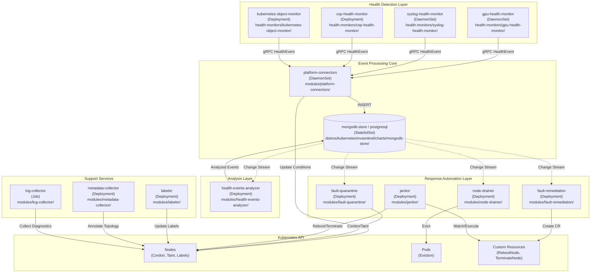
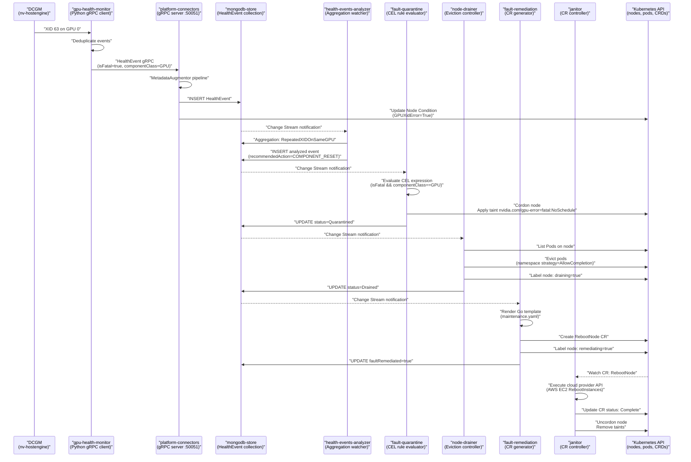

<!-- source: DeepWiki mcp.deepwiki.com · repo NVIDIA/NVSentinel · page 1 Home · fetched 2026-10-26 -->

# Home

<details>
<summary>Relevant source files</summary>

The following files were used as context for generating this wiki page:

- [README.md](README.md)
- [RELEASE_NOTES_v1.0.0.md](RELEASE_NOTES_v1.0.0.md)
- [ROADMAP.md](ROADMAP.md)
- [demos/local-fault-injection-demo/Makefile](demos/local-fault-injection-demo/Makefile)
- [demos/local-fault-injection-demo/README.md](demos/local-fault-injection-demo/README.md)
- [demos/local-fault-injection-demo/scripts/00-setup.sh](demos/local-fault-injection-demo/scripts/00-setup.sh)
- [demos/local-fault-injection-demo/scripts/01-show-cluster.sh](demos/local-fault-injection-demo/scripts/01-show-cluster.sh)
- [demos/local-fault-injection-demo/scripts/02-inject-error.sh](demos/local-fault-injection-demo/scripts/02-inject-error.sh)
- [demos/local-fault-injection-demo/scripts/03-verify-cordon.sh](demos/local-fault-injection-demo/scripts/03-verify-cordon.sh)
- [demos/local-fault-injection-demo/scripts/99-cleanup.sh](demos/local-fault-injection-demo/scripts/99-cleanup.sh)
- [demos/local-slinky-drain-demo/scripts/00-setup.sh](demos/local-slinky-drain-demo/scripts/00-setup.sh)
- [distros/kubernetes/README.md](distros/kubernetes/README.md)
- [distros/kubernetes/nvsentinel/charts/gpu-health-monitor/files/dcgmerrorsmapping.csv](distros/kubernetes/nvsentinel/charts/gpu-health-monitor/files/dcgmerrorsmapping.csv)
- [distros/kubernetes/nvsentinel/charts/preflight/templates/deployment.yaml](distros/kubernetes/nvsentinel/charts/preflight/templates/deployment.yaml)
- [distros/kubernetes/nvsentinel/values-full.yaml](distros/kubernetes/nvsentinel/values-full.yaml)
- [distros/kubernetes/nvsentinel/values-tilt.yaml](distros/kubernetes/nvsentinel/values-tilt.yaml)
- [distros/kubernetes/nvsentinel/values.yaml](distros/kubernetes/nvsentinel/values.yaml)
- [docs/INTEGRATIONS.md](docs/INTEGRATIONS.md)
- [docs/OVERVIEW.md](docs/OVERVIEW.md)
- [platform-connectors/pkg/transformers/metadata/transformer_test.go](platform-connectors/pkg/transformers/metadata/transformer_test.go)
- [tests/helpers/preflight.go](tests/helpers/preflight.go)
- [tilt/Tiltfile](tilt/Tiltfile)
- [tilt/helpers.star](tilt/helpers.star)

</details>


## Purpose and Scope

This wiki documents **NVSentinel**, a comprehensive GPU node resilience system for Kubernetes that automatically detects, classifies, and remediates hardware and software faults in GPU nodes. This page provides an introduction to the system architecture, key components, and navigation to detailed documentation.

For installation instructions, see **Getting Started > Installation and Quick Start**. For architectural details, see **Architecture > System Overview**. For hands-on learning, see **Getting Started > Fault Injection Demo**.

**Sources:** [README.md:1-13](), [docs/OVERVIEW.md:1-13]()

---

## What is NVSentinel

NVSentinel is a **microservices-based fault management system** designed for GPU clusters running on Kubernetes. It continuously monitors GPU hardware health, system logs, and cloud provider events, then automatically responds to failures by cordoning nodes, draining workloads, and triggering remediation workflows.

The system operates in production GPU clusters to:
- Detect GPU XID errors, thermal failures, ECC errors, and NVSwitch faults [docs/OVERVIEW.md:21-22]()
- Prevent new workload scheduling on faulty nodes via cordon/taint [docs/OVERVIEW.md:32-33]()
- Gracefully evacuate running workloads from degraded hardware [docs/OVERVIEW.md:33-34]()
- Trigger automated repair workflows via cloud provider APIs [docs/OVERVIEW.md:34-35]()
- Maintain complete audit trails of all fault events [docs/OVERVIEW.md:45-46]()

**Target Environment:** Kubernetes 1.25+ clusters with NVIDIA GPU Operator (DCGM), designed for AI/ML training infrastructure and HPC workloads. [README.md:19-21](), [docs/OVERVIEW.md:7-8]()

**Sources:** [README.md:7-10](), [docs/OVERVIEW.md:4-33]()

---

## System Architecture

NVSentinel implements an **event-driven architecture** where health monitors detect faults, platform connectors normalize and persist events to a datastore, and response modules watch for specific conditions via change streams to take automated action. [README.md:163-206](), [docs/OVERVIEW.md:15-17]()

### Component Architecture



**Key Design Principles:**
- **Decoupled Communication:** Modules communicate primarily via datastore change streams, not direct RPC. [docs/OVERVIEW.md:17-18]()
- **Independent Scaling:** Each module can scale replicas independently based on load. [distros/kubernetes/nvsentinel/values-full.yaml:161-169]()
- **Progressive Enablement:** Monitoring can run alone; response modules are enabled gradually. [docs/OVERVIEW.md:55-57]()
- **Failure Isolation:** Module failures do not cascade; the datastore acts as a central coordinator. [docs/OVERVIEW.md:32-33]()

**Sources:** [README.md:163-206](), [distros/kubernetes/README.md:52-76](), [docs/OVERVIEW.md:15-38]()

---

## Core Components

### Component Summary Table

| Component | Type | Language | Purpose | Default State |
|-----------|------|----------|---------|---------------|
| `gpu-health-monitor` | DaemonSet | Python | Monitors GPU hardware via DCGM (XID errors, thermal, ECC) | Enabled [distros/kubernetes/nvsentinel/values.yaml:144]() |
| `syslog-health-monitor` | DaemonSet | Go | Parses system logs via journalctl for hardware faults | Enabled [distros/kubernetes/nvsentinel/values.yaml:160]() |
| `csp-health-monitor` | Deployment | Go | Polls cloud provider APIs for maintenance events | Disabled [distros/kubernetes/nvsentinel/values.yaml:158]() |
| `kubernetes-object-monitor` | Deployment | Go | Policy-based monitoring of K8s resources via CEL | Disabled [distros/kubernetes/nvsentinel/values.yaml:172]() |
| `platform-connectors` | DaemonSet | Go | gRPC server receiving events, persists to datastore | Enabled [distros/kubernetes/nvsentinel/values-tilt.yaml:131]() |
| `mongodb-store` | StatefulSet | — | Event persistence with change streams | Disabled (internal) [distros/kubernetes/nvsentinel/values.yaml:170]() |
| `health-events-analyzer` | Deployment | Go | Pattern detection, aggregation pipelines | Disabled [distros/kubernetes/nvsentinel/values.yaml:146]() |
| `fault-quarantine` | Deployment | Go | CEL-based rules engine for cordoning nodes | Disabled [distros/kubernetes/nvsentinel/values.yaml:148]() |
| `node-drainer` | Deployment | Go | Pod eviction with namespace-specific strategies | Disabled [distros/kubernetes/nvsentinel/values.yaml:150]() |
| `fault-remediation` | Deployment | Go | Creates maintenance CRs via Go templates | Disabled [distros/kubernetes/nvsentinel/values.yaml:152]() |
| `janitor` | Deployment | Go | Executes node reboots/terminations via cloud APIs | Disabled [distros/kubernetes/nvsentinel/values.yaml:154]() |
| `labeler` | Deployment | Go | Auto-labels nodes with DCGM/driver versions | Enabled [distros/kubernetes/nvsentinel/values.yaml:162]() |
| `metadata-collector` | Deployment | Go | Collects GPU topology (PCI, UUIDs) | Enabled [distros/kubernetes/nvsentinel/values.yaml:164]() |
| `log-collector` | Job | Python | Diagnostic log collection on faults | Disabled [distros/kubernetes/nvsentinel/values-full.yaml:226]() |

**Production Strategy:** Start with a monitoring-only configuration (`gpuHealthMonitor.enabled: true`, `faultQuarantine.enabled: false`), validate detection accuracy, then progressively enable response automation. [docs/OVERVIEW.md:55-57]()

**Sources:** [distros/kubernetes/README.md:87-115](), [distros/kubernetes/nvsentinel/values.yaml:143-180](), [docs/OVERVIEW.md:30-38]()

---

## Event Lifecycle and Data Flow

The following sequence shows a complete fault lifecycle from detection to remediation, using actual code module names and Kubernetes API interactions:



**Event Data Model:** Each `HealthEvent` contains metadata such as `nodeName`, `componentClass`, `componentID`, `checkName`, `isFatal`, and `severity`. Platform connectors augment these with cloud provider metadata and node topology before persistence. [docs/OVERVIEW.md:26-27](), [distros/kubernetes/nvsentinel/values.yaml:105-106]()

**Change Stream Watchers:** Response modules use datastore change streams (MongoDB `watch()` or PostgreSQL `LISTEN/NOTIFY`) for real-time processing. Circuit breakers in `fault-quarantine` prevent mass node quarantines based on configurable thresholds. [distros/kubernetes/README.md:145-150](), [docs/OVERVIEW.md:45-46]()

**Sources:** [README.md:163-206](), [demos/local-fault-injection-demo/README.md:75-95](), [docs/OVERVIEW.md:15-38]()

---

## Key Features

### Fault Detection
- **GPU Hardware Monitoring:** DCGM integration detects XID errors, thermal issues, ECC errors, and NVLink failures. [docs/OVERVIEW.md:21-22]()
- **System Log Analysis:** `journalctl` parsing for kernel panics, driver crashes, and hardware errors. [docs/OVERVIEW.md:22-23]()
- **Cloud Provider Events:** Integration with AWS, GCP, Azure, and OCI APIs for maintenance events. [docs/OVERVIEW.md:23-24]()
- **Custom Policies:** CEL-based monitoring of any Kubernetes resource via `kubernetes-object-monitor`. [docs/OVERVIEW.md:24-25]()

### Automated Response
- **Quarantine:** CEL rules determine when to cordon nodes and apply taints; includes a circuit breaker to prevent mass outages. [distros/kubernetes/README.md:136-169]()
- **Graceful Draining:** Namespace-specific eviction strategies including `Immediate`, `AllowCompletion`, and `DeleteAfterTimeout`. [distros/kubernetes/README.md:171-193]()
- **Remediation Workflows:** Go templates generate maintenance resources (e.g., `RebootNode`, `GPUReset`) consumed by the `janitor`. [distros/kubernetes/README.md:195-218]()
- **Multi-Cloud Execution:** The `janitor` executes reboots and terminations via cloud provider APIs. [docs/OVERVIEW.md:35-36]()

### Operational Safety
- **Dry-Run Mode:** Global flag to log all actions without executing them (cordon, drain, remediation). [distros/kubernetes/nvsentinel/values.yaml:16](), [distros/kubernetes/nvsentinel/values-full.yaml:59-69]()
- **Progressive Enablement:** Modules can be enabled one by one as confidence grows. [docs/OVERVIEW.md:55-57]()
- **Circuit Breakers:** Configurable limits on the percentage of nodes that can be quarantined simultaneously. [distros/kubernetes/README.md:145-149]()
- **Manual Override:** Use labels like `k8saas.nvidia.com/ManagedByNVSentinel: "false"` to exempt specific nodes. [distros/kubernetes/README.md:161]()

**Sources:** [README.md:37-47](), [distros/kubernetes/README.md:115-149](), [docs/OVERVIEW.md:30-38]()

---

## Technology Stack

### Languages and Frameworks
- **Go:** Used for core processing modules (`platform-connectors`, `fault-quarantine`, `node-drainer`, `fault-remediation`, `janitor`). [tilt/Tiltfile:126-145]()
- **Python:** Used for health monitors requiring DCGM bindings (`gpu-health-monitor`) and diagnostic collection. [distros/kubernetes/nvsentinel/values.yaml:143-165]()
- **gRPC/Protobuf:** Protocol for inter-service communication (monitors → connectors). [README.md:41-41](), [docs/OVERVIEW.md:26-27]()
- **CEL (Common Expression Language):** Policy evaluation in `fault-quarantine` and `kubernetes-object-monitor`. [distros/kubernetes/README.md:138-140]()

### Data Storage
- **MongoDB:** Primary event store with change streams (default). [distros/kubernetes/nvsentinel/values-tilt.yaml:145-148]()
- **PostgreSQL:** Supported alternative datastore using `LISTEN/NOTIFY`. [distros/kubernetes/nvsentinel/values.yaml:33-35](), [docs/OVERVIEW.md:45-46]()

### Kubernetes Integration
- **Helm 3.0+:** Modular chart architecture with subcharts for each module. [distros/kubernetes/README.md:52-76]()
- **client-go / controller-runtime:** Kubernetes API interaction and custom resource controllers. [distros/kubernetes/nvsentinel/values.yaml:99-103]()

### Build and CI/CD
- **Ko:** Build system for Go container images. [docs/OVERVIEW.md:61-62]()
- **GitHub Actions:** CI/CD pipeline for linting, testing, and multi-platform image publishing. [docs/OVERVIEW.md:61-63]()

**Sources:** [README.md:1-6](), [distros/kubernetes/README.md:1-6](), [docs/OVERVIEW.md:60-63]()

---

## Getting Started

### Quick Installation

```bash
# Prerequisites: Kubernetes 1.25+, Helm 3.0+, NVIDIA GPU Operator

# 1. Install cert-manager (required for TLS)
helm repo add jetstack https://charts.jetstack.io
helm upgrade --install cert-manager jetstack/cert-manager \
  --namespace cert-manager --create-namespace \
  --version v1.19.1 --set installCRDs=true --wait

# 2. Install NVSentinel (monitoring-only by default)
NVSENTINEL_VERSION=v1.0.0
helm upgrade --install nvsentinel oci://ghcr.io/nvidia/nvsentinel \
  --version "$NVSENTINEL_VERSION" \
  --namespace nvsentinel --create-namespace --wait
```

**Default Configuration:** Only health monitors are enabled. Response automation modules must be explicitly enabled via Helm values. [docs/OVERVIEW.md:55-57]()

**Verification:**
```bash
kubectl get pods -n nvsentinel
kubectl get nodes  # Verify GPU nodes are visible
```

For complete installation steps, see **Getting Started > Installation and Quick Start**.

**Sources:** [README.md:15-96](), [distros/kubernetes/README.md:8-50]()

---

## Try the Demo

The **Local Fault Injection Demo** demonstrates the complete fault detection and quarantine workflow on a laptop without GPU hardware:

```bash
cd demos/local-fault-injection-demo
make demo  # Automated: creates KIND cluster, installs NVSentinel, injects fault, verifies cordon
```

**What it demonstrates:**
1. **GPU Health Monitor** detects an injected error from a simulated DCGM. [demos/local-fault-injection-demo/README.md:103-104]()
2. **Platform Connectors** persists the health event to **MongoDB**. [demos/local-fault-injection-demo/README.md:124-125]()
3. **Fault Quarantine** evaluates CEL rules and cordons the node. [demos/local-fault-injection-demo/README.md:131-133]()
4. **Kubernetes API** reflects the node as `SchedulingDisabled`. [demos/local-fault-injection-demo/README.md:137-139]()

**Duration:** ~5-10 minutes. [demos/local-fault-injection-demo/README.md:42-43]()

For a detailed walkthrough, see **Getting Started > Fault Injection Demo**.

**Sources:** [demos/local-fault-injection-demo/README.md:1-142](), [demos/local-fault-injection-demo/scripts/00-setup.sh:1-25]()

---

## Navigation Guide

### For New Users
- **Getting Started > Core Concepts:** Health events, quarantine, drain, remediation lifecycle.
- **Getting Started > Fault Injection Demo:** Hands-on walkthrough of fault detection.
- **Architecture > System Overview:** Architecture layers and component relationships.

### For Operators
- **Getting Started > Installation and Quick Start:** Helm installation and prerequisites.
- **Deployment > Configuration Guide:** Helm values, module configuration, safety settings.
- **Deployment > Production Deployment:** Progressive enablement strategy and rollout checklist.
- **Operations and Observability > Troubleshooting Guide:** Common issues and debugging procedures.

### For Developers
- **Development > Development Environment Setup:** Tool installation and local development.
- **Development > Local Development with Tilt:** Live reload workflow for code changes.
- **Development > Testing Strategy:** Unit tests, integration tests, E2E validation.
- **CI/CD and Build System > CI/CD Pipeline Overview:** GitHub Actions workflows and quality gates.

### Component Deep Dives
- **Health Monitoring:** [GPU Health Monitor](#4.1), [Syslog Health Monitor](#4.2), [CSP Health Monitor](#4.3).
- **Event Processing:** [Platform Connectors](#5.1), [Health Events Analyzer](#5.2).
- **Fault Management:** [Fault Quarantine Module](#6.1), [Node Drainer Module](#6.2), [Fault Remediation Module](#6.3), [Janitor and Maintenance Execution](#6.4).

### Advanced Topics
- **Plugin System > Custom Drain Plugins:** `DrainRequest` CRD for external drain controllers.
- **Support Services > Event Exporter:** Streaming events to external monitoring systems.
- **Deployment > Multi-Cloud Deployment:** AWS, GCP, Azure, OCI configuration.
- **Operations and Observability > Scale Testing:** KWOK-based validation with large-scale simulated nodes.

**Sources:** [README.md:1-282](), [docs/OVERVIEW.md:1-141]()

---

