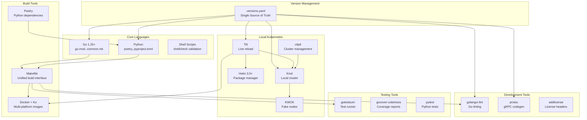
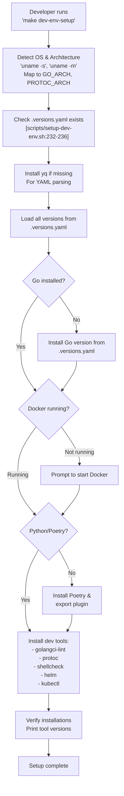
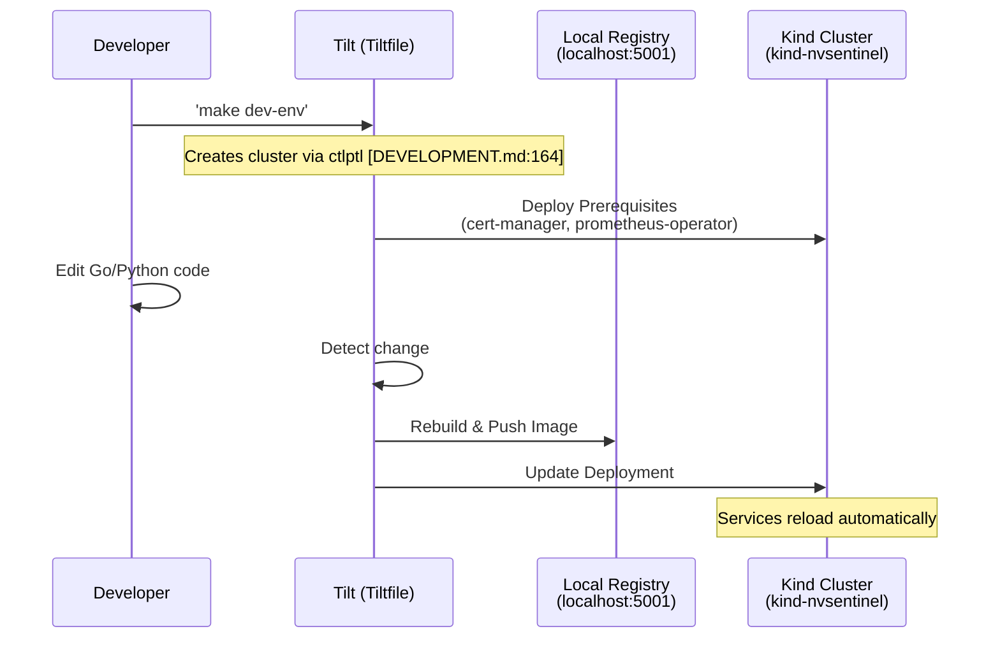
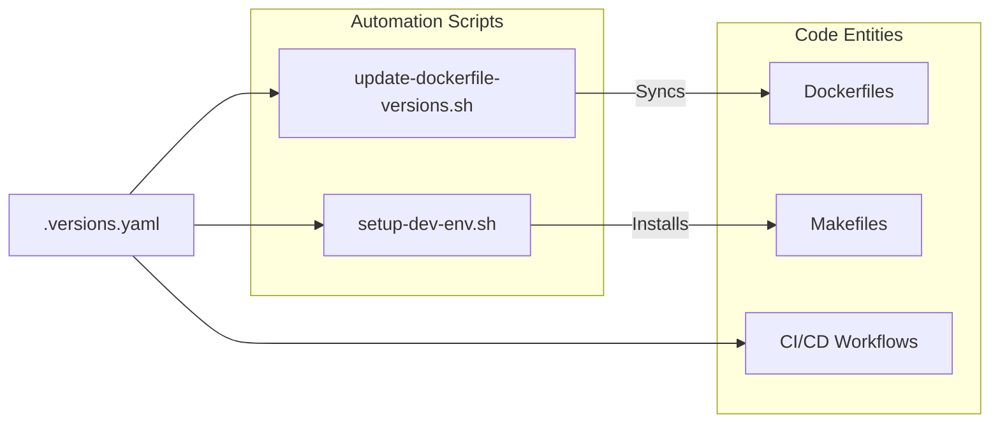

<!-- source: DeepWiki mcp.deepwiki.com · repo NVIDIA/NVSentinel · page 10 Development · fetched 2026-10-26 -->

# Development

Relevant source files

The following files were used as context for generating this wiki page:

- [DEVELOPMENT.md](DEVELOPMENT.md)
- [distros/kubernetes/nvsentinel/charts/gpu-health-monitor/files/dcgmerrorsmapping.csv](distros/kubernetes/nvsentinel/charts/gpu-health-monitor/files/dcgmerrorsmapping.csv)
- [distros/kubernetes/nvsentinel/charts/preflight/templates/deployment.yaml](distros/kubernetes/nvsentinel/charts/preflight/templates/deployment.yaml)
- [distros/kubernetes/nvsentinel/values-full.yaml](distros/kubernetes/nvsentinel/values-full.yaml)
- [distros/kubernetes/nvsentinel/values-tilt.yaml](distros/kubernetes/nvsentinel/values-tilt.yaml)
- [distros/kubernetes/nvsentinel/values.yaml](distros/kubernetes/nvsentinel/values.yaml)
- [docs/INTEGRATIONS.md](docs/INTEGRATIONS.md)
- [platform-connectors/pkg/transformers/metadata/transformer_test.go](platform-connectors/pkg/transformers/metadata/transformer_test.go)
- [scripts/setup-dev-env.sh](scripts/setup-dev-env.sh)
- [scripts/update-dockerfile-versions.sh](scripts/update-dockerfile-versions.sh)
- [tests/helpers/preflight.go](tests/helpers/preflight.go)
- [tilt/Tiltfile](tilt/Tiltfile)
- [tilt/helpers.star](tilt/helpers.star)

This page provides an overview of local development practices for NVSentinel, including environment setup, development workflows, and testing strategies. For production deployment, see [Deployment](#11).

**Child pages provide detailed guides:**
- [Development Environment Setup](#10.1) — Tool installation, prerequisites, and automated setup.
- [Local Development with Tilt](#10.2) — Live reload workflow, Kind cluster setup, and debugging.
- [Testing Strategy](#10.3) — Unit tests, integration tests, E2E tests, and coverage requirements.
- [Writing and Running Tests](#10.4) — Test helpers, writing new tests, and debugging techniques.

## Development Environment Overview

NVSentinel development requires a polyglot toolchain supporting Go microservices, Python health monitors, shell scripts, and Kubernetes manifests. The development environment is optimized for rapid iteration via Tilt and automated testing via GitHub Actions.

### Tool Ecosystem

NVSentinel uses `.versions.yaml` for centralized version management across local development, CI/CD pipelines, and container builds [DEVELOPMENT.md:28-33]().

**Sources:** [DEVELOPMENT.md:30-62](), [scripts/setup-dev-env.sh:32-64](), [scripts/update-dockerfile-versions.sh:48-52]()

### Multi-Language Architecture

NVSentinel follows a microservices architecture with event-driven communication via MongoDB change streams [DEVELOPMENT.md:104-112]().

| Language | Components | Build System | Testing |
|----------|-----------|--------------|---------|
| **Go** | Platform Connectors, Fault Quarantine, Node Drainer, Fault Remediation, Health Events Analyzer, Syslog Health Monitor, CSP Health Monitor, Kubernetes Object Monitor, Preflight | `go.mod`, Makefile delegation [DEVELOPMENT.md:98-99]() | `gotestsum`, `envtest` for controllers [DEVELOPMENT.md:200-207]() |
| **Python** | GPU Health Monitor, DCGM Diagnostics, NCCL Multi-node test | Poetry for dependencies [DEVELOPMENT.md:55]() | `pytest` |
| **Shell** | Log collector scripts | Direct execution, shellcheck validation [DEVELOPMENT.md:56]() | Integration tests |
| **YAML** | Helm charts, Kubernetes manifests | Helm 3.0+ [DEVELOPMENT.md:46]() | E2E tests via Kind [DEVELOPMENT.md:61]() |

**Sources:** [DEVELOPMENT.md:115-135](), [scripts/setup-dev-env.sh:190-205]()

## Development Setup Flow

### Automated Setup Script

The `scripts/setup-dev-env.sh` script automates the installation of the entire toolchain by parsing `.versions.yaml` [scripts/setup-dev-env.sh:32-33]().

**Sources:** [scripts/setup-dev-env.sh:18-216](), [DEVELOPMENT.md:64-91]()

### Architecture Detection

The setup script normalizes architecture names to ensure compatibility with various binary download patterns [scripts/setup-dev-env.sh:52-64]().

| Raw Architecture (`uname -m`) | `GO_ARCH` (Go/yq/kubectl) | `PROTOC_ARCH` (Protobuf) |
|-------------------------------|---------------------------|---------------------------|
| `x86_64`                      | `amd64`                   | `x86_64`                  |
| `aarch64` / `arm64`           | `arm64`                   | `aarch_64`                |

**Sources:** [scripts/setup-dev-env.sh:48-64](), [scripts/setup-dev-env.sh:223-228]()

## Local Development with Tilt

### Tilt Workflow

Tilt provides the fastest development experience with hot reloading [DEVELOPMENT.md:157](). It automates the lifecycle of a local Kind cluster and synchronizes code changes into running containers.

**Sources:** [DEVELOPMENT.md:155-179](), [DEVELOPMENT.md:181-190](), [tilt/Tiltfile:43-68]()

### Local Cluster Configuration

The Tilt environment uses a declarative configuration via `ctlptl` to manage a multi-node Kind cluster [DEVELOPMENT.md:181-190](). It includes:
*   **KWOK Nodes**: Up to 50 fake GPU nodes are created using KWOK to simulate large-scale clusters [tilt/Tiltfile:26-119]().
*   **Database Providers**: Supports both MongoDB (default) and PostgreSQL (`USE_POSTGRESQL=1`) [tilt/Tiltfile:28-41]().
*   **Live Reload**: Modules like `fault-quarantine` and `node-drainer` are included via `Tiltfile` logic [tilt/Tiltfile:126-145]().

**Sources:** [tilt/Tiltfile:1-150](), [distros/kubernetes/nvsentinel/values-tilt.yaml:1-102]()

## Version Management

### Centralized Version Control

The `.versions.yaml` file is the single source of truth for all components [DEVELOPMENT.md:30-33]().

**Sources:** [scripts/setup-dev-env.sh:32-51](), [scripts/update-dockerfile-versions.sh:16-58]()

### Synchronization Tools

NVSentinel includes tools to ensure that container base images match local development versions.
*   **`make show-versions`**: Displays current versions defined in the project [DEVELOPMENT.md:37-38]().
*   **`scripts/update-dockerfile-versions.sh`**: Scans all Dockerfiles in the repository and updates `FROM` instructions for Go and Python base images to match `.versions.yaml` [scripts/update-dockerfile-versions.sh:16-25]().

**Sources:** [scripts/update-dockerfile-versions.sh:71-155]()

## Next Steps

- **[Development Environment Setup](#10.1)** — Detailed installation guide with prerequisites and troubleshooting.
- **[Local Development with Tilt](#10.2)** — Complete Tilt workflow, debugging techniques, and KWOK usage.
- **[Testing Strategy](#10.3)** — Unit tests, integration tests, E2E tests, and coverage requirements.
- **[Writing and Running Tests](#10.4)** — Test helpers, node pool creation, and debugging failing tests.

---

