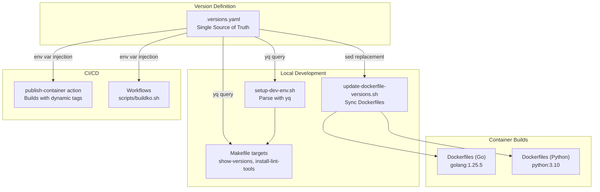
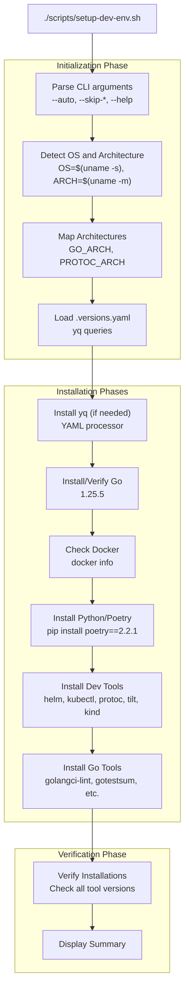
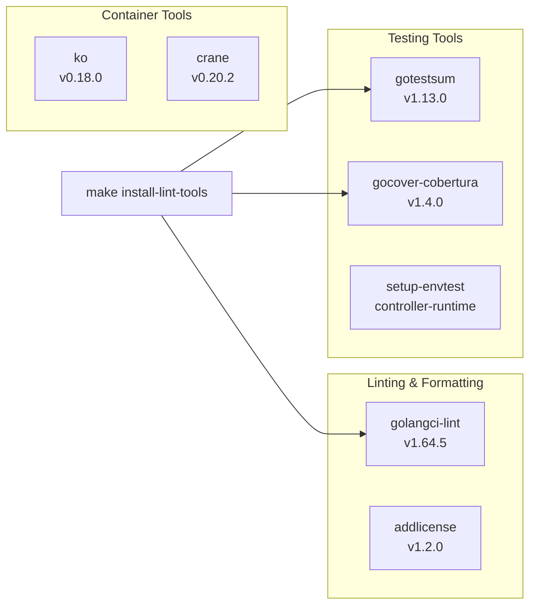
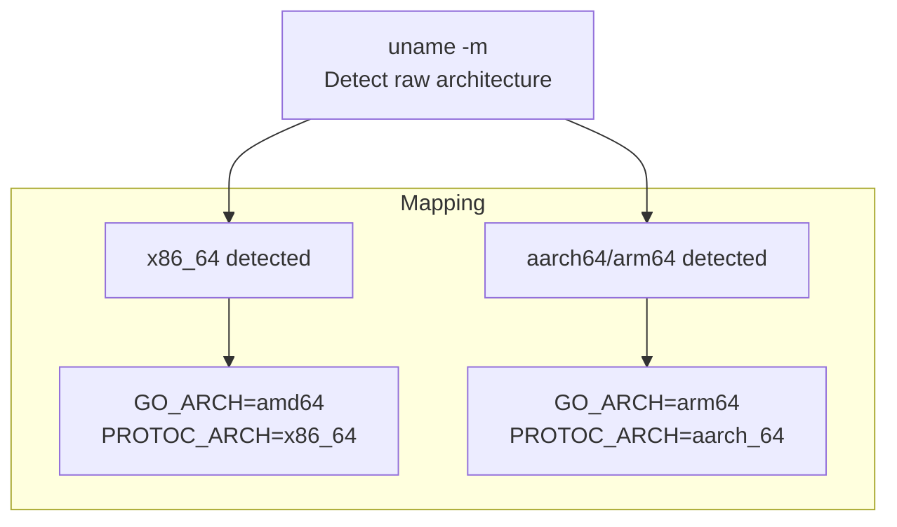
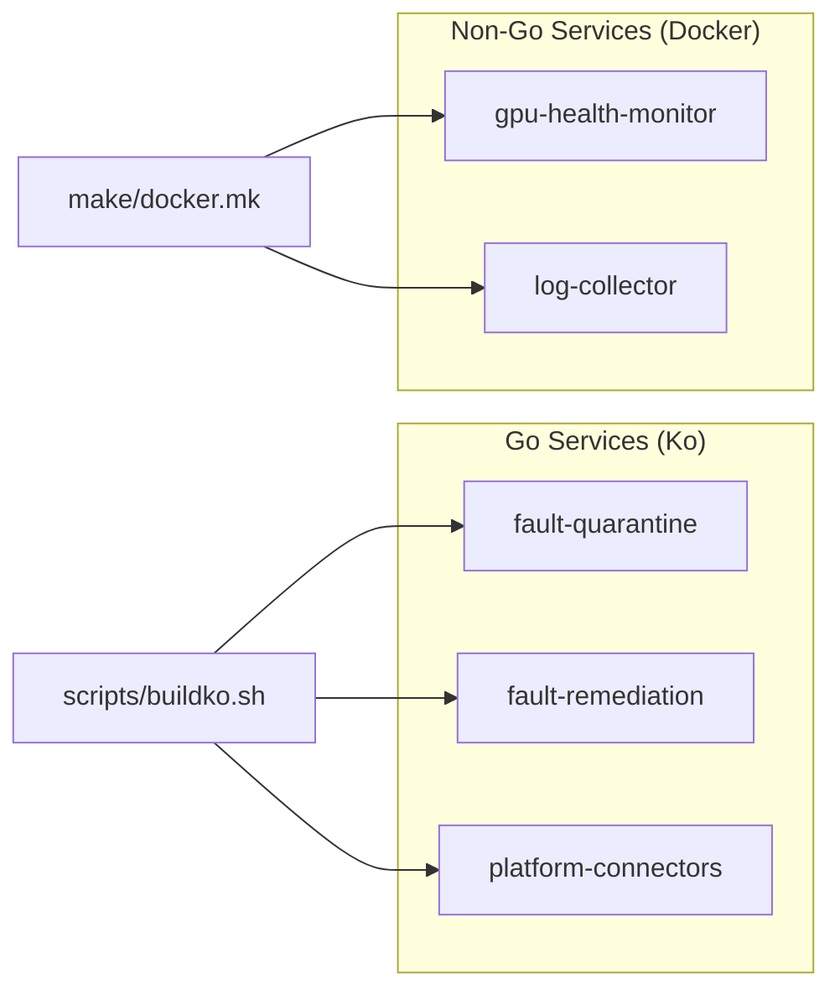

<!-- source: DeepWiki mcp.deepwiki.com · repo NVIDIA/NVSentinel · page 10.1 Development Environment Setup · fetched 2026-10-26 -->

# Development Environment Setup

<details>
<summary>Relevant source files</summary>

The following files were used as context for generating this wiki page:

- [.github/actions/publish-container/action.yml](.github/actions/publish-container/action.yml)
- [.github/actions/sbom-and-attest/action.yml](.github/actions/sbom-and-attest/action.yml)
- [.gitignore](.gitignore)
- [.ko.yaml](.ko.yaml)
- [DEVELOPMENT.md](DEVELOPMENT.md)
- [Makefile](Makefile)
- [distros/kubernetes/nvsentinel/policies/must-have-sbom.yaml](distros/kubernetes/nvsentinel/policies/must-have-sbom.yaml)
- [distros/kubernetes/nvsentinel/policies/must-have-slsa.yaml](distros/kubernetes/nvsentinel/policies/must-have-slsa.yaml)
- [make/docker.mk](make/docker.mk)
- [scripts/build-image-list.sh](scripts/build-image-list.sh)
- [scripts/buildko.sh](scripts/buildko.sh)
- [scripts/check-image-attestations.sh](scripts/check-image-attestations.sh)
- [scripts/setup-dev-env.sh](scripts/setup-dev-env.sh)
- [scripts/update-dockerfile-versions.sh](scripts/update-dockerfile-versions.sh)
- [scripts/verify-image-provenance.sh](scripts/verify-image-provenance.sh)

</details>


This document describes how to set up a local development environment for NVSentinel. It covers automated and manual installation of all required tools, version management, and platform-specific configuration. For information about actually developing with Tilt and live reload, see [Local Development with Tilt](). For testing workflows, see [Testing Strategy]().

---

## Purpose and Scope

This page covers:
- Prerequisites and system requirements.
- Centralized version management via `.versions.yaml`.
- Automated environment setup using `setup-dev-env.sh`.
- Tool installation for Go, Python, containers, and Kubernetes.
- Architecture detection and platform-specific handling.
- Manual installation procedures for troubleshooting.

**What this page does NOT cover:**
- Daily development workflows with Tilt (see [Local Development with Tilt]()).
- Writing and running tests (see [Writing and Running Tests]()).
- CI/CD pipeline configuration (see [CI/CD Pipeline Overview]().

---

## Prerequisites and System Requirements

### Supported Platforms

The development environment supports the following platforms:

| Platform | Architectures | Notes |
|----------|--------------|-------|
| **Linux** | `x86_64` (amd64), `aarch64` (arm64) | Primary development platform |
| **macOS** | `x86_64` (Intel), `arm64` (Apple Silicon) | Full support via Homebrew |

**Architecture Mapping:**
- The setup script automatically detects your architecture and maps it to tool-specific naming conventions:
  - Go tools use `amd64`/`arm64`.
  - Protocol Buffers use `x86_64`/`aarch_64`.
  - kubectl uses `amd64`/`arm64`.

Sources: [scripts/setup-dev-env.sh:48-64]()

### System Dependencies

**Required:**
- `curl`, `wget`, `git`, `unzip` - Download and extraction utilities.
- `build-essential` (Linux) or Xcode Command Line Tools (macOS) - C/C++ compilers.
- Docker Desktop (macOS) or Docker Engine (Linux) - Container runtime.

**Package Managers:**
- **macOS:** Homebrew (`brew`) - Used for most tool installations.
- **Linux:** `apt-get`, `yum`, or equivalent - Used for system packages.

Sources: [scripts/setup-dev-env.sh:242-262]()

---

## Version Management System

### .versions.yaml as Single Source of Truth

NVSentinel uses a centralized version management system where `.versions.yaml` defines canonical versions for all tools, languages, and dependencies. This ensures consistency across local development, CI/CD pipelines, and container builds.

**Version Management Flow**



Sources: [Makefile:15-38](), [scripts/setup-dev-env.sh:30-32](), [scripts/update-dockerfile-versions.sh:16-25](), [scripts/buildko.sh:22-31]()

### Version Categories

The `.versions.yaml` file organizes versions into logical categories. The Makefile uses `yq` to load these into variables for build automation.

| Category | Tools | Example Versions |
|----------|-------|------------------|
| **languages** | `go`, `python` | `1.25.5`, `3.10` |
| **build_tools** | `poetry`, `poetry_plugin_export` | `2.2.1`, `1.10.0` |
| **go_tools** | `golangci_lint`, `gotestsum`, `gocover_cobertura` | `v1.64.5`, `v1.13.0`, `v1.4.0` |
| **protobuf** | `protobuf`, `protoc_gen_go`, `protoc_gen_go_grpc`, `grpcio_tools` | `v33.4`, `v1.36.10`, `v1.5.1`, `1.75.1` |
| **linting** | `shellcheck`, `addlicense`, `black` | `v0.11.0`, `v1.2.0`, `26.3.1` |
| **container_tools** | `docker_buildx`, `ko` | `v3.11.1`, `v0.18.0` |
| **testing_tools** | `kind`, `helm`, `kwok`, `ctlptl`, `tilt` | `0.30.0`, `v3.19.2`, `v0.7.0`, `0.8.43`, `0.35.2` |

Sources: [Makefile:24-38](), [DEVELOPMENT.md:30-38]()

### Viewing Current Versions

```bash
# Display all versions loaded from .versions.yaml
make show-versions
```

Sources: [Makefile:89-122](), [DEVELOPMENT.md:35-38]()

---

## Automated Setup Script

### setup-dev-env.sh Architecture

The `setup-dev-env.sh` script provides automated installation of all development dependencies with platform detection, interactive prompts, and comprehensive error handling.

**Script Execution Flow**



Sources: [scripts/setup-dev-env.sh:1-216](), [Makefile:125-128]()

### Command-Line Interface

**Basic Usage:**

```bash
# Interactive mode (prompts for each installation)
./scripts/setup-dev-env.sh

# Non-interactive mode (auto-install everything)
./scripts/setup-dev-env.sh --auto

# Makefile wrapper
make dev-env-setup AUTO_MODE=true
```

**Available Options:**

| Option | Description |
|--------|-------------|
| `--auto` | Non-interactive mode (auto-yes to all prompts). |
| `--skip-go` | Skip Go installation. |
| `--skip-docker` | Skip Docker installation/check. |
| `--skip-python` | Skip Python/Poetry installation. |
| `--skip-tools` | Skip development tools installation. |

Sources: [scripts/setup-dev-env.sh:152-181](), [Makefile:125-128]()

---

## Tool Categories and Installation

### Core Language Runtimes

#### Go Installation
**Target Version:** `1.25.5` (defined in `.versions.yaml`).
The installation is managed by the setup script which ensures the local binary matches the project requirement.

Sources: [Makefile:27](), [scripts/setup-dev-env.sh:300-346]()

#### Python and Poetry
**Target Version:** `3.10`.
**Package Manager:** Poetry `2.2.1` with `poetry-plugin-export` `1.10.0`.

```bash
# Install Poetry via pip as part of setup-dev-env.sh
pip install poetry==2.2.1 poetry-plugin-export==1.10.0
```

Sources: [Makefile:33-37](), [scripts/update-dockerfile-versions.sh:49-51]()

### Go Development Tools

NVSentinel requires several Go-based tools for linting, testing, and containerization.

**Go Tools Installation Map**



Sources: [Makefile:24-36](), [Makefile:131-157](), [DEVELOPMENT.md:50-57]()

### Container and Kubernetes Tools

**Development Infrastructure:**

| Tool | Purpose | Installation |
|------|---------|--------------|
| `Kind` | Local Kubernetes clusters | `scripts/setup-dev-env.sh` |
| `ctlptl` | Cluster and Registry management | `scripts/setup-dev-env.sh` |
| `Tilt` | Live reload development | `scripts/setup-dev-env.sh` |
| `Helm` | Package management | `scripts/setup-dev-env.sh` |
| `KWOK` | Fake node simulation | `scripts/setup-dev-env.sh` |

Sources: [DEVELOPMENT.md:58-62](), [scripts/setup-dev-env.sh:434-610]()

---

## Architecture Detection and Platform Handling

The setup script detects the system architecture and maps it to tool-specific naming conventions to construct download URLs.

**Architecture Mapping Logic:**



Sources: [scripts/setup-dev-env.sh:48-64]()

### URL Verification System
The script includes a `verify_download_url` function that performs a `curl -I` (HEAD request) to validate tool availability before attempting a full download, providing detailed troubleshooting for 404 (version mismatch) or 403 (rate limiting) errors.

Sources: [scripts/setup-dev-env.sh:90-125]()

---

## Docker and Ko Integration

### Synchronizing Dockerfiles
To ensure Docker containers use the same versions as the local environment, the `update-dockerfile-versions.sh` script parses `.versions.yaml` and updates `FROM` instructions in all Dockerfiles.

```bash
# Show version discrepancies
./scripts/update-dockerfile-versions.sh

# Apply changes to all Dockerfiles
./scripts/update-dockerfile-versions.sh apply
```

Sources: [scripts/update-dockerfile-versions.sh:16-70]()

### Build and Publish Workflow
NVSentinel uses both `ko` (for Go services) and `docker buildx` (for Python/Shell services).

**Build Entity Association:**



Sources: [scripts/buildko.sh:60-75](), [make/docker.mk:24-47](), [Makefile:41-67]()

---

## Next Steps

After setting up your development environment:

1. **Start local development:** See [Local Development with Tilt]() for instructions on starting a Kubernetes cluster with live reload.
2. **Verify provenance:** If deploying official images, see [scripts/verify-image-provenance.sh]() for policy enforcement setup.
3. **Run tests:** See [Testing Strategy]() for unit and integration test workflows.

Sources: [DEVELOPMENT.md:155-180](), [scripts/verify-image-provenance.sh:17-44]()

---

