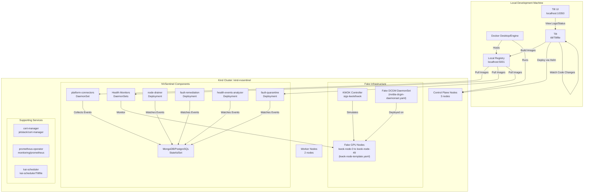
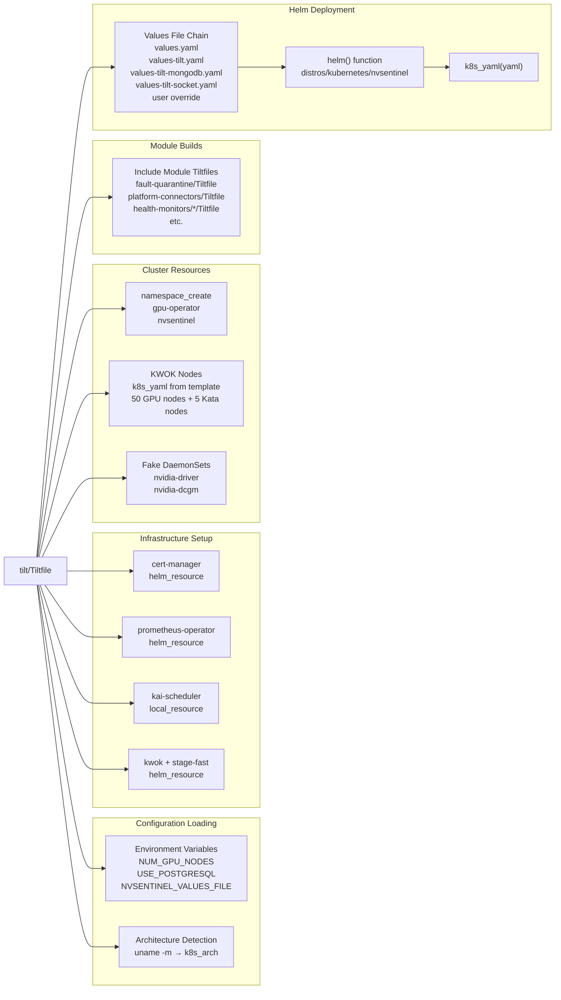

<!-- source: DeepWiki mcp.deepwiki.com · repo NVIDIA/NVSentinel · page 10.2 Local Development with Tilt · fetched 2026-10-26 -->

# Local Development with Tilt

<details>
<summary>Relevant source files</summary>

The following files were used as context for generating this wiki page:

- [DEVELOPMENT.md](DEVELOPMENT.md)
- [distros/kubernetes/nvsentinel/charts/gpu-health-monitor/files/dcgmerrorsmapping.csv](distros/kubernetes/nvsentinel/charts/gpu-health-monitor/files/dcgmerrorsmapping.csv)
- [distros/kubernetes/nvsentinel/charts/preflight/templates/deployment.yaml](distros/kubernetes/nvsentinel/charts/preflight/templates/deployment.yaml)
- [distros/kubernetes/nvsentinel/values-full.yaml](distros/kubernetes/nvsentinel/values-full.yaml)
- [distros/kubernetes/nvsentinel/values-tilt.yaml](distros/kubernetes/nvsentinel/values-tilt.yaml)
- [distros/kubernetes/nvsentinel/values.yaml](distros/kubernetes/nvsentinel/values.yaml)
- [docs/INTEGRATIONS.md](docs/INTEGRATIONS.md)
- [platform-connectors/pkg/transformers/metadata/transformer_test.go](platform-connectors/pkg/transformers/metadata/transformer_test.go)
- [scripts/setup-dev-env.sh](scripts/setup-dev-env.sh)
- [scripts/update-dockerfile-versions.sh](scripts/update-dockerfile-versions.sh)
- [scripts/validate-nvsentinel.sh](scripts/validate-nvsentinel.sh)
- [tests/helpers/preflight.go](tests/helpers/preflight.go)
- [tests/uat/kind/README.md](tests/uat/kind/README.md)
- [tests/uat/kind/cert-manager-values.yaml](tests/uat/kind/cert-manager-values.yaml)
- [tests/uat/kind/kwok-node-template.yaml](tests/uat/kind/kwok-node-template.yaml)
- [tests/uat/kind/nvidia-dcgm-daemonset.yaml](tests/uat/kind/nvidia-dcgm-daemonset.yaml)
- [tests/uat/kind/nvidia-driver-daemonset.yaml](tests/uat/kind/nvidia-driver-daemonset.yaml)
- [tests/uat/kind/prometheus-operator-values.yaml](tests/uat/kind/prometheus-operator-values.yaml)
- [tilt/Tiltfile](tilt/Tiltfile)
- [tilt/dcgm-fake/gpu-spec.yaml](tilt/dcgm-fake/gpu-spec.yaml)
- [tilt/helpers.star](tilt/helpers.star)
- [tilt/nvidia-dcgm-daemonset.yaml](tilt/nvidia-dcgm-daemonset.yaml)
- [tilt/nvidia-driver-daemonset.yaml](tilt/nvidia-driver-daemonset.yaml)

</details>


This page describes how to use Tilt for rapid local development of NVSentinel. Tilt provides live code reloading, integrated logging, and an interactive UI for managing the full NVSentinel stack on a local Kubernetes cluster.

For initial environment setup including tool installation, see [Development Environment Setup](#10.1). For testing strategies and test execution, see [Testing Strategy](#10.3) and [Writing and Running Tests](#10.4).

---

## Purpose and Scope

This document covers:
- Tilt architecture and integration with NVSentinel
- Quick start guide for launching the development environment
- Tiltfile configuration and customization options
- Development workflow with live reload
- KWOK fake node simulation
- Local registry integration
- Debugging techniques

**Prerequisites**: Complete [Development Environment Setup](#10.1) before proceeding. You must have Docker, kubectl, Kind, ctlptl, and Tilt installed. [DEVELOPMENT.md:42-62]()

---

## Tilt Architecture Overview

Tilt orchestrates a complete NVSentinel development environment on a local Kind cluster with live code reloading. The architecture consists of four layers: infrastructure, build system, deployment, and development UI.

**Tilt Architecture and Code Mapping**

Sources: [tilt/Tiltfile:15-145](), [tilt/Tiltfile:185-230](), [DEVELOPMENT.md:181-190]()

### Key Components

| Component | Purpose | Configuration |
|-----------|---------|---------------|
| **Kind Cluster** | Local Kubernetes cluster with 5 nodes (3 control-plane, 2 workers) | Created via ctlptl with `kind-nvsentinel` prefix [DEVELOPMENT.md:183-185]() |
| **Local Registry** | Container registry at `localhost:5001` for fast image pushes | Integrated with Kind cluster [DEVELOPMENT.md:186-187]() |
| **KWOK** | Simulates 50 GPU nodes without real kubelet overhead | [tilt/Tiltfile:26-27](), [tilt/Tiltfile:106-121]() |
| **Fake DCGM** | Mock DCGM service responding to health checks | [tilt/nvidia-dcgm-daemonset.yaml:1-40]() |
| **Tilt** | Orchestrates builds, deployments, and live reloads | [tilt/Tiltfile:1-186]() |
| **Helm** | Deploys NVSentinel with Tilt-specific values | [distros/kubernetes/nvsentinel/values-tilt.yaml:1-103]() |

Sources: [tilt/Tiltfile:26-30](), [tilt/Tiltfile:69-116](), [DEVELOPMENT.md:155-179]()

---

## Quick Start

### Start Development Environment

```bash
# One-command setup: creates cluster and starts Tilt
make dev-env

# Or manual step-by-step approach:
make cluster-create    # Creates Kind cluster with local registry
make tilt-up          # Starts Tilt (opens UI at http://localhost:10350)
```
Sources: [DEVELOPMENT.md:159-171]()

### Verify Deployment

Access the Tilt UI at http://localhost:10350 to monitor deployment status. All resources should show green after initial deployment.

```bash
# View KWOK fake nodes
kubectl get nodes -l type=kwok

# Check NVSentinel components
kubectl get pods -n nvsentinel
```
Sources: [scripts/validate-nvsentinel.sh:102-106]()

---

## Tiltfile Configuration

The Tiltfile is the core configuration file that defines how Tilt builds and deploys NVSentinel. It is organized into several logical sections.

**Tilt Deployment Flow**

Sources: [tilt/Tiltfile:15-186]()

### Environment Variables

Configure the development environment by setting environment variables before running `tilt up`:

| Variable | Default | Purpose |
|----------|---------|---------|
| `NUM_GPU_NODES` | `50` | Number of KWOK fake GPU nodes to create [tilt/Tiltfile:26-26]() |
| `NUM_KATA_TEST_NODES` | `5` | Number of KWOK Kata test nodes to create [tilt/Tiltfile:27-27]() |
| `USE_POSTGRESQL` | `0` | Set to `1` to use PostgreSQL instead of MongoDB [tilt/Tiltfile:28-28]() |
| `NVSENTINEL_VALUES_FILE` | empty | Path to custom values file for overrides [tilt/Tiltfile:31-31]() |
| `PRINT_HELM_VALUES` | `0` | Set to `1` to print effective Helm values [tilt/Tiltfile:32-32]() |
| `SKIP_KWOK_NODES_IN_TILT` | `0` | Set to `1` to skip KWOK node creation [tilt/Tiltfile:104-104]() |

Sources: [tilt/Tiltfile:26-32](), [tilt/Tiltfile:104-105]()

### Architecture Detection

Tilt automatically detects the host architecture and creates KWOK nodes with the correct architecture label. This ensures compatibility on both x86_64 and ARM64 development machines.

```python
# Architecture detection logic in Tiltfile
arch = str(local('uname -m')).strip()
if arch in ['arm64', 'aarch64']:
    k8s_arch = 'arm64'
elif arch in ['x86_64', 'amd64']:
    k8s_arch = 'amd64'
else:
    k8s_arch = 'amd64'
```
Sources: [tilt/Tiltfile:95-102]()

### Values File Chain

Tilt applies Helm values files in a specific order, with later files overriding earlier ones:

1. `distros/kubernetes/nvsentinel/values.yaml` (Production defaults) [distros/kubernetes/nvsentinel/values.yaml:15-182]()
2. `distros/kubernetes/nvsentinel/values-tilt.yaml` (Development overrides) [distros/kubernetes/nvsentinel/values-tilt.yaml:15-103]()
3. `distros/kubernetes/nvsentinel/values-tilt-socket.yaml` (Socket path configuration) [tilt/Tiltfile:149-149]()
4. Datastore-specific values (e.g., `values-tilt-mongodb.yaml` or `values-tilt-postgresql.yaml`) [tilt/Tiltfile:153-160]()
5. `values-tilt-arm64.yaml` (if ARM64 detected) [tilt/Tiltfile:163-164]()
6. `NVSENTINEL_VALUES_FILE` (optional user overrides) [tilt/Tiltfile:167-172]()

Sources: [tilt/Tiltfile:146-172]()

---

## Live Reload Workflow

Tilt watches your source code and automatically rebuilds and redeploys when changes are detected.

### Go Module Live Update

For Go modules, Tilt uses `live_update` to sync code changes directly into the running pod without rebuilding the entire image. This is typically configured in individual module `Tiltfile` inclusions.

Modules included in Tilt workflow:
- `fault-quarantine` [tilt/Tiltfile:126-126]()
- `platform-connectors` [tilt/Tiltfile:131-131]()
- `node-drainer` [tilt/Tiltfile:130-130]()
- `fault-remediation` [tilt/Tiltfile:127-127]()

### Python Module Rebuild

Python modules like `gpu-health-monitor` often require a full image rebuild because they use Poetry for dependency management. These are handled via `docker_build` in their respective `Tiltfile` files.

Included Python monitors:
- `gpu-health-monitor` [tilt/Tiltfile:137-137]()
- `syslog-health-monitor` [tilt/Tiltfile:140-140]()

---

## KWOK Fake Nodes

KWOK (Kubernetes WithOut Kubelet) simulates Kubernetes nodes without running actual kubelet processes. NVSentinel uses KWOK to create 50 fake GPU nodes by default, enabling testing at scale on a laptop.

### Node Template

KWOK nodes are created from a template that defines node properties and GPU count:

```yaml
# tilt/kwok-node-template.yaml
apiVersion: v1
kind: Node
metadata:
  name: kwok-node-PLACEHOLDER
  labels:
    type: kwok
    kubernetes.io/arch: amd64
    nvidia.com/gpu.present: "true"
    nvidia.com/gpu.count: "8"
```
Sources: [tilt/Tiltfile:108-111](), [scripts/validate-nvsentinel.sh:102-103]()

### Fake DCGM DaemonSet

A fake DCGM daemonset is deployed to KWOK nodes to respond to GPU health checks via the `nvidia-dcgm.gpu-operator.svc` endpoint defined in [distros/kubernetes/nvsentinel/values.yaml:115-115]().

```yaml
# tilt/nvidia-dcgm-daemonset.yaml
apiVersion: apps/v1
kind: DaemonSet
metadata:
  name: nvidia-dcgm
  namespace: gpu-operator
spec:
  selector:
    matchLabels:
      app: nvidia-dcgm
# ...
```
Sources: [tilt/nvidia-dcgm-daemonset.yaml:1-40]()

---

## Advanced Development Features

### Datastore Selection

The datastore is controlled by the `USE_POSTGRESQL` environment variable, which selects the appropriate Helm values and prints status messages.

```python
if use_postgresql:
    print("Using PostgreSQL as datastore (USE_POSTGRESQL=1)")
    values_files.append('../distros/kubernetes/nvsentinel/values-tilt-postgresql.yaml')
else:
    print("Using MongoDB as datastore (default).")
    values_files.append('../distros/kubernetes/nvsentinel/values-tilt-mongodb.yaml')
```
Sources: [tilt/Tiltfile:28-41](), [tilt/Tiltfile:153-160]()

### Preflight Simulation

In Tilt environments, the `preflight` module is configured to use a fake DCGM diagnostic check (Busybox) to avoid needing real GPUs for NCCL initialization.

```yaml
# distros/kubernetes/nvsentinel/values-tilt.yaml
preflight:
  initContainers:
    - name: preflight-dcgm-diag
      image:
        repository: busybox
        tag: latest
      command: ["/bin/sh", "-c"]
      args: ["echo 'preflight-dcgm-diag: no real GPU, exiting ok'; exit 0"]
```
Sources: [distros/kubernetes/nvsentinel/values-tilt.yaml:107-124]()

### Log Level Adjustment

Log levels for modules are overridden to `debug` in the Tilt values file to facilitate local troubleshooting and detailed event analysis.

```yaml
# distros/kubernetes/nvsentinel/values-tilt.yaml
fault-quarantine:
  logLevel: debug

fault-remediation:
  logLevel: debug
```
Sources: [distros/kubernetes/nvsentinel/values-tilt.yaml:246-264]()

---

