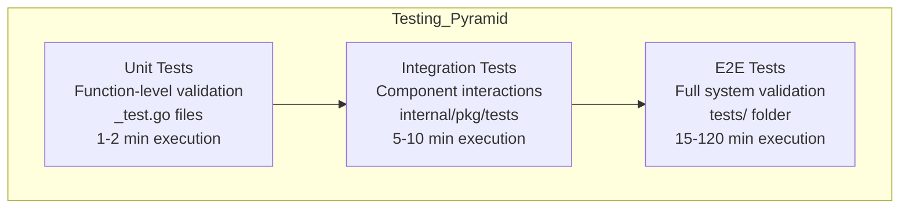
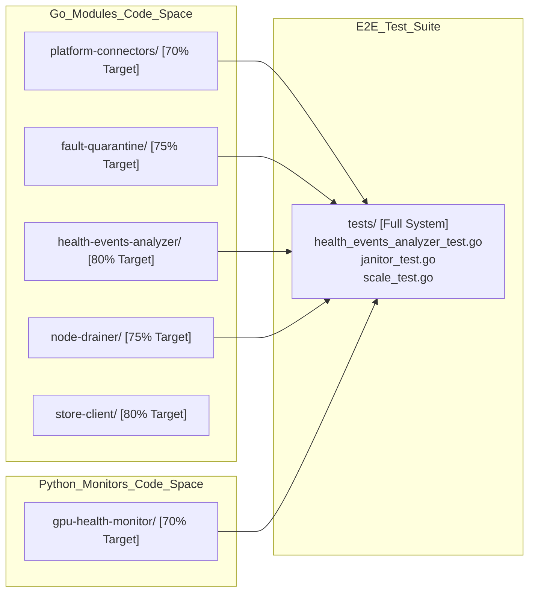
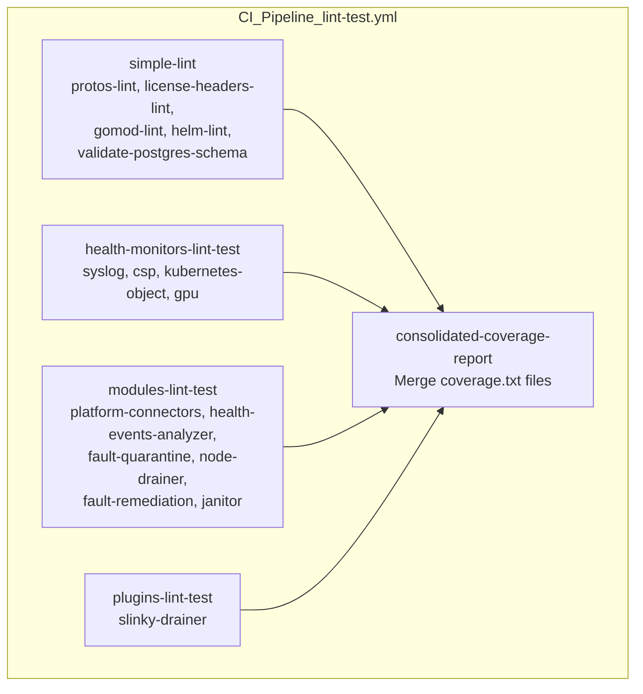
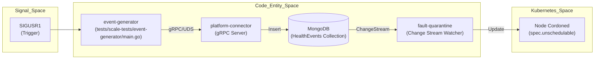
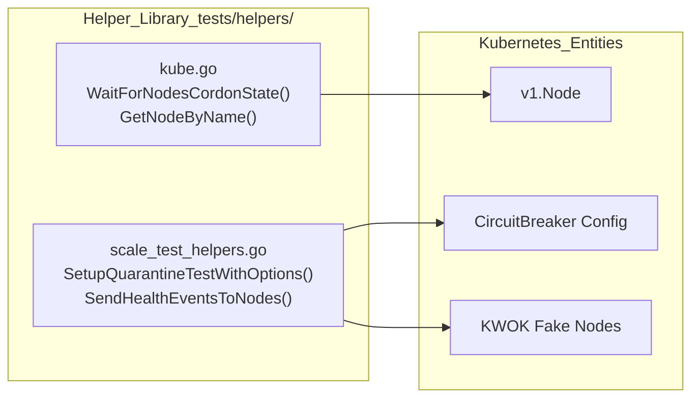

<!-- source: DeepWiki mcp.deepwiki.com · repo NVIDIA/NVSentinel · page 10.3 Testing Strategy · fetched 2026-10-26 -->

# Testing Strategy

<details>
<summary>Relevant source files</summary>

The following files were used as context for generating this wiki page:

- [.coderabbit.yaml](.coderabbit.yaml)
- [health-monitors/syslog-health-monitor/pkg/syslog-monitor/syslogmonitor.go](health-monitors/syslog-health-monitor/pkg/syslog-monitor/syslogmonitor.go)
- [labeler/go.mod](labeler/go.mod)
- [labeler/go.sum](labeler/go.sum)
- [tests/go.mod](tests/go.mod)
- [tests/go.sum](tests/go.sum)
- [tests/scale-tests/.gitignore](tests/scale-tests/.gitignore)
- [tests/scale-tests/PROMETHEUS_QUERIES.md](tests/scale-tests/PROMETHEUS_QUERIES.md)
- [tests/scale-tests/README.md](tests/scale-tests/README.md)
- [tests/scale-tests/cmd/fqm-scale-test/main.go](tests/scale-tests/cmd/fqm-scale-test/main.go)
- [tests/scale-tests/configs/values-v0.4.0-with-mongodb-metrics.yaml](tests/scale-tests/configs/values-v0.4.0-with-mongodb-metrics.yaml)
- [tests/scale-tests/event-generator/main.go](tests/scale-tests/event-generator/main.go)
- [tests/scale-tests/manifests/event-generator-config-fqm-latency.yaml](tests/scale-tests/manifests/event-generator-config-fqm-latency.yaml)
- [tests/scale-tests/manifests/event-generator-daemonset.yaml](tests/scale-tests/manifests/event-generator-daemonset.yaml)
- [tests/scale-tests/manifests/inference-sim-deployment.yaml](tests/scale-tests/manifests/inference-sim-deployment.yaml)
- [tests/scale-tests/manifests/training-sim-deployment.yaml](tests/scale-tests/manifests/training-sim-deployment.yaml)
- [tests/scale-tests/results/API_and_MongoDB_Results.md](tests/scale-tests/results/API_and_MongoDB_Results.md)
- [tests/scale-tests/results/Concurrent_Drain_Results.md](tests/scale-tests/results/Concurrent_Drain_Results.md)
- [tests/scale-tests/results/FQM_Latency_and_Queue_Depth_Results.md](tests/scale-tests/results/FQM_Latency_and_Queue_Depth_Results.md)
- [tests/scale-tests/results/graphs/pods_vs_drain_time.png](tests/scale-tests/results/graphs/pods_vs_drain_time.png)
- [tests/scale_test.go](tests/scale_test.go)
- [tests/uat/tests.sh](tests/uat/tests.sh)

</details>


## Purpose and Scope

This document describes NVSentinel's comprehensive testing strategy, including test types, organization, execution, and coverage requirements. It covers the testing pyramid approach, CI integration, and test infrastructure that ensures code quality and reliability across all components.

For practical guidance on writing and running tests, see [Writing and Running Tests](10.4). For setting up your local development environment with testing tools, see [Development Environment Setup](10.1).

---

## Testing Pyramid Overview

NVSentinel employs a three-tier testing strategy that balances test coverage with execution speed:

**Testing Pyramid Hierarchy**


**Test Distribution by Layer:**

| Layer | Purpose | Scope | Execution Time | When Run |
|-------|---------|-------|----------------|----------|
| **Unit Tests** | Validate individual functions and methods | Single package/module | 1-2 minutes | Every commit (CI) |
| **Integration Tests** | Verify component interactions | Multiple packages, mocked external deps | 5-10 minutes | Every commit (CI) |
| **E2E Tests** | Validate complete workflows | Full system with real Kubernetes | 15-120 minutes | PR branches, main, nightly |

Sources: [.github/workflows/lint-test.yml:40-210](), [.github/workflows/e2e-test.yml:15-82]()

---

## Test Organization by Component

Tests are organized per module, following a consistent structure that enables parallel execution and clear ownership. Internal modules like `commons` and `data-models` are linked via local replacements in `go.mod` files to ensure test consistency across the monorepo [tests/go.mod:92-100]().

### Component Mapping: Natural Language to Code Entities
The following diagram maps high-level system components to their corresponding test implementations and coverage targets.

**Component Test Mapping**


**Per-Component Test Execution:**
Each component has a standardized `Makefile` target:
- `make lint-test`: Run linters and tests for the component [.github/workflows/lint-test.yml:133-133]().
- `make test`: Run tests only.
- `make coverage`: Generate coverage reports [.github/workflows/lint-test.yml:197-200]().

Sources: [.github/workflows/lint-test.yml:111-210](), [labeler/go.mod:7-17](), [tests/go.mod:7-28]()

---

## CI Testing Pipeline

The CI pipeline runs tests in parallel across multiple dimensions to ensure comprehensive validation.

### Parallel Test Execution Matrix

**CI Pipeline Flow**


### E2E Test Matrix
The E2E tests run across all combinations of architectures and datastores to ensure compatibility [.github/workflows/e2e-test.yml:45-79]().

**E2E Matrix Configuration:**
- **Architectures:** `amd64`, `arm64` [.github/workflows/e2e-test.yml:49-54]().
- **Datastores:** `mongodb`, `mongodb-no-tls`, `postgresql` [.github/workflows/e2e-test.yml:52-72]().
- **Cluster Setup:** KIND (Kubernetes-in-Docker) with KWOK (Kubernetes WithOut Kubelet) [.github/workflows/e2e-test.yml:146-153]().

Sources: [.github/workflows/e2e-test.yml:42-82](), [.github/workflows/lint-test.yml:41-80]()

---

## Build Tags and Test Filtering

Tests use Go build tags to control which tests run in different contexts, particularly to handle database-specific features and hardware architectures.

### Build Tag Strategy
NVSentinel uses tags to skip tests that are not yet supported on certain backends or require specific CPU architectures [tests/scale_test.go:1-2]().

**Tag Categories:**

| Build Tag | Purpose | Usage |
|-----------|---------|-------|
| `amd64_group` | Architecture-specific tests | Tests that run only on AMD64 [tests/scale_test.go:1-1]() |
| `mongodb` | Database-specific tests | Tests requiring MongoDB features [.github/workflows/e2e-test.yml:53-53]() |
| `postgresql` | Database-specific tests | Tests for PostgreSQL compatibility [.github/workflows/e2e-test.yml:71-72]() |

**Tag Application in CI:**
The `TEST_TAGS` environment variable is computed based on the matrix architecture and datastore [.github/workflows/e2e-test.yml:160-172]().

Sources: [tests/scale_test.go:1-2](), [.github/workflows/e2e-test.yml:45-79]()

---

## Scale Testing Strategy

NVSentinel includes a specialized suite for validating performance at production scale (1500+ nodes) [tests/scale-tests/README.md:3-16]().

### Scale Test Objectives
1. **API Server Impact:** Ensure NVSentinel does not cause API slowdown at 1000+ nodes [tests/scale-tests/README.md:9-9]().
2. **MongoDB Performance:** Validate MongoDB under sustained write loads [tests/scale-tests/README.md:10-10]().
3. **FQM Latency:** Measure end-to-end latency from fatal event to node cordon [tests/scale-tests/README.md:11-11]().
4. **Drain Concurrency:** Handle concurrent drain operations at scale [tests/scale-tests/README.md:12-13]().

### Scale Test Pipeline
The scale tests utilize a dedicated `fqm-scale-test` tool and `event-generator` to simulate massive failure events [tests/scale-tests/results/FQM_Latency_and_Queue_Depth_Results.md:23-29]().

**Scale Test Data Flow**


**Key Performance Metrics:**
- **FQM Throughput:** Consistent ~2.5 nodes/sec cordoning rate [tests/scale-tests/results/FQM_Latency_and_Queue_Depth_Results.md:107-107]().
- **MongoDB Latency:** Writes complete in ~5ms [tests/scale-tests/results/FQM_Latency_and_Queue_Depth_Results.md:146-146]().
- **Drain Performance:** Scales linearly with pod count when rate limited [tests/scale-tests/README.md:139-139]().

Sources: [tests/scale-tests/README.md:1-163](), [tests/scale-tests/results/FQM_Latency_and_Queue_Depth_Results.md:20-185](), [tests/scale-tests/PROMETHEUS_QUERIES.md:50-106]()

---

## Test Infrastructure and Utilities

### Test Helper Library
The `tests/helpers` package provides reusable utilities for E2E and scale tests, abstracting complex Kubernetes operations.

**Core Test Infrastructure Mapping**


**Core Helper Functions:**

| Function | Purpose | Location |
|----------|---------|----------|
| `WaitForNodesCordonState()` | Wait for node `Unschedulable` state | [tests/helpers/kube.go:82-107]() |
| `SetupQuarantineTestWithOptions()` | Initialize test env with specific CB settings | [tests/scale_test.go:63-69]() |
| `SendHealthEventsToNodes()` | Inject gRPC health events to multiple nodes | [tests/scale_test.go:124-124]() |
| `GetCircuitBreakerState()` | Query current status of FQM circuit breaker | [tests/scale_test.go:60-60]() |
| `NewGPUPodSpec()` | Generate pod templates for workload simulation | [tests/scale_test.go:108-108]() |

Sources: [tests/scale_test.go:54-128](), [tests/helpers/kube.go:82-107](), [tests/uat/tests.sh:121-173]()

---

## Coverage Requirements and Reporting

### Coverage Consolidation Pipeline
The CI pipeline consolidates coverage from all components into a single report to track overall project health [.github/workflows/lint-test.yml:249-310]().

1. **Collection:** Each test job (e.g., `modules-lint-test`) uploads `coverage.txt` [.github/workflows/lint-test.yml:199-199]().
2. **Validation:** Scripts validate that coverage files are not malformed [.github/workflows/lint-test.yml:269-280]().
3. **Merging:** All individual coverage files are merged into a single `consolidated-coverage/coverage.txt` [.github/workflows/lint-test.yml:300-305]().
4. **PR Feedback:** The `go-coverage-report` action posts a delta comment to Pull Requests [.github/workflows/lint-test.yml:315-330]().

Sources: [.github/workflows/lint-test.yml:193-201](), [.github/workflows/lint-test.yml:249-330]()

---

## Test Execution Strategies

### Local Test Execution
Developers can run tests locally using the `Makefile` or standard Go/Python tools.

```bash
# Run tests for a single module
cd labeler
go test ./...

# Run UAT scripts for local validation
./tests/uat/tests.sh
```

### E2E Testing with KIND and KWOK
E2E tests leverage **KWOK** to simulate GPU nodes without requiring physical hardware. This is critical for scale tests involving 1500+ nodes [tests/scale-tests/README.md:16-16]().

**E2E Workflow:**
1. **Cluster Creation:** `make cluster-create` sets up KIND [.github/workflows/e2e-test.yml:153-153]().
2. **Event Injection:** Tests use `SendHealthEventsToNodes` to simulate faults [tests/scale_test.go:124-124]().
3. **State Verification:** `WaitForNodesCordonState` ensures the node is cordoned [.tests/helpers/kube.go:82-107]().
4. **Circuit Breaker Check:** Verify `TRIPPED` state when cordon threshold is exceeded [tests/scale_test.go:167-172]().

Sources: [.github/workflows/e2e-test.yml:146-172](), [tests/scale_test.go:130-177](), [tests/uat/tests.sh:176-197]()

---

## Security and Vulnerability Testing

NVSentinel includes automated security scanning as part of its testing strategy.

| Tool | Purpose | Frequency | Location |
|------|---------|-----------|----------|
| **CodeQL** | Static analysis for security vulnerabilities | Every PR/Push | [.github/workflows/code-scanning.yml:15-112]() |
| **Trivy** | Daily vulnerability scan of repo and containers | Daily | [.github/workflows/vuln-scan.yml:15-74]() |
| **Linting** | Enforce code style and best practices | Every PR | [.github/workflows/lint-test.yml:41-80]() |

Sources: [.github/workflows/code-scanning.yml:15-60](), [.github/workflows/vuln-scan.yml:39-60]()

---

