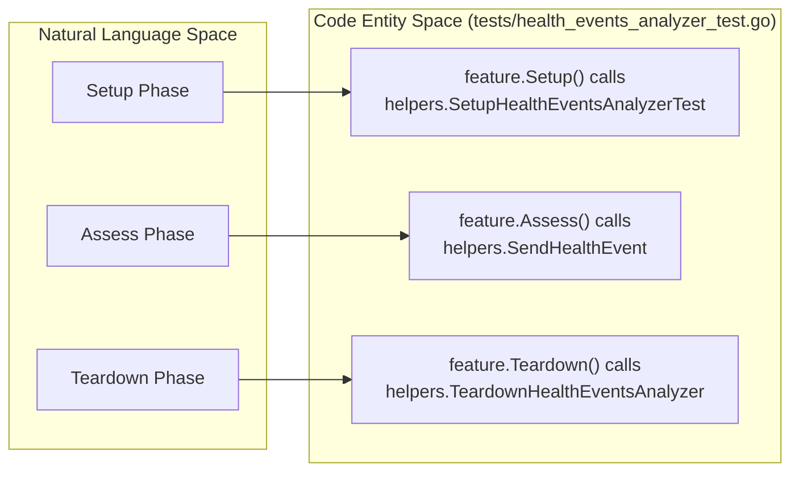
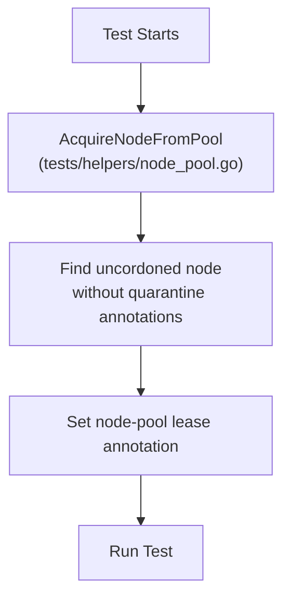
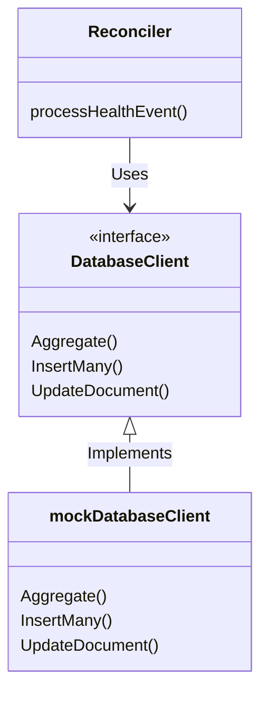

<!-- source: DeepWiki mcp.deepwiki.com · repo NVIDIA/NVSentinel · page 10.4 Writing and Running Tests · fetched 2026-10-26 -->

# Writing and Running Tests

<details>
<summary>Relevant source files</summary>

The following files were used as context for generating this wiki page:

- [distros/kubernetes/nvsentinel/charts/health-events-analyzer/values.yaml](distros/kubernetes/nvsentinel/charts/health-events-analyzer/values.yaml)
- [fault-quarantine/Makefile](fault-quarantine/Makefile)
- [health-events-analyzer/main.go](health-events-analyzer/main.go)
- [health-events-analyzer/pkg/config/rules.go](health-events-analyzer/pkg/config/rules.go)
- [health-events-analyzer/pkg/publisher/publisher.go](health-events-analyzer/pkg/publisher/publisher.go)
- [health-events-analyzer/pkg/reconciler/reconciler.go](health-events-analyzer/pkg/reconciler/reconciler.go)
- [health-events-analyzer/pkg/reconciler/reconciler_test.go](health-events-analyzer/pkg/reconciler/reconciler_test.go)
- [janitor/pkg/controller/gpureset_controller.go](janitor/pkg/controller/gpureset_controller.go)
- [janitor/pkg/controller/gpureset_controller_test.go](janitor/pkg/controller/gpureset_controller_test.go)
- [janitor/pkg/webhook/v1alpha1/janitor_webhook.go](janitor/pkg/webhook/v1alpha1/janitor_webhook.go)
- [janitor/pkg/webhook/v1alpha1/janitor_webhook_test.go](janitor/pkg/webhook/v1alpha1/janitor_webhook_test.go)
- [tests/Makefile](tests/Makefile)
- [tests/csp_health_monitor_test.go](tests/csp_health_monitor_test.go)
- [tests/gpu_reset_test.go](tests/gpu_reset_test.go)
- [tests/health_events_analyzer_test.go](tests/health_events_analyzer_test.go)
- [tests/helpers/fault_quarantine.go](tests/helpers/fault_quarantine.go)
- [tests/helpers/fault_remediation.go](tests/helpers/fault_remediation.go)
- [tests/helpers/health_events_analyzer.go](tests/helpers/health_events_analyzer.go)
- [tests/helpers/kube.go](tests/helpers/kube.go)
- [tests/helpers/node_drainer.go](tests/helpers/node_drainer.go)
- [tests/helpers/prometheus.go](tests/helpers/prometheus.go)
- [tests/smoke_test.go](tests/smoke_test.go)
- [tilt/simple-health-client/Makefile](tilt/simple-health-client/Makefile)
- [tilt/simple-health-client/main.go](tilt/simple-health-client/main.go)

</details>


This page documents how to write and execute tests in NVSentinel. It covers test helper libraries, common patterns for writing E2E tests, and commands for running unit tests, integration tests, and linting across Go and Kubernetes-based modules.

For information about the overall testing strategy and test architecture, see [Testing Strategy](#10.3). For setting up your development environment before running tests, see [Development Environment Setup](#10.1).

## Writing Tests

NVSentinel provides a comprehensive test helper library located in `tests/helpers/` that simplifies writing E2E tests. These helpers handle common operations like node management, event injection, condition waiting, and Kubernetes resource manipulation.

### Test Helper Library Overview

The test helper library consists of several specialized modules:

| Helper Module | File | Primary Functions | Purpose |
|--------------|------|------------------|---------|
| **Kubernetes Helpers** | `tests/helpers/kube.go` | `GetNodeByName`, `WaitForNodesCordonState`, `CreateNamespace` | Node operations, pod management, CR lifecycle |
| **Event Injection** | `tests/helpers/health_events.go` | `SendHealthEvent`, `NewHealthEvent` | Inject health events via gRPC to platform-connectors |
| **Node Pool Management** | `tests/helpers/node_pool.go` | `AcquireNodeFromPool` | Prevent test interference by reserving nodes |
| **Health Events Analyzer** | `tests/helpers/health_events_analyzer.go` | `SetupHealthEventsAnalyzerTest`, `TriggerMultipleRemediationsCycle` | Setup/teardown and lifecycle orchestration for analyzer tests |
| **Condition Waiting** | `tests/helpers/kube.go` | `WaitForNodeConditionWithCheckName`, `WaitForCR` | Wait for async operations to complete |

**Sources:** [tests/helpers/kube.go:15-60](), [tests/helpers/health_events_analyzer.go:43-47]()

### Test Structure and Patterns

E2E tests in NVSentinel follow the `sigs.k8s.io/e2e-framework` pattern with three phases: Setup, Assess, and Teardown.

**Natural Language to Code Entity Space: Test Lifecycle**



**Example Test Structure:**

```go
func TestMultipleRemediationsCompleted(t *testing.T) {
    feature := features.New("TestMultipleRemediationsCompleted").
        WithLabel("suite", "health-event-analyzer")

    var testCtx *helpers.HealthEventsAnalyzerTestContext

    feature.Setup(func(ctx context.Context, t *testing.T, c *envconf.Config) context.Context {
        // Setup logic: acquire node, backup config, restart analyzer
        newCtx, testCtx = helpers.SetupHealthEventsAnalyzerTest(ctx, t, c, "", "health-events-analyzer-test", "")
        return newCtx
    })

    feature.Assess("Check condition", func(ctx context.Context, t *testing.T, c *envconf.Config) context.Context {
        // Assessment logic: inject fatal event and wait for node condition
        helpers.SendHealthEvent(ctx, t, event)
        helpers.WaitForNodeConditionWithCheckName(...)
        return ctx
    })

    feature.Teardown(func(ctx context.Context, t *testing.T, c *envconf.Config) context.Context {
        // Cleanup logic: send healthy event and restore config
        return helpers.TeardownHealthEventsAnalyzer(...)
    })

    testEnv.Test(t, feature.Feature())
}
```

**Sources:** [tests/health_events_analyzer_test.go:44-86]()

### Managing Test Nodes

Node pool management prevents test contamination by ensuring each test uses a clean, uncordoned node.

#### Selecting Test Nodes

```go
// Acquire node from pool with automatic lease
testNodeName := helpers.AcquireNodeFromPool(ctx, t, client, helpers.DefaultExpiry)

// Get node object
node, err := helpers.GetNodeByName(ctx, client, nodeName)
```

**Node Selection Flow:**



**Key Functions:**

- **`AcquireNodeFromPool`**: Reserves a node for a specific duration to prevent concurrent test interference [tests/helpers/health_events_analyzer.go:65-66]().
- **`GetNodeByName`**: Retrieves a standard Kubernetes Node object [tests/helpers/health_events_analyzer.go:206-206]().

**Sources:** [tests/helpers/health_events_analyzer.go:59-71](), [tests/helpers/kube.go:82-107]()

### Injecting Health Events

Test helpers provide a fluent API for constructing and sending health events to platform-connectors via gRPC.

#### Health Event Builder Pattern

```go
// Create health event with builder pattern
event := helpers.NewHealthEvent(nodeName).
    WithAgent(helpers.SYSLOG_HEALTH_MONITOR_AGENT).
    WithErrorCode(helpers.ERRORCODE_119).
    WithFatal(true).
    WithRecommendedAction(int(pb.RecommendedAction_RESTART_VM))

// Send event to platform-connectors
helpers.SendHealthEvent(ctx, t, event)
```

**Common Agent Constants:**

```go
helpers.SYSLOG_HEALTH_MONITOR_AGENT           // "syslog-health-monitor"
helpers.HEALTH_EVENTS_ANALYZER_AGENT          // "health-events-analyzer"
```

**Common Error Codes:**

```go
helpers.ERRORCODE_13   // XID 13
helpers.ERRORCODE_31   // XID 31
helpers.ERRORCODE_48   // XID 48
helpers.ERRORCODE_79   // XID 79
helpers.ERRORCODE_119  // XID 119
```

**Sources:** [tests/helpers/health_events_analyzer.go:29-41](), [tests/health_events_analyzer_test.go:67-71]()

### Waiting for Conditions

Test helpers provide polling-based wait functions with configurable timeouts.

#### Common Wait Functions

```go
// Wait for nodes to be cordoned
helpers.WaitForNodesCordonState(ctx, t, client, nodeNames, true)

// Wait for node condition with specific check name
helpers.WaitForNodeConditionWithCheckName(ctx, t, client, gpuNodeName, "MultipleRemediations",
    "ErrorCode:31...", "MultipleRemediationsIsNotHealthy", v1.ConditionTrue)

// Wait for CR creation
rebootNodeCR := helpers.WaitForCR(ctx, t, client, nodeName, helpers.RebootNodeGVK)
```

**Wait Timeout Configuration:**

```go
const (
    EventuallyWaitTimeout = 10 * time.Minute
    WaitInterval          = 5 * time.Second
)
```

**Node Label State Watcher:**

The `StartNodeLabelWatcher` verifies nodes progress through a sequence of label values, such as `quarantined` -> `draining` -> `remediating` [tests/helpers/kube.go:168-172]().

**Sources:** [tests/helpers/kube.go:62-67](), [tests/helpers/kube.go:82-85](), [tests/helpers/kube.go:168-194]()

### Working with Custom Resources

Helper functions simplify CR lifecycle management for maintenance operations like reboots and GPU resets.

```go
// Delete all CRs of a type
err := helpers.DeleteAllCRs(ctx, t, client, RebootNodeGVK)

// Wait for CR completion
rebootNodeCR := helpers.WaitForCR(ctx, t, client, nodeName, RebootNodeGVK)
```

**CR GroupVersionKinds:**

```go
var (
    RebootNodeGVK = schema.GroupVersionKind{
        Group:   "janitor.dgxc.nvidia.com",
        Version: "v1alpha1",
        Kind:    "RebootNode",
    }
    GPUResetGVK = schema.GroupVersionKind{
        Group:   "janitor.dgxc.nvidia.com",
        Version: "v1alpha1",
        Kind:    "GPUReset",
    }
)
```

**Sources:** [tests/helpers/kube.go:69-80](), [tests/helpers/health_events_analyzer.go:182-183](), [tests/helpers/health_events_analyzer.go:199-200]()

### ConfigMap Management for Tests

Tests that need to modify module configuration can backup and restore ConfigMaps to ensure environment consistency.

```go
// Backup ConfigMap before modifying
backupData, err := helpers.BackupConfigMap(ctx, client, "health-events-analyzer-config", NVSentinelNamespace)

// Create ConfigMap from file
err = helpers.createConfigMapFromFilePath(ctx, client, configMapPath, "health-events-analyzer-config", NVSentinelNamespace)

// Restart deployment to apply new config
err = helpers.RestartDeployment(ctx, t, client, "health-events-analyzer", NVSentinelNamespace)
```

**Sources:** [tests/helpers/health_events_analyzer.go:78-91]()

### Writing Unit Tests with Mocks

Unit tests use mock objects to isolate components from external dependencies like MongoDB or gRPC clients.

**Natural Language to Code Entity Space: Mocking Strategy**



**Mock Implementation Example:**

```go
type mockDatabaseClient struct {
    mock.Mock
}

func (m *mockDatabaseClient) Aggregate(ctx context.Context, pipeline interface{}) (client.Cursor, error) {
    args := m.Called(ctx, pipeline)
    return args.Get(0).(client.Cursor), args.Error(1)
}
```

**Sources:** [health-events-analyzer/pkg/reconciler/reconciler_test.go:47-102]()

### Test Context and Setup Helpers

Specialized setup functions prepare module-specific test contexts, including node acquisition and condition clearing.

#### Health Events Analyzer Test Context

```go
type HealthEventsAnalyzerTestContext struct {
    NodeName        string
    ConfigMapBackup []byte
    TestNamespace   string
}

// Setup test context
newCtx, testCtx = helpers.SetupHealthEventsAnalyzerTest(ctx, t, c, "", "health-events-analyzer-test", "")
```

The `SetupHealthEventsAnalyzerTest` function acquires a node, clears existing analyzer conditions, and handles ConfigMap backups [tests/helpers/health_events_analyzer.go:49-94]().

**Sources:** [tests/helpers/health_events_analyzer.go:43-94]()

### Testing Multiple Remediation Cycles

The `TriggerMultipleRemediationsCycle` function simulates repeated failures to test threshold-based rules like `MultipleRemediations` [tests/helpers/health_events_analyzer.go:177-191]().

```go
// Trigger multiple remediations on same node
helpers.TriggerMultipleRemediationsCycle(ctx, t, client, nodeName)
```

**Sources:** [tests/helpers/health_events_analyzer.go:177-191]()

## Running Tests

### Unit and Integration Tests

Tests are categorized by build tags such as `mongodb` or architecture groups like `amd64_group` or `arm64_group` [tests/health_events_analyzer_test.go:1-2](), [tests/smoke_test.go:1-2]().

```bash
# Run tests with specific build tags
go test -v -tags=mongodb ./tests/...
```

### End-to-End Tests

E2E tests utilize the `csp-health-monitor` and other modules to verify cloud-specific maintenance lifecycles and smoke test fatal event flows [tests/csp_health_monitor_test.go:41-43](), [tests/smoke_test.go:34-36]().

**CSP Test Workflow:**
1. Setup GCP/AWS health monitor environment [tests/csp_health_monitor_test.go:49-53]().
2. Inject maintenance events via mock APIs [tests/csp_health_monitor_test.go:80-82]().
3. Verify node quarantine and condition updates [tests/csp_health_monitor_test.go:113-115]().
4. Transition event status and verify recovery (uncordon) [tests/csp_health_monitor_test.go:143-145]().

**Sources:** [tests/csp_health_monitor_test.go:41-162](), [tests/smoke_test.go:34-182]()

### Distributed Tracing and Debugging

Tests leverage OpenTelemetry for trace correlation across service boundaries and `slog` for structured logging [health-events-analyzer/pkg/reconciler/reconciler.go:146-148](), [health-events-analyzer/pkg/reconciler/reconciler.go:170-170]().

```go
// Start a span for event processing with trace context correlation
ctx, span := tracing.StartSpanWithLinkFromTraceContext(
    ctx, traceID, parentSpanID, "health_events_analyzer.process_health_event")

// Log errors with context for easier debugging
slog.ErrorContext(ctx, "Failed to process health event", "error", err, "nodeName", labelValue)
```

**Sources:** [health-events-analyzer/pkg/reconciler/reconciler.go:140-148](), [health-events-analyzer/pkg/reconciler/reconciler.go:164-171]()

---

