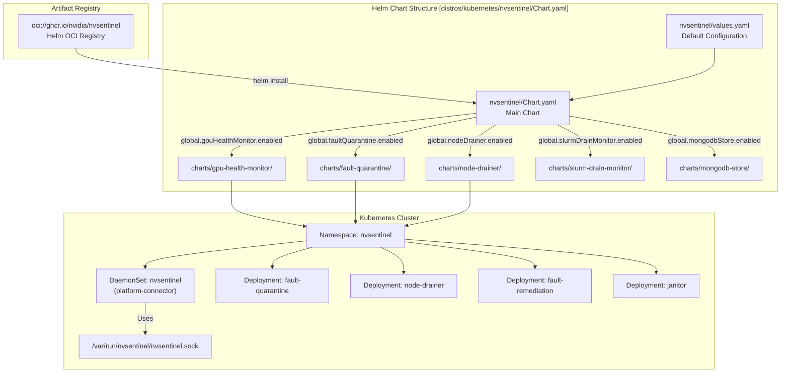
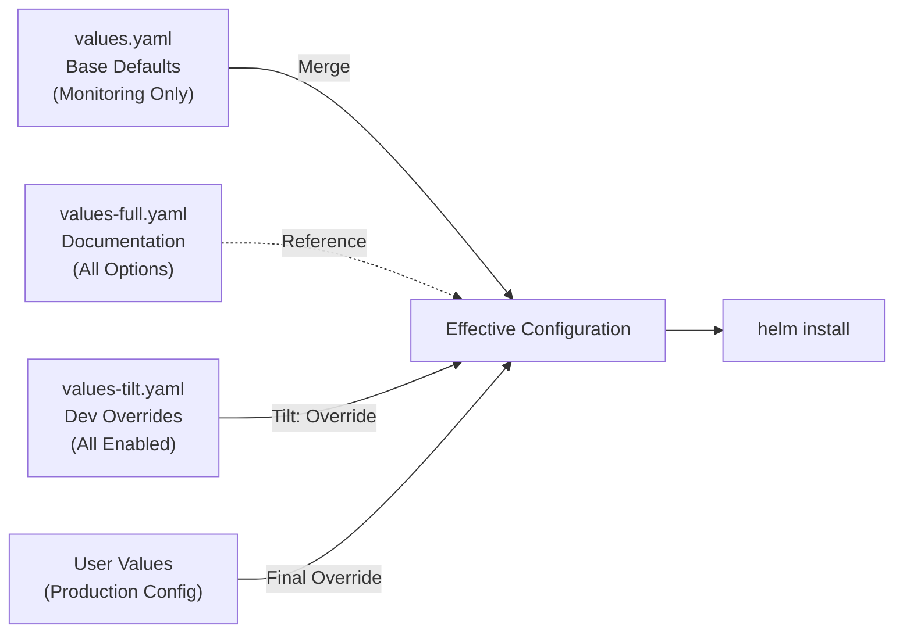

<!-- source: DeepWiki mcp.deepwiki.com · repo NVIDIA/NVSentinel · page 11 Deployment · fetched 2026-10-26 -->

# Deployment

<details>
<summary>Relevant source files</summary>

The following files were used as context for generating this wiki page:

- [distros/kubernetes/nvsentinel/charts/csp-health-monitor/templates/deployment.yaml](distros/kubernetes/nvsentinel/charts/csp-health-monitor/templates/deployment.yaml)
- [distros/kubernetes/nvsentinel/charts/event-exporter/templates/deployment.yaml](distros/kubernetes/nvsentinel/charts/event-exporter/templates/deployment.yaml)
- [distros/kubernetes/nvsentinel/charts/fault-quarantine/templates/deployment.yaml](distros/kubernetes/nvsentinel/charts/fault-quarantine/templates/deployment.yaml)
- [distros/kubernetes/nvsentinel/charts/fault-remediation/templates/deployment.yaml](distros/kubernetes/nvsentinel/charts/fault-remediation/templates/deployment.yaml)
- [distros/kubernetes/nvsentinel/charts/gpu-health-monitor/files/dcgmerrorsmapping.csv](distros/kubernetes/nvsentinel/charts/gpu-health-monitor/files/dcgmerrorsmapping.csv)
- [distros/kubernetes/nvsentinel/charts/health-events-analyzer/templates/deployment.yaml](distros/kubernetes/nvsentinel/charts/health-events-analyzer/templates/deployment.yaml)
- [distros/kubernetes/nvsentinel/charts/node-drainer/templates/deployment.yaml](distros/kubernetes/nvsentinel/charts/node-drainer/templates/deployment.yaml)
- [distros/kubernetes/nvsentinel/charts/preflight/templates/deployment.yaml](distros/kubernetes/nvsentinel/charts/preflight/templates/deployment.yaml)
- [distros/kubernetes/nvsentinel/templates/_helpers.tpl](distros/kubernetes/nvsentinel/templates/_helpers.tpl)
- [distros/kubernetes/nvsentinel/templates/configmap-datastore.yaml](distros/kubernetes/nvsentinel/templates/configmap-datastore.yaml)
- [distros/kubernetes/nvsentinel/templates/daemonset.yaml](distros/kubernetes/nvsentinel/templates/daemonset.yaml)
- [distros/kubernetes/nvsentinel/templates/job-external-mongodb-setup.yaml](distros/kubernetes/nvsentinel/templates/job-external-mongodb-setup.yaml)
- [distros/kubernetes/nvsentinel/values-atlas-gcp.yaml](distros/kubernetes/nvsentinel/values-atlas-gcp.yaml)
- [distros/kubernetes/nvsentinel/values-full.yaml](distros/kubernetes/nvsentinel/values-full.yaml)
- [distros/kubernetes/nvsentinel/values-tilt.yaml](distros/kubernetes/nvsentinel/values-tilt.yaml)
- [distros/kubernetes/nvsentinel/values.yaml](distros/kubernetes/nvsentinel/values.yaml)
- [docs/INTEGRATIONS.md](docs/INTEGRATIONS.md)
- [platform-connectors/pkg/transformers/metadata/transformer_test.go](platform-connectors/pkg/transformers/metadata/transformer_test.go)
- [tests/helpers/preflight.go](tests/helpers/preflight.go)
- [tilt/Tiltfile](tilt/Tiltfile)
- [tilt/helpers.star](tilt/helpers.star)

</details>


This page provides an overview of deploying NVSentinel to production Kubernetes clusters using Helm. It covers installation methods, prerequisites, configuration concepts, and operational strategies.

**Scope**: This page covers high-level deployment architecture and concepts. For detailed information, see:
- **[Helm Chart Overview](#11.1)** — Chart structure, subcharts, dependencies, and modular architecture
- **[Configuration Guide](#11.2)** — values.yaml structure, global settings, and configuration hierarchy
- **[Production Deployment](#11.3)** — Production checklist, progressive enablement, and rollout strategy
- **[Multi-Cloud Deployment](#11.4)** — AWS, GCP, Azure, and OCI specific configurations
- **[Deployment Validation](#11.5)** — Post-deployment validation and health checks

---

## Deployment Architecture Overview

NVSentinel is distributed as a Helm chart published to GitHub Container Registry (GHCR). The chart uses a modular architecture with over 15 subcharts, each representing an independent component that can be toggled via configuration flags in the `global` scope.

**Deployment Architecture: Helm Chart to Kubernetes Resources**



**Sources**: [distros/kubernetes/nvsentinel/values.yaml:143-180](), [distros/kubernetes/nvsentinel/templates/daemonset.yaml:17-19](), [distros/kubernetes/nvsentinel/charts/fault-quarantine/templates/deployment.yaml:14-17]()

---

## Prerequisites

NVSentinel requires several infrastructure components to be present. For details on validating these, see [Deployment Validation](#11.5).

| Component | Purpose | Required |
|-----------|---------|----------|
| **cert-manager** | TLS certificate management for webhooks and DBs | Yes |
| **NVIDIA GPU Operator** | Provides DCGM hostengine service (`nvidia-dcgm.gpu-operator.svc`) | For GPU health |
| **Prometheus Operator** | Scrapes metrics via `PodMonitor` resources | For observability |
| **Persistent Storage** | CSI driver for MongoDB/PostgreSQL volumes | For datastore |

**Sources**: [tilt/Tiltfile:43-68](), [distros/kubernetes/nvsentinel/values.yaml:110-117](), [distros/kubernetes/nvsentinel/values-tilt.yaml:126-160]()

---

## Installation Methods

### Helm Installation
The standard method for production is via Helm. The chart is organized to allow fine-grained control over which monitors and response modules are active.

```bash
# Standard installation from OCI registry
helm install nvsentinel oci://ghcr.io/nvidia/nvsentinel \
  --namespace nvsentinel \
  --create-namespace \
  --values production-values.yaml
```

**Sources**: [distros/kubernetes/nvsentinel/values.yaml:1-24](), [distros/kubernetes/nvsentinel/values-full.yaml:15-32]()

### Local Development with Tilt
For testing and development, Tilt provides a complete environment including fake nodes (KWOK) and mock CSP APIs. It leverages `values-tilt.yaml` to enable all modules for E2E validation.

```bash
# Start local environment with MongoDB
tilt up

# Start local environment with PostgreSQL
USE_POSTGRESQL=1 tilt up
```

**Sources**: [tilt/Tiltfile:26-41](), [distros/kubernetes/nvsentinel/values-tilt.yaml:1-15]()

---

## Configuration Hierarchy

NVSentinel uses a layered configuration approach. Settings in the `global` section of `values.yaml` propagate to subcharts, but can be overridden at the subchart level.

**Configuration Merge Flow**



**Sources**: [tilt/Tiltfile:146-173](), [distros/kubernetes/nvsentinel/values-full.yaml:35-39]()

### Key Global Settings
*   **`global.dryRun`**: When `true`, all actions (cordon, drain, reboot) are logged but not executed [distros/kubernetes/nvsentinel/values.yaml:16]().
*   **`global.datastore.provider`**: Switches between `mongodb` and `postgresql` [distros/kubernetes/nvsentinel/values.yaml:33-35]().
*   **`global.metricsPort`**: Default port (2112) for Prometheus scraping across all components [distros/kubernetes/nvsentinel/values.yaml:23]().
*   **`global.auditLogging`**: Enables centralized audit trails for health events, using an `initContainer` to set up log permissions [distros/kubernetes/nvsentinel/values.yaml:128-134](), [distros/kubernetes/nvsentinel/templates/daemonset.yaml:50-53]().

---

## Progressive Enablement Strategy

NVSentinel is designed for a phased rollout to minimize production risk. For a detailed checklist, see [Production Deployment](#11.3).

1.  **Monitoring Only**: Enable `gpuHealthMonitor`, `syslogHealthMonitor`, and `labeler`. Set `global.dryRun: true` [distros/kubernetes/nvsentinel/values.yaml:143-164]().
2.  **Observation**: Enable `mongodbStore` and `healthEventsAnalyzer` to collect and analyze historical fault data [distros/kubernetes/nvsentinel/values.yaml:145-148]().
3.  **Soft Response**: Enable `faultQuarantine` but keep `dryRun: true`. Review logs to see which nodes *would* have been cordoned [distros/kubernetes/nvsentinel/values-full.yaml:154-155]().
4.  **Active Quarantine**: Set `dryRun: false` for `faultQuarantine`. Nodes are now cordoned/tainted on failure [distros/kubernetes/nvsentinel/charts/fault-quarantine/templates/deployment.yaml:93]().
5.  **Automated Recovery**: Enable `nodeDrainer`, `faultRemediation`, and `janitor` to automate the full cycle from eviction to node reboot [distros/kubernetes/nvsentinel/values.yaml:149-154]().

**Sources**: [distros/kubernetes/nvsentinel/values.yaml:144-173](), [distros/kubernetes/nvsentinel/values-full.yaml:131-175]()

---

## Related Deployment Topics

### [Helm Chart Overview](#11.1)
Details the internal structure of the `nvsentinel` chart, including how subcharts like `fault-remediation` [distros/kubernetes/nvsentinel/charts/fault-remediation/templates/deployment.yaml:14-17]() and `node-drainer` [distros/kubernetes/nvsentinel/charts/node-drainer/templates/deployment.yaml:14-17]() are integrated.

### [Configuration Guide](#11.2)
Deep dive into the `values.yaml` schema, covering complex configurations like `global.datastore.tls` [distros/kubernetes/nvsentinel/values.yaml:58-64]() and the `fix-cert-permissions` init container for PostgreSQL [distros/kubernetes/nvsentinel/templates/daemonset.yaml:54-79]().

### [Multi-Cloud Deployment](#11.4)
Specific instructions for cloud-native features, such as configuring the `janitor` to interact with AWS, GCP, or Azure APIs for node maintenance [distros/kubernetes/nvsentinel/values-full.yaml:171-175]().

### [Deployment Validation](#11.5)
Procedures for verifying the health of the deployment, including checking `Preflight` statuses [distros/kubernetes/nvsentinel/values-tilt.yaml:107-124]() and validating `HealthEvent` data flow [docs/INTEGRATIONS.md:67-101]().

---

