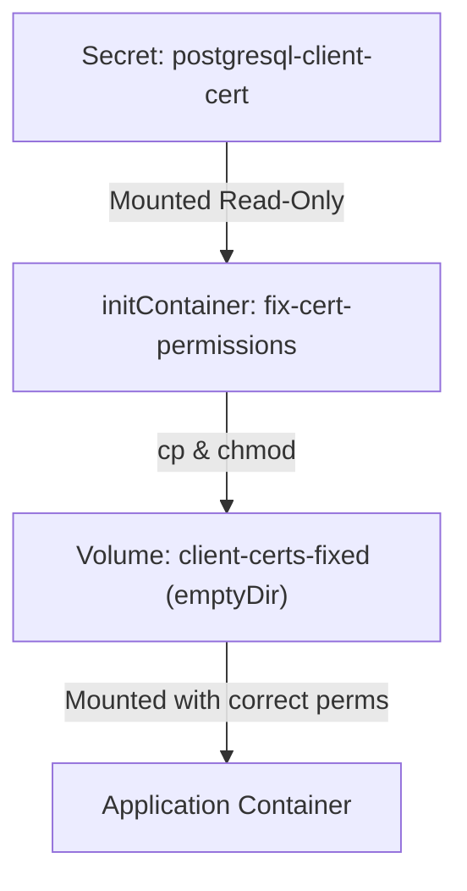
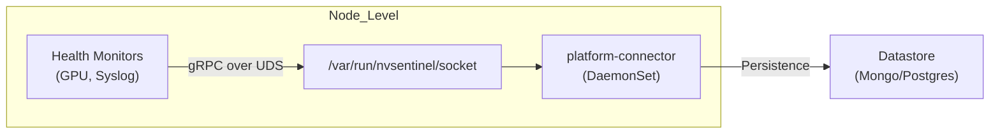

<!-- source: DeepWiki mcp.deepwiki.com · repo NVIDIA/NVSentinel · page 11.1 Helm Chart Overview · fetched 2026-10-26 -->

# Helm Chart Overview

<details>
<summary>Relevant source files</summary>

The following files were used as context for generating this wiki page:

- [distros/kubernetes/nvsentinel/Chart.yaml](distros/kubernetes/nvsentinel/Chart.yaml)
- [distros/kubernetes/nvsentinel/charts/csp-health-monitor/templates/deployment.yaml](distros/kubernetes/nvsentinel/charts/csp-health-monitor/templates/deployment.yaml)
- [distros/kubernetes/nvsentinel/charts/event-exporter/templates/deployment.yaml](distros/kubernetes/nvsentinel/charts/event-exporter/templates/deployment.yaml)
- [distros/kubernetes/nvsentinel/charts/fault-quarantine/templates/deployment.yaml](distros/kubernetes/nvsentinel/charts/fault-quarantine/templates/deployment.yaml)
- [distros/kubernetes/nvsentinel/charts/fault-remediation/templates/deployment.yaml](distros/kubernetes/nvsentinel/charts/fault-remediation/templates/deployment.yaml)
- [distros/kubernetes/nvsentinel/charts/health-events-analyzer/templates/deployment.yaml](distros/kubernetes/nvsentinel/charts/health-events-analyzer/templates/deployment.yaml)
- [distros/kubernetes/nvsentinel/charts/node-drainer/templates/deployment.yaml](distros/kubernetes/nvsentinel/charts/node-drainer/templates/deployment.yaml)
- [distros/kubernetes/nvsentinel/charts/slurm-drain-monitor/Chart.yaml](distros/kubernetes/nvsentinel/charts/slurm-drain-monitor/Chart.yaml)
- [distros/kubernetes/nvsentinel/charts/slurm-drain-monitor/templates/_helpers.tpl](distros/kubernetes/nvsentinel/charts/slurm-drain-monitor/templates/_helpers.tpl)
- [distros/kubernetes/nvsentinel/charts/slurm-drain-monitor/templates/clusterrole.yaml](distros/kubernetes/nvsentinel/charts/slurm-drain-monitor/templates/clusterrole.yaml)
- [distros/kubernetes/nvsentinel/charts/slurm-drain-monitor/templates/clusterrolebinding.yaml](distros/kubernetes/nvsentinel/charts/slurm-drain-monitor/templates/clusterrolebinding.yaml)
- [distros/kubernetes/nvsentinel/charts/slurm-drain-monitor/templates/configmap.yaml](distros/kubernetes/nvsentinel/charts/slurm-drain-monitor/templates/configmap.yaml)
- [distros/kubernetes/nvsentinel/charts/slurm-drain-monitor/templates/deployment.yaml](distros/kubernetes/nvsentinel/charts/slurm-drain-monitor/templates/deployment.yaml)
- [distros/kubernetes/nvsentinel/charts/slurm-drain-monitor/templates/serviceaccount.yaml](distros/kubernetes/nvsentinel/charts/slurm-drain-monitor/templates/serviceaccount.yaml)
- [distros/kubernetes/nvsentinel/charts/slurm-drain-monitor/values.yaml](distros/kubernetes/nvsentinel/charts/slurm-drain-monitor/values.yaml)
- [distros/kubernetes/nvsentinel/templates/_helpers.tpl](distros/kubernetes/nvsentinel/templates/_helpers.tpl)
- [distros/kubernetes/nvsentinel/templates/configmap-datastore.yaml](distros/kubernetes/nvsentinel/templates/configmap-datastore.yaml)
- [distros/kubernetes/nvsentinel/templates/daemonset.yaml](distros/kubernetes/nvsentinel/templates/daemonset.yaml)
- [distros/kubernetes/nvsentinel/templates/job-external-mongodb-setup.yaml](distros/kubernetes/nvsentinel/templates/job-external-mongodb-setup.yaml)
- [distros/kubernetes/nvsentinel/values-atlas-gcp.yaml](distros/kubernetes/nvsentinel/values-atlas-gcp.yaml)

</details>


## Purpose and Scope

This page describes the NVSentinel Helm chart architecture, its modular subchart structure, and configuration system. The chart uses a parent-child dependency model to enable selective deployment of components. For specific deployment instructions, see [Production Deployment](). For detailed configuration options, see [Configuration Guide]().

The Helm chart is located at [distros/kubernetes/nvsentinel/]() and provides a unified deployment mechanism for all NVSentinel components.

**Sources**: [distros/kubernetes/nvsentinel/Chart.yaml:1-78](), [distros/kubernetes/nvsentinel/templates/_helpers.tpl:1-49]()

## Chart Structure

### Main Chart Definition

The main chart is defined in [Chart.yaml]() with metadata and conditional dependencies. It acts as an umbrella chart for the entire ecosystem.

```yaml
apiVersion: v2
name: nvsentinel
description: Helm chart for NVSentinel
type: application
version: 0.1.0
appVersion: "1.0.0"
```

The chart uses Helm's `condition` field to enable/disable subcharts via `global.*` flags in values files. This allows operators to selectively deploy only the components they need.

**Sources**: [distros/kubernetes/nvsentinel/Chart.yaml:15-20]()

### Subchart Dependencies

The chart declares 18 subchart dependencies, each with a conditional enable flag. This modular architecture allows the system to scale from a minimal detection-only setup to a full-featured automated remediation pipeline.

**System Dependency Tree**

```mermaid
graph TB
    MainChart["nvsentinel<br/>(Main Chart)"]
    
    subgraph "Health Detection Subcharts"
        GPU["gpu-health-monitor<br/>condition: global.gpuHealthMonitor.enabled"]
        Syslog["syslog-health-monitor<br/>condition: global.syslogHealthMonitor.enabled"]
        CSP["csp-health-monitor<br/>condition: global.cspHealthMonitor.enabled"]
        K8sObj["kubernetes-object-monitor<br/>condition: global.kubernetesObjectMonitor.enabled"]
        Slurm["slurm-drain-monitor<br/>condition: global.slurmDrainMonitor.enabled"]
    end
    
    subgraph "Core Processing Subcharts"
        HEA["health-events-analyzer<br/>condition: global.healthEventsAnalyzer.enabled"]
        FQ["fault-quarantine<br/>condition: global.faultQuarantine.enabled"]
        ND["node-drainer<br/>condition: global.nodeDrainer.enabled"]
        FR["fault-remediation<br/>condition: global.faultRemediation.enabled"]
    end
    
    subgraph "Infrastructure Subcharts"
        Mongo["mongodb-store<br/>condition: global.mongodbStore.enabled"]
        Postgres["postgresql<br/>condition: postgresql.enabled"]
        Jan["janitor<br/>condition: global.janitor.enabled"]
        JanProv["janitor-provider<br/>condition: global.janitorProvider.enabled"]
    end
    
    subgraph "Support Service Subcharts"
        Labeler["labeler<br/>condition: global.labeler.enabled"]
        MetaCol["metadata-collector<br/>condition: global.metadataCollector.enabled"]
        FileServer["incluster-file-server<br/>condition: global.inclusterFileServer.enabled"]
        EventExp["event-exporter<br/>condition: global.eventExporter.enabled"]
        Preflight["preflight<br/>condition: global.preflight.enabled"]
    end
    
    MainChart --> GPU
    MainChart --> Syslog
    MainChart --> CSP
    MainChart --> K8sObj
    MainChart --> Slurm
    MainChart --> HEA
    MainChart --> FQ
    MainChart --> ND
    MainChart --> FR
    MainChart --> Mongo
    MainChart --> Postgres
    MainChart --> Jan
    MainChart --> JanProv
    MainChart --> Labeler
    MainChart --> MetaCol
    MainChart --> FileServer
    MainChart --> EventExp
    MainChart --> Preflight
```



**Sources**: [distros/kubernetes/nvsentinel/Chart.yaml:21-78]()

## Configuration Architecture

### Configuration Files

NVSentinel uses multiple values files to support different deployment scenarios. A notable example is the GCP/Atlas configuration which overrides defaults to support external managed databases.

| File | Purpose | Target Environment |
|------|---------|-------------------|
| `values.yaml` | Production defaults, monitoring-first approach | Production clusters |
| `values-atlas-gcp.yaml` | External MongoDB Atlas overrides | Managed GCP environments |
| `values-tilt.yaml` | Development overrides, all features enabled | Local development with Tilt |

**Sources**: [distros/kubernetes/nvsentinel/values-atlas-gcp.yaml:1-73]()

### Global Settings

Global settings control cross-cutting concerns that affect multiple components. The chart uses a `global.datastore` structure to unify database connectivity across all modules.

**Sources**: [distros/kubernetes/nvsentinel/templates/configmap-datastore.yaml:41-85](), [distros/kubernetes/nvsentinel/templates/configmap-datastore.yaml:87-112]()

## Datastore Integration and Certificate Management

The Helm chart implements a certificate management system to ensure secure database connections. This includes handling both MongoDB and PostgreSQL providers.

### PostgreSQL Certificate Fixing
For PostgreSQL, pods use an `initContainer` named `fix-cert-permissions` to copy certificates from a Secret to an `emptyDir` volume with restricted permissions (`chmod 600/644`) required by the PostgreSQL client driver.

**PostgreSQL Certificate Flow**



**Sources**: [distros/kubernetes/nvsentinel/charts/fault-remediation/templates/deployment.yaml:52-78](), [distros/kubernetes/nvsentinel/charts/health-events-analyzer/templates/deployment.yaml:44-71](), [distros/kubernetes/nvsentinel/charts/csp-health-monitor/templates/deployment.yaml:44-70]()

### MongoDB External Setup
When using an external MongoDB, the chart triggers a `post-install` / `post-upgrade` Job named `{{ .Release.Name }}-external-mongodb-setup`. This job uses `mongosh` to create collections and TTL indexes.

**Sources**: [distros/kubernetes/nvsentinel/templates/job-external-mongodb-setup.yaml:64-74](), [distros/kubernetes/nvsentinel/templates/job-external-mongodb-setup.yaml:144-170]()

## Subchart Organization

### Health Monitors

Health monitor subcharts run as DaemonSets or Deployments to detect faults:

| Subchart | Type | Detection Source | Enable Flag |
|----------|------|-----------------|-------------|
| `gpu-health-monitor` | DaemonSet | DCGM XIDs, GPU metrics | `global.gpuHealthMonitor.enabled` |
| `syslog-health-monitor` | DaemonSet | journalctl system logs | `global.syslogHealthMonitor.enabled` |
| `csp-health-monitor` | Deployment | Cloud provider APIs | `global.cspHealthMonitor.enabled` |
| `slurm-drain-monitor` | Deployment | Slurm pod drain conditions | `global.slurmDrainMonitor.enabled` |
| `kubernetes-object-monitor`| Deployment | K8s API (CEL rules) | `global.kubernetesObjectMonitor.enabled` |

The `csp-health-monitor` is unique as it deploys two containers: the monitor itself and a `maintenance-notifier` (Quarantine Trigger Engine).

**Sources**: [distros/kubernetes/nvsentinel/Chart.yaml:22-78](), [distros/kubernetes/nvsentinel/charts/csp-health-monitor/templates/deployment.yaml:93-160]()

### Core Processing Components

Core processing subcharts coordinate event analysis and response. They share common patterns for datastore configuration via `envFrom` referencing the global datastore ConfigMap.

| Subchart | Function | Deployment Entity |
|----------|----------|-------------------|
| `health-events-analyzer` | Pattern detection | `health-events-analyzer` [distros/kubernetes/nvsentinel/charts/health-events-analyzer/templates/deployment.yaml:18-18]() |
| `fault-quarantine` | CEL rules & Cordoning | `fault-quarantine` [distros/kubernetes/nvsentinel/charts/fault-quarantine/templates/deployment.yaml:17-17]() |
| `node-drainer` | Pod eviction | `node-drainer` [distros/kubernetes/nvsentinel/charts/node-drainer/templates/deployment.yaml:17-17]() |
| `fault-remediation` | Remediation CRs | `fault-remediation` [distros/kubernetes/nvsentinel/charts/fault-remediation/templates/deployment.yaml:17-17]() |

**Sources**: [distros/kubernetes/nvsentinel/charts/fault-remediation/templates/deployment.yaml:165-168](), [distros/kubernetes/nvsentinel/charts/node-drainer/templates/deployment.yaml:167-170]()

## Platform Connectors: Core Component

The `platform-connectors` component is deployed as a DaemonSet directly from the main chart templates. It serves as the primary ingestion point for health events via a Unix Domain Socket (UDS) or gRPC.

**Event Ingestion Pipeline**



**Sources**: [distros/kubernetes/nvsentinel/templates/daemonset.yaml:17-19](), [distros/kubernetes/nvsentinel/templates/daemonset.yaml:126-131](), [distros/kubernetes/nvsentinel/templates/daemonset.yaml:82-82]()

## Template Helpers and Logic

The chart uses extensive logic in `_helpers.tpl` to resolve certificate paths and secret names.

*   `nvsentinel.mongodb.certMountPath`: Dynamically determines where to mount database certificates based on the provider and configuration. [distros/kubernetes/nvsentinel/templates/_helpers.tpl:205-215]()
*   `nvsentinel.mongodb.certVolume`: Renders the MongoDB certificate volume definition, handling external vs internal MongoDB and x509 vs SCRAM auth mechanisms. [distros/kubernetes/nvsentinel/templates/_helpers.tpl:132-172]()
*   `nvsentinel.auditLogging.envVars`: Standardizes audit logging configuration across all components. [distros/kubernetes/nvsentinel/templates/_helpers.tpl:92-105]()

**Sources**: [distros/kubernetes/nvsentinel/templates/_helpers.tpl:132-215]()

## Support Services

Support service subcharts provide secondary functionality for metadata, labeling, and integration:

| Subchart | Function | Key Feature |
|----------|----------|-------------|
| `event-exporter` | External Streaming | Supports OIDC auth for exports [distros/kubernetes/nvsentinel/charts/event-exporter/templates/deployment.yaml:88-88]() |
| `slurm-drain-monitor` | HPC Integration | Monitors Slurm-specific conditions [distros/kubernetes/nvsentinel/Chart.yaml:76-78]() |
| `labeler` | Node Metadata | Automates GPU driver version labeling [distros/kubernetes/nvsentinel/Chart.yaml:52-54]() |
| `janitor` | Cloud Cleanup | Multi-cloud maintenance execution [distros/kubernetes/nvsentinel/Chart.yaml:55-57]() |

**Sources**: [distros/kubernetes/nvsentinel/charts/event-exporter/templates/deployment.yaml:88-115](), [distros/kubernetes/nvsentinel/charts/event-exporter/templates/deployment.yaml:131-149]()

---

