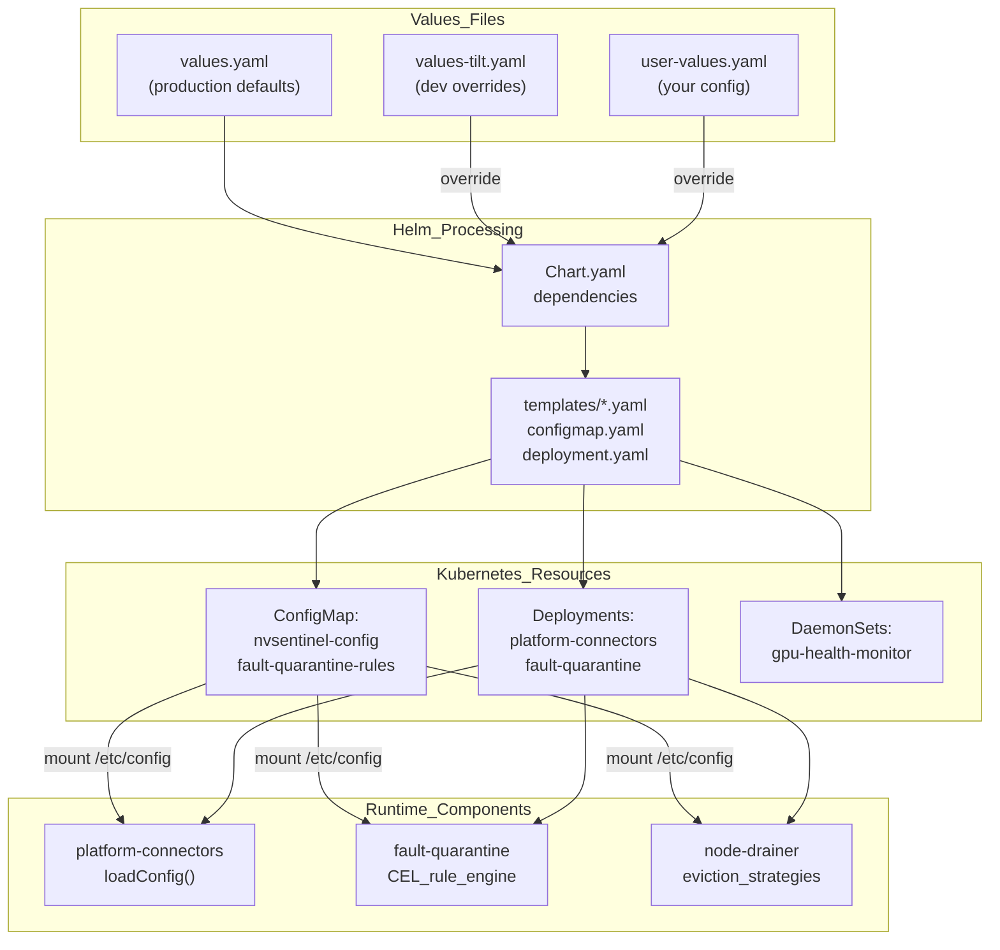
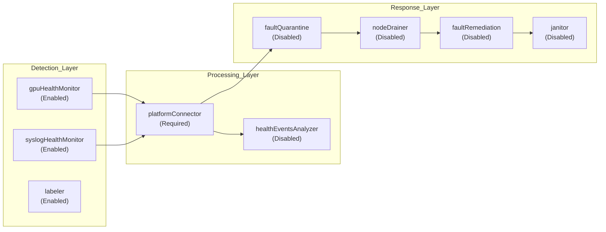
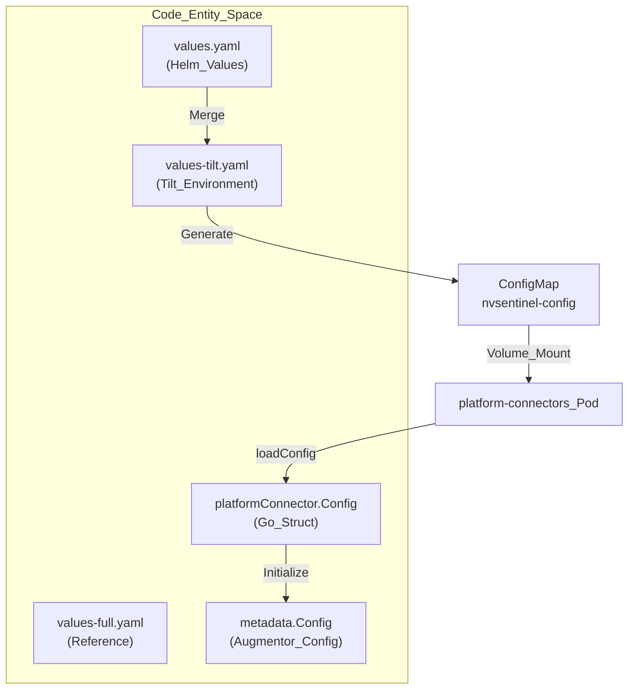

<!-- source: DeepWiki mcp.deepwiki.com · repo NVIDIA/NVSentinel · page 11.2 Configuration Guide · fetched 2026-10-26 -->

# Configuration Guide

<details>
<summary>Relevant source files</summary>

The following files were used as context for generating this wiki page:

- [distros/kubernetes/nvsentinel/charts/gpu-health-monitor/files/dcgmerrorsmapping.csv](distros/kubernetes/nvsentinel/charts/gpu-health-monitor/files/dcgmerrorsmapping.csv)
- [distros/kubernetes/nvsentinel/charts/preflight/templates/deployment.yaml](distros/kubernetes/nvsentinel/charts/preflight/templates/deployment.yaml)
- [distros/kubernetes/nvsentinel/values-full.yaml](distros/kubernetes/nvsentinel/values-full.yaml)
- [distros/kubernetes/nvsentinel/values-tilt.yaml](distros/kubernetes/nvsentinel/values-tilt.yaml)
- [distros/kubernetes/nvsentinel/values.yaml](distros/kubernetes/nvsentinel/values.yaml)
- [docs/INTEGRATIONS.md](docs/INTEGRATIONS.md)
- [docs/configuration/event-exporter.md](docs/configuration/event-exporter.md)
- [docs/configuration/fault-quarantine.md](docs/configuration/fault-quarantine.md)
- [docs/configuration/fault-remediation.md](docs/configuration/fault-remediation.md)
- [docs/configuration/gpu-health-monitor.md](docs/configuration/gpu-health-monitor.md)
- [docs/configuration/kubernetes-object-monitor.md](docs/configuration/kubernetes-object-monitor.md)
- [docs/configuration/labeler.md](docs/configuration/labeler.md)
- [docs/configuration/mongodb-store.md](docs/configuration/mongodb-store.md)
- [docs/configuration/node-drainer.md](docs/configuration/node-drainer.md)
- [docs/configuration/platform-connectors.md](docs/configuration/platform-connectors.md)
- [docs/configuration/syslog-health-monitor.md](docs/configuration/syslog-health-monitor.md)
- [docs/platform-connectors.md](docs/platform-connectors.md)
- [platform-connectors/pkg/transformers/metadata/transformer_test.go](platform-connectors/pkg/transformers/metadata/transformer_test.go)
- [tests/helpers/preflight.go](tests/helpers/preflight.go)
- [tilt/Tiltfile](tilt/Tiltfile)
- [tilt/helpers.star](tilt/helpers.star)

</details>


This guide explains how to configure NVSentinel for your environment through Helm chart values. It covers the essential configuration decisions operators need to make, the configuration hierarchy, and how values flow from `values.yaml` to runtime components. For chart structure details, see [11.1 Helm Chart Overview](). For deployment procedures, see [11.3 Production Deployment]().

## Overview

NVSentinel's configuration system uses Helm's values mechanism to control:
- **Module enablement**: Which components are deployed (monitoring-only vs full automation) [distros/kubernetes/nvsentinel/values.yaml:144-181]()
- **Global settings**: Image tags, dry-run mode, datastore selection, and scheduling constraints [distros/kubernetes/nvsentinel/values.yaml:15-141]()
- **Per-module configuration**: Rules, strategies, timeouts, and resource limits [docs/configuration/platform-connectors.md:9-31]()
- **Infrastructure**: Datastore backend (MongoDB/PostgreSQL), TLS certificates, and authentication [distros/kubernetes/nvsentinel/values.yaml:25-98]()

Configuration follows a layered approach where more specific values override more general ones:
1. `values.yaml` - Production defaults (most action-taking modules disabled) [distros/kubernetes/nvsentinel/values.yaml:1-182]()
2. `values-full.yaml` - Complete documentation reference [distros/kubernetes/nvsentinel/values-full.yaml:1-175]()
3. `values-tilt.yaml` - Development overrides (all modules enabled) [distros/kubernetes/nvsentinel/values-tilt.yaml:1-102]()
4. User-provided values - Environment-specific overrides [tilt/Tiltfile:167-173]()

Sources: [distros/kubernetes/nvsentinel/values.yaml:1-242](), [distros/kubernetes/nvsentinel/values-tilt.yaml:1-102](), [distros/kubernetes/nvsentinel/values-full.yaml:1-175](), [tilt/Tiltfile:167-173]()

## Configuration Flow

This diagram shows how configuration flows from Helm values through Kubernetes resources to runtime consumption:

Title: Configuration Data Flow


Sources: [distros/kubernetes/nvsentinel/values.yaml:1-182](), [docs/INTEGRATIONS.md:67-101](), [docs/configuration/platform-connectors.md:5-32]()

## Global Configuration

The `global` section in `values.yaml` controls system-wide behavior for all NVSentinel components. [distros/kubernetes/nvsentinel/values.yaml:15-141]()

### Key Global Settings

| Key | Type | Default | Purpose |
|-----|------|---------|---------|
| `global.dryRun` | boolean | `false` | Safety mode: logs actions without executing (cordons, drains, reboots) [distros/kubernetes/nvsentinel/values.yaml:16-16]() |
| `global.image.tag` | string | `"main"` | Container image tag for all components [distros/kubernetes/nvsentinel/values.yaml:18-18]() |
| `global.metricsPort` | integer | `2112` | Prometheus metrics scrape port [distros/kubernetes/nvsentinel/values.yaml:23-23]() |

### Pod Scheduling

Operators can control where NVSentinel pods are scheduled to separate monitoring agents from control-plane logic. [distros/kubernetes/nvsentinel/values-full.yaml:82-130]()

| Key | Type | Default | Purpose |
|-----|------|---------|---------|
| `global.nodeSelector` | map | `{}` | Constrain pods to specific nodes [distros/kubernetes/nvsentinel/values.yaml:135-135]() |
| `global.tolerations` | list | `Exists` | Allow pods to run on tainted nodes [distros/kubernetes/nvsentinel/values.yaml:136-138]() |
| `global.systemNodeSelector` | map | `{}` | Placement for control plane modules [distros/kubernetes/nvsentinel/values.yaml:139-139]() |
| `global.systemNodeTolerations` | list | `[]` | Tolerations for control plane modules [distros/kubernetes/nvsentinel/values.yaml:140-140]() |

Sources: [distros/kubernetes/nvsentinel/values.yaml:15-141](), [distros/kubernetes/nvsentinel/values-full.yaml:40-130]()

## Module Enable Flags

NVSentinel uses a modular architecture where every major component can be toggled via boolean flags in `values.yaml`. [distros/kubernetes/nvsentinel/values.yaml:144-181]()

### Default Module States

Title: Module Dependency and Enablement


### Flag Reference

| Module Flag | Default | Code Entity |
|-------------|---------|-------------|
| `gpuHealthMonitor.enabled` | `true` | `gpu-health-monitor` [distros/kubernetes/nvsentinel/values.yaml:144]() |
| `syslogHealthMonitor.enabled` | `true` | `syslog-health-monitor` [distros/kubernetes/nvsentinel/values.yaml:160]() |
| `faultQuarantine.enabled` | `false` | `fault-quarantine` [distros/kubernetes/nvsentinel/values.yaml:148]() |
| `nodeDrainer.enabled` | `false` | `node-drainer` [distros/kubernetes/nvsentinel/values.yaml:150]() |
| `faultRemediation.enabled` | `false` | `fault-remediation` [distros/kubernetes/nvsentinel/values.yaml:152]() |
| `janitor.enabled` | `false` | `janitor` [distros/kubernetes/nvsentinel/values.yaml:154]() |

Sources: [distros/kubernetes/nvsentinel/values.yaml:144-181](), [distros/kubernetes/nvsentinel/values-full.yaml:131-175]()

## Datastore Configuration

NVSentinel requires a datastore (MongoDB or PostgreSQL) to persist health events. Configuration is centralized under `global.datastore`. [distros/kubernetes/nvsentinel/values.yaml:25-98]()

### Connection and Authentication

Operators can configure internal (in-cluster) or external databases.

```yaml
global:
  datastore:
    provider: "mongodb" # or "postgresql"
    connection:
      host: "mongodb-service"
      port: 27017
      database: "HealthEventsDatabase"
    auth:
      mechanism: "scram" # or "x509"
      existingSecret: "db-creds"
```

For MongoDB, the system supports `certificateRotationEnabled` which uses `controller-runtime`'s `certwatcher` to update connection pools without restarting pods. [distros/kubernetes/nvsentinel/values.yaml:99-103]()

Sources: [distros/kubernetes/nvsentinel/values.yaml:25-103](), [distros/kubernetes/nvsentinel/values-tilt.yaml:126-238]()

## Component-Specific Hierarchy

### Platform Connectors
The `platformConnector` section configures the gRPC ingestion pipeline and Kubernetes integration. [docs/configuration/platform-connectors.md:1-212]()

- **Transformer Pipeline**: Sequentially processes events using components like `MetadataAugmentor` and `OverrideTransformer`. [docs/configuration/platform-connectors.md:33-56]()
- **K8s Connector**: Controls `qps` and `burst` for node condition updates. [docs/configuration/platform-connectors.md:175-212]()

### Syslog Health Monitor
Watches journald logs for GPU errors. [docs/configuration/syslog-health-monitor.md:1-41]()

- **XID Analyzer Sidecar**: Optional container for enhanced error analysis. [docs/configuration/syslog-health-monitor.md:66-80]()
- **Kata Support**: Automatically deploys specific DaemonSets for Kata nodes based on labels. [docs/configuration/syslog-health-monitor.md:213-225]()

### Fault Remediation
Configures Go templates for creating maintenance Custom Resources (CRs). [docs/configuration/fault-remediation.md:1-220]()

- **Equivalence Groups**: Deduplication logic to prevent redundant reboots (e.g., `reset` vs `restart`). [docs/configuration/fault-remediation.md:99-107]()
- **Go Templates**: Dynamic CR generation using variables like `.NodeName` and `.HealthEventID`. [docs/configuration/fault-remediation.md:111-127]()

### Event Exporter
Exports events via CloudEvents over HTTP. [docs/configuration/event-exporter.md:1-285]()

- **Backfill**: Controls export of historical events from the datastore upon startup. [docs/configuration/event-exporter.md:144-157]()
- **OIDC**: Supports OAuth 2.0 Client Credentials flow for secure sink communication. [docs/configuration/event-exporter.md:107-134]()

Sources: [docs/configuration/platform-connectors.md:1-212](), [docs/configuration/syslog-health-monitor.md:1-225](), [docs/configuration/fault-remediation.md:1-220](), [docs/configuration/event-exporter.md:1-285]()

## Configuration Hierarchy Implementation

Title: Configuration Hierarchy Implementation


Sources: [distros/kubernetes/nvsentinel/values.yaml:1-182](), [distros/kubernetes/nvsentinel/values-tilt.yaml:146-178](), [platform-connectors/pkg/transformers/metadata/transformer_test.go:76-94]()

---

