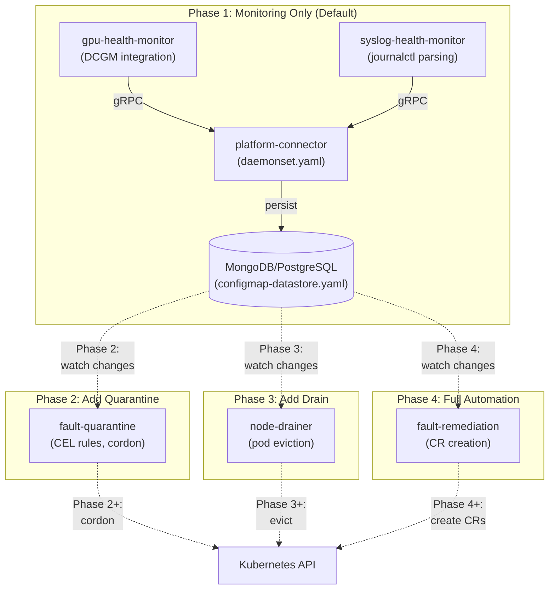
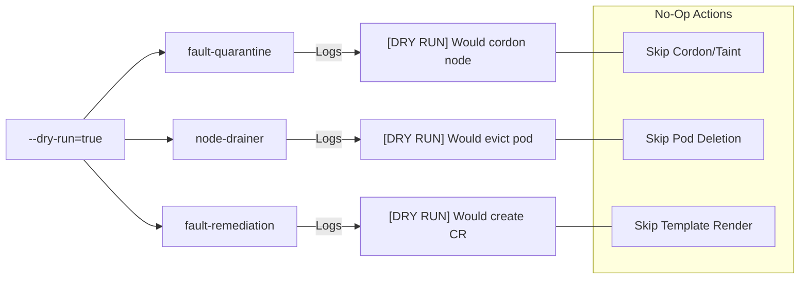

<!-- source: DeepWiki mcp.deepwiki.com · repo NVIDIA/NVSentinel · page 11.3 Production Deployment · fetched 2026-10-26 -->

# Production Deployment

<details>
<summary>Relevant source files</summary>

The following files were used as context for generating this wiki page:

- [distros/kubernetes/nvsentinel/charts/csp-health-monitor/templates/deployment.yaml](distros/kubernetes/nvsentinel/charts/csp-health-monitor/templates/deployment.yaml)
- [distros/kubernetes/nvsentinel/charts/event-exporter/templates/deployment.yaml](distros/kubernetes/nvsentinel/charts/event-exporter/templates/deployment.yaml)
- [distros/kubernetes/nvsentinel/charts/fault-quarantine/templates/deployment.yaml](distros/kubernetes/nvsentinel/charts/fault-quarantine/templates/deployment.yaml)
- [distros/kubernetes/nvsentinel/charts/fault-remediation/templates/deployment.yaml](distros/kubernetes/nvsentinel/charts/fault-remediation/templates/deployment.yaml)
- [distros/kubernetes/nvsentinel/charts/health-events-analyzer/templates/deployment.yaml](distros/kubernetes/nvsentinel/charts/health-events-analyzer/templates/deployment.yaml)
- [distros/kubernetes/nvsentinel/charts/node-drainer/templates/deployment.yaml](distros/kubernetes/nvsentinel/charts/node-drainer/templates/deployment.yaml)
- [distros/kubernetes/nvsentinel/templates/_helpers.tpl](distros/kubernetes/nvsentinel/templates/_helpers.tpl)
- [distros/kubernetes/nvsentinel/templates/configmap-datastore.yaml](distros/kubernetes/nvsentinel/templates/configmap-datastore.yaml)
- [distros/kubernetes/nvsentinel/templates/daemonset.yaml](distros/kubernetes/nvsentinel/templates/daemonset.yaml)
- [distros/kubernetes/nvsentinel/templates/job-external-mongodb-setup.yaml](distros/kubernetes/nvsentinel/templates/job-external-mongodb-setup.yaml)
- [distros/kubernetes/nvsentinel/values-atlas-gcp.yaml](distros/kubernetes/nvsentinel/values-atlas-gcp.yaml)
- [scripts/validate-nvsentinel.sh](scripts/validate-nvsentinel.sh)
- [tests/uat/kind/README.md](tests/uat/kind/README.md)
- [tests/uat/kind/cert-manager-values.yaml](tests/uat/kind/cert-manager-values.yaml)
- [tests/uat/kind/kwok-node-template.yaml](tests/uat/kind/kwok-node-template.yaml)
- [tests/uat/kind/nvidia-dcgm-daemonset.yaml](tests/uat/kind/nvidia-dcgm-daemonset.yaml)
- [tests/uat/kind/nvidia-driver-daemonset.yaml](tests/uat/kind/nvidia-driver-daemonset.yaml)
- [tests/uat/kind/prometheus-operator-values.yaml](tests/uat/kind/prometheus-operator-values.yaml)
- [tilt/dcgm-fake/gpu-spec.yaml](tilt/dcgm-fake/gpu-spec.yaml)
- [tilt/nvidia-dcgm-daemonset.yaml](tilt/nvidia-dcgm-daemonset.yaml)
- [tilt/nvidia-driver-daemonset.yaml](tilt/nvidia-driver-daemonset.yaml)

</details>


## Purpose and Scope

This page provides a production-ready deployment strategy for NVSentinel, focusing on safe rollout practices, progressive feature enablement, and operational safety mechanisms. It covers the deployment workflow, configuration strategy, and production checklist.

For detailed configuration options, see [Configuration Guide](11.2). For cloud-specific setup, see [Multi-Cloud Deployment](11.4). For post-deployment validation, see [Deployment Validation](11.5).

---

## Prerequisites

Before deploying NVSentinel to production, ensure the following components are installed and operational:

| Requirement | Version | Purpose | Validation Command |
|-------------|---------|---------|-------------------|
| Kubernetes | 1.25+ | Cluster platform | `kubectl version --short` |
| Helm | 3.0+ | Package manager | `helm version --short` |
| cert-manager | v1.19.0+ | TLS certificate management | `kubectl get pods -n cert-manager` |
| NVIDIA GPU Operator | Latest | DCGM hostengine for GPU monitoring | `kubectl get pods -n gpu-operator` |
| Persistent Storage | - | MongoDB/PostgreSQL data | `kubectl get storageclass` |
| Prometheus Operator | v0.68.0+ (optional) | Metrics collection via PodMonitor | `kubectl get crd podmonitors.monitoring.coreos.com` |

**Storage Requirements:**
- **MongoDB**: 10GB minimum per replica, 3 replicas recommended for change streams [distros/kubernetes/nvsentinel/templates/configmap-datastore.yaml:18-21]().
- **PostgreSQL**: 20GB minimum for production workloads [distros/kubernetes/nvsentinel/templates/configmap-datastore.yaml:47-51]().

**Network Requirements:**
- Pod-to-pod communication (gRPC, MongoDB change streams).
- Access to DCGM hostengine service.
- Outbound cloud provider API access (if using CSP health monitor or Janitor).

Sources: [distros/kubernetes/nvsentinel/templates/configmap-datastore.yaml:16-112](), [distros/kubernetes/nvsentinel/templates/daemonset.yaml:94-114]()

---

## Production Deployment Strategy

NVSentinel follows a **monitoring-first, automation-later** approach to minimize risk. The system allows operators to:

1. Validate detection accuracy before enabling automation.
2. Build confidence in the system's behavior using `dry-run` mode.
3. Gradually enable features as trust is established.

### Progressive Enablement Workflow

The following diagram maps high-level phases to specific code entities and deployment flags.

**Progressive Enablement Flow**


**Progressive Enablement Stages:**
1. **Phase 1 (Default)**: Monitoring only - safe, read-only observation. Involves `platform-connector` and monitors [distros/kubernetes/nvsentinel/templates/daemonset.yaml:82-115]().
2. **Phase 2**: Add quarantine - prevents new workloads on faulty nodes [distros/kubernetes/nvsentinel/charts/fault-quarantine/templates/deployment.yaml:81-93]().
3. **Phase 3**: Add drain - evacuates existing workloads [distros/kubernetes/nvsentinel/charts/node-drainer/templates/deployment.yaml:81-113]().
4. **Phase 4**: Full automation - triggers repairs via `fault-remediation` [distros/kubernetes/nvsentinel/charts/fault-remediation/templates/deployment.yaml:81-94]().

Sources: [distros/kubernetes/nvsentinel/templates/daemonset.yaml:82-115](), [distros/kubernetes/nvsentinel/charts/fault-quarantine/templates/deployment.yaml:81-93](), [distros/kubernetes/nvsentinel/charts/node-drainer/templates/deployment.yaml:81-113](), [distros/kubernetes/nvsentinel/charts/fault-remediation/templates/deployment.yaml:81-94]()

---

## Dry-Run Mode

Dry-run mode allows testing the entire pipeline without executing actual changes. All components log actions they **would** take, but Kubernetes API modifications (like cordoning or evicting) are skipped.

### Configuration

The `--dry-run` flag is passed to the major automation components via Helm values.

- **Fault Quarantine**: Controlled by `--dry-run` argument [distros/kubernetes/nvsentinel/charts/fault-quarantine/templates/deployment.yaml:93]().
- **Node Drainer**: Controlled by `--dry-run` argument [distros/kubernetes/nvsentinel/charts/node-drainer/templates/deployment.yaml:113]().
- **Fault Remediation**: Controlled by `--dry-run` argument [distros/kubernetes/nvsentinel/charts/fault-remediation/templates/deployment.yaml:92]().

### Component Behavior Mapping

**Dry-Run Implementation Logic**


Sources: [distros/kubernetes/nvsentinel/charts/fault-quarantine/templates/deployment.yaml:93](), [distros/kubernetes/nvsentinel/charts/node-drainer/templates/deployment.yaml:113](), [distros/kubernetes/nvsentinel/charts/fault-remediation/templates/deployment.yaml:92]()

---

## Production Deployment Checklist

### Checklist Table

| Category | Item | Validation | Reference |
|----------|------|------------|-----------|
| **Prerequisites** | Kubernetes 1.25+ | `kubectl version` | [scripts/validate-nvsentinel.sh:79-80]() |
| | Datastore | MongoDB or PostgreSQL | [scripts/validate-nvsentinel.sh:62-76]() |
| **Security** | TLS Enabled | Check `MONGODB_TLS_ENABLED` | [distros/kubernetes/nvsentinel/templates/configmap-datastore.yaml:125-128]() |
| | Cert Rotation | `MONGODB_ENABLE_CERT_ROTATION` | [distros/kubernetes/nvsentinel/templates/configmap-datastore.yaml:117]() |
| | Permissions | `fix-cert-permissions` init container | [distros/kubernetes/nvsentinel/templates/daemonset.yaml:55-79]() |
| **Safety** | Dry-run active | Check pod args for `--dry-run=true` | [distros/kubernetes/nvsentinel/charts/fault-remediation/templates/deployment.yaml:92]() |
| **Observability** | Metrics | Port 2112 available | [distros/kubernetes/nvsentinel/templates/daemonset.yaml:93]() |
| | Audit Logs | `AUDIT_ENABLED: "true"` | [distros/kubernetes/nvsentinel/templates/_helpers.tpl:93-94]() |

Sources: [distros/kubernetes/nvsentinel/templates/configmap-datastore.yaml:114-130](), [distros/kubernetes/nvsentinel/templates/daemonset.yaml:55-115](), [scripts/validate-nvsentinel.sh:62-80]()

---

## External Datastore Setup

When deploying to production with an external MongoDB (e.g., MongoDB Atlas), a specialized setup job is used to initialize collections and indexes.

### External MongoDB Job
The `external-mongodb-setup` job handles [distros/kubernetes/nvsentinel/templates/job-external-mongodb-setup.yaml:16-27]():
- **Collection Creation**: Initializes `HealthEvents`, `Tokens`, and `MaintenanceEvents` [distros/kubernetes/nvsentinel/templates/job-external-mongodb-setup.yaml:149-158]().
- **TTL Indexes**: Sets expiry for event data [distros/kubernetes/nvsentinel/templates/job-external-mongodb-setup.yaml:161-168]().
- **Authentication**: Supports SCRAM-SHA-256 and X.509 [distros/kubernetes/nvsentinel/templates/job-external-mongodb-setup.yaml:119-138]().

### Example Atlas Override
For GCP Atlas deployments, specific overrides are used to disable in-cluster storage and point to the Atlas URI [distros/kubernetes/nvsentinel/values-atlas-gcp.yaml:27-48]().

Sources: [distros/kubernetes/nvsentinel/templates/job-external-mongodb-setup.yaml:1-170](), [distros/kubernetes/nvsentinel/values-atlas-gcp.yaml:1-73]()

---

## Security Considerations

### Certificate Management
NVSentinel components require correct file permissions for TLS certificates, especially when running as non-root users (UID 1001). The `fix-cert-permissions` init container ensures that secrets mounted from Kubernetes are accessible [distros/kubernetes/nvsentinel/charts/fault-remediation/templates/deployment.yaml:53-71]().

### Audit Logging
Production environments should enable audit logging to track all health event modifications and remediation actions.
- **Environment Variables**: `AUDIT_ENABLED`, `AUDIT_LOG_MAX_SIZE_MB`, etc. [distros/kubernetes/nvsentinel/templates/_helpers.tpl:92-105]().
- **Storage**: Uses a `hostPath` volume at `/var/log/nvsentinel` [distros/kubernetes/nvsentinel/templates/_helpers.tpl:82-87]().

Sources: [distros/kubernetes/nvsentinel/charts/fault-remediation/templates/deployment.yaml:53-71](), [distros/kubernetes/nvsentinel/templates/_helpers.tpl:82-105]()

---

## Deployment Validation

After deployment, use the `validate-nvsentinel.sh` script to ensure all components are running with the correct versions and configurations.

```bash
# Run validation script
./scripts/validate-nvsentinel.sh --version v0.9.0 --namespace nvsentinel
```

The script performs the following checks [scripts/validate-nvsentinel.sh:83-170]():
1. **Namespace existence**.
2. **Datastore connectivity** (Auto-detects MongoDB or PostgreSQL).
3. **Node counts** (GPU nodes vs. total nodes).
4. **Image versions** (Ensures all containers match the target version).
5. **Image Pull Secrets** (Verifies registry access).

Sources: [scripts/validate-nvsentinel.sh:1-170]()

---

