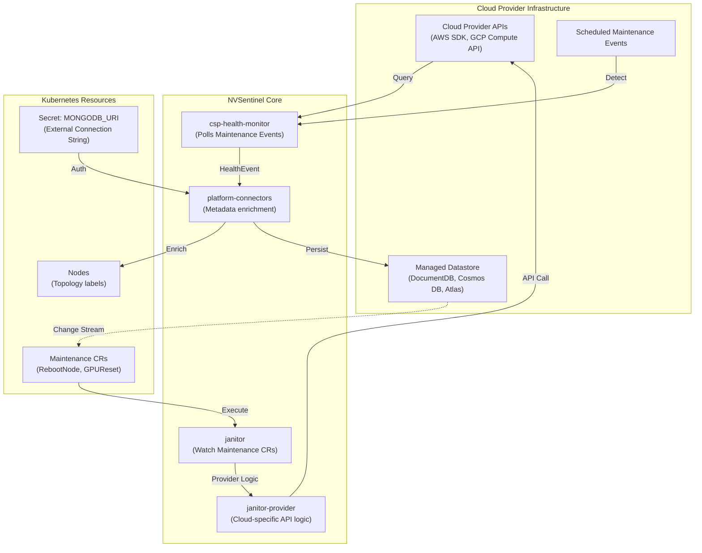
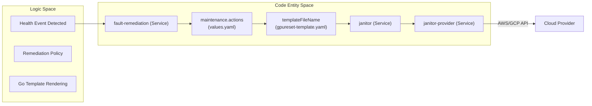

<!-- source: DeepWiki mcp.deepwiki.com · repo NVIDIA/NVSentinel · page 11.4 Multi-Cloud Deployment · fetched 2026-10-26 -->

# Multi-Cloud Deployment

<details>
<summary>Relevant source files</summary>

The following files were used as context for generating this wiki page:

- [SECURITY.md](SECURITY.md)
- [commons/go.mod](commons/go.mod)
- [health-monitors/csp-health-monitor/go.mod](health-monitors/csp-health-monitor/go.mod)
- [health-monitors/csp-health-monitor/go.sum](health-monitors/csp-health-monitor/go.sum)
- [janitor/go.mod](janitor/go.mod)
- [janitor/go.sum](janitor/go.sum)
- [store-client/go.sum](store-client/go.sum)
- [tests/uat/README.md](tests/uat/README.md)
- [tests/uat/aws/account/README.md](tests/uat/aws/account/README.md)
- [tests/uat/aws/account/federation.tf](tests/uat/aws/account/federation.tf)
- [tests/uat/aws/account/main.tf](tests/uat/aws/account/main.tf)
- [tests/uat/aws/account/outputs.tf](tests/uat/aws/account/outputs.tf)
- [tests/uat/aws/account/providers.tf](tests/uat/aws/account/providers.tf)
- [tests/uat/aws/account/variables.tf](tests/uat/aws/account/variables.tf)
- [tests/uat/aws/create-eks-cluster.sh](tests/uat/aws/create-eks-cluster.sh)
- [tests/uat/aws/delete-eks-cluster.sh](tests/uat/aws/delete-eks-cluster.sh)
- [tests/uat/aws/eks-cluster-config.yaml.template](tests/uat/aws/eks-cluster-config.yaml.template)
- [tests/uat/aws/nvsentinel-values.yaml](tests/uat/aws/nvsentinel-values.yaml)
- [tests/uat/gcp/nvsentinel-values.yaml](tests/uat/gcp/nvsentinel-values.yaml)
- [tests/uat/install-apps.sh](tests/uat/install-apps.sh)
- [tests/uat/kind/nvsentinel-values.yaml](tests/uat/kind/nvsentinel-values.yaml)
- [tests/uat/run.sh](tests/uat/run.sh)

</details>


This document covers NVSentinel deployment across multiple cloud providers (AWS, GCP, Azure, and OCI), including cloud-specific configurations, credential management, external datastore integration, and Janitor setup.

For general Helm chart configuration, see [Configuration Guide](#11.2). For production deployment best practices, see [Production Deployment](#11.3).

---

## Overview

NVSentinel supports multi-cloud deployments with cloud provider-specific integrations for automated maintenance operations and proactive health monitoring. The system interacts with cloud provider APIs through two primary components:

*   **Janitor** — Executes maintenance operations (node reboots, terminations, instance replacement) via cloud provider APIs based on Custom Resources created by Fault Remediation. Configured via `global.janitor.enabled` and `global.janitorProvider.enabled` in [tests/uat/aws/nvsentinel-values.yaml:32-35]().
*   **CSP Health Monitor** — Polls cloud provider APIs to detect scheduled maintenance events, capacity constraints, and infrastructure health signals. It utilizes cloud-specific SDKs including AWS Health SDK and Google Compute API [health-monitors/csp-health-monitor/go.mod:8-13](). Configured via `global.cspHealthMonitor.enabled` in [tests/uat/aws/nvsentinel-values.yaml:28-29]().

NVSentinel also supports **External Datastores**, allowing clusters focused on GPU workloads to connect to managed services instead of running an in-cluster MongoDB replicaset.

---

## Multi-Cloud Architecture

The following diagram illustrates how NVSentinel integrates with cloud provider infrastructure and external managed services:



**Sources:** [health-monitors/csp-health-monitor/go.mod:8-13](), [tests/uat/aws/nvsentinel-values.yaml:61-88](), [janitor/go.mod:10-27]()

---

## External Datastore Configuration

NVSentinel components utilize a `store-client` to abstract database interactions, supporting both MongoDB and PostgreSQL providers.

### Supported Managed Services

| Cloud Provider | MongoDB-compatible | PostgreSQL-compatible |
| :--- | :--- | :--- |
| **AWS** | Amazon DocumentDB | Amazon RDS / Aurora |
| **Azure** | Azure Cosmos DB for MongoDB | Azure Database for PostgreSQL |
| **GCP** | MongoDB Atlas on GCP | Cloud SQL for PostgreSQL |
| **OCI** | MongoDB on OCI | Oracle Autonomous Database |

**Sources:** [health-monitors/csp-health-monitor/go.mod:107-109](), [commons/go.mod:9-10]()

### Implementation via Helm
To use an external datastore, `global.mongodbStore.enabled` must be set to `false`, and a connection string must be provided. In AWS environments, this often involves `gp2` or `gp3` storage classes [tests/uat/aws/nvsentinel-values.yaml:139-142]().

```yaml
# Example for AWS DocumentDB
global:
  mongodbStore:
    enabled: false
  janitor:
    enabled: true
janitor-provider:
  csp:
    provider: aws
    aws:
      region: us-east-1
```

**Sources:** [tests/uat/aws/nvsentinel-values.yaml:36-37](), [tests/uat/aws/nvsentinel-values.yaml:131-135]()

---

## Cloud Provider Configuration

### AWS (EKS)
AWS integration requires specific region and account configuration. The `janitor-provider` handles the interaction with EC2 APIs [tests/uat/aws/nvsentinel-values.yaml:131-137]().

#### AWS Specific Values
```yaml
janitor-provider:
  csp:
    provider: aws
    aws:
      region: us-east-1
      accountId: ""
      iamRoleName: ""
```
**Sources:** [tests/uat/aws/nvsentinel-values.yaml:131-137]()

### GCP (GKE)
GCP integration is configured by setting the provider to `gcp`. In UAT environments, specific resource quotas and NVIDIA driver installers are applied [tests/uat/install-apps.sh:49-57]().

#### GCP Specific Values
```yaml
janitor-provider:
  csp:
    provider: gcp
```
**Sources:** [tests/uat/gcp/nvsentinel-values.yaml:137-139]()

---

## Janitor and Maintenance Execution

The Janitor component is responsible for executing remediation actions. It uses `controller-runtime` to watch for maintenance-related Custom Resources [janitor/go.mod:27]().

### Remediation Action Mapping
Remediation actions are defined in the `fault-remediation` configuration, mapping health event types to specific Janitor CRs using Go templates [tests/uat/aws/nvsentinel-values.yaml:63-88]().

| Action Name | CR Kind | Equivalence Group | Scope |
| :--- | :--- | :--- | :--- |
| `COMPONENT_RESET` | `GPUReset` | `reset` | `GPU_UUID` |
| `RESTART_VM` | `RebootNode` | `restart` | `Cluster` |
| `RESTART_BM` | `RebootNode` | `restart` | `Cluster` |

**Sources:** [tests/uat/aws/nvsentinel-values.yaml:63-88]()

### Code Entity Mapping: Janitor Workflow



**Sources:** [tests/uat/aws/nvsentinel-values.yaml:61-112](), [tests/uat/aws/nvsentinel-values.yaml:131-137](), [janitor/go.mod:1-10]()

---

## Deployment Validation

Multi-cloud deployments are validated using User Acceptance Testing (UAT) scripts that provision infrastructure, install dependencies (Prometheus, Cert-Manager, GPU Operator), and verify component health [tests/uat/install-apps.sh:88-132]().

### Infrastructure Cleanup
For AWS, cleanup involves deleting OIDC providers and CloudFormation stacks in a specific order to avoid orphaned resources. The script extracts cluster names from stack patterns like `eksctl-{CLUSTER_NAME}-cluster` [tests/uat/aws/delete-eks-cluster.sh:89-113]().

| Step | Action | Logic Reference |
| :--- | :--- | :--- |
| 1 | Delete OIDC Provider | `delete_oidc_provider` |
| 2 | Delete Stacks | `delete_cluster_stacks` |
| 3 | Orphan Search | `delete_orphaned_oidc_providers` |

**Sources:** [tests/uat/aws/delete-eks-cluster.sh:67-77](), [tests/uat/aws/delete-eks-cluster.sh:117-132](), [tests/uat/aws/delete-eks-cluster.sh:166-175]()

---

