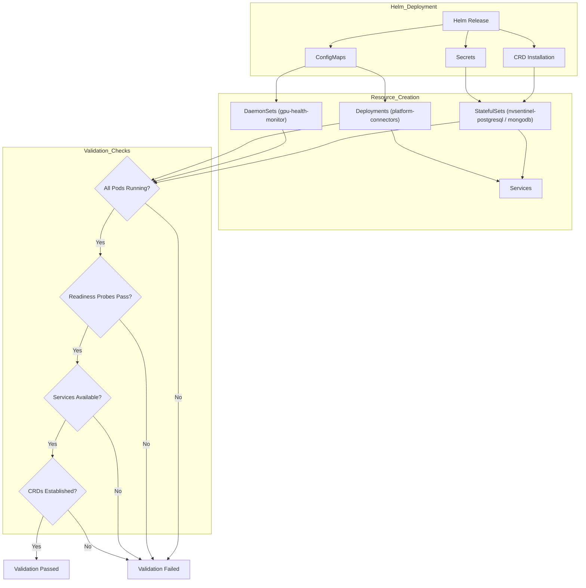
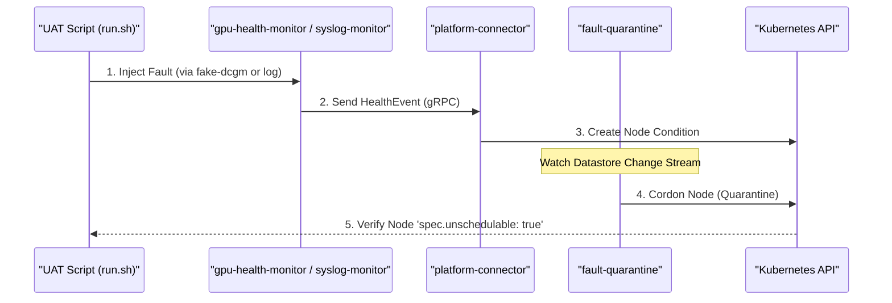

<!-- source: DeepWiki mcp.deepwiki.com · repo NVIDIA/NVSentinel · page 11.5 Deployment Validation · fetched 2026-10-26 -->

# Deployment Validation

<details>
<summary>Relevant source files</summary>

The following files were used as context for generating this wiki page:

- [SECURITY.md](SECURITY.md)
- [scripts/validate-nvsentinel.sh](scripts/validate-nvsentinel.sh)
- [tests/uat/README.md](tests/uat/README.md)
- [tests/uat/aws/eks-cluster-config.yaml.template](tests/uat/aws/eks-cluster-config.yaml.template)
- [tests/uat/aws/nvsentinel-values.yaml](tests/uat/aws/nvsentinel-values.yaml)
- [tests/uat/gcp/nvsentinel-values.yaml](tests/uat/gcp/nvsentinel-values.yaml)
- [tests/uat/install-apps.sh](tests/uat/install-apps.sh)
- [tests/uat/kind/README.md](tests/uat/kind/README.md)
- [tests/uat/kind/cert-manager-values.yaml](tests/uat/kind/cert-manager-values.yaml)
- [tests/uat/kind/kwok-node-template.yaml](tests/uat/kind/kwok-node-template.yaml)
- [tests/uat/kind/nvidia-dcgm-daemonset.yaml](tests/uat/kind/nvidia-dcgm-daemonset.yaml)
- [tests/uat/kind/nvidia-driver-daemonset.yaml](tests/uat/kind/nvidia-driver-daemonset.yaml)
- [tests/uat/kind/nvsentinel-values.yaml](tests/uat/kind/nvsentinel-values.yaml)
- [tests/uat/kind/prometheus-operator-values.yaml](tests/uat/kind/prometheus-operator-values.yaml)
- [tests/uat/run.sh](tests/uat/run.sh)
- [tilt/dcgm-fake/gpu-spec.yaml](tilt/dcgm-fake/gpu-spec.yaml)
- [tilt/nvidia-dcgm-daemonset.yaml](tilt/nvidia-dcgm-daemonset.yaml)
- [tilt/nvidia-driver-daemonset.yaml](tilt/nvidia-driver-daemonset.yaml)

</details>


## Purpose and Scope

This page describes post-deployment validation procedures for NVSentinel, including health checks, integration testing, and verification of correct system operation. Validation ensures that all components are running, communicating properly, and ready to detect and respond to GPU faults.

For deployment configuration details, see [Configuration Guide](). For production deployment strategies, see [Production Deployment](). For multi-cloud specific setup, see [Multi-Cloud Deployment]().

---

## Validation Levels

NVSentinel validation occurs at three levels:

| Level | Scope | Duration | When to Run |
|-------|-------|----------|-------------|
| **Basic** | Pod status, Helm release, CRDs | 1-2 minutes | After every deployment/upgrade |
| **Component** | Individual module functionality | 5-10 minutes | After enabling new modules |
| **Integration** | End-to-end event flow (UAT) | 10-15 minutes | After configuration changes |

---

## Basic Deployment Validation

### Automated Validation Script
The primary tool for post-deployment verification is the `validate-nvsentinel.sh` script. It automates checks for namespace existence, datastore connectivity, image versions, and resource readiness.

```bash
# Basic usage
./scripts/validate-nvsentinel.sh --version v0.0.3 --namespace nvsentinel

# Verbose mode to list all images and registries
./scripts/validate-nvsentinel.sh --version v0.0.3 --verbose
```

The script performs the following checks:
1. **Namespace Verification**: Confirms the target namespace exists [scripts/validate-nvsentinel.sh:83-89]().
2. **Datastore Detection**: Automatically detects if `mongodb` or `postgresql` is in use by checking for specific StatefulSets [scripts/validate-nvsentinel.sh:61-76]().
3. **Node Inventory**: Counts total nodes, GPU-labeled nodes (`nvidia.com/gpu.present=true`), and KWOK fake nodes [scripts/validate-nvsentinel.sh:95-105]().
4. **Image Consistency**: Verifies all NVSentinel pods are running the expected version string [scripts/validate-nvsentinel.sh:108-115]().
5. **Registry Audit**: Summarizes image sources (ghcr.io, nvcr.io, registry.k8s.io, etc.) to ensure supply chain compliance and security [scripts/validate-nvsentinel.sh:117-151]().

Sources: [scripts/validate-nvsentinel.sh:17-151]()

### Pod Readiness Check
All pods must reach `Running` state with readiness probes passing. The deployment process uses Helm to manage these resources across different environments (AWS, GCP, Kind).

```bash
# Check all NVSentinel pods
kubectl get pods -n nvsentinel

# Wait for all pods to be ready
kubectl wait --for=condition=ready pod \
  -l app.kubernetes.io/instance=nvsentinel \
  -n nvsentinel \
  --timeout=300s
```

#### Deployment Validation Flow



Sources: [scripts/validate-nvsentinel.sh:61-89](), [tests/uat/install-apps.sh:181-205](), [tests/uat/kind/nvsentinel-values.yaml:15-37]()

---

## Component Validation

### Health Monitor Verification
Health monitors must be verified on nodes where GPUs are present or simulated.

#### GPU Health Monitor
Verify the monitor is correctly identifying GPU nodes and communicating with the driver:
1. **Node Selection**: Ensure the monitor pod is running on nodes labeled with the appropriate GPU labels [tests/uat/kind/nvsentinel-values.yaml:40-42]().
2. **Driver Pod Check**: Verify a corresponding `nvidia-driver-daemonset` pod is running to provide the necessary kernel modules and libraries [tilt/nvidia-driver-daemonset.yaml:15-21]().
3. **DCGM Service**: Confirm the `nvidia-dcgm` service is reachable on port 5555 [tilt/nvidia-dcgm-daemonset.yaml:45-66]().

#### Janitor and Remediation
Remediation actions are validated by checking if the correct Custom Resources (CRs) are created upon fault detection.
- **Action Mapping**: Verify `COMPONENT_RESET` maps to `GPUReset` and `RESTART_VM` maps to `RebootNode` [tests/uat/aws/nvsentinel-values.yaml:63-88]().
- **Template Execution**: Ensure the Go templates for maintenance CRs correctly resolve node names and health event IDs [tests/uat/aws/nvsentinel-values.yaml:90-112]().

Sources: [tests/uat/aws/nvsentinel-values.yaml:63-112](), [tilt/nvidia-dcgm-daemonset.yaml:15-66]()

---

## Integration Validation (UAT)

Integration validation (User Acceptance Testing) ensures that an injected fault triggers the correct sequence of remediation.

### Fault Response Sequence



Sources: [tests/uat/run.sh:91-151](), [tests/uat/aws/nvsentinel-values.yaml:144-148]()

### Validation Procedures

#### Verifying Quarantine (Cordon)
Validation scripts check that nodes are marked as unschedulable after a fatal event. In UAT environments, circuit breakers are often disabled to ensure every injected fault results in a quarantine action [tests/uat/kind/nvsentinel-values.yaml:63-67]().

```bash
# Manual check for node status
kubectl get node <node-name> -o jsonpath='{.spec.unschedulable}'
```

#### Multi-Cloud Provider Verification
For CSP-specific deployments, the `janitor-provider` must be validated against the specific cloud environment (e.g., AWS, GCP):
- **AWS**: Verify IAM roles for `janitor-provider` allow `ec2:RebootInstances` [tests/uat/aws/eks-cluster-config.template:27-53]().
- **GCP**: Verify resource quotas and service account configurations [tests/uat/install-apps.sh:187-195]().

Sources: [tests/uat/aws/eks-cluster-config.template:27-53](), [tests/uat/install-apps.sh:49-57]()

---

## Kind/Test Environment Validation
When validating in a Kind (local) environment, specific "fake" components are used to simulate GPU hardware and system behavior.

| Component | Code Entity / Image | Purpose |
|-----------|---------------------|---------|
| **Fake Nodes** | `kwok` | Simulates large clusters without real hardware [tests/uat/install-apps.sh:134-160]() |
| **Fake GPU Nodes** | `kwok-node-template.yaml` | Simulates nodes with `nvidia.com/gpu` labels [tests/uat/install-apps.sh:162-179]() |
| **Fake DCGM** | `nvsentinel-fake-dcgm:4.2.0` | Simulates DCGM gRPC interface for testing [tilt/nvidia-dcgm-daemonset.yaml:35-37]() |

### Resource Validation (Kind)
In resource-constrained test environments, verify that resource requests are minimized for supporting services:
- **cert-manager**: Requests reduced to 10m CPU / 32Mi Memory with faster readiness probes [tests/uat/kind/cert-manager-values.yaml:26-41]().
- **Infrastructure**: Use of `stage-fast` for KWOK to accelerate node lifecycle transitions [tests/uat/install-apps.sh:151-159]().

Sources: [tests/uat/kind/cert-manager-values.yaml:15-55](), [tests/uat/install-apps.sh:134-179]()

---

